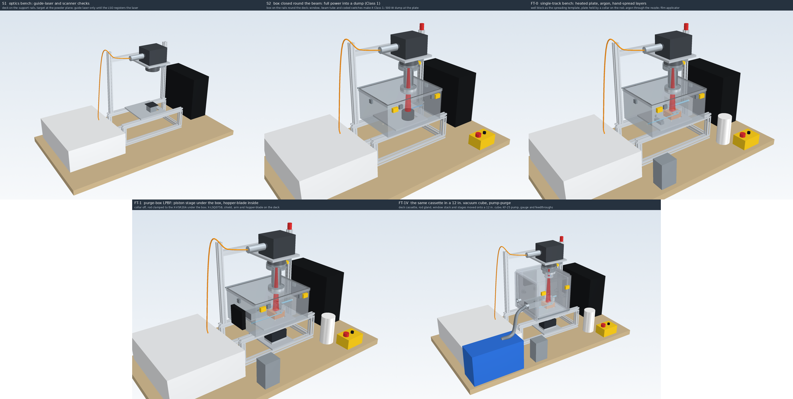
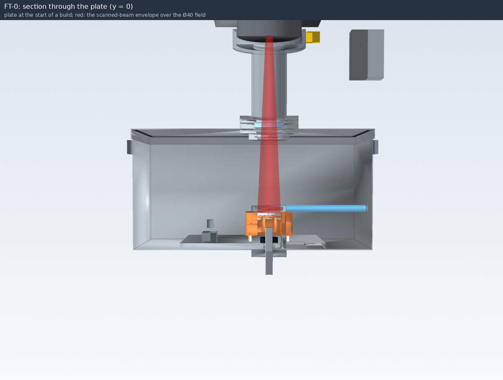
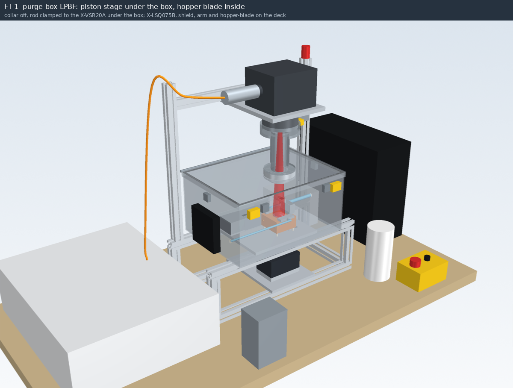
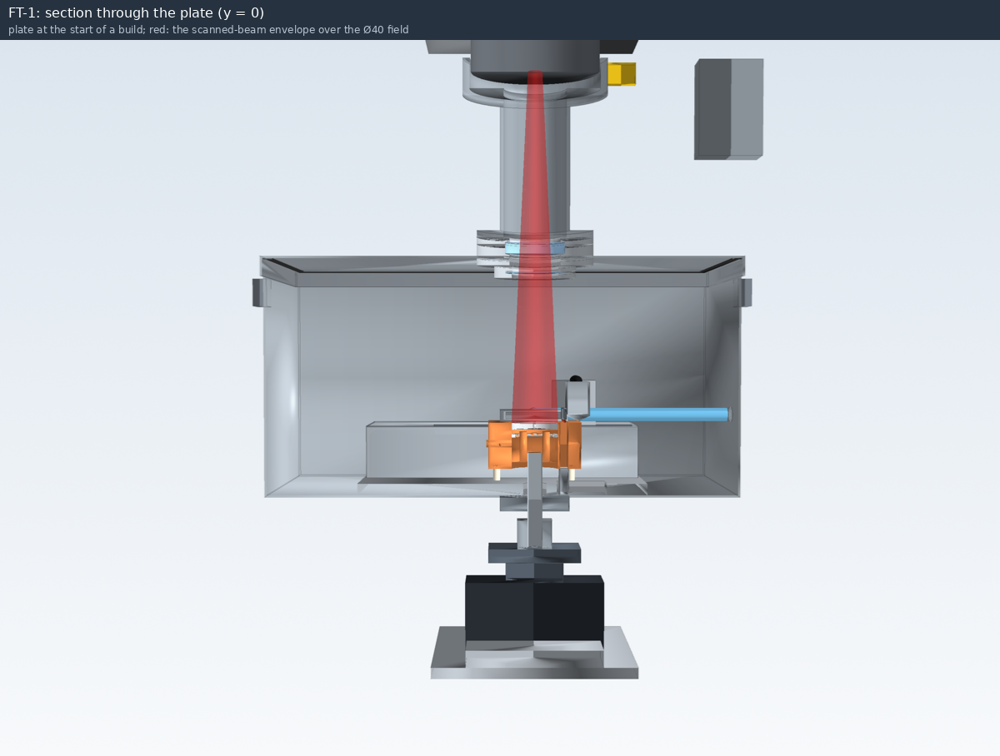
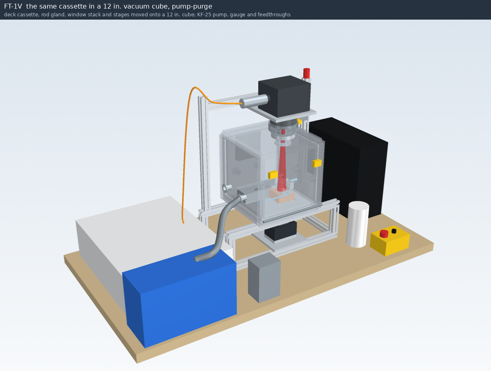

# Fast-track CAD: FT-0, FT-1 and FT-1V as one machine that grows

For [issue #260](https://github.com/vertical-cloud-lab/digital-alloy-lab/issues/260), 2026-11-26. On PR 294 Sterling asked
to "attempt the full FT-0, FT-1, and FT-1V modeling and progression, showing also the progression of how we would move
from one configuration to the next as parts become available". This folder answers that:

- **The model:** one parametric CadQuery model with five states. Each state is built from the one before, in the order
  the parts arrive.
- **The checks:** each state is tested for interference, the beam path, travel, fit and gas volume.
- **The schedule:** when each state can start.
- **The images:** renders of each state and of each step between states.

It extends the study in [`../README.md`](../README.md). Nothing has been bought or built.

| File | What it is |
|---|---|
| [`ft_model.py`](ft_model.py) | the model: parameters with sources, `build(state, pz, hx)`, the made parts (`MADE`), and the diff between states |
| [`ft_checks.py`](ft_checks.py) → [`out/checks.md`](out/checks.md) | interference, beam envelope, recoater and piston sweeps, fit, gas volume, purge and heat by state |
| [`ft_progression.py`](ft_progression.py) → [`out/progression.md`](out/progression.md), [`out/progression.csv`](out/progression.csv) | the schedule of the five states as parts arrive (three ordering scenarios), the spend by state, and what each step adds, moves and removes |
| [`ft_render.py`](ft_render.py) → [`../img/cad-*.png`](../img/), [`../img/cad-progression.gif`](../img/cad-progression.gif) | renders |
| `out/ft-0.step`, `out/ft-1.step`, `out/ft-1v.step` | the three machines as STEP assemblies |

```bash
python desktop-lpbf/fast-track/cad/ft_model.py                      # STEP files
python desktop-lpbf/fast-track/cad/ft_checks.py                     # out/checks.*
python desktop-lpbf/fast-track/cad/ft_progression.py                # out/progression.*, img/progression-gantt.png
xvfb-run -a -s "-screen 0 1920x1080x24" python desktop-lpbf/fast-track/cad/ft_render.py
```

The Python packages are in [`../../analysis/requirements.txt`](../../analysis/requirements.txt): CadQuery 2.8 and PyVista.




## Short answer

- **One machine, five states, nothing wasted.** S1 → S2 → FT-0 → FT-1 → FT-1V. Each step reuses the parts of the step
  before, and these are the only parts that drop out along the way:
  - FT-0's rod collar and its film applicator;
  - FT-1's rod and long beam tube, replaced by a longer rod and a shorter tube for the cube;
  - the box, when the cube arrives. It then becomes the spreadability rig, as the study planned.
- **What makes that work is a 250 × 250 mm deck cassette, sized for the cube from day 0.** The deck plate carries
  everything inside the enclosure:
  - the well block on Macor standoffs, and the plate on its rod;
  - the nozzle, the exhaust collector and the overflow cup;
  - the recoater stage, its shield and the hopper-blade.

  It sits in the box with 78 mm and 27 mm to spare, and passes the cube's face opening with 16 mm to spare. The opening
  is an estimate; check it before ordering. The box is cut on day 0 for everything FT-1 needs: the rod hole and gland,
  the bulkheads and the cable glands.
  - **FT-0 → FT-1 is a 1–2 day job inside the box:** take the collar off, clamp the rod to the X-VSR20A under the box,
    bolt the recoater onto the pre-drilled deck, and put two heaters into the block.
  - **FT-1 → FT-1V moves the cassette, the rod gland, the window stack and both stages across unchanged.** The new made
    parts are the cube's top and bottom plates, a rod 21 mm longer and a short beam tube. The gantry's cross-beam slides
    up 21 mm, because the cube's floor plate is that much thicker than the box's sheet floor.
- **The checks are clean in all five states:**
  - no clashes and nothing in the scanned-beam envelope;
  - the hopper-blade swept over its full 75 mm and the plate over its full 20 mm without contact;
  - the nearest parts to the beam are the cord clamp and the blade at the hopper's park, 3.5–4.0 mm away by design.
- **Milestones, with every order out on day 0:**

  | Milestone | A: stages on PCards, cube on day 0 | B: stages on PCards, cube after FT-0's O₂ log | C: stages on one Zaber PO |
  |---|---|---|---|
  | S1 guide-laser and scanner checks | 1.4–3.8 wk | 1.4–3.8 wk | 1.4–3.8 wk |
  | S2 full power into the dump | 1.6–4.2 wk | 1.6–4.2 wk | 1.6–4.2 wk |
  | FT-0 first tracks | 1.8–4.6 wk | 1.8–4.6 wk | 1.8–4.6 wk |
  | FT-1 first coupons | **3.2–6.6 wk** | **3.2–6.6 wk** | 3.6–6.8 wk |
  | FT-1V first coupons, < 100 ppm | 3.8–7.8 wk | 5.2–8.8 wk | 5.2–8.8 wk |

  Building FT-0 first costs FT-1 almost nothing: the study's stand-alone FT-1 reached coupons at 3.2–6.4 weeks. FT-0
  runs while the stages and the FT-1 parts are on their way, and it checks the used laser chain inside its return
  windows.
- **Spend by the state that first needs each item** (`parts.csv` after this PR's changes):

  | State | Adds | Cumulative |
  |---|---:|---:|
  | S1 optics bench | $6.1k–10.3k | $6.1k–10.3k |
  | S2 box and interlocks | $2.1k–3.0k | $8.2k–13.3k |
  | FT-0 | $5.1k–10.4k | $13.2k–23.7k |
  | FT-1 | $7.1k–7.8k | $20.3k–31.5k |
  | FT-1V | $11.4k–13.2k | $31.7k–44.7k |

  Growing into FT-1V this way costs $0.7k–1.5k more than building FT-1V outright, because it also buys the box and the
  film applicator.


## What drawing it to size changed

The model changed four things in the study's design, all now in [`../parts.csv`](../parts.csv) and
[`../README.md`](../README.md):

1. **The recoater stage is the Zaber X-LSQ075B-E01, not the X-LSQ150B.**
   - **Price and lead time:** $2,923 and "Lead Time: 1-5 Days", read today. That is $290 less than the X-LSQ150B.
   - **Why the X-LSQ150B is out:** its body is about 316 mm long. That is an estimate, the travel plus 166 mm; Zaber's
     drawing wasn't readable from the runner. It doesn't fit the 250 mm deck or the cube's 289.6 mm inside, so a
     cassette built round it could never move into FT-1V.
   - **Why 75 mm of travel is enough:** the X-LSQ075B is about 241 mm long. The hopper is narrowed to 20 × 46 mm,
     still ~30 cm³. It needs 66.4 mm of travel between the two parks where it clears the beam (−30.9 and +35.5 mm).
     At the right park the blade has passed the overflow slot.
   - **From Zaber's datasheets:** 75 N thrust, 200 N centred load, 0–50 °C, and "Vacuum Compatible: No". The web
     page gives the X-LSQ150B a 500 N centred load; its datasheet says 200 N.
2. **The heater plate is Ø39.8 × 28 mm with its heaters axial, and its leads go down the rod.**
   - **The problem:** the study's 12 mm plate takes cartridge heaters only in chord holes that open onto the plate's
     rim, and the rim runs in a bore with 0.1 mm clearance, so the leads have nowhere to go.
   - **The fix:** two 1/4 × 1 in. heaters go in from below at r = 11.5 mm. The thin-wall 1/2 in. 304 rod is hollow,
     so the heater and thermocouple leads run down inside it. They leave its lower end outside the enclosure, where a
     potted plug or a multi-hole sealing gland closes it.
   - **The rod as thermal break:** it replaces the three Macor standoffs that were under the plate. It conducts about
     2 W at 200 °C, the same as the three standoffs, so the heat budget doesn't change.
   - **Check:** whether McMaster 3714N36 is 1 in. long.
3. **The substrate screws are M2, not M3.** A countersunk M3 head outside the Ø30 mm build area reaches r = 21 mm,
   past the disc's 19.9 mm edge. M2 heads at r = 17.1 mm fit.
4. **FT-1V needs vacuum feedthroughs the study left out** (new line E5, $300–700, estimate). The box's IP68 cable
   glands and tube bulkheads don't hold vacuum. Two KF-25 multi-pin feedthroughs carry the heaters, the thermocouples
   and the recoater's M8 data and power.

Three further results feed the study's numbers:

- **The gas volume, measured from the model:**
  - FT-0: 24.2 L;
  - FT-1: 23.5 L, against the study's 21 L estimate;
  - FT-1V: 22.2 L in the modelled cube, whose frame is an estimate. Ideal Vacuum's brochure gives the empty cube as
    22.6 L.

  `fast_track.py` now uses the FT-1 figure, so a flow purge to 1000 ppm takes 6.3 min ideally and 13–31 min expected.
- **The pump-purge in FT-1V:** two pump-and-fill cycles to about 1 mbar reach < 100 ppm on paper, in about 7 minutes
  and with 44 L of argon. That compares with 250–900 L for the box's flow purge. The pump's effective speed of 1 L/s is
  an estimate. The real floor is set by leaks, outgassing and the argon's own O₂, which the analyzer measures. During a
  build the 27 L/min cross-flow still uses most of the argon.
- **The window is 145 mm above the bed in the box and 252 mm in the cube.** At 400 W with a 5 mm beam, that puts
  6.2 kW/cm² on the window in the box and 2.1 kW/cm² in the cube.
- **The piston:**
  - the stroke is 20 mm of the X-VSR20A's 20 mm;
  - at the bottom of the stroke the plate is 3.7 mm above the deck;
  - at the top, the rod clamp is 3.0 mm below the gland;
  - the rope wiper stays inside the bore over the whole stroke;
  - in the cube, atmospheric pressure pushes the rod with 12.8 N, against the stage's 100 N continuous thrust.
- **Heat:** with the same load as the study, the cube's larger surface keeps its air at about 61 °C in still air, and
  the box's at 71 °C. Both need the fan to keep the stages under 50 °C: with it, 36 °C and 39 °C.

## The five states

Weeks are scenario A's (stages on PCards, cube ordered on day 0); `out/progression.md` has B and C.

| State | Starts | Needs these to have arrived | Made parts first used | What it can do | Gate before the next state |
|---|---|---|---|---|---|
| **S1** optics bench | 1.4–3.8 wk (the LSO sets the late end) | laser chain L1–L7, water L10, PC C1, T-slot frame E4, eyewear S2 | deck plate MK-01, target stand MK-18, head plate MK-09 | guide laser only: the head and RTC5 talk; the head's own objective's focal length; field size and distortion on a target at the powder plane | LSO registration; the laser's interface (analog power, gate, interlock) identified |
| **S2** box round the beam | 1.6–4.2 wk | box E1, window and cover slides L8, beam dump L9, safety relay and switches S1 | window stack MK-02, long beam tube MK-10 | full power into a water-cooled dump inside a closed Class 1 box: calorimetry against the setpoint, a focus ladder on anodised Al, interlocks proven | the laser makes its power and its spot, inside its return window |
| **FT-0** single-track bench | tracks at 1.8–4.6 wk | heater control H1–H4, gas and O₂ G1–G5, Pi C2, extinguisher and room O₂ monitor S3–S4, film applicator M4, stock F1 | well block MK-03, heater plate MK-04, substrates MK-05, rod MK-06, gland MK-07, nozzle and collector MK-11, overflow cup MK-16, collar MK-17 | flow purge with an O₂ log (the FT-1V decision), the plate at 200 °C, bare-plate tracks, single tracks on a hand-spread 50 µm layer (Bosio's 40 mm disc screening), pads | EHS review; O₂ log; stages and FT-1 parts in |
| **FT-1** purge-box LPBF | coupons at 3.2–6.6 wk | X-LSQ075B M1b, X-VSR20A M2, hopper parts M3 | arm and hopper MK-08, shield MK-12, stage bracket and rod clamp MK-15 | multi-layer coupons, 10 × 10 × 5–15 mm, at 100–1000 ppm O₂, plate and well at 200 °C | coupons made, or the O₂ log asks for FT-1V |
| **FT-1V** cube | coupons at 3.8–7.8 wk | cube frame and plates E2, pump-purge kit E3, feedthroughs E5 | cube top and bottom plates MK-13/14, long rod MK-06, short beam tube MK-10 | the same coupons at < 100 ppm by pump-purge; the box becomes the spreadability rig | – |

### The steps, in pictures

Green: added. Blue: moved. Red: removed (faint). Grey: unchanged. The part lists are in
[`out/progression.md`](out/progression.md).

| | |
|---|---|
|  |  |
|  |  |

### The three machines

| | |
|---|---|
|  |  |
|  |  |
|  |  |

## How it is built

- **Frame:**
  - the origin is the centre of the substrate's top face at the start of a build, in the box states;
  - +X is the recoat direction and +Y points to the back;
  - the bench stays put between states. In FT-1V the cassette, the rod and the optics sit 21 mm higher. The cube's
    underside lands where the box's was, so the support rails don't move.
- **Inside the enclosure, on the deck:**
  - **Well block:** 80 × 80 × 40 mm, on four Macor standoffs, with two heater holes along X and a 7 × 44 mm overflow
    slot through it at x = 22–29 mm. The overflow cup sits in a pocket in the deck under the slot and slides out
    towards +X.
  - **Plate:** in the Ø40.00 bore, on the rod.
  - **Gas, on the block's top face:** the slot nozzle (45 × 4 mm) in front and the exhaust collector behind, so the
    cross-flow runs along +Y, across the recoat direction. The hopper parks at ±X, out of the flow.
  - **Recoater:** the X-LSQ075B runs behind the collector, under a shield with a slot for the carriage bracket. The arm
    reaches forward over the collector to the hopper.
- **Under the enclosure:** the X-VSR20A sits on a riser on the base frame. Its clamp holds the rod, which passes
  through the gland plate.
  - The gland has two O-rings, rated for rough vacuum, so that it moves to the cube unchanged.
  - At the top of the stroke the clamp stops 3 mm short of the gland.
- **Above the enclosure:**
  - **Window stack:** the window ring and retaining flange hold the Ø50.8 mm window. On the thin lid of the box an
    inner clamp ring is added; in the cube, the window ring bolts to the machined top plate.
  - **Beam path:** a cover slide below the window. The beam tube runs from the flange to a collar round the lens, with
    an interlock switch.
  - **Optics:** the hurrySCAN 25 sits on a head plate cantilevered from the gantry's cross-beam. The lens hangs below
    it, its working distance above the bed.
- **Beam envelope:** the chief ray to the edge of the Ø40 field pivots near the top of the lens, plus the converging
  beam's own half-width. That is about Ø40 at the bed and Ø12 at the lens.

## Estimates, and what was not done

- **These sizes are estimates, marked in `ft_model.P`.** Zaber's drawings and Ideal Vacuum's STEP files couldn't be read
  from the runner:
  - Zaber stage bodies: only the travel, the X-VSR20A's 73 mm retracted height, loads and temperatures come from the
    datasheets. The X-LSQ length is the travel + 166 mm;
  - the hurrySCAN 25 housing, 160 × 140 × 115 mm;
  - the LINOS lens housing, and its 300 mm working distance (as in the study);
  - the IPG chassis, the PC, the pump and the beam dump;
  - the cube's face opening, 266 mm. It decides whether the 250 mm deck goes in through a face: measure it or read the
    vendor STEP before ordering.

  A clash or a fit with these envelopes means "check the maker's drawing", not a certainty.
- **Not modelled:**
  - the PCard route's Thorlabs MTS50/M-Z8 piston stage. The model has the X-VSR20A, so scenarios A and B assume the
    Thorlabs stage fits the same space; check its vertical mount and load first;
  - cables, gas plumbing outside the enclosure, fasteners;
  - the seal at the rod's lower end;
  - the cover-slide holder's slide-in slot in detail;
  - the room's laser-safety layout.
- **Not run:** FEA, CFD of the cross-flow, thermal FE. The heat numbers are `fast_track.py`'s lumped model.
- **Unchanged:** the study's schedule durations are reused as they were. The upgrade steps (FT-0 → FT-1 in 1–2 days,
  FT-1 → FT-1V in 1–2 days plus 2–3 days to machine the cube plates) are estimates.
