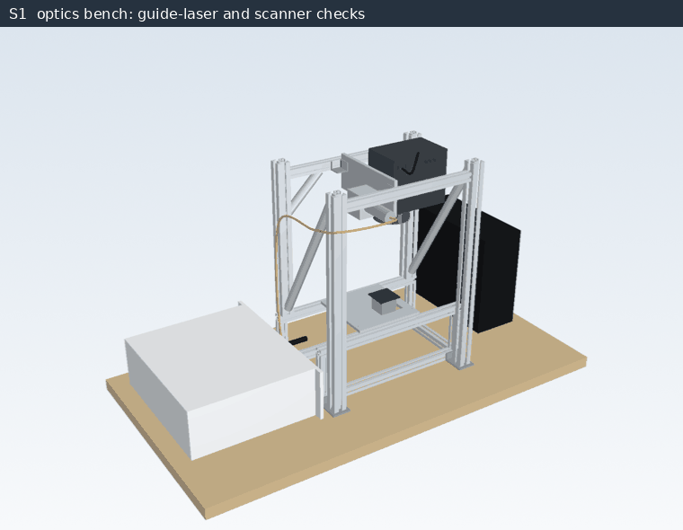
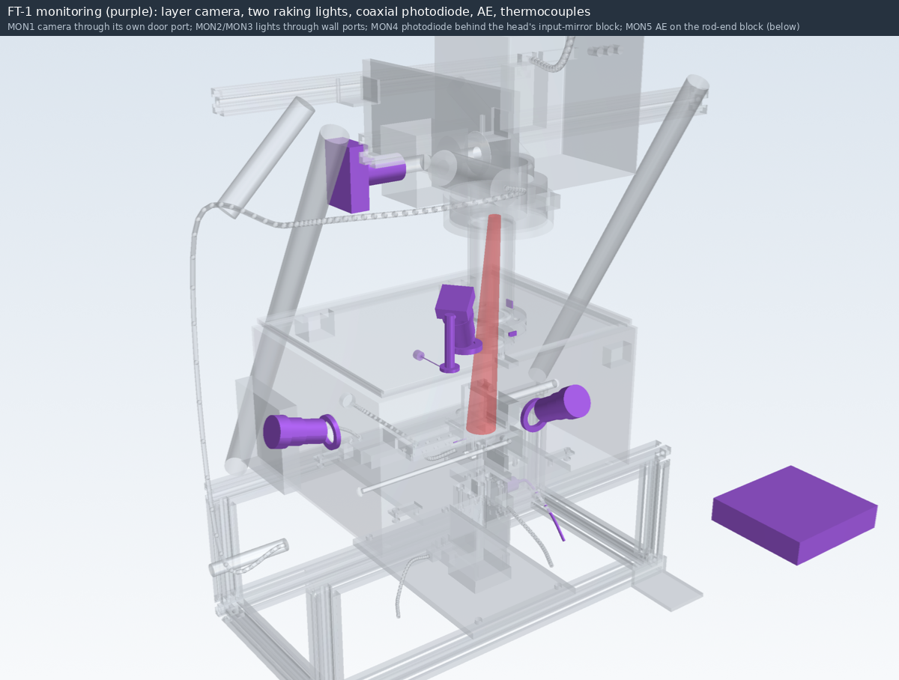
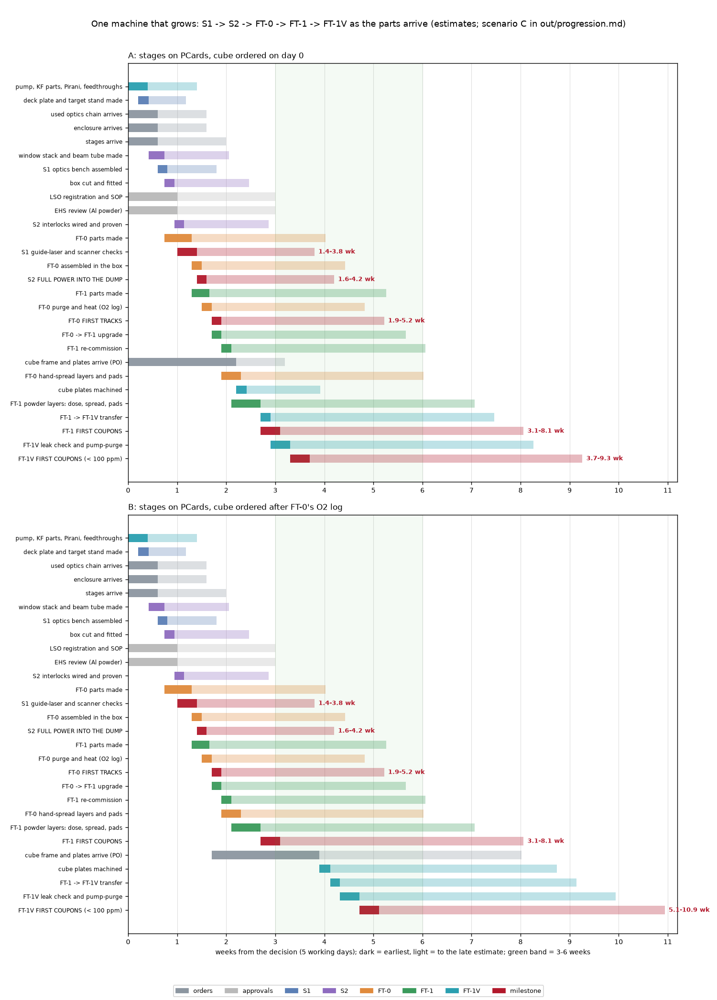
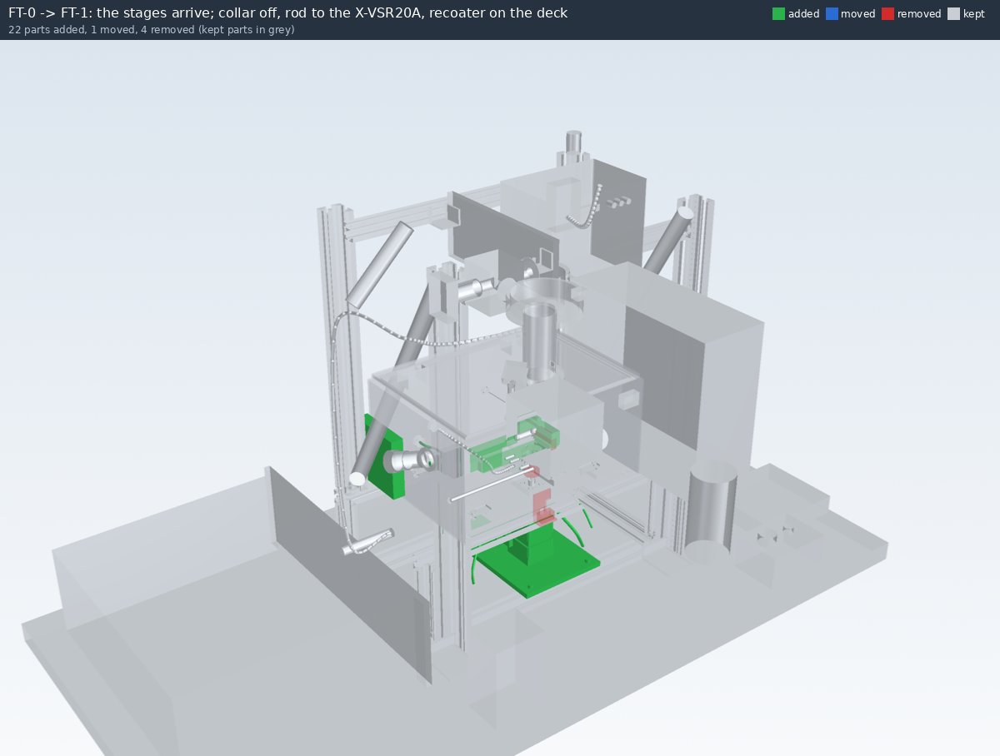
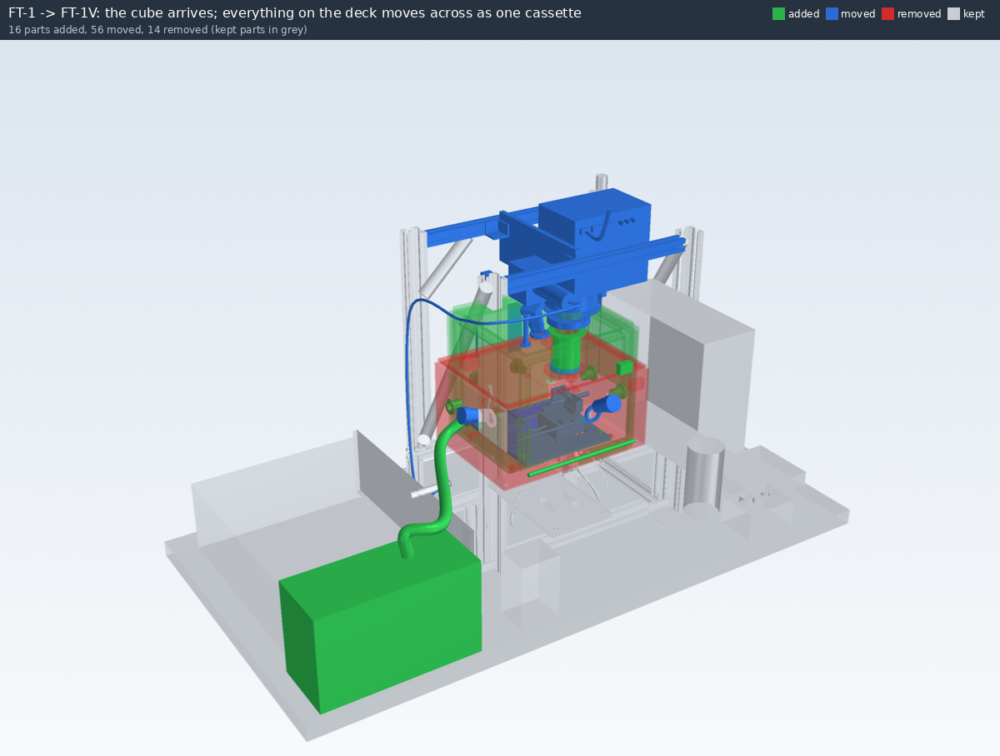
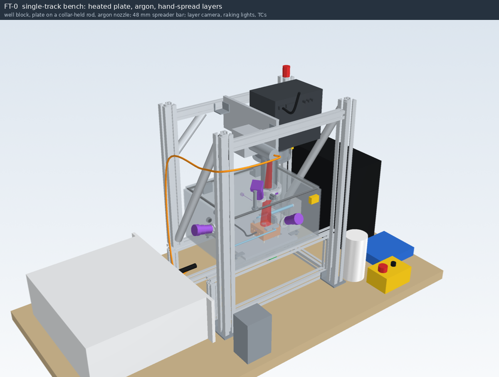
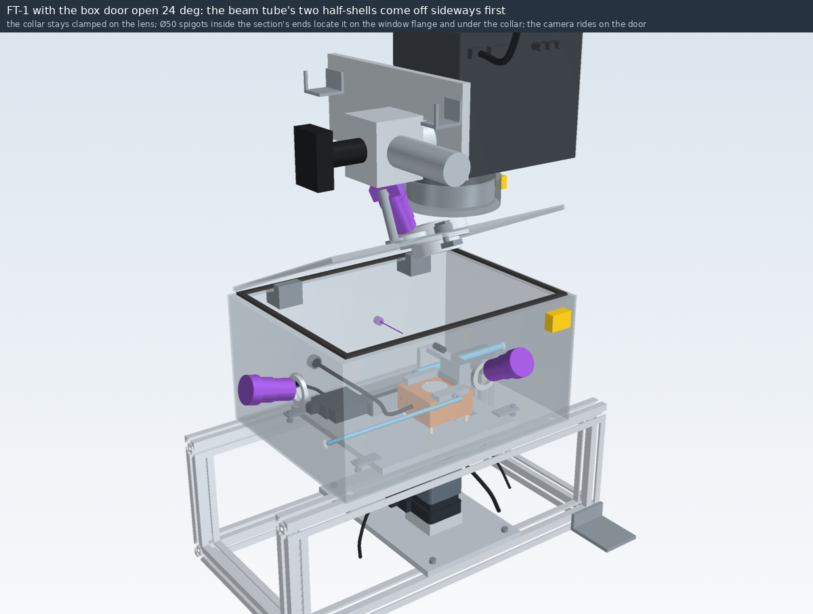
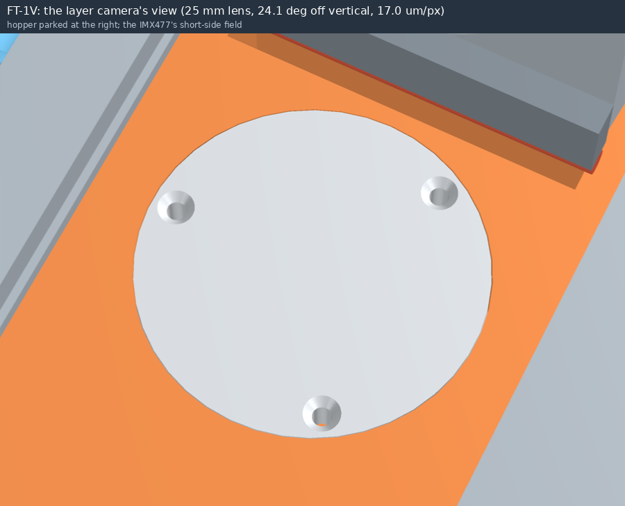
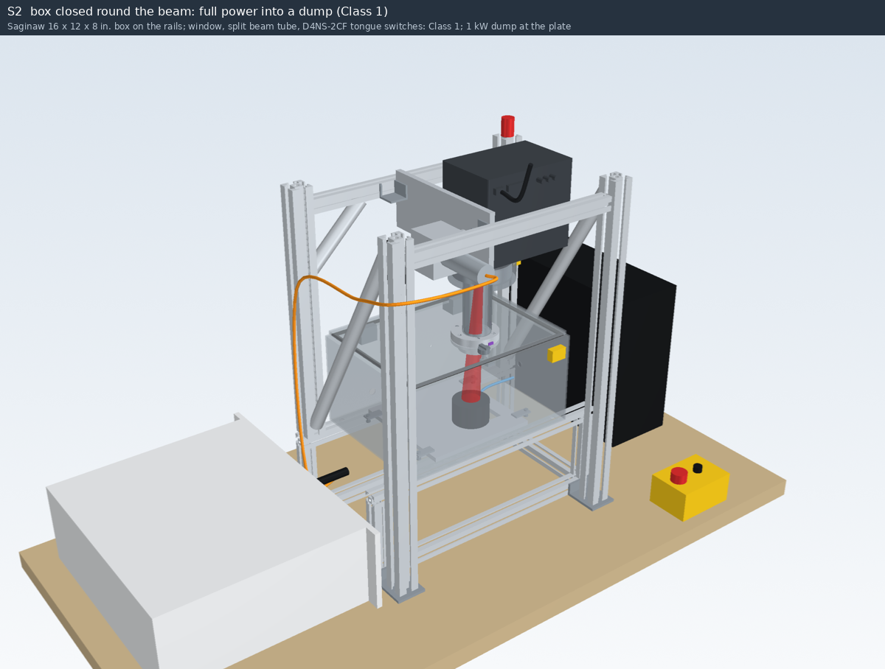

# Fast-track CAD: FT-0, FT-1 and FT-1V as one machine that grows

For [issue #260](https://github.com/vertical-cloud-lab/digital-alloy-lab/issues/260). Round 1 (2026-11-26) answered
Sterling's request on PR 294 to "attempt the full FT-0, FT-1, and FT-1V modeling and progression, showing also the
progression of how we would move from one configuration to the next as parts become available". Round 2 (2026-11-27)
redraws the bought parts that decide fit from the makers' STEP files and drawings, adds the monitoring parts and the
PCard route's Thorlabs piston stage, and fixes what the other round-2 workers found. Nothing has been bought or built.

- **The model:** one parametric CadQuery model with five states, S1 → S2 → FT-0 → FT-1 → FT-1V, each built from the
  one before in the order the parts arrive.
- **The checks:** interference, the scanned beam, recoater and piston sweeps (exact booleans and a python-fcl mesh
  sweep), the box door's swing, taking the beam tube off, fit, the layer camera's and lights' sight lines, gas volume.
- **The schedule and spend:** when each state can start, and what it adds to the cost.
- **The images:** each state, each step between states, the monitoring parts, the camera's view, the Thorlabs variant.

It extends the study in [`../README.md`](../README.md).

| File | What it is |
|---|---|
| [`ft_model.py`](ft_model.py) | the model: parameters with sources (`P`), `build(state, pz, hx, lid_open, piston, monitoring)`, the made parts (`MADE`, MK-01 to MK-23), the monitoring parts (`MON`, MON1 to MON9), the diff between states, STEP export |
| [`ft_vendor.py`](ft_vendor.py) → [`out/vendor-verify.json`](out/vendor-verify.json) | the bought parts drawn to the makers' dimensions, with `measure` and `verify` modes against the vendors' STEP files |
| [`vendor-cad-manifest.csv`](vendor-cad-manifest.csv) | where each vendor file came from (URL, sha256, date); the files themselves are not committed |
| [`ft_checks.py`](ft_checks.py) → [`out/checks.md`](out/checks.md), [`out/checks.json`](out/checks.json) | all the checks above, by state |
| [`ft_progression.py`](ft_progression.py) → [`out/progression.md`](out/progression.md), [`out/progression.csv`](out/progression.csv) | the schedule of the five states (three ordering scenarios), the spend by state, what each step adds, moves and removes, and the assembly order at each step |
| [`ft_render.py`](ft_render.py) → [`../img/cad-*.png`](../img/), [`../img/cad-progression.gif`](../img/cad-progression.gif) | renders |
| `out/ft-0.step`, `out/ft-1.step`, `out/ft-1v.step`, `out/ft-1-thorlabs.step` | the machines as STEP assemblies |

```bash
python desktop-lpbf/fast-track/cad/ft_model.py                      # STEP files
python desktop-lpbf/fast-track/cad/ft_vendor.py verify              # needs the vendor files in /tmp/ft-vcad/
python desktop-lpbf/fast-track/cad/ft_checks.py                     # out/checks.*  (~26 min on one core)
python desktop-lpbf/fast-track/cad/ft_progression.py                # out/progression.*, img/progression-gantt.png
xvfb-run -a -s "-screen 0 1920x1080x24" python desktop-lpbf/fast-track/cad/ft_render.py
```

The Python packages are in [`../../analysis/requirements.txt`](../../analysis/requirements.txt): CadQuery 2.8,
PyVista, python-fcl and trimesh.




## Short answer

- **Still one machine in five states, and nothing wasted.** The parts that drop out along the way are FT-0's rod
  collar and spreader bar, the box's rod and long beam-tube section (the cube takes a 21 mm longer rod and a short
  section), and the box itself when the cube arrives; it then becomes the spreadability rig.
- **Drawing the bought parts from the makers' files changed the cassette.** Zaber's STEP shows the X-LSQ075B recoater
  is 285.85 mm long, not ~241 mm, so it fits neither the deck nor the cube with room to load it. The **X-LSM100B-E03**
  (239.2 mm, 101.6 mm travel) replaces it, and the deck shrinks to **245 x 245 mm**. The hopper needs 66.6 mm of
  travel between its parks and has 101.6 mm.
- **The optics moved.** The lens axis is 30 mm in front of the plate centre (no specular return into the fibre), the
  head is SCANLAB's 206.9 x 140 x 180 mm housing hung by its entrance face, and the LINOS lens's datasheet puts its
  bottom 299.5 mm above the bed. The head's top is 528.1 mm above the bed.
- **The checks are clean in all five states and with the Thorlabs stage:** no clashes and nothing in the
  scanned-beam envelope; the hopper over its full 101.6 mm and the plate over its 20 mm stroke without contact (exact
  booleans and a python-fcl mesh sweep). The nearest parts to the beam are the cord clamp at the hopper's park
  (3.5 mm) and the cover-slide holder (5.6 mm); the tightest apertures keep 6.2 mm round the beam.
- **The box opens now, but only to 24 degrees.** The beam tube's centre section is two half-shells that slide off
  sideways (no contact over 60 mm). The door then swings 24 degrees before the layer camera meets the lens collar
  (26 degrees with the camera unclipped), which lifts its front edge 120 mm: a tight opening for hand-spreading and
  plate changes.
- **The gantry is the structural FEA's four-post frame** (45 mm posts, front and back cross-beams carrying the head's
  flange plate, a diagonal per side, two knee braces at the back: 79 Hz in the FEA against 13 Hz for round 1's two
  uprights), checked here for clashes, the beam and the lid's swing.
- **Gas volume from the model:** FT-0 24.2 L, FT-1 24.0 L, FT-1V 22.6 L (Ideal Vacuum gives the empty cube 22.6 L).
- **Monitoring (MON1-MON9)** is drawn: a Raspberry Pi HQ layer camera through its own window port (17.8 µm per pixel
  across the plate in the box), two raking LED lights through wall ports, a coaxial photodiode behind the head's input
  mirror, an acoustic-emission sensor on the rod-end block, thermocouples, and a digitizer on the laser's sync.
- **The cube's face opening is still unverified** (Ideal Vacuum's site blocked us). The cassette needs 247 mm; below
  that, the bare deck goes in edge-on (it needs 180.3 mm) and the cassette is built inside. Kurt J. Lesker's BX1212S,
  with a full-face door, is the documented alternative.

## What round 2 changed, and why

Round 1 drew most bought parts as estimated envelopes. Round 2 draws the ones that decide fit from the makers' own
files, in our code (`ft_vendor.py`; no vendor geometry is copied or committed; URLs and sha256 in
[`vendor-cad-manifest.csv`](vendor-cad-manifest.csv)), and takes the other workers' findings.

| Item | Round 1 | Round 2 | Source |
|---|---|---|---|
| Recoater stage | Zaber X-LSQ075B-E01, ~241 mm long (estimate) | **Zaber X-LSM100B-E03**: 239.2 x 84.8 x 21.0 mm with its controller, 101.6 mm travel (parts.csv M1c) | X-LSM100A-E03 STEP (same body; Zaber offers no STEP of the B), datasheet |
| Why | | the X-LSQ075B measures **285.85 mm**: it fits neither the deck nor the cube's 289.6 mm inside with room to load it; the X-LSQ150B is 360.9 mm | Zaber STEPs |
| Deck cassette | 250 x 250 mm | **245 x 245 mm**: the X-LSM100B spans x -148.8 to 90.4 on a deck from -150.5 to 94.5 (1.7 and 4.1 mm spare); the cube's face opening must be >= 247 mm | this model |
| Piston stage | X-VSR20A, 120 x 80 mm footprint (estimate) | X-VSR20A-E01 **88 x 101 x 73 mm** retracted, 64 x 64 platform, M6 grid; drive housing turned to +y | Zaber STEP |
| PCard piston stage | not modelled | **Thorlabs MTS50/M-Z8 on end** beside the rod, an L-arm to the same rod-end block, a tower plate on the bracket plate: `build(..., piston="thorlabs")` | Thorlabs STEP |
| Box | "SCE-16128CHNFSS class" (not a real part) | **Saginaw SCE-16EL1208SSLP**: 16 x 12 x 8 in., 0.075 in. 304, door 15.50 x 11.63 in., usable depth 8.30 in., quarter-turn latch, concealed hinges, poured gasket, four panel studs that now hold the deck (MK-23) | Saginaw drawing |
| Scan head | 160 x 140 x 115 mm on a plate (estimate) | hurrySCAN 20/30 housing **206.9 x 140 x 180 mm, 5.8 kg**, hung by its beam-entrance face from a flange plate (MK-09) on the gantry's two cross-beams; the unit's input turret and 45 deg mirror block drawn by eye from the listing photos | SCANLAB brochure drawing (the 25 sharing it is an assumption); seller's photos |
| f-theta lens | Ø110 x 66 mm, working distance 300 mm (estimates) | LINOS 4401-288-000-20: **Ø118 body, Ø119.8 ring, 69.2 mm long, WD 296.2 mm, FFL 344.8 mm**; with the window and cover slide in the beam the focus moves 3.3 mm, so the lens bottom is 299.5 mm and its flange 348.1 mm above the bed; the head's top 528.1 mm above the bed | LINOS datasheet; process worker |
| Lens axis | over the plate centre | **at (0, -30)**: on axis the plate's specular reflection would put ~342 W back into the fibre core, 30 mm off none. The window stack is centred at y -11 (box) and -21 (cube), the beam tube at y -17 / -24, the cover-slide holder opened from Ø40 to Ø44 | process worker (`../process/`) |
| Cover slide | under the window / the cube's top plate | **130 mm above the bed in both enclosures**; in the cube on a drop tube from the top plate (a sooted slide defocuses 2.3 mm there against 9.4 mm at 221 mm) | process worker |
| Heaters | 1/4 x 1 in. cartridges, length unverified (McMaster login wall) | **Ø6 x 20 mm, 24 V 50 W cartridges** (LulzBot KT-CP0013 class, H1): 2 in the plate in Ø6.1 x 21 mm holes, 4 in the well block from its -x face. The heater plate drops from 28 to **24 mm** | lead |
| Beam tube | one tube with a floor ring in the lens collar: captive once the lid is shut (video worker) | collar clamped on the lens, and a **centre section split in two half-shells** (2 toggle clamps) located by Ø50 spigots *inside* both its ends: each half slides off sideways, then the door opens | this model; checks below |
| Window-stack screws | not drawn | 6 x M4 x 12 flat heads, countersunk flush, so the half-shells slide over them | this model |
| Rod's lower end | open question | a **potted plug** (vacuum epoxy, 15 mm) in the hollow rod; the 6-wire pigtail leaves into a pocket in the **rod-end block** (MK-15: rod clamp, M4 screw, the AE sensor's face) and plugs into a 6-way terminal block on it | this model |
| FT-0 layer spreading | 70 mm film applicator (knobs to ±41 mm) | **48 mm spreader bar** (48 x 12 x 30 mm, ground edge), parked at +x out of the raking light: the slot nozzle and exhaust collector leave 54 mm on the block top (video worker) | this model |
| Gantry | two 30 mm uprights and a cross-beam at the back, the head cantilevered (13 Hz, structural FEA) | **four 45 mm posts, front and back cross-beams, a diagonal per side, two back knee braces** (79 Hz in the FEA); the head's flange plate spans both cross-beams | structural FEA 4c |
| Monitoring | none | MON1-MON9 (below) | PR 266/281 `monitoring.md`, adapted |
| Cables and fasteners | not drawn | recoater M8 to a back-wall gland (box) or a KF-25 feedthrough (cube); X-VSR20A M8; well-block leads; heater and TC cable; gland screws M5 x 25 with bonded seals, inside the gland's face seal at (±12.5, ±12.5) and into M5 taps in the deck (fab worker); deck clamps on the panel studs (box), M6 deck screws into the bottom plate (cube); bracket-plate screws into T-nuts | this model |

### The bought parts against the makers' files (`ft_vendor.py verify`, `out/vendor-verify.json`)

Our shapes are outer envelopes with the mounting features (holes, faces, connectors) at the measured places, so they
are fuller than the vendors' hollow bodies; the extents are what decides fit.

| Part | Maker's file | Extents, ours (mm) | Extents, maker's (mm) | Volume, ours vs maker's |
|---|---|---|---|---:|
| Zaber X-VSR20A-E01 | STEP | 73.0 x 88.0 x 101.0 | 73.0 x 88.0 x 101.0 | +13.9 % |
| Zaber X-LSM100A-E03 (the B's body) | STEP | 21.0 x 84.81 x 239.2 | 21.0 x 84.81 x 239.2 | +4.8 % |
| Thorlabs MTS50/M-Z8 | STEP | 22.0 x 43.0 x 163.45 | 22.0 x 43.0 x 163.45 | +7.5 % |
| Zaber X-LSQ075B-E01 (rejected) | STEP | 43.1 x 65.0 x 285.85 | 43.1 x 65.0 x 285.85 | envelope only |
| Zaber X-LSQ150B-E01 (rejected) | STEP | 43.1 x 65.0 x 360.9 | 43.1 x 65.0 x 360.85 | envelope only |
| SCANLAB hurrySCAN 20/30 housing | drawing | 140 x 180 x 206.9 | 140 x 180 x 206.9 | no STEP |
| LINOS 4401-288-000-20 | drawing | 69.1 x 119.8 x 119.8 | 69.2 x 119.8 x 119.8 | no STEP |
| Saginaw SCE-16EL1208SSLP | drawing | 203.2 x 304.8 x 406.4 | 203.2 x 304.8 x 406.4 | no STEP |

Not available this round: Ideal Vacuum's cube (its sites returned a Cloudflare block), McMaster parts (login wall),
the Lesker BX1212S (VacuCAD login). Those stay estimates, marked in `ft_model.P`.

## The checks (`out/checks.md`)

| State | Parts | Clashes | Designed contacts | Parts in the beam envelope |
|---|---:|---:|---:|---:|
| S1 | 24 | 0 | 3 | 0 |
| S2 | 48 | 0 | 5 | 0 |
| FT-0 | 83 | 0 | 7 | 0 |
| FT-1 | 101 | 0 | 7 | 0 |
| FT-1V | 103 | 0 | 8 | 0 |
| FT-1, Thorlabs MTS50/M-Z8 piston | 100 | 0 | 7 | 0 |

The last run (1051 s on one core, capped at 3 GB) was on the final model except one detail: the lid's two coded
switches became one Omron D4NS-2CF tongue switch per guard afterwards (one box fewer; no effect on clashes).

- **Beam:** with the lens axis at (0, -30) the envelope is an oblique cone; the nearest parts are the cord clamp at
  the hopper's park (3.5 mm) and the cover-slide holder (5.6 mm). Margins round the envelope at the apertures:
  the window 7.54 mm (box) and 10.47 mm (cube), the cover-slide holder 6.17 mm, the tube's lower and upper spigots 7.4 and 11.79 mm (box), 12.11 and 14.54 mm (cube).
- **Recoater:** the hopper needs 66.6 mm of travel between its parks (-31.1 and +35.5 mm, where it clears the beam and
  its blade has passed the overflow slot); the X-LSM100B gives 101.6 mm, 14.7 mm spare at the left end and 20.3 mm at
  the right. Swept over the full travel, 13 positions with exact booleans and 41 with python-fcl: no contact; the
  closest is the carriage bracket to the stage shield's slot, 2.0 mm, at the left end.
- **Piston:** 20 mm of the X-VSR20A's 20 mm stroke (50 mm of the MTS50's); at the bottom the heater plate is 7.7 mm
  above the deck, at the top the rod-end block is 3.0 mm under the gland, and the rope wiper stays in the bore over the
  whole stroke. 21 fcl poses, no contact. Rods: 84.6 mm (box), 105.6 mm (cube). In the cube, 1 atm pushes the rod
  with 12.8 N against the stage's 100 N continuous thrust.
- **Box door:** with the tube's half-shells off, it swings to **24 degrees** before the layer camera meets the beam-tube lens collar (its front edge then 120.2 mm up), or 26 degrees with the camera unclipped, when the quarter-turn latch meets the beam-tube lens collar (129.5 mm). Hinge axis estimated at the door's back top edge.
- **Beam tube removal:** FT-1: the 123.5 mm section's half-shells slide out along x, no contact over 60 mm; FT-1V: the 23.7 mm section's half-shells slide out along y, no contact over 60 mm.
- **Fit:** the deck has 78.8 and 28.0 mm to spare in the box, 22.3 mm a side inside the cube, 21 mm through the cube's
  estimated 266 mm face opening, 29.9 mm a side in a Lesker BX1212S. The cassette stands 102.7 mm above the floor in a
  289.6 mm tall cube. The window is 152.0 mm above the bed in the box (a 2.99 mm beam, 5.7 kW/cm² at 400 W) and
  251.8 mm in the cube (4.95 mm, 2.1 kW/cm²); the cover slide is 130 mm above the bed in both. M2 substrate screws fit
  (head edge at r = 19.0 mm on the 19.9 mm disc); M2.5 and M3 don't.
- **Gas:** FT-0 24.2 L, FT-1 24.0 L, FT-1V 22.6 L of gas. A 20 L/min flow purge of the box reaches 1000 ppm in
  6.4 min ideally (13-32 min expected, 257-642 L of argon); two pump-and-fill cycles to 1 mbar take the cube below
  100 ppm on paper in about 7 min with 45 L (pump speed 1 L/s through the KF-25 hose is an estimate).
- **Sight lines:** with the hopper parked at the right, where it waits while the laser runs, the camera sees all of the
  plate in FT-0, FT-1 and FT-1V, the -x light reaches all of it and the -y light 91-93 %. Parked at the left, the
  hopper shades the -x light completely and 17-22 % of the camera's view. Two round-2 changes got there: FT-0's
  spreader bar parks at +x (at -x it shaded the -x light completely), and the cube's camera port moved out to
  (-100, -50) (at (-70, -55) it saw 76 % of the plate, looking past the drop tube that hangs the cube's cover slide).
- **Two late fixes** (the vibration motor was 5 mm into the arm; the pump hose 17.7 mm into the pump's inlet, both
  found by the video worker's frame audit) were re-checked on their own: no contact over the recoater's travel, and
  4.0 mm of hose on the inlet (`out/checks.md` section 8).
- **Heat (`fast_track.py`'s load):** box air 71 °C in still air, 39 °C with the fan; cube 61 °C and 36 °C. The stages
  are rated to 50 °C, so both need the fan.

## Monitoring (MON1-MON9)

Sterling asked to film what happens in the chamber at the highest resolution, frame rate and zoom that fit, and to
log as much metadata as possible. PR 266's `../../monitoring.md` (sections 9-10 on PR 281's branch) answers that for
the robot-built machine; here it is fitted to FT-0, FT-1 and FT-1V and drawn (purple in the renders). Prices are in
[`../parts.csv`](../parts.csv) (rows MON1, MON2 (both lights), MON4, MON5, MON6, MON8; the MCC 134 is in C3), read
live by the lead.

| Id | What | Suggested product | First state | In the model |
|---|---|---|---|---|
| MON1 | layer camera | Raspberry Pi HQ Camera (IMX477, 4056 x 3040, 1.55 µm), 16 mm C-mount lens (25 mm for FT-1V), Thorlabs FESH1000 short-pass in front | FT-0 | on a post on the box door, looking through its own Ø1 in. window port (MK-19) at the plate, 30.7 deg off vertical; on the cube's top plate at 24.1 deg; Scheimpflug wedge (MK-20) |
| MON2 | raking light from -x, 15 deg | Thorlabs mounted white LED (MCWHL7 class), SM1 tube with an aspheric condenser (ACL2520U class), LEDD1B driver fired by the Pi | FT-0 | through a window port in the box's left wall (MK-21); a bore in the cube's left plate |
| MON3 | raking light from -y, 30 deg, over the nozzle | as MON2 | FT-0 | the box's front wall; the cube's door |
| MON4 | coaxial photodiode | short-pass dichroic (DMSP1000 class) cut to replace the hurrySCAN's 45 deg input mirror: it still folds the 1070 nm beam into the head and passes 400-1000 nm back out of the mirror block's back port, into an SM1 tube with FESH1000, a bandpass, AC254-050-B, a 500 µm pinhole and a PDA36A2 | S1 (aligned once, used from FT-0) | on the input-mirror block's back face |
| MON5 | acoustic emission | resonant 150 kHz sensor with integrated preamp (MISTRAS R15I-AST or Vallen VS150-RIC class), couplant, decoupler | FT-1 | clamped on the rod-end block's +x face (it rides with the plate) |
| MON6 | thermocouples | self-adhesive type K patches on the beam tube and window ring (S2); 1/16 in. sheathed type K in the plate and the well block, and a box-air probe through a compression fitting (FT-0) | S2 | drawn in their holes and on their faces |
| MON7 | laser and layer sync | the RTC4's (or RTC5's) laser gate and a job-list trigger bit, through an isolator to the digitizer and the Pi | FT-0 | no geometry |
| MON8 | digitizer | PicoScope 4824A class, 8 channels on one clock (photodiode, AE, gate, layer sync) | FT-0 | envelope on the bench |
| MON9 | thermocouple logger | MCC 134 HAT on the Pi I/O node (parts.csv C3) | S2 | no geometry |

The layer camera, from the model (`ft_model.camera_geometry`, `ft_checks.camera_numbers`; IMX477, f/2.8, circle of
confusion two pixels):

| | Box (FT-0, FT-1) | Cube (FT-1V) |
|---|---|---|
| C-mount lens | 16 mm | 25 mm |
| tilt off vertical | 30.7 deg | 24.1 deg |
| lens to plate centre | 199.4 mm | 298.7 mm |
| µm per pixel, across / along the tilt | 17.8 / 20.7 | 17.0 / 18.6 |
| field (full sensor) | 72.1 x 54.0 mm | 68.8 x 51.6 mm |
| Scheimpflug wedge | 2.96 deg | 2.34 deg |
| depth of field at f/2.8 | 2.48 mm | 2.27 mm |
| plate depth across the tilt | 20.4 mm | 16.3 mm |
| Rayleigh radius at f/2.8, 550 nm, on the plate | 21.5 µm | 20.6 µm |
| video 2028 x 1520 at 40 fps | 35.5 µm per pixel | 33.9 µm per pixel |

Sight lines (rays from 133 points on the plate to the camera's lens and to each light's port, hopper at either park; a blocked ray meets any part):

| State | Hopper | Camera sees | MON2 lights | MON3 lights |
|---|---|---:|---:|---:|
| FT-0 | right park (hx 37.5) | 100.0 % | 100.0 % | 90.8 % |
| FT-0 | left park (hx -33.1) | 100.0 % | 100.0 % | 90.8 % |
| FT-1 | right park (hx 37.5) | 100.0 % | 100.0 % | 90.8 % |
| FT-1 | left park (hx -33.1) | 78.0 % | 0.0 % | 90.8 % |
| FT-1V | right park (hx 37.5) | 100.0 % | 100.0 % | 92.7 % |
| FT-1V | left park (hx -33.1) | 82.6 % | 0.0 % | 92.7 % |





## Opening the box, and moving from the box to the cube

The video worker collision-checked assembly paths on round 1's model and found three problems. Round 2's answers:

1. **The beam tube trapped the lid.** Its lens collar had a floor ring inside the tube, so the tube could slide only
   14 mm up the lens, and the lid needs more than 15 mm to clear the gasket. Now the collar stays clamped on the lens
   and the tube's centre section is two half-shells held by two toggle clamps. Both of its ends sit over Ø50 mm
   spigots *inside* the bore (3 mm overlap, light-tight), one on the window flange and one under the collar, and the
   window-stack screws are countersunk flush. So each half-shell slides straight off sideways with no lift:
   FT-1: the 123.5 mm section's half-shells slide out along x, no contact over 60 mm; FT-1V: the 23.7 mm section's half-shells slide out along y, no contact over 60 mm. Then the door opens to 24 degrees (26 with the camera unclipped). `build(..., lid_open=True)` draws it.
2. **FT-0's film applicator didn't fit between the nozzle and the collector** (70 mm against 54 mm). FT-0 spreads its
   layers with a 48 mm spreader bar (48 x 12 x 30 mm, ground edge) that rides on the block top between them, with the
   layer depth set by the plate's recess under the block top (shims under the FT-0 collar). parts.csv M4 should
   change from the film applicator to this bar (a short length of 1/2 x 1-1/4 in. ground flat stock, edge ground).
3. **The box couldn't slide off its rails with the gland under its floor.** The gland plate hangs 12.0 mm below the rail tops, and the rod reaches 22.0 mm into the rod-end block.. The FT-1 -> FT-1V order
   that avoids lifting the box:

   | Step | What | Numbers from the model |
   |---|---|---|
   | 1 | plate to the top of its stroke (pz +5), heaters off and cool, substrate off | |
   | 2 | beam tube half-shells off, door open | free to 24 deg with the camera on the door |
   | 3 | at the rod-end block: the pigtail's 6 wires out of the terminal plug, rod clamp (M4) loose | the rod is 22.0 mm into the block |
   | 4 | lift the heater plate and its rod straight up out of the bore | 103.6 mm lift; the rod (84.6 mm, box) passes the block, the gland's O-rings, the floor and the deck |
   | 5 | deck clamps off (4 stud nuts), recoater M8 and well-block leads unplugged at the glands, cassette lifted out through the door opening | deck 245 x 245 mm in a 402.6 x 301.0 mm box |
   | 6 | stage to the bottom of its stroke, gland plate (4 x M5) unbolted and taken out sideways | block top 23.0 mm under the gland (3.0 mm at the top of the stroke); the gland hangs 12.0 mm below the rail tops |
   | 7 | box unbolted from the support rails and slid forward off them | nothing hangs below its floor now |
   | 8 | cube onto the rails (its underside lands where the box's was), gland onto its bottom plate, the X-VSR20A untouched | |
   | 9 | cassette in through a face (or, if the face opening is under 247 mm, the bare deck edge-on and the cassette built inside), M6 deck screws into the bottom plate | see the chamber comparison below |
   | 10 | the long rod's plate assembly down through the bore, the gland and into the rod-end block; plug in, clamp | rod 105.6 mm (cube) |
   | 11 | window stack on the top plate, cover-slide drop tube, short half-shells; cross-beam and optics up 21.0 mm | |

   The pigtail's plug has to pass the gland's 12.9 mm bore (step 4): either screw terminals that are wired after the
   rod is through, as drawn, or a 6-pin circular plug of 12 mm or less (estimate: Lemo 0B or Binder 719 class, check
   its current rating against 2.1 A per heater). The leads are potted in the rod, so the cube's long rod is a second
   plate-and-rod assembly made ahead (2 more H1 cartridges and one more MK-04), or the leads are re-potted (a day for
   the epoxy).

## FT-1V's chamber: the Ideal Vacuum cube or a Lesker box

Ideal Vacuum's sites blocked every fetch on 2026-11-27, so the cube's face opening is still an estimate (266 mm). The
cassette needs a face opening of at least **247 mm** (the 245 mm deck plus 2 mm). The model is robust to a smaller
opening in one way: the bare deck plate passes a square opening of **180.3 mm** or more edge-on along the diagonal
((245 + 10) / √2), turns flat inside the 289.6 mm cube, and the cassette is then built on it inside, through the door
and the open top. That is slower and awkward, but it needs no new parts.

The documented alternative is Kurt J. Lesker's BX1212S box chamber (read by the lead on lesker.com): 12 x 12 x 12 in.
(304.8 mm) inside, 304 stainless, a hinged aluminium door over the whole front face, ports KF40 and ISO100-K
(positions not stated), $7,995, lead time not stated. It is not drawn in the model (its STEP needs a VacuCAD login);
on its published inside size the 245 mm deck loads through the door with 29.9 mm each side, the stage stays under its
floor (a machined or bored floor for the gland), and the window needs a machined top or a viewport on the ISO100-K
port if that port can sit on top.

**Which is less risky:** the Lesker box carries less fit risk (a full-face door; nothing depends on an unpublished
opening) and lists for less than the cube kit ($7,995 against parts.csv E2's $9,210-9,450, before machining either
one's top); the Ideal Vacuum cube carries less schedule risk ("Available now" on 2026-11-25, while Lesker's "KJLC will
contact you" suggests a made-to-order lead time). So: confirm the cube's face opening (a call or a drawing) is at least
247 mm, or accept building the cassette inside it, and order the cube; if neither is acceptable, ask Lesker for a
lead time.

## The PCard route's piston stage: Thorlabs MTS50/M-Z8

`build(state, piston="thorlabs")` (and `out/ft-1-thorlabs.step`) puts the MTS50/M-Z8 (163.45 x 43 x 22 mm by
Thorlabs' STEP, 50 mm travel; with a KDC101 controller it is parts.csv M2b, $2,179-2,300 read by the lead) on end
beside the rod: its carriage faces -y, an L-arm (MK-15) carries the same rod-end block, and a tower plate on the
bracket plate holds the stage with its lower end through a cut-out. It checks clean (no clashes, nothing in the beam;
20 mm of its 50 mm used; the same 3.0 and 23.0 mm block-to-gland gaps). Its limit is force, not fit: the structural
FEA ([`../analysis/out/fea/struct.md`](../analysis/out/fea/struct.md), 4d) takes Thorlabs' 4.5 kg (44 N) vertical
rating and finds the gland as drawn (two O-rings at 15 % squeeze) not acceptable (up to 50 N at breakout in FT-1,
58 N in FT-1V), and one O-ring at 10 % acceptable (19 N and 27 N at breakout). So the MTS50 needs a one-O-ring gland.

## The five states

Weeks are scenario A's (stages on PCards, cube ordered on day 0); `out/progression.md` has B and C. The schedule is
this folder's own task graph (`ft_progression.py`), built on `fast_track.py`'s task durations: the orders and
approvals in its `COMMON` (the RTC4's eBay window, the 208/240 V circuit for the laser, the O₂ analyzers), and its
per-state shop days from the fabrication worker's hours ([`../fab/out/hours.json`](../fab/out/hours.json), at 8 h a
working day early and 5 h late). The upgrade steps (1-2 days each) are estimates.

| State | Starts | Needs these to have arrived (parts.csv) | Made parts first used | What it can do | Gate before the next state |
|---|---|---|---|---|---|
| **S1** optics bench | checks at 1.4-3.8 wk | laser chain L1-L7 (RTC4 L5b), water L10-L11, PC C1, T-slot frame E4, eyewear S2, coaxial photodiode MON4 | deck MK-01, target stand MK-18, head flange plate MK-09 | guide laser only: the head and the RTC4 talk; field size and distortion on a target at the powder plane; the photodiode branch aligned | LSO registration; the laser's interface and the 208/240 V circuit |
| **S2** box round the beam | full power at 1.6-4.2 wk | box E1, window and cover slides L8, beam dump L9, safety relay and switches S1, S5, S6, the Pi and its I/O node C2-C4, thermocouples MON6 | window stack MK-02, beam tube MK-10 (long section), deck clamps MK-23 | full power into a water-cooled dump inside a closed Class 1 box: calorimetry, a focus ladder, interlocks proven | the laser makes its power and its spot, inside its return window |
| **FT-0** single-track bench | tracks at 1.9-5.2 wk | heater parts H1 (2), H2-H4, gas and O₂ G1-G8, extinguisher and room O₂ S3-S4, spreader bar M4, stock F1, glovebox P1, camera, lights and digitizer MON1-MON3, MON7-MON8 | well block MK-03, heater plate MK-04, substrates MK-05, rod MK-06, gland MK-07, nozzle and collector MK-11, overflow cup MK-16, collar and terminal bracket MK-17, camera and light ports MK-19-MK-21 | flow purge with an O₂ log, the plate at 200 °C, single tracks on hand-spread layers, pads | EHS review; O₂ log; stages and FT-1 parts in |
| **FT-1** purge-box LPBF | coupons at 3.1-8.1 wk | X-LSM100B M1c, X-VSR20A M2 (or the MTS50 M2b), hopper parts M3, second heater zone H5, stage supplies C5, AE sensor MON5 | arm and hopper MK-08, shield MK-12, bracket, riser and rod-end block MK-15 | multi-layer coupons at 100-1000 ppm O₂, plate and well at 200 °C | coupons made, or the O₂ log asks for FT-1V |
| **FT-1V** cube | coupons at 3.7-9.3 wk | cube frame and plates E2, pump-purge kit E3, feedthroughs E5 | cube top and bottom plates MK-13/14, long rod MK-06, short beam-tube section MK-10, cover-slide drop tube | the same coupons at < 100 ppm by pump-purge; the box becomes the spreadability rig | - |

Milestones in weeks, earliest to latest:

| Milestone | A: stages on PCards, cube ordered on day 0 | B: stages on PCards, cube ordered after FT-0's O2 log | C: both stages on one Zaber PO, cube after the O2 log |
|---|---|---|---|
| S1 guide-laser and scanner checks | 1.4-3.8 wk | 1.4-3.8 wk | 1.4-3.8 wk |
| S2 FULL POWER INTO THE DUMP | 1.6-4.2 wk | 1.6-4.2 wk | 1.6-4.2 wk |
| FT-0 FIRST TRACKS | 1.9-5.2 wk | 1.9-5.2 wk | 1.9-5.2 wk |
| FT-1 FIRST COUPONS | 3.1-8.1 wk | 3.1-8.1 wk | 3.6-8.1 wk |
| FT-1V FIRST COUPONS (< 100 ppm) | 3.7-9.3 wk | 5.1-10.9 wk | 5.1-10.9 wk |

Spend by the state that first needs each `parts.csv` line (the lead's round-2 file):

| State | Adds | Cumulative |
|---|---:|---:|
| S1 | $6.3k-10.7k | $6.3k-10.7k |
| S2 | $3.1k-4.0k | $9.4k-14.7k |
| FT-0 | $11.3k-21.8k | $20.7k-36.5k |
| FT-1 | $8.3k-10.8k | $29.0k-47.3k |
| FT-1V | $11.7k-13.8k | $40.7k-61.1k |

The FT-1 and FT-1V sums are the study's stand-alone totals (`fast_track.py`, from the same `parts.csv`) plus what
growing costs: FT-0's spreader M4 ($150-600) and, at FT-1V, the box E1 ($694-760), which then becomes the
spreadability rig.



### The steps, in pictures

Green: added. Blue: moved. Red: removed (faint). Grey: unchanged. The part lists are in
[`out/progression.md`](out/progression.md).

| | |
|---|---|
|  |  |
|  |  |

### The three machines

| | |
|---|---|
|  |  |
|  |  |
|  |  |

### Details

| | |
|---|---|
|  |  |
|  |  |

## How it is built

- **Frame:** the origin is the centre of the substrate's top face at the start of a build, in the box states; +X is
  the recoat direction and +Y points to the back. The bench stays put between states. In FT-1V the cassette, the rod
  and the optics sit 21.0 mm higher, because the cube's floor plate (22.9 mm) is that much thicker than the box's
  sheet floor; the cube's underside lands where the box's was, so the support rails and the X-VSR20A don't move.
- **Inside the enclosure, on the 245 mm deck (MK-01):**
  - **Well block (MK-03):** 80 x 80 x 40 mm on four Macor standoffs, four Ø6 x 20 mm cartridges from its -x face, a
    thermocouple beside them, and a 7 x 44 mm overflow slot at x = 22-29 mm over the overflow cup (MK-16) in a deck
    pocket.
  - **Plate stack:** the Ø39.8 x 6 mm substrate (three M2 countersunk screws at r = 17.1 mm) on the Ø39.8 x 24 mm heater
    plate (MK-04: two Ø6 x 20 mm cartridges in from below, a thermocouple, lead grooves to the rod socket, a fibreglass
    rope wiper in a groove), on the hollow 1/2 in. rod (MK-06) whose lower end is potted.
  - **Gas, on the block's top:** the 45 x 4 mm slot nozzle in front and the exhaust collector behind, so the
    cross-flow runs along +Y, across the recoat direction.
  - **Recoater:** the X-LSM100B runs behind the collector at y = 82 mm under a stainless shield (MK-12) with a slot for
    the carriage bracket; the arm (MK-08) reaches forward over the collector to the 20 x 46 mm hopper with its 3 mm
    silicone-cord blade. The hopper parks at x = +37.5 mm while the laser runs (it must be at +35.5 or beyond).
- **Under the enclosure:** the rod passes the deck, the floor and the gland plate (MK-07: two O-rings on the rod, a
  face seal, four M5 screws inside it) to the rod-end block (MK-15) on the X-VSR20A's platform. The stage sits on a
  riser on a bracket plate across the base rails. At the top of the stroke the block stops 3.0 mm under the gland.
- **On the enclosure:** the window stack (MK-02: ring, Ø50.8 x 9.53 mm fused-silica window, retaining flange; in the
  box also an inner clamp ring under the thin door) centred at y = -11 mm (box) or -21 mm (cube); the cover slide
  130 mm above the bed in a Ø44 holder (in the cube on a drop tube); the beam tube (MK-10) from the flange to the
  lens collar; one direct-opening Omron D4NS-2CF tongue switch per guard (S5): on the box's front for the lid
  (the cube's door in FT-1V) and on the lens collar for the beam tube.
- **Gantry:** four 45 mm T-slot posts, the back pair on the back support rail and the front pair on the bench in
  front of the front rail, a cross-beam between each pair at the head's height, a diagonal per side and two knee
  braces at the back (the structural FEA's frame). In FT-1V both cross-beams slide up 21.0 mm with the head.
- **Optics:** the hurrySCAN hangs by its entrance face from a 12 mm flange plate (MK-09) bolted to both cross-beams
  with angle brackets; the input turret and the 45 deg mirror block stick out of the entrance face toward
  -x, the collimator comes in from -y, the photodiode branch (MON4) sits on the block's back. The lens screws into
  the head (M85 x 1).
- **Beam envelope:** chief rays from a pivot 392.9 mm above the bed (estimate, inside the process worker's 296-424 mm)
  to the Ø40 field, plus the converging beam's own half-width; with the axis offset the envelope is an oblique cone,
  Ø40.2 at the bed and centred on the plate, Ø16.7 at the tube's upper end and 4.9 mm off the tube's axis there.


## Differences from fab/ (v1)

The fabrication worker's [`../fab/`](../fab/) (round 2) machined the made parts from this model's round-1 geometry and
changed some of them; it documents its delta to this v2 model on its side. Taken here: the rod gland's four M5 screws
moved inside the gland's face O-ring, to (±12.5, ±12.5) with M5 taps in the deck (at ±21 they left four open leak paths
from the box to the room). Still different, for the lead to settle:

| Part | This model (v2) | fab/ (v1) |
|---|---|---|
| Beam tube MK-10 | collar clamped on the lens; centre section split in two half-shells (2 toggle clamps) over Ø50 spigots inside both ends; slides off sideways | one-piece 2-3/8 in. tube in a 2 mm socket on the window flange and a 3 mm socket in the collar, held by four M4 tie rods; the collar's lens bore is 112 mm (round 1's Ø110 envelope; the lens is Ø118/119.8) |
| Window stack MK-02 | 6 x M4 flat heads, flush, on Ø80; flange aperture Ø44; 1.8 mm window recess | 8 x M5 flat heads on Ø84 clamping flange, window, ring and lid; aperture Ø38; 2.2 mm recess (window + 0.8 mm FKM cushion); AS568-030 and -140 face grooves; ring with a 4 mm lip, 12 mm tall |
| Cover-slide holder | one piece, the slide goes in from +x | split at the slide plane |
| Rod socket in the heater plate | Ø12.80 x 8 | Ø12.95 x 8 with a set screw (seamless 1/2 in. tube is 12.70 ± 0.13 mm) |
| Rod MK-06 | 1/2 in. x 0.035 in. 304 tube | 0.497-0.501 in. OD seamless |
| Macor standoffs | Ø6.35 | Ø7.94 |
| Slot nozzle and exhaust collector MK-11 | 55 x 19 x 8 mm and 60 x 13 x 10 mm | larger |
| Overflow cup MK-16 | 304 | 6061 |

With fab's window flange the beam keeps about 4.5 mm of margin at the window instead of 7.5 mm (aperture Ø38 against
Ø44). fab's one-piece tube can only come off if the collar slides up the lens body once the tie rods are out; this
model's checks cover the half-shell version only.

## Estimates, and what was not done

- **Still estimates, marked in `ft_model.P`:** the cube's face opening (266 mm) and frame; the hurrySCAN 25 using the
  20/30 housing, its beam displacement (30.4 mm) and input height; the input turret and mirror block (by eye from the
  listing photos); the IPG chassis depth, the PC, the pump, the beam dump, the digitizer, the camera and light stacks;
  the chief-ray pivot; the box door's hinge axis (taken as the door's back top edge). A clash or a fit against these
  means "check the maker's drawing", not a certainty.
- **The gantry is the structural FEA's frame** ([`../analysis/out/fea/struct.md`](../analysis/out/fea/struct.md), 4c:
  13 Hz for round 1's two uprights, 79 Hz for this one): four 45 mm posts (drawn as the 30 mm profile scaled up, an
  envelope), the front pair 25 mm in front of the front rail on L feet, a front cross-beam that carries the head
  plate's front end, a diagonal per side from the front post's top to the back post's base, and two knee braces at the
  back; no front knee braces, because the lid swings through that space. It is checked here for clashes, the beam and
  the door's swing, but its frequencies are the FEA's on round 1's plate; the FEA has not been re-run on v2's
  entrance-face hanger. `P["gantry"] = "two_post"` draws round 1's frame.
- **Not drawn:** the Lesker BX1212S (no STEP without a login); the gas plumbing outside the enclosure; O-ring grooves;
  the face seal under the gland; the half-shells' toggle clamps and their seam; wiring outside the enclosure.
- **Not run here:** FEA, CFD and thermal FE are in [`../analysis/`](../analysis/) (round 2 workers). The heat numbers in
  `out/checks.md` are `fast_track.py`'s lumped model.
- **The door's swing** is checked with the hinge axis estimated at the door's back top edge; the Saginaw concealed
  hinges' real axis may sit lower and further back, which would change the free angle by a few degrees.
