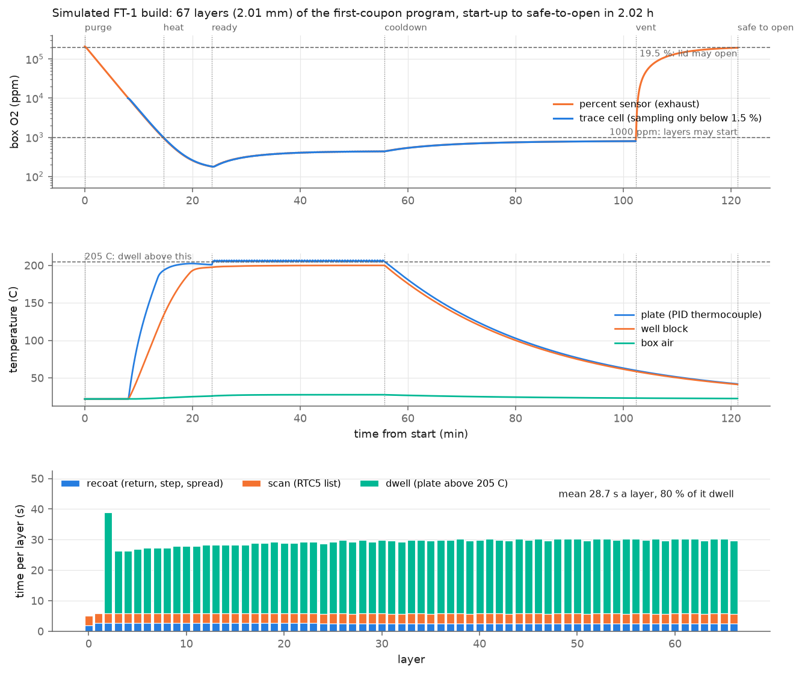
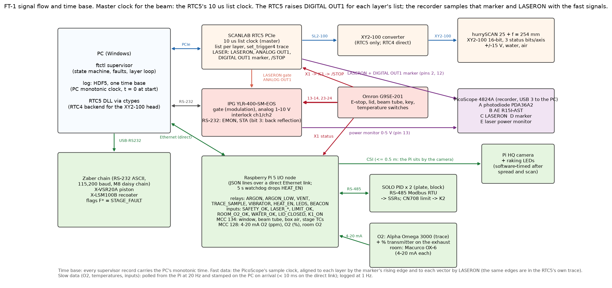
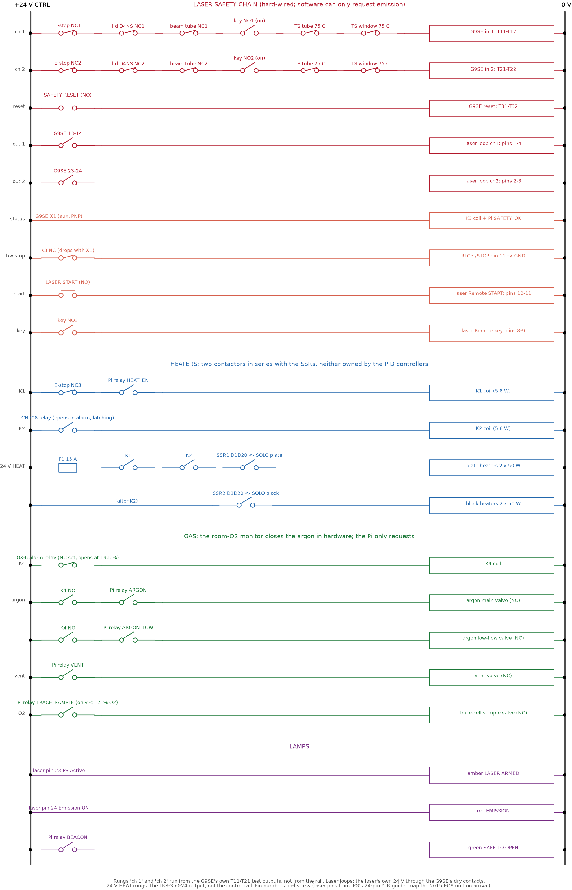
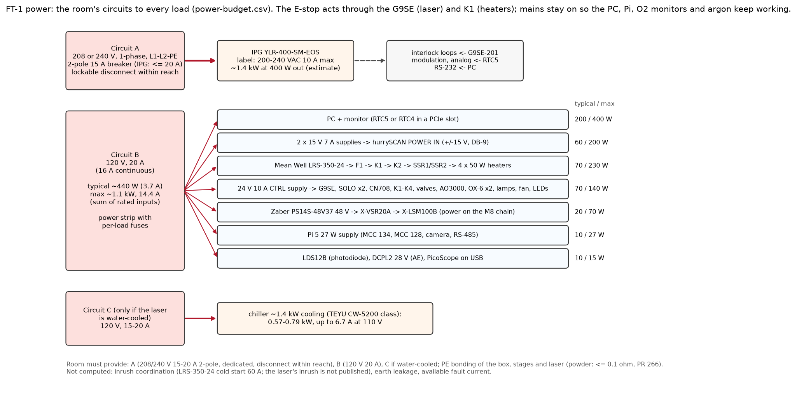

# FT-1 control: electrical I/O, interlocks, power, and the build supervisor

For [issue #260](https://github.com/vertical-cloud-lab/digital-alloy-lab/issues/260), 2026-11-27. This folder is the
electrical and software side of the fast-track machine in [`../README.md`](../README.md): every signal and load, the
hard-wired safety chain, and a Python supervisor that runs a build on the real hardware or on a simulation of it.
Nothing has been bought, wired, powered, or reviewed by an electrician, BYU's Laser Safety Officer or EHS.

| File | What it is |
|---|---|
| [`io-list.csv`](io-list.csv) | 70 signals: device, signal, type, level, connector and pin, from, to, owner, status, source |
| [`power-budget.csv`](power-budget.csv) | every load with its supply, typical and maximum power, and the circuit totals |
| [`make_tables.py`](make_tables.py) | writes both CSVs from one source and checks the totals |
| [`diagrams/`](diagrams/) | `interlock-ladder`, `power-single-line`, `signal-flow` (PNG and SVG), drawn by [`draw.py`](diagrams/draw.py) with schemdraw |
| [`ftctl/`](ftctl/) | the supervisor package (below) |
| [`tests/`](tests/) | 51 pytest cases, all in simulation or against stand-ins for the hardware |
| [`out/dwell-study.csv`](out/dwell-study.csv) | layer period and argon use against the dwell band, plate-block conductance, absorptivity and block offset |
| [`img/sim-build-2mm.png`](img/sim-build-2mm.png) | one simulated 2 mm build from start-up to safe-to-open |

```bash
cd desktop-lpbf/fast-track/control
pip install -r requirements.txt
python -m ftctl simulate --layers 20          # simulated build of 20 layers of the process worker's scan program
python -m ftctl simulate --height 2           # a 2 mm build (67 layers), start-up to safe-to-open, in ~3 s
python -m ftctl simulate --layers 20 --fault o2_leak@layer5
python -m ftctl info                          # layers and planned RTC5 list times of the scan program
python -m ftctl interlock                     # contact-level check of the hard-wired chain
python -m ftctl study-dwell                   # out/dwell-study.csv
python -m ftctl plot --height 2               # img/sim-build-2mm.png
python -m pytest tests                        # 51 tests, 15-75 s depending on load
python make_tables.py && python diagrams/draw.py
```

The scan program is the process worker's NPZ (`../process/out/build_first_coupons_15mm.npz`: 3 × 10 mm and 2 × 5 mm
cubes, 500 layers of 30 µm, ~514 vectors a layer, 250 W hatch at 1200 mm/s). Without it the tools use a synthetic
10 × 10 mm square.

## Short answer

- **The laser can only emit through hardware.** An Omron G9SE-201 safety relay takes the E-stop, the lid switch, the
  beam-tube switch, the key and four bimetal temperature switches on two channels, and its two outputs are the laser's
  two interlock loops. Software requests emission (EMON over RS-232, LASERON from the scan card) and can always stop
  it. A contact-level model of the chain, checked over 1,048,576 transitions (every combination of its 14 contacts,
  the two buttons, EMON and LASERON from every reachable state), never emits with a contact open, and none of 16
  single faults (a stuck contact, a welded output) leaves the beam on.
- **The supervisor runs the whole build** (purge → heat → home → arm → layer loop → cool → vent → safe to open), with
  21 fault codes, each tested to end in a safe stop, and one log on one time base (HDF5). Every device has a simulated
  backend, so the build runs on a laptop: a 2 mm build (67 layers) simulates in about 3 s, a 15 mm build (500 layers)
  in 13 s.
- **Simulated 2 mm build** ([figure](img/sim-build-2mm.png)): purge to 1000 ppm in 14.6 min, ready at 23.4 min (the
  heaters start once O₂ < 1 %), 67 layers in 32 min, cool to 60 °C in 47 min, vent to 19.5 % O₂ in 19 min:
  **2.0 h from start to safe-to-open**, 1.2 m³ of argon. The purge time sits inside the study's 13-31 min.
- **Six findings change parts or numbers elsewhere in the study:**
  1. **The RTC5 cannot drive the 2003 hurrySCAN 25 on its own.** Its head connector speaks SL2-100 only; an XY2-100
     head needs SCANLAB's XY2-100 converter, which isn't in `parts.csv` (RTC5 manual Rev. 1.9 e, pp. 41-43).
     **Recommended: the used RTC4 PCIe ($400)**, which drives XY2-100 directly (§6). `ftctl` has backends for both.
  2. **The trace O₂ analyzer can't tell when the lid may open.** The Alpha Omega Series 3000's widest range is
     0-10,000 ppm, and its cell should not sit in air. Add a percent-range O₂ transmitter (4-20 mA = 0-25 %) on the
     exhaust and a 24 V valve that isolates the trace cell above 1.5 %. The analyzer has no pump and wants 0.1-1.5 psig;
     the box runs at 0.07-0.15 psig, so a sample pump may be needed.
  3. **The lid switch: one Omron D4NS-2CF, not two coded reed switches.** Omron's G9SE-201 documents cover
     direct-opening mechanical switches and Type 4 OSSD sensors, not reed-type coded switches. And with two lid
     switches in series, a stuck contact in either is masked every time the lid opens; with one, it is caught on the
     next opening (§2.2).
  4. **The plate's heat sets the build time.** The laser leaves ~56 W in the plate at the no-dwell rate, and the plate
     can pass only ~11 W to the block through the 0.1 mm argon gap at +5 K. The dwell then takes 80 % of every layer:
     30 s a layer, **4.2 h for 15 mm** (the study assumed 1.2-1.8 h for 10 mm). Running the well block 20 K below the
     plate during the build gives 11.8 s a layer and 1.6 h; the gap's radial clearance changes by ~9 µm (§7).
  5. **Cross-flow only when it is needed.** Dropping to a 5 L/min hold flow during dwells cuts the argon used while
     building a 15 mm part from 6.5 to 2.3 m³ (§7). It needs a second argon valve and a needle valve.
  6. **Back reflection** (Edison round 2's top risk) is STA bit 3 of the YLR status word and also pulls the laser's
     Error/Ready output low; the supervisor polls the first at 5 Hz while scanning and watches the second, and stops
     on either. Whether this unit has back-reflection protection is a question for IPG with the serial number.
- **Power:** the laser on its own 208/240 V, 15 A 2-pole circuit (label: 200-240 V, 10 A); everything else ~440 W
  typical and 14.4 A at most (sum of rated inputs) on one 120 V 20 A circuit; a third circuit only if the laser turns
  out to be water-cooled (§3).



*A simulated 2 mm build of the first-coupon program (`python -m ftctl plot`). Top: box O₂ from the percent sensor and
the trace cell, which samples only below 1.5 %. Middle: plate, block and box air. Bottom: where each layer's time
goes; the dwell is the plate shedding the laser's heat (§7).*

## 1. The supervisor (`ftctl`)

| Module | What it does |
|---|---|
| `supervisor.py` | start-up, layer loop, dwell and hold, end of build, fault checks at every poll, safe stop |
| `states.py` | the 18 states and the only transitions allowed between them |
| `faults.py` | the 21 fault codes with how each is detected, what the supervisor does, and what acts without it |
| `config.py` | every parameter with its source or "estimate" |
| `scanprog.py` | reads the process worker's NPZ; RTC5 list timing (10 µs clock, delays) per layer |
| `logger.py` | events as JSON lines while running; samples, layers, events and markers in one HDF5 at the end |
| `clock.py` | the single time base: `RealClock` (PC monotonic) or `SimClock` |
| `interlock.py` | the contact-level model of the hard-wired chain and its exhaustive check |
| `commission.py` | first light, hot piston test, dose-and-spread test, daily chain proof test |
| `studies.py`, `plots.py` | the dwell study and the build figure |
| `hw/interfaces.py` | the small interfaces: `ScanCard`, `Laser`, `Axis`, `HeaterZone`, `IoNode`, `Camera` |
| `hw/sim.py` | the simulated machine: gas, heat, stages, safety chain, laser, scan card |
| `hw/rtc5.py` | SCANLAB RTC5 through `RTC5DLLx64.dll` with ctypes: 40 functions with argument types and units from the manual |
| `hw/rtc4.py` | SCANLAB RTC4: the same card interface with the RTC4's differences |
| `hw/ipg.py` | IPG YLR over RS-232: EMON/EMOFF, STA decoding, configuration |
| `hw/zaber.py` | both Zaber stages through `zaber-motion` |
| `hw/pinode.py` | the Raspberry Pi 5 I/O node: gpiozero relays and inputs, MCC 134/128, SOLO PIDs over Modbus, a JSON-lines link to the PC and a 5 s watchdog |

### 1.1 The sequence

- **Start-up.** Argon on (~27 L/min). The trace cell's sample valve opens once the percent sensor reads < 1.5 %. The
  heaters start below 1 % O₂ and the purge ends below 1000 ppm. Plate and block must then hold 200 ± 3 °C for 60 s.
  The stages home hot, so the piston's zero is at its working temperature. The operator closes the chain (SAFETY
  RESET) and starts the laser's supply (LASER START); the supervisor sends `EEC EMOD DGM DLE ABF` and `EMON`.
- **Each layer** (the study's order, §3.3):
  - preflight: O₂ < 1000 ppm and box air < 45 °C, else HOLD;
  - return the hopper-blade over the scanned layer (vibrator off), step the plate down 30 µm, spread forward with the
    vibrator on;
  - camera ('powder');
  - dwell if the plate is above 205 °C;
  - the layer's RTC5 list; O₂, the laser's STA word and the head status are polled while it runs;
  - camera ('scanned'), log the layer, dwell again if needed.
- **End of a build.** EMOFF, heaters off, argon at the hold flow until the plate is < 60 °C. Then argon off, trace cell
  isolated, air in through the inlet filter at ~10 L/min until the percent sensor reads ≥ 19.5 % (NIST AMMT's rule),
  then SAFE TO OPEN.
- **Safe stop**, on any fault, in this order: `stop_execution`, EMOFF, both stages stopped where they are (a person may
  be at the lid), vibrator off, heaters off (K1 dropped), argon kept flowing unless the room's O₂ is low. The layer in
  progress is logged incomplete.

### 1.2 Faults (each has a test in `tests/test_faults.py`)

| Code | Detected by | The hardware acts on its own |
|---|---|---|
| INTERLOCK_OPEN | G9SE status output low | the G9SE opens both laser loops; K3 pulls the RTC5's /STOP low |
| LASER_FAULT | Error/Ready low; STA bits 1, 6, 19, 24, 25, 29, 30, 31; supply dropped with the chain closed | the laser's own protection |
| BACK_REFLECTION | STA bit 3, polled at 5 Hz while scanning | the laser, if it has the protection |
| SCANNER_FAULT | head PowerOK or TempOK lost (`get_head_status`) | RTC5: `set_laser_control` bits 16, 17, 19, 20, 28 suppress LASERON and stop the list |
| COOLING_FAULT | scan head water flow switch open | - |
| RTC_ERROR | `get_last_error` ≠ 0, or a list running > 1 s past its plan | - |
| O2_HIGH | O₂ > 1500 ppm during a scan | - |
| O2_TIMEOUT | the purge, or a hold, does not get under 1000 ppm in time | - |
| ROOM_O2_LOW | the room monitor's relay or its 4-20 mA below 19.5 % | the OX-6 relay drops K4, which closes both argon valves |
| STAGE_FAULT | Zaber flags F* (FS stalled, FD, FE, FT, FQ, FM, FV, FF ...), a move overrunning its plan, or a position error > 0.05 mm | - |
| TC_OPEN | any thermocouple open (SOLO 0x8002-0x8007, MCC 134 -9999) | the SOLO's sensor-break action turns its SSR off |
| PLATE_OVERTEMP | plate or block > 225 °C | the CN708 opens K2 at 240 °C (latching) |
| LIMIT_TRIPPED | K2 open | K2 is already open |
| HEAT_TIMEOUT, DWELL_TIMEOUT | not at temperature in 45 min; plate above the band for 10 min | - |
| WINDOW_HOT | window ring > 65 °C, warning at 55 °C (a fouled cover slide, Edison round 2) | bimetal switches at 75 °C open the chain |
| STRAY_BEAM | beam tube > 60 °C | the same switches |
| BOX_AIR_HOT | box air > 50 °C (the stages' rating); hold above 45 °C | - |
| IO_LINK_LOST | the Pi doesn't answer for 2 s | the Pi's watchdog drops HEAT_EN, the vibrator and the LEDs after 5 s |
| OPERATOR_STOP, INTERNAL_ERROR | stop request; an exception in a driver | - |

The simulation caught one design error: the window ring's software fault was first set at 80 °C, above the 70 °C of its
bimetal switch, so the hardware tripped first. Now software warns at 55 °C and stops at 65 °C, and the switches open at
75 °C as the backstop.

### 1.3 Backends and what checks them

| Device | Simulated | Real backend | Checked against |
|---|---|---|---|
| Scan card | list runs for its planned time; layer markers | `Rtc5Scan` / `Rtc4Scan` (ctypes) | a fake DLL that records every call: call order, units (scanner delays in 10 µs, laser delays in 0.5 µs or 1 µs plus the converter's 10 µs, speeds in bits/ms), every coordinate inside ±524,287 (RTC5) or ±32,767 (RTC4), power 250 W → 2559 (12-bit) or 639 (10-bit) |
| Laser | supply, EMON, STA bits, injected faults | `IpgYlr` (pyserial) | a fake port answering as the guide's examples (`STA: 4100` → emission on, modulation enabled) |
| Stages | trapezoidal moves, stall when thrust × current < load | `ZaberAxis` (zaber-motion 10.3.1) | a fake axis; units and flags checked against zaber-motion's own enums (its mock connection cannot move devices) |
| PID zones | PI control on lagged thermocouples, sensor-break action | `SoloPid` (minimalmodbus) | a fake instrument: PV 0x1000, SV 0x1001 in 0.1 °C, error codes |
| Pi I/O node | outputs, inputs, temperatures, analog | `PiIoNode` + `RemoteIoNode` over TCP | gpiozero's `MockFactory` pins, a real TCP link on localhost, the watchdog dropping HEAT_EN |

Not run against real hardware or real DLLs: the RTC DLLs are Windows-only and not on this runner, and nothing has been
bought.

### 1.4 One time base



- **The supervisor** stamps every record with the PC's monotonic clock (t = 0 at start).
- **The scan card** raises DIGITAL OUT1 (LASER pin 12) for the length of each layer's list and records LASERON, X, Y
  and ANALOG OUT1 every 10 µs with `set_trigger4` (up to 2¹⁹ samples a channel: 5.2 s, against ~3.2 s lists).
- **The recorder** (PicoScope 4824A, 8 channels on one sample clock) records the photodiode, the AE sensor, LASERON,
  the layer marker and the laser's power monitor. The marker's rising edge ties each recording to a layer, and the
  LASERON edges tie it to each vector of the card's own trace.
- **Slow signals** are read from the Pi at 20 Hz and stamped on the PC when they arrive.
- The supervisor's acquisition code for the PicoScope is not written; the wiring and the sync scheme are.

**Edison's "position-synchronous output" is not what the RTC5 offers.** The RTC5's *output synchronization* (manual
p. 149) locks the galvo motion to the pulses of a free-running *pulsed* laser on DIGITAL IN1 (50 kHz-6.4 MHz), which a
CW YLR doesn't have. Position-dependent laser control (p. 140) exists, but nothing here needs it: the marker and
LASERON give the time base.

## 2. Interlocks



### 2.1 The chain

- **G9SE-201** (24 VDC, 3 W):
  - inputs: T11-T12 and T21-T22, one per channel, each a series of E-stop, lid, beam tube, key and two temperature
    switches;
  - manual reset: T31-T32 through the SAFETY RESET button;
  - outputs: 13-14 and 23-24 (30 VDC, 5 A) into the laser's loops, pins 1-4 and 2-3 in IPG's 24-pin guide;
  - X1 (PNP, 100 mA) to the Pi's SAFETY_OK input and to relay K3, whose NC contact pulls the RTC5's /STOP low when
    the chain opens.

  Outputs drop within 15 ms; the laser removes diode power within 500 ms (IPG guide). A mismatch between the channels
  latches until both open (Omron instruction sheet).
- **Heaters:** K1 (E-stop third contact + the Pi's HEAT_EN relay) and K2 (the CN708's latching relay) in series in
  the 24 V heater bus, ahead of the two SOLO-driven SSRs.
- **Gas:** the room monitor's alarm relay holds K4, and K4 feeds both argon valves, so a room O₂ alarm closes the
  argon with no software involved.

### 2.2 The contact-level check (`python -m ftctl interlock`)

| Check | Result |
|---|---|
| Transitions checked (4 reachable states × 2¹⁴ states of the 14 contacts × RESET, START, EMON, LASERON) | 1,048,576 |
| Emission with any contact open | 0 |
| Safety outputs closed without a RESET pulse | 0 |
| Single faults (14 contacts stuck closed, 2 outputs welded) that leave the beam on at any of 127 demands | 0 of 16 |
| Stuck contact caught when its own device is operated alone | 14 of 14 |
| Caught when the lid is opened, with **two** lid switches in series | 0 of 14 |
| Caught when the lid is opened, with **one** lid switch | yes, for the lid switch's own contacts |
| Welded G9SE output | caught every time: the laser's own channel monitoring refuses to restart |

What that means:
- **Fit one lid switch in the chain.** Buy an **Omron D4NS-2CF** (Digi-Key Z4035-ND: 3PST, 2 NC + 1 NO, direct
  opening, M20 conduit; 552 in stock at $79.27 on 2026-11-27), with a D4DS-K operation key on the lid. Its two NC
  contacts go to the two channels and its NO to the Pi's LID_CLOSED input. If a second switch is wanted on the lid,
  wire it to the Pi only.
- **A short proof test before each day's work** (`commission.chain_proof_test`): with the laser off, open the E-stop,
  the key, the lid and the beam tube one at a time and check that the chain opens and re-arms. In a series chain this
  is the only way a stuck contact in another device shows up.
- Reed-type coded switches (Schmersal BNS 260, IDEC HS7A-DMC) are specified with their makers' own relays. Pilz's
  PSEN 1.1p lists criteria for third-party relays, and the G9SE probably meets them (estimate). The D4NS is the
  documented match.

## 3. Power



| Circuit | Loads | Typical | Max |
|---|---|---:|---:|
| A: 208 or 240 V 1-phase, 2-pole 15 A | IPG YLR-400-SM-EOS (label 200-240 V 10 A) | ~1.4 kW (estimate) | 10 A |
| B: 120 V 20 A | PC; ±15 V head supplies; LRS-350-24 heater supply; 24 V control supply; Zaber 48 V; Pi; instrument adapters | ~440 W | 14.4 A (sum of rated inputs; 16 A continuous allowed) |
| C: 120 V 15-20 A (only if water-cooled) | chiller ~1.4 kW cooling (TEYU CW-5200 class) | ~0.6 kW | 6.7 A |

**What the room must provide:**
- circuit A, dedicated, with a lockable disconnect within reach of the laser: IPG's guide asks for a breaker of no
  more than 20 A, marked as the laser's disconnect;
- circuit B;
- circuit C if the laser is water-cooled.

The E-stop does not cut mains, so the PC, the Pi, the O₂ monitors and the argon keep running. Not computed: inrush
coordination (the LRS-350-24 draws 60 A on a cold start; the laser's inrush is not published), earth leakage, and the
available fault current.

## 4. The I/O list in short

| Owner | Rows | What |
|---|---:|---|
| SAFETY | 21 | the chain, its outputs into the laser, K3/K4, buttons, lamps, the room-O₂ cut-off |
| PI | 20 | 8 relays, 9 opto inputs, 4 thermocouples (MCC 134), 3 × 4-20 mA (MCC 128), camera, LEDs |
| RTC | 8 | scan head link, LASERON, ANALOG OUT1, layer marker, /STOP, head status |
| STANDALONE | 8 | two SOLO PIDs, two SSRs, the CN708, K2, heaters |
| REC | 5 | photodiode, AE, laser power monitor, BUSY, the recorder |
| PC | 4 | laser RS-232, Zaber chain, back-reflection status, the spare laser inputs handled over RS-232 |
| POWER | 4 | laser mains, scan head ±15 V, Zaber supply |

**Pi 5 pin map** (BCM; MCC HATs use GPIO 8-11, 12, 13 and 26):
- outputs, through a ULN2803A into 24 V DIN relays: ARGON 17, ARGON_LOW 27, VENT 22, TRACE_SAMPLE 23, VIBRATOR 24,
  HEAT_EN 25, LEDS 4, BEACON 18;
- opto-isolated 24 V inputs: SAFETY_OK 14, LASER_PS_ACTIVE 15, LASER_EMISSION 16, LASER_READY 19, LIMIT_OK 20,
  ROOM_O2_OK 21, WATER_OK 2, LID_CLOSED 3, K1_ON 7 (with `dtoverlay=spi0-1cs`).

The camera is the Pi HQ camera, which has no external trigger input (the Global Shutter camera has one). Layer images
are taken in software after each spread and scan, when the bed is still.

## 5. Arrival checks for the laser interface

IPG's public YLR-series user guide ([24-pin generation](https://manualedistruzioni.it/ipg/measuring-instrument/ylr-series/user-manual/20cai),
pp. 43-45, 56-64) is the best public description. This unit is a 2015 EOS OEM laser whose panel shows INTERLOCK,
MODULATION INPUT and RESET connectors instead, so the guide gives the functions to look for, not the pins.

| Function | The guide says (known) | Measure on this unit |
|---|---|---|
| Interlock | two loops (pins 1-4, 2-3), potential-free contacts rated > 1 A / 24 VDC, < 500 ms response, Cat 3 PL d; one loop open: both must open before a restart | which INTERLOCK pins pair up (continuity, unpowered); each pair's open-circuit voltage and closed-loop current (powered, key off); that the two loops share no conductor; isolation to chassis |
| Gate (modulation) | 5-24 V CMOS, 6 mA sink, 20 µs, ≤ 50 kHz | connector type (likely BNC), input impedance, the threshold with a 0-5 V square wave from a function generator, the response at 1, 10 and 50 kHz with the beam in the dump (S2) |
| Analog power | 1-10 V = 10-100 %, 1 mA, 100 µs; needs EEC | whether this unit has an analog input at all, or takes its power only over RS-232; its pins; power against voltage with the calorimetric check |
| Serial | RS-232, 57,600 8N1, CR-terminated (EMON, EMOFF, STA, RERR ...) | the port and baud rate (try 57,600, then 9600-115,200); `RFV`, `RSN`, `RET` (hours), `RMEC`, `STA`, decoded |
| Status outputs | Error/Ready, PS Active, Emission ON: 24 V, 100 mA source | which exist; their voltage, to size the opto inputs and lamps |
| Back reflection | STA bit 3, emission stops | the bit on the first `STA`; whether protection is fitted: ask IPG with the serial number |
| Mains | 200-240 V 1-phase (label: 10 A) | inlet type; inrush at first power-up with a peak-hold clamp meter |
| Cooling | YLR 400 W comes air- or water-cooled (datasheet rev 2/26) | fans and vents, or water fittings; if water, a chiller and circuit C |

**Order of work:**
1. Unpowered continuity and isolation.
2. Powered, key off: voltages on the interlock and the outputs.
3. RS-232 read-out.
4. Close the loops through the G9SE with the lid and beam tube closed, and the beam into the water-cooled dump. With a
   scope on PS Active, open each device in turn and time the drop (< 500 ms).
5. Connect the RTC5's LASERON and ANALOG OUT1 and run a test list with the key off; scope both to check levels and the
   laser delays.
6. First light (`commission.focus_ladder`): 50 W, 5 mm lines 8 mm off the field centre on an anodised or bead-blasted
   plate, one line per plate height from -1 to +1 mm (Edison round 2), still in the closed box.

**Scan head on arrival:**
- check the POWER IN pins against SCANLAB's sheet by continuity first: -15 V on 1, 2, 6; GND on 3, 7, 8; +15 V on
  4, 5, 9 (the sheet is current production, the head is from 2003);
- power it from a ±15 V bench supply limited to 0.5 A, then raise the limit;
- read PowerOK and TempOK through the card (`get_head_status`) before any beam.

## 6. Scan card for this head: RTC4 PCIe, RTC5 + converter, or a Teensy

| | RTC4 PCIe (eBay, $400, returns accepted) | RTC5 PCIe ($1,499.99) + SCANLAB XY2-100 converter | Teensy XY2-100 controller (OPAL, DTU) |
|---|---|---|---|
| Drives the hurrySCAN 25 | directly: 25-pin XY2-100 (RTC4 manual Rev. 1.3 e, p. 54) | only with the converter (RTC5 manual pp. 41-43); none found on eBay; SCANLAB quote | yes |
| Field resolution | 16-bit (all an XY2-100 head takes) | 20-bit in the card, 16-bit after the converter | 16-bit |
| Laser power output | 10-bit, OUT1 jumpered to 0-10 V (0.4 W steps at 400 W) | 12-bit | own DAC |
| List memory | 2 × 4,000 commands; a layer here needs up to ~2,250 (estimate) | 2²⁰ positions | firmware |
| Head-error laser suppression in hardware | no (the supervisor checks the head at 5 Hz) | yes (`set_laser_control`) | no |
| Software | DLL for Windows; the 2006 manual covers XP/2000 only; **a 64-bit DLL is not confirmed** from a document opened here | 64-bit DLL, current | weeks of firmware; OPAL warns it is pre-alpha |
| In `ftctl` | `hw/rtc4.py`: tested against a fake DLL; three signatures unconfirmed | `hw/rtc5.py`: 40 functions from the manual | not written |

**Recommendation: buy the RTC4 PCIe now.** It is cheaper, returnable, and drives the head without a part nobody has
priced. Before paying, ask the seller or SCANLAB for its driver package and a 64-bit Windows 10/11 DLL. Buy the RTC5
only if its seller includes a converter. The Teensy is the fallback if both fail.

Evidence for the RTC4:
- XY2-100 on the head connector: the RTC4 manual, p. 54. The RTC5 manual's notes for RTC4 users (pp. 31-34) list
  exactly what changed: the RTC4 had no `init_rtc5_dll`, used 16-bit coordinates, 10-bit analog outputs and 1 µs
  laser delays, and loaded `.ctb` correction files with its own arguments.
- The 64-bit RTC4 DLL is not confirmed. SCANLAB names its 64-bit DLLs `RTCnDLLx64.dll` for the RTC5 and RTC6, and a
  search snippet of a SCANLAB product sheet mentions 32- and 64-bit RTC4 drivers, but the sheet itself did not open.
- `rtc4.py` marks three items as unconfirmed: the 64-bit DLL's file name, `load_correction_file`'s argument list, and
  `enable_laser`/`disable_laser` on the RTC4. Check them against `RTC4expl.h` from SCANLAB's package before the
  first run.

## 7. Heat and argon: the dwell study (`out/dwell-study.csv`)

The plate (Ø39.8 × 28 mm + its substrate, ~105 J/K) takes the laser's heat: 0.45 × ~720 J a layer for the first-coupon
program. Its only good path out is the 0.1 mm argon gap to the block: argon at ~0.025 W/(m·K) over 3,510 mm², about
0.9 W/K (estimate; an FEA of the plate and block should replace it). The rod is a thermal break by design.

| Dwell band | Plate-block (W/K) | Absorptivity | Block offset | s a layer | Dwell share | 15 mm build | Argon while building 15 mm |
|---:|---:|---:|---:|---:|---:|---:|---:|
| +5 K | 0.9 | 0.45 | 0 | 30.0 | 81 % | 4.17 h | 2.26 m³ (6.47 m³ with full flow in dwells) |
| +3 K | 0.9 | 0.45 | 0 | 36.1 | 84 % | 5.01 h | 2.51 m³ |
| +10 K | 0.9 | 0.45 | 0 | 21.2 | 73 % | 2.95 h | 1.90 m³ |
| +20 K | 0.9 | 0.45 | 0 | 13.4 | 57 % | 1.87 h | 1.58 m³ |
| +5 K | 2.0 | 0.45 | 0 | 19.1 | 70 % | 2.65 h | 1.82 m³ |
| +5 K | 5.0 | 0.45 | 0 | 10.2 | 43 % | 1.41 h | 1.63 m³ |
| +5 K | 0.9 | 0.30 | 0 | 20.7 | 72 % | 2.88 h | 1.88 m³ |
| +5 K | 0.9 | 0.60 | 0 | 38.6 | 85 % | 5.36 h | 2.61 m³ |
| +5 K | 0.9 | 0.45 | -10 K | 16.6 | 65 % | 2.31 h | 1.76 m³ |
| **+5 K** | **0.9** | **0.45** | **-20 K** | **11.8** | **51 %** | **1.63 h** | **1.67 m³** |
| +10 K | 0.9 | 0.45 | -20 K | 10.0 | 42 % | 1.39 h | 1.65 m³ |
| +20 K | 2.0 | 0.45 | 0 | 7.4 | 21 % | 1.03 h | 1.40 m³ |

Without any dwell a layer is 5.8 s (2.6 s recoat, 3.2 s scan): the plate would settle ~50-60 K above the block. Each
run simulates 67 layers and takes the second half as steady.

**Recommendations:**
- Run the block 10-20 K below the plate during the build (`Thermal.block_offset_K`). 6061 expands 23.6 × 10⁻⁶/K, so
  20 K on Ø40 mm moves the 0.1 mm radial gap by ~9 µm.
- Keep the low argon flow in dwells (on by default).
- Measure the plate-block conductance on the machine before trusting any row above. With the block held at 200 °C,
  step the plate 20 K above it and fit the decay: τ = 105 J/K / (G_gap + ~0.03 W/K).

## 8. Commissioning (Edison round 2, in `commission.py`)

| Test | How | Pass (estimate unless noted) |
|---|---|---|
| First light | focus ladder: 50 W, 500 mm/s, 5 mm lines at x = 8 mm, plate at -1 … +1 mm | lines on anodised Al; no back-reflection bit; the narrowest line gives the focus |
| Hot piston | 10 full strokes at 200 °C, then the stroke repeated at falling motor current until it stalls (Zaber FS) | in simulation, a 23 N drag (estimate) moves at 25 % current: a 4× margin on the X-VSR20A's 100 N |
| Dose and spread | 20 cycles with the real powder, each dose weighed | coefficient of variation < 15 % (Edison) |
| Window ring | thermocouple on the ring, logged with every build | warning 55 °C, stop 65 °C |
| Trace O₂ | sample from the exhaust, isolation valve, percent sensor beside it | the purge reaches < 1000 ppm; the cell never sees air (the simulated build logs 0 s in air) |
| Interlock proof test | each device alone opens the chain | daily |

## 9. What is unknown, and what resolves it

| Unknown | Resolved by |
|---|---|
| the EOS laser's connectors, pins and levels | the measurements in §5 |
| back-reflection protection in this unit | IPG, with the serial number |
| air- or water-cooled | inspection on arrival (if water: chiller and circuit C) |
| power against the set point | the calorimetric check (water-cooled dump, flow, two thermocouples) |
| a 64-bit RTC4 driver | the seller or SCANLAB, before paying |
| plate-block conductance and absorptivity | the decay test in §7, the first builds' plate log, and an FEA |
| hot O-ring drag on the piston | the hot piston test |
| the trace cell's response time and the sample flow at +5-10 mbar | a step from argon to a calibration gas; a flowmeter on the sample line |
| the McMaster 8077K237 valve's coil power (behind McMaster's login) | its label (ASCO's equivalent: 10.6 W) |
| inrush of the laser and the supplies together | a peak-hold clamp meter at first power-up |

## 10. Parts this adds or changes (for `parts.csv`)

Prices as read on 2026-11-27 (by the lead or by the research for this folder); "estimate" where none was read.

| Change | Part | Price | Why |
|---|---|---:|---|
| add (or replaces L5) | SCANLAB RTC4 PCIe, used (eBay 366737163447) | $400.00 | drives the XY2-100 head; the RTC5 would need a converter (quote) |
| add | Omron D4NS-2CF lid switch (Digi-Key Z4035-ND) + D4DS-K operation key | $79.27 + ~$15 (estimate) | documented G9SE input; one switch in the chain |
| add | beam-tube switch, D4NS class | ~$80 (estimate) | 2 NC, direct opening |
| add | 4 bimetal NC temperature switches, ~75 °C | ~$60 (estimate) | stray-beam backstop, one per channel per location |
| add | percent O₂ transmitter on the exhaust (second Macurco OX-6, 4-20 mA on) | $553.50-663.00 | the trace analyzer stops at 10,000 ppm |
| add | 3 × 24 VDC NC solenoid valves (argon low flow, vent, trace-cell isolation; ASCO 8262 class) + a needle valve | 3 × $159 + ~$50 (estimate) | hold flow in dwells, slow vent, keep the trace cell out of air |
| maybe | Alpha Omega PMP-24 sample pump | $791 | the analyzer wants 0.1-1.5 psig; the box gives 0.07-0.15 |
| choose (H2) | 2 × AutomationDirect SOLO SL4848-VR-D (24 VDC, voltage-pulse output, RS-485 Modbus) | 2 × $143.00 | the "PID (not chosen)" of H2; one zone each for plate and block |
| add | 2 × Crydom D1D20 (one SSR a zone) + heat sinks | $93.36 each | H2 lists one |
| add | K3, K4: 24 VDC signal relays | ~$40 (estimate) | RTC5 /STOP from the chain; argon cut by the room monitor |
| add | MCC 134 + MCC 128 HATs, ULN2803A relay interface, 8 DIN relays, 16-ch opto input board, USB-RS485 | ~$700 (estimate) | the Pi I/O node |
| add | Zaber PS14S-48V37 (48 V 3.75 A) | $112 | one supply for the chain |
| add | 24 V 10 A control supply (Mean Well SDR-240-24 class) | ~$100 (estimate) | G9SE, PIDs, CN708, coils, valves, analyzers |
| add | water flow switch for the scan head | ~$60 (estimate) | COOLING_FAULT |
| monitoring | PicoScope 4824A | £2,189 ex VAT (RS UK; US price not read) | 8 channels on one clock: photodiode, AE, LASERON, marker, power monitor |
| monitoring | MISTRAS R15I-AST + Vallen DCPL2 | not read | AE sensor with its 28 V phantom-power decoupler |

## 11. Not done

- Nothing ran against real hardware or the SCANLAB DLLs. The backends are tested against stand-ins: a fake DLL, a fake
  serial port, a fake Zaber axis, gpiozero's mock pins and fake HAT readers.
- The PicoScope acquisition code, an operator UI (prompts are console messages), and the camera capture code on the
  Pi (`picamera2`) are not written.
- No Performance Level calculation (no B10d or MTTFd values collected), no electrician's review, no LSO or EHS review,
  no inrush, earth-leakage or fault-current calculation.
- The thermal and gas models are lumped. Their parameters are in `config.py` with sources, and most are estimates; the
  dwell numbers scale with them.
- Part numbers marked "part to choose" in `io-list.csv` (E-stop, key switch, temperature switches, relay and input
  boards) were not priced.
