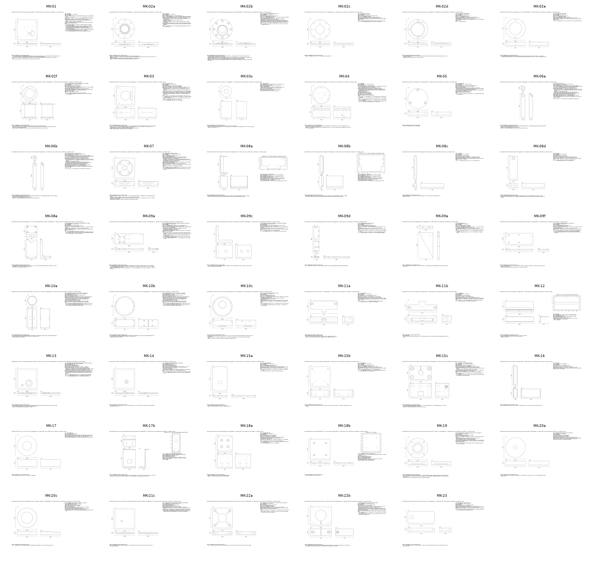

# Fast-track fabrication: the made parts, programmed, checked and counted

For [issue #260](https://github.com/vertical-cloud-lab/digital-alloy-lab/issues/260), PR 294 round 2, 2026-11-27. The CAD
model ([`../cad/ft_model.py`](../cad/ft_model.py)) draws the 18 made parts MK-01 to MK-18 as envelopes. This folder
turns them into what a shop makes:

- **35 pieces,** each with its joint holes, O-ring glands, stock, route and setups;
- **FreeCAD CAM** for every milled setup, posted to G-code;
- **a voxel check** of every program;
- **a drawing sheet** per piece;
- **shop hours** per piece and per state.

Nothing has been made, quoted or checked by a machinist. Vendor part numbers not read today are marked so.



## Short answer

- **35 pieces from 18 MK numbers:**
  - 27 milled (5 of them also turned);
  - 3 only turned or sawn (the Macor standoffs and the two beam tubes);
  - 4 bent or cut sheet, for SendCutSend (the hopper's two walls, the stage shield, the target plate);
  - MK-17, the FT-0 rod collar, is bought: it is a catalogue 1/2 in. clamp collar.
- **Shop hours are 3-5 times the study's estimate.** Counted per piece with PR 266's allowances (CAM, setups,
  machine time, deburr and inspection; "Low" uses robot-shop.md's smaller allowances):

  | Machine (cumulative) | This count | Low | Study (`fast_track.py`, parts.csv F2a-c) | At $65/h |
  |---|---:|---:|---:|---:|
  | FT-0 (S1 + S2 + FT-0 pieces) | **92 h** | 44 h | 10-15 h | $2.9k-6.0k |
  | FT-1 | **123 h** | 59 h | 25-40 h | $3.8k-8.0k |
  | FT-1V | **141 h** | 68 h | 30-48 h | $4.4k-9.2k |

  The study's estimate covered "about 12 simple parts". Drawn to size, with every joint, the same machine is 35 pieces
  in 64 mill setups.
- **Where the 141 h go:**
  - CAM: 62 h;
  - setups: 61 h;
  - deburr and inspection: 12 h;
  - machine time: 6.5 h. Of that, 3.4 h is programmed cutting (FreeCAD's own estimate 4.8 h), 0.7 h tapping and
    tool changes, 1.6 h turning and 0.9 h hand work.

  The cutting is the small part, as in PR 266's count, so the levers are fewer pieces, fewer setups, and CAM that
  is reused rather than rewritten.
- **The CAM is written and posted.**
  - **Programs:** 64 setups, 189 FreeCAD operations, `linuxcnc` post, in [`gcode/`](gcode/).
  - **Taken as done:** if a programmer only reviews and proves them out (0.25 h a setup, an assumption), CAM drops
    from 62 h to 19 h, and the FT-1 machine to about 85 h.
- **Every program was cut on a voxel blank** ([`sim.py`](sim.py), table [below](#the-programs-checked)).
  - **The check found 12 faults** in the first programs, and the time recount 3 more; all are fixed in these files
    ([list](#faults-the-checks-found)).
  - **Six were FreeCAD 1.0.2 behaviours** worth knowing:
    - `PocketShape` posts no path;
    - `Pocket`, `Adaptive` and `MillFace` skip a floor that is open to the side;
    - a 3D `Pocket` also clears the disc inside an O-ring groove;
    - the helix's `StartRadius` leaves a core;
    - Custom-op feeds are read as mm/s;
    - a Job's first op fails headless if the Job has two tool controllers.
- **Design changes the assembly model should take** are [listed below](#changes-for-the-assembly-model). The ones that
  matter:
  - **The well block's thermocouple hole runs straight through a heater hole** in the model. Moved to z 10.
  - **The window ring needs a 4 mm lip and a 12 mm height** to carry an O-ring under the window (the model's lip is
    2 mm).
  - **The rod gland's squeeze is right only if the rod OD is held to 0.497-0.501 in.** ASTM A269's ±0.005 in. on a
    1/2 in. seamless tube gives 9-20 %, against Parker's 10-17 %.
  - **The carriage bracket has only 3.0 mm under the stage shield for a foot.**
- **Schedule:**
  - **The risk:** one machinist making the S1, S2 and FT-0 pieces in that order, with PR 266's allowances, needs
    11.5 working days, about 2.3 weeks. FT-0's earliest start is 1.8 weeks (scenario A, `cad/README.md`), so FT-0
    would wait on the shop for about half a week.
  - **The fix:** reuse this CAM. FT-0's pieces are then done in about 8 working days (11 calendar days), and FT-1's
    by day 11 (2.1 weeks, against FT-1's earliest 3.2 weeks). See the [first-week plan](#first-week-shop-plan).

## Files

| File | What it is |
|---|---|
| [`parts.py`](parts.py) | the 35 pieces in CadQuery, built from `ft_model.P` (ft_model.py is not edited): geometry, holes, glands, stock, route, setups, lathe and hand steps, tolerances, and what changed against the model. Every cut is recorded as a CAM feature. Writes `out/pieces.json`, BREP/STL to `/tmp/ft-fab/pieces/`, DXF flat patterns to `out/dxf/` |
| [`tools.py`](tools.py) | the common tool library (face mill, 1/2, 1/4, 1/8 in. and 2 mm end mills, a 90° spot drill, 16 drills), thread and hole tables, and PR 266's time allowances |
| [`cam.py`](cam.py) | FreeCAD 1.0.2 CAM, headless: one Job per setup, ops from the recorded features, `linuxcnc` post → [`gcode/`](gcode/), [`out/cam.json`](out/cam.json) (per op: tool, feed, FreeCAD CycleTime, recount) |
| [`sim.py`](sim.py) | the voxel check of every posted program → [`out/sim.json`](out/sim.json), [`img/sim-check.png`](img/sim-check.png) |
| [`hours.py`](hours.py) | shop hours per piece, per state, and for an outsourced split → [`out/hours.md`](out/hours.md), `out/hours.csv`, `out/hours.json` |
| [`drawings.py`](drawings.py) | one sheet per piece → [`drawings/`](drawings/) (PDF), [`img/drawings-contact.png`](img/drawings-contact.png) |
| [`out/dxf/`](out/dxf/) | flat patterns of the four sheet pieces (cut layer only; bends on the drawings) |

```bash
/tmp/venv/bin/python desktop-lpbf/fast-track/fab/parts.py                       # pieces, out/pieces.json, out/dxf
/tmp/tools/capmem 3 /tmp/setup/squashfs-root/usr/bin/freecadcmd -c \
  "import runpy; runpy.run_path('desktop-lpbf/fast-track/fab/cam.py', run_name='__main__')"   # gcode/, out/cam.json
/tmp/tools/capmem 2 /tmp/venv/bin/python desktop-lpbf/fast-track/fab/sim.py     # out/sim.json, img/sim-check.png
/tmp/venv/bin/python desktop-lpbf/fast-track/fab/hours.py                       # out/hours.*
/tmp/tools/capmem 2 /tmp/venv/bin/python desktop-lpbf/fast-track/fab/drawings.py   # drawings/*.pdf
```

Run times on the shared runner: `parts.py` 10-30 s; `cam.py` 80 s for all 64 setups; `sim.py` about 10 min;
`drawings.py` about 1 min. FreeCAD is the official 1.0.2 conda AppImage, extracted, as in PR 266.

## The pieces

Shop h uses PR 266's allowances; Low uses robot-shop.md's. Program min is the posted G-code's recount (feeds as
programmed, rapids at 25.4 m/min), times the quantity. Full columns are in [`out/hours.md`](out/hours.md).

PIECE_TABLE

**Stock.** Part numbers that were read in PR 266's files are given with the date they were read:

| Stock | McMaster number | Price | Read in |
|---|---|---:|---|
| 1/2 in. 6061-T651, 12 × 24 in. | 89155K135 | $148.74 | `mcmaster-parts.csv`, 2026-11-17 |
| 3/4 in. 6061-T651, 12 × 24 in. | 89155K155 | $211.96 | `audit-prices.csv`, 2026-11-22 |
| Macor rod, 5/16 in. × 6 in. | 8489K75 | | parts.csv H4 |

The other sizes are standard 6061 bar and plate, 304 seamless tube and 6061 tube; their part numbers were not read
(no McMaster page was fetched for this round) and are marked "PN not read". Two blanks for the deck and the head plate
come from one 89155K135 sheet; the stage bracket plate needs a second.

## O-ring glands

From the Parker O-Ring Handbook ORD 5700 (50th anniversary edition, 2018), read on 2026-11-27. Parker's own copy
returned HTTP 403 to automated fetches, so the values were read from a distributor's copy of the same PDF
(`https://www.marcorubber.com/downloads/Parker_O-Ring_Handbook_ORD_5700.pdf`). Page numbers are the printed ones; the
gland drawing's finish labels (p. 5-31) were placed from the extracted text, so check them on the page.

| Seal | O-ring (AS568) | Gland | Parker basis | Squeeze | Fill |
|---|---|---|---|---|---:|
| Rod, 2 in series (MK-07) | -112: 0.487 × 0.103 in. (12.37 × 2.62) | throat 12.95 +0.05/0; groove Ø17.15-17.20 (0.675-0.677 in.) × 3.56-3.68 wide (0.140-0.145); 1.59 mm lands | Design Table 5-2 (2-112 on a 0.499 rod); Chart 5-2-a: L .088-.090, R .005-.015 | 10.0-17.9 % with the rod at 0.497-0.501 in.; 9.0-19.8 % at ASTM's ±0.005 | 66 % |
| Window, under the fused silica (MK-02a) | -030: 1.614 × 0.070 (41.00 × 1.78) | face groove ID 41.20, 2.20 wide, 1.32 deep | Chart 4-3: L .050-.054, G .084-.089 for vacuum and gases; external pressure: groove ID = O-ring ID +0-1 % | 19-32 % | 86 % |
| Window ring to lid or cube top plate (MK-02a) | -140: 2.237 × 0.103 (56.82 × 2.62) | face groove ID 57.10, 3.11 wide, 1.96 deep | Chart 4-3: L .074-.080, G .120-.125 | 20-30 % | 89 % |
| Gland plate to floor (MK-07) | -031: 1.739 × 0.070 (44.17 × 1.78) | face groove ID 44.39, 2.20 wide, 1.32 deep | Chart 4-3 | 19-32 % | 86 % |

- **Two O-rings in series on the rod.** Parker calls this "quite feasible" for gases and vacuum (section 5.32), not a
  requirement.
- **The throat is looser than Parker's.** Parker lists a 0.501 +.001 in. throat for a 0.499 in. rod. Here it is
  12.95 mm (0.510 in.) to pass the tube's tolerance. Extrusion is no concern at one atmosphere.
- **Finishes:**
  - the rod surface 16 RMS (Parker: 10-20 µin);
  - face-seal lands 16 RMS for gas and vacuum (about Ra 0.4 µm);
  - groove bottoms 32 RMS.
- **Compound and lubrication:**
  - FKM (V0747-75 lost 0.09 % in Parker's vacuum weight-loss table 3-19);
  - Super O-Lube or DC-55 for FKM in vacuum (Table 3-1).
- **Groove cutter:** every face groove is cut with a 2.0 mm end mill. Parker's vacuum widths (2.13-2.26 and 3.05-3.18
  mm) are narrower than the 3/32 in. and 1/8 in. cutters the first programs used; the voxel check caught that.

## Critical tolerances

| Piece | Feature | Tolerance | Why |
|---|---|---|---|
| MK-03 | Ø40.00 bore | 40.000-40.025 (H7), cylindricity 0.01, Ra 0.8, square to the top within 0.02; helix-roughed, boring-head finish | the plate's 0.1 mm radial clearance |
| MK-03 | top face (powder plane) | flatness 0.02, Ra 0.8, height 40.00 ±0.02, bore edge sharp (0.1 max) | the blade runs on it |
| MK-04, MK-05 | Ø39.80 OD | 0 / −0.025 | with the H7 bore: 0.200-0.250 mm diametral clearance |
| MK-05 | thickness, top face | 6.00 ±0.03, flatness 0.02 | the first layer's thickness |
| MK-06 | rod OD | 0.497-0.501 in., measured; 16 RMS in the gland zone; seamless only | rod-seal squeeze; a weld seam leaks |
| MK-07 | throat, grooves | 12.95 +0.05/0; Ø17.15-17.20 × 3.56-3.68; grooves concentric with the throat within 0.03 | Parker 5-2 |
| MK-02a | window seat floor | flatness 0.01, 16 RMS | O-ring land under fused silica |
| MK-02a, MK-13, MK-14 | ring base, spot faces | flatness 0.02, 16 RMS | static face seals for vacuum |
| MK-15c | rod bore | 12.95 +0.05/0, square to the base within 0.02 | the rod must run true through the gland |
| MK-09b | slot edges | z 46.77 ±0.05 above the plate | they set the collimator axis at z 60 |
| MK-02b | window recess | 2.20 +0.05/0 deep | the cushion ring's 15 % squeeze |

Everything else: ISO 2768-m (±0.1 up to 30 mm, ±0.2 to 120, ±0.3 to 400), edges broken 0.2-0.5 × 45°, Ra 3.2 as
machined.

## The CAM

- **One FreeCAD Job per setup,** with a box stock (the blank, or the turned piece or bought plate a setup starts
  from). The piece is turned so the setup's "up" faces +Z, with the same rotation convention as PR 266's
  `freecad_cam.py`.
- **Each setup programs, in order:**
  - face the top (MillFace);
  - the outside (Adaptive outside the piece's widest flat outline);
  - pockets: a 3D Pocket on the floor face found by a probe point, or Adaptive for open pockets;
  - O-ring grooves: Profile round both wires of the groove floor, tool inside;
  - through openings: Profile round the inside;
  - bores and counterbores: Helix;
  - holes: Drilling with G83 pecks, one op per drill and depth;
  - countersinks: the 90° spot drill.
- **Two features are Custom ops with written G-code:**
  - the cover-slide pocket, which is open to the side (a shapely raster plus a finishing contour);
  - the lead window through the rod's 0.89 mm wall.
- **Feeds** (6061-T6, conservative, as PR 266): mm/min = rpm × flutes × chip load × 25.4.
  - end mills: 1/2 in. 1,737 mm/min; 1/4 in. 926; 1/8 in. 329; 2 mm 206;
  - drills: rpm × mm/rev;
  - plunges and ramps at half the feed.
- **Not programmed** (timed as estimates in `hours.py`):
  - tapping (12 s a hole on the mill, 90 s by hand);
  - the 10 min boring-head finish of the Ø40 H7 bore;
  - reaming;
  - deburring;
  - lathe work: from feeds and lengths in `parts.py`. FreeCAD's lathe CAM was not tried.
- **Workholding** is described per setup in `out/pieces.json` (vise, soft jaws, a sacrificial plate screwed through the
  piece's own holes, a 5C collet block, a V-block). It is not modelled, and there is no holder or fixture collision
  check: PR 266's `holder_check.py` was not adapted.

### FreeCAD 1.0.2, headless: what had to be worked round

| Behaviour | Workaround |
|---|---|
| `PocketShape` posts an empty path on these floors | `Pocket` (3D) |
| `Pocket`, `Adaptive` and `MillFace` (Face Region) post nothing or a partial path for a floor open to the side (MK-02d's slide pocket) | a Custom op with a raster written by `parts.raster_gcode` |
| a 3D `Pocket` on an O-ring groove's floor also clears the disc inside it (139 min instead of 2, and through solid metal where the bore is not yet cut) | `Profile` of both wires, tool inside |
| an op created in a Job with more than one tool controller fails headless: `findToolController` has no user to ask and raises `UnboundLocalError` | the controller is created right before each op |
| Helix `StartRadius` > 0 leaves a core | `StartRadius` 0 (as `freecad_cam.py`) |
| Custom-op G-code feeds are taken as mm/s (the post multiplies by 60) | feeds divided by 60 on the way in |
| `Drilling.Create()` / `Helix.Create()` fail headless (PR 266) | ops built from `ObjectDrilling` / `ObjectHelix` |

### Faults the checks found

All fixed in the committed programs. "Voxel" is `sim.py`; "recount" is the posted G-code's time per op.

| Found by | Piece | Fault | Fix |
|---|---|---|---|
| voxel | MK-02a, MK-07 | O-ring grooves left half cut: Parker's vacuum widths (2.20, 3.11 mm) are narrower than the 3/32 and 1/8 in. cutters | 2.0 mm cutter, Profile of both groove wires |
| voxel | MK-02a, MK-03 | a core left in the middle of each helix-milled bore | Helix `StartRadius` 0 |
| voxel | MK-07 | the face-groove Pocket also cut the throat area, solid at that point if the lathe work comes later | lathe first (the mill starts from the turned blank); grooves by Profile |
| voxel | MK-02d | the outside taken from a notched top face: the Adaptive went through the slide pocket (5.3 cm³ gouge, 2.2 mm deep) | outline from the widest flat face |
| voxel | MK-11a, MK-11b | the round inlet and outlet bosses cut away by the outside pass (they were not in the top face) | bosses drawn as flat-sided tabs |
| voxel | MK-15c | the hand-sawn slit in the CAM model: the outside pass cut into both clamp halves (8.3 cm³) | CAM model without the slit; slit by hand |
| voxel | MK-10c | the lens bore left a 26 mm tall island inside the floor's Ø54 hole (57 cm³) | 3D Pocket, which clears it |
| voxel | MK-18a | only one of the four screw wells cut (one probe, four faces) | wells drilled, 10 mm |
| voxel | MK-02d, MK-02e | blanks drawn thicker than the plate: a skin left under the piece | blank = the plate |
| voxel | MK-08e | the last 1 mm of the L outline and a sharp inside corner left | R6.5 inside corner; the second setup finishes the outline |
| voxel | MK-09b | a round cradle along the collimator's axis, which no setup reaches | a 30 mm slot whose edges carry the collimator |
| voxel | MK-02d, MK-15c | open pockets not cut at all | Adaptive (MK-15c); a written raster (MK-02d) |
| recount | MK-02a | a 3D Pocket on the window groove took 139 min (it cleared the whole disc inside the groove, from the top face down) | Profile of the groove wires, starting at the seat floor |
| recount | MK-02d, MK-06 | Custom-op G-code ran 60 times too fast (feeds read as mm/s) | feeds divided by 60 on the way in |
| recount | all | `PocketShape` ops with no path (0 min) | `Pocket` |

A feature-to-setup consistency check also found two hole groups whose setup faced the wrong way (MK-08d, MK-10c);
both fixed.

### The programs, checked

[`sim.py`](sim.py) cuts every posted program into a voxel model of its blank, as PR 266's `gcode_sim.py` does but
simpler:

- **The cut:** within a setup the tool axis is one of the piece's axes, so the cut is a height field of the lowest
  point each tool reaches. Flat end mills are swept exactly along each linear move; drills and the spot drill cut
  with their cones. Everything above the field is removed.
- **Order:** the setups run in order on one grid in the piece's frame. Resolution is 0.12-0.58 mm, chosen per piece
  to keep about 12 million voxels.
- **Slugs:** a slug cut free by a through profile drops out.
- **Timing:** the minutes are re-timed from the expanded moves (`camotics_sim.camotics_times`) as a check on the
  recount.

SIM_TABLE

- **Reading the table:**
  - "Removed" is the voxels cut, against the blank minus the piece;
  - "gouge" counts piece voxels removed more than 1.5 voxels deep;
  - "left" counts stock left more than 1.5 voxels thick;
  - a rapid "through the piece" passes more than 2 voxels inside it.
- **What the remaining "left" is:**
  - inside corners a round cutter cannot make sharp (the L bracket's corner is now drawn R6.5);
  - thin slivers at a blank's far edge that FreeCAD's Adaptive leaves (up to 2.8 mm, on the nozzle and the
    collector);
  - the open slide pocket's two corners.
- **Pieces whose features are left to hand work** (the rod clamp's slit) are checked against the piece without them.
- **The threads are not modelled:** tapped holes are drawn at the tap drill.


## Shop hours

[`hours.py`](hours.py), per piece:

- **CAM:** 0.5 h + 0.6 h a mill setup + 0.015 h a hole, + 1 h for a piece that is also turned (PR 266's
  `hours.py`). A lathe-only piece gets 0.25 h; a sheet piece 0.5 h for its flat pattern and drawing.
- **Setups:**
  - 0.75 h each in a vise;
  - 1.25 h if the blank is over 200 mm. PR 266 used 300 mm, but the 260 mm deck and the 275 mm head plate don't go
    in a vise either;
  - 0.5 h a lathe setup (estimate);
  - a batch shares its setups.
- **Machine time:** the recount, plus 4.2 s a tool change and 12 s a tapped hole, plus the lathe and hand steps.
- **Deburr and inspection:** 0.25 h a piece (+0.05 h for each extra in a batch), 1 h for a piece with a sealing face.

STATE_ROWS

- **What the study's numbers left out.** `fast_track.py`'s 25-40 h for FT-1 was "about 12 simple parts". The model
  needs 35, so the per-piece floor of CAM, setups and inspection (about 3-4 h each with PR 266's allowances) sets
  the total.
- **The allowances are the uncertain input,** as in PR 266. Nobody has timed a piece. A BYU machinist's estimate for
  three of them would pin the total down better than more modelling: the well block (4 setups), the gland (mill +
  lathe) and a small bracket.
- **Reusing this CAM** saves most of the CAM hours. With 0.25 h a setup for review and prove-out (an assumption), CAM
  falls from 62 h to 19 h. The machines then come to:
  - FT-0: about 63 h;
  - FT-1: about 85 h;
  - FT-1V: about 98 h.

**Outsourced split** (sheet parts and flat plates out; turned, sealing and precision parts in):

- **Out to SendCutSend** (laser or waterjet; plate profiles and through holes):
  - the hopper walls, the shield and the target plates;
  - the deck, the head plate, the stage bracket plate and riser;
  - the inner clamp ring and the two cover-slide holder pieces.
- **Still done at BYU on those:** a drawing (0.5 h), receiving (0.25 h), and the counterbores and taps (one setup or
  hand taps).
- **Hours saved:** 16 h on the FT-1 machine (123 → 107 h). The plates are not where the hours are.
- **Lead times:** SendCutSend's delivered dates were 5-6 days out for sheet and plate and 6-15 days for CNC.
  - Source: PR 266's [`outsourcing.md`](../../outsourcing.md), read there on 2026-11-22; not re-read today.
  - Not read: anodising for the target plate, and any machine shop's lead time for the in-house pieces.
- **The 10 mm deck** is not a standard SendCutSend plate thickness. Outsourcing it means 3/8 in. (9.53 mm) plate and
  `deck_t` = 9.525 in the model.

## First-week shop plan

One machinist, 8 h a day, this folder's CAM reviewed rather than rewritten (0.25 h a setup). Hours below are that
case; PR 266's full allowances add about half (92 h instead of 63 h to the end of FT-0).

| Working day | Shop | Why then |
|---|---|---|
| 0 (order day) | Order the McMaster stock (1-2 days, the study's assumption) and the SendCutSend sheet (MK-08a/b, MK-12, MK-18b; 5-6 days delivered). Review and prove out the S1 programs; set the tool library (T1-T7 and the drills in `tools.py`) | CAM needs only the model |
| 1-2 | **S1:** MK-09a head plate, MK-09b saddle, MK-18a target stand, MK-01 deck (about 14 h) | S1 starts at 1.4 weeks at the earliest, when the laser chain is in |
| 2-4 | **S2:** MK-02a window ring, MK-02b flange, MK-02c clamp ring, MK-02d/e cover-slide holder, MK-10c lens collar, MK-10a long tube (about 16 h) | S2 at 1.6 weeks at the earliest |
| 4-8 | **FT-0:** MK-03 well block (boring-head finish), MK-07 gland (lathe first), MK-04 heater plate and MK-05 substrates (lathe batch), MK-06a rod, MK-11a/b nozzle and collector, MK-16 cup, MK-03s Macor standoffs; buy MK-17 (about 33 h) | FT-0 at 1.8 weeks at the earliest; its O₂ log decides FT-1V |
| 8-11 | **FT-1:** MK-15a/b/c stage plate, riser and rod clamp; MK-08c/d/e cord clamp, arm and bracket; rivet the hopper when the sheet arrives (about 22 h) | FT-1 at 3.2 weeks at the earliest |
| when the cube is in | **FT-1V:** MK-13, MK-14 (the Ideal Vacuum blanks), MK-06b rod, MK-10b tube (about 13 h) | the cube arrives on its own schedule |

- **In this order no state waits on the shop.**
  - **The tightest:** FT-0, done on working day 8 (11 calendar days), against its earliest start of 12.6 days.
  - **With PR 266's full allowances:** FT-0 slips to working day 12 (16 calendar days), which leaves the rig waiting
    about 3 days.
  - **Avoiding that:** send the flat plates out, or put a second person on the lathe pieces (the substrates, heater
    plate, gland, rods and standoffs).

## Changes for the assembly model

For the CAD worker; `ft_model.py` was not edited here. Each is also on the piece's drawing sheet.

| MK | Change | Why |
|---|---|---|
| MK-03 | **block thermocouple hole: z 20 → z 10**, Ø1.6 → 2.0 | at z 20 the hole (x −30, along −y) runs straight through the y +30 heater hole |
| MK-02 | window ring 10 → 12 mm tall, lip 2 → 4 mm, aperture Ø44 → Ø38 | a 1.32 mm deep O-ring groove under the window needs the lip; at the window the scanned beam is Ø26.8 in the box and Ø16.8 in the cube, so Ø38 leaves 5.6 mm margin |
| MK-02 | retaining-flange recess 1.8 → 2.2 mm; the flange takes the beam tube in a 2 mm socket; 4 × M4 tie rods hold the tube to the lens collar; the beam tube loses its own flange | light-tight without bonding; the long tube swaps for the short one |
| MK-02 | cover-slide holder split at the slide plane (base 5.6 + cover 4.4) | the model's 1.2 mm undercut slot is not 2.5D |
| MK-02 | in the box, close the 1 mm gap between holder and clamp ring (`cs_top` = clamp-ring bottom) | the holder hangs from the ring's M4s |
| MK-07 | 6061; throat 12.95; 2 rod grooves (AS568-112); face groove (AS568-031); 4 × M5 at (±12.5, ±12.5) inside the face seal, into the deck | Parker 5-2 and 4-3; no bolt hole outside the seal |
| MK-01, MK-14, box floor | holes to match: deck M5 tapped at (±12.5, ±12.5); M5 at the deck corners (±115 about the cube centre); MK-14 Ø5.5 at (±12.5, ±12.5) | the gland and deck fixings |
| MK-04 | rod socket 12.80 → 12.95 with an M3 dog-point set screw; plate TC hole Ø2.0 | the tube's ±0.13 mm OD |
| MK-04 | optional: rope groove 2 mm lower | the M2 substrate threads are limited to 3 mm by the groove |
| MK-06 | 5 × 10 mm lead window 9-19 mm below the rod's top; seamless tube; OD 0.497-0.501 in. | the heater leads enter the rod; it stays 2.7 mm above the floor at the bottom of the stroke |
| H4 | Macor standoffs Ø6.35 → Ø7.94 (`so_d`) | the H4 rod (8489K75) is 5/16 in. |
| MK-11 | nozzle 55 × 19 × 8 → 61 × 19 × 12, collector 60 × 13 × 10 → 66 × 13 × 14; both 6061; feed and exhaust tubes bonded into tabs | room for a plenum, two M3 screws and the tubes |
| MK-16 | overflow cup machined 6061, walls 1.5, 10.5 × 49.5 × 21.7 | 0.5 mm folded 304 is not powder-tight at the corners |
| MK-08 | cord clamp 1.5 mm lower with a 3.2 × 1.6 slot; bracket = L with a 3 mm foot (or raise the stage shield 3 mm for a 6 mm foot); the arm sits in a notch in the bracket | the shield leaves 3.0 mm over the carriage; the model's boxes overlap |
| MK-15 | rod-clamp slit 4 → 1.5 mm, full height, 2 × M3; a 6 × 6 lead exit at the bottom | the model's 8 mm tall slit would not close; the leads leave the rod there |
| MK-09 | new collimator saddle (L bracket, 30 mm slot whose edges carry the Ø40 collimator) | the model has none |
| MK-18 | target plate 3.0 → 3.18 mm (1/8 in.), stand 51.6 → 51.4 | stock size |
| MK-10 | lens collar 32 → 31.75 tall | 1-1/4 in. plate |
| MK-01 | keep 10 mm (faced 1/2 in. plate), or `deck_t` = 9.525 for 3/8 in. plate | 3/8 in. can go to SendCutSend |
| MK-17 | buy a 1/2 in. clamp collar (Ruland MCL-8-A class, 1-1/8 in. OD × 13/32 in.; recalled, not read) | catalogue part |

## Not done, and what is uncertain

- **Hours are allowance-based estimates.** Nobody has timed a piece, and no machinist has reviewed the drawings or
  the programs.
- **Vendor mounting patterns not read:** the X-LSQ075B and X-VSR20A (Zaber), the hurrySCAN 25 base (SCANLAB) and the
  collimator size. Holes for them are marked "PATTERN EST." and must be drilled to the makers' drawings.
- **Not modelled or programmed:**
  - threads, reaming, the boring-head finish, chamfers and deburring;
  - holder and fixture collisions. The voxel check treats tool and holder as one cylinder of the tool's diameter;
  - FreeCAD's lathe CAM and TechDraw (both not tried; lathe times are feed-and-length estimates, and the drawings
    use OCC's hidden-line projection directly).
- **Sheet flat patterns use K = 0.44** (assumed). SendCutSend recalculates from its own bend tables; its gauges, bend
  limits and services were not read today. The hopper's end-wall funnel shape is trimmed after bending; check that
  with SendCutSend.
- **Lead times:** SendCutSend's are PR 266's 2026-11-22 reads. McMaster's 1-2 days is the study's assumption.
  Anodising and job-shop lead times were not read.
- **Small leftovers in the voxel check** (the table above) are real and need a programmer's eye: the slivers FreeCAD's
  Adaptive leaves at a blank's far edge, and the open pocket's corners.
