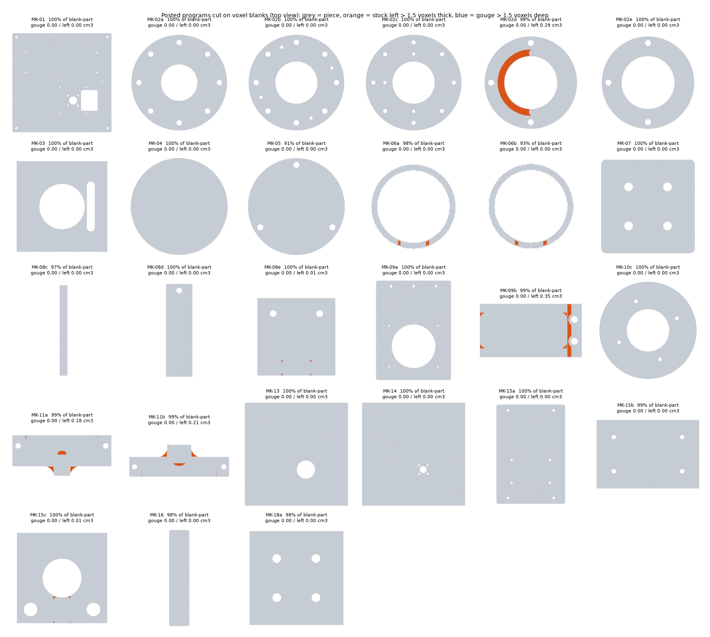

# Fast-track fabrication: the made parts, programmed, checked and counted

For [issue #260](https://github.com/vertical-cloud-lab/digital-alloy-lab/issues/260), PR 294 round 2, 2026-11-27. The CAD
model ([`../cad/ft_model.py`](../cad/ft_model.py)) draws the 18 made parts MK-01 to MK-18 as envelopes. This folder
turns them into what a shop makes:

- **35 pieces,** each with its joint holes, O-ring glands, stock, route and setups;
- **FreeCAD CAM** for every milled setup, posted to G-code;
- **a voxel check** of every program;
- **a drawing sheet** per piece;
- **shop hours** per piece and per state.

Nothing has been made, quoted or checked by a machinist. Vendor part numbers not read today are marked so.

The pieces here follow the v1 model (`ft_model.py` at d117ba8). The CAD v2 model (commit e6efa1c) came during this
round: what it changes in each piece, and an estimate of its hours, are in
[CAD v2](#cad-v2-commit-e6efa1c-what-changes-in-the-fab-pieces).

**Round 3 (2026-11-28):** this folder now builds CAD v2 with the g3 gantry: 47 pieces in 85 mill setups. The CAM
review's fixes ([`review-r3.md`](review-r3.md)) are in, and were checked. Everything in `out/`, `gcode/` and
`drawings/` is v2 now. The sections after Round 3 are round 2's: they describe v1 and keep v1's numbers. v1's
hours, shop plan and voxel check are in [`out/v1/`](out/v1/). See [Round 3](#round-3-2026-11-28-cad-v2-and-the-cam-reviews-fixes).


## Round 3 (2026-11-28): CAD v2, and the CAM review's fixes

**Short answer:**

- **CAD v2 makes 47 pieces** (v1 35) in 85 mill setups (v1 63) and 21 lathe setups (v1 15): 261 FreeCAD operations,
  all posted, no errors and no empty operations.
- **The CAM review's fixes are in and checked,** except ramp entries into pockets and profiles, setup sheets and a
  Haas post. Checked with the review's own checkers on all 85 programs:
  - no Adaptive link would cut material as a Haas dogleg rapid (v1: 194 links in 12 setups);
  - the review's six setups that couldn't run with the tools now pass the holder and flute checks (MK-09b_C, one of
    the six, is not in v2);
  - every G83 pecks 1.0 D or 0.5 D, as intended (v1: 0.75 D on all).
- **The checks found new problems on v2,** not in the review:
  - four drills too short for v2's deep holes, now long-series drills;
  - one outline too deep for T2's flutes, now split;
  - MK-10c's lens bore left a 50 × 34 mm pillar (62 cm³), and its set-screw holes ran 128 mm across the bore. Both
    are fixed.
- **Hours, cumulative, low / expected / high:** S1 19.3 / 45.8 / 62.8 h; S2 34.8 / 74.9 / 107.8 h; FT-0 65.9 /
  133.1 / 202.4 h; **FT-1 81.2 / 165.9 / 248.9 h**; FT-1V 99.3 / 199.8 / 295.9 h. The fixes moved them by 0.1-0.3 h.
  Against v1, FT-1 is 44 h (36 %) more at the expected allowances.
- **New reviewed case:** the review's sensitivity, per piece, on v2's setups. FT-1 takes 107-137 h with the programs
  proven out and a machinist doing the floor work. It takes 129-178 h if a student does half the setups, lathe work
  and deburring. On v1 these were 77-98 h and 92-125 h.
- **Not verified:** no piece has been made or timed, and no machinist has reviewed the programs or the hours.

**What was run** (shared runner, 2026-11-28):

- `parts.py` (15 s) and `cam.py` in FreeCAD 1.0.2 (about 3.5 min for the 85 setups). A second pass took the first
  pass's check findings (the drills and MK-15c), and a third, MK-10c's alone (`FT_CAM_ONLY=MK-10c`).
- The review's two checkers, on all 85 programs of each pass, with their tool table read from `tools.py`. They are
  not in this repo:
  - `gcheck.py` has its own G-code parser and a 2.5D stock, and runs the modal checks and a cycle-time recount;
  - `gcheck3d.py` carries a voxel stock through each piece's setups. It checks rapids, the Haas dogleg path, the
    holder at the tool's stick-out, and the walls against flute length.
- `sim.py` on the ten pieces whose programs the fixes changed most; `hours.py`, `plan.py`; `drawings.py` for the 47
  sheets (about 4 min).

### The review's fixes on v2

| Review §7 item | What was done | Checked after |
|---|---|---|
| 1. Helix start height | every bore and counterbore helix starts 1 mm above its surface | the moves into each helix start are 1 mm above the surface (v1: 104 at the surface's exact height, in 17 setups). The 220 low-clearance rapids left are the moves back to the hole's centre at the bottom of each helix, inside the cut hole. The in-process check finds none of them in material |
| 2. Adaptive links | after posting, each Adaptive `G0` that has only X and Y and runs below the operation's safe height becomes a `G1` at 5000 mm/min (`cam.py` `g0_links_to_g1`): 11,221 links in 35 setups | Haas dogleg check: **0** links into material (v1: 194 in 12 setups) |
| 3. Peck depth | `setExpression("PeckDepth", None)` before setting it | G83 Q is 1.0 D on 247 cycles and 0.5 D on 3, as `cam.py` intends (v1: 0.75 D on all) |
| 4. Outline depths and holding | B's outline cuts only through what A left, plus 0.5 mm: MK-02a, MK-07, MK-15b, MK-15c (split at z 10) and MK-18a (split at z 25). MK-08e's 39 mm L and MK-10c's outline are split between two setups. MK-03's bore is roughed from both sides. Each changed setup's label says how it is held | no flute or holder problem left on these pieces, except MK-15c_C's T3 wall (below) |
| 5. Ramp entries | the 304 notch (a custom op) ramps down along the slot | `Pocket` and `Profile` still plunge: **not done** |
| 6. Setup sheets and a Haas post | – | **not done.** The programs are still `linuxcnc` posts, with G54 at the model's origin |
| 7. Tools | T5: 15 mm stick-out. **T8:** 2.0 mm carbide for the 304 notch, 5000 rpm (31 m/min) and 76 mm/min with a ramp. The notch is 3.0 mm wide, so the review's 1/8 in. T4 doesn't fit. **T9:** 1/8 in. long reach (66 mm) for MK-08e's foot counterbores. MK-10c's 34 mm lens bore is on the 3/4 in. T6 (38 mm flutes). Every drill has a flute length and a stick-out: DIN 338 jobber, and DIN 340 long series for 2.0, 3.4, 4.5 and 5.5 mm. The drills' speed comment is corrected (60000/d rpm is about 19 m/min). No long-flute 1/2 in. cutter was added: the splits keep T2 within its 32 mm. The adaptive feeds were not raised (optional) | holder check: the review's six setups pass (MK-03_A and _D, MK-08e_A, MK-18a_A and _B; MK-09b is not in v2). The first pass found holder hits on five more v2 setups (MK-02f_B, MK-08e_C, MK-15c_D, MK-22b_D, MK-10c_C). The long-series drills clear the first four. MK-10c_C's M4 set-screw holes were set `through=True`, so they ran 128 mm, across the bore and through the far wall: now 9 mm, through the near wall |
| 8. MK-09b's counterbores | MK-09b is gone in v2: the collimator hangs in MK-22's clamp block | – |
| 9. Holding the through-cut plates; fixtures | fixtures, loading the tools and sawing are in the reviewed hours case below, not in low / expected / high | holding not yet recorded per plate |

### The checks after the fixes (85 programs)

- **In-process stock (`gcheck3d.py`):**
  - no dogleg link into material;
  - the holder clears the stock in every setup but MK-10c_C (its 3.3 mm tap drill, below);
  - rapids into material only where the checker models a bought shape as a solid box: MK-09c (an angle, so the 31 mm
    is the angle's open corner) and MK-10a/b (0.4-0.6 mm on the crown of a 60 mm tube in V-blocks);
  - walls over flute length: MK-15c_C's T3, 28 mm against 25.4 mm, and MK-11b_A's T4, 10.0 mm against 9.5 mm (about
    two voxels).
- **2.5D (`gcheck.py`):**
  - 0 issues: units, plane, G54, tool changes with G43 H, spindle and coolant before feed moves, no F0, arcs, M2;
  - the tool in the spindle matches `cam.json` for all 262 operations;
  - cycle time: the recount is 307.6 min (`cam.json` 306.7 min), 312.6-318.8 min with acceleration, and 339.8 min
    with exact stop.
- **Voxel cut (`sim.py`, 10 pieces):**
  - no gouges, and no rapids through a piece;
  - MK-10c first left 62 cm³, a pillar 50 mm across and 34 mm tall in the lens bore. The v2 programs from before
    the fixes leave the same (61.8 cm³), so it came with the v2 port. The lens bore's Adaptive kept the floor's 50 mm
    tube-bore hole as an island; at the machine the pillar would have come loose when the tube bore broke through
    from below. Now the Adaptive clears the face's whole outline (`UseOutline`, a `use_outline` flag in `parts.py`):
    99.4 % removed, nothing left.

<!-- R3_SIM -->
| Piece | Setups | Voxel mm | Removed of blank - piece, cm³ | Gouge cm³ (deepest mm) | Left cm³ (thickest mm) | Slugs dropped cm³ | Rapids through the piece | Minutes: recount / from moves / FreeCAD |
|---|---:|---:|---|---|---|---:|---:|---|
| MK-02a | 2 | 0.28 | 148.2 of 148.2 (100.0 %) | 0.000 (0.28) | 0.000 (0.56) | 0.0 | 0 | 23.1 / 23.0 / 27.6 |
| MK-03 | 3 | 0.32 | 138.7 of 139.4 (99.5 %) | 0.000 (0.32) | 0.000 (0.63) | 0.0 | 0 | 10.9 / 10.9 / 15.8 |
| MK-06a | 2 | 0.12 | 0.0 of 0.0 (93.9 %) | 0.000 (0.00) | 0.000 (0.49) | 0.0 | 0 | 0.7 / 0.7 / 2.3 |
| MK-06b | 2 | 0.13 | 0.0 of 0.0 (88.4 %) | 0.000 (0.00) | 0.000 (0.52) | 0.0 | 0 | 0.7 / 0.7 / 2.6 |
| MK-07 | 2 | 0.18 | 11.5 of 11.7 (98.8 %) | 0.000 (0.18) | 0.000 (0.72) | 0.0 | 0 | 13.1 / 12.9 / 14.1 |
| MK-08e | 3 | 0.24 | 118.1 of 118.3 (99.9 %) | 0.000 (0.00) | 0.017 (1.38) | 0.0 | 0 | 10.1 / 10.0 / 21.9 |
| MK-10c | 3 | 0.43 | 691.1 of 695.5 (99.4 %) | 0.000 (0.43) | 0.000 (0.86) | 0.0 | 0 | 26.7 / 26.7 / 33.3 |
| MK-15b | 2 | 0.23 | 45.3 of 45.5 (99.6 %) | 0.000 (0.23) | 0.000 (0.66) | 0.0 | 0 | 2.7 / 2.7 / 3.2 |
| MK-15c | 4 | 0.24 | 46.6 of 48.0 (97.1 %) | 0.000 (0.24) | 0.040 (1.06) | 0.0 | 0 | 19.9 / 19.5 / 26.0 |
| MK-18a | 2 | 0.28 | 48.1 of 50.5 (95.2 %) | 0.000 (0.28) | 0.000 (0.55) | 0.0 | 0 | 2.3 / 2.3 / 3.5 |
| **All** | 25 | | | | | | | **110.3 / 109.4 / 150.1** |
<!-- /R3_SIM -->

### Hours on v2

Cumulative, at the round-2 allowances (unchanged):

<!-- V1V2_TABLE -->
| State | Pieces, v1 -> v2 (cumulative) | v1 (round 2), low / expected / high h | v2 estimated in round 2 | **v2, round 3** (CAM fixed), low / expected / high h | Change from v1, expected |
|---|---|---|---|---|---:|
| S1 | 5 -> 10 | 8.6 / 19.7 / 26.9 | 11.6 / 25.5 / 35.0 | 19.3 / **45.8** / 62.8 | +26.1 h (+133 %) |
| S2 | 12 -> 18 | 21.2 / 41.8 / 62.5 | 26.5 / 53.1 / 77.7 | 34.8 / **74.9** / 107.8 | +33.1 h (+79 %) |
| FT-0 | 22 -> 32 | 43.8 / 90.7 / 145.5 | 60.3 / 122.2 / 189.4 | 65.9 / **133.1** / 202.4 | +42.3 h (+47 %) |
| FT-1 | 31 -> 41 | 58.5 / 121.9 / 189.3 | 75.3 / 154.8 / 235.3 | 81.2 / **165.9** / 248.9 | +44.0 h (+36 %) |
| FT-1V | 35 -> 47 | 67.6 / 140.0 / 214.1 | 90.5 / 188.2 / 280.6 | 99.3 / **199.8** / 295.9 | +59.7 h (+43 %) |
<!-- /V1V2_TABLE -->

<!-- R3_STATE_ROWS -->
| State | Pieces | This state, low / expected / high h | Cumulative (the machine), low / **expected** / high h | Cumulative at $65/h, low / expected / high | Study (`fast_track.py`) | BYU h with sheet and flat plates out, cumulative (expected) |
|---|---:|---|---|---|---|---:|
| S1 | 10 | 19.3 / 45.8 / 62.8 | 19.3 / **45.8** / 62.8 | $1,260 / 2,980 / 4,080 | - | 30.3 |
| S2 | 8 | 15.5 / 29.1 / 45.1 | 34.8 / **74.9** / 107.8 | $2,260 / 4,870 / 7,010 | - | 56.6 |
| FT-0 | 14 | 31.1 / 58.1 / 94.6 | 65.9 / **133.1** / 202.4 | $4,280 / 8,650 / 13,160 | 10-15 h | 114.8 |
| FT-1 | 9 | 15.4 / 32.9 / 46.5 | 81.2 / **165.9** / 248.9 | $5,280 / 10,790 / 16,180 | 25-40 h | 142.4 |
| FT-1V | 6 | 18.1 / 33.8 / 47.0 | 99.3 / **199.8** / 295.9 | $6,450 / 12,980 / 19,230 | 30-48 h | 176.2 |
<!-- /R3_STATE_ROWS -->

- **The fixes moved the hours by 0.1-0.3 h.** The Adaptive links now run at 5000 mm/min, not at the 25.4 m/min
  rapid, so the programs total 308 min (292 before the fixes).
- **The reviewed case** (`hours.py` `REVIEWED`) is new. It is the review's §4 sensitivity, applied per piece:
  - a piece's first mill setup 0.75 h (1.25 h over 200 mm), its further setups 0.25-0.5 h, 0.5 h a lathe setup;
  - 0.25 h of CAM review and prove-out a mill setup;
  - the mill time × 1.08-1.16, and lathe and hand work × 1.5-3;
  - 10-20 h of fixtures, tool loading, sawing and CAM fixes per 57 mill setups (v1's count to FT-1), scaled to v2's
    setups;
  - a student doing half the setups, lathe work and deburring at 1.7-2.0 times a machinist's time.

  It reproduces the review's v1 figures (76.8-97.7 h and 92.3-125.0 h to FT-1). On v2:

<!-- R3_REVIEWED -->
| State | Mill / lathe setups (cumulative) | Machinist, h | Machinist and student, h | The set's low / expected / high, h |
|---|---|---|---|---|
| S1 | 22 / 0 | 27.3-34.8 | 32.5-44.0 | 19.3 / 45.8 / 62.8 |
| S2 | 35 / 2 | 46.4-58.6 | 55.8-74.9 | 34.8 / 74.9 / 107.8 |
| FT-0 | 58 / 15 | 86.2-110.7 | 104.9-144.5 | 65.9 / 133.1 / 202.4 |
| FT-1 | 75 / 15 | 106.8-137.4 | 128.9-177.5 | 81.2 / 165.9 / 248.9 |
| FT-1V | 85 / 21 | 131.9-173.1 | 161.1-227.8 | 99.3 / 199.8 / 295.9 |
<!-- /R3_REVIEWED -->

  The set's expected FT-1 (165.9 h) sits inside the student band, as it did on v1. The extras still count the
  review's 3-6 h of CAM fixes, since setup sheets, a Haas post and ramp entries are still to do.

<details><summary>Hours per piece, v2 (round 3)</summary>

<!-- R3_PIECE_TABLE -->
| Piece | What | First in | Route | Stock | Setups (mill / lathe) | Cycle min: recount / FreeCAD | Low h | **Expected h** | High h |
|---|---|---|---|---|---:|---|---:|---:|---:|
| MK-01 | Deck plate | S1 | CNC mill | 1/2 in. 6061-T651 plate (12.7 +0/+0.69), 255 x 255 cut from a 12 x 24 in. sheet | 2 / 0 | 10.9 / 14.9 | 1.9 | **5.0** | 6.6 |
| MK-02a | Window ring | S2 | CNC mill | 3/4 in. 6061-T651 plate, 106 x 106 square (faced to 12.0) | 2 / 0 | 23.1 / 27.6 | 2.8 | **4.7** | 10.8 |
| MK-02b | Window retaining flange (beam-tube spigot on top) | S2 | CNC mill | 3/8 in. 6061 plate (9.53) faced to 9.0, 106 x 106 | 2 / 0 | 9.5 / 12.5 | 1.8 | **3.7** | 5.3 |
| MK-02c | Inner clamp ring (box lid only) | S2 | CNC mill | 1/4 in. 6061 plate (6.35) faced to 6.0 on top, 106 x 106 | 1 / 0 | 4.2 / 6.3 | 1.4 | **2.4** | 3.2 |
| MK-02d | Cover-slide holder, base (slide pocket) | S2 | CNC mill | 1/4 in. 6061 plate faced to 5.6, 76 x 76 | 1 / 0 | 5.1 / 8.6 | 1.4 | **2.2** | 3.0 |
| MK-02e | Cover-slide holder, cover (11.0 tall) | S2 | CNC mill | 1/2 in. 6061 plate faced to 11.0, 76 x 76 | 1 / 0 | 3.8 / 5.9 | 1.4 | **2.2** | 3.0 |
| MK-02f | Cover-slide drop tube from the cube top plate (84.8 long, two flanges) | FT-1V | lathe + CNC mill | 6061 round bar 3-1/2 in. (88.9) sawn 91 long | 2 / 2 | 0.8 / 0.6 | 2.8 | **6.0** | 8.8 |
| MK-03 | Well block, 40.00 H7 bore | FT-0 | CNC mill | 6061 bar 1-3/4 x 3-1/2 in. (44.45 x 88.9) sawn 84 long | 3 / 0 | 10.9 / 15.8 | 2.3 | **5.4** | 12.9 |
| MK-03s | Macor standoffs (4) | FT-0 | lathe (carbide, slow) or diamond saw + drill | McMaster 8489K75 Macor rod, 5/16 in. x 6 in. (parts.csv H4) | 0 / 2 | 0.0 / 0.0 | 2.3 | **2.2** | 3.5 |
| MK-04 | Heater plate | FT-0 | lathe + CNC mill | 6061 round bar 1-3/4 in. (44.45) sawn 30 long | 3 / 2 | 2.2 / 3.8 | 2.8 | **7.0** | 10.4 |
| MK-05 | Substrate discs (10) | FT-0 | lathe + CNC mill | 6061 round bar 1-3/4 in., one 100 mm length makes ten discs | 1 / 2 | 1.1 / 4.8 | 2.9 | **5.1** | 7.1 |
| MK-06a | Piston rod, box (84.6 long) | FT-0 | cut-off saw + lathe + CNC mill | seamless 304 tube, 1/2 in. OD x 0.035 in. wall (12.70 x 0.89), cut 89 long | 2 / 2 | 2.0 / 6.4 | 3.0 | **6.2** | 9.1 |
| MK-06b | Piston rod, cube, 21 mm longer (105.6 long) | FT-1V | cut-off saw + lathe + CNC mill | seamless 304 tube, 1/2 in. OD x 0.035 in. wall (12.70 x 0.89), cut 110 long | 2 / 2 | 2.0 / 7.3 | 3.0 | **6.2** | 9.1 |
| MK-07 | Rod gland plate, 2 x AS568-112 rod seals | FT-0 | CNC mill + lathe (4-jaw) | 1/2 in. 6061 plate, 64 x 64 (faced to 12.0) | 2 / 1 | 13.1 / 14.1 | 3.0 | **6.1** | 13.4 |
| MK-08a | Hopper wall A (with both end walls) | FT-1 | sheet: laser-cut and bent (SendCutSend) | SendCutSend 304 stainless (0.030-0.031 in. gauge as listed by them) | 0 / 0 | 0.0 / 0.0 | 1.1 | **1.1** | 1.2 |
| MK-08b | Hopper wall B (with rivet flanges) | FT-1 | sheet: laser-cut and bent (SendCutSend) | SendCutSend 304 stainless (0.030-0.031 in. gauge as listed by them) | 0 / 0 | 0.0 / 0.0 | 1.1 | **1.1** | 1.2 |
| MK-08c | Cord clamp | FT-1 | CNC mill | 6061 bar 1/4 x 1/2 in. sawn 50 long | 3 / 0 | 3.7 / 5.0 | 2.0 | **4.9** | 7.2 |
| MK-08d | Hopper arm | FT-1 | CNC mill | 6061 bar 3/8 x 3/4 in. sawn 49 long | 3 / 0 | 1.0 / 1.8 | 2.0 | **4.9** | 7.1 |
| MK-08e | Carriage bracket (L: 6 mm foot on the X-LSM100B carriage, 8 mm upright) | FT-1 | CNC mill | 6061 bar 1-3/4 x 3 in. (44.45 x 76.2) sawn 43 long | 3 / 0 | 10.1 / 21.9 | 2.1 | **5.0** | 7.5 |
| MK-09a | Scan-head flange plate (on the head's entrance face, between the cross-beams) | S1 | CNC mill | 1/2 in. 6061-T651 plate, 309 x 110 from a 12 x 24 in. sheet | 3 / 0 | 23.8 / 21.2 | 2.4 | **7.0** | 9.2 |
| MK-09c | Angle brackets, plates to the cross-beams (4: 2 flange plate, 2 far-side plate) | S1 | saw + CNC mill | 6061 angle 1-1/2 x 1-1/2 x 3/16 in. sawn 30 long (4 from one 6 in. length) | 2 / 0 | 0.2 / 0.7 | 1.8 | **3.7** | 5.2 |
| MK-09d | Head-plate top flange on both cross-beams | S1 | CNC mill | 1/2 in. 6061-T651 plate, 80 x 367, faced to 12.0 | 2 / 0 | 39.7 / 44.9 | 2.3 | **5.3** | 6.9 |
| MK-09e | Head-plate gussets (3) | S1 | CNC mill | 5/16 in. 6061 plate (7.94), 63 x 108 each | 3 / 0 | 7.0 / 10.5 | 2.2 | **5.1** | 7.4 |
| MK-09f | Head far-side support plate, between both cross-beams (g3) | S1 | CNC mill | 1/2 in. 6061-T651 plate, 309 x 130, faced to 10.0 | 2 / 0 | 12.1 / 13.2 | 1.8 | **4.8** | 6.3 |
| MK-10a | Beam tube centre section, long (121.5 long), split in two half-shells | S2 | saw + lathe + CNC mill + slitting saw | 6061 round tube 60.3 x 3.18 wall (2-3/8 x 0.125 in. | 2 / 2 | 0.1 / 0.6 | 3.0 | **6.2** | 9.1 |
| MK-10b | Beam tube centre section, short (21.7 long), split in two half-shells | FT-1V | saw + lathe + CNC mill + slitting saw | 6061 round tube 60.3 x 3.18 wall (2-3/8 x 0.125 in. | 2 / 2 | 0.1 / 0.4 | 3.0 | **6.2** | 9.1 |
| MK-10c | Lens collar with the tube's upper spigot (on the lens) | S2 | CNC mill | 1-3/4 in. 6061 plate (44.45), 140 x 140 | 3 / 0 | 26.7 / 33.3 | 2.4 | **5.3** | 7.7 |
| MK-11a | Slot nozzle 45 x 4 | FT-0 | CNC mill | 6061 bar 3/4 x 1-1/4 in. (19.05 x 31.75) sawn 65 long | 4 / 0 | 12.1 / 18.6 | 2.5 | **6.4** | 9.5 |
| MK-11b | Exhaust collector | FT-0 | CNC mill | 6061 bar 3/4 x 1-1/4 in. sawn 70 long | 4 / 0 | 11.9 / 19.3 | 2.5 | **6.4** | 9.5 |
| MK-12 | Stage shield | FT-1 | sheet: laser-cut and bent (SendCutSend) | SendCutSend 304 stainless, 0.036 in. class (their gauge list not read) | 0 / 0 | 0.0 / 0.0 | 0.8 | **0.8** | 0.8 |
| MK-13 | Cube top plate (Ideal Vacuum P108171 blank: window ring, drop tube, camera port) | FT-1V | CNC mill + tilted setup | Ideal Vacuum P108171 blank plate (E2) | 2 / 0 | 6.2 / 8.0 | 3.5 | **6.6** | 8.6 |
| MK-14 | Cube bottom plate (P108171 blank, bored for the rod gland) | FT-1V | CNC mill | Ideal Vacuum P108171 blank plate (E2) | 2 / 0 | 3.8 / 4.8 | 2.5 | **5.4** | 6.9 |
| MK-15a | Piston-stage bracket plate | FT-1 | CNC mill | 1/2 in. 6061-T651 plate, 190 x 307, faced to 10.0 | 2 / 0 | 13.0 / 14.3 | 1.8 | **4.8** | 6.3 |
| MK-15b | Piston-stage riser | FT-1 | CNC mill | 1 in. 6061 plate (25.4), 70 x 70, faced to 20.0 | 2 / 0 | 2.7 / 3.2 | 1.7 | **3.6** | 5.2 |
| MK-15c | Rod-end block: rod clamp, lead pocket, AE face | FT-1 | CNC mill + saw slit | 6061 bar 1-3/4 x 2-3/4 in. (44.45 x 69.85) sawn 43 long | 4 / 0 | 19.9 / 26.0 | 2.8 | **6.7** | 9.9 |
| MK-16 | Overflow cup | FT-0 | CNC mill | 6061 bar 1/2 x 2 in. (12.7 x 50.8) sawn 25 long | 2 / 0 | 1.1 / 1.4 | 1.6 | **3.5** | 5.0 |
| MK-17 | FT-0 rod collar (buy) | FT-0 | buy | Ruland MCL-8-A class one-piece clamp collar, 1/2 in. bore (1-1/8 in. OD x 13/32 in.) | 0 / 0 | 0.0 / 0.0 | 0.0 | **0.1** | 0.1 |
| MK-17b | FT-0 lead terminal bracket under the gland (bent sheet) | FT-0 | sheet: laser-cut and bent (SendCutSend) | SendCutSend 5052-H32, 0.080 in. | 0 / 0 | 0.0 / 0.0 | 0.8 | **0.8** | 0.8 |
| MK-18a | Guide-laser target stand | S1 | CNC mill | 6061 square bar 2-1/2 in. (63.5) sawn 55 long | 2 / 0 | 2.3 / 3.5 | 1.7 | **3.7** | 5.2 |
| MK-18b | Target plate 80 x 80 x 1/8 in., black anodised (x2) | S1 | sheet: laser-cut (SendCutSend) or bandsaw + mill; anodise outside | 1/8 in. 6061 sheet (SendCutSend stock) | 0 / 0 | 0.0 / 0.0 | 0.8 | **0.8** | 0.9 |
| MK-19 | Port ring: camera port (MK-19) and the two light ports (MK-21), one design (x3) | FT-0 | CNC mill | 3/8 in. 6061 plate (9.53) faced to 7.0, 56 x 56 each | 2 / 0 | 17.6 / 22.4 | 2.8 | **4.7** | 6.2 |
| MK-20a | Camera post foot (bonded to the door or the top plate) | FT-0 | lathe | 6061 round bar 1-1/4 in. (31.75) sawn 12 long | 0 / 2 | 0.0 / 0.0 | 1.7 | **1.6** | 2.6 |
| MK-20c | Scheimpflug wedges, C-mount (2: 2.96 deg box, 2.34 deg cube) | FT-0 | lathe + sine vise | 6061 round bar 1-3/4 in. (44.45), 12 long each | 0 / 2 | 0.0 / 0.0 | 3.0 | **2.9** | 4.5 |
| MK-21c | Light-port bores in the cube's left plate and door (2 Ideal Vacuum E2 plates) | FT-1V | tilted setup on the mill | the cube's left plate and its door (parts.csv E2) | 0 / 0 | 0.0 / 0.0 | 3.4 | **3.4** | 4.5 |
| MK-22a | Coaxial branch plate: SM1 bore and 30 mm cage on the mirror block's back face | S1 | CNC mill | 3/8 in. 6061 plate (9.53), 64 x 64, faced to 8.0 | 2 / 0 | 6.6 / 9.2 | 1.7 | **3.7** | 5.2 |
| MK-22b | Collimator clamp block, hung under the front cross-beam | S1 | CNC mill + saw slit | 6061 bar 1 x 3-1/2 in. (25.4 x 88.9) sawn 72 long | 4 / 0 | 14.7 / 18.7 | 2.7 | **6.6** | 9.8 |
| MK-23 | Deck clamps on the box's panel studs (4) | S2 | saw + CNC mill | 6061 bar 3/16 x 3/4 in. (4.76 x 19.05) sawn 42 long | 1 / 0 | 0.5 / 0.9 | 1.4 | **2.3** | 3.0 |
| **All** | 47 pieces | | | | 85 / 21 | 326 / 432 | 99.3 | **199.8** | 295.9 |
<!-- /R3_PIECE_TABLE -->

</details>

### Shop plan on v2

The calendar from `plan.py` on the v2 hours (round 2's method; working days from the order day; "need" is the
progression network's date):

<!-- R3_PLAN -->
| Hours | People | Variant | Pieces done, working day (need): S1 | S2 | FT-0 | FT-1 | FT-1V | Milestones, weeks: S1 / S2 / FT-0 tracks / FT-1 coupons / FT-1V coupons |
|---|---:|---|---|---|---|---|---|---|
| low | 1 | – | 2.6 (4) | 4.3 (5) | 8.2 (9) | 10.2 (11) | 12.4 (16) | 1.4 / 1.6 / 2.2 / 3.5 / 4.0 |
| low | 2 | – | 1.9 (4) | 2.5 (5) | 5.2 (9) | 5.3 (11) | 11.6 (16) | 1.4 / 1.6 / 1.8 / 2.8 / 3.4 |
| low | 3 | – | 1.6 (4) | 2.0 (5) | 5.0 (9) | 5.1 (11) | 11.3 (16) | 1.4 / 1.6 / 1.8 / 2.8 / 3.4 |
| expected | 1 | – | **5.7** (4) | **9.4** (5) | **16.6** (9) | **20.7** (11) | **25.0** (16) | **1.7** / **2.5** / **3.9** / **5.5** / **6.2** |
| expected | 2 | – | 3.2 (4) | 4.8 (5) | 8.4 (9) | 10.6 (11) | 12.6 (16) | 1.4 / 1.6 / 2.3 / 3.5 / 4.1 |
| expected | 3 | – | 2.4 (4) | 3.2 (5) | 5.6 (9) | 7.2 (11) | 11.6 (16) | 1.4 / 1.6 / 1.8 / 2.9 / 3.5 |
| high | 1 | – | **7.8** (4) | **13.5** (5) | **25.3** (9) | **31.1** (11) | **37.0** (16) | **2.2** / **3.3** / **5.7** / **7.6** / **8.4** |
| high | 2 | – | **4.3** (4) | **6.9** (5) | **12.9** (9) | **15.9** (11) | **18.7** (16) | **1.5** / **2.0** / **3.2** / **4.6** / **5.2** |
| high | 3 | – | 3.3 (4) | 4.7 (5) | 8.6 (9) | 10.8 (11) | 12.5 (16) | 1.4 / 1.6 / 2.3 / 3.6 / 4.2 |
| expected | 1 | FT-1 plates out | **5.7** (4) | **9.4** (5) | **16.6** (9) | **20.1** (11) | **24.3** (16) | **1.7** / **2.5** / **3.9** / **5.4** / **6.0** |
| expected | 2 | FT-1 plates out | 3.2 (4) | 4.8 (5) | 8.4 (9) | 10.4 (11) | 12.3 (16) | 1.4 / 1.6 / 2.3 / 3.5 / 4.1 |
| expected | 2 | stock day 2 | 3.8 (4) | 4.7 (5) | 8.4 (9) | 10.6 (11) | 12.6 (16) | 1.4 / 1.6 / 2.3 / 3.5 / 4.1 |
| expected | 3 | stock day 2 | 3.5 (4) | 4.0 (5) | 5.7 (9) | 7.1 (11) | 11.6 (16) | 1.4 / 1.6 / 1.8 / 2.9 / 3.5 |
| *network as drawn* | | | 3.4 | 5.3 | 9.2 | 11.1 | 13.3 | 1.4 / 1.7 / 2.4 / 3.6 / 4.2 |
<!-- /R3_PLAN -->

### Drawings

There are 47 sheets in [`drawings/`](drawings/), one per v2 piece, with the contact sheet above. MK-09b's v1 sheet is
in [`drawings/v1/`](drawings/v1/).

### Still not verified

- **No piece has been made or timed,** and no machinist has reviewed the programs or the hours. Every hour here is an
  estimate.
- **Not done from the review:**
  - ramp entries into `Pocket` and `Profile`;
  - setup sheets with touch-off datums;
  - a Haas post, and a prove-out on the Haas's graphics;
  - higher adaptive chip loads.
- **MK-15c_C:** T3 cuts beside a 28 mm wall with 25.4 mm of flute.
- **The voxel cut ran on 10 of v2's 37 milled pieces.** The other 27 have only the two G-code checks.

## Short answer (round 2, v1)

- **35 pieces from 18 MK numbers:**
  - 27 milled (5 of them also turned);
  - 3 only turned or sawn (the Macor standoffs and the two beam tubes);
  - 4 bent or cut sheet, for SendCutSend (the hopper's two walls, the stage shield, the target plate);
  - MK-17, the FT-0 rod collar, is bought: it is a catalogue 1/2 in. clamp collar.
- **Shop hours are 3-5 times the study's estimate** at the expected allowances, and 1.5-4 times at the low ones.
  Counted per piece (CAM, setups, machine time, deburr and inspection; the allowances are [below](#shop-hours)):

  <!-- SHORT_TABLE -->
  | Machine (cumulative) | Low | **Expected** | High | Study (`fast_track.py`, parts.csv F2a-c) | At $65/h, low / expected / high |
  |---|---:|---:|---:|---:|---|
  | S1 | 8.6 h | **19.7 h** | 26.9 h | – | $560 / 1,280 / 1,750 |
  | S1 + S2 | 21.2 h | **41.8 h** | 62.5 h | – | $1,380 / 2,710 / 4,060 |
  | FT-0 (S1 + S2 + FT-0 pieces) | 43.8 h | **90.7 h** | 145.5 h | 10-15 h | $2,850 / 5,900 / 9,460 |
  | FT-1 | 58.5 h | **121.9 h** | 189.3 h | 25-40 h | $3,810 / 7,930 / 12,310 |
  | FT-1V | 67.6 h | **140.0 h** | 214.1 h | 30-48 h | $4,390 / 9,100 / 13,920 |
  <!-- /SHORT_TABLE -->

  - **Low:** robot-shop.md's allowances (0.7 h of CAM a piece, 20 min a setup). That is also about what reviewing
    and proving out this folder's programs would take (0.25 h a mill setup, 18.5 h in all).
  - **Expected:** PR 266's allowances (CAM written fresh, 45 min a vise setup). Use this one in the schedule.
  - **High:** setups at 90 min, the top of the survey median PR 266 cites; FreeCAD's own cycle times; and the three
    tight-fit pieces (well block, gland, window ring) made twice.
  - **Why the study is low:** its estimate covered "4 simple parts" for FT-0 and "about 12 simple parts" for FT-1.
    Drawn to size with every joint, the machine is 35 pieces in 63 mill setups and 15 lathe setups.
- **Where the expected 140 h go:**
  - CAM: 61.5 h;
  - setups: 59.8 h;
  - deburr and inspection: 12.2 h;
  - machine time: 6.5 h. Of that, 3.4 h is programmed cutting (FreeCAD's own estimate 4.9 h), 0.6 h tapping and
    tool changes, 1.6 h turning and 0.9 h hand work.

  The cutting is the small part, as in PR 266's count, so the levers are fewer pieces, fewer setups, and CAM that
  is reused rather than rewritten.
- **The CAM is written and posted.**
  - **Programs:** 63 setups, 188 FreeCAD operations, `linuxcnc` post, in [`gcode/`](gcode/).
  - **Taken as done:** if a programmer only reviews and proves them out (0.25 h a setup, an assumption), CAM drops
    from 61.5 h to 18.5 h, and the machines to 61.6 h (FT-0), 83.8 h (FT-1) and 97.0 h (FT-1V).
- **Every program was cut on a voxel blank** ([`sim.py`](sim.py), table [below](#the-programs-checked)).
  - **The check found 13 faults** in the first programs, and the time recount 3 more; all are fixed in these files
    ([list](#faults-the-checks-found)). The last, found in this round's full run: MK-02d's slide pocket was cut on
    one side only, so the cover slide would not have gone in.
  - **Six were FreeCAD 1.0.2 behaviours** worth knowing:
    - `PocketShape` posts no path;
    - `Pocket`, `Adaptive` and `MillFace` skip a floor that is open to the side;
    - a 3D `Pocket` also clears the disc inside an O-ring groove;
    - the helix's `StartRadius` leaves a core;
    - Custom-op feeds are read as mm/s;
    - a Job's first op fails headless if the Job has two tool controllers.
- **Design changes the assembly model should take** are [listed below](#changes-for-the-assembly-model). The ones that
  matter:
  - **The well block's thermocouple hole ran straight through a heater hole** in v1. Moved to z 10 here; v2 moves it
    8 mm under the top, which also clears its four heaters.
  - **The window ring needs a 4 mm lip and a 12 mm height** to carry an O-ring under the window (the model's lip is
    2 mm, in v2 too).
  - **The rod gland's squeeze is right only if the rod OD is held to 0.497-0.501 in.** ASTM A269's ±0.005 in. on a
    1/2 in. seamless tube gives 9-20 %, against Parker's 10-17 %.
  - **The carriage bracket had only 3.0 mm under the stage shield for a foot** in v1. v2 gives it 6 mm.
  - **v2's gland screws in the box** go through the 1.9 mm floor outside the gland's face O-ring: four open paths
    from the box to the room. Keep them inside the face seal.
- **Schedule** ([`plan.py`](plan.py), [calendar below](#first-week-shop-plan)):
  - **When the pieces are needed.** The study's progression network (`cad/ft_progression.py`, scenario A, early end
    of every range) needs S1's pieces by working day 4, S2's by day 5, FT-0's by day 6 and FT-1's by day 9, and the
    cube plates within 3 working days of the cube's arrival. Day 0 is the order day.
  - **One person** meets those dates only at the low allowances. At the expected hours one person finishes FT-0's
    pieces on day 11.3 and FT-1's on day 15.2. FT-0's first tracks then move from 1.8 to 2.9 weeks, and FT-1's first
    coupons from 3.2 to 4.5 weeks.
  - **Two people who both program and cut, from day 0 to day 8,** meet every date at the expected hours: S1 day
    1.9, S2 2.7, FT-0 5.8, FT-1 7.8. FT-1's coupons then come at 3.0 weeks, against the network's 3.2.
  - **At the high hours** two people are 3 days late on FT-0 (tracks at 2.4 weeks, coupons at 3.8), and three
    people bring it back to 1.9 and 3.1 weeks.
  - **For the study's schedule:** replace "one person at least half time" (`fast_track.py`) with two people full
    time for the first 8 working days.
- **CAD v2** (commit e6efa1c, [below](#cad-v2-commit-e6efa1c-what-changes-in-the-fab-pieces)) makes 44 pieces: 13
  unchanged, 12 re-dimensioned, 10 redesigned or moved, 9 new (mostly monitoring hardware). Estimated, not built:
  122.2 / 154.8 / 188.2 h expected to FT-0 / FT-1 / FT-1V. Keeping FT-0's tracks at 1.8 weeks then takes three
  people, or two with the monitoring pieces made after the tracks (1.9 weeks).

## Files

| File | What it is |
|---|---|
| [`parts.py`](parts.py) | the 35 pieces in CadQuery, built from `ft_model.P` (ft_model.py is not edited): geometry, holes, glands, stock, route, setups, lathe and hand steps, tolerances, and what changed against the model. Every cut is recorded as a CAM feature. Writes `out/pieces.json`, BREP/STL to `/tmp/ft-fab/pieces/`, DXF flat patterns to `out/dxf/` |
| [`tools.py`](tools.py) | the common tool library (face mill, 3/4, 1/2, 1/4, 1/8 in. and 2 mm end mills, a 90° spot drill, 17 drills with flute lengths and stick-outs; round 3 added T8, a 2.0 mm end mill for 304, and T9, a long-reach 1/8 in. end mill), thread and hole tables, and PR 266's time allowances |
| [`cam.py`](cam.py) | FreeCAD 1.0.2 CAM, headless: one Job per setup, ops from the recorded features, `linuxcnc` post → [`gcode/`](gcode/), [`out/cam.json`](out/cam.json) (per op: tool, feed, FreeCAD CycleTime, recount) |
| [`sim.py`](sim.py) | the voxel check of the posted programs → [`out/sim.json`](out/sim.json) (round 3: the 10 v2 pieces the CAM fixes changed; v1's 27 pieces in [`out/v1/sim.json`](out/v1/sim.json)), [`img/sim-check.png`](img/sim-check.png) (v1) |
| [`hours.py`](hours.py) | shop hours per piece and per state at the low, expected and high allowances, for an outsourced split, and (round 3) the reviewed case → [`out/hours.md`](out/hours.md), `out/hours.csv`, `out/hours.json` (`by_state`, `cumulative`, `reviewed`) |
| [`plan.py`](plan.py) | the shop calendar: the progression network's need dates, and when each state's pieces are done for one to three people → [`out/plan.md`](out/plan.md), `out/plan.json` |
| [`v2_delta.py`](v2_delta.py) | what the CAD v2 model changes in each piece, and the v2 hours (estimate) → [`out/v2/delta.md`](out/v2/delta.md), `out/v2/hours.json`; `plan.py out/v2/hours.json out/v2` → [`out/v2/plan.md`](out/v2/plan.md) |
| [`tables.py`](tables.py) | fills this README's round-3 tables from `out/` (the round-2 tables describe v1 and are no longer regenerated) |
| [`drawings.py`](drawings.py) | one sheet per piece → [`drawings/`](drawings/) (PDF), [`img/drawings-contact.png`](img/drawings-contact.png) |
| [`out/dxf/`](out/dxf/) | flat patterns of the four sheet pieces (cut layer only; bends on the drawings) |

```bash
/tmp/venv/bin/python desktop-lpbf/fast-track/fab/parts.py                       # pieces, out/pieces.json, out/dxf
/tmp/tools/capmem 3 /tmp/setup/squashfs-root/usr/bin/freecadcmd -c \
  "import runpy; runpy.run_path('desktop-lpbf/fast-track/fab/cam.py', run_name='__main__')"   # gcode/, out/cam.json
/tmp/tools/capmem 2 /tmp/venv/bin/python desktop-lpbf/fast-track/fab/sim.py     # out/sim.json, img/sim-check.png
/tmp/venv/bin/python desktop-lpbf/fast-track/fab/hours.py                       # out/hours.*
/tmp/venv/bin/python desktop-lpbf/fast-track/fab/plan.py                        # out/plan.*
/tmp/venv/bin/python desktop-lpbf/fast-track/fab/v2_delta.py                    # out/v2/delta.md, hours.json
/tmp/venv/bin/python desktop-lpbf/fast-track/fab/plan.py out/v2/hours.json out/v2   # out/v2/plan.*
/tmp/venv/bin/python desktop-lpbf/fast-track/fab/plan.py out/v2/monitoring-later/hours.json out/v2/monitoring-later
/tmp/venv/bin/python desktop-lpbf/fast-track/fab/tables.py                      # this README's tables
/tmp/tools/capmem 2 /tmp/venv/bin/python desktop-lpbf/fast-track/fab/drawings.py   # drawings/*.pdf
```

Run times on the shared runner: `parts.py` 10-30 s; `cam.py` 80 s for all 63 setups; `sim.py` about 15 min (1.2 GB
peak on the cube plates); `drawings.py` about 25 s; `hours.py`, `plan.py`, `v2_delta.py` and `tables.py` a few
seconds. FreeCAD is the official 1.0.2 conda AppImage, extracted, as in PR 266.

## The pieces

Shop h uses PR 266's allowances; Low uses robot-shop.md's. Program min is the posted G-code's recount (feeds as
programmed, rapids at 25.4 m/min), times the quantity. Full columns are in [`out/hours.md`](out/hours.md).

<!-- PIECE_TABLE -->
| Piece | What | First in | Route | Stock | Setups (mill / lathe) | Cycle min: recount / FreeCAD | Low h | **Expected h** | High h |
|---|---|---|---|---|---:|---|---:|---:|---:|
| MK-01 | Deck plate | S1 | CNC mill | 1/2 in. 6061-T651 plate (12.7 +0/+0.69), 260 x 260 cut from a 12 x 24 in. sheet | 2 / 0 | 16.9 / 23.3 | 1.9 | **5.1** | 6.7 |
| MK-02a | Window ring | S2 | CNC mill | 3/4 in. 6061-T651 plate, 106 x 106 square (faced to 12.0) | 2 / 0 | 24.1 / 29.7 | 2.8 | **4.7** | 10.8 |
| MK-02b | Window retaining flange (beam-tube socket on top) | S2 | CNC mill | 1/4 in. 6061 plate (6.35) faced to 6.0 both sides, 106 x 106 | 2 / 0 | 6.7 / 10.1 | 1.8 | **3.8** | 5.3 |
| MK-02c | Inner clamp ring (box lid only) | S2 | CNC mill | 1/4 in. 6061 plate (6.35) faced to 6.0 on top, 106 x 106 | 1 / 0 | 3.8 / 6.0 | 1.4 | **2.4** | 3.2 |
| MK-02d | Cover-slide holder, base (slide pocket) | S2 | CNC mill | 1/4 in. 6061 plate faced to 5.6, 76 x 76 | 1 / 0 | 4.4 / 7.5 | 1.4 | **2.2** | 3.0 |
| MK-02e | Cover-slide holder, cover | S2 | CNC mill | 3/16 in. 6061 plate faced to 4.4, 76 x 76 | 1 / 0 | 2.0 / 3.1 | 1.3 | **2.2** | 3.0 |
| MK-03 | Well block, 40.00 H7 bore | FT-0 | CNC mill | 6061 bar 1-3/4 x 3-1/2 in. (44.45 x 88.9) sawn 84 long | 4 / 0 | 10.4 / 15.2 | 2.7 | **6.7** | 16.5 |
| MK-03s | Macor standoffs (4) | FT-0 | lathe (carbide, slow) or diamond saw + drill | McMaster 8489K75 Macor rod, 5/16 in. x 6 in. (parts.csv H4) | 0 / 2 | 0.0 / 0.0 | 2.3 | **2.2** | 3.5 |
| MK-04 | Heater plate | FT-0 | lathe + CNC mill | 6061 round bar 1-3/4 in. (44.45) sawn 34 long | 3 / 2 | 0.3 / 0.6 | 2.7 | **7.0** | 10.3 |
| MK-05 | Substrate discs (10) | FT-0 | lathe + CNC mill | 6061 round bar 1-3/4 in., one 100 mm length makes ten discs | 1 / 2 | 1.2 / 4.8 | 2.9 | **5.1** | 7.1 |
| MK-06a | Piston rod, box (81.6 long) | FT-0 | cut-off saw + lathe + CNC mill | seamless 304 tube, 1/2 in. OD x 0.035 in. wall (12.70 x 0.89), cut 86 long | 2 / 2 | 0.3 / 0.8 | 2.4 | **5.6** | 8.2 |
| MK-06b | Piston rod, cube, 21 mm longer (102.6 long) | FT-1V | cut-off saw + lathe + CNC mill | seamless 304 tube, 1/2 in. OD x 0.035 in. wall (12.70 x 0.89), cut 107 long | 2 / 2 | 0.3 / 0.9 | 2.4 | **5.6** | 8.2 |
| MK-07 | Rod gland plate, 2 x AS568-112 rod seals | FT-0 | CNC mill + lathe (4-jaw) | 1/2 in. 6061 plate, 64 x 64 (faced to 12.0) | 2 / 1 | 12.2 / 13.2 | 3.0 | **6.0** | 13.4 |
| MK-08a | Hopper wall A (with both end walls) | FT-1 | sheet: laser-cut and bent (SendCutSend) | SendCutSend 304 stainless (0.030-0.031 in. gauge as listed by them) | 0 / 0 | 0.0 / 0.0 | 1.1 | **1.1** | 1.2 |
| MK-08b | Hopper wall B (with rivet flanges) | FT-1 | sheet: laser-cut and bent (SendCutSend) | SendCutSend 304 stainless (0.030-0.031 in. gauge as listed by them) | 0 / 0 | 0.0 / 0.0 | 1.1 | **1.1** | 1.2 |
| MK-08c | Cord clamp | FT-1 | CNC mill | 6061 bar 1/4 x 1/2 in. sawn 50 long | 3 / 0 | 3.7 / 5.0 | 2.0 | **4.9** | 7.2 |
| MK-08d | Hopper arm | FT-1 | CNC mill | 6061 bar 3/8 x 3/4 in. sawn 60 long | 3 / 0 | 0.9 / 1.7 | 2.0 | **4.9** | 7.1 |
| MK-08e | Carriage bracket (L: 3 mm foot under the shield, 8 mm web) | FT-1 | CNC mill | 6061 bar 2 x 2 in. (50.8) sawn 43 long | 3 / 0 | 5.8 / 10.7 | 2.1 | **5.0** | 7.3 |
| MK-09a | Scan-head plate | S1 | CNC mill | 1/2 in. 6061-T651 plate, 210 x 275 from a 12 x 24 in. sheet | 2 / 0 | 23.8 / 39.0 | 2.0 | **5.0** | 6.8 |
| MK-09b | Collimator saddle | S1 | CNC mill | 6061 bar 1-3/4 x 2 in. (44.45 x 50.8) sawn 88 long | 3 / 0 | 8.1 / 10.9 | 2.1 | **5.0** | 7.3 |
| MK-10a | Beam tube, long (123.6 long) | S2 | saw + lathe | 6061 round tube 60.3 x 3.18 wall (2-3/8 x 0.125 in.) | 0 / 2 | 0.0 / 0.0 | 1.7 | **1.6** | 2.6 |
| MK-10b | Beam tube, short (17.2 long) | FT-1V | saw + lathe | 6061 round tube 60.3 x 3.18 wall (2-3/8 x 0.125 in.) | 0 / 2 | 0.0 / 0.0 | 1.7 | **1.6** | 2.6 |
| MK-10c | Lens collar | S2 | CNC mill | 1-1/4 in. 6061 plate (31.75), 130 x 130 | 3 / 0 | 21.5 / 31.6 | 2.3 | **5.3** | 7.7 |
| MK-11a | Slot nozzle 45 x 4 | FT-0 | CNC mill | 6061 bar 3/4 x 1-1/4 in. (19.05 x 31.75) sawn 65 long | 4 / 0 | 11.7 / 18.3 | 2.5 | **6.4** | 9.5 |
| MK-11b | Exhaust collector | FT-0 | CNC mill | 6061 bar 3/4 x 1-1/4 in. sawn 70 long | 4 / 0 | 11.4 / 18.9 | 2.5 | **6.4** | 9.5 |
| MK-12 | Stage shield | FT-1 | sheet: laser-cut and bent (SendCutSend) | SendCutSend 304 stainless, 0.036 in. class (their gauge list not read) | 0 / 0 | 0.0 / 0.0 | 0.8 | **0.8** | 0.8 |
| MK-13 | Cube top plate (Ideal Vacuum P108171 blank, bored for the window ring) | FT-1V | CNC mill | Ideal Vacuum P108171 blank plate (E2) | 2 / 0 | 5.9 / 6.8 | 2.5 | **5.5** | 7.0 |
| MK-14 | Cube bottom plate (P108171 blank, bored for the rod gland) | FT-1V | CNC mill | Ideal Vacuum P108171 blank plate (E2) | 2 / 0 | 3.7 / 5.0 | 2.5 | **5.4** | 6.9 |
| MK-15a | Piston-stage bracket plate | FT-1 | CNC mill | 1/2 in. 6061-T651 plate, 190 x 270, faced to 10.0 | 2 / 0 | 11.5 / 11.7 | 1.8 | **4.8** | 6.3 |
| MK-15b | Piston-stage riser | FT-1 | CNC mill | 5/8 in. 6061 plate (15.88), 126 x 86, faced to 15.0 | 2 / 0 | 4.0 / 4.8 | 1.7 | **3.7** | 5.2 |
| MK-15c | Rod clamp (split) | FT-1 | CNC mill + saw slit | 6061 bar 1-1/4 in. square (31.75) sawn 28 long | 3 / 0 | 6.1 / 9.3 | 2.2 | **5.1** | 7.5 |
| MK-16 | Overflow cup | FT-0 | CNC mill | 6061 bar 1/2 x 2 in. (12.7 x 50.8) sawn 25 long | 2 / 0 | 1.1 / 1.4 | 1.6 | **3.5** | 5.0 |
| MK-17 | FT-0 rod collar (buy) | FT-0 | buy | Ruland MCL-8-A class one-piece clamp collar, 1/2 in. bore (1-1/8 in. OD x 13/32 in.) | 0 / 0 | 0.0 / 0.0 | 0.0 | **0.1** | 0.1 |
| MK-18a | Guide-laser target stand | S1 | CNC mill | 6061 square bar 2-1/2 in. (63.5) sawn 55 long | 2 / 0 | 3.2 / 5.1 | 1.7 | **3.7** | 5.2 |
| MK-18b | Target plate 80 x 80 x 1/8 in., black anodised (x2) | S1 | sheet: laser-cut (SendCutSend) or bandsaw + mill; anodise outside | 1/8 in. 6061 sheet (SendCutSend stock) | 0 / 0 | 0.0 / 0.0 | 0.8 | **0.8** | 0.9 |
| **All** | 35 pieces | | | | 63 / 15 | 205 / 295 | 67.6 | **140.0** | 214.1 |
<!-- /PIECE_TABLE -->

**Stock.** Part numbers that were read in PR 266's files are given with the date they were read:

| Stock | McMaster number | Price | Read in |
|---|---|---:|---|
| 1/2 in. 6061-T651, 12 × 24 in. | 89155K135 | $148.74 | `mcmaster-parts.csv`, 2026-11-17 |
| 3/4 in. 6061-T651, 12 × 24 in. | 89155K155 | $211.96 | `audit-prices.csv`, 2026-11-22 |
| Macor rod, 5/16 in. × 6 in. | 8489K75 | | parts.csv H4 |

The other sizes are standard 6061 bar and plate, 304 seamless tube and 6061 tube; their part numbers were not read
(no McMaster page was fetched for this round) and are marked "PN not read". Two blanks for the deck and the head plate
come from one 89155K135 sheet; the stage bracket plate needs a second.

## O-ring glands

From the Parker O-Ring Handbook ORD 5700 (50th anniversary edition, 2018), read on 2026-11-27. Parker's own copy
returned HTTP 403 to automated fetches, so the values were read from a distributor's copy of the same PDF
(`https://www.marcorubber.com/downloads/Parker_O-Ring_Handbook_ORD_5700.pdf`). Page numbers are the printed ones; the
gland drawing's finish labels (p. 5-31) were placed from the extracted text, so check them on the page.

| Seal | O-ring (AS568) | Gland | Parker basis | Squeeze | Fill |
|---|---|---|---|---|---:|
| Rod, 2 in series (MK-07) | -112: 0.487 × 0.103 in. (12.37 × 2.62) | throat 12.95 +0.05/0; groove Ø17.15-17.20 (0.675-0.677 in.) × 3.56-3.68 wide (0.140-0.145); 1.59 mm lands | Design Table 5-2 (2-112 on a 0.499 rod); Chart 5-2-a: L .088-.090, R .005-.015 | 10.0-17.9 % with the rod at 0.497-0.501 in.; 9.0-19.8 % at ASTM's ±0.005 | 66 % |
| Window, under the fused silica (MK-02a) | -030: 1.614 × 0.070 (41.00 × 1.78) | face groove ID 41.20, 2.20 wide, 1.32 deep | Chart 4-3: L .050-.054, G .084-.089 for vacuum and gases; external pressure: groove ID = O-ring ID +0-1 % | 19-32 % | 86 % |
| Window ring to lid or cube top plate (MK-02a) | -140: 2.237 × 0.103 (56.82 × 2.62) | face groove ID 57.10, 3.11 wide, 1.96 deep | Chart 4-3: L .074-.080, G .120-.125 | 20-30 % | 89 % |
| Gland plate to floor (MK-07) | -031: 1.739 × 0.070 (44.17 × 1.78) | face groove ID 44.39, 2.20 wide, 1.32 deep | Chart 4-3 | 19-32 % | 86 % |

- **Two O-rings in series on the rod.** Parker calls this "quite feasible" for gases and vacuum (section 5.32), not a
  requirement.
- **The throat is looser than Parker's.** Parker lists a 0.501 +.001 in. throat for a 0.499 in. rod. Here it is
  12.95 mm (0.510 in.) to pass the tube's tolerance. Extrusion is no concern at one atmosphere.
- **Finishes:**
  - the rod surface 16 RMS (Parker: 10-20 µin);
  - face-seal lands 16 RMS for gas and vacuum (about Ra 0.4 µm);
  - groove bottoms 32 RMS.
- **Compound and lubrication:**
  - FKM (V0747-75 lost 0.09 % in Parker's vacuum weight-loss table 3-19);
  - Super O-Lube or DC-55 for FKM in vacuum (Table 3-1).
- **Groove cutter:** every face groove is cut with a 2.0 mm end mill. Parker's vacuum widths (2.13-2.26 and 3.05-3.18
  mm) are narrower than the 3/32 in. and 1/8 in. cutters the first programs used; the voxel check caught that.

## Critical tolerances

| Piece | Feature | Tolerance | Why |
|---|---|---|---|
| MK-03 | Ø40.00 bore | 40.000-40.025 (H7), cylindricity 0.01, Ra 0.8, square to the top within 0.02; helix-roughed, boring-head finish | the plate's 0.1 mm radial clearance |
| MK-03 | top face (powder plane) | flatness 0.02, Ra 0.8, height 40.00 ±0.02, bore edge sharp (0.1 max) | the blade runs on it |
| MK-04, MK-05 | Ø39.80 OD | 0 / −0.025 | with the H7 bore: 0.200-0.250 mm diametral clearance |
| MK-05 | thickness, top face | 6.00 ±0.03, flatness 0.02 | the first layer's thickness |
| MK-06 | rod OD | 0.497-0.501 in., measured; 16 RMS in the gland zone; seamless only | rod-seal squeeze; a weld seam leaks |
| MK-07 | throat, grooves | 12.95 +0.05/0; Ø17.15-17.20 × 3.56-3.68; grooves concentric with the throat within 0.03 | Parker 5-2 |
| MK-02a | window seat floor | flatness 0.01, 16 RMS | O-ring land under fused silica |
| MK-02a, MK-13, MK-14 | ring base, spot faces | flatness 0.02, 16 RMS | static face seals for vacuum |
| MK-15c | rod bore | 12.95 +0.05/0, square to the base within 0.02 | the rod must run true through the gland |
| MK-09b | slot edges | z 46.77 ±0.05 above the plate | they set the collimator axis at z 60 |
| MK-02b | window recess | 2.20 +0.05/0 deep | the cushion ring's 15 % squeeze |

Everything else: ISO 2768-m (±0.1 up to 30 mm, ±0.2 to 120, ±0.3 to 400), edges broken 0.2-0.5 × 45°, Ra 3.2 as
machined.

## The CAM

- **One FreeCAD Job per setup,** with a box stock (the blank, or the turned piece or bought plate a setup starts
  from). The piece is turned so the setup's "up" faces +Z, with the same rotation convention as PR 266's
  `freecad_cam.py`.
- **Each setup programs, in order:**
  - face the top (MillFace);
  - the outside (Adaptive outside the piece's widest flat outline);
  - pockets: a 3D Pocket on the floor face found by a probe point, or Adaptive for open pockets;
  - O-ring grooves: Profile round both wires of the groove floor, tool inside;
  - through openings: Profile round the inside;
  - bores and counterbores: Helix;
  - holes: Drilling with G83 pecks, one op per drill and depth;
  - countersinks: the 90° spot drill.
- **Two features are Custom ops with written G-code:**
  - the cover-slide pocket, which is open to the side (a shapely raster plus a finishing contour);
  - the lead window through the rod's 0.89 mm wall.
- **Feeds** (6061-T6, conservative, as PR 266): mm/min = rpm × flutes × chip load × 25.4.
  - end mills: 1/2 in. 1,737 mm/min; 1/4 in. 926; 1/8 in. 329; 2 mm 206;
  - drills: rpm × mm/rev;
  - plunges and ramps at half the feed.
- **Not programmed** (timed as estimates in `hours.py`):
  - tapping (12 s a hole on the mill, 90 s by hand);
  - the 10 min boring-head finish of the Ø40 H7 bore;
  - reaming;
  - deburring;
  - lathe work: from feeds and lengths in `parts.py`. FreeCAD's lathe CAM was not tried.
- **Workholding** is described per setup in `out/pieces.json` (vise, soft jaws, a sacrificial plate screwed through the
  piece's own holes, a 5C collet block, a V-block). It is not modelled, and there is no holder or fixture collision
  check: PR 266's `holder_check.py` was not adapted.

### FreeCAD 1.0.2, headless: what had to be worked round

| Behaviour | Workaround |
|---|---|
| `PocketShape` posts an empty path on these floors | `Pocket` (3D) |
| `Pocket`, `Adaptive` and `MillFace` (Face Region) post nothing or a partial path for a floor open to the side (MK-02d's slide pocket) | a Custom op with a raster written by `parts.raster_gcode` |
| a 3D `Pocket` on an O-ring groove's floor also clears the disc inside it (139 min instead of 2, and through solid metal where the bore is not yet cut) | `Profile` of both wires, tool inside |
| an op created in a Job with more than one tool controller fails headless: `findToolController` has no user to ask and raises `UnboundLocalError` | the controller is created right before each op |
| Helix `StartRadius` > 0 leaves a core | `StartRadius` 0 (as `freecad_cam.py`) |
| Custom-op G-code feeds are taken as mm/s (the post multiplies by 60) | feeds divided by 60 on the way in |
| `Drilling.Create()` / `Helix.Create()` fail headless (PR 266) | ops built from `ObjectDrilling` / `ObjectHelix` |

### Faults the checks found

All fixed in the committed programs. "Voxel" is `sim.py`; "recount" is the posted G-code's time per op.

| Found by | Piece | Fault | Fix |
|---|---|---|---|
| voxel | MK-02a, MK-07 | O-ring grooves left half cut: Parker's vacuum widths (2.20, 3.11 mm) are narrower than the 3/32 and 1/8 in. cutters | 2.0 mm cutter, Profile of both groove wires |
| voxel | MK-02a, MK-03 | a core left in the middle of each helix-milled bore | Helix `StartRadius` 0 |
| voxel | MK-07 | the face-groove Pocket also cut the throat area, solid at that point if the lathe work comes later | lathe first (the mill starts from the turned blank); grooves by Profile |
| voxel | MK-02d | the outside taken from a notched top face: the Adaptive went through the slide pocket (5.3 cm³ gouge, 2.2 mm deep) | outline from the widest flat face |
| voxel | MK-11a, MK-11b | the round inlet and outlet bosses cut away by the outside pass (they were not in the top face) | bosses drawn as flat-sided tabs |
| voxel | MK-15c | the hand-sawn slit in the CAM model: the outside pass cut into both clamp halves (8.3 cm³) | CAM model without the slit; slit by hand |
| voxel | MK-10c | the lens bore left a 26 mm tall island inside the floor's Ø54 hole (57 cm³) | 3D Pocket, which clears it |
| voxel | MK-18a | only one of the four screw wells cut (one probe, four faces) | wells drilled, 10 mm |
| voxel | MK-02d, MK-02e | blanks drawn thicker than the plate: a skin left under the piece | blank = the plate |
| voxel | MK-08e | the last 1 mm of the L outline and a sharp inside corner left | R6.5 inside corner; the second setup finishes the outline |
| voxel | MK-09b | a round cradle along the collimator's axis, which no setup reaches | a 30 mm slot whose edges carry the collimator |
| voxel | MK-02d, MK-15c | open pockets not cut at all | Adaptive (MK-15c); a written raster (MK-02d) |
| voxel | MK-02d | the raster cut only the +x half of the Ø50.6 slide pocket (0.29 cm³ left, 1.2 mm deep, round the back): the 1/4 in. cutter is wider than the 5.3 mm ring between the aperture and the pocket wall, so the region eroded by its radius kept only the entry slot | the region leaves out only r < 16.8: the cutter's edge overhangs the aperture, which is already cut |
| recount | MK-02a | a 3D Pocket on the window groove took 139 min (it cleared the whole disc inside the groove, from the top face down) | Profile of the groove wires, starting at the seat floor |
| recount | MK-02d, MK-06 | Custom-op G-code ran 60 times too fast (feeds read as mm/s) | feeds divided by 60 on the way in |
| recount | all | `PocketShape` ops with no path (0 min) | `Pocket` |

A feature-to-setup consistency check also found two hole groups whose setup faced the wrong way (MK-08d, MK-10c);
both fixed.

### The programs, checked

[`sim.py`](sim.py) cuts every posted program into a voxel model of its blank, as PR 266's `gcode_sim.py` does but
simpler:

- **The cut:** within a setup the tool axis is one of the piece's axes, so the cut is a height field of the lowest
  point each tool reaches. Flat end mills are swept exactly along each linear move; drills and the spot drill cut
  with their cones. Everything above the field is removed.
- **Order:** the setups run in order on one grid in the piece's frame. Resolution is 0.12-0.58 mm, chosen per piece
  to keep about 12 million voxels.
- **Slugs:** a slug cut free by a through profile drops out.
- **Timing:** the minutes are re-timed from the expanded moves (`camotics_sim.camotics_times`) as a check on the
  recount.

<!-- SIM_TABLE -->
| Piece | Setups | Voxel mm | Removed of blank - piece, cm³ | Gouge cm³ (deepest mm) | Left cm³ (thickest mm) | Slugs dropped cm³ | Rapids through the piece | Minutes: recount / from moves / FreeCAD |
|---|---:|---:|---|---|---|---:|---:|---|
| MK-01 | 2 | 0.45 | 264.6 of 263.6 (100.4 %) | 0.000 (0.45) | 0.000 (0.90) | 11.8 | 0 | 16.9 / 16.5 / 23.3 |
| MK-02a | 2 | 0.28 | 148.2 of 148.2 (100.0 %) | 0.000 (0.28) | 0.000 (0.56) | 0.0 | 0 | 24.1 / 24.1 / 29.7 |
| MK-02b | 2 | 0.21 | 38.5 of 38.5 (99.9 %) | 0.000 (0.21) | 0.000 (0.42) | 0.0 | 0 | 6.7 / 6.7 / 10.1 |
| MK-02c | 1 | 0.21 | 33.1 of 33.1 (99.9 %) | 0.000 (0.21) | 0.000 (0.42) | 0.0 | 0 | 3.8 / 3.8 / 6.0 |
| MK-02d | 1 | 0.17 | 23.5 of 23.5 (100.0 %) | 0.000 (0.17) | 0.000 (0.34) | 0.0 | 0 | 4.4 / 4.4 / 7.5 |
| MK-02e | 1 | 0.16 | 16.3 of 16.3 (100.0 %) | 0.000 (0.16) | 0.000 (0.32) | 0.0 | 0 | 2.0 / 2.0 / 3.1 |
| MK-03 | 4 | 0.32 | 138.9 of 139.5 (99.5 %) | 0.000 (0.32) | 0.000 (0.63) | 0.0 | 0 | 10.4 / 10.3 / 15.2 |
| MK-04 | 3 | 0.17 | 1.9 of 1.9 (100.1 %) | 0.000 (0.17) | 0.000 (0.34) | 0.0 | 0 | 0.3 / 0.3 / 0.6 |
| MK-05 | 1 | 0.12 | 0.1 of 0.1 (90.8 %) | 0.000 (0.12) | 0.000 (0.24) | 0.0 | 0 | 0.1 / 0.1 / 0.5 |
| MK-06a | 2 | 0.12 | 0.1 of 0.1 (97.9 %) | 0.000 (0.12) | 0.000 (0.54) | 0.0 | 0 | 0.3 / 0.3 / 0.8 |
| MK-06b | 2 | 0.13 | 0.1 of 0.1 (92.8 %) | 0.000 (0.00) | 0.000 (0.73) | 0.0 | 0 | 0.3 / 0.3 / 0.9 |
| MK-07 | 2 | 0.18 | 11.5 of 11.6 (99.5 %) | 0.000 (0.18) | 0.000 (0.72) | 0.0 | 0 | 12.2 / 12.0 / 13.2 |
| MK-08c | 3 | 0.12 | 2.6 of 2.7 (96.6 %) | 0.000 (0.00) | 0.000 (0.48) | 0.0 | 0 | 3.7 / 3.7 / 5.0 |
| MK-08d | 3 | 0.12 | 4.1 of 4.1 (99.9 %) | 0.000 (0.12) | 0.000 (0.24) | 0.0 | 0 | 0.9 / 0.9 / 1.7 |
| MK-08e | 3 | 0.22 | 92.6 of 92.8 (99.9 %) | 0.000 (0.22) | 0.015 (1.26) | 0.0 | 0 | 5.8 / 5.8 / 10.6 |
| MK-09a | 2 | 0.43 | 208.6 of 208.7 (100.0 %) | 0.000 (0.43) | 0.000 (0.85) | 0.0 | 0 | 23.8 / 23.8 / 39.0 |
| MK-09b | 3 | 0.27 | 60.9 of 61.8 (98.6 %) | 0.000 (0.00) | 0.346 (2.69) | 0.0 | 0 | 8.1 / 8.0 / 10.9 |
| MK-10c | 3 | 0.37 | 425.7 of 425.9 (100.0 %) | 0.000 (0.37) | 0.000 (0.74) | 0.0 | 0 | 21.5 / 21.5 / 31.6 |
| MK-11a | 4 | 0.16 | 29.5 of 29.7 (99.1 %) | 0.000 (0.16) | 0.177 (2.79) | 0.0 | 0 | 11.7 / 11.7 / 18.3 |
| MK-11b | 4 | 0.17 | 33.5 of 33.9 (99.1 %) | 0.003 (0.33) | 0.210 (2.36) | 0.5 | 0 | 11.4 / 11.3 / 18.9 |
| MK-13 | 2 | 0.58 | 55.6 of 55.7 (99.9 %) | 0.000 (0.00) | 0.000 (1.17) | 0.0 | 0 | 5.9 / 5.8 / 6.8 |
| MK-14 | 2 | 0.58 | 11.2 of 11.2 (99.7 %) | 0.000 (0.00) | 0.000 (1.17) | 0.0 | 0 | 3.7 / 3.7 / 5.0 |
| MK-15a | 2 | 0.41 | 194.0 of 194.0 (100.0 %) | 0.000 (0.41) | 0.000 (0.82) | 0.0 | 0 | 11.5 / 11.3 / 11.7 |
| MK-15b | 2 | 0.26 | 25.6 of 25.9 (98.8 %) | 0.000 (0.26) | 0.000 (0.52) | 0.0 | 0 | 4.0 / 4.0 / 4.8 |
| MK-15c | 3 | 0.15 | 11.3 of 11.4 (99.5 %) | 0.000 (0.15) | 0.006 (0.88) | 0.0 | 0 | 6.1 / 6.0 / 9.3 |
| MK-16 | 2 | 0.12 | 11.7 of 11.9 (98.0 %) | 0.000 (0.13) | 0.000 (0.35) | 0.0 | 0 | 1.1 / 1.1 / 1.4 |
| MK-18a | 2 | 0.28 | 49.2 of 50.5 (97.5 %) | 0.000 (0.28) | 0.000 (0.55) | 0.0 | 0 | 3.2 / 3.2 / 5.1 |
| **All** | 63 | | | | | | | **204.0 / 202.6 / 291.1** |
<!-- /SIM_TABLE -->

- **Reading the table:**
  - "Removed" is the voxels cut, against the blank minus the piece;
  - "gouge" counts piece voxels removed more than 1.5 voxels deep;
  - "left" counts stock left more than 1.5 voxels thick;
  - a rapid "through the piece" passes more than 2 voxels inside it.
- **What the remaining "left" is:**
  - inside corners a round cutter cannot make sharp (the L bracket's corner is now drawn R6.5);
  - thin slivers at a blank's far edge that FreeCAD's Adaptive leaves (up to 2.8 mm, on the nozzle and the
    collector);
  - the collimator saddle's slot ends (MK-09b, 0.35 cm³ up to 2.7 mm).
- **The one gouge left** is on MK-11b, the exhaust collector: a strip 1 mm wide and 14 mm tall on the side of the
  outlet tab, 0.2-0.33 mm deep (0.003 cm³). That is two voxels, at the limit of the check, but it looks like the
  outside pass nicking the tab. Check it in CAMotics, or leave 0.5 mm on the tab and file it.
- **Run:** 27 programmed pieces, 63 setups, about 11 min on the shared runner, 1.35 GB peak. The first full runs died
  without a message after about 20 pieces: `sim.py` kept every piece's 3D arrays for the contact sheet and passed
  its 2 GB cap. It now keeps only the top views.
- **Pieces whose features are left to hand work** (the rod clamp's slit) are checked against the piece without them.
- **The threads are not modelled:** tapped holes are drawn at the tap drill.



## Shop hours

[`hours.py`](hours.py), per piece, with three sets of allowances. None of them has been checked against a timed
piece.

| Item | Low | **Expected** (use in the schedule) | High |
|---|---|---|---|
| CAM | 0.7 h a piece (robot-shop.md); 0.5 h a sheet piece | 0.5 h + 0.6 h a mill setup + 0.015 h a hole, + 1 h if also turned (PR 266's `hours.py`: "an estimate, no published rule"); 0.25 h a lathe-only piece; 0.5 h a sheet piece (flat pattern and drawing) | as expected |
| Setups | 20 min each, mill or lathe (robot-shop.md) | 0.75 h in a vise; 1.25 h for a blank over 200 mm (PR 266 used 300 mm, but the 260 mm deck and 275 mm head plate don't go in a vise either); 0.5 h a lathe setup (estimate); a batch shares its setups | 1.5 h, the top of the 68-90 min Modern Machine Shop survey median that PR 266 cites; 2.0 h over 200 mm; 1.0 h a lathe setup |
| Machine time | as expected | the posted programs' recount (feeds as programmed, rapids at 25.4 m/min) + 4.2 s a tool change + 12 s a tapped hole + 10 min of boring head on the Ø40 H7 bore; lathe from feeds and lengths (`parts.py`); hand steps as listed (estimates) | FreeCAD's own cycle time instead of the recount; lathe and hand steps × 1.5 |
| Deburr and inspection | as expected | 0.25 h a piece (+0.05 h for each extra in a batch); 1 h for a piece with a sealing face | as expected |
| Remakes | none | none | the three tight-fit pieces made twice (setups, machine and inspection again; CAM reused): MK-03's H7 bore, MK-07's gland, MK-02a's window seat |

<!-- STATE_ROWS -->
| State | Pieces | This state, low / expected / high h | Cumulative (the machine), low / **expected** / high h | Cumulative at $65/h, low / expected / high | Study (`fast_track.py`) | BYU h with sheet and flat plates out, cumulative (expected) |
|---|---:|---|---|---|---|---:|
| S1 | 5 | 8.6 / 19.7 / 26.9 | 8.6 / **19.7** / 26.9 | $560 / 1,280 / 1,750 | - | 13.0 |
| S2 | 7 | 12.6 / 22.1 / 35.6 | 21.2 / **41.8** / 62.5 | $1,380 / 2,710 / 4,060 | - | 32.4 |
| FT-0 | 10 | 22.6 / 49.0 / 83.0 | 43.8 / **90.7** / 145.5 | $2,850 / 5,900 / 9,460 | 10-15 h | 81.3 |
| FT-1 | 9 | 14.7 / 31.2 / 43.8 | 58.5 / **121.9** / 189.3 | $3,810 / 7,930 / 12,310 | 25-40 h | 107.3 |
| FT-1V | 4 | 9.1 / 18.1 / 24.8 | 67.6 / **140.0** / 214.1 | $4,390 / 9,100 / 13,920 | 30-48 h | 125.4 |
<!-- /STATE_ROWS -->

- **What the study's numbers left out.** `fast_track.py`'s 25-40 h for FT-1 was "about 12 simple parts". The model
  needs 35, so the per-piece floor of CAM, setups and inspection (about 3-4 h a piece at the expected allowances)
  sets the total.
- **The allowances are the uncertain input,** as in PR 266. Setups alone move the FT-1 machine by 60 h between the
  low and high cases. Nobody has timed a piece. A BYU machinist's estimate for three of them would pin the total down
  better than more modelling: the well block (4 setups), the gland (mill + lathe) and a small bracket.
- **Reusing this CAM** saves most of the CAM hours. With 0.25 h a setup for review and prove-out (an assumption), CAM
  falls from 61.5 h to 18.5 h. The machines then come to:
  - FT-0: 61.6 h;
  - FT-1: 83.8 h;
  - FT-1V: 97.0 h.

**Outsourced split** (sheet parts and flat plates out; turned, sealing and precision parts in):

- **Out to SendCutSend in every case:** the hopper walls and the stage shield (FT-1).
- **Flat plates `hours.py` also sends out:** the deck, the head plate, the stage bracket plate and riser, the inner
  clamp ring and the two cover-slide holder pieces.
  - **Still done at BYU on those:** a drawing (0.5 h), receiving (0.25 h), and the counterbores and taps (one setup
    or hand taps).
  - **Hours saved:** 14.6 h on the FT-1 machine (121.9 → 107.3 h, expected). The plates are not where the hours are.
  - **But the dates don't allow most of them.** Delivered on calendar day 5-6, they are in hand on working day 5:
    after S1's need date (day 4) and on S2's (day 5). Only FT-1's two plates (MK-15a/b, needed by day 9) go out
    without a wait. They save 5.2 h, and FT-1's pieces finish on day 7.6 instead of 7.8 with two people.
- **The target plates (MK-18b)** are 80 mm squares: the calendar cuts them in house on the bandsaw and mill, so S1
  does not wait for a delivery. Anodising them is an outside job.
- **Lead times:**
  - **SendCutSend:** delivered dates were 5-6 days out for sheet and plate, and 6-15 days for CNC. Source: PR 266's
    instant quotes of 2026-11-22 in [`outsourcing.md`](../../outsourcing.md); not re-read today.
  - **McMaster stock:** 1-2 days, the study's assumption ("most orders arrive same or next day").
  - **Not read:** anodising for the target plate, and any job shop's lead time for the in-house pieces.
- **The 10 mm deck** is not a standard SendCutSend plate thickness. Outsourcing it means 3/8 in. (9.53 mm) plate and
  `deck_t` = 9.525 in the model.

## First-week shop plan

[`plan.py`](plan.py) puts the pieces on a calendar: 8 h a working day, day 0 the order day, the pieces taken in the
order of the state that needs them. Each piece is a CAM task (no stock needed) and a floor task (after its CAM and
after its stock arrives). The need dates come from the study's progression network (`cad/ft_progression.py`, scenario
A, early end of every range): each shop task is replaced by a fixed finish, and the need date is the latest one that
delays no milestone.

**The plan: two people, both programming and cutting, from day 0 to day 8, at the expected hours.**

| Working day | Shop | Done (need) |
|---|---|---|
| 0 (order day) | Order the McMaster stock (in on day 1) and send the hopper walls and shield to SendCutSend (in hand on day 5). Both people program the S1 and S2 pieces (18.5 h of CAM) and set up the tool library (T1-T7 and the drills in `tools.py`) | |
| 1 | **S1:** MK-01 deck, MK-09a head plate, MK-09b saddle, MK-18a stand, MK-18b targets (bandsaw and mill). Start S2: MK-02a window ring, MK-02b flange | S1 on day 1.9 (4) |
| 2 | **S2:** MK-02c clamp ring, MK-02d/e cover-slide holder, MK-10c lens collar, MK-10a long tube. Start FT-0: program and cut MK-03 well block, MK-03s Macor standoffs | S2 on day 2.7 (5) |
| 3 | **FT-0:** MK-03 (4 setups, boring-head finish of the Ø40 H7 bore), MK-03s; MK-04 heater plate and MK-05 substrates (lathe batch) | |
| 4 | **FT-0:** MK-06a rod, MK-07 gland (lathe first), MK-11a nozzle; program MK-11b | |
| 5 | **FT-0:** MK-11a, MK-11b collector, MK-16 cup; buy MK-17 (a catalogue collar). The sheet arrives: rivet the hopper (MK-08a/b) | FT-0 on day 5.8 (6) |
| 6-7 | **FT-1:** MK-08c/d/e cord clamp, arm and bracket; MK-12 shield; MK-15a/b/c stage plate, riser and rod clamp | FT-1 on day 7.8 (9) |
| 7-8 | **FT-1V, ahead of the cube:** MK-06b long rod, MK-10b short tube; program MK-13/14 | |
| cube + 0.5 | **FT-1V:** MK-13, MK-14 from the Ideal Vacuum plates (the cube is in on day 11 at the earliest) | day 11.5 (14) |

- **In this order no state waits on the shop.** The tightest is FT-0: its pieces are done on day 5.8, against day 6.
- **All the cases** (need dates in brackets; bold is late; milestones in weeks from the order):

<!-- PLAN_TABLE -->
| Hours | People | Variant | Pieces done, working day (need): S1 | S2 | FT-0 | FT-1 | FT-1V | Milestones, weeks: S1 / S2 / FT-0 tracks / FT-1 coupons / FT-1V coupons |
|---|---:|---|---|---|---|---|---|---|
| low | 1 | – | 1.7 (4) | 2.6 (5) | 5.5 (6) | 7.3 (9) | 11.4 (14) | 1.4 / 1.6 / 1.8 / 2.9 / 3.5 |
| low | 2 | – | 1.4 (4) | 1.9 (5) | 2.9 (6) | 5.1 (9) | 11.2 (14) | 1.4 / 1.6 / 1.8 / 2.8 / 3.4 |
| low | 3 | – | 1.3 (4) | 1.6 (5) | 2.3 (6) | 5.1 (9) | 11.2 (14) | 1.4 / 1.6 / 1.8 / 2.8 / 3.4 |
| expected | 1 | – | 2.5 (4) | **5.2** (5) | **11.3** (6) | **15.2** (9) | **17.5** (14) | 1.4 / 1.6 / **2.9** / **4.5** / **5.0** |
| expected | 2 | – | 1.9 (4) | 2.7 (5) | 5.8 (6) | 7.8 (9) | 11.5 (14) | 1.4 / 1.6 / 1.8 / 3.0 / 3.6 |
| expected | 3 | – | 1.7 (4) | 2.3 (5) | 3.9 (6) | 5.2 (9) | 11.5 (14) | 1.4 / 1.6 / 1.8 / 2.8 / 3.4 |
| high | 1 | – | 3.4 (4) | **7.8** (5) | **18.2** (6) | **23.6** (9) | **26.8** (14) | 1.4 / **2.2** / **4.2** / **6.1** / **6.7** |
| high | 2 | – | 2.3 (4) | 4.1 (5) | **9.2** (6) | **12.0** (9) | 13.6 (14) | 1.4 / 1.6 / **2.4** / **3.8** / **4.4** |
| high | 3 | – | 2.1 (4) | 3.2 (5) | **6.3** (6) | 8.1 (9) | 11.6 (14) | 1.4 / 1.6 / **1.9** / 3.1 / 3.7 |
| expected | 1 | FT-1 plates out | 2.5 (4) | **5.2** (5) | **11.3** (6) | **14.6** (9) | **16.8** (14) | 1.4 / 1.6 / **2.9** / **4.3** / **4.9** |
| expected | 2 | FT-1 plates out | 1.9 (4) | 2.7 (5) | 5.8 (6) | 7.6 (9) | 11.5 (14) | 1.4 / 1.6 / 1.8 / 3.0 / 3.6 |
| expected | 2 | stock day 2 | 2.8 (4) | 3.6 (5) | 5.8 (6) | 7.8 (9) | 11.5 (14) | 1.4 / 1.6 / 1.8 / 3.0 / 3.6 |
| expected | 3 | stock day 2 | 2.6 (4) | 3.2 (5) | 4.2 (6) | 5.2 (9) | 11.5 (14) | 1.4 / 1.6 / 1.8 / 2.8 / 3.4 |
| *network as drawn* | | | 2 | 3 | 6 | 9 | 13 | 1.4 / 1.6 / 1.8 / 3.2 / 3.8 |
<!-- /PLAN_TABLE -->

- **What the table says:**
  - **One person** is enough only at the low allowances (or with this folder's CAM reused and 20 min setups).
  - **At the expected hours, the second person is what keeps FT-0 on time.** Sending FT-1's plates out saves
    5.2 h but changes no milestone.
  - **Stock a day late** (day 2, the late end of the study's 1-2 days for McMaster) changes no date for two people:
    they program ahead in the meantime, and FT-0's pieces still finish on day 5.8.
  - **At the high hours,** two people put FT-0's tracks 3 days late; a third person for the FT-0 pieces (days 2-6)
    brings them to 1.9 weeks.
  - **The network as drawn** has the shop finish S1 on day 2, S2 on day 3, FT-0 on day 6 and FT-1 on day 9, from
    about 35 h ("~3", "~8", "~12" and "~12 shop hours" in `ft_progression.py`). The counted hours need two people to
    keep those dates.
- **Not modelled:** the shop's queue (other jobs, PML's hours), holidays, a machine being down, and remakes beyond
  the high case's three. A shared university shop's queue was not read and could add days before day 1.

## CAD v2 (commit e6efa1c): what changes in the fab pieces

The CAD worker's v2 model (branch `worktree-agent-a2b343ac764912700`, commit e6efa1c) was read here, not merged. The
programs, the voxel check and the drawings above are the v1 set (`ft_model.py` at d117ba8).
[`v2_delta.py`](v2_delta.py) records what v2 changes in each piece, and estimates the v2 hours with `hours.py`'s
own allowances. The program minutes of the changed and new pieces are estimates; no CAM was posted for them.

- **Why the v2 pieces were not regenerated:**
  - v2 redesigns 9 pieces and adds 9. Each needs a new builder in `parts.py`, its CAM and a voxel check.
  - With 4 cores shared by about seven jobs, that did not fit before this round's 13:00 UTC deadline.
  - `parts.py` now stops with a message if it is run against v2's `ft_model.py`. It reads four parameters v2
    removed, and with the rest it would mix v1 and v2 dimensions (a 24 mm heater plate with 25.4 mm heater holes).
- **What changes:**
  - **Same (13 pieces):** MK-02a/b/c, MK-03s, MK-05, MK-08a/b/c, MK-11a/b, MK-16, MK-17, MK-18b.
  - **Re-dimensioned, same setups (12):** MK-01 (245 mm square), MK-02d/e (Ø44 opening), MK-03 (four heaters
    from −x), MK-04 (24 mm), MK-07 (bolt circle), MK-08d, MK-12, MK-14, MK-15a/b, MK-18a.
  - **Redesigned (9):** MK-06a/b (lead notches and a potted plug), MK-08e (for the X-LSM100B), MK-09a (a flange
    plate on the head's entrance face), MK-10a/b (split centre sections), MK-10c (a collar for the LINOS lens),
    MK-13 (a tilted camera bore), MK-15c (the rod-end block).
  - **Moved (1):** the collimator saddle MK-09b becomes MK-22b.
  - **New (9):** MK-02f drop tube, MK-09c angle brackets, MK-17b lead bracket, MK-19 camera port, MK-20 camera
    post and wedges, MK-21 light-port rings, MK-21c light-port bores in two cube plates, MK-22a cage plate, MK-23
    deck clamps.
- **v2 hours (estimate), against v1:**

<!-- V2_STATES -->
| State | v1 cumulative low / expected / high h | v2 cumulative low / expected / high h | v2 pieces |
|---|---|---|---:|
| S1 | 8.6 / 19.7 / 26.9 | 11.6 / **25.5** / 35.0 | 7 |
| S2 | 21.2 / 41.8 / 62.5 | 26.5 / **53.1** / 77.7 | 15 |
| FT-0 | 43.8 / 90.7 / 145.5 | 60.3 / **122.2** / 189.4 | 29 |
| FT-1 | 58.5 / 121.9 / 189.3 | 75.3 / **154.8** / 235.3 | 38 |
| FT-1V | 67.6 / 140.0 / 214.1 | 90.5 / **188.2** / 280.6 | 44 |
<!-- /V2_STATES -->

- **v2 on the shop calendar** (the same need dates; table in [`out/v2/plan.md`](out/v2/plan.md)):
  - **Two people at the expected hours** finish FT-0's pieces on day 7.8 (need 6) and FT-1's on day 9.9 (need 9).
    FT-0's tracks move to 2.2 weeks and FT-1's coupons to 3.4 weeks.
  - **Three people** keep 1.8 and 2.9 weeks.
  - **Making the monitoring pieces after the rest of FT-0's** (MK-19, MK-20, MK-21, MK-22a: 19.6 h; no track
    needs them) brings two people to day 6.5 and tracks at 1.9 weeks
    ([`out/v2/monitoring-later/plan.md`](out/v2/monitoring-later/plan.md)).
- **To settle with the CAD worker:**
  - **The gland's screws in the box.** v2 puts 4 × M5 at (±21, ±21), outside the gland's face O-ring, through the
    box's 1.9 mm floor. Each floor hole then opens from the box to the room in the gap between the floor and the
    gland. Bonded seals under the heads seal the gland's holes, not the floor's. Keep every hole through the floor
    inside the face seal, as the fab's (±12.5, ±12.5) does, with bonded seals under the heads. In the cube the
    screws go into blind taps in MK-14, so the question does not arise there.
  - **Still not taken in v2:** the window ring's 4 mm lip and 12 mm height, the flange's 2.2 mm recess, the
    cover-slide holder split at the slide plane, the rod socket at 12.95 with a set screw, the Ø7.94 Macor
    standoffs, the larger nozzle and collector, and the machined 6061 overflow cup.
  - **Taken or settled in v2:** the thermocouple hole clears the heaters (8 mm under the top); the holder hangs
    from the clamp ring with no gap; the carriage bracket gets a 6 mm foot under the shield; the rod-end block has
    the full-height 1.5 mm slit; the collimator saddle exists (MK-22).

**Per piece** (v2 counts in `v2_delta.py`; hours low / expected / high):

<!-- DELTA_TABLE -->
| v1 piece | v2 piece | First in (v2) | Status | What v2 changes | v1 expected h | v2 low / expected / high h |
|---|---|---|---|---|---:|---|
| MK-01 | MK-01 | S1 | re-dimensioned | outline 250 -> 245 square; X-LSM100B hole pattern (Zaber's STEP, in ft_vendor.py) in place of the X-LSQ075B's estimate; gland M5 taps at (+-21, +-21); 4 x M6 clearance at (+-112, +-92.1) for the cube's deck screws; no floor screws in the box (MK-23 clamps on the panel studs) | 5.1 | 1.9 / 5.0 / 6.7 |
| MK-02a | MK-02a | S2 | same | v2 still draws a 2 mm lip and a 10 mm ring; the fab's 4 mm lip and 12 mm height stand | 4.7 | 2.8 / 4.7 / 10.8 |
| MK-02b | MK-02b | S2 | same | unchanged (6 x M4 at r 40) | 3.8 | 1.8 / 3.8 / 5.3 |
| MK-02c | MK-02c | S2 | same | unchanged; on the Saginaw box's 1.9 mm door the ring's window bore moves to (0, -11) | 2.4 | 1.4 / 2.4 / 3.2 |
| MK-02d | MK-02d | S2 | re-dimensioned | opening 40 -> 44, OD 70, slide pocket 50.6 x 1.2 from +x; centred at (0, -11) | 2.2 | 1.4 / 2.2 / 3.0 |
| MK-02e | MK-02e | S2 | re-dimensioned | opening 40 -> 44, OD 70 | 2.2 | 1.3 / 2.2 / 3.0 |
| MK-03 | MK-03 | FT-0 | re-dimensioned | 4 heater holes 6.1 x 21 from the -x face at y +-15, +-30 (v1: 2); TC hole 1.6, 8 mm under the top from +y at x -30, clear of the heaters (v2's answer to the v1 clash) | 6.7 | 2.7 / 6.7 / 16.6 |
| MK-03s | MK-03s | FT-0 | same | unchanged | 2.2 | 2.3 / 2.2 / 3.5 |
| MK-04 | MK-04 | FT-0 | re-dimensioned | 28 -> 24 thick; heater holes 6.1 x 21 for 6 x 20 mm cartridges (v1 6.40 for 1/4 in.); TC hole 1.6 x 21; three 3 x 2.5 lead grooves in the underside from the holes to the socket | 7.0 | 2.7 / 7.0 / 10.3 |
| MK-05 | MK-05 | FT-0 | same | unchanged | 5.1 | 2.9 / 5.1 / 7.1 |
| MK-06a | MK-06a | FT-0 | redesigned | the 5 x 10 lead window becomes 3 notches 3 x 3.5 at 120 deg at the socket mouth (one indexed setup); a 15 mm vacuum-epoxy plug potted in the lower end (the leads leave through it) | 5.6 | 2.9 / 6.1 / 9.0 |
| MK-06b | MK-06b | FT-1V | redesigned | as MK-06a | 5.6 | 2.9 / 6.1 / 9.0 |
| MK-07 | MK-07 | FT-0 | re-dimensioned | 4 x M5 at (+-21, +-21), outside the face groove, with bonded-seal screws (v2), in place of the fab's (+-12.5, +-12.5) inside it; the deck needs M5 taps there (v2 does not draw them) | 6.0 | 3.0 / 6.0 / 13.4 |
| MK-08a | MK-08a | FT-1 | same | unchanged | 1.1 | 1.1 / 1.1 / 1.2 |
| MK-08b | MK-08b | FT-1 | same | unchanged | 1.1 | 1.1 / 1.1 / 1.2 |
| MK-08c | MK-08c | FT-1 | same | unchanged | 4.9 | 2.0 / 4.9 / 7.2 |
| MK-08d | MK-08d | FT-1 | re-dimensioned | 13.5 mm shorter (stage centre line y 95.5 -> 82) | 4.9 | 2.0 / 4.9 / 7.1 |
| MK-08e | MK-08e | FT-1 | redesigned | for the X-LSM100B carriage: foot 40 x 40 x 6 on Zaber's carriage holes, upright 40 x 8, taller (carriage top 21 mm over the deck); the shield sits 2 mm over the 6 mm foot, so the fab's 3 mm foot problem is gone | 5.0 | 2.1 / 5.0 / 7.3 |
| MK-09a | MK-09a | S1 | redesigned | becomes the scan-head flange plate: 278 x 120 x 12, standing on the head's entrance face (SCANLAB's drawing), a 52 bore for the input turret, hung from the gantry cross-beam by MK-09c | 5.0 | 1.9 / 4.9 / 6.6 |
| MK-09b | MK-22b | S1 | moved | the collimator saddle moves to MK-22 (coaxial branch adapter); same piece, its height follows the input axis (head_in_z 60 -> 43.5) | 5.0 | 2.1 / 5.0 / 7.3 |
| MK-10a | MK-10a | S2 | redesigned | the long tube becomes a centre section 60 x 54 split lengthwise into two half-shells with 2 toggle clamps, seated on the window flange and in the collar's socket | 1.6 | 2.1 / 4.4 / 6.2 |
| MK-10b | MK-10b | FT-1V | redesigned | as MK-10a, short | 1.6 | 2.1 / 4.4 / 6.2 |
| MK-10c | MK-10c | S2 | redesigned | bore 110 -> 121.2 for the LINOS lens (119.8), OD 136, 34 tall plus a 6 mm floor ring with the 62 socket 13 mm off the lens axis; clamped on the lens | 5.3 | 2.6 / 5.5 / 8.1 |
| MK-11a | MK-11a | FT-0 | same | v2 keeps the 55 x 19 x 8 envelope; the fab's 61 x 19 x 12 stands | 6.4 | 2.5 / 6.4 / 9.5 |
| MK-11b | MK-11b | FT-0 | same | as MK-11a | 6.4 | 2.5 / 6.4 / 9.5 |
| MK-12 | MK-12 | FT-1 | re-dimensioned | flat pattern for the X-LSM100B: 166 x 50 top with a 145.6 x 12 slot, a 30 mm skirt | 0.8 | 0.8 / 0.8 / 0.8 |
| MK-13 | MK-13 | FT-1V | redesigned | window bore 53 at (0, -21) (the window stack's centre in the cube); a 26 camera bore along the camera's line of sight (a tilted setup); the drop tube's M4s | 5.5 | 2.9 / 7.5 / 9.8 |
| MK-14 | MK-14 | FT-1V | re-dimensioned | M5 gland taps at (+-21, +-21); 4 x M6 blind taps for the deck at (+-112, +-92.1) | 5.4 | 2.5 / 5.5 / 7.0 |
| MK-15a | MK-15a | FT-1 | re-dimensioned | 296.7 x 180 x 10 across the base rails (4 x M6 at (+-70, rails)); the riser's holes | 4.8 | 1.8 / 4.8 / 6.3 |
| MK-15b | MK-15b | FT-1 | re-dimensioned | 64 x 64 x 10 under the X-VSR20A (its foot measured from the STEP: 88 x 101; check that the riser carries its bolt pattern) | 3.7 | 1.7 / 3.6 / 5.2 |
| MK-15c | MK-15c | FT-1 | redesigned | becomes the rod-end block 64 x 40 x 40: rod clamp (1.5 slit, M4 across), a 16 x 29 x 12 lead pocket open to -y for the potted plug's pigtail, 4 x M6 counterbored into the X-VSR20A platform, a flat AE face at +x | 5.1 | 2.5 / 6.5 / 9.6 |
| MK-16 | MK-16 | FT-0 | same | unchanged | 3.5 | 1.6 / 3.5 / 5.0 |
| MK-17 | MK-17 | FT-0 | same | buy the collar, as v1 | 0.1 | 0.0 / 0.1 / 0.1 |
| MK-18a | MK-18a | S1 | re-dimensioned | height follows v2's levels (deck top to 3 mm under the powder plane) | 3.7 | 1.7 / 3.7 / 5.2 |
| MK-18b | MK-18b | S1 | same | unchanged | 0.8 | 0.8 / 0.8 / 0.9 |
| – | MK-02f | FT-1V | new | Cover-slide drop tube from the cube top plate: 64 x 54 tube with a 90 x 5 flange; lathe time as MK-10a x 3.5 (bored 54 through) | – | 2.2 / 4.5 / 6.3 |
| – | MK-09c | S1 | new | Flange-to-beam angle brackets (2): two drilled angles, one batch setup | – | 1.4 / 2.3 / 3.1 |
| – | MK-17b | FT-0 | new | FT-0 lead terminal bracket: an L with a slot: as MK-08d | – | 1.7 / 3.6 / 5.2 |
| – | MK-19 | FT-0 | new | Camera port ring (window 25.4 x 3, cover slide): 44 x 7 ring, window seat 26 x 6: as MK-02a on a lathe | – | 2.8 / 5.0 / 6.9 |
| – | MK-20 | FT-0 | new | Camera post, foot, arm and Scheimpflug wedges (2.9 and 1.9 deg): three turned bits and two wedges cut on a sine vise | – | 3.0 / 5.5 / 8.4 |
| – | MK-21 | FT-0 | new | Light-port window rings (2, box walls): 44 x 6 rings with a 30 bore: as MK-19, a batch of 2 | – | 3.2 / 5.5 / 7.4 |
| – | MK-21c | FT-1V | new | Light-port bores in the cube's left plate and door (E2 plates): a 24 bore at 15 and 30 deg on two bought plates, one tilted setup each: as MK-13 | – | 2.5 / 5.5 / 7.0 |
| – | MK-22a | S1 | new | Coaxial branch cage-cube plate on the head flange: not drawn in v2; a 60 x 60 plate with 4 cage-rod holes and 4 bolts: as MK-02b | – | 1.7 / 3.6 / 5.2 |
| – | MK-23 | S2 | new | Deck clamps on the box's panel studs (4): 40 x 18 x 4 bars with a 5.2 hole for the #10 panel stud, a batch | – | 1.5 / 2.4 / 3.1 |
<!-- /DELTA_TABLE -->

## Changes for the assembly model

For the CAD worker, against v1 (`ft_model.py` at d117ba8, not edited here). Each is also on the piece's drawing
sheet. Which of them v2 took is in [CAD v2](#cad-v2-commit-e6efa1c-what-changes-in-the-fab-pieces).

| MK | Change | Why |
|---|---|---|
| MK-03 | **block thermocouple hole: z 20 → z 10**, Ø1.6 → 2.0 | at z 20 the hole (x −30, along −y) runs straight through the y +30 heater hole |
| MK-02 | window ring 10 → 12 mm tall, lip 2 → 4 mm, aperture Ø44 → Ø38 | a 1.32 mm deep O-ring groove under the window needs the lip; at the window the scanned beam is Ø26.8 in the box and Ø16.8 in the cube, so Ø38 leaves 5.6 mm margin |
| MK-02 | retaining-flange recess 1.8 → 2.2 mm; the flange takes the beam tube in a 2 mm socket; 4 × M4 tie rods hold the tube to the lens collar; the beam tube loses its own flange | light-tight without bonding; the long tube swaps for the short one |
| MK-02 | cover-slide holder split at the slide plane (base 5.6 + cover 4.4) | the model's 1.2 mm undercut slot is not 2.5D |
| MK-02 | in the box, close the 1 mm gap between holder and clamp ring (`cs_top` = clamp-ring bottom) | the holder hangs from the ring's M4s |
| MK-07 | 6061; throat 12.95; 2 rod grooves (AS568-112); face groove (AS568-031); 4 × M5 at (±12.5, ±12.5) inside the face seal, into the deck | Parker 5-2 and 4-3; no bolt hole outside the seal |
| MK-01, MK-14, box floor | holes to match: deck M5 tapped at (±12.5, ±12.5); M5 at the deck corners (±115 about the cube centre); MK-14 Ø5.5 at (±12.5, ±12.5) | the gland and deck fixings |
| MK-04 | rod socket 12.80 → 12.95 with an M3 dog-point set screw; plate TC hole Ø2.0 | the tube's ±0.13 mm OD |
| MK-04 | optional: rope groove 2 mm lower | the M2 substrate threads are limited to 3 mm by the groove |
| MK-06 | 5 × 10 mm lead window 9-19 mm below the rod's top; seamless tube; OD 0.497-0.501 in. | the heater leads enter the rod; it stays 2.7 mm above the floor at the bottom of the stroke |
| H4 | Macor standoffs Ø6.35 → Ø7.94 (`so_d`) | the H4 rod (8489K75) is 5/16 in. |
| MK-11 | nozzle 55 × 19 × 8 → 61 × 19 × 12, collector 60 × 13 × 10 → 66 × 13 × 14; both 6061; feed and exhaust tubes bonded into tabs | room for a plenum, two M3 screws and the tubes |
| MK-16 | overflow cup machined 6061, walls 1.5, 10.5 × 49.5 × 21.7 | 0.5 mm folded 304 is not powder-tight at the corners |
| MK-08 | cord clamp 1.5 mm lower with a 3.2 × 1.6 slot; bracket = L with a 3 mm foot (or raise the stage shield 3 mm for a 6 mm foot); the arm sits in a notch in the bracket | the shield leaves 3.0 mm over the carriage; the model's boxes overlap |
| MK-15 | rod-clamp slit 4 → 1.5 mm, full height, 2 × M3; a 6 × 6 lead exit at the bottom | the model's 8 mm tall slit would not close; the leads leave the rod there |
| MK-09 | new collimator saddle (L bracket, 30 mm slot whose edges carry the Ø40 collimator) | the model has none |
| MK-18 | target plate 3.0 → 3.18 mm (1/8 in.), stand 51.6 → 51.4 | stock size |
| MK-10 | lens collar 32 → 31.75 tall | 1-1/4 in. plate |
| MK-01 | keep 10 mm (faced 1/2 in. plate), or `deck_t` = 9.525 for 3/8 in. plate | 3/8 in. can go to SendCutSend |
| MK-17 | buy a 1/2 in. clamp collar (Ruland MCL-8-A class, 1-1/8 in. OD × 13/32 in.; recalled, not read) | catalogue part |

## Not done, and what is uncertain

- **The fab set is v1.** The CAD v2 pieces were listed and their hours estimated, not built, programmed, checked or
  drawn ([CAD v2](#cad-v2-commit-e6efa1c-what-changes-in-the-fab-pieces)). The v2 hours carry estimated program
  minutes for 21 changed or new pieces, and MK-22a is not drawn in v2 at all.
- **Hours are allowance-based estimates.** Nobody has timed a piece, and no machinist has reviewed the drawings or
  the programs. The low-to-high spread (58.5-189.3 h for FT-1) is mostly the setup allowance.
- **The calendar** ([`plan.py`](plan.py)) assumes 8 h days, people who both program and cut, stock on day 1, and
  the network's early-end dates. It does not model the shop's queue, a machine being down, holidays, or remakes
  beyond the high case's three.
- **Vendor mounting patterns not read:** the X-LSQ075B and X-VSR20A (Zaber), the hurrySCAN 25 base (SCANLAB) and the
  collimator size. Holes for them are marked "PATTERN EST." and must be drilled to the makers' drawings. (v2 draws
  the Zaber stages from their STEP files, so a v2 port can take the real patterns.)
- **Not modelled or programmed:**
  - threads, reaming, the boring-head finish, chamfers and deburring;
  - holder and fixture collisions. The voxel check treats tool and holder as one cylinder of the tool's diameter;
  - FreeCAD's lathe CAM and TechDraw (both not tried; lathe times are feed-and-length estimates, and the drawings
    use OCC's hidden-line projection directly).
- **Sheet flat patterns use K = 0.44** (assumed). SendCutSend recalculates from its own bend tables; its gauges, bend
  limits and services were not read today. The hopper's end-wall funnel shape is trimmed after bending; check that
  with SendCutSend.
- **Lead times:** SendCutSend's are PR 266's 2026-11-22 reads. McMaster's 1-2 days is the study's assumption.
  Anodising and job-shop lead times were not read.
- **Small leftovers in the voxel check** (the table above) are real and need a programmer's eye: the slivers FreeCAD's
  Adaptive leaves at a blank's far edge, the saddle's slot ends, and MK-11b's 0.3 mm strip on the outlet tab.
