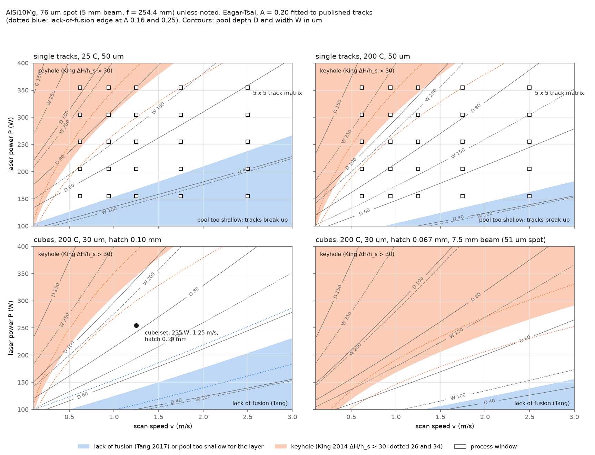

# Fast-track process: optics chain, process window and the first scan program

For [issue #260](https://github.com/vertical-cloud-lab/digital-alloy-lab/issues/260), PR 294 round 2, 2026-11-27. It
covers the laser path of FT-0, FT-1 and FT-1V from the fibre to the plate, the AlSi10Mg process window, and the scan
program for the first coupon build. Nothing here has been run on hardware. The models are analytic or small numerical
solves, checked against published data where it exists. Estimates are marked.

Round 3 (2026-11-28) re-checked the optics on CAD v2 (the current `cad/ft_model.py`), wrote the scan program as RTC4
lists, and redid the build times with the thermal FEA's dwell: [§R3](#round-3-2026-11-28-on-cad-v2), next. The
sections after it are round 2's, on the round-1 (v1) geometry, and are labelled so where it matters.

| File | What it is |
|---|---|
| [`optics.py`](optics.py) → [`out/optics.json`](out/optics.json) | spot, field geometry, footprints and irradiance, clear apertures, thermal lens (r-z and 2D solves), ghosts and back-reflection |
| [`meltpool.py`](meltpool.py) → [`out/process_window.json`](out/process_window.json) | Eagar-Tsai melt pool, calibrated on published AlSi10Mg tracks; King, Tang and Plateau-Rayleigh criteria; P-v maps; starting sets for each rung |
| [`scan_program.py`](scan_program.py) → [`out/build_first_coupons_15mm.npz`](out/build_first_coupons_15mm.npz) | coupon layout, hatching and contours for a whole build in one file, RTC5 timing, recoat and build times, heat input |
| [`rtc5_list.py`](rtc5_list.py) → [`out/rtc5_layer1.txt`](out/rtc5_layer1.txt) | the build file turned into RTC5 list commands (real function names and units), a ctypes binding, a dry-run timer |
| [`out/heat_input.csv`](out/heat_input.csv) | layer-wise heat input for the FEA (also at `/tmp/ft-process/heat_input.csv`) |
| [`out/rung1_bare_plate.npz`](out/rung1_bare_plate.npz), [`out/rung2_single_tracks.npz`](out/rung2_single_tracks.npz) → [`out/rtc5_rung1_bare_plate.txt`](out/rtc5_rung1_bare_plate.txt), [`out/rtc5_rung2_single_tracks.txt`](out/rtc5_rung2_single_tracks.txt) | one-layer programs for rungs 1–3 of the commissioning ladder (§2.2), in the same format, with their RTC5 lists |
| [`out/build_times.csv`](out/build_times.csv), [`out/scan_program.json`](out/scan_program.json), [`out/rtc5.json`](out/rtc5.json), [`out/layout.json`](out/layout.json) | tables behind the figures |
| [`optics_v2.py`](optics_v2.py) → [`out/optics_v2.json`](out/optics_v2.json) | round 3: the optics re-checked on CAD v2, reading the geometry from `cad/ft_model.py` (clearance of every part, scan angles, back-reflection chain and ray cast, irradiance, thermal lens, ghosts, sight lines) |
| [`rtc4_list.py`](rtc4_list.py) → [`out/rtc4_layer1.txt`](out/rtc4_layer1.txt), [`out/rtc4_rung1_bare_plate.txt`](out/rtc4_rung1_bare_plate.txt), [`out/rtc4_rung2_single_tracks.txt`](out/rtc4_rung2_single_tracks.txt), [`out/rtc4.json`](out/rtc4.json) | round 3: the rungs 1–3 and the first layer as RTC4 lists, in the order `control/ftctl/hw/rtc4.py` loads them |
| [`build_time_v2.py`](build_time_v2.py) → [`out/build_times_v2.csv`](out/build_times_v2.csv), [`out/build_time_v2.json`](out/build_time_v2.json) | round 3: build times on CAD v2 (X-LSM100B between v2's parks) with the thermal FEA's dwell |

```bash
python desktop-lpbf/fast-track/process/meltpool.py        # 42 s, 150 MB
python desktop-lpbf/fast-track/process/scan_program.py    # 29 s, 115 MB (writes the NPZ and heat_input.csv)
python desktop-lpbf/fast-track/process/optics.py          # 106 s, 390 MB (needs the NPZ; run it under capmem 2)
python desktop-lpbf/fast-track/process/rtc5_list.py       # 6 s
# round 3 (CadQuery: run under capmem 2)
python desktop-lpbf/fast-track/process/optics_v2.py       # 9 min, < 2 GB
python desktop-lpbf/fast-track/process/optics_v2.py --sight
python desktop-lpbf/fast-track/process/rtc4_list.py       # 10 s
python desktop-lpbf/fast-track/process/build_time_v2.py   # 20 s
```

## Round 3 (2026-11-28): on CAD v2

Round 2's process work ran on the round-1 (v1) geometry, with its own copy of the heights. Its changes went into CAD
v2: the lens axis 30 mm toward −Y, the window stack at (0, −11) in the box and (0, −21) in the cube, the Ø44
cover-slide opening, and (as recommended) the cube's cover slide hung on a drop tube 130 mm above the bed. Round 2
also swapped the RTC5 for a used RTC4 PCIe, but its lists were still RTC5 lists. This round reads the v2 geometry from
`cad/ft_model.py` itself (`P`, `levels()` and the parts of `build(state)`), re-runs the optics on it, writes the scan
program as RTC4 lists, and redoes the build time with the thermal FEA's dwell. Nothing here has been run on hardware.

### Short answer (round 3)

- **No part of CAD v2 is in the beam.** The scanned beam, counted to twice its 1/e² radius, clears every part of FT-1
  and FT-1V over the whole Ø40 plate, at any telecentricity k from 0.58 to 0.86. This is an OpenCascade distance from
  the beam's envelope to every part near it, not a sampled check. The tightest openings (Ø40 plate / Ø30 build area):
  - the cover-slide holder's Ø44 opening, 2.8 / 6.4 mm (both enclosures);
  - the window retaining flange, 3.3 / 6.5 mm (box); the cube's drop tube, 4.2 / 7.6 mm;
  - the parked hopper's cord clamp, 3.5 / 8.5 mm;
  - the window's Ø45.72 clear aperture, 5.4 / 7.7 mm; MK-13's Ø53 bore, 6.9 / 9.3 mm.
- **Scan angles are unchanged:** the plate's far edge is 50 mm from the lens axis, 0.197 rad optical on the Y galvo
  (the head allows ±0.26 and ±0.40 rad, the lens ±0.309 rad). The Ø30 build area needs 0.177 rad.
- **Back-reflection: keep the beam off the plate's front strip.** From the Ø30 build area the specular return comes
  back ≥ 17.4 mm off the input beam at the scan mirrors. It misses their 25 mm aperture (≤ 0.02 W on them from a
  polished plate at 400 W) and nothing reaches the fibre. The plate's front 5 mm (nearer than 15 mm to the lens axis)
  is different. CAD v2 hangs the head higher than round 2 assumed, which lets k go down to 0.58. At the front edge the
  return is then only 11.6 mm off: up to **~256 W of a polished plate's 342 W return lands on the mirrors** and ~5.5 W
  passes the head's entrance aperture (the core still gets ~10⁻⁷ W). **So the focus ladders and reference crosses go
  on the back half of the plate margin (y > 0), not the front.** Ray-cast through the v2 parts, a polished plate's
  specular return lands mostly on the cover-slide holder (36–39 % of the plate's area) and on the inner clamp ring or
  the cube's top plate (22–42 %); 6–16 % goes back into the lens, and none reaches the camera or the light ports.
- **Irradiance and thermal lens:** the box's window sits 6.6 mm higher in v2 (152.0 mm): 11.4 kW/cm² peak at 400 W
  (12.5 in v1). The cube's slide now hangs at 130 mm. Its peak rises from 5.4 to 15.6 kW/cm², the box's value, but the
  thermal lens of a 2 %-sooted slide while scanning **drops from 9.4 mm (2.4 z_R) to 2.4 mm (0.6 z_R)**. The box's
  numbers moved by ≤ 0.04 mm while scanning (≤ 0.2 mm with a parked beam).
- **Lens ghosts:** CAD v2 puts the head's mirrors 27.5 and 57.9 mm before the lens's first surface (estimates; round 2
  read 23.0 and 52.9). The 52.6 mm ghost then focuses 5.3 mm short of the X mirror: a 0.50 mm spot, ~500 W/cm² per watt
  of ghost, not 0.3 mm and ~155 kW/cm² per watt. The real head's mirror positions decide this: measure them on arrival.
- **RTC4 lists** for rung 1 (68 commands, 0.45 s), rungs 2–3 (90 commands, 0.32 s) and the first build's layers
  (803–1,105 commands, 3.3–3.4 s). Every layer fits one of the RTC4's two 4,000-command lists, so no list switching is
  needed. The 16-bit field is 2.71 µm a bit at f = 254 mm: end points within 1.8 µm, and hatch lines 100 ± 2.3 µm
  apart, against a 176 µm track. The RTC4 has no sky writing; round 2's lists didn't use it.
- **Build time on v2, with the thermal FEA's dwell:** the dwell, not the recoater, sets it. Holding the substrate
  within +10 K takes 16–32 s a layer with the block at the set point and 8.4–16.8 s with the block 20 K below
  (absorptivity 0.3–0.6), against 6.5 s of scanning and recoating:

  | Build | 5 mm | 10 mm | 15 mm |
  |---|---|---|---|
  | No dwell (scan + X-LSM100B recoat) | 0.30 h | 0.60 h | 0.90 h |
  | Block at the set point | 0.74–1.48 h | 1.48–2.96 h | 2.22–4.44 h |
  | **Block 20 K below the plate** | **0.39–0.78 h** | **0.78–1.55 h** | **1.17–2.33 h** |

  The X-LSM100B's recoat between v2's parks (66.6 mm) is 3.07 s at Zaber's published 104 mm/s, or 3.51 s if its
  unpublished acceleration is 250 rather than 1000 mm/s². That is no change from round 2.

### R3.1 The optics on CAD v2

[`optics_v2.py`](optics_v2.py) imports the CAD model and round 2's solvers (`optics.py`), and writes
[`out/optics_v2.json`](out/optics_v2.json) with the v1 numbers beside the v2 ones.

**What the beam sees, read from CAD v2** (mm above the bed):

| | v1 (round 2's copy) | v2 (`cad/ft_model.py`) |
|---|---|---|
| Lens axis on the bed | (0, −30), recommended | `P['axis_off']` = (0, −30) |
| Lens bottom | 300.0 | 299.5: the LINOS working distance 296.2 + the 3.27 mm focus shift of window and slide |
| Box: cover slide / window | 129.0–130.0 / 145.4–154.9 | 130.0–131.0 / 152.0–161.6 (the Saginaw door) |
| Cube: cover slide / window | 221.4–222.4 / 251.8–261.3 | 130.0–131.0, on the drop tube / 251.8–261.3 |
| Stack centres | (0, −11) box, (0, −21) cube, recommended | window (0, −11) box, (0, −21) cube; slide (0, −11) in both; drop tube (0, −16) |
| Head mirrors before the lens's first surface, Y / X | 23.0 / 52.9 (LINOS m2, the head's 29.88 mm) | 27.5 / 57.9 (`head_in_z` 43.5, `head_disp` 30.4: CAD estimates) |
| Telecentricity k (chief ray u = kθ) | 0.60–0.86 | 0.58–0.83 from v2's pupil; **0.58–0.86 used** |

**Clearance between the scanned beam and each part.** The beam is the envelope of every chief ray from the exit pupil
(on the lens axis, f/k above the focus) to the field, plus 2w of the beam itself. The table gives the smallest
OpenCascade distance over k = 0.58, 0.65 (the CAD's own pivot) and 0.86, in mm.

| Part | FT-1, Ø30 | FT-1, Ø40 | FT-1V, Ø30 | FT-1V, Ø40 |
|---|---:|---:|---:|---:|
| Cover-slide holder, Ø44 opening (MK-02) | 6.4 | **2.8** | 6.4 | **2.8** |
| Window retaining flange (MK-02) | 6.5 | 3.3 | 7.4 | 5.3 |
| Window ring (MK-02) | 7.3 | 4.9 | 6.7 | 4.5 |
| Inner clamp ring (MK-02, box) | 7.6 | 4.4 | | |
| Box door's window bore / cube top plate's Ø53 bore (MK-13) | 11.9 | 9.4 | 9.3 | 6.9 |
| Cover-slide drop tube (MK-02, cube) | | | 7.6 | 4.2 |
| Beam tube centre section (MK-10) | 8.5 | 5.3 | 9.7 | 7.7 |
| Beam-tube lens collar (MK-10) | 6.8 | 6.7 | 9.5 | 7.7 |
| Hopper parked at x = 37.5: cord clamp / hopper (MK-08) | 8.5 / 12.6 | 3.5 / 7.6 | 8.5 / 12.6 | 3.5 / 7.6 |
| Slot nozzle / exhaust collector (MK-11) | 11.4 / 12.0 | 6.6 / 7.0 | 11.4 / 12.0 | 6.6 / 7.0 |
| Thermocouples on the window ring and beam tube (MON6) | 17.4 | 14.4 | 18.9 | 16.9 |
| Camera port ring / window (MK-19, box door) | 48.1 / > 40 | 44.9 / 54.2 | > 40 | > 40 |
| Window's Ø45.72 clear aperture (analytic) | 7.7 | 5.4 | 7.7 | 5.6 |
| Lens exit, Ø70 (CAD estimate; analytic) | 14.6 | 13.0 | 14.6 | 13.0 |

- **v1 vs v2:** round 2 sized the holder to Ø44 for its own envelope (k 0.60): 3.2 mm (box) and 2.3 mm (cube) to spare
  at the plate edge. On v2 it has 2.8 mm in both, because the cube's slide now sits at the box's height and the k range
  reaches 0.58.
- The camera port and the raking lights stay 40 mm or more from the beam. Their view of the plate, re-run on v2
  (`cad/ft_checks.sight_lines`, 157 points of the Ø38 plate): with the hopper parked at the right, as while lasing,
  the camera sees 100 % of the plate, the light from −x reaches 100 % and the light from −y 91 % (box) or 93 % (cube),
  shadowed by the nozzle. With the hopper at the left park the camera sees 78–83 % and the light from −x none, so the
  layer photos are taken with the hopper on the right.

**Scan angles** (per axis, optical; the lens axis 30 mm in front of the plate centre):

| | Ø30 build area | Ø40 plate |
|---|---|---|
| Distance from the lens axis | 15–45 mm | 10–50 mm |
| Y (galvo 2 with the head as drawn: its input beam along +x) | 0.059–0.177 rad | 0.039–0.197 rad |
| X (galvo 1) | ≤ 0.059 rad | ≤ 0.079 rad |
| Largest mechanical angle | 5.1° | 5.6° |
| Limits | galvo 1 ±0.26, galvo 2 ±0.40 rad; lens ±0.309 rad (±17.7°) | margin 0.063 rad on the tighter galvo |

**Back-reflection: the return's path back to the laser.** The specular return from a flat plate at a distance r from
the lens axis comes back through the lens parallel to the outgoing beam, displaced Δ = 2kr at the scan mirrors. It
stays Δ off the input axis through the head's entrance aperture (Ø18, CAD estimate), the input turret (Ø16, CAD
estimate) and the collimator. The table gives the worst point of each region, a polished plate (R 0.9) at 400 W,
342 W returned. "Edge" is Δ minus the aperture's radius minus 2w; a positive edge means the return misses.

| Worst point | k | Δ | Edge: mirrors (25 mm) / entrance / turret | W on the mirrors / past the entrance / past the turret / in the core |
|---|---|---:|---|---|
| Ø30 build area, 15 mm from the axis | 0.58 | 17.4 mm | −0.1 / +3.4 / +4.4 mm | 0.01 / 0 / 0 / 0 |
| | 0.86 | 25.8 mm | +8.3 / +11.8 / +12.8 mm | 0 |
| Ø40 plate, front edge, 10 mm from the axis | 0.58 | 11.6 mm | −5.9 / −2.4 / −1.4 mm | **256 / 5.5 / 0.55** / 1.5 × 10⁻⁷ |
| | 0.86 | 17.2 mm | −0.3 / +3.2 / +4.2 mm | 0.02 / 0 / 0 / 0 |

- Round 2 said every plate point returns 12–86 mm off axis and misses the mirrors. That holds for the build area but
  not for the plate's front strip at low k, which v2's head position allows.
- At the fibre, the return that gets past the turret arrives 4.6 times the beam's own divergence off the fibre's axis.
  It can't couple into the core but could reach the cladding. That is ~0.5 W in the worst case, and only from a
  polished bare plate scanned at full power on its front edge.
- **Rules that follow:** the rung-1 lines stay inside r = 14 mm of the plate centre (16 mm or more from the lens axis:
  Δ ≥ 18.6 mm), as written. Focus ladders and reference crosses go on the back half of the plate margin (y > 0: 30 mm
  or more from the axis, Δ ≥ 35 mm). Round 2's rule stands: never scan a polished bare plate at full power.

**Where the specular return lands.** A ray cast of the return's chief ray from 721 points of the Ø40 plate
(area-weighted), through the v2 parts, for a flat polished plate at focus:

| First part the return meets (share of the plate's area) | FT-1, k 0.58 / 0.86 | FT-1V, k 0.58 / 0.86 |
|---|---|---|
| Cover-slide holder (MK-02) | 39 / 37 % | 39 / 36 % |
| Inner clamp ring (box) / underside of the cube's top plate (MK-13) | 22 / 29 % | 32 / 42 % |
| Back into the lens, inside its exit | 16 / 9 % | 10 / 6 % |
| Beam tube (box) / drop tube (cube) | 10 / 9 % | 10 / 10 % |
| Window ring and flange, lens collar and barrel, door | 13 / 17 % | 9 / 6 % |
| Camera port, light ports, other MON parts | 0 | 0 |

So a polished plate scanned at 400 W would send most of its ~340 W return into the cover-slide holder, the part
that also carries the slide. The specular share from powder or a bead-blasted plate is small, which is why rung 1
starts at 50 W on a bead-blasted plate. Black-anodising the holder and the clamp ring is cheap insurance.

**Irradiance at 400 W** (5 mm beam; peak = 2P/πw²):

| Surface | v1 box | v2 box | v1 cube | v2 cube |
|---|---|---|---|---|
| Cover slide, lower face | 2.54 mm, 15.8 kW/cm² | 2.56 mm, 15.6 kW/cm² | 4.35 mm, 5.4 kW/cm² | **2.56 mm, 15.6 kW/cm²** |
| Window, lower face | 2.85 mm, 12.5 kW/cm² | 2.98 mm, 11.4 kW/cm² | 4.94 mm, 4.2 kW/cm² | 4.94 mm, 4.2 kW/cm² |

**Thermal lens** (round 2's solvers on v2's heights and stack centres; Δz of the focus, mm):

| Case (400 W, 5 mm beam) | Parked beam, v1 → v2 | Scanning layer 1, transient max, v1 → v2 |
|---|---|---|
| Box, clean slide / clean window | 4.45 → 4.45 / 4.64 → 4.65 | 0.12 → 0.12 / 0.16 → 0.17 |
| Box, slide 1 % / 2 % soot | 33.9 → 34.0 / 53.7 → 53.8 | 1.17 → 1.19 / 2.34 → 2.38 (0.61 z_R) |
| Cube, clean slide / clean window | 4.36 → 4.45 / 4.67 → 4.67 | 0.47 → 0.12 / 0.82 → 0.82 |
| Cube, slide 1 % / 2 % soot | 36.9 → 34.0 / 63.3 → 53.8 | **4.70 → 1.19 / 9.40 → 2.38** (2.42 → 0.61 z_R) |

The cube's window is unchanged and is now its biggest clean-optics lens (0.82 mm while scanning, 0.21 z_R): it sits
252 mm up. Round 2's caveats stand: the parked rows are bounds, the window is thick for the thin-plate model, and the
soot is taken as uniform.

**Lens ghosts against v2's mirror positions** (LINOS back-reflex foci, measured from the first surface; ~1 W of
ghost per V-coated surface at 400 W):

| Ghost focus | v1: nearest mirror, gap, spot, W/cm² per W | v2 |
|---|---|---|
| 19.6 mm | Y at 23.0: 3.4 mm short, 0.87 mm, 170 | Y at 27.5: 7.9 mm short, 2.0 mm, 31 |
| 52.6 mm | X at 52.9: 0.3 mm, 0.03 mm, ~155,000 | X at 57.9: 5.3 mm short, 0.50 mm, 500 |
| 71.3 / 72.4 mm | X: 18.4 / 19.5 mm past, 1.3 mm, 70–76 | X: 13.4 / 14.5 mm past, 0.94–1.0 mm, 127–144 |

The spacer that round 2 suggested (3–5 mm under the head) is what CAD v2's estimate already amounts to. Both are
estimates: the hurrySCAN's mirror heights above its mounting face are not published. Measure them (or ask SCANLAB with
the serial) before full power.

### R3.2 The scan program as RTC4 lists

[`rtc4_list.py`](rtc4_list.py) turns the same build files into RTC4 lists. The command names and their order are those
of the supervisor's RTC4 backend ([`../control/ftctl/hw/rtc4.py`](../control/ftctl/hw/rtc4.py), `Rtc4Scan.load_layer`),
so a list here is the list the supervisor would load. They have not been run on a card.

| List | Commands (of 4,000 a list) | Dry run | Laser on | Energy | Largest coordinate (of ±32,767) |
|---|---:|---:|---:|---:|---:|
| Rung 1, bare plate ([`out/rtc4_rung1_bare_plate.txt`](out/rtc4_rung1_bare_plate.txt)) | 68 | 0.447 s | 0.345 s | 78 J | 15,757 bits |
| Rungs 2 and 3, single tracks ([`out/rtc4_rung2_single_tracks.txt`](out/rtc4_rung2_single_tracks.txt)) | 90 | 0.322 s | 0.207 s | 53 J | 15,923 bits |
| First build, layer 1 ([`out/rtc4_layer1.txt`](out/rtc4_layer1.txt)) | 803 | 3.319 s | 3.007 s | 746 J | 14,770 bits |
| First build, all 500 layers | 803–1,105 a layer | 3.31–3.44 s | | | |

- **The order of a list:**
  1. once, before any list, the control command `set_delay_mode(0, 0, 65500, 30, 1843)`: the variable jump delay, from
     300 µs up to the full delay at 5 mm;
  2. `set_start_list`, then `write_io_port_list(1)` (the layer marker, EXTENSION 1 bit 0);
  3. `set_scanner_delays(70, 55, 25)` (10 µs units: 700 / 550 / 250 µs), `set_laser_delays(250, 500)` (1 µs units),
     `set_jump_speed(2580)` (bits/ms, 7 m/s);
  4. per polyline: `jump_abs`, then `write_da_1_list` and `set_mark_speed` when they change, then `mark_abs`;
  5. at the end: `write_da_1_list(0)`, `jump_abs(0, 0)` (park on the lens axis, off the plate), `list_nop`,
     `write_io_port_list(0)`, `set_end_of_list`.
- **The dry run** applies the 10 µs clock and the delays to the commands. It comes out 5 ms longer than
  `scan_program.layer_time`, because the park on the lens axis is 30 mm further away.
- **Facts checked** against the RTC4 manual Rev. 1.3 e (2006,
  [manualslib](https://www.manualslib.com/manual/1581336/Scanlab-Rtc-4.html)), SCANLAB's "RTC4 Software, Release
  2023-11-02" (readme and C headers, from [scanlab.de](https://www.scanlab.de/en/downloads/rtc-software)) and the RTC5
  manual's notes for RTC4 users. A research agent read them; the page numbers are in `rtc4_list.py`.

| | RTC5 lists (round 2) | RTC4 lists (round 3) | Effect on this program |
|---|---|---|---|
| Field | 20-bit; K = 6,679 bits/mm (an example) | 16-bit, ±32,767; K = 2¹⁶ / field. Here 368.6 bits/mm (`ftctl`'s 2²⁰ / (2 f θ) / 16, θ = 0.35 rad): **2.71 µm a bit** at f = 254 mm (2.40 µm if the table spans the LINOS's 157 mm) | end points within 1.8 µm; neighbouring hatch lines 100 ± 2.3 µm apart (rms 1.0 µm) on layer 1, against a 176 µm track. The XY2-100 head takes 16 bits anyway. The plate's far edge is 18,430 bits out |
| List clock | 10 µs | a fixed 10 µs raster; a vector longer than 2¹⁶ steps goes to 20 µs steps | none: the longest vector here is ~800 steps |
| Laser power | 12-bit, 0.10 W steps | 10-bit, 0.39 W steps; ANALOG OUT1 is 0–10 V with jumper X3 at 2–3 | none |
| Laser delays | 0.5 µs | 1 µs; on −8,000…8,000 and off 2…8,000 µs (the page doesn't label which is which); off must exceed on, and the mark delay must exceed off − on | 250 / 500 µs as before; 550 > 250 µs |
| Speeds | bits/ms | bits/ms, 1…50,000 | 461 (1.25 m/s) and 2,580 (7 m/s) bits/ms |
| Variable jump delay | `set_delay_mode` (arguments not transcribed in round 2) | a control command (`set_delay_mode_list` is RTC5-only): sent once before the lists | as round 2's timing |
| List memory | 2²⁰ entries, 4,000 a list by default | two lists of 4,000, one of 8,000, or an 8,000-entry queue (`auto_change`, `get_list_space`) | a layer is ≤ 1,105 commands, so one list a layer and no switching. The next layer's list can be loaded while the recoat runs |
| Sky writing | not used | none on the RTC4 | none: the lists use the laser and mark delays |
| Signal recording | `set_trigger4`, 4 channels | `set_trigger`, 2 channels of 32,768 samples | `rtc4.py` doesn't use it yet; the digitizer (MON8) records the laser gate |
| List timer | `save_and_restart_timer`, `get_time` | both exist on the RTC4 | `rtc4.py` returns no list time; it could use them |
| Laser off on a head error | `set_laser_control` | none | the supervisor polls `get_head_status` at 5 Hz |
| 64-bit DLL | `RTC5DLLx64.dll` | `RTC4DLLx64.dll` exists (SCANLAB's 2023 package, DLL 460; product sheet: Windows 10 x64) | closes one of `rtc4.py`'s three open items. `load_correction_file`'s arguments in `rtc4.py` match the header, which closes a second; the third, `enable_laser` / `disable_laser`, was not checked |

Still unconfirmed: the RTC4's exact rule for the variable jump delay (taken as linear, as in round 2), and whether the
PCIe board's manual differs from the 2006 PCI manual on list memory and the jumper.

### R3.3 Build time on CAD v2, with the dwell

[`build_time_v2.py`](build_time_v2.py) gives each layer the longer of two times:
- its list time plus the recoat;
- the dwell the thermal FEA asks for, A × E / P_allowed. E is the layer's laser energy (746 J on average). P_allowed
  is the mean absorbed power that holds the substrate top within +10 K of 200 °C
  ([`../analysis/out/fea/thermal.md`](../analysis/out/fea/thermal.md), case 3, CAD v2): **14.0 W with the block at
  the set point, 26.7 W with the block 20 K below** (and the plate's own set point lowered so its heater stays off).

The recoat inputs:
- The X-LSM100B-E03 runs between v2's hopper parks, from `cad/ft_checks.travel_needed()`: x = −31.1 to 35.5, 66.6 mm
  (round 2: 66.4 mm). The supervisor's `park_left_x` / `park_right_x` are round 1's −30.9 / 35.5.
- Its speed is Zaber's published 104 mm/s. Zaber publishes no acceleration: neither the product page nor the X-LSM-E
  manual gives one (read 2026-11-28). The device's `accel` setting holds it, and `get accel` reads it. This uses
  1000 mm/s² (round 2's estimate) and 250 mm/s².
- Spreading at 40 mm/s (estimate) or Heriot-Watt's 10 mm/s; the plate step on the X-VSR20A; 0.5 s host overhead.

| Recoat, 66.6 mm | 1000 mm/s² | 250 mm/s² |
|---|---|---|
| Spreading at 40 mm/s | 3.07 s (return 0.74 s, spread 1.70 s) | 3.51 s |
| Spreading at 10 mm/s | 8.04 s | 8.38 s |

Build time (h), absorptivity 0.3 / 0.45 / 0.6, spreading at 40 mm/s, 1000 mm/s²
([`out/build_times_v2.csv`](out/build_times_v2.csv) has every case):

| Build | No dwell | Block at the set point | Block 20 K below |
|---|---|---|---|
| 5 mm (167 layers) | 0.30 | 0.74 / 1.11 / 1.48 | 0.39 / 0.58 / 0.78 |
| 10 mm (333 layers) | 0.60 | 1.48 / 2.22 / 2.96 | 0.78 / 1.16 / 1.55 |
| 15 mm (500 layers) | 0.90 | 2.22 / 3.33 / 4.44 | 1.17 / 1.75 / 2.33 |
| Seconds a layer | 6.47 | 16.0 / 24.0 / 32.0 | 8.4 / 12.6 / 16.8 |

- **The dwell sets the time** in every case with 40 mm/s spreading: the acceleration (250 or 1000 mm/s²) changes
  only the no-dwell row (0.60 → 0.64 h for 10 mm). At 10 mm/s spreading, the 11.4 s layer beats the dwell only with
  the block 20 K below and A = 0.3 (1.06 h for 10 mm).
- **A tighter band costs more.** The control worker's lumped study at the FE conductance (0.67 W/K) holds +5 K:
  10 mm in 2.26–4.22 h at the set point and 0.92–1.82 h with the block 20 K below
  ([`../control/out/dwell-study-fe.csv`](../control/out/dwell-study-fe.csv)).
- The first 30–50 layers run a little faster while the plate warms into the band: ~105 J/K × 10 K / 14 W, about
  1–2 min, not counted.

### R3.4 Not done in round 3, and notes for other folders

- **Nothing is measured.** k, the head's mirror heights, its entrance aperture (Ø18) and turret bore (Ø16) are CAD
  estimates, and the IPG collimator's aperture is unknown. The specular-return analysis follows the chief ray of a
  flat, polished plate; the diffuse return from powder was not modelled.
- **The thermal-lens runs use round 2's 6.46 s layer period.** The dwell stretches it to 8–32 s, which lowers the
  layer-averaged part of the lens; the peak while a part is hatched stays. Layer 1 only, as in round 2.
- **The RTC4 lists are not run on a card.** Also unconfirmed: the real correction table's K, the RTC4's exact
  variable-jump-delay rule, and `enable_laser` / `disable_laser` on the RTC4.
- **For `control/` (not edited here):**
  - `config.Scan.y_offset_mm` is 0.0, but CAD v2's lens axis is at y = −30 (`P['axis_off']`), which these lists
    assume. Set it to −30.0; otherwise the field is centred on the lens axis and every vector lands 30 mm toward −Y
    of where it should.
  - `rtc4.py`: the 64-bit DLL (`RTC4DLLx64.dll`) exists, and the `load_correction_file` prototype matches SCANLAB's
    header. `set_delay_mode` is a control command (harmless where it is called). `save_and_restart_timer` /
    `get_time` and `set_trigger` exist on the RTC4, so `list_time()` and `trace()` could return data.
  - The hopper parks: v2's are −31.1 / 35.5.

## Short answer (round 2, on the CAD v1 geometry)

- **Spot:** the 5 mm collimated beam gives a **76 µm spot** (1/e², M² 1.1) with a **3.9 mm Rayleigh range** through
  the LINOS f = 254.4 mm lens. The 7.5 mm option gives 51 µm and 1.7 mm, and it narrows the AlSi10Mg window to a
  thin band at ≤ 400 W. **Use the 5 mm beam.** The window and cover slide push the focus 3.27 mm away from the lens.
- **Move the lens axis 30 mm in front of the plate centre (to −Y).** With the axis on the plate, a flat bare plate
  at focus sends up to **342 W back into the fibre core** (R 0.9, 400 W). With the offset, every plate point is
  10–50 mm off axis. The specular return then comes back 12–86 mm off the input axis at the scan mirrors, and nothing
  reaches the core.
  - The far-edge scan angle is 0.197 rad, inside the head's ±0.26 rad and the lens's ±17.7°.
  - The window stack moves to y = −11 mm (box) / −21 mm (cube).
  - The cover-slide holder opens from Ø40 to Ø44.

  The full CAD list is in [the CAD section](#5-changes-for-the-cad).
- **Thermal lens:** with the clean optics (20 ppm/cm bulk plus a pessimistic 0.1 % coating loss), a parked beam
  moves the focus 4.4–4.7 mm (1.2 z_R). While a coupon build scans, the beam sees at most 0.12–0.16 mm in the box
  and 0.47–0.82 mm in the cube (transient 2D solve along the real scan path).
  - **A sooted cover slide (1–2 %) is the real risk:**
    - with a parked beam, 34–63 mm of focus shift (the slide would crack first);
    - while scanning, up to 1.2–2.3 mm in the box (0.3–0.6 z_R) and 4.7–9.4 mm in the cube (1.2–2.4 z_R).
  - The cube is worse because its slide hangs under the top plate, 221 mm up. **In FT-1V, hang the slide ~130 mm
    above the bed, as in the box,** or change it every build.
- **AlSi10Mg starting set for the cubes:** **255 W, 1.25 m/s, 0.10 mm hatch, 30 µm layers**, 67° rotation, one
  contour at 150 W and 0.8 m/s.
  - At 200 °C the model gives a pool 176 µm wide and 83 µm deep.
  - Margins: King's normalised enthalpy is 22 (keyhole above 30); Tang's lack-of-fusion sum is 0.45 (fails above 1;
    0.73 on a cold plate). That is 68 J/mm³.
  - The model is Eagar-Tsai with one absorptivity, A = 0.20, fitted to 15 published AlSi10Mg tracks: ±17 % on width
    over all 15, ±10 % on Bosio's 11.
- **First build:** **three 10 × 10 mm cubes and two 5 × 5 mm cubes** inside the Ø30 build area, with 2 mm gaps and
  ≥ 1 mm from the screw heads. Four 10 mm cubes fit only with 1 mm gaps.
  - The three big cubes bracket the starting set: nominal, a 0.12 mm hatch, and 1.0 m/s.
  - The whole 15 mm build is one 750 kB NPZ: 252,486 vectors in 500 layers.
- **Build time with the X-LSM100B:**

  | Build height | 5 mm | 10 mm | 15 mm |
  |---|---|---|---|
  | Spreading at 40 mm/s (estimate) | 0.30 h | 0.60 h | 0.90 h |
  | Heriot-Watt's 10 mm/s | 0.53 h | 1.06 h | 1.59 h |

  - Per layer: the scan list takes 3.40 s and the recoat 3.07 s.
  - The study's 1.2–1.8 h for 10 mm assumed 8–15 s of spreading a layer.
  - The X-LSQ075B (280 mm/s) saves only 3 % (0.58 h), because the spreading speed sets the recoat time, not the
    stage.
- **Heat input for the FEA:** 746 J of laser energy a layer, 115 W averaged over the 6.46 s layer period. That is
  35–69 W absorbed at A = 0.3–0.6.

## 1. The optics chain (round 2, CAD v1 geometry; §R3.1 has the v2 numbers)

### 1.1 Inputs

| Item | Value | Source |
|---|---|---|
| Laser | IPG YLR-400-SM-EOS (made 2015-02), 1070 ± 10 nm, M² < 1.1, CW or modulated to 50 kHz, power 10–100 %, a 5 mm affixed collimator up to 400 W (2.5 and 7.5 mm options) | [IPG YLR datasheet](https://cdn.ipgphotonics.com/6f98cba1-ae50-4feb-8635-b10901309bcd/IPG_YLR-Series_DS_EN_LTR.pdf) ("2/26"); label from the listing (lead) |
| Scan head | SCANLAB hurrySCAN 25: 25 mm aperture, beam displacement 29.88 mm (read here as the X-to-Y mirror spacing), ±0.26 rad (galvo 1) and ±0.40 rad (galvo 2) optical, tracking error 0.50 ms, step response 0.90 ms at 1 % of full scale, 0.8 m/s marking and 5.0 m/s positioning at f = 160, 1500 W at 1064 nm, 206.9 × 140 × 180 mm, 5.8 kg, XY2-100 | [SCANLAB product page](https://scanlab.de/en/print-product/609); this unit's SCANcheck sticker is dated 2003 (lead) |
| Lens | LINOS F-Theta-Ronar 4401-288-000-20: EFL 254.4, BFL 299.1, WD 296.2, FFL 344.8 mm; design beam 20 mm; mirrors m1 25.6 / m2 23.0 mm; ±17.7°; field 157 × 157 mm; T > 96 %; back-reflex foci 14.2, 19.6, 52.6, 71.3, 72.4, 142.8, 457.8 mm from the first surface. Not given: telecentricity, field curvature, CW rating | [datasheet 2021.12-V4](https://mm.digikey.com/Volume0/opasdata/d220001/medias/docus/1068/4401-288-000-20_2021.12-V4.pdf) |
| Window, slide | Edmund 38-990, Ø50.8 × 9.53 fused silica, V-coat, CA Ø45.72; cover slide Ø50 × 1 | `cad/ft_model.py`, PR 266 `beam_path.py` |
| Heights above the bed | box: slide 129.0–130.0, window 145.4–154.9; cube: slide 221.4–222.4, window 251.8–261.3 | `cad/ft_model.py` `levels()` and `build()` |

The telecentricity factor k (chief-ray angle u = k·θ) isn't published. The entrance pupil sits 35.8 mm before the
first lens surface (m2 + m1/2). The front principal plane lies somewhere between the first surface and the lens's
bottom. That gives **k = 0.60–0.86**, and every result below is given at both ends.

### 1.2 Spot and field

| | 5 mm beam | 7.5 mm beam |
|---|---|---|
| Spot (1/e², M² 1.05 / 1.1) | 72.8 / 76.2 µm | 48.5 / 50.8 µm |
| Rayleigh range z_R (M² 1.1) | 3.88 mm | 1.72 mm |
| Depth for ≤ 5 % spot growth | ±1.24 mm | ±0.55 mm |
| Focus shift from window + slide | +3.27 mm (away from the lens) | same |

| Field point (r from the lens axis) | r = 20 mm (plate edge, axis centred) | r = 50 mm (far edge, axis offset 30 mm) |
|---|---|---|
| Optical / mechanical scan angle | 4.50° / 2.25° | 11.3° / 5.6° (0.197 rad, head limit 0.26) |
| Chief-ray angle u (k 0.60–0.86) | 2.7–3.9° | 6.8–9.7° |
| Spot elongation 1/cos u | 0.11–0.23 % | 0.7–1.4 % |
| xy shift per 100 µm height error | 4.7–6.8 µm | 11.8–17.1 µm |
| Lateral shift through the window | 0.14–0.20 mm | 0.35–0.51 mm |
| Focus surface of an *uncorrected* lens (bound) | 0.79 mm (+2.0 % spot) | 4.9 mm (+61 % spot) |

- **Burn the correXion grid through the window and slide.** The window shifts field points sideways by up to
  0.5 mm, and the calibration then removes it.
- The F-Theta-Ronar is flat-field corrected for a 20 mm beam over ±78.5 mm, so the last row is an upper bound, not
  a prediction. Run a focus ladder at the far edge as well as the centre.
- The datasheet's spot map (14 mm beam) shows 12.6–18.1 µm radius across the field. At 5 mm the aberrations are far
  smaller than the 38 µm diffraction radius (not computed; no prescription).

### 1.3 Footprint, irradiance and clear apertures

At 400 W with the 5 mm beam (peak = 2P/πw², mean = P/πw²):

| Surface | Box: beam Ø, peak / mean | Cube: beam Ø, peak / mean |
|---|---|---|
| Cover slide, lower face | 2.54 mm, 15.8 / 7.9 kW/cm² | 4.35 mm, 5.4 / 2.7 kW/cm² |
| Window, lower face | 2.85 mm, 12.5 / 6.3 kW/cm² | 4.94 mm, 4.2 / 2.1 kW/cm² |

Clear aperture needed (beam to 2w, plus 2 mm), against what the CAD has:

| Opening | Axis centred: needed / drawn radius | Axis offset 30 mm, stack at y = −11 (box) / −21 (cube) |
|---|---|---|
| Cover-slide holder | 18.6 / 20.0 mm (box, k 0.60) | 20.8 (box) and 21.7 (cube) mm: **open Ø40 to Ø44** |
| Window CA | 18.0 / 22.9 mm | ≤ 18.7 mm of 22.9 |
| Window ring ledge, flange, clamp ring | ≤ 18.3 / 22.0 mm | ≤ 19.7 mm of 22.0 |
| Beam tube Ø54 | ≤ 17.7 / 27.0 mm | cone spans y −35.0 to +4.3; tube axis at y = −17 clears it by ≥ 7 mm |


*Left: the first layer's scan pattern seen on the box's cover slide, as irradiance averaged over the layer period.
The instantaneous peak is 15.8 kW/cm². Right: the slide's temperature rise if 1 % of that is absorbed (soot), from
a 2D steady conduction solve with the rim held at the mount temperature.*

### 1.4 Thermal lens

The static case uses an r-z finite-volume solve of the disc with the rim held at the mount temperature, after PR 266's
`analysis/optics/thermal_lens.py`. The focus shift is Δz = h²D/(1 + hD), against z_R = 3.88 mm.

The scanning columns use a 2D thin-plate solve of the element with the first build's layer 1 as the source:
- *steady:* the layer-averaged irradiance, at the five parts' images;
- *transient:* explicit time steps along the real, time-stamped scan path for two layer periods (scan, then
  recoat), starting from the steady field. Δz is sampled every 10 ms where the beam is. The model is linear in the
  absorbed power, so one run per element gives every absorption case.

| Case (400 W, 5 mm beam) | Absorbed while on | Parked beam: Δz (× z_R) | Scanning, steady: Δz | Scanning, transient: mean / max Δz (max × z_R) |
|---|---|---|---|---|
| Box, clean slide (20 ppm/cm + 0.1 %) | 0.40 W | 4.45 mm (1.15) | 0.01–0.05 mm | 0.06 / 0.12 mm (0.03) |
| Box, clean window | 0.41 W | 4.64 mm (1.20) | 0.02–0.08 mm | 0.09 / 0.16 mm (0.04) |
| Box, slide 1 % soot | 4.0 W | 33.9 mm (8.7), ΔT ~1200 K | 0.08–0.47 mm | 0.58 / 1.17 mm (0.30) |
| Box, slide 2 % soot | 8.0 W | 53.7 mm (13.8), ΔT ~2400 K | 0.15–0.94 mm | 1.16 / 2.34 mm (0.60) |
| Cube, clean slide | 0.40 W | 4.36 mm (1.12) | 0.07–0.27 mm | 0.28 / 0.47 mm (0.12) |
| Cube, clean window | 0.41 W | 4.67 mm (1.20) | 0.21–0.57 mm | 0.56 / 0.82 mm (0.21) |
| Cube, slide 1 % soot | 4.0 W | 36.9 mm (9.5) | 0.74–2.66 mm | 2.81 / 4.70 mm (1.21) |
| Cube, slide 2 % soot | 8.0 W | 63.3 mm (16.3) | 1.49–5.33 mm | 5.62 / 9.40 mm (2.42) |

- **The parked-beam rows are bounds.** They need a beam held in one place for longer than the local time constant
  (~0.5 s), as in a slow focus ladder or a stuck scanner. The linear model also stops meaning anything once ΔT
  passes a few hundred kelvin: the slide would crack first.
- **0.1 % coating loss is pessimistic.** A good V-coat absorbs < 50 ppm a face, which cuts the clean rows about
  15-fold.
- **The transient lens is 1.2–2.5 times the steady one.** Heat builds up over one part's image while that part is
  hatched (~0.8 s), faster than it spreads.
- **The cube is worse than the box.** Its slide is higher (h² in Δz), and the scan pattern's image on it is smaller,
  which concentrates the heat. Hanging the cube's slide ~130 mm above the bed, as in the box, gives it the box's
  numbers.
- **The window is thick (9.53 mm) for a thin-plate model,** so its scanning rows are rougher than the slide's.
- **Rules that follow:**
  - change the slide when it looks grey, and every build until the soot rate is known;
  - never park the beam at full power;
  - log a focus check (one short ladder on the plate margin) at the start of each build.

### 1.5 Back-reflection

| Path | Into the fibre core | How |
|---|---|---|
| Flat bare Al at focus, R 0.9, on the lens axis | **342 W** | cat's eye: returned beam coaxial |
| same, 3 mm off axis (k 0.86 / 0.60) | 4.8 / 43 W | returned beam displaced Δ = 2kr at the mirrors; overlap exp(−(2Δ/D)²) |
| same, 5 mm off axis | 0.003 / 1.1 W | |
| same, ≥ 10 mm off axis (**every plate point with the 30 mm offset**) | ~0 (Δ = 12–86 mm) | the return misses the mirrors and the collimator |
| Melt pool of curvature radius 0.1 / 0.3 / 1 / 3 mm (multiplies the above) | × 6.6e-4 / 5.9e-3 / 0.062 / 0.37 | overlap 1/(1 + (z_R/R_c)²) |
| Window and slide faces, V-coat 0.25 % (box) | 0.65–0.90 mW each | waist 260–300 mm out of place |
| Lens ghost focused 19.6 mm before the first surface | 3.4 mm short of M2: 0.87 mm spot, 170 W/cm² per W of ghost | LINOS back-reflex table |
| Lens ghost at 52.6 mm | **0.3 mm from M1** if the head's 29.88 mm mirror spacing sits behind m2 = 23.0 | spot of tens of µm, ~1 W: measure, and space the head 3–5 mm up if so |

- **IPG's guidance is thin.** IPG's YLR user guide has a "High Back Reflection Level" status bit that switches
  emission off when "the back reflected power exceeded the preinstalled maximal applicable level"
  ([user guide P21-010078 rev. A, mirror](https://manualedistruzioni.it/ipg/measuring-instrument/ylr-series/user-manual/20cai)).
  It gives no threshold. No IPG free-space isolator was found on ipgphotonics.com.
- **Stellwag (2012 thesis; IPG YLR-6000 welding 304; no DOI given)**, via Edison's round-2 review
  ([`../../edison/ft-round2-review/answer.md`](../../edison/ft-round2-review/answer.md)):
  - tilting the head sideways 5–10° was the most effective fix;
  - a lead angle helped and a lag angle made it worse;
  - reflection spikes came at the conduction/keyhole transitions.
- **What FT-1 does:**
  1. **The 30 mm offset to −Y.** It removes the flat-plate cat's eye with the focal plane still flat. The chief ray
     on the plate is then 1.4–9.7° (4.1–5.8° at the plate centre).
  2. **Hatch lines are kept away from Y.** Lines within ±30° of the Y axis are skipped in the 67° sequence. Every
     line is then nearer sideways to the tilt than lead or lag, and none runs along the gas flow.
  3. **Rung 1 starts at 50 W** on a bead-blasted or anodised plate, with the laser's back-reflection status bit
     logged. Then ramp. A 3° head tilt about X (minimum chief ray 4.4–4.9°) is the fallback if the alarm trips; it
     costs ±1.05 mm of focus at the plate edges. Edison suggests asking IPG, with the serial number, whether the
     unit has back-reflection protection.
  4. **Never scan polished bare plates at full power.** With the offset the return misses the laser, but up to
     ~340 W then lands in the head and lens barrel. Powder and bead-blasted surfaces reflect diffusely.


## 2. Process window (AlSi10Mg; 6061 and 7075 noted)

### 2.1 Model and calibration

- **Eagar-Tsai** (Gaussian source, σ = w0/2, constant properties, no latent heat), integrated numerically. It matches
  `scipy.integrate.quad` to 3e-5 and reproduces Rosenthal's Q/(2πkR) along the trailing centreline.
- **AlSi10Mg inputs:** Tang's set: k 110 W/m·K, c 915 J/kg·K, ρ 2670 kg/m³, T_m 849 K
  ([thesis](https://doi.org/10.1184/R1/6720185.v1) Table 12).
- **Absorptivity fitted to published track widths:**
  - [Bosio et al. 2019](https://doi.org/10.1016/j.matdes.2019.107949) Table A1: 11 tracks, 100 µm spot, 100 °C,
    one 50 µm layer on a 40 mm disc;
  - [Kempen et al. 2011](https://utw10945.utweb.utexas.edu/Manuscripts/2011/2011-37-Kempen.pdf): 137 µm at 200 W and
    1.4 m/s;
  - Tang's thesis Table 13: 3 tracks; spot and plate temperature assumed.

  | Fit | A | rms width error (log) |
  |---|---|---|
  | All 15 tracks | 0.199 | 0.17 |
  | Bosio only | 0.175 | 0.10 |

  Patel et al. 2022 ([doi](https://doi.org/10.1016/j.addma.2022.103112)) inferred 0.24 ± 0.05 in conduction mode.
  Calorimetry on Al powder gives 0.53–0.58 at 970 nm ([Boley 2016](https://doi.org/10.1364/AO.55.006496)). A = 0.20 is
  the effective value for this model's pool sizes. Use 0.3–0.6 for heat balances.
- **Track continuity:** Bosio's stable (160–195 W) and unstable (100–130 W) tracks overlap in model depth between
  42 and 48 µm. The boundary is drawn at **D ≥ 45 µm for a 50 µm layer**.
  - Plateau-Rayleigh (L/W > π) never triggers here: the model's L/W is 1.0–2.2 over all the maps.
  - So low-power balling in Al is a too-shallow pool, not a long one.
- **Keyhole:** [King et al. 2014](https://doi.org/10.1016/j.jmatprotec.2014.06.005) Eq. 2.6,
  ΔH/h_s = A·P/(h_s·√(π·D·v·σ³)), with h_s = ρcT_m. Threshold 30 ± 4 (316L).
  - σ is the Gaussian standard deviation (I ∝ exp(−r²/2σ²)), so σ = w0/2 here. The paper doesn't say which
    beam size went into Eq. 2.6; σ = D4σ/4 is the reading that fits its own Table 3.
  - With A = 0.20, Bosio's and Kempen's tracks fall at 8–23, and Kempen's "deep penetration" at 200 W and 0.2 m/s at
    ~29. Consistent.
  - For the 76 µm spot this puts the keyhole onset at P ≈ 310 W·√(v / 1 m/s).
  - Patel's AlSi10Mg bands on [Gan et al. 2021](https://doi.org/10.1038/s41467-021-22704-0)'s keyhole number (Ke < 12
    conduction, > 20 keyhole) agree: the cube set has Ke = 10.
- **Lack of fusion:** [Tang et al. 2017](https://doi.org/10.1016/j.addma.2016.12.001), (H/W)² + (t/D)² ≤ 1, with D
  measured from the top surface.



### 2.2 Starting sets for the commissioning ladder

| Rung | Set | Predicted |
|---|---|---|
| 1. Bare 6061 disc, 25 °C | 50 W first (back-reflection check), then a matrix 100–400 W × 0.25 / 0.5 / 1 / 2 m/s, 10 mm lines 1 mm apart, on a bead-blasted or anodised disc; focus ladder on a plate tilted 10–15° | at 200 W, 0.5 m/s: W 70–117 µm, D 20–48 µm (A 0.1–0.2; flat Al ~0.05) |
| 2. Single tracks, one 50 µm layer, 25 °C | 5 × 5: 155 / 205 / 255 / 305 / 355 W × 0.62 / 0.94 / 1.25 / 1.75 / 2.5 m/s, 9 mm tracks (Bosio's method) | continuous except 155 W ≥ 1.25 m/s and 205 W at 2.5 m/s; keyhole at 255 W/0.62, 305 W ≤ 0.94, 355 W ≤ 1.25 m/s |
| 3. Same at 200 °C | the same matrix | pools ~25 % larger; only 155 W at 2.5 m/s too shallow; the same keyhole corner |
| 4. Cubes, 30 µm, 200 °C | **255 W, 1.25 m/s, hatch 0.10 mm**, 67° with the ±30° exclusion, contour 150 W, 0.8 m/s | W 176, D 83 µm, King 22, Tang 0.45, 68 J/mm³ (cold plate: W 141, D 63, Tang 0.73) |
| 4, variant B | hatch 0.12 mm | Tang 0.60, 57 J/mm³ |
| 4, variant C | 1.0 m/s | W 190, D 90 µm, King 24.7, 85 J/mm³ |

- **Programs for rungs 1–3** are written in the build-file format and turned into RTC5 lists:
  - `out/rung1_bare_plate.npz`: 18 lines of 10 mm, 1.5 mm apart, starting with two 50 W lines; 0.44 s.
  - `out/rung2_single_tracks.npz`: 25 tracks of 9 mm, 1.1 mm apart; 0.32 s. Rung 3 uses the same file.

  Every line runs along +X, the field is scanned from +Y to −Y, and all of it lies within r = 14 mm of the plate
  centre.
- **Speed:** the hatch speed sits at the hurrySCAN 25's 1.27 m/s marking speed at f = 254.4. The window reaches past
  2 m/s if the delays are tuned for it.
- **Calibration:** rung 3's widths and depths re-fit A, and the cube set moves with them. The model and the tables
  are rerun with one command.
- **6061 and 7075 at the cube set (200 °C):**
  - 6061: W 140 µm, D 62 µm, Tang 0.74 (keep 0.10 mm);
  - 7075: W 151 µm, D 69 µm, Tang 0.63.

  Their pools are similar. Cracking is the problem, not density:
  - 100–200 °C preheat did not reduce cracking in 7075 ([Velikajne et al. 2026](https://doi.org/10.3390/ma19050970));
  - every 7075 part hot-cracked in [Kaufmann 2016](https://doi.org/10.1016/j.phpro.2016.08.096);
  - crack-free 6061 needed a 500 °C bed ([Uddin et al. 2018](https://doi.org/10.1016/j.addma.2018.05.047)).

  So FT-1's 200 °C plate will not stop hot cracking. Zn in 7075 boils at 907 °C, so expect more vapour and
  porosity than the AlSi10Mg model shows.

## 3. The scan program

### 3.1 Layout

How many cubes fit inside r = 15 mm (`out/layout.json`):

| Cube | 1 mm gap | 2 mm | 2.5 mm | 3 mm | 4 mm |
|---|---|---|---|---|---|
| 10 × 10 mm | 4 | 3 | – | 3 | 2 |
| 5 × 5 mm | – | 12 | 10 | 10 | 7 |

- **The first build:** A (−6, 5.15), B (6, 5.15) and C (0, −6.9), each 10 × 10 mm, plus d (−9.5, −4.4) and
  e (9.5, −4.4), each 5 × 5 mm, all checked against 2 mm gaps and 1 mm from the screw heads. That scans 350 mm² a
  layer.
- **Scan order:** parts from +Y to −Y, with hatch lines stepping towards −Y, against the cross-flow.
- **Hatching:** meander at the set's hatch, 67° a layer, skipping angles within ±30° of Y.
- **Contour:** one per part, 0.08 mm inside the outline. The hatch stops 0.06 mm inside the contour.


### 3.2 The build file and the RTC5 lists (round 2; §R3.2 has the RTC4 lists)

- **`out/build_first_coupons_15mm.npz`** holds the whole 15 mm build: 500 layers, 252,486 vectors, 750 kB. The
  5 mm and 10 mm builds are its first 167 and 333 layers. It contains:
  - `seg_delta_um`: int32 µm, delta-coded by column;
  - `kind` and `part`;
  - `layer_ptr`;
  - `meta`: JSON with the parts, parameter sets and timing.

  `scan_program.load_build()` restores it to 0.5 µm.
- **`rtc5_list.py`** maps the plate frame to the lens frame (axis offset), then writes per layer:
  - `set_start_list`, `set_laser_delays` (0.5 µs a bit), `set_scanner_delays` (10 µs a bit), `set_jump_speed` and
    `set_mark_speed` (bits/ms = v·K/1000);
  - `write_da_1_list` (12 bit, 0–10 V for 0–400 W), `jump_abs` / `mark_abs` (20-bit field), `set_end_of_list`.

  Names and units are from the RTC5 manual Rev. 1.9 e; the page numbers are in the module.
  - A layer needs 799–1101 commands; lists 1 and 2 hold 4000 each by default.
  - K = 6679 bits/mm is an example (2^20 / 157 mm); the correXion table sets the real K.
  - The ctypes binding is written but untested, as there is no card here. `set_delay_mode`'s arguments were not
    transcribed, and the laser-mode and control bits wait on IPG's interface pinout.

### 3.3 Timing (round 2: v1 recoater stroke, no dwell; §R3.3 has v2 with the dwell)

| Item | Value | Basis |
|---|---|---|
| Marks | length / v in 10 µs ticks | RTC5 list clock |
| Jumps | 7.0 m/s, delay 300–700 µs (variable below 5 mm) | hurrySCAN 25: 7.95 m/s positioning at f = 254.4, tracking error 0.50 ms |
| Mark / polygon delay | 550 / 250 µs | ~ tracking error / half of it |
| Laser on / off delay | 250 / 500 µs | laser-on time = marks − on + off delay, per polyline |
| List time, first build | **3.40 s a layer** on average; layer 1: 3.31 s, or 3.41 s from a dry run of its RTC5 commands with a fixed jump delay | `layer_time`, `rtc5_list.dry_run_time` |
| Same with 0.7 ms tracking error (worn 2003 galvos) | 3.57 s (+5 %) | all delays × 1.4 |
| Return stroke, 66.4 mm | 0.74 s at 104 mm/s (X-LSM100B), 0.52 s at 280 mm/s (X-LSQ075B) | 1000 mm/s² (estimate) |
| Spread stroke, 66.4 mm | 1.70 s at 40 mm/s (estimate); 6.65 s at Heriot-Watt's 10 mm/s | powder-limited |
| Plate step 30 µm + settle | 0.12 s | X-VSR20A, 48 mm/s maximum |
| Host overhead | 0.50 s (estimate) | stage commands, list load, a layer photo |
| **Recoat** | **3.07 s** (X-LSM100B), 2.84 s (X-LSQ075B) at 40 mm/s | |

Build time (hours, layout above, excluding purge and heat-up):

| Stage, spreading speed | 5 mm | 10 mm | 15 mm |
|---|---|---|---|
| X-LSM100B, 10 mm/s | 0.53 | 1.06 | 1.59 |
| X-LSM100B, 20 mm/s | 0.38 | 0.75 | 1.13 |
| **X-LSM100B, 40 mm/s** | **0.30** | **0.60** | **0.90** |
| X-LSM100B, 80 mm/s | 0.26 | 0.52 | 0.79 |
| X-LSQ075B, 40 mm/s | 0.29 | 0.58 | 0.87 |
| Scan list alone | 0.16 | 0.31 | 0.47 |

The study's 1.2–1.8 h for a 10 mm build corresponds to 8–15 s of spreading a layer. Only spreading at Heriot-Watt's
10 mm/s comes near it.


## 4. Heat input for the FEA

`out/heat_input.csv`, one row a layer, 500 rows (15 mm at 30 µm; rows 1–167 and 1–333 are the 5 mm and 10 mm
builds):

| Column | Meaning |
|---|---|
| `layer` | 1…500 |
| `t_start_s` | start of the layer's scan, from the start of the build |
| `exposure_s` | RTC5 list time of the layer (marks, jumps, delays) |
| `energy_J` | laser energy delivered (P × laser-on time); multiply by A for the absorbed share |
| `mean_W` | `energy_J` / layer period |
| `laser_on_s`, `period_s` | laser-on time; scan + recoat |

- **Per layer:** 746 J delivered, 3.01 s laser-on, 6.46 s period (X-LSM100B, 40 mm/s spreading), 115 W mean. At
  A = 0.3–0.6 that is 35–69 W absorbed, the study's 46–91 W band at a lower duty.
- **By part, layer 1:** A 208 J, B 175 J, C 257 J, d and e 53 J each. Positions are in §3.1. The heat goes in over
  the 350 mm² of coupons, not the whole plate.

## 5. Changes for the CAD (round 2; all of them are in CAD v2)

Sent to the lead as `/tmp/ft-process/cad_changes.md`:

1. **Lens axis:** scan head, lens, collimator and lens collar −30 mm in Y in all states. The head plate grows
   30 mm towards −Y.
2. **Window stack** centred at y = −11 (box) / −21 (cube): window ring, flange, window, inner clamp ring, lid or
   top-plate bore, holder and slide. Open the holder from Ø40 to Ø44. Beam tube: Ø54 bore with its axis at y = −17
   (box) / −24 (cube), and a flat flange carrying the lens collar at y = −30.
3. **Lens:** bottom 299.5 mm above the bed (WD 296.2 + 3.27); body Ø119.8 × 69.2 mm, 20.5 mm above datum A; datum A
   at 348.1 mm. In the beam envelope, chief rays pivot f/k = 296–424 mm above the focus.
4. **Head:** 206.9 × 140 × 180 mm on datum A, so its top is ~528 mm above the bed in the box. Possibly a 3–5 mm
   spacer under the head (lens ghost, §1.5).
5. **Cube slide height (recommended):** hang the FT-1V cover slide ~130 mm above the bed on a drop tube from the top
   plate, as in the box, instead of under the top plate at 221 mm. A 2 % sooted slide then defocuses by ≤ 0.6 z_R
   instead of 2.4 z_R.
6. **Optional:** a 3° head tilt about X, only if the back-reflection alarm trips.

## 6. Checks on arrival this work adds

- **Telecentricity:** burn a cross at two plate heights 2 mm apart at r = 10 and 50 mm. The shift gives k, which
  fixes the window-stack centre to ±1 mm.
- **The head's mirror positions relative to the lens datum:** the 52.6 mm and 19.6 mm ghost foci must stay ≥ 3 mm off
  the mirrors.
- **The 2003 galvos:**
  - read `get_head_status` (position acknowledge, temperature, power);
  - burn a delay test pattern to measure the tracking error;
  - burn a reference cross on the plate margin at the start and end of each build. The new head's 8 h drift was
    < 0.6 mrad, which is 0.15 mm at f = 254.4.
- **The X mirror's gold-looking coating** may reflect the red guide laser poorly. If the guide spot is faint, align
  with a low-power burn instead. A coaxial camera through the head would also see little visible light.
- **The head's adjustable input lens** must be set to infinity (collimated) for the LINOS lens, or it moves the
  focus.
- **Ask IPG,** with the serial, for the back-reflection protection and its threshold.

## 7. Not done, and what is uncertain

- **Lens and scanner:** no lens prescription, so k (0.60–0.86), field curvature and ghost positions relative to the
  real mirrors are ranges or vendor numbers. The ghost check uses LINOS's recommended mirror distances and SCANLAB's
  29.88 mm beam displacement read as the mirror spacing; the real distances are unknown. The hurrySCAN delays are datasheet-based starting values for a
  23-year-old head.
- **Melt-pool model:**
  - Eagar-Tsai has no latent heat, no Marangoni flow and no powder layer. One absorptivity covers both modes, so
    keyhole depths are underestimated.
  - The calibration spans 160–360 W with 100–150 µm spots. Our 76 µm spot is an extrapolation in spot size.
  - The continuity boundary is ±3 µm in depth.
- **Not simulated:** spatter, plume attenuation, oxygen and the cross-flow (the CFD worker's).
- **Timing and heat input:** the recoat accelerations, spreading speeds and host overhead are estimates; the
  spreading speed decides the build time. The heat input assumes every layer is scanned as programmed; no
  inter-layer dwell is added.
- **Thermal lens:**
  - the scanning cases are thin-plate 2D solves of layer 1 only;
  - the window's 9.53 mm thickness is beyond the thin-plate model;
  - the soot is taken as uniform over the slide;
  - no CalculiX cross-check was run here (PR 266 checked its r-z solver against CalculiX for its slide).
