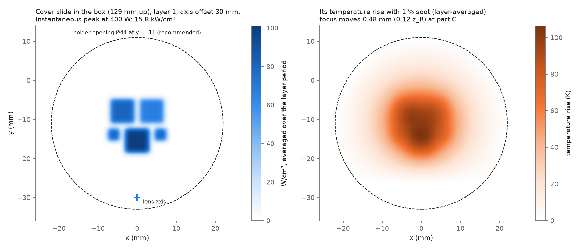
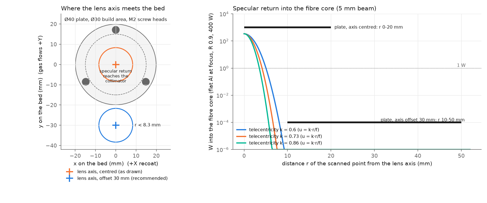
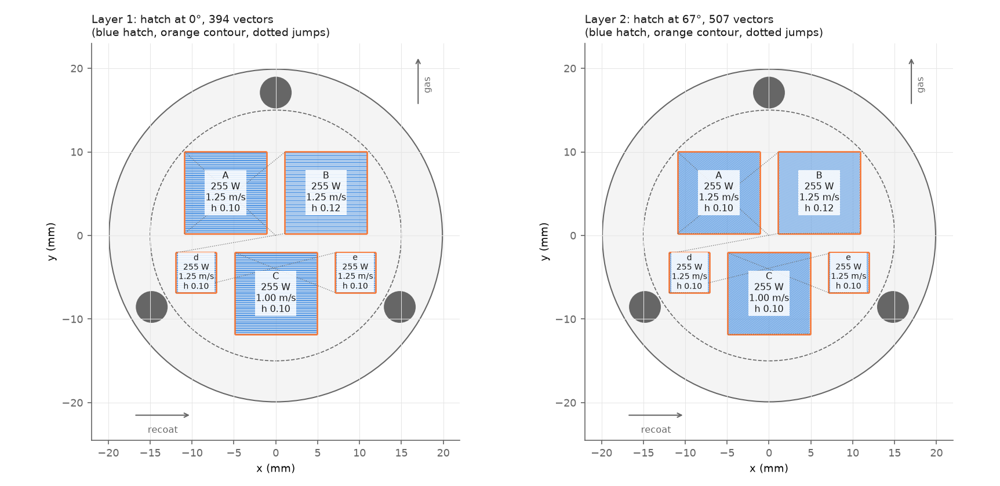
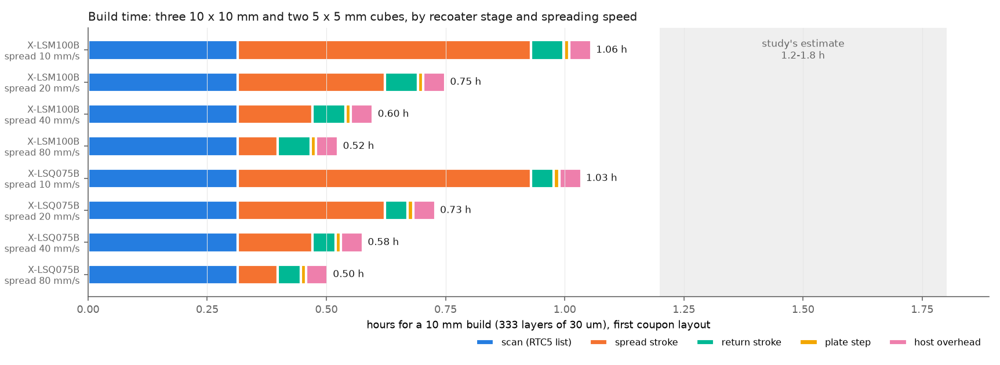

# Fast-track process: optics chain, process window and the first scan program

For [issue #260](https://github.com/vertical-cloud-lab/digital-alloy-lab/issues/260), PR 294 round 2, 2026-11-27. It
covers the laser path of FT-0, FT-1 and FT-1V from the fibre to the plate, the AlSi10Mg process window, and the scan
program for the first coupon build. Nothing here has been run on hardware. The models are analytic or small numerical
solves, checked against published data where it exists. Estimates are marked.

| File | What it is |
|---|---|
| [`optics.py`](optics.py) → [`out/optics.json`](out/optics.json) | spot, field geometry, footprints and irradiance, clear apertures, thermal lens (r-z and 2D solves), ghosts and back-reflection |
| [`meltpool.py`](meltpool.py) → [`out/process_window.json`](out/process_window.json) | Eagar-Tsai melt pool, calibrated on published AlSi10Mg tracks; King, Tang and Plateau-Rayleigh criteria; P-v maps; starting sets for each rung |
| [`scan_program.py`](scan_program.py) → [`out/build_first_coupons_15mm.npz`](out/build_first_coupons_15mm.npz) | coupon layout, hatching and contours for a whole build in one file, RTC5 timing, recoat and build times, heat input |
| [`rtc5_list.py`](rtc5_list.py) → [`out/rtc5_layer1.txt`](out/rtc5_layer1.txt) | the build file turned into RTC5 list commands (real function names and units), a ctypes binding, a dry-run timer |
| [`out/heat_input.csv`](out/heat_input.csv) | layer-wise heat input for the FEA (also at `/tmp/ft-process/heat_input.csv`) |
| [`out/rung1_bare_plate.npz`](out/rung1_bare_plate.npz), [`out/rung2_single_tracks.npz`](out/rung2_single_tracks.npz) → [`out/rtc5_rung1_bare_plate.txt`](out/rtc5_rung1_bare_plate.txt), [`out/rtc5_rung2_single_tracks.txt`](out/rtc5_rung2_single_tracks.txt) | one-layer programs for rungs 1–3 of the commissioning ladder (§2.2), in the same format, with their RTC5 lists |
| [`out/build_times.csv`](out/build_times.csv), [`out/scan_program.json`](out/scan_program.json), [`out/rtc5.json`](out/rtc5.json), [`out/layout.json`](out/layout.json) | tables behind the figures |

```bash
python desktop-lpbf/fast-track/process/meltpool.py        # 42 s, 150 MB
python desktop-lpbf/fast-track/process/scan_program.py    # 29 s, 115 MB (writes the NPZ and heat_input.csv)
python desktop-lpbf/fast-track/process/optics.py          # 106 s, 390 MB (needs the NPZ; run it under capmem 2)
python desktop-lpbf/fast-track/process/rtc5_list.py       # 6 s
```

## Short answer

- **Spot:** the 5 mm collimated beam gives a **76 µm spot** (1/e², M² 1.1) with a **3.9 mm Rayleigh range** through
  the LINOS f = 254.4 mm lens. The 7.5 mm option gives 51 µm and 1.7 mm, and it narrows the AlSi10Mg window to a
  thin band at ≤ 400 W. **Use the 5 mm beam.** The window and cover slide push the focus 3.27 mm away from the lens.
- **Move the lens axis 30 mm in front of the plate centre (to −Y).** With the axis on the plate, a flat bare plate
  at focus sends up to **342 W back into the fibre core** (R 0.9, 400 W). With the offset, every plate point is
  10–50 mm off axis. The specular return then comes back 12–86 mm off the input axis at the scan mirrors, and nothing
  reaches the core.
  - The far-edge scan angle is 0.197 rad, inside the head's ±0.26 rad and the lens's ±17.7°.
  - The window stack moves to y = −11 mm (box) / −21 mm (cube).
  - The cover-slide holder opens from Ø40 to Ø44.

  The full CAD list is in [the CAD section](#5-changes-for-the-cad).
- **Thermal lens:** with the clean optics (20 ppm/cm bulk plus a pessimistic 0.1 % coating loss), a parked beam
  moves the focus 4.4–4.7 mm (1.2 z_R). While a coupon build scans, the beam sees at most 0.12–0.16 mm in the box
  and 0.47–0.82 mm in the cube (transient 2D solve along the real scan path).
  - **A sooted cover slide (1–2 %) is the real risk:**
    - with a parked beam, 34–63 mm of focus shift (the slide would crack first);
    - while scanning, up to 1.2–2.3 mm in the box (0.3–0.6 z_R) and 4.7–9.4 mm in the cube (1.2–2.4 z_R).
  - The cube is worse because its slide hangs under the top plate, 221 mm up. **In FT-1V, hang the slide ~130 mm
    above the bed, as in the box,** or change it every build.
- **AlSi10Mg starting set for the cubes:** **255 W, 1.25 m/s, 0.10 mm hatch, 30 µm layers**, 67° rotation, one
  contour at 150 W and 0.8 m/s.
  - At 200 °C the model gives a pool 176 µm wide and 83 µm deep.
  - Margins: King's normalised enthalpy is 22 (keyhole above 30); Tang's lack-of-fusion sum is 0.45 (fails above 1;
    0.73 on a cold plate). That is 68 J/mm³.
  - The model is Eagar-Tsai with one absorptivity, A = 0.20, fitted to 15 published AlSi10Mg tracks: ±17 % on width
    over all 15, ±10 % on Bosio's 11.
- **First build:** **three 10 × 10 mm cubes and two 5 × 5 mm cubes** inside the Ø30 build area, with 2 mm gaps and
  ≥ 1 mm from the screw heads. Four 10 mm cubes fit only with 1 mm gaps.
  - The three big cubes bracket the starting set: nominal, a 0.12 mm hatch, and 1.0 m/s.
  - The whole 15 mm build is one 750 kB NPZ: 252,486 vectors in 500 layers.
- **Build time with the X-LSM100B:**

  | Build height | 5 mm | 10 mm | 15 mm |
  |---|---|---|---|
  | Spreading at 40 mm/s (estimate) | 0.30 h | 0.60 h | 0.90 h |
  | Heriot-Watt's 10 mm/s | 0.53 h | 1.06 h | 1.59 h |

  - Per layer: the scan list takes 3.40 s and the recoat 3.07 s.
  - The study's 1.2–1.8 h for 10 mm assumed 8–15 s of spreading a layer.
  - The X-LSQ075B (280 mm/s) saves only 3 % (0.58 h), because the spreading speed sets the recoat time, not the
    stage.
- **Heat input for the FEA:** 746 J of laser energy a layer, 115 W averaged over the 6.46 s layer period. That is
  35–69 W absorbed at A = 0.3–0.6.

## 1. The optics chain

### 1.1 Inputs

| Item | Value | Source |
|---|---|---|
| Laser | IPG YLR-400-SM-EOS (made 2015-02), 1070 ± 10 nm, M² < 1.1, CW or modulated to 50 kHz, power 10–100 %, a 5 mm affixed collimator up to 400 W (2.5 and 7.5 mm options) | [IPG YLR datasheet](https://cdn.ipgphotonics.com/6f98cba1-ae50-4feb-8635-b10901309bcd/IPG_YLR-Series_DS_EN_LTR.pdf) ("2/26"); label from the listing (lead) |
| Scan head | SCANLAB hurrySCAN 25: 25 mm aperture, beam displacement 29.88 mm (read here as the X-to-Y mirror spacing), ±0.26 rad (galvo 1) and ±0.40 rad (galvo 2) optical, tracking error 0.50 ms, step response 0.90 ms at 1 % of full scale, 0.8 m/s marking and 5.0 m/s positioning at f = 160, 1500 W at 1064 nm, 206.9 × 140 × 180 mm, 5.8 kg, XY2-100 | [SCANLAB product page](https://scanlab.de/en/print-product/609); this unit's SCANcheck sticker is dated 2003 (lead) |
| Lens | LINOS F-Theta-Ronar 4401-288-000-20: EFL 254.4, BFL 299.1, WD 296.2, FFL 344.8 mm; design beam 20 mm; mirrors m1 25.6 / m2 23.0 mm; ±17.7°; field 157 × 157 mm; T > 96 %; back-reflex foci 14.2, 19.6, 52.6, 71.3, 72.4, 142.8, 457.8 mm from the first surface. Not given: telecentricity, field curvature, CW rating | [datasheet 2021.12-V4](https://mm.digikey.com/Volume0/opasdata/d220001/medias/docus/1068/4401-288-000-20_2021.12-V4.pdf) |
| Window, slide | Edmund 38-990, Ø50.8 × 9.53 fused silica, V-coat, CA Ø45.72; cover slide Ø50 × 1 | `cad/ft_model.py`, PR 266 `beam_path.py` |
| Heights above the bed | box: slide 129.0–130.0, window 145.4–154.9; cube: slide 221.4–222.4, window 251.8–261.3 | `cad/ft_model.py` `levels()` and `build()` |

The telecentricity factor k (chief-ray angle u = k·θ) isn't published. The entrance pupil sits 35.8 mm before the
first lens surface (m2 + m1/2). The front principal plane lies somewhere between the first surface and the lens's
bottom. That gives **k = 0.60–0.86**, and every result below is given at both ends.

### 1.2 Spot and field

| | 5 mm beam | 7.5 mm beam |
|---|---|---|
| Spot (1/e², M² 1.05 / 1.1) | 72.8 / 76.2 µm | 48.5 / 50.8 µm |
| Rayleigh range z_R (M² 1.1) | 3.88 mm | 1.72 mm |
| Depth for ≤ 5 % spot growth | ±1.24 mm | ±0.55 mm |
| Focus shift from window + slide | +3.27 mm (away from the lens) | same |

| Field point (r from the lens axis) | r = 20 mm (plate edge, axis centred) | r = 50 mm (far edge, axis offset 30 mm) |
|---|---|---|
| Optical / mechanical scan angle | 4.50° / 2.25° | 11.3° / 5.6° (0.197 rad, head limit 0.26) |
| Chief-ray angle u (k 0.60–0.86) | 2.7–3.9° | 6.8–9.7° |
| Spot elongation 1/cos u | 0.11–0.23 % | 0.7–1.4 % |
| xy shift per 100 µm height error | 4.7–6.8 µm | 11.8–17.1 µm |
| Lateral shift through the window | 0.14–0.20 mm | 0.35–0.51 mm |
| Focus surface of an *uncorrected* lens (bound) | 0.79 mm (+2.0 % spot) | 4.9 mm (+61 % spot) |

- **Burn the correXion grid through the window and slide.** The window shifts field points sideways by up to
  0.5 mm, and the calibration then removes it.
- The F-Theta-Ronar is flat-field corrected for a 20 mm beam over ±78.5 mm, so the last row is an upper bound, not
  a prediction. Run a focus ladder at the far edge as well as the centre.
- The datasheet's spot map (14 mm beam) shows 12.6–18.1 µm radius across the field. At 5 mm the aberrations are far
  smaller than the 38 µm diffraction radius (not computed; no prescription).

### 1.3 Footprint, irradiance and clear apertures

At 400 W with the 5 mm beam (peak = 2P/πw², mean = P/πw²):

| Surface | Box: beam Ø, peak / mean | Cube: beam Ø, peak / mean |
|---|---|---|
| Cover slide, lower face | 2.54 mm, 15.8 / 7.9 kW/cm² | 4.35 mm, 5.4 / 2.7 kW/cm² |
| Window, lower face | 2.85 mm, 12.5 / 6.3 kW/cm² | 4.94 mm, 4.2 / 2.1 kW/cm² |

Clear aperture needed (beam to 2w, plus 2 mm), against what the CAD has:

| Opening | Axis centred: needed / drawn radius | Axis offset 30 mm, stack at y = −11 (box) / −21 (cube) |
|---|---|---|
| Cover-slide holder | 18.6 / 20.0 mm (box, k 0.60) | 20.8 (box) and 21.7 (cube) mm: **open Ø40 to Ø44** |
| Window CA | 18.0 / 22.9 mm | ≤ 18.7 mm of 22.9 |
| Window ring ledge, flange, clamp ring | ≤ 18.3 / 22.0 mm | ≤ 19.7 mm of 22.0 |
| Beam tube Ø54 | ≤ 17.7 / 27.0 mm | cone spans y −35.0 to +4.3; tube axis at y = −17 clears it by ≥ 7 mm |



*Left: the first layer's scan pattern seen on the box's cover slide, as irradiance averaged over the layer period.
The instantaneous peak is 15.8 kW/cm². Right: the slide's temperature rise if 1 % of that is absorbed (soot), from
a 2D steady conduction solve with the rim held at the mount temperature.*

### 1.4 Thermal lens

The static case uses an r-z finite-volume solve of the disc with the rim held at the mount temperature, after PR 266's
`analysis/optics/thermal_lens.py`. The focus shift is Δz = h²D/(1 + hD), against z_R = 3.88 mm.

The scanning columns use a 2D thin-plate solve of the element with the first build's layer 1 as the source:
- *steady:* the layer-averaged irradiance, at the five parts' images;
- *transient:* explicit time steps along the real, time-stamped scan path for two layer periods (scan, then
  recoat), starting from the steady field. Δz is sampled every 10 ms where the beam is. The model is linear in the
  absorbed power, so one run per element gives every absorption case.

| Case (400 W, 5 mm beam) | Absorbed while on | Parked beam: Δz (× z_R) | Scanning, steady: Δz | Scanning, transient: mean / max Δz (max × z_R) |
|---|---|---|---|---|
| Box, clean slide (20 ppm/cm + 0.1 %) | 0.40 W | 4.45 mm (1.15) | 0.01–0.05 mm | 0.06 / 0.12 mm (0.03) |
| Box, clean window | 0.41 W | 4.64 mm (1.20) | 0.02–0.08 mm | 0.09 / 0.16 mm (0.04) |
| Box, slide 1 % soot | 4.0 W | 33.9 mm (8.7), ΔT ~1200 K | 0.08–0.47 mm | 0.58 / 1.17 mm (0.30) |
| Box, slide 2 % soot | 8.0 W | 53.7 mm (13.8), ΔT ~2400 K | 0.15–0.94 mm | 1.16 / 2.34 mm (0.60) |
| Cube, clean slide | 0.40 W | 4.36 mm (1.12) | 0.07–0.27 mm | 0.28 / 0.47 mm (0.12) |
| Cube, clean window | 0.41 W | 4.67 mm (1.20) | 0.21–0.57 mm | 0.56 / 0.82 mm (0.21) |
| Cube, slide 1 % soot | 4.0 W | 36.9 mm (9.5) | 0.74–2.66 mm | 2.81 / 4.70 mm (1.21) |
| Cube, slide 2 % soot | 8.0 W | 63.3 mm (16.3) | 1.49–5.33 mm | 5.62 / 9.40 mm (2.42) |

- **The parked-beam rows are bounds.** They need a beam held in one place for longer than the local time constant
  (~0.5 s), as in a slow focus ladder or a stuck scanner. The linear model also stops meaning anything once ΔT
  passes a few hundred kelvin: the slide would crack first.
- **0.1 % coating loss is pessimistic.** A good V-coat absorbs < 50 ppm a face, which cuts the clean rows about
  15-fold.
- **The transient lens is 1.2–2.5 times the steady one.** Heat builds up over one part's image while that part is
  hatched (~0.8 s), faster than it spreads.
- **The cube is worse than the box.** Its slide is higher (h² in Δz), and the scan pattern's image on it is smaller,
  which concentrates the heat. Hanging the cube's slide ~130 mm above the bed, as in the box, gives it the box's
  numbers.
- **The window is thick (9.53 mm) for a thin-plate model,** so its scanning rows are rougher than the slide's.
- **Rules that follow:**
  - change the slide when it looks grey, and every build until the soot rate is known;
  - never park the beam at full power;
  - log a focus check (one short ladder on the plate margin) at the start of each build.

### 1.5 Back-reflection

| Path | Into the fibre core | How |
|---|---|---|
| Flat bare Al at focus, R 0.9, on the lens axis | **342 W** | cat's eye: returned beam coaxial |
| same, 3 mm off axis (k 0.86 / 0.60) | 4.8 / 43 W | returned beam displaced Δ = 2kr at the mirrors; overlap exp(−(2Δ/D)²) |
| same, 5 mm off axis | 0.003 / 1.1 W | |
| same, ≥ 10 mm off axis (**every plate point with the 30 mm offset**) | ~0 (Δ = 12–86 mm) | the return misses the mirrors and the collimator |
| Melt pool of curvature radius 0.1 / 0.3 / 1 / 3 mm (multiplies the above) | × 6.6e-4 / 5.9e-3 / 0.062 / 0.37 | overlap 1/(1 + (z_R/R_c)²) |
| Window and slide faces, V-coat 0.25 % (box) | 0.65–0.90 mW each | waist 260–300 mm out of place |
| Lens ghost focused 19.6 mm before the first surface | 3.4 mm short of M2: 0.87 mm spot, 170 W/cm² per W of ghost | LINOS back-reflex table |
| Lens ghost at 52.6 mm | **0.3 mm from M1** if the head's 29.88 mm mirror spacing sits behind m2 = 23.0 | spot of tens of µm, ~1 W: measure, and space the head 3–5 mm up if so |

- **IPG's guidance is thin.** IPG's YLR user guide has a "High Back Reflection Level" status bit that switches
  emission off when "the back reflected power exceeded the preinstalled maximal applicable level"
  ([user guide P21-010078 rev. A, mirror](https://manualedistruzioni.it/ipg/measuring-instrument/ylr-series/user-manual/20cai)).
  It gives no threshold. No IPG free-space isolator was found on ipgphotonics.com.
- **Stellwag (2012 thesis; IPG YLR-6000 welding 304; no DOI given)**, via Edison's round-2 review
  ([`../../edison/ft-round2-review/answer.md`](../../edison/ft-round2-review/answer.md)):
  - tilting the head sideways 5–10° was the most effective fix;
  - a lead angle helped and a lag angle made it worse;
  - reflection spikes came at the conduction/keyhole transitions.
- **What FT-1 does:**
  1. **The 30 mm offset to −Y.** It removes the flat-plate cat's eye with the focal plane still flat. The chief ray
     on the plate is then 1.4–9.7° (4.1–5.8° at the plate centre).
  2. **Hatch lines are kept away from Y.** Lines within ±30° of the Y axis are skipped in the 67° sequence. Every
     line is then nearer sideways to the tilt than lead or lag, and none runs along the gas flow.
  3. **Rung 1 starts at 50 W** on a bead-blasted or anodised plate, with the laser's back-reflection status bit
     logged. Then ramp. A 3° head tilt about X (minimum chief ray 4.4–4.9°) is the fallback if the alarm trips; it
     costs ±1.05 mm of focus at the plate edges. Edison suggests asking IPG, with the serial number, whether the
     unit has back-reflection protection.
  4. **Never scan polished bare plates at full power.** With the offset the return misses the laser, but up to
     ~340 W then lands in the head and lens barrel. Powder and bead-blasted surfaces reflect diffusely.



## 2. Process window (AlSi10Mg; 6061 and 7075 noted)

### 2.1 Model and calibration

- **Eagar-Tsai** (Gaussian source, σ = w0/2, constant properties, no latent heat), integrated numerically. It matches
  `scipy.integrate.quad` to 3e-5 and reproduces Rosenthal's Q/(2πkR) along the trailing centreline.
- **AlSi10Mg inputs:** Tang's set: k 110 W/m·K, c 915 J/kg·K, ρ 2670 kg/m³, T_m 849 K
  ([thesis](https://doi.org/10.1184/R1/6720185.v1) Table 12).
- **Absorptivity fitted to published track widths:**
  - [Bosio et al. 2019](https://doi.org/10.1016/j.matdes.2019.107949) Table A1: 11 tracks, 100 µm spot, 100 °C,
    one 50 µm layer on a 40 mm disc;
  - [Kempen et al. 2011](https://utw10945.utweb.utexas.edu/Manuscripts/2011/2011-37-Kempen.pdf): 137 µm at 200 W and
    1.4 m/s;
  - Tang's thesis Table 13: 3 tracks; spot and plate temperature assumed.

  | Fit | A | rms width error (log) |
  |---|---|---|
  | All 15 tracks | 0.199 | 0.17 |
  | Bosio only | 0.175 | 0.10 |

  Patel et al. 2022 ([doi](https://doi.org/10.1016/j.addma.2022.103112)) inferred 0.24 ± 0.05 in conduction mode.
  Calorimetry on Al powder gives 0.53–0.58 at 970 nm ([Boley 2016](https://doi.org/10.1364/AO.55.006496)). A = 0.20 is
  the effective value for this model's pool sizes. Use 0.3–0.6 for heat balances.
- **Track continuity:** Bosio's stable (160–195 W) and unstable (100–130 W) tracks overlap in model depth between
  42 and 48 µm. The boundary is drawn at **D ≥ 45 µm for a 50 µm layer**.
  - Plateau-Rayleigh (L/W > π) never triggers here: the model's L/W is 1.0–2.2 over all the maps.
  - So low-power balling in Al is a too-shallow pool, not a long one.
- **Keyhole:** [King et al. 2014](https://doi.org/10.1016/j.jmatprotec.2014.06.005) Eq. 2.6,
  ΔH/h_s = A·P/(h_s·√(π·D·v·σ³)), with h_s = ρcT_m. Threshold 30 ± 4 (316L).
  - σ is the Gaussian standard deviation (I ∝ exp(−r²/2σ²)), so σ = w0/2 here. The paper doesn't say which
    beam size went into Eq. 2.6; σ = D4σ/4 is the reading that fits its own Table 3.
  - With A = 0.20, Bosio's and Kempen's tracks fall at 8–23, and Kempen's "deep penetration" at 200 W and 0.2 m/s at
    ~29. Consistent.
  - For the 76 µm spot this puts the keyhole onset at P ≈ 310 W·√(v / 1 m/s).
  - Patel's AlSi10Mg bands on [Gan et al. 2021](https://doi.org/10.1038/s41467-021-22704-0)'s keyhole number (Ke < 12
    conduction, > 20 keyhole) agree: the cube set has Ke = 10.
- **Lack of fusion:** [Tang et al. 2017](https://doi.org/10.1016/j.addma.2016.12.001), (H/W)² + (t/D)² ≤ 1, with D
  measured from the top surface.


### 2.2 Starting sets for the commissioning ladder

| Rung | Set | Predicted |
|---|---|---|
| 1. Bare 6061 disc, 25 °C | 50 W first (back-reflection check), then a matrix 100–400 W × 0.25 / 0.5 / 1 / 2 m/s, 10 mm lines 1 mm apart, on a bead-blasted or anodised disc; focus ladder on a plate tilted 10–15° | at 200 W, 0.5 m/s: W 70–117 µm, D 20–48 µm (A 0.1–0.2; flat Al ~0.05) |
| 2. Single tracks, one 50 µm layer, 25 °C | 5 × 5: 155 / 205 / 255 / 305 / 355 W × 0.62 / 0.94 / 1.25 / 1.75 / 2.5 m/s, 9 mm tracks (Bosio's method) | continuous except 155 W ≥ 1.25 m/s and 205 W at 2.5 m/s; keyhole at 255 W/0.62, 305 W ≤ 0.94, 355 W ≤ 1.25 m/s |
| 3. Same at 200 °C | the same matrix | pools ~25 % larger; only 155 W at 2.5 m/s too shallow; the same keyhole corner |
| 4. Cubes, 30 µm, 200 °C | **255 W, 1.25 m/s, hatch 0.10 mm**, 67° with the ±30° exclusion, contour 150 W, 0.8 m/s | W 176, D 83 µm, King 22, Tang 0.45, 68 J/mm³ (cold plate: W 141, D 63, Tang 0.73) |
| 4, variant B | hatch 0.12 mm | Tang 0.60, 57 J/mm³ |
| 4, variant C | 1.0 m/s | W 190, D 90 µm, King 24.7, 85 J/mm³ |

- **Programs for rungs 1–3** are written in the build-file format and turned into RTC5 lists:
  - `out/rung1_bare_plate.npz`: 18 lines of 10 mm, 1.5 mm apart, starting with two 50 W lines; 0.44 s.
  - `out/rung2_single_tracks.npz`: 25 tracks of 9 mm, 1.1 mm apart; 0.32 s. Rung 3 uses the same file.

  Every line runs along +X, the field is scanned from +Y to −Y, and all of it lies within r = 14 mm of the plate
  centre.
- **Speed:** the hatch speed sits at the hurrySCAN 25's 1.27 m/s marking speed at f = 254.4. The window reaches past
  2 m/s if the delays are tuned for it.
- **Calibration:** rung 3's widths and depths re-fit A, and the cube set moves with them. The model and the tables
  are rerun with one command.
- **6061 and 7075 at the cube set (200 °C):**
  - 6061: W 140 µm, D 62 µm, Tang 0.74 (keep 0.10 mm);
  - 7075: W 151 µm, D 69 µm, Tang 0.63.

  Their pools are similar. Cracking is the problem, not density:
  - 100–200 °C preheat did not reduce cracking in 7075 ([Velikajne et al. 2026](https://doi.org/10.3390/ma19050970));
  - every 7075 part hot-cracked in [Kaufmann 2016](https://doi.org/10.1016/j.phpro.2016.08.096);
  - crack-free 6061 needed a 500 °C bed ([Uddin et al. 2018](https://doi.org/10.1016/j.addma.2018.05.047)).

  So FT-1's 200 °C plate will not stop hot cracking. Zn in 7075 boils at 907 °C, so expect more vapour and
  porosity than the AlSi10Mg model shows.

## 3. The scan program

### 3.1 Layout

How many cubes fit inside r = 15 mm (`out/layout.json`):

| Cube | 1 mm gap | 2 mm | 2.5 mm | 3 mm | 4 mm |
|---|---|---|---|---|---|
| 10 × 10 mm | 4 | 3 | – | 3 | 2 |
| 5 × 5 mm | – | 12 | 10 | 10 | 7 |

- **The first build:** A (−6, 5.15), B (6, 5.15) and C (0, −6.9), each 10 × 10 mm, plus d (−9.5, −4.4) and
  e (9.5, −4.4), each 5 × 5 mm, all checked against 2 mm gaps and 1 mm from the screw heads. That scans 350 mm² a
  layer.
- **Scan order:** parts from +Y to −Y, with hatch lines stepping towards −Y, against the cross-flow.
- **Hatching:** meander at the set's hatch, 67° a layer, skipping angles within ±30° of Y.
- **Contour:** one per part, 0.08 mm inside the outline. The hatch stops 0.06 mm inside the contour.



### 3.2 The build file and the RTC5 lists

- **`out/build_first_coupons_15mm.npz`** holds the whole 15 mm build: 500 layers, 252,486 vectors, 750 kB. The
  5 mm and 10 mm builds are its first 167 and 333 layers. It contains:
  - `seg_delta_um`: int32 µm, delta-coded by column;
  - `kind` and `part`;
  - `layer_ptr`;
  - `meta`: JSON with the parts, parameter sets and timing.

  `scan_program.load_build()` restores it to 0.5 µm.
- **`rtc5_list.py`** maps the plate frame to the lens frame (axis offset), then writes per layer:
  - `set_start_list`, `set_laser_delays` (0.5 µs a bit), `set_scanner_delays` (10 µs a bit), `set_jump_speed` and
    `set_mark_speed` (bits/ms = v·K/1000);
  - `write_da_1_list` (12 bit, 0–10 V for 0–400 W), `jump_abs` / `mark_abs` (20-bit field), `set_end_of_list`.

  Names and units are from the RTC5 manual Rev. 1.9 e; the page numbers are in the module.
  - A layer needs 799–1101 commands; lists 1 and 2 hold 4000 each by default.
  - K = 6679 bits/mm is an example (2^20 / 157 mm); the correXion table sets the real K.
  - The ctypes binding is written but untested, as there is no card here. `set_delay_mode`'s arguments were not
    transcribed, and the laser-mode and control bits wait on IPG's interface pinout.

### 3.3 Timing

| Item | Value | Basis |
|---|---|---|
| Marks | length / v in 10 µs ticks | RTC5 list clock |
| Jumps | 7.0 m/s, delay 300–700 µs (variable below 5 mm) | hurrySCAN 25: 7.95 m/s positioning at f = 254.4, tracking error 0.50 ms |
| Mark / polygon delay | 550 / 250 µs | ~ tracking error / half of it |
| Laser on / off delay | 250 / 500 µs | laser-on time = marks − on + off delay, per polyline |
| List time, first build | **3.40 s a layer** on average; layer 1: 3.31 s, or 3.41 s from a dry run of its RTC5 commands with a fixed jump delay | `layer_time`, `rtc5_list.dry_run_time` |
| Same with 0.7 ms tracking error (worn 2003 galvos) | 3.57 s (+5 %) | all delays × 1.4 |
| Return stroke, 66.4 mm | 0.74 s at 104 mm/s (X-LSM100B), 0.52 s at 280 mm/s (X-LSQ075B) | 1000 mm/s² (estimate) |
| Spread stroke, 66.4 mm | 1.70 s at 40 mm/s (estimate); 6.65 s at Heriot-Watt's 10 mm/s | powder-limited |
| Plate step 30 µm + settle | 0.12 s | X-VSR20A, 48 mm/s maximum |
| Host overhead | 0.50 s (estimate) | stage commands, list load, a layer photo |
| **Recoat** | **3.07 s** (X-LSM100B), 2.84 s (X-LSQ075B) at 40 mm/s | |

Build time (hours, layout above, excluding purge and heat-up):

| Stage, spreading speed | 5 mm | 10 mm | 15 mm |
|---|---|---|---|
| X-LSM100B, 10 mm/s | 0.53 | 1.06 | 1.59 |
| X-LSM100B, 20 mm/s | 0.38 | 0.75 | 1.13 |
| **X-LSM100B, 40 mm/s** | **0.30** | **0.60** | **0.90** |
| X-LSM100B, 80 mm/s | 0.26 | 0.52 | 0.79 |
| X-LSQ075B, 40 mm/s | 0.29 | 0.58 | 0.87 |
| Scan list alone | 0.16 | 0.31 | 0.47 |

The study's 1.2–1.8 h for a 10 mm build corresponds to 8–15 s of spreading a layer. Only spreading at Heriot-Watt's
10 mm/s comes near it.



## 4. Heat input for the FEA

`out/heat_input.csv`, one row a layer, 500 rows (15 mm at 30 µm; rows 1–167 and 1–333 are the 5 mm and 10 mm
builds):

| Column | Meaning |
|---|---|
| `layer` | 1…500 |
| `t_start_s` | start of the layer's scan, from the start of the build |
| `exposure_s` | RTC5 list time of the layer (marks, jumps, delays) |
| `energy_J` | laser energy delivered (P × laser-on time); multiply by A for the absorbed share |
| `mean_W` | `energy_J` / layer period |
| `laser_on_s`, `period_s` | laser-on time; scan + recoat |

- **Per layer:** 746 J delivered, 3.01 s laser-on, 6.46 s period (X-LSM100B, 40 mm/s spreading), 115 W mean. At
  A = 0.3–0.6 that is 35–69 W absorbed, the study's 46–91 W band at a lower duty.
- **By part, layer 1:** A 208 J, B 175 J, C 257 J, d and e 53 J each. Positions are in §3.1. The heat goes in over
  the 350 mm² of coupons, not the whole plate.

## 5. Changes for the CAD

Sent to the lead as `/tmp/ft-process/cad_changes.md`:

1. **Lens axis:** scan head, lens, collimator and lens collar −30 mm in Y in all states. The head plate grows
   30 mm towards −Y.
2. **Window stack** centred at y = −11 (box) / −21 (cube): window ring, flange, window, inner clamp ring, lid or
   top-plate bore, holder and slide. Open the holder from Ø40 to Ø44. Beam tube: Ø54 bore with its axis at y = −17
   (box) / −24 (cube), and a flat flange carrying the lens collar at y = −30.
3. **Lens:** bottom 299.5 mm above the bed (WD 296.2 + 3.27); body Ø119.8 × 69.2 mm, 20.5 mm above datum A; datum A
   at 348.1 mm. In the beam envelope, chief rays pivot f/k = 296–424 mm above the focus.
4. **Head:** 206.9 × 140 × 180 mm on datum A, so its top is ~528 mm above the bed in the box. Possibly a 3–5 mm
   spacer under the head (lens ghost, §1.5).
5. **Cube slide height (recommended):** hang the FT-1V cover slide ~130 mm above the bed on a drop tube from the top
   plate, as in the box, instead of under the top plate at 221 mm. A 2 % sooted slide then defocuses by ≤ 0.6 z_R
   instead of 2.4 z_R.
6. **Optional:** a 3° head tilt about X, only if the back-reflection alarm trips.

## 6. Checks on arrival this work adds

- **Telecentricity:** burn a cross at two plate heights 2 mm apart at r = 10 and 50 mm. The shift gives k, which
  fixes the window-stack centre to ±1 mm.
- **The head's mirror positions relative to the lens datum:** the 52.6 mm and 19.6 mm ghost foci must stay ≥ 3 mm off
  the mirrors.
- **The 2003 galvos:**
  - read `get_head_status` (position acknowledge, temperature, power);
  - burn a delay test pattern to measure the tracking error;
  - burn a reference cross on the plate margin at the start and end of each build. The new head's 8 h drift was
    < 0.6 mrad, which is 0.15 mm at f = 254.4.
- **The X mirror's gold-looking coating** may reflect the red guide laser poorly. If the guide spot is faint, align
  with a low-power burn instead. A coaxial camera through the head would also see little visible light.
- **The head's adjustable input lens** must be set to infinity (collimated) for the LINOS lens, or it moves the
  focus.
- **Ask IPG,** with the serial, for the back-reflection protection and its threshold.

## 7. Not done, and what is uncertain

- **Lens and scanner:** no lens prescription, so k (0.60–0.86), field curvature and ghost positions relative to the
  real mirrors are ranges or vendor numbers. The ghost check uses LINOS's recommended mirror distances and SCANLAB's
  29.88 mm beam displacement read as the mirror spacing; the real distances are unknown. The hurrySCAN delays are datasheet-based starting values for a
  23-year-old head.
- **Melt-pool model:**
  - Eagar-Tsai has no latent heat, no Marangoni flow and no powder layer. One absorptivity covers both modes, so
    keyhole depths are underestimated.
  - The calibration spans 160–360 W with 100–150 µm spots. Our 76 µm spot is an extrapolation in spot size.
  - The continuity boundary is ±3 µm in depth.
- **Not simulated:** spatter, plume attenuation, oxygen and the cross-flow (the CFD worker's).
- **Timing and heat input:** the recoat accelerations, spreading speeds and host overhead are estimates; the
  spreading speed decides the build time. The heat input assumes every layer is scanned as programmed; no
  inter-layer dwell is added.
- **Thermal lens:**
  - the scanning cases are thin-plate 2D solves of layer 1 only;
  - the window's 9.53 mm thickness is beyond the thin-plate model;
  - the soot is taken as uniform over the slide;
  - no CalculiX cross-check was run here (PR 266 checked its r-z solver against CalculiX for its slide).
