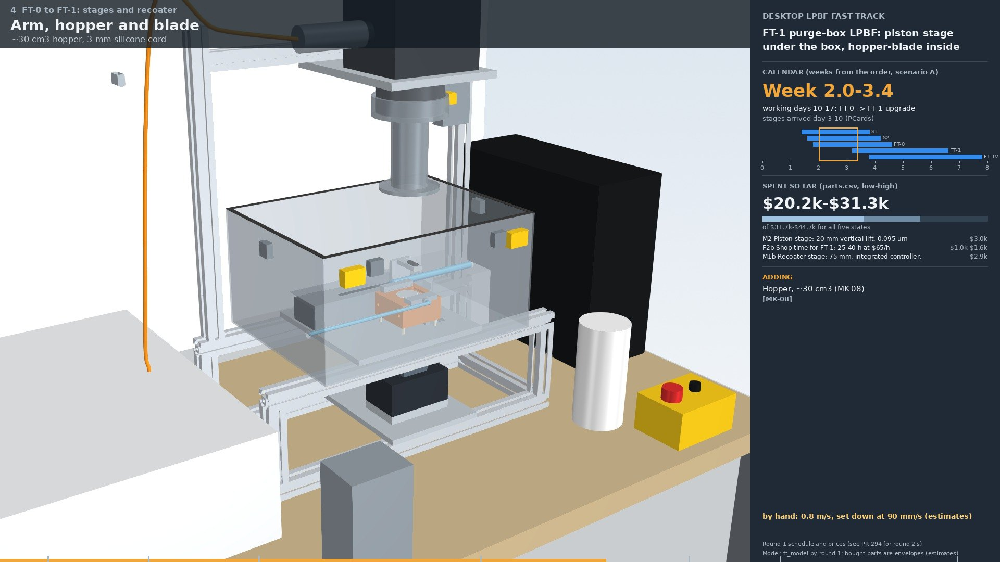
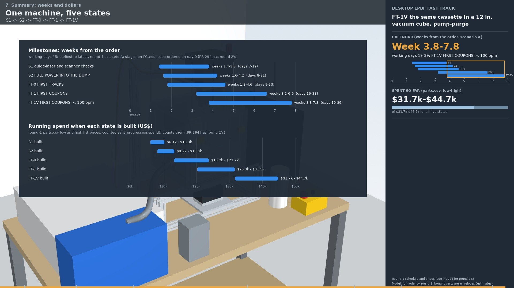

# The fast-track progression video

For [issue #260](https://github.com/vertical-cloud-lab/digital-alloy-lab/issues/260) and PR 294. The machine of
[`../README.md`](../README.md) grows S1 -> S2 -> FT-0 -> FT-1 -> FT-1V on the bench as its parts arrive, makes its first
coupons as FT-1, and is moved into the vacuum cube as FT-1V. Calendar, state, running spend and the part going in are on
screen in every frame.

**On YouTube: https://youtu.be/kdaj7jzdJyI** (public, subscribers not notified; uploaded 2026-11-27).

**Video:** [`out/fast-track-progression.mp4`](out/fast-track-progression.mp4): 5 min 51 s (351.5 s, 10,544 frames at 30 fps),
1920 x 1080, H.264 (libx264, CRF 24, yuv420p), 9.2 MB; composed 2026-11-27. Chapter list:
[`out/chapters.txt`](out/chapters.txt); four frames of every chapter: [`../img/video/contact-sheet.jpg`](../img/video/contact-sheet.jpg);
one still per chapter: [`../img/video/`](../img/video/); what went in: [`out/compose.json`](out/compose.json); the frame
audit: [`out/audit.json`](out/audit.json); the camera check: [`out/video_qa.json`](out/video_qa.json).

**Model shown: the round-1 CAD model** of this branch (`cad/ft_model.py` as committed in 91c1931, 2026-11-26): the
Zaber X-LSQ075B recoater behind the well, the f-theta lens on the plate axis, envelopes for the bought optics and stages.
The CAD v2 model (vendor geometry, monitoring parts) is not in these frames. The scripts read the round-1 files from git
(`FT_MODEL_REV`, default d117ba8: `ft_model.py`, `ft_checks.py`, `ft_progression.py`, `fast_track.py`, `parts.csv`,
`lpbf_model.py`, written once under `/tmp/ft-video/pin-d117ba8/`), so the v2 model and round 2's schedule and prices,
now on the branch, change nothing drawn; the mesh cache key (a hash of the pinned `ft_model.py`) is the one the other
chapters were rendered with.

**The calendar and the spend on screen are round 1's**, and the panel and the charts say so. Round 2's differ (from
`fast_track.py` and `parts.csv` on the PR branch): FT-1 coupons at 3.7-9.3 weeks with 5-8 shop hours a day, FT-1
$28.8k-46.7k, FT-1V $39.9k-59.7k. See the study's README for them.




## Chapters

| Start | Chapter | Length | Fixed cameras (s) |
|---|---|---|---|
| 0:00 | 0 The bench and the room | 17.0 s | room 8.0, bench 9.0 (with the order list: when each order is in hand) |
| 0:17 | 1 S1: optics on the frame | 35.2 s | wide 11.5, optics 9.0, wide 2.6, target 12.2 (guide laser on the target) |
| 0:52 | 2 S2: the box closed round the beam | 38.9 s | core 13.0, box 10.1, core 2.3, box 13.5 (interlocks, 400 W into the dump) |
| 1:31 | 3 FT-0: single tracks | 77.9 s | core 10.5, box 19.4, well 10.9, box 10.9, wide 16.8, well 9.4 |
| 2:49 | 4 FT-0 to FT-1: stages and recoater | 73.2 s | core 10.5, box 9.4, under 5.3, box 28.4, core 9.0, well 10.6 |
| 4:02 | 5 FT-1: the first coupons | 32.1 s | well 16.8 (one layer, real time), lowwell 15.3 (500 layers, time-lapse) |
| 4:34 | 6 FT-1 to FT-1V: into the vacuum cube | 62.1 s | cube 21.5, under 4.0, cube 36.6 |
| 5:36 | 7 Summary: weeks and dollars | 15.0 s | cube 15.0 (milestone weeks and running spend as charts) |

28 shots: median 10.7 s, shortest 2.3 s (none under 2 s). No camera moves within a shot; every change of view is a cut
between fixed tripods, overview first, then detail.

## What is drawn, and what is an estimate

- **Parts come in along checked paths.** Every part enters from outside the picture along straight legs and stops at its
  place in the model; nothing pops in. Each path is sampled every 2 mm and checked against everything in the scene with
  python-fcl (the mover shrunk 0.3 mm, 1.5 mm depth limit) before anything is drawn ([`plan.py`](plan.py),
  [`collide.py`](collide.py)). Over chapters 1-6: 47 paths found by the planner, 20 given by hand and checked (none
  collides), 20 moves (optics lifted, plate lowered, tube slid) checked the same way. The stages' own motions (piston,
  recoater) are not path-planned; the frame audit below covers them.
- **The end of every chapter is the model's next state.** `render.py N --plan` compares the drawn scene with
  `ft_model.build(state)`: every part within 0.6 mm of its place, nothing extra. Chapters 1-6: 0 problems, nothing left
  unplaced.
- **Speeds** (labelled in the panel): parts by hand at 0.8 m/s, set down at 90 mm/s (estimates); optics slid up the
  uprights at 5 mm/s (estimate); X-VSR20A plate moves at 10 mm/s (stage maximum 48 mm/s); recoater spread at 10 mm/s
  (Heriot-Watt's recoater, Bidare et al. 2017) and return at 40 mm/s (estimate; the X-LSQ075B tops out at 280 mm/s);
  guide laser at 100 mm/s; the FT-0 tracks at 1/10 of real speed (labelled "slow motion"); chapter 5 shows one layer in
  real time, then the 500 layers at one frame per 2 layers (labelled "time-lapse x802: one frame per 2 layers (27 s of build)").
- **Scan vectors are the process worker's programs** ([`../process/README.md`](../process/README.md)), read with
  [`../control/ftctl/scanprog.py`](../control/ftctl/scanprog.py)'s `load_npz` (segments x0 y0 x1 y1 in mm in the plate
  frame, which is ft_model's; the lens axis offset does not change it). Chapter 3: the 25 single tracks of
  [`../process/out/rung2_single_tracks.npz`](../process/out/rung2_single_tracks.npz) (ladder rung 2: 9 mm each, 155-355 W,
  620-2500 mm/s), in program order, at 1/10 of real speed. Chapter 5: layer 1 of
  [`../process/out/build_first_coupons_15mm.npz`](../process/out/build_first_coupons_15mm.npz) (394 vectors, hatch at
  1000-1250 mm/s, contours at 800 mm/s) in real time, then the real hatch of every second layer (500 layers of 30 um; three
  10 x 10 mm coupons and two 5 x 5 mm ones, 15 mm tall, hatch turned 67 deg a layer). Each vector starts and ends when
  the RTC5 would mark it (10 us ticks, jumps at 5000 mm/s with their delays, polygon and mark delays, as
  `scanprog.layer_time`): layer 1 takes 3.26 s, 3.31 s with the list overhead and the jump home that `layer_time` adds.
- **Calendar:** round 1's scenario A of [`../cad/ft_progression.py`](../cad/ft_progression.py) (stages on PCards, cube ordered on
  day 0), working days / 5 = weeks. **Spend:** [`../parts.csv`](../parts.csv) low and high list prices, each line counted
  when its first part goes in, as `ft_progression.spend()` counts them.
- **Person for scale:** a static person (PR 266's mesh), only in chapter 0. Nobody walks.
- **Charts** (chapter 0's order list, chapter 7's summary, the panel's milestone strip): one series each, so one hue
  (`#338ced`, checked on the panel colour with the dataviz skill's palette validator); rows named on the axis and every
  bar labelled with its numbers. The same numbers as a table:

| Milestone (round 1, scenario A) | Working days | Weeks | Running spend when built (US$) |
|---|---|---|---|
| S1 guide-laser and scanner checks | 7-19 | 1.4-3.8 | 6,081-10,280 |
| S2 full power into the dump | 8-21 | 1.6-4.2 | 8,176-13,275 |
| FT-0 first tracks | 9-23 | 1.8-4.6 | 13,230-23,685 |
| FT-1 first coupons | 16-33 | 3.2-6.6 | 20,294-31,518 |
| FT-1V first coupons (< 100 ppm) | 19-39 | 3.8-7.8 | 31,729-44,688 |

## Frame audit ([`audit.py`](audit.py), [`out/audit.json`](out/audit.json))

`render.py` records, for every image it draws, each part's drawn state (shown or hidden, translation, the lift column's
scale, the fibre's blended mesh) and the solid effects (the growing coupons). `audit.py` replays the record and checks
everything that moves against everything drawn that is solid and at least 30 % opaque: python-fcl BVH collision on the
drawn triangles, the mover shrunk 0.3 mm, the translational penetration depth over 26 directions, 1.5 mm limit (the
method of PR 266's `scene_audit.py`).

| Chapter | Drawn frames | Moving parts | Pairs deeper than 1.5 mm | Model overlaps of parts that move together |
|---|---|---|---|---|
| 0 | 2 | 0 | 0 | - |
| 1 | 419 | 14 | 0 | - |
| 2 | 353 | 30 | 0 | - |
| 3 | 900 | 36 | 0 | - |
| 4 | 941 | 38 | 0 | vibration motor in the carriage bracket and arm (MK-08), 4.9 mm |
| 5 | 341 | 14 | 0 | the same, 4.9 mm |
| 6 | 652 | 92 | 0 | the same, 4.9 mm; KF-25 pump hose in the pump's inlet, 17.7 mm |
| 7 | 1 | 0 | 0 | - |

3,609 drawn frames, **0 violations**. Two contacts are allowed by name, because the model draws them so: the process
fibre's laser end starts 3 mm inside the laser envelope's top face (2.9-3.0 mm wherever the fibre is checked, chapters
1-4 and 6), and the pump hose's clamp end sits over its KF-25 port's flange (5.1 mm, 96 frames of chapter 6). The hose's
other end sits 17.7 mm down in the pump's inlet, past its 15 mm allowance, so it is listed with the overlaps of parts
that move together.

**Finding for the CAD:** the vibration motor overlaps the carriage bracket and arm (MK-08) by 4.9 mm in `ft_model.py`
(round 1); the two move as one group, so it is the model's overlap, not a motion clash.

## Camera check ([PR 266's `video_qa.py`](https://github.com/vertical-cloud-lab/digital-alloy-lab/blob/claude/issue-260-20261113-2332/desktop-lpbf/cad/robotbuild/video_qa.py), [`out/video_qa.json`](out/video_qa.json))

On the MP4's pixels (320 x 180 grey, picture area only). Limits: at most 10 jumps a minute, at most 3 % jump frames,
median steady run at least 4 s, at most 15 % of runs under 2 s (where a chapter has six or more jumps), 95th-percentile
camera speed at most 1/7 frame width per second.

| Chapter | Seconds | Jumps | Jumps a minute | Jump frames | Median run (s) | Runs under 2 s | Frames with camera motion | p95 camera speed (fw/s) | Result |
|---|---|---|---|---|---|---|---|---|---|
| The bench and the room | 17 | 1 | 3.5 | 0.2 % | 8.5 | 0 % | 0 % | 0.000 | pass |
| S1: optics on the frame | 35 | 4 | 6.9 | 0.4 % | 10.2 | 0 % | 2 % | 0.011 | pass |
| S2: the box closed round the beam | 39 | 1 | 1.5 | 0.1 % | 19.5 | 50 % | 0 % | 0.005 | pass |
| FT-0: single tracks | 78 | 5 | 3.8 | 0.2 % | 10.8 | 0 % | 2 % | 0.005 | pass |
| FT-0 to FT-1: stages and recoater | 73 | 6 | 4.9 | 0.3 % | 9.3 | 14 % | 0 % | 0.004 | pass |
| FT-1: the first coupons | 32 | 0 | 0.0 | 0.0 % | 32.0 | 0 % | 11 % | 0.032 | pass |
| FT-1 to FT-1V: into the vacuum cube | 62 | 3 | 2.9 | 0.2 % | 12.7 | 25 % | 0 % | 0.004 | pass |
| Summary: weeks and dollars | 16 | 1 | 3.9 | 0.2 % | 7.7 | 50 % | 0 % | 0.000 | pass |
| **Whole video** | 352 | 21 | 3.6 | 0.2 % | 10.8 | 0 % | 2 % | 0.005 | pass |

All eight chapters and the whole video pass. The runs under 2 s inside chapters 2, 4, 6 and 7 (0.03-0.5 s) are slivers
of the chapter before: `chapters.txt` rounds each start down to whole seconds, so a chapter's window opens up to a second
before its first frame. Over the whole video the shortest steady run is 2.5 s. Chapter 4 comes closest to a limit (6
jumps, so the short-run limit applies: 14 % against 15 %, from that sliver). No camera moves in any shot; chapter 5's
11 % of frames "with camera motion" are the time-lapse, where the recoater crossing the close-up reads as a shift.

## How it was made

| File | What it does |
|---|---|
| [`scene.py`](scene.py) | meshes of every state from `cad/ft_model.py` (cached under `/tmp/ft-video/cache`), the room, the person |
| [`collide.py`](collide.py) | python-fcl BVH collision and penetration depth on triangle meshes |
| [`plan.py`](plan.py) | insertion and removal paths, checked every 2 mm |
| [`engine.py`](engine.py) | timeline: shots, inserts, removals, moves, stage motions, overlays; fixed cameras |
| [`scan.py`](scan.py) | the process worker's scan programs (`load_npz`) and each vector's time by the RTC5 rules |
| [`story.py`](story.py) | the eight chapters |
| [`render.py`](render.py) | pyvista offscreen frames (1440 x 1080), metadata and the audit record per chapter |
| [`compose.py`](compose.py) | panel, captions, charts, progress bar; the H.264 MP4, stills and contact sheet |
| [`audit.py`](audit.py) | the frame audit |

```bash
cd desktop-lpbf/fast-track/video
for c in 0 1 2 3 4 5 6 7; do OMP_NUM_THREADS=1 /tmp/tools/capmem 1.5 xvfb-run -a -s "-screen 0 1920x1080x24" \
  /tmp/venv/bin/python render.py $c; done    # frames under /tmp/ft-video/frames/chN (not committed); FT_MODEL_REV=d117ba8
/tmp/tools/capmem 2 /tmp/venv/bin/python audit.py              # -> out/audit.json
/tmp/tools/capmem 2 /tmp/venv/bin/python compose.py --stills   # -> out/*.mp4, chapters.txt, compose.json, ../img/video/
python video_qa.py out/fast-track-progression.mp4 --chapters out/chapters.txt --out out/video_qa.json
```

Run times on the shared 4-core runner (about seven jobs at once): rendering 3 s to 13 min a chapter (chapter 3: 784 s,
940 drawn frames; peak 1.1 GB), planning 0.1-49 s a chapter, the audit about 3 min for all chapters, composing 9.5 min, the
camera check about 3 min.

The worker that wrote this pipeline ran out of credits before committing, and its worktree was deleted. The source was
rebuilt from its transcript (every edit replayed in order); chapters 0-4 are the frames it rendered, chapter 5 was
rendered again from the rebuilt code, and chapters 6-7 after two fixes: the planner spent over 25 minutes on chapter 6
trying paths for the FT-1V copies of the head and lens, whose places the lifted FT-1 parts already filled (it now fails at
once when a place is taken, and skips parts a move has put in place, 18 s); and the +-15 V supply now rises with the head
as the model draws it. After the PR branch was merged in, chapters 3 and 5 were rendered again with the process
worker's scan programs, from the pinned round-1 model (the mesh cache was hit, so their parts are the same meshes as
the other chapters').

## Not done, or uncertain

- **Not re-rendered on the CAD v2 model** (vendor geometry, monitoring parts): the frames show round 1.
  - *Round 3 (2026-11-28):* a port of this pipeline to CAD v2 (the g3 gantry, the X-LSM100B, the 30 mm lens offset,
    the monitoring parts; round 2's schedule and prices) was about half done when round 3's first attempt ran out of
    credits. It is kept as [`v2-port-wip.patch`](v2-port-wip.patch) (`git apply` from the repo root; it changes
    `story.py`, `scene.py`, `plan.py`, `engine.py`, `render.py`, `audit.py` and `compose.py`). Its last plan run still
    failed in three places: chapter 4's given path for the rod-end block (MK-15) hits the X-VSR20A's platform; the
    well-block heater and thermocouple leads have no removal path past the door gasket and the box; and chapter 6
    finds no removal path for the deck-plate group. Fixes it made after the patch's commit were lost with its
    worktree. Rendering takes about an hour on a shared runner, so round 3's retry didn't re-render.
- **Round-1 schedule and prices on screen** (labelled); round 2's are in the study's README.
- Hand speeds, the optics' slide speed and the return stroke are estimates; lead times and prices are scenario A of
  `ft_progression.py` and parts.csv list prices (low-high).
- Bought parts are envelopes: the hurrySCAN 25, the lens, the laser, the stages and the pump are boxes and cylinders of
  their published sizes, so the audit checks envelopes, not the real housings.

## YouTube description (draft)

> **Desktop LPBF fast track: one machine grown from an optics bench to a vacuum-cube LPBF (CAD walkthrough)**
>
> A CAD walkthrough of a small laser powder-bed fusion machine for first Al-alloy test coupons, built as one machine that
> grows as its parts arrive: S1 optics bench, S2 a box closed round the beam (400 W into a dump), FT-0 single tracks on a
> heated plate under argon, FT-1 a purge-box LPBF with a piston stage and a hopper-blade recoater, and FT-1V the same deck
> cassette in a 12 in. aluminium vacuum cube. On screen: weeks from the order (scenario A), the running spend at list
> prices (low-high), and each part as it goes in. Every part enters along a collision-checked path and every frame was
> checked for interpenetration. Bought parts are drawn as envelopes; hand speeds, lead times and prices are estimates;
> the scan vectors are the process program's own (single-track ladder and the first coupon build). Weeks and prices
> on screen are the design's first round; the second round's are in the PR.
>
> Design study: https://github.com/vertical-cloud-lab/digital-alloy-lab/pull/294 (issue #260)
>
> 0:00 The bench and the room
> 0:17 S1: optics on the frame
> 0:52 S2: the box closed round the beam
> 1:31 FT-0: single tracks
> 2:49 FT-0 to FT-1: stages and recoater
> 4:02 FT-1: the first coupons
> 4:34 FT-1 to FT-1V: into the vacuum cube
> 5:36 Summary: weeks and dollars
