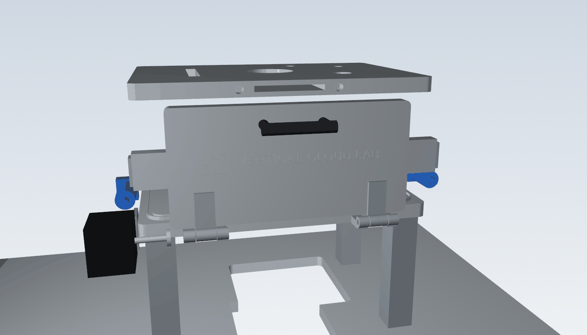

# Follow-up checks before buying and building (2026-11-20)

For [PR #266](https://github.com/vertical-cloud-lab/digital-alloy-lab/pull/266) (issue #260), in answer to Sterling's
2026-11-20 request: run follow-up simulations and checks, get machining-aware software to look at the parts, add an
optional tooling BOM, run MuJoCo, powder-spreading simulations and theory, Edison second opinions and pain points from
similar systems, simulate every assembly, use, maintenance and swap operation, use real parts, make sure the seals
seal, use Shigley, heat transfer and CalculiX, and say what the machine costs used and with cheaper equivalents.

Nothing here has been built, quoted by a shop, or reviewed by BYU's Laser Safety Officer or EHS. Each note below has
its own sources, assumptions and re-run instructions.

## 0. Round 9 (2026-11-27): what round 8's frame audit still found, fixed; the robot-build video on YouTube

Every chapter planned and rendered again ([`robot-build/video.md`](robot-build/video.md) round 9; 40 min 56 s, public at
[youtu.be/B9k2RO6CxCM](https://youtu.be/B9k2RO6CxCM), subscribers not notified). People's feet are locked
([`people.py`](cad/robotbuild/people.py)'s `Gait`: 0.0 mm stance slip outside the assembly chapters). The assembly is planned
and recorded in one process (run 13, 45 min) with run 14 continuing it from F54: 105 of 110 steps, 125 of 129 screws, 175 of 175
MiR moves clear ([`round9_run13.md`](analysis/out/assembly/round9_run13.md)). The planner had never checked the arms' wrist
cameras and tool changers; fixed. A person now does each step the arms fail. The shop has the lathe unload, MiR drives and the
4th-axis bolt-up, and a new chapter 31b cuts the vise bracket with its own FreeCAD programs. The camera check passes on the whole
file (4.7 cuts a minute; round 8 8.1). Every frame is audited: 0 pairs over 1.5 mm in nine chapters; 40 has 29 (round 8: 221),
30 has 42 (its first full audit), and 41 has 238 (round 8: 209). In 41 none of round 8's large faults are left; most of what
remains is fingertips in held parts and parts sliding home, from the plan and the model. Still failing: F15, F18, F26, F27, F57
([`assembly.md`](assembly.md)). The CAD build animation with the MakeHuman person is up unlisted as version 3.1
([`build-sequence.md`](build-sequence.md)).

## 0. Round 8 (2026-11-26): the robot-build video re-made against "moonwalk, motion sickness, collisions and interference, dummy tool paths"

Every chapter planned and rendered again ([`robot-build/video.md`](robot-build/video.md) round 8; 33 min 17 s). The chamber is cut by its eight posted programs with a voxel material-removal simulation of them ([`gcode_sim.py`](cad/robotbuild/gcode_sim.py)); two people lift by hand (no lifter; the 30.0 kg plate as delivered is inside a 30.7 kg two-person guideline, only just); every MiR move is pivot-drive-pivot (6.9 m of reversing in docking legs, against 402 m in round 7); the assembly is filmed from fixed tripods (6.5 and 10.3 jumps a minute, against 84 and 103); the second arm holds a part on its seal while the first drives the first screws (M19, C04, the lid F30; three more need a hold that Fixture B blocks). Assembly run 12 passes the same 99 of 108 steps as run 11 ([`round8_run12.md`](analysis/out/assembly/round8_run12.md)). A new audit of every drawn frame still finds collisions in chapters 20, 30, 31, 32 and 40 and sliding feet in the shop chapters' two-person carries; they are listed in video.md for the next round.

## 0a. Round 7 (2026-11-25): the machine built by two mobile manipulators, on video, and where the 287 shop hours go

Sterling asked on 2026-11-25 to see two UR12e arms, each on a MiR250, carry out the machining steps and the assembly (screws,
seals, tightening) from the full set of parts on a long table, with a person only where one is really needed; with accurate
models of the shop's equipment and custom tools where they help; and with the running cost (new against used), lead times and
time estimates on screen. He also asked what the 287.3 shop hours mean in labour and days, in house against outsourced, how
others make chambers like this, and whether to print the chamber. The first run of the round (05:12-09:14 UTC) wrote the
data, the route study, the equipment models, the planners and the renderers, then ran out of usage credits before the video
was put together; its frames were lost with its runner. The second run (21:12 UTC on) re-rendered everything, re-ran the
assembly planner with the fixes the first had listed, and composed the video.

### What it found

1. **The video:** [`robot-build/video.md`](robot-build/video.md): 23 min 12 s in 12 chapters, 53.5 MB ([`cad/img/robotbuild/robot-build.mp4`](cad/img/robotbuild/robot-build.mp4); chapter list in [`chapters.txt`](cad/img/robotbuild/chapters.txt)). Every arm motion in it is a collision-checked
   plan (FCL on meshes, RRT-Connect, byu-vcl PR 318's 1.5 mm audit); a person appears where the plan says one is needed.
2. **The 287.3 h are not the chamber** ([`robot-build/manufacturing-route.md`](robot-build/manufacturing-route.md)). The frame
   and floor plate are 24.9 h (8.7 %); CAM is 46 % and setups 34 %, about 3.5 h of overhead per part however small. Printing
   the chamber (live JLC3DP quotes: $4,826 in 316L, $2,917 in aluminium) saves 11-17 h. What cuts the hours is making fewer
   parts at BYU:

   | Route (daytime only, 8 h x 5 d) | BYU hours | All-in cost | Weeks, PO to the first leak test |
   |---|---:|---:|---:|
   | All in house, one machinist | 291 | $28.7k | 8-12 |
   | All outsourced, JLCCNC | 72 | $11.1k | 7-13 |
   | All outsourced, US shops | 72 | $33.2k | 7-13 |
   | **Hybrid (recommended)** | **134** | **$19.6k** | **7-12** |
   | Robot shop (Edison's estimate) | 1,430-2,850 | $432-524k with $329k of equipment | 22-42 |

   The module's outside honing (3-6 weeks, unquoted) sets the date in most routes; get that quote first.
3. **Cost and lead time** ([`robot-build/lead-times.md`](robot-build/lead-times.md)): $115.6k all new at the design's spec
   against $70.3-75.6k with the used majors, nearly all of it the laser chain ($44.4k new, $6.0-11.2k used). New, the IPG
   laser sets the schedule (12-15 weeks to arrive) and the machine is ready to assemble at 13-16 weeks; with the majors used, at
   10-11.5. **Two cheap safety parts in `bom.csv` would set it at about 30 weeks unless swapped:** IDEC's HS6B guard switch (27
   weeks) and Omron's K8DT relay (out of stock until March 2027).
4. **The robot shop** ([`robot-shop.md`](robot-shop.md) round 7): every arm motion shown is planned; payload, not reach, is the
   limit. A person moves every load over about 10 kg (the 30 kg frame blank, its flip, the 13 kg core, the base and bridge
   plates) with a vacuum tube lifter on a jib, because two arms on separate MiR250s sharing a load has no standard or precedent
   (Edison r7). Person-hours to make the parts: 137 by hand against 60-78 with the robot shop, not counting the cell's
   commissioning (Edison: 1,230-2,470 person-hours).
5. **The assembly by the two arms, run 10** ([`assembly.md`](assembly.md) round 7): **98 of 108 checked steps pass, 124 of 129
   screws, and 55 of 74 picks at the long table are planned** (run 9: 93, 123, 40). New in run 10: a **pin pusher** for the
   door's hinge pins (a Ø4.5 push rod with a magnet in its tip; the pins become 17-4 PH, magnetic and harder than the 304
   knuckles), arm B from the back for the metering base's coupling and stepper, and more planner iterations for the leg
   screws. **Ten steps still fail**, each with its next change listed: one floor screw, one inlet-plenum screw, the rail's held
   screws, the blade holder and its screws, the roller feedthrough and the dock parts on the metering base, the camera window
   stack, the optics bridge and the beam line. They would fall to a person; the video shows the failed attempts.
   **Run 11** (not in the video) adds a fix for the table picks (plan each with only the part that is on the table) and
   four next changes: **99 of 108 steps and 57 of 74 picks** (F45 passes with a 35 mm axial leg; M13's and C00a's picks
   plan); F15, F18 and F26 still fail, each now for a reason the change ruled in.
6. **Where a person is needed in the assembly**, among others: the felt bore seal (M09), the two half-dovetail O-rings on the bench (F39,
   F51), the f-theta lens on its M85 thread (F53), alignment and calibration (F57b), the process fiber (F58), the laser guard
   (F59), tube and hose routing, the hoist for the three carries over 10 kg, and checks after the rod-gland O-rings (M12) and the
   ball screw (F21). The shop's: CAM, first-article runs, tool setting, the lifts over 10 kg, gauging the bore and seal faces,
   deburring the sealing faces, TIG welding and sending the bore out to be honed.
7. **The custom tools** are in the video (chapter 38) and in [`assembly-tooling.csv`](assembly-tooling.csv), with STEP files in
   [`analysis/out/assembly/tooling/`](analysis/out/assembly/tooling/): the spigot mandrel and pusher, ring loader, rod bullet,
   roller, pin caps, nozzle, liner wand, ring pad, pin pusher, bit extensions, the trunnion, Fixtures P and B and the nests.

### Still not done
- **Run 12:** the next change for each of run 11's nine failing steps is listed in [`assembly.md`](assembly.md). The video
  replays run 10; a re-render from the latest run would show F45 passing and two more picks.
- **The table picks:** run 11 still has 8 unplanned picks: a fingertip meets a riser (M04), a tray rim (F02b, F45d), the O₂
  sample line (F36), the drawer-latch studs (F39) or the part's own rail (F18), and MiR B's drive is swept into the release-air
  tube lying on the table (F45, F45b).
- **The shop:** MiR drives between stations are not animated; the floor plate's turnover between its setups, unloading the
  lathe and the F-S3 bolt-up are not planned (robot-shop.md).
- **Not built, quoted by a shop, wired, or reviewed** by BYU's LSO, EHS or an electrician.

## 0. Round 6 (2026-11-25): everything round 5 left undone

Sterling asked on 2026-11-25 for everything round 5 listed as not done or skipped, and then for the build video to go back on
YouTube without notifying subscribers. He also asked what the LED bar's trade-offs are and what the collimators cost and why one
would pick one, said that something automation-friendly sounded appealing for the module clamps, and said to keep only the traced
BYU Y for now (the model already has only the Y, so it is unchanged).

Eight workers did the items in parallel, each in its own git worktree. Their branches were merged, and the merged model was
re-checked. Nothing here has been built, quoted by a shop, wired, or reviewed by BYU's LSO, EHS or an electrician.

### What changes what we buy or draw

1. **The build module is held by two zero-point clamps now, not screws** ([`hot-swap.md`](hot-swap.md) §3.2a).
   - **The clamps:** two SCHUNK NSE-HT mini 88-20 V1 (rated 200 °C, 0.5 kN pull each, locked by springs, opened by 6 bar air) hang
     pin-face-down from the floor at (100, 40) and (−102, −26). Each sits on a 10 mm 6061 plate on two 16 × 16 posts, with M6 studs
     into new floor inserts. Each module carries two arms under new flange ears, each with a SCHUNK SPC-HT mini 20 clamping pin.
     The dowel and diamond pin still locate the module; the clamps only pull it up.
   - **The air:** one 3/2 normally-closed 24 V valve (SMC VT307) opens both. Air off or power off leaves the module clamped. It is
     PLC output s4.5, allowed only with the plate below 50 °C, the chamber vented and the Z arm holding the module
     ([`electrical-io.csv`](electrical-io.csv) M-15).
   - **What moved to make room** (round 5's "four layout moves"): the Z servo folded to the back of its actuator, (0, 130); the
     overflow jar and the funnel's outlet moved to the slot's front end (the jar's joint is at (94, −46)); the outlet hose goes round
     the left clamp (about 0.7 m longer); and the front-right and back-right legs moved.
   - **The captive M6 and their retainers are gone.** The floor's M6 inserts stay as a hand fallback.
   - **Robot:** the module swap passes on M50, S25 and L75 (closest 0.5 mm, wrist 1 at 52–55 %, 26.0 s; [`robot-ops.md`](robot-ops.md)).
     By hand, the swap path S2.4 passes at 0.1 mm.
   - **Cost:** BOM B3 $5,770–6,380 (the NSE-HT is $2,680 each at MROSupply; the pins have no published price) and B4 $205–260 for the
     release air.
   - **Open:** the SPC-HT mini 20 is drawn Ø20 × 14 mm, unconfirmed, because SCHUNK's drawing couldn't be read. The arms are sized
     for the 0.5 kN pull, so the turbo port is not used. The SMC push-in elbows are rated to 60 °C (stainless KQG2 elbows if the
     floor's underside runs hotter).
2. **The funnel can no longer drain the slot's back end by gravity.** With its outlet at the slot's front end, its pocket slopes
   13°; fine Al powder needs 55–60°. Options are a vibrator, an argon pulse, or a bin the length of the slot. Decide this before the
   funnel block is machined.
3. **The overflow jar holds ~104 cm³ (was ~65) and has a robot grip fin**, an I-section like the module's grip block.
   - **Robot:** the jar job passes on M50, S25 and L75 (MiR at x +400, 2.0 mm, elbow 30.8 %, 22.7 s). Releasing the jar's toggle
     clamp is not simulated.
   - **Capacity:** L75 builds taller than about 22 mm fill it, and taking the jar off vents the chamber. So a tall L75 build stops to
     empty it, or the jar needs a valve above it (not drawn; there is no height for one as drawn).
4. **The round-5 draw latches pried the door off its seal** ([`seals.md`](seals.md)). At 1.2 kN per latch the door touched the
   chamber only at its ears' tips, and the squeeze fell to 15.2 % at the top and bottom centres (9.0 % at the gland's worst
   tolerance). The hinge now holds the door's bottom edge (round pin holes, knuckles shimmed at assembly), and the latches preload
   ~0.75 kN: 23.6–25.8 % squeeze, 17.3 % at worst tolerance, hinges 1.1 kN each (SF 8.0 on yield).
5. **Collimator: order IPG's 2.5 mm collimator (96 µm spot)** with the laser ([`optics.md`](optics.md) §9). It is the EOS M 290's
   spot size, so EOS aluminium settings carry over. A 1 mm focus error changes the spot by 1 % (19 % at 48 µm). In the order:
   "YLR-500-U3-SM-AC, 5 m fibre, affixed 2.5 mm collimator", with its price, drawing and CW rating, and prices for the 5 mm and a
   3.2 mm unit.
6. **LED bar: put it outside the chamber**, lighting the bed through a small new window low in the back wall, left of the gas inlet
   (8–13° to the bed; [`optics.md`](optics.md) §9). Nothing electrical, hot or outgassing then sits in the argon, and the window is
   upstream of the gas flow. **Not drawn: it adds a port to the frame's back wall, so it needs Sterling's OK first.**
7. **Gas flow: keep the upper inlet slot** ([`gas-flow.md`](gas-flow.md) §0). Without it, 9–16 % of the condensate that rises enters
   the cover slide's recess, against 0.2–0.5 % with it. The outlet's move to the slot's left end barely changes the plate (1.61 m/s
   mean over Ø75 at 115 L/min). The 200 + 40 L/min fix still puts all of Ø25, Ø50 and Ø75 at ≥ 2.5 m/s. A KF-40 outlet port no
   longer fits at the left end (its Ø71 clamp needs more than the 67 mm there), so keep KF-25, about 0.25 kPa more at 240 L/min.
   BOM G4 is now 180–250 L/min at ~2.5–4 kPa.
8. **The window and cover slide are drawn as the BOM parts** (Edmund 38-990, 9.53 mm; Edmund 36-299, Ø50 × 2 mm): the focus shift is
   3.58 mm, and the lens sits 0.17 mm higher on 2.83 mm of shims. The galvo riser's bore is now Ø56: the lens nose ran into the Ø40
   bore (161 mm³), so the upper half of the shim range never existed. M50 builds get a Ø41 field-stop insert.
9. **The rod end's block is 81 mm wide** (was 72), and the gland plate's six M4 sit on the arc behind it, so a torque screwdriver
   reaches all six (A1.20, M7.1) on S25, M50 and L75 ([`electrical.md`](electrical.md) §13.3). Solid Sealing prefers its welds on the
   vacuum side; ours are on the air side ([`seals.md`](seals.md)). Ask them with the blind-bore question.
10. **A2.36, new from the servo fold, fixed:** the wider bracket that carries the folded servo stood 1.25 mm under the heads of the
    Z flange's two left M5, so they couldn't come straight down. That pair moved from x −33 to x −37 (the flange is now x −45 to 48),
    and A2.36 passes again (4 of 4 screws, 2.72 mm). Two of the floor plate's M5 inserts move 4 mm, to (−37, 70) and (−37, 100).
11. **Machining** ([`machining.md`](machining.md)): the lid's M5 STI holes had a 6.0 mm drill, which leaves nothing for the STI tap;
    insert and dowel holes now get their own drills. Buy 2.9, 5.2 and 5.8 mm drills and an M6 × 0.75 tap. The hours are 302.3 h with
    3-axis setups and 287.3 h with a 4th axis, for 57 parts (rounds 4–5: 263.8 / 249.5 h for 48); the rise is the parts added since,
    including the zero-point posts, plates and arms.
12. **Two small parts problems from the OEM refinement** ([`oem-parts.md`](oem-parts.md)): the lid's pressure transmitter, on its
    SAE-4 adapter, ends 1.25 mm under the solid optics bridge, so its lead can't leave upward (a 90° adapter, a side-exit
    transmitter, or a bore in the bridge); and the HEPA housing needs two KF-25 adapters, two elbows and a stand that BOM G5 doesn't
    list.

### What was run

| Check | Result | Note |
|---|---|---|
| Interference, exact booleans, on the merged model | **0 for M50, S25 and L75**, in 6 static states and 8 motion sweeps each | [`interference.md`](analysis/out/interference.md), [`variants/`](analysis/out/variants/) |
| Mass | 290.7 kg on the tray (was 289.6). The process module is 94.8 kg and tips at 0.68 g | [`mass.md`](analysis/out/mass.md) |
| Robot (UR12e on MiR250, byu-vcl PR 318's cell) | **Liners right and left, reservoir and blade cartridge pass on M50** (1.6 / 1.6 / 3.5 / 2.0 mm, elbow 33.7 %). They had never run: the liner tabs sat 15 mm outside the door opening, so they are now hangers inside it. **The jar passes by its grip fin on M50, S25 and L75** (2.0 mm, 30.8 %, 22.7 s), and **the module swap with the zero-point clamps on all three** (0.5 mm, 52–55 % wrist 1, 26.0 s). A bug fixed on the way: the module job dragged the module 3.6 mm sideways in its 40 mm drop, hidden by a soft floor plate | [`robot-ops.md`](robot-ops.md) |
| Hand operations, all of M50 on the merged model | **98 pass / 1 warn / 24 fail** (round 5: 90 / 2 / 34), and **99 / 1 / 23** after the A2.36 fix (A2 re-run). Newly passing: A1.20, M7.1 (rod end), A2.18 (liners through the door), U4.5, U4.7 (jar), M3 (liners with hangers), S2.4 (swap path with the clamps), M5.3, and 8 steps whose paths were corrected. The 24 left are real and known since round 3 (fixes 5–13 in operations.md: base-plate screws from below, the Z stage and lens order, the funnel screw, the metering base, the camera and lid against the bridge, the window ring under the lens, the recoater servo and dosing stepper boxed in by the bridge), and the forearm-model limit in M10–M11 | [`operations.md`](operations.md) |
| Hand operations, S25 and L75 (S1–S3, U1, U2, U4, M3, M8) | 20 / 0 / 3 each: only the recoater servo (M8.1–M8.3) fails, as on M50 | [`operations.md`](operations.md) |
| Door-seal FEA (CalculiX) and latch checks | as drawn in round 5 the latches pry the door off its seal (item 4); fixed: 23.6–25.8 % squeeze, hinges SF 8.0, latch brackets SF 5.7, the brackets' screws' separation factor 6.0 at 1.2 kN. `door_seal_fea.py` now reads the latches, brackets and hinges from the model | [`seals.md`](seals.md) |
| Seals inventory | the rod end's weld-ins replace the connector (Solid Sealing: < 1e-10 atm cc/s He per part). Permeation 2.19 ppm O₂/h over 27 glands | [`seals.md`](seals.md) |
| BOM audit | 264 parts from the model's own tags: 125 priced, 3 unpriced, 46 generic, 78 custom, 2 missing, 9 inconsistent | [`completeness-audit.md`](completeness-audit.md) |
| Two-arm assembly (UR12e pair) | Chapter 3 re-sequenced for the new rod end: the gland plate goes onto the welded rod end, and M16 grips the module body across its Ø56.8 tube (1.73 kg, inside the 2F-85's stroke and 5 kg rating) instead of the 119 mm flange. **Run 5, all chapters on the merged model (51 min): chapter 3 30 of 30, chapter 4a 18 of 18 checked steps.** It found new fails from parts that moved in rounds 5–6; runs 6 and 7 re-ran only chapter 4a and the changed steps. Fixed by planning: C05 (a 60 mm bit extension), F05b (carry the module by its legs under the right zero-point module), F50 (hinge knuckles before the module), F09 (the jar-sensor bracket) and C08 (the funnel) become bench steps, as in hand op A2.13, and the side liners (F10c, F10f) with the tending robot's plate fingers on their hanger tabs. **Runs 5–7: 71 of 88 checked steps, 111 of 129 screws on a planned approach** (round 5: 64 of 80 and 118 of 135; the totals fell because the funnel's and the sensor bracket's screws are now bench work). Still failing: the four back liner halves, which have no tab (give them hanger tabs like the side liners'), patch 9's F14, F16, F18 and F23, and the same chapter 4b–5 steps as in rounds 4–5 | [`assembly.md`](assembly.md) |
| CFD (OpenFOAM v2406) on the round-5 outlet | the CFD script still drew the outlet at the right end; it now reads both plenums from the model. As drawn: 1.61 m/s mean over Ø75 (coarse; 1.79 fine), none ≥ 2.5 m/s; 83–84 % drains through the slot's left half; 525 Pa (was 466–473). More condensate passes under the window (22 against 5 % coarse, 14 against 8 % fine). Fix at 200 + 40 L/min: 2.94 m/s coarse, 2.96 fine, all plates ≥ 2.5 m/s | [`gas-flow.md`](gas-flow.md) §0 |
| Machining: frame setup C, CAMotics, holder check, hours | **setup C programmed** (four walls on the HRT210, one Haas program with A moves). CAMotics ignores the A axis, so each index ran as its own 3-axis program: **0 gouges, 0 rapids through stock** in all eight programs; frame 64.7 min (0.017 cm³ left deeper than 1 mm, at the SAE ports), floor plate 69.2 min. **Holder check: 0 collisions** (holders ≥ 4.0 mm from the stock, tools ≥ 2.76 mm from the fixtures). Floor plate re-posted for the clamp posts. The video's machining chapter now draws the checked fixturing | [`machining.md`](machining.md) |
| OEM parts | **Edwards nXDS6i** against Edwards' drawing: silhouette IoU 0.867 → 0.923 (five views; no vendor CAD). **3861N11** against McMaster's CAD 0.692 → 0.948, **5169K72** 0.746 → 0.949. IPG 4U and Eaton fronts from the vendors' images (Eaton photo fit 0.956). **Video reconstruction** (COLMAP on Teknic's ClearPath turntable video): 74 of 74 frames, 13,502 points, 0.84 px; 48.7 % of the points within 1 mm of our model and silhouette IoU 0.81, but the reconstruction is out of proportion by 26 % between axes, so it can't check the model to better than a few mm | [`oem-parts.md`](oem-parts.md) |
| Optics | focus at z +0.004 mm with the BOM window and slide; CalculiX thermal lens within 1–2 % of the hand model; the M50 field stop passes the M50 edge for beam lean k 0.33–0.63 | [`optics.md`](optics.md) §9 |
| Video | Re-rendered on the merged model (a979f31): 3:24, 1,840 frames. Uploaded as version 3, public, subscribers not notified, 11 chapters: **[youtu.be/54KqThbeVOg](https://youtu.be/54KqThbeVOg)** | [`build-sequence.md`](build-sequence.md) |

### Still not done
- **Decisions for Sterling** (each blocks a drawing or an order):
  - the LED bar outside, behind a new back-wall window (item 6);
  - the upper inlet slot, which needs its own feed (a branch off the blower with a needle valve, and a plenum) and a larger blower
    (item 7);
  - how the funnel drains the slot's back end (item 2);
  - the jar's toggle clamp: a lever the gripper can push, or a powered clamp, so the jar is fully robot-tended;
  - the door: keep the fixed, shimmed hinge, or redesign the latches to pull inside the bearing;
  - a gland plate with no screw in front of the rod end (estimated 11–16 kN of preload against at most 0.3 kN from the O-ring);
  - S25's handle, whose two screws sit over the rod-end block (A1.22 fails on S25): fit it before the rod, or change it.
- **Not drawn:** the LED window, the upper slot (at z 110–114, below the lid's O-ring groove), a funnel vibrator or pulse, a valve
  above the jar, the HEPA housing's adapters, elbows and stand in BOM G5, the latch brackets' screws, cable routes, and the
  release valve's cable in `electrical-bom.csv`.
- **Robot:** releasing the jar's toggle clamp is not simulated (the job starts with it open). The module job pushes 106–158 N,
  over the 100 N force mode.
- **Two-arm assembly:** the four back liner halves need hanger tabs like the side liners' (not drawn), and patch 9's steps and the older chapter 4b–5 fails
  remain ([`assembly.md`](assembly.md)).
- **Hand operations:** 23 fails on M50 need the design changes listed since round 3 (fixes 5–13 in [`operations.md`](operations.md):
  the base plate's screws from below, the Z stage's and the lens's order, a funnel screw, the metering base, the camera and lid
  against the bridge, the window ring under the lens, the recoater servo and dosing stepper boxed in by the bridge). They were
  not part of round 5's list and are not drawn. M10–M11 fail on the hand model's straight forearm; check them on a mock-up.
- **CFD:** the upper slot was not re-run at z 110–114; the slide purge ran at one flow on the coarse mesh only; an outlet at the
  door end and a lip at the door weren't tried; a KF-40 port's fit isn't interference-checked.
- **Machining:** taps, STI taps, reamers, spot drills and the SAE port tool aren't programmed. The CAM blank is 5 in. thick against
  the planned 5.5 in. plate (4–7 min more facing per face). The floor plate's edge-clamp force is unchecked. Ask the shop which
  rotary it has, which side its motor is on and how its direction is set.
- **Parts to confirm:** the SPC-HT mini 20's dimensions and price (SCHUNK); the weld-ins' weld side and the 81 mm layout's weld access
  (Solid Sealing); the IPG front on a photo of the delivered unit; the collimator's price, drawing and CW rating (IPG).
- **OEM video reconstruction:** it solved (74 of 74 frames), but the reconstruction is out of proportion by 26 % between axes, so
  it can't check a model to better than a few mm. A second video, or a calibrated turntable, would be needed.
- **Optics:** an L75 field-stop insert waits on the beam's lean, k, measured with the guide laser. The bridge FEA wasn't re-run for
  the riser's −16 g.
- **Not built, quoted by a shop, wired, or reviewed** by BYU's LSO, EHS or an electrician.

## 0a. Round 5 (2026-11-23): what round 4 left undone

Sterling asked on 2026-11-23 for everything round 4 listed as not done:
- the model changes: the overflow jar, the zero-point clamps, the liners, and the optics and electrical patches;
- the two-arm assembly chapter with the new gland-plate order;
- FEA cases 1 and 1b, and the thermal model with the heater-stack screws;
- a holder and fixture collision check for the CAMotics runs;
- the single-line diagram on the dry scroll pump;
- the 2026-11-20 OEM-part refinement, and the VCL and Y logos.

Seven workers did these in parallel, each in its own git worktree. Their branches were merged, and the merged model was re-checked.
Nothing here has been built, quoted by a shop, wired, or reviewed by BYU's LSO, EHS or an electrician.

### What changes what we buy or draw

1. **The zero-point module clamps still don't fit** ([`hot-swap.md`](hot-swap.md) §3.2a).
   - The overflow jar now comes out (item 2), but it has to stay under the funnel: the overflow slot is fixed at x 90–110.
   - On the right, every place for the second SCHUNK NSE-HT mini 88-20 is taken: the jar's lane, the jar itself, the Z servo
     behind it, and the legs' sweep.
   - §3.2a lists the four moves it would take. Fold the Z servo to the back, move the jar to the slot's front end, put the
     modules at (+100, +30) and (−100, −30), and re-route the outlet hose.
   - Until then, the module keeps its two captive M6. Two modules would pull 2 × 500 N, 4.6× the worst separating load (218 N).
2. **The overflow jar comes out by hand, but not yet by robot** ([`operations.md`](operations.md), [`robot-ops.md`](robot-ops.md)).
   - **What changed:**
     - the KF-40 joint is 26 mm lower, on a 42 mm stub;
     - the jar is a 2 in. 316L cup of ~65 cm³, with an 11 mm neck;
     - it is held by an MKS 100318805 toggle clamp ($23.34), lever to the front;
     - the outlet plenum's KF-25 port and hose moved to its left end;
     - the front-right leg moved to the right side.
   - **Hand:** U4.5 and U4.7 pass.
   - **Robot:** fails at all six MiR positions. Either the wrist camera meets the guard frame, the forearm meets the guard
     door's handle, or the arm runs out of reach. The cup sits 55 mm below the module's grip block, which the robot does
     reach. A grip fin on the jar at z ≈ −50 is the likely fix; it isn't drawn.
   - **Emptying:** the jar holds ~65 cm³ (was ~120). L75 makes ~70 cm³ of overflow per 15 mm of build, so it needs emptying
     more often.
   - **CFD:** the outlet now drains at the slot's left end, next to the dose zone, so the CFD needs a re-run
     ([`gas-flow.md`](gas-flow.md)).
3. **No catalogue collimator gives the 75 µm spot** ([`optics.md`](optics.md) §8).
   - No QBH collimator with f ≈ 20–25 mm is rated for 500 W. IPG's shortest is f = 50 mm, and Coherent's run 50–250 mm.
     Wavelength's COL-1070-D25-F30 is the closest and gives 57 µm.
   - The model draws IPG's 2.5 mm collimator, which gives **96 µm**.
   - 75 µm needs a custom f ≈ 23 mm collimator: ask IPG or Wavelength with the laser order.
4. **L75's outer ring is still out of the beam's reach.**
   - The galvo now sits 35 mm above the lens. 30 mm is the least possible, because SCANLAB's second mirror is 30 mm above the
     mounting face.
   - The reach is 22–34 mm against L75's 38.1 mm radius, and the Ø36 field stop is the limit.
   - An L75 field-stop insert would reach it only if the beam's lean is k ≳ 0.58. Measure k with the guide laser before the
     lid is machined.
5. **The focus is on the powder now.**
   - The lens is raised 3.41 mm, the shift `beam_path.py` computes, on 3 mm of shim rings (±3 mm) cut from McMaster 18-8 shim
     stock.
   - The machine is 579.6 mm tall, 115.4 mm under Modula's 695 mm bay.
   - The old 10 mm galvo riser had no hole: the beam went through solid aluminium. It is now 5 mm, bored Ø40.
6. **The 600 W power head doesn't fit the chamber,** which is 120 mm tall.
   - A water-cooled Gentec UP55M-500W-H12-D0 (89 × 89 × 43 mm, $1,969) sits on a stand on the plate instead, in a new
     "calibration" state of the interference check.
   - With the 2.5 mm beam it sees 57 kW/cm² at 500 W, against its 45 kW/cm² rating. Calibrate at 50 W until Gentec confirms.
7. **The thermal cutoff is dropped** ([`electrical.md`](electrical.md) §13).
   - No catalogue cutoff holds 225 °C with a DC rating for 10.4 A.
   - With an SSR failed shorted and no cutoff, the limit trips in 6 s on S25 (plate 209–211 °C), 35–40 s on M50
     (223–224 °C) and 48–51 s on L75 (227 °C).
   - The PLC's over-temperature channel is the second, diverse channel.
8. **The rod end is a 316L block with seven Solid Sealing weld-ins** on a 72 × 16 mm face: 3 × FA11631 and 3 × FA11632 type K,
   and an FA10443 4-pin power feedthrough. Ask Solid Sealing to confirm the blind-bore weld and weld access.
9. **The pump runs on 208 V** (2-pole 10 A D-curve breaker), off the UPS: it has no job in a power cut.
   - Set its Auto-run, or it won't restart when power returns.
   - Worst real leg currents are 17.7 / 14.0 A, and everything at rated is 23.7 / 20.0 A, both inside 24 A.
10. **Decide where the LED bar goes.**
    - The access fixes moved it to the lid's underside, because it trapped the right liner. From there it lights the layer at
      ~40° instead of ~10°, and that hasn't been checked against the defect camera.
    - The electrical work found no free opening for its feedthrough and recommends moving the bar outside the chamber.
11. **The CAM set-ups had 417 tool, holder and fixture collisions; all are fixed in `freecad_cam.py`** ([`machining.md`](machining.md)).
    - **Fixes:** low-profile edge clamps instead of toe clamps and tabs; an ER32 chuck at 66 mm stick-out for the 3/4 in. end
      mill; a split finish pass; an expanding clamp inside the floor plate's port.
    - **For the shop:** check the floor plate's edge clamps, which grip only 7.7 mm of the blank.

### What was run

| Check | Result | Note |
|---|---|---|
| Interference, exact booleans, on the merged model | **0 for M50, S25 and L75**, in 6 static states (including the new calibration state) and 8 motion sweeps each. The first sweep of the merged model found one clash between two workers' parts: the re-routed outlet hose ran through a recoater sensor post (135.8 mm³). The hose's run behind the chamber moved from y 135 to y 166 to clear it | [`interference.md`](analysis/out/interference.md) |
| Mass | 289.6 kg on the tray (was 268.8). The process module is 91.4 kg and tips at 0.67 g (was 88.0 kg, 0.69 g). The tray's own parts grew from 12.4 to 29.6 kg, which includes the new power box beside the rack | [`mass.md`](analysis/out/mass.md) |
| Hand operations, overflow jar | **U4.5 and U4.7 pass.** M50 is 84 pass / 2 warn / 36 fail (round 4: 82 / 2 / 37). New fail **A2.13**: one funnel screw sits behind the moved leg, so bolt the funnel to the floor plate on the bench | [`operations.md`](operations.md) |
| Hand operations, access fixes | M50 U1, U2, M3, M8: 12 pass / 0 warn / 3 fail (round 4: 3 / 0 / 7). **Pass:** U1.1 (the reservoir's pull tab), U2.2 (latches on brackets on the door, levers in front of the optics post), all six liners out (tightest 0.36 mm), M8.4. **Still fail:** M8.1–M8.3 (the recoater servo against the front-left post and the bridge) | [`operations.md`](operations.md) |
| Hand operations, all of M50 on the merged model | **90 pass / 2 warn / 34 fail** (round 4: 82 / 2 / 37; [`results-M50-merged.md`](analysis/out/ops/results-M50-merged.md)). **Newly passing:** U1.1, U2.2, U4.5, U4.7, M3.2–M3.8, M6.1, M8.4 and A2.15. **New fails:** A1.20 and M7.1 are real: the new rod-end feedthrough block stops a torque screwdriver reaching 3 of the gland plate's 6 M4 screws. A1.14 is stale: it still names the removed hermetic connector. A2.18 is a step definition: the liners' install step uses straight-up paths, while M3.2–M3.8 show they go in and out through the door. **Checker fix:** `ops/checks.py` now skips the calibration fixtures; on the first run they sat on the plate in every operation and blocked 10 more steps | [`operations.md`](operations.md) |
| Robot (UR12e on MiR250) | Module swap passes on M50, S25 and L75: 1.0 mm closest, wrist 1 at 55–57 %. The overflow jar fails at all six MiR positions (item 2) | [`robot-ops.md`](robot-ops.md) |
| Optics | **Focus:** z −0.001 mm at the plate. **Spot:** 96 µm. **Layer camera:** sees all three plates through a Ø30 bore (was 56 / 46 / 40 %). **Bridge:** first mode 128 Hz with the vendors' masses (6.9 kg of optics; was 134 Hz) | [`optics.md`](optics.md) §8 |
| Electrical | Single-line, power budget and tray budget on the nXDS6i and the Eaton 5PX1500RTG2. **Devices not drawn:** 37 → 30. **Devices with no BOM line:** 20 → 16. **Electrical BOM:** 102 lines, $11,845.92 | [`electrical.md`](electrical.md) §13 |
| FEA cases 1 and 1b (CalculiX) | **Case 1 (open top):** 53.9 MPa; SF 5.1 / 2.7 / 2.0 (yield / Goodman / weld HAZ), unchanged. **Case 1b (lid on):** 28.8 MPa; SF 9.6 / 5.1 / 3.8 (was 9.9 / 5.3 / 3.9). The floor joint stays closed | [`fea.md`](analysis/out/fea/fea.md), [`chamber-construction.md`](chamber-construction.md) |
| Module thermal with the stack screws (CalculiX) | **Heater power:** on M50 the 316 screws add 0.8 W (Ti: 0.3 W), not the hand estimate's 1.6 W, because boring the Macor takes about as much off. S25 / M50 / L75: 44.7 / 72.9 / 98.0 W, margins 2.2× / 2.1× / 2.6×. **Cool-down:** 16.3 / 28.9 / 41.3 min. **Temperatures:** worst bore seal 125 °C, magnet face ≤ 61 °C. **Dense M50 build, end of stroke:** magnet 74 °C (heat.md's 85 °C came from an older run) | [`heat.md`](heat.md), [`modules.md`](modules.md), [`hot-swap.md`](hot-swap.md) §4 |
| Two-arm assembly, new gland-plate order | Chapter 3 is re-sequenced: the gland plate goes onto the welded rod end, and the stack enters the bore from below. **First pass:** 17 pass / 3 fail, screws 16 of 16; with chapters 4–5 unchanged, 61 of 79 steps (was 63) and 118 of 135 screws. **Second pass,** with the three fixes ([`results_M.json`](analysis/out/assembly/results_M.json)): 27 of 28 chapter-3 steps pass. M16 fails: the welded module body is 119 mm across where it is gripped, wider than the 2F-85's 85 mm stroke. Both passes ran on the round-4 model | [`assembly.md`](assembly.md) |
| CAMotics: tool holders, spindle, fixtures | **Check:** the new `holder_check.py` sweeps flutes, shank, holder (Haas Tooling CAT40 ER32, ER16, shell mill, side-lock), flange and spindle along every G-code move. It checks them against the in-process stock, each setup's fixtures and the VF-4's travels, on a 0.5 mm grid. Its stock agrees with CAMotics' to 0.07 cm³ of 1,626 (frame). **Result:** 417 → 0 collisions. Every holder is ≥ 4.0 mm from the stock and every tool ≥ 2.7 mm from the fixtures | [`machining.md`](machining.md) |
| OEM parts | **Aligned volume IoU against the vendors' CAD, before → after:** ClearPath 0.59 → 0.66; NEMA 17 0.95 → 0.98; carriage 0.78 → 0.83; KF-25 clamp 0.28 → 0.71; KF-40 clamp 0.52 → 0.80; KF-25 valve 0.58 → 0.88. **Photo overlays,** camera pose and focal length solved: silhouette IoU 0.917 (ClearPath) and 0.932 (valve). **Colour,** metallic and roughness are stored per body | [`oem-parts.md`](oem-parts.md) |
| Logos | **VCL:** the lab's own SVG lockup, 180 × 24.5 mm, debossed 0.5 mm into the chamber door's front face. **BYU:** the block Y, 50 mm, on the 4U drawer's front. **Machining:** a 1/32 in. cutter misses 0.39 % and 0.05 % of their areas, at most 0.32 mm, all in inner corners | [`oem-parts.md`](oem-parts.md) |

### Still not done
- **Zero-point clamps:** they need the four moves in item 1.
- **Robot jobs:**
  - the jar job needs the grip fin;
  - the liner, reservoir and blade-cartridge jobs are written but haven't run.
- **Not re-run after the latch move:** the door seal FEA and the mech checks. The access fixes' hand operations weren't run on
  S25 or L75.
- **Stale part names:** the rod end's new block replaced the "Hermetic connector" and the "Thermal cutoff". `seals.py`,
  `audit/completeness.py`, `ops/operations.py`, `assembly/sequence.py` and `render_build.py` still name them, so on the merged
  model the assembly's connector step matches nothing.
- **Machining:**
  - CAMotics hasn't run on the final programs;
  - the frame's setup C isn't programmed;
  - `setup_plan.json` and the hours tables are not regenerated.
- **CFD:** not re-run with the outlet at the slot's left end.
- **Optics:** the window is drawn 8 mm and the slide 3 mm (the BOM parts are 9.53 mm and 2 mm). There are no field-stop inserts
  per module.
- **Electrical:** the LED feedthrough (item 10). Cable routes aren't drawn.
- **OEM parts:**
  - the multi-view reconstruction from a product video was skipped;
  - the pump, transmitter and filter housing aren't refined;
  - the IPG front panel's style is a guess;
  - Eaton's pages returned 503 through the tunnel, so its front comes from the datasheet photo alone.
- **BYU Y:** traced from BYU's brand-guide page. The official file needs a BYU sign-in, so check the outline against it. BYU's
  guide also says the main BYU logo should usually appear with the Y.

## 0b. Round 4 (2026-11-22): CAMotics, the unfinished re-runs, outsourcing, electrical, optics and a BOM audit

Sterling asked on 2026-11-22 for four things:
- fix the CAMotics install error;
- run and simulate whatever round 3 left undone;
- price outsourcing for the custom parts, uploading files for automated quotes where a service allows it;
- say whether the electrical side is covered (do we need custom PCBs?) and whether the mechanical, electrical and optical
  parts are complete.

Nothing here has been built, quoted by a shop, wired, or reviewed by BYU's LSO, EHS or an electrician.

### What changes what we buy or draw

1. **Optics** ([`optics.md`](optics.md) §0):
   - **Spot size.** The drawn 5 mm IPG collimator gives a 48 µm spot at f = 160 mm (±1.5 mm depth of focus), not 75 µm.
     A 75 µm spot needs a ~3.2 mm beam (a collimator of f ≈ 23 mm); ask IPG. The fallback is IPG's 2.5 mm collimator, which
     gives 96 µm.
   - **Focus.** The 8 mm window and 3 mm cover slide push the focus 3.4 mm below the powder. Raise the lens 3.4–3.6 mm and
     give its mount ±3 mm of shims. Not drawn: it moves the bridge, galvo and guard top.
   - **Field reach.** The outer ring of the L75 plate may be out of reach. The model has the galvo's second mirror ~40 mm
     from the lens, where Thorlabs specifies 7.5 mm. Measure the beam's lean with the guide laser before the lid is
     machined.
   - **Cover slides and lens.** Buy AR-coated slides: an uncoated slide sends 34 W back up the beam. The f-theta has only
     a pulsed rating, and its protective window is N-BK7.
   - **Back-reflection.** A polished plate near the lens axis can return up to ~440 W to the fibre. Get IPG's limit in
     writing, and bead-blast the plates.
   - **Layer camera.** It sees only 40–56 % of each plate through the vertical lid hole. A Ø30 bore on its line of sight
     would fix that, but the bore cuts into the adapter's seal groove, so it is not drawn.
2. **Electrical** ([`electrical.md`](electrical.md) §0). **No custom PCBs are needed.** The gaps the design had:
   - **Supply:** there was no supply design. It is now a power box (main disconnect and four AC branches) beside the rack.
   - **Drawer:** the 3U drawer was too shallow for a safety controller with enough inputs, and too hot without a fan. The
     model now has a 4U drawer in a 12U, 560 mm rack.
   - **Galvo supply:** one 24 V rail, not ±15 V.
   - **Servo bus:** it needs two contactors in series, because ClearPath has no safe torque off.
   - **Thermal cutoff:** the 240 °C cutoff holds only to 205 °C, while the S25 block runs at 216–221 °C. Replace it or
     drop it.
   - **Dense builds:** they trip the 235 °C limit within 3–12 min unless the scan software holds each layer until the
     plate settles. That dwell costs 22–54 % more build time at the end of the stroke.
   - **Pi location:** the lid's camera, NFC and load-cell boards need a Pi within 0.5 m, on the process module.
   - **Rod end:** it needs a ~30 mm face for six type K weld-ins and a 4-pin power weld-in.
   - **Missing from model and BOM:** home and limit sensors, a guard-position sensor, two more E-stops, a Pirani port and
     an LED feedthrough.
   - **Earth leakage:** about 8 mA, so the dock needs two PE contacts.
3. **The recoater blade now deflects 5.1 µm, against its 5 µm criterion** ([`fea.md`](analysis/out/fea/fea.md)). The
   committed 3.4 µm came from a 74 mm holder; the holder is now 114 mm long because the blade spans ±50 mm. It needs a
   stiffer holder or a second support. Not drawn.
4. **The lid is weaker than the committed numbers said, and its insert webs are thin.**
   - **FEA:** CalculiX now gives SF 5.8, not 18, and a window-seat sag of 67.6 µm, not 27.8 µm. The lid grew from 182 to
     222 mm across and gained the drawer slot after the old run. It still passes.
   - **Insert webs:** Edison r4 flags the M5 lid inserts beside the gland. The model leaves 1.18 mm of web each side.
     Options are M4 inserts (1.75 mm) or a 4 mm lip round the frame's top (3.2 mm)
     ([`chamber-construction.md`](chamber-construction.md), Edison r4).
5. **The L75 bayonet lugs still yield at 204 °C** (107.1 MPa against 103 MPa, CalculiX re-run on the current model). Use
   the drawbar, or steel lugs, on L75.
6. **Make or buy** ([`outsourcing.md`](outsourcing.md)):
   - **Make at BYU (27 parts):** the frame from a bought, cut-to-size blank, the floor plate, lid, door and drawer, the
     module internals, the optics bridge, and the robot tools.
   - **Outsource (32 parts):** brackets, flanges, handles and panels, mostly to SendCutSend.
   - **Buy instead (15 parts):** catalogue parts that replace custom ones.
   - **Hybrids (8 parts):** for example, buy the base plates profile-cut and drill them here.
   - **Cost:** $25.7k and 152 shop hours, against $32.5k and 329 h to make everything here at $65/h.
   - **Long pole:** honing has no quote, so the module's honing loop (assumed 3–6 weeks) sets the schedule.
7. **The BOM was missing a third of the machine** ([`completeness-audit.md`](completeness-audit.md)).
   - **Before:** 71 of the model's 223 parts had no BOM line, and 29 disagreed with theirs. G1 (chamber), S9 (frame and
     guard) and M3 (Z stage) still described the tall model of 2026-11-17.
   - **Now:** 1 part is missing, the scan PC, and 9 are inconsistent.
   - **Total:** $70,478–$154,119, with shop hours as line X1. Without X1 it is $62,770–$133,349. It was
     $39,440–$112,978.
   - **Biggest decisions still open:** a gas-tight blower for 140–200 L/min (none found); the dry scroll pump the model
     draws (G2 is now an Edwards nXDS6i at $5,978, while the tray budget still uses the $588 rotary-vane pump);
     chilled-water lines to an air-cooled laser; and the UPS model.

### What was run

| Check | Result | Note |
|---|---|---|
| CAMotics (the install error) | **Fixed.** The 2019 1.2.0 .deb installs on Ubuntu 26.04, because apt counts Node's libnode-dev as libv8-dev, but its programs are linked against V8 3.14 and OpenSSL 1.1 and won't start. It now runs in Docker on Ubuntu 18.04, plus the libqt5websockets5 the package doesn't declare. All five setups are cut and chained. **Seven real CAM errors** turned up and were fixed in `freecad_cam.py`: unfaced corners, an unfaced web with 303 notch-tool rapids through it, dowels drilled from the wrong side, 14 drill rapids into solid stock, drill points left in through holes, slugs held until the wrong setup, and nested comments that made CAMotics drop two drill ops. Final run: 0 gouges, 0 rapids through stock. Cutting time is 59.7 min (frame) and 61.2 min (floor plate), against FreeCAD's 76.1 and 82.8. | [`machining.md`](machining.md#g-code-simulated-in-camotics-2026-11-22) |
| FEA cases that ran out of memory | **Fixed:** they now run under 4.5 GB, with SPOOLES up to 60,000 nodes, iterative Cholesky above, and one case per process. Same-mesh checks of the solver change: −0.01 % and −1.9 % in peak stress. Lid SF 5.8 (was 18). Recoater blade 5.1 µm (was 3.4). Bridge first mode 134 Hz (was 133). | [`fea.md`](analysis/out/fea/fea.md) |
| Hot-swap FEA, both halves, on the current model | L75 lugs 107.1 MPa, so they still yield. M50 lugs 43.0 MPa. Module flange 131 MPa (was 126.4). Kinematic seat 27.5 MPa. | [`fea_hotswap.md`](analysis/out/hotswap/fea_hotswap.md) |
| Model fixes | **Module swap:** a robot grip block on every module's handle; the robot swap passes on M50, S25 and L75, so **11 of 12 tending jobs now pass on M50**. **Gland plate:** it stays on the welded rod end and goes on first, with the stack entering the bore from below; M50 hand operations 82 pass / 2 warn / 37 fail (was 81 / 2 / 40). **Rack:** 12U with a 4U drawer. Interference 0 for M50, S25 and L75; mass 268.8 kg. | [`robot-ops.md`](robot-ops.md), [`operations.md`](operations.md), [`hot-swap.md`](hot-swap.md) §3.2a |
| Outsourcing | **Quotes:** 59 attempts through the lab Pi in headed Chrome, with no accounts and no orders. Live quotes cover 39 of 82 custom parts: SendCutSend sheet and CNC ($3.55–1,075.62 a part, 5–15 days), OSH Cut, JLCCNC and JLC3DP. Xometry, RapidDirect, Protolabs and Fictiv need an e-mail or an account. Hubs and Craftcloud asked for declarations or terms we didn't accept. | [`outsourcing.md`](outsourcing.md), [`outsourcing-quotes.csv`](outsourcing-quotes.csv) |
| Electrical | Safety logic checked over all 16.8 M input combinations and 49 single faults. Heater loop fitted to the CalculiX runs, including a shorted SSR: the limit trips in 35–51 s on M50 and L75. Power, inrush, UPS runtime, drawer heat and voltage drop checked. Single-line diagram, interlock schematic and panel layouts drawn to scale. 95 devices and signals listed. | [`electrical.md`](electrical.md), [`electrical-io.csv`](electrical-io.csv), [`electrical-bom.csv`](electrical-bom.csv) |
| Optics | Gaussian beam from the fibre to the plate. Irradiance against ratings. Thermal lens of the slide, window and lens, by a finite-volume solve with a CalculiX cross-check (within 1 %). Ghost and back-reflection estimates and a layer-camera ray trace. 35-row optics BOM. | [`optics.md`](optics.md), [`optics-bom.csv`](optics-bom.csv) |
| Completeness audit | Every model part mapped to a purchase record and back; BOM lines rewritten and added. | [`completeness-audit.md`](completeness-audit.md) |
| Edison (new account) | **r4:** the chamber frame and floor, the query that was blocked by HTTP 402. **r5:** electrical, optics and outsourcing. Each note says where it agrees and where it doesn't. | [`edison/r4-*`, `edison/r5-*`](edison/) |

### Still not done

- **Model:**
  - the overflow jar is the last failing robot job: the gripper can't pass the front-right leg and the plenum's KF-25
    hose, which must move;
  - the zero-point clamps (no room under the floor until the jar moves);
  - the liners, locating pins, the right draw latch and the reservoir handle;
  - the optics and electrical patches listed above;
  - the two-arm assembly chapter that needs the new gland-plate order.
- **FEA:** cases 1 and 1b weren't re-run this round. `thermal_module.py` still lacks the stack screws and S25's thinner
  rod.
- **CAMotics:** no holder, spindle or fixture collision check. The frame's setup-C features were never programmed.
- **Quotes:**
  - no services that need an account;
  - no honing quote;
  - SendCutSend's CNC prices come before its review;
  - no certificates, passivation or vacuum cleaning priced.
- **Still generic or unpriced:** the RTC6, the IPG interface cable and a 3.2 mm collimator, a 500 W shutter, the CombiTac
  dock, the 12U rack, the blower.
- **Unanswered from 2026-11-20:** refining the OEM parts from photos and video, and the VCL and Y logos. That run
  stopped before it pushed anything, and this round didn't take it up.

## 0c. Round 3 (2026-11-20 evening): the machinist's review, the robots, safety, and a full re-run

Sterling asked for four things on 2026-11-20:
- the UR12e aligned with byu-vcl PR 318, with whatever tools make each automated job work;
- answers to a BYU machinist's three concerns: the chamber block, the 5-axis look, and assembly collisions;
- two UR12e arms on MiR250s taking the build from boxes to a machine, and laser, gas and powder safety;
- then a re-run of every check, with Edison as a rubber duck.

Each line links its own note. Nothing here has been built, quoted by a shop or reviewed by BYU's LSO or EHS.

### What changed

1. **The chamber is now a through-frame plus a bolted floor plate** ([`chamber-construction.md`](chamber-construction.md)).
   - **Material:** the frame is cut from 5-1/2 in. 6061-T651 plate. Its core comes out as one 17 kg slug of reusable
     stock, and the walls are finished from both sides with a standard 3/4 in. end mill at 3.3:1, R10 corners. The
     block needed a 3/8 in. tool at 13:1. The leftover stock with standard tools is 1.05 cm³, against 29.1 cm³.
   - **Floor joint:** 3.53 mm FKM in a Parker gland at 24.9 % squeeze, 18 × M4 and 2 dowels. The Shigley separation
     factor is 3.2 to 9.5, including a +0.5 bar regulator fault.
   - **CalculiX:** yield SF 5.1 with the top open, 9.9 with the lid on, and 500 at +20 mbar.
   - **Rail holes:** tapped through the back wall from outside, with plugs on bonded washers, so no tool has to reach the
     inside face.
2. **Nothing needs 5-axis** ([`machining.md`](machining.md), [`setup_plan.json`](analysis/out/machining/setup_plan.json)).
   - With a 4th axis the 48 machined parts drop from 118 setups to 60. The frame goes from 6 to 3: bottom up, top up,
     then all four walls in one clamping on an HRT210 on a 2-1/2 in. riser.
   - **Still needing a special tool or a compound angle:** the lid's enclosed drawer slot (mill it open from the
     underside), the camera-adapter boss and the dovetail grooves.
3. **The machinist's "few hundred hours" is right.** Counted honestly, it is about 264 h for 48 parts (250 h with a 4th
   axis).
   - Only 28 h of that is cutting; CAM is 116 h and setups 99 h.
   - Buying stock parts, waterjetting the flat parts and standardising tools could bring it to about 150 h.
   - FreeCAD 1.0.2's CAM ran headless and wrote G-code: the frame cuts in 60 min and the floor plate in 58 min. CAMotics
     would not install, so the G-code isn't simulated.
4. **The video now shows scale and runs the mill the way the shop would** ([`build-sequence.md`](build-sequence.md)).
   - **Scale:** a soda can, a 300 mm rule, dimension lines, and a 1.75 m person on the room floor beside the tray.
   - **Mill:** the spindle is always vertical, and the part is clamped, flipped or indexed on the 4th axis. The animated
     cuts match the model's frame and floor plate to 0.000 % by volume.
5. **Two UR12e arms assembling the machine** ([`assembly.md`](assembly.md)): every part is swept along its insertion path,
   both arms are planned with RRT-Connect, and every move gets PR 318's 1.5 mm audit.
   - **Result after two iterations:** 63 of 79 checked steps pass, and 118 of 135 screws get a planned, collision-free
     approach.
   - **What it took:** a trunnion positioner for the turn-overs, an angle-head nutrunner for upward screws, a vacuum
     gripper and nozzle, and a reordered sequence.
   - **What still fails needs design changes:** a clamped rod-end cap instead of the weld, dowels pressed by the shop,
     locating pins on three bolted parts, a lever KF-40 clamp, and door clamps.
   - **Seals:** installed stretch is 1.4–2.7 %. Folding the two rod O-rings through the gland plate is the riskiest
     step (~34 % bending strain).
   - **Model fixes from it:** the lid gland's corners went from R4 to R13 (Parker's minimum is 10.6 mm), and the floor
     port got a 20° lead-in.
6. **Robot tending in PR 318's cell** ([`robot-ops.md`](robot-ops.md)): UR12e + 2F-85 + D405 on a MiR250 with the 131 kg
   ballast, FCL on meshes, IK branches, RRT-Connect, the 1.5 mm audit and the movers check.
   - **Result:** 10 of 12 jobs pass end to end on M50, counting the bayonet re-run below, and both plate exchanges also pass on S25 and L75.
   - **Pushing the door shut fails** from every one of 16 arm placements, so the door gets a rotary actuator. Its latches
     get air cylinders.
   - **The bayonet plate exchange** hit the thermal cutoff, which sat in the lugs' path. The cutoff is now lowered 1 mm, and
     the re-run passes on M50, S25 and L75.
   - **Still failing:** the build module swap (no reach past the hinge knuckles, or for the last 140 mm of its path; the
     fix is zero-point modules and a handle) and the overflow jar (its hose and the guard rail are in the way). The liners
     weren't run.
7. **A hypothetical robot shop** ([`robot-shop.md`](robot-shop.md)): payload limits it, not reach.
   - 44 of 48 parts start from ≤ 5 kg of stock. The 34.7 kg frame blank needs a person with a vacuum lifter, and it is
     still 15.7 kg after the core comes out, so two arms are needed.
   - The planned VF-4, lathe, two-arm and box moves pass, and the MiR keeps a 39.6 kg tip-over margin with the ballast.
   - **Time:** 137 person-hours by hand against 60–78 with the cell, not counting the months to set the cell up.
8. **Safety** ([`safety.md`](safety.md)).
   - **BYU's pages:** every one of BYU's 35 safety program pages needs a BYU login.
   - **Top gaps:** a fixed O₂ monitor (room and Shuttle), a limit on the argon a supply fault can release, a safety
     controller with enough inputs, and a filter-cake passivation and bag-out procedure.
   - **Laser:** the NHZ through the f-theta is 114 m, so eyewear needs OD ≥ 5.4 at full power.
   - **What's listed:** 33 parts and 14 design changes.
9. **Bugs found and fixed:**
   - the robot cell's torques: the wrists had been carrying the arm's own link weights, reading 228 % of a limit where
     the right figure is 21–31 %;
   - a held part kept riding in the arm's collision set after release;
   - moves after a grip dragged the part 2 mm sideways;
   - `thermal_laser.py` crashed on a NameError;
   - the shop study used a 13 in. frame blank where the final plan cuts a 15 in. one.

### The full re-run on the final model (2026-11-20 23:59 to 2026-11-21 02:15 UTC, [`analysis/rerun_all.sh`](analysis/rerun_all.sh))

| Check | Script | Result on the final model | Against the committed result |
|---|---|---|---|
| Interference, exact booleans | `interference.py` | **0** for M50, S25 and L75: 224 parts, 5 states and 8 motion sweeps each | unchanged; the floor plate's 8 designed contacts were added to the allowlist |
| Robot tending, bayonet plate | `robot/ops.py` | **passes** on M50, S25 and L75, with a 0.6–0.7 mm closest pass and 33 % peak torque | was failing: its lugs hit the thermal cutoff, now lowered 1 mm |
| Mass | `mass_budget.py` | 268.2 kg on the tray; the process module is 87.7 kg and tips at 0.69 g | +0.6 kg (the tending features) |
| Tray power and heat | `tray/tray_budget.py` | unchanged | identical |
| Seals | `seals/seals.py` | every gland OK, including the new floor gland (25 % squeeze, 80 % fill); the lid cord path is 955 mm with R13 corners | permeation O₂ 1.76 → 2.20 ppm/h (+0.44 from the floor cord); make-up argon for 10 ppm 37.5 → 46.8 sccm |
| Door as a seal carrier (CalculiX) | `seals/door_seal_fea.py` | 1.78 mm cord: O-ring 1401 N, 34 µm of squeeze lost, latch 724 N each | the same to 0.1 µm |
| Mechanical checks | `mech/mech_checks.py` | door latches 724 N each, SF 4.9 against 3.56 kN; the hinges carry about 0 | the committed 410 N / 314 N split predated moving the latches to the seal's centroid height (the door FEA already had 724 N) |
| Hot-swap joint sizing | `hotswap/joint_calcs.py` | the same conclusions | numbers within 2 %, from the refreshed temperatures |
| Hot-swap FEA (CalculiX) | `hotswap/hotswap_fea.py` | M50 re-run: plate lugs 42.3 MPa, flange 126.4 MPa | within 1.5 %. The L75 half was cut off by the runner's memory (the 10 GB cap ran out). The parts it checks are unchanged this round except 9 mm³ of heater block, so its committed L75 numbers stand |
| Structural FEA (CalculiX) | `fea/fea.py` | chamber frame + floor plate cases 1, 1b and 1f (the chamber study); door SF 38; Z lift arm tilt 7.0 µm; window SF 45 | **Z arm tilt is 7.0 µm, not 3.8 µm** (still under 10 µm): the old figure predated the seal round's changes. Cases 2, 4 and 6 (lid, recoater, bridge) hit the memory cap in meshing or rendering; their parts are unchanged this round (identical volumes), so their committed results stand |
| Module thermal (CalculiX) | `thermal_module.py` | plate, block and seal temperatures within 1 °C | **the magnet face runs 6–8 °C cooler at build end (56–58 °C).** The rod grew from 77 to 91 mm two rounds ago and this hadn't been re-run |
| Laser heat in the module | `thermal_laser.py` | the same conclusion: dense layouts drive the plate past 200 °C, and the fan or water sleeve fixes it | the magnet column is a few °C cooler (the same rod change). A NameError that stopped the script writing its JSON is fixed |
| MuJoCo | `mujoco_check.py` | every contact is a designed joint or a convex-decomposition artefact (the exact check is clear). The unlatched door stays shut to 11°, then reaches 1.71 m/s at the edge with no damping. The tray in transit doesn't slide or tilt up to 2 m/s² | the same picture; the door now has a rotary actuator ([`robot-ops.md`](robot-ops.md)) |
| Hand operations | `ops/run_ops.py` | M50 81 pass / 2 warn / 40 fail; S25 and L75 8 / 0 / 3 | was 78 / 1 / 40. The floor plate's steps pass. New warning: hex keys reach the 18 floor screws, but no torque screwdriver fits, so use a torque-limiting hex key |
| CFD (OpenFOAM, coarse) | `cfd/` | identical to the committed coarse case: 122 metrics, 0.00 % ([`rerun_coarse_2026-11-21.json`](analysis/out/cfd/rerun_coarse_2026-11-21.json)) | the gas volume the CFD meshes didn't change; the R10 corners are below its rectilinear mesh |
| DEM (LIGGGHTS) | `powder/dem_spread.py` | the baseline case reproduces every number exactly | its inputs (blade, powder) are unchanged |
| Machining | `machining/` | the chamber study re-ran cam_sim, per_setup, dfm, setup_plan and FreeCAD CAM | §0.2–0.3 above |
| Two-arm assembly | `assembly/run_assembly.py` | 63 of 79 steps pass; 118 of 135 screws get a planned approach | the first pass was 47 / 26 and 91 |
| Robot shop | `shop/shop_checks.py` | payload table refreshed from the final part list | frame blank corrected to the 15 in. one |

The memory cap matters on this 15 GB runner: two earlier runs on this branch died of OOM. Every step ran under
`/tmp/capmem`, and `rerun_all.sh` re-runs any step by name.

### Edison

The four rubber-duck tasks the stopped run had submitted are fetched with their full trajectories: chamber construction,
robotic O-ring assembly, robot tending, and safety (`edison/r3-*`).

From 22:28 UTC Edison refused new tasks with HTTP 402 (out of credit), so no further rubber-duck passes ran. The next query
is written and waiting in [`edison/r4-frame-floor-review/`](edison/r4-frame-floor-review/).

## 1. What changes what we buy or draw, most urgent first

1. **Decide air- or water-cooled before ordering the laser** ([`heat.md`](heat.md) §2). The quoted IPG
   YLR-500-U3-SM-AC is forced-air cooled, rated 10–35 °C, and dumps ~1.2 kW. Running inside the VLM, a build puts
   1.2–2.7 kW into the Shuttle, more than all six trays of Shuttle 1 idling. Either buy the water-cooled unit and size a
   chiller for it (the shared ThermoFlex 900 is too small), or duct the air-cooled unit's exhaust out of the Shuttle.
   It is a 10–12 week order, so this comes first. A used, returnable 400 W YLR-400-SM at $2,100 is also on the table
   ([`cost-scenarios.md`](cost-scenarios.md)).
2. **The build module needs a way to shed the laser's heat** ([`heat.md`](heat.md) §1, CalculiX).
   - A dense layout's absorbed beam power (81–111 W on M50/L75) is more than the module loses at 200 °C (52–97 W), so
     the heater switches off and the plate drifts: about 290 °C by the end of the stroke as drawn.
   - That pushes the NdFeB coupling past 80 °C and the rod gland past 150 °C. The block's 240 °C cutoff trips first,
     but it only cuts heaters that are already off.
   - **Fix:** a fan on the module under the floor (magnet 29 °C, rod gland ≤ 75 °C), or a water-cooled sleeve (plate
     within ~7 K of 200 °C); SmCo instead of NdFeB; a plate over-temperature trip on laser enable; an interlayer dwell in
     the scan software.
   - Edison's second opinion agrees: AlSi10Mg over-ages at 200 °C within ~10 h, so hold the plate within about ±10 °C.
3. **The gas flow misses its target** ([`gas-flow.md`](gas-flow.md), OpenFOAM).
   - At the design point (115 L/min) no part of the plate reaches 2.5 m/s: a thin wall jet at 1.5 m/s mean, 3 mm up.
     One slow vortex fills the chamber and passes under the cover slide. The drawn gas knife can't reach the slide.
   - **Fix (simulated):** perforated plates in both slots, a 35 mm outlet channel with a KF-40 port, and 140–200 L/min.
     These give 2.6–3.3 m/s over the whole Ø75 plate. The blower spec (BOM G4) becomes 140–200 L/min at 1.5–3 kPa.
     [`real-parts.md`](real-parts.md) found no compact gas-tight blower even at the old 60 L/min (the nearest, a KNF
     N 630.1.2, weighs 45 kg), so G4 needs a decision.
4. **Seals are now drawn, three details are still open** ([`seals.md`](seals.md)). Every closure and penetration has a
   real seal in the model, and the sweeps are clean. Still open:
   - the door and drawer half-dovetail grooves overfill at worst tolerance: use a 2.62 mm cord or a plain groove;
   - no catalogue quarter-turn latch gives the drawer its 0.4 kN;
   - the hermetic rod-end feedthrough that meets the spec needs a KF-16 port, which the Ø22 cap can't take.
5. **Two features can't be machined as drawn, and the bore needs outsourced honing** ([`machining.md`](machining.md)):
   - the lid's enclosed cover-slide drawer slot;
   - two back-wall rail inserts outside the door opening;
   - the Ø50.8 H7 bore needs honing, and no BYU shop lists a honing machine.

   Everything else can be made at BYU (Haas VF-4, and the Physical Facilities shop's lathe, TIG and wire EDM); the
   gas-module base plate needs a re-position or a waterjet outline.
6. **Jobs done every build that still fail** ([`operations.md`](operations.md), re-checked on the final model,
   9e6464a):
   - the overflow jar can't come out, on S25, M50 and L75;
   - the right draw latch, new with the real latches, sits behind the front-right optics post where no hand reaches;
   - the beam tube, now on the galvo's real axis, blocks the hand from the reservoir handle (the reservoir itself
     still slides out with 0.85 mm to spare).

   The guard door now clears the right latch, and the L75 module swap passes. Still failing: window service means
   removing the scan head, the gland plate and its rod O-rings are trapped on the welded rod end, the liners are
   captive, and the assembly order changes in 12 places.
7. **Real parts didn't all fit the envelopes they replaced** ([`real-parts.md`](real-parts.md); fixed in the model,
   §3):
   - the laser is 4U, so the rack becomes 11U;
   - the real KF-25 ball valve and the collimator poke through the guard;
   - the galvo's beam axis is 25 mm off;
   - the f-theta needs an adapter ring.
8. **Powder spreading:** zero the blade gap at temperature, because the 200 °C plate stack grows ~112 µm. Start
   layers at ~2 × D90 (about 120 µm), spread at 50 mm/s, and sieve the overflow, which comes out coarse
   ([`powder-spreading.md`](powder-spreading.md), LIGGGHTS DEM).
9. **A robot can't do any of the automated jobs end to end yet** ([`robot-ops.md`](robot-ops.md), MuJoCo,
   UR10e + Robotiq 2F-85). The arm's strength and reach are never the limit: peak joint torque is at most 39 %, and the
   reach margin is ≥ 342 mm. What it would grip is the limit:
   - the stock 2F-85 reaches only ~60 mm past its housing, so in-chamber work needs stepped, cranked fingertips;
   - the plate's grip groove is level with the door sill, so the gripper needs a two-step approach, or the plate has
     to rise ~16 mm instead of 8 mm for exchange;
   - the guard door has no handle;
   - the chamber door needs ~1.4 kN to seat and the drawer 350 N, against a cobot's ~100 N force mode, so both need
     clamps that pull them home;
   - the blade (2 × M3) and the module (2 × M6 thumb screws) need tool-free holds, as [`hot-swap.md`](hot-swap.md)
     already recommends;
   - the liners are captive on the ball screw.

   The paths are straight-line moves without a collision-aware planner, so the arm collisions it found are postures,
   not proof that a job is impossible.
10. **Cost** ([`cost-scenarios.md`](cost-scenarios.md)):

    | Scenario | Low | High |
    |---|---:|---:|
    | Baseline, all new (`bom.csv`) | $39,440 | $112,978 |
    | Used major parts | $36,655 | $71,884 |
    | Cheaper same-spec catalogue parts | $34,168 | $105,324 |
    | Both | $31,711 | $65,002 |

    At the design's spec (a CW single-mode laser, a real scan head and card), the machine is about $79k all new and
    $34–40k with used majors plus cheaper catalogue parts.

## 2. What was run

| Workstream | Tools | Note | Headline |
|---|---|---|---|
| Heat: laser into the module, machine into the VLM | CalculiX (54 axisymmetric runs), energy balance against byu-vcl PR 318's dock and Shuttle budget | [`heat.md`](heat.md), [`laser_heat.md`](analysis/out/thermal/laser_heat.md), [`tray_budget.md`](analysis/out/tray/tray_budget.md) | §1 items 1–2 |
| Seals | Parker gland checks on 29 glands, closure forces, CalculiX door, permeation, pump-down | [`seals.md`](seals.md) | §1 item 4 |
| Machining | OpenCAMLib toolpaths, a voxel stock-removal simulation over six setups, DFM rules over 37 parts | [`machining.md`](machining.md) | §1 item 5; optional tooling BOM: [`tooling-bom.csv`](tooling-bom.csv), machines: [`machines.csv`](machines.csv) |
| Gas flow | OpenFOAM v2406, k-ω SST, 173k and 427k cells, Lagrangian spatter and condensate | [`gas-flow.md`](gas-flow.md) | §1 item 3 |
| Powder spreading | theory (Hamaker, Bond number, gap/D90), LIGGGHTS DEM, 11 runs | [`powder-spreading.md`](powder-spreading.md) | §1 item 8 |
| Hand operations | 21 operations, 154 steps, exact booleans, real tool shapes on 93 screws | [`operations.md`](operations.md) | §1 item 6 |
| Robot operations | MuJoCo 4.0.1, menagerie UR10e + Robotiq 2F-85, IK, convex-piece clearances, joint torques with payload and push forces, 11 operations | [`robot-ops.md`](robot-ops.md) | §1 item 9 |
| Real parts | 18 bought parts drawn to published dimensions, 11 checked against vendor CAD | [`real-parts.md`](real-parts.md) | §1 item 7 |
| Cost | live listings and catalogue prices through the lab Pi | [`cost-scenarios.md`](cost-scenarios.md) | §1 item 10 |
| Second opinions | Edison `LITERATURE_HIGH` ×5 | [`edison/followup-*/`](edison/) | design review, sealing and O₂, powder spreading, lab-built LPBF lessons, laser heat |
| Pain points | 59 sourced incidents and lessons from similar and adjacent systems | [`notes/2026-11-20-pain-points.md`](notes/2026-11-20-pain-points.md) | each turned into a check or change |
| Shigley-style checks | Z-coupling friction, ball screw, screws and latches, chamber warm-up, cover-slide thermal lens | [`analysis/out/mech/mech.md`](analysis/out/mech/mech.md) | carried into `seals.md` §4 |

## 3. Design changes: in the model now, and still to draw

**In the model now** (exact-boolean sweeps: 0 interferences in all 5 states and 8 motion sweeps for M50/M, S25/S and
L75/L; the machine is still 581.2 mm above the tray):
- every seal fix listed in [`seals.md`](seals.md) §0, with real O-rings, cord, latches, feedthroughs and fittings
  ([`seal-parts.csv`](seal-parts.csv));
- 17 of the 63 bought-part entries now drawn to published dimensions ([`real-parts.md`](real-parts.md)): the recoater
  and Z servos, dosing stepper, recoater rail, carriage and ball nut, KF-25 ports, the KF-40 overflow jar and clamp,
  f-theta lens, galvo, collimator, vacuum valve, the 4U laser and the UPS;
- the fit changes those parts forced: an 11U rack (515 mm), the guard widened on both sides for the collimator and the
  valve, the beam line moved to the galvo's real input on a 10 mm riser, a 16 mm lens adapter ring, the Z servo's
  connector to the front;
- the guard door now slides 515 mm, so it clears the door opening (re-checked: passes; [`operations.md`](operations.md)).

**Still to draw**, each with the note that sizes it:

| Change | Why | Note |
|---|---|---|
| A fan or water-cooled sleeve on the module under the floor; SmCo coupling magnet; plate over-temperature trip on laser enable | laser heat | [`heat.md`](heat.md) |
| Water-cooled laser and chiller, or a ducted exhaust | VLM heat | [`heat.md`](heat.md) |
| Perforated inlet and outlet slots, 35 mm outlet channel with KF-40, ~20 mm floor slot or a lip, a purge out of the slide recess instead of the gas knife | gas flow | [`gas-flow.md`](gas-flow.md) |
| Drawer slot opened from the lid's underside; rail inserts within \|x\| ≤ 100 mm; pocket corners R ≥ 9.6 mm; thicker webs at the lid inserts, heater block and piston head; full-depth insert holes | machining | [`machining.md`](machining.md) |
| A removal path for the overflow jar; the right draw latch on the front face or the optics post moved outboard; a reservoir handle reachable past the beam tube; window screws on a bolt circle outside the lens; the chute and gas knife hung from the walls; slotted liner holes and a two-piece back liner; a split gland plate at the rod end; the lens and its adapter ring fitted to the bridge on the bench | hand operations | [`operations.md`](operations.md) |
| 2.62 mm cord or plain grooves on the door and drawer; a drawer latch; KF-16 rod-end feedthrough | seals | [`seals.md`](seals.md) |
| A handle on the guard door; pneumatic clamps that pull the chamber door and drawer home; stepped fingertips; plate exchange height ~+16 mm, or a two-step approach; tool-free blade and module holds | robot tending | [`robot-ops.md`](robot-ops.md), [`hot-swap.md`](hot-swap.md) |
| A hot touch-off or plate-height sensor to zero the gap at temperature; a strain gauge on the blade holder for jam detection | powder spreading | [`powder-spreading.md`](powder-spreading.md) |

## 4. Not done

- **Re-checks on the final model are partial.** The hand-operation check was re-run on the final model (all of M50;
  the swap and overflow jobs on S25 and L75). The robot check was re-run for six of its eleven operations; the
  reservoir, blade, liner and module-swap rows are from the 13:54 UTC model. The interference sweeps, mass budget and
  STEP are on the final model. Their scripts take the CAD path as an argument,
  so they can be re-run on the current model: `operations.md` and `robot-ops.md` give the commands.
- Not yet real in the model: the pump and HEPA housing (builders exist; the gas-loop hoses need re-routing to their
  real ports), the pressure transmitter (the lid port is now SAE-4, the BOM's transmitter is 1/4 NPT), the door
  hardware, solenoids, regulator and small sensors.
- No shop quotes, no blower curve, no measurements.
- The DEM uses a softened contact stiffness, so its absolute packing figures are lower bounds.
- The CFD variants ran on the coarse mesh only.
- The tray budget's galvo, PC, servo and instrument draws are estimates.
