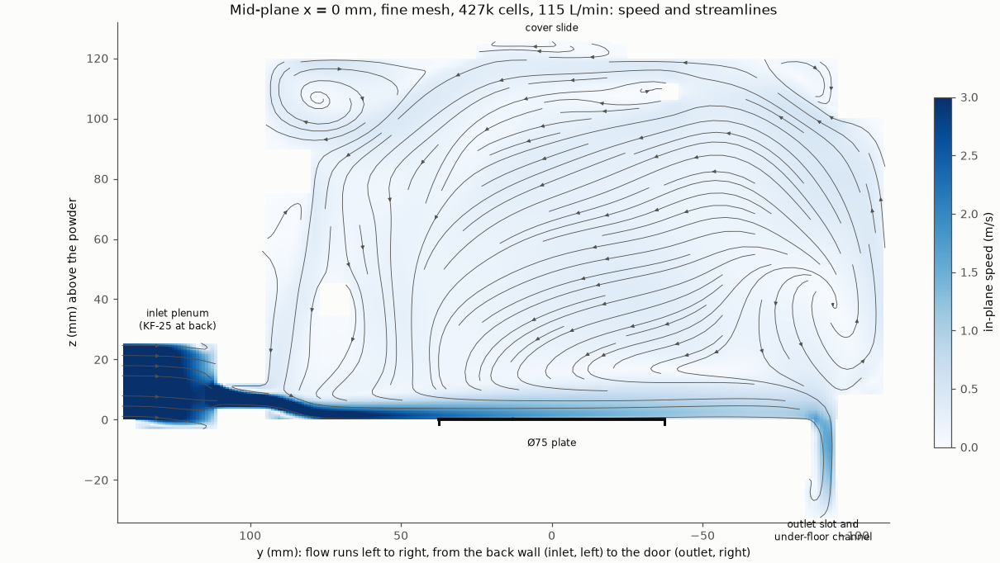
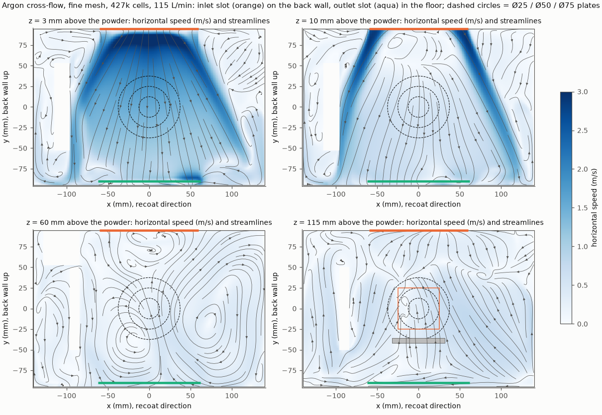
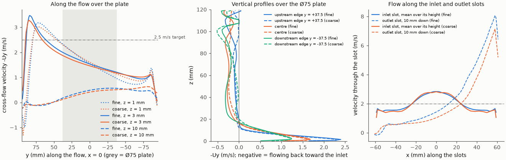
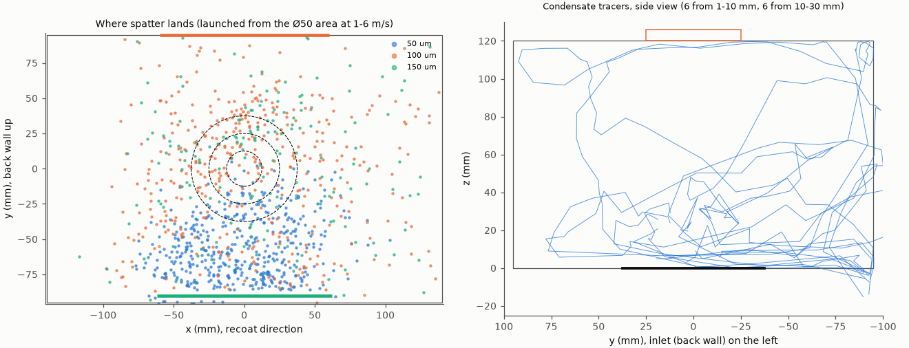
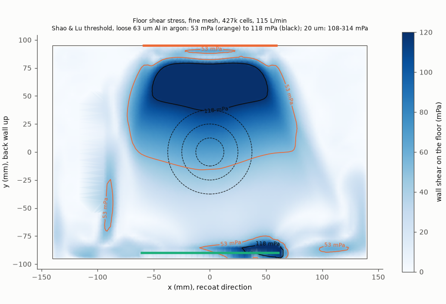
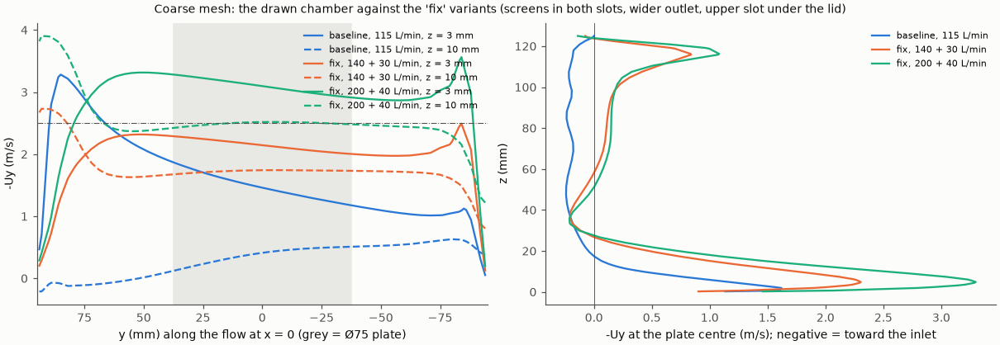
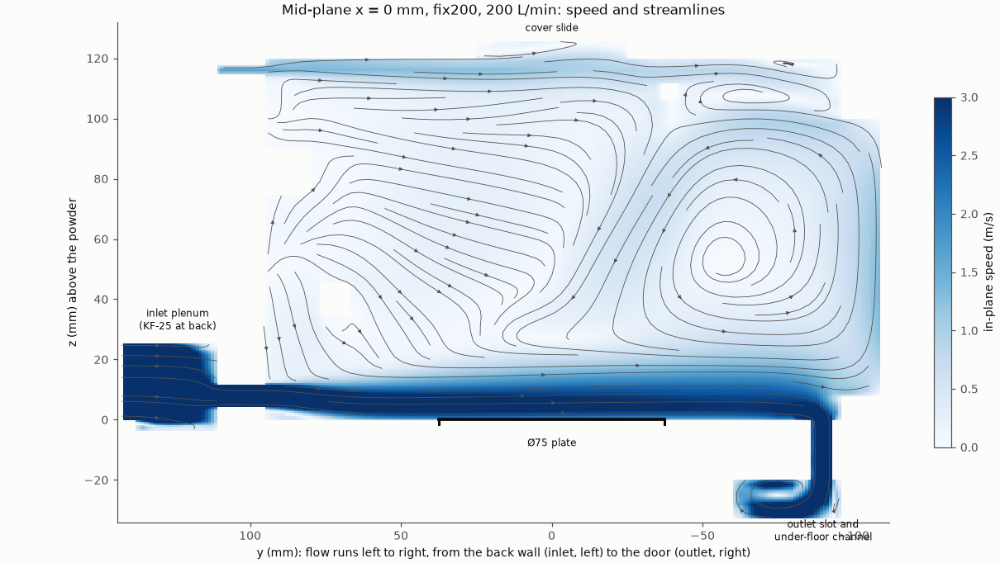

# Argon cross-flow in the process chamber: CFD of the chamber as drawn

Written 2026-11-20 for [PR #266](https://github.com/vertical-cloud-lab/digital-alloy-lab/pull/266) (issue #260). The Edison
[design review](edison/followup-design-review/answer.md) ranks gas flow as the #2 risk, and pain point P54 in
[`notes/2026-11-20-pain-points.md`](notes/2026-11-20-pain-points.md) puts it as "2 m/s cross-flow is the threshold, not
a margin, and small chambers recirculate".
This note answers it with OpenFOAM on the chamber of [`cad/lpbf_low.py`](cad/lpbf_low.py). Nothing has been built or measured.

| File | What it is |
|---|---|
| [`analysis/cfd/make_case.py`](analysis/cfd/make_case.py) | writes the OpenFOAM case from the model's dimensions: mesh, boundary conditions, solver settings; `--variant fix` adds the changes tried in §5 |
| [`analysis/cfd/run_case.sh`](analysis/cfd/run_case.sh) | meshes and solves one case in Docker (`opencfd/openfoam-run:2406`, 3 GB, 1.5 CPUs) |
| [`analysis/cfd/post.py`](analysis/cfd/post.py) | velocities over the plate, slot distribution, recirculation, bed shear against an entrainment threshold, pressure drop, spatter and condensate tracking, figures |
| [`analysis/out/cfd/cfd.json`](analysis/out/cfd/cfd.json) | every number below, per case |
| `analysis/out/cfd/*.png` | the figures shown here |

## 1. Short answer

At the design point (**115 L/min, 2.0 m/s mean in the 120 × 8 mm inlet slot**), on the fine mesh:

1. **The plate sees a thin wall jet, not a cross-flow, and it is below the 2.5 m/s target everywhere.**
   - At 3 mm above the powder the gas moves at **1.2–2.0 m/s over the Ø75 plate (mean 1.5 m/s)**. It falls from
     2.2 m/s at the upstream (back) edge to 1.2 m/s at the downstream (door) edge.
   - At 10 mm it is **0.2–0.6 m/s**. Above ~20 mm it flows backwards, toward the inlet.
   - Even at 1 mm, only 14 % of the Ø75 plate reaches 2.0 m/s, and none of it 2.5 m/s. The design review asks for
     ≥ 2.5 m/s measured over the whole usable plate (Reijonen et al. 2020).
   - Uniformity at 3 mm (coefficient of variation): 5 % over Ø25, 9 % over Ø50, 14 % over Ø75 (24 % at 10 mm).
2. **Neither the inlet plenum nor the outlet spreads the flow along its slot.**
   - The KF-25 port blows straight at the back of the slot. **The middle of the slot runs at 2.8 m/s and its ends at
     1.4 m/s**; the middle third carries 43 % of the flow.
   - Under the floor, the 10 × 13 mm channel ends in a 10 × 10 mm link to the boot at ~19 m/s. **85 % of the suction
     enters the right half of the outlet slot**, the half next to the boot. That junction alone costs ~0.43 of the
     chamber's 0.47 kPa.
3. **Above the jet the whole chamber is one slow vortex (0.1–0.5 m/s), and its return flow passes under the cover
   slide.**
   - Gas rises at the door, runs back along the ceiling toward the back wall, and falls into the jet again.
   - Under the slide it moves at 0.2–0.35 m/s toward the back wall. 91 % of the gas over the plate between z = 30 and
     120 mm moves toward the inlet.
   - This is the compact-chamber recirculation Griggs et al. (2021) found, and the review warned about.
4. **Condensate (< 1 µm, as tracers with turbulent diffusion):**
   - Released 1–10 mm above the plate, inside the jet: 95 % leaves within 12 s (median 0.13 s). 2 % passes within
     30 mm of the beam axis near the lid, and 0.5 % enters the slide recess.
   - Released 10–30 mm up, a plume that has risen out of the jet: 31 % reaches the upper vortex and 8 % passes under
     the window. **1.9 % enters the slide recess**, and 7 % is still in the chamber after 12 s.
   - The 200 °C plate isn't modelled. Its buoyancy (velocity scale ~0.6 m/s against 0.1–0.5 m/s in the vortex) will
     lift more condensate out of the jet, so these numbers are the optimistic end.
5. **Spatter (50–150 µm, launched at an assumed 1–6 m/s from the Ø50 area):**
   - **50 µm** is carried downstream: 78 % lands on the floor, mostly between the plate and the door, and 12 % goes
     into the outlet slot. 10 % lands back on the Ø75 plate.
   - **100 and 150 µm** fly almost ballistically. 17 % and 7 % land back on the Ø75 plate. 6 % and 32 % reach the
     lid, of which 2 % and 10 % hit the slide footprint.
   - No cross-flow this side of picking up powder can turn a 150 µm particle doing several m/s within 120 mm, so the
     slide stays a consumable.
6. **Bed shear is already at the entrainment threshold of the coarse fraction.**
   - The flow puts **0.07 Pa (mean) to 0.11 Pa (upstream edge) on the Ø75 plate**, and 0.13 Pa (up to 0.17) where
     the jet lands between the slot and the plate. Loose powder the blade leaves on the floor there blows onto the
     plate.
   - A Shao & Lu (2000) threshold for loose Al spheres in argon is 0.05–0.12 Pa at 63 µm, 0.06–0.17 Pa at 40 µm and
     0.11–0.31 Pa at 20 µm (the ranges span their cohesion parameter).
   - Pushing more gas through the same thin jet raises bed shear as ~Q^1.8 *(estimate)*: about 2.7× at 200 L/min.
     That is above the threshold of every size in the 20–63 µm cut. So more flow alone isn't the fix; spreading it over more height is.
7. **Pressure drop: 0.47 kPa flange to flange at 115 L/min** (coarse and fine mesh within 1.3 %), almost all of it in
   the outlet. Add ~0.1 kPa of hoses, ~0.2–0.3 kPa for the filter housing's 1/2 NPSC ports and 0.5–1.5 kPa for a
   cyclone *(estimates)*: **the blower needs ~1.5–2.5 kPa at 115 L/min (6.9 m³/h)**. As drawn, that rises as Q²:
   ~3× at 200 L/min.
8. **What to change (§7), and what the CFD says it buys (§5, coarse mesh):**
   - **Perforated plates (or honeycombs) in the inlet and outlet slots, and the under-floor outlet channel widened
     from 10 to 35 mm with a KF-40 port.**
     - At 200 L/min through the bed slot this gives **2.6–3.3 m/s at 3 mm and 2.1–2.5 m/s at 10 mm over the whole Ø75
       plate (CoV 6 %)**.
     - The bed shear upstream of the plate is lower than now (0.09–0.10 against 0.11–0.12 Pa on the same mesh), and
       0.08–0.09 Pa on the plate. The chamber costs 0.59 kPa at 240 L/min in total.
     - At 140 L/min it gives 1.75–2.3 m/s at 3 mm, with 0.04–0.06 Pa on the bed.
   - **Run 140–200 L/min through the bed slot**, and let a pick-up test on each powder set where in that range it runs.
   - **For the slide, gas flowing out of its recess** (a small purge, with the gas-knife outlet moved up into the recess).
     An upper slot under the lid turned the flow under the slide around, but it didn't reduce the condensate
     reaching the recess, and it doubled what passes near the window.
   - **A wider floor slot or a lip at the door**, so the faster jet turns down into the outlet instead of climbing the
     door.
   - **A velocity map and a pick-up test before the first build.**



*Mid-plane (x = 0), fine mesh, 115 L/min. The jet leaves the slot (left), runs along the powder and over the plate,
and leaves through the floor slot by the door (right). The rest of the chamber turns slowly the other way. Its return
flow runs along the ceiling under the cover slide.*



*Horizontal speed at 3, 10, 60 and 115 mm above the powder. Dashed circles: Ø25, Ø50 and Ø75 plates. At 3 mm the jet
narrows toward the right end of the outlet slot. At 115 mm the slide recess (orange square) sits in the return flow,
just downstream of the gas-knife body (grey).*

## 2. What was modelled

The gas volume is taken from the model ([`cad/lpbf_low.py`](cad/lpbf_low.py) `P` and [`cad/module_params.py`](cad/module_params.py),
read from a copy made at the start of this run; the gas path wasn't being edited). Coordinates as in the model:
z = 0 is the powder plane, +x is the recoat direction, +y points to the back wall, so the cross-flow runs in −y.

| Part | As modelled (mm) | From the model |
|---|---|---|
| Chamber interior | 280 × 190 × 120 (x −140…140, y −95…95, z 0…120) | `ch_x, ch_y, ch_z` |
| Inlet plenum | 120 × 27 × 28 box behind the back wall (y 111…138, z −3…25), fed head-on by a KF-25 port at its back (Ø25.4 as 20 × 25) | `plen_in`, inlet port |
| Inlet slot | 120 × 8 through the 16 mm back wall, z 4…12 (lower edge 4 mm above the powder) | `INLET_HALF`, `box(..., 4, 12)` |
| Outlet slot | 124 × 8 in the floor at y −94…−86, 20 mm deep | `OUTLET_HALF`, `OUTLET_Y` |
| Outlet channel and boot | 10 × 13 mm channel under the floor from x −62 to 72, then a 20 × 20 × 38 boot at x 76…96 to a KF-25 port pointing down | `plo` |
| Door recess | 220 × 92 × 16 pocket in the front wall (the door's inner face at y −111), z 8…100 | door opening |
| Slide recess | the lid's Ø56 bore (z 120…125) and the drawer's Ø46 opening (z 125…126) as squares of the same area; the cover slide's underside is z = 126 | lid bore, drawer |
| In the gas | parked recoater (blade + holder to the floor at x −115…−96, y ±53, z 0…35; arm and carriage block x −128…−84 up to z 100), rail (z 75…90) and Ø12 ball screw (z 35…45, along the whole back wall), dose chute (x −96…−84, y ±50, z 37…120), gas-knife body (x ±32, y −42…−36, z 106…112) | recoater, chute, knife |

- **Gas:** argon at 25 °C and ~+10 mbar: ρ = 1.65 kg/m³, μ = 22.6 µPa·s, ν = 1.37 × 10⁻⁵ m²/s. Isothermal.
- **Flow:** 115 L/min into the KF-25 port, which is the README's design point: 2.0 m/s mean in the 120 × 8 mm slot.
  `budgets.py` still has the older 70 × 8 mm nozzle (67 L/min), and the BOM's blower line says 60–100 L/min; both are
  below this. Outlet port at fixed pressure. The gas knife is off (the model gives it no flow or slot).
- **Solver:** OpenFOAM v2406 (`opencfd/openfoam-run:2406` in Docker, 3 GB, 1.5 CPUs), steady `simpleFoam` (SIMPLEC),
  k-ω SST with Spalding wall functions, linear-upwind convection. The slot's Reynolds number is ~1,200 on its 8 mm
  height (transitional), the KF-25 jet into the plenum ~7,000 and the outlet channel ~12,000 (turbulent), so a
  turbulence model rather than laminar flow.
- **Mesh:** `make_case.py` builds a rectilinear hexahedral grid whose lines fall on every edge of the gas volume
  (one blockMesh block per grid box; solid boxes left out). 1 mm cells in z from the floor to z = 14 (0.5 mm first
  cell centre), 2 mm through the slot, 3 mm elsewhere. Coarse: the same with every spacing × 1.5.
  `checkMesh`: zero non-orthogonality and skewness, aspect ratio ≤ 4.5.

## 3. Results at the design point (115 L/min, fine mesh)

### 3.1 Over the plate

Horizontal speed (m/s) sampled on discs centred on the plate; −U_y is the component along the cross-flow.

| Height above the powder | Ø25: mean (min–max), CoV | Ø50 | Ø75 | Share of Ø75 ≥ 2.0 / ≥ 2.5 m/s |
|---|---|---|---|---|
| 1 mm | 1.54 (1.34–1.78), 8 % | 1.54 (1.15–2.04), 16 % | 1.53 (0.96–2.32), 24 % | 14 % / 0 % |
| 3 mm | 1.53 (1.42–1.67), 5 % | 1.53 (1.31–1.82), 9 % | 1.52 (1.20–1.99), 14 % | 0 % / 0 % |
| 10 mm | 0.49 (0.41–0.54), 8 % | 0.49 (0.30–0.57), 15 % | 0.48 (0.18–0.64), 24 % | 0 % / 0 % |

- Along the flow at 3 mm (x = 0): **2.15 m/s at the upstream edge, 1.59 at the centre, 1.24 at the downstream edge**.
  That is the same inlet-to-outlet decay as in commercial machines (~4 → ~1 m/s, Shen et al. 2020), at half the speed.
- The jet's peak is within ~1–2 mm of the powder, and the jet is ~10 mm thick over the plate. Over the plate, 27 % of
  the gas between z = 0 and 30 mm already flows back toward the inlet, as does 91 % between 30 and 120 mm.
- Across the plate (x), the fast core is slightly right of centre, because the outlet draws from its right end.



*Left: −U_y along the flow at x = 0, at 1 mm (dotted), 3 mm (solid) and 10 mm (dashed), fine mesh (blue) against
coarse (orange); the inlet is on the left. Middle: vertical profiles at the plate's upstream edge, centre and
downstream edge, fine (solid) against coarse (dashed). Above ~20 mm the gas flows back toward the inlet. Right:
velocity through the inlet slot (mean over its 8 mm height) and 10 mm down the outlet slot, along their length.*

### 3.2 The slots

| | Inlet slot (120 × 8) | Outlet slot (124 × 8, in the floor) |
|---|---|---|
| Mean velocity | 2.0 m/s | 2.4 m/s at 10 mm down (it narrows the flow to the right) |
| Along the slot | 1.4 m/s at the ends, **2.8 m/s in the middle** (the KF-25 jet behind it) | ~0.5 m/s at the left end (x = −60, slight backflow at the very end), **8.1 m/s at the right end** |
| Share | middle third (\|x\| < 20 mm) takes 43 % | right half (x > 0) takes **85 %** |
| Why | the slot costs ~10 Pa (plenum to chamber in the CFD; 3 Pa of it is the jet's own dynamic pressure), about the dynamic pressure of the KF-25 jet into the plenum (12 Pa at 3.8 m/s), so nothing spreads the flow before the slot; the plenum is only 27 mm deep | the channel under the floor is 10 × 13 mm and ends in a 10 × 10 mm link at ~19 m/s (300 Pa of dynamic pressure) against ~3 Pa across the slot, so the slot drains toward the boot |

A header feeding a row of openings distributes evenly only when the openings' own pressure drop is large compared with
the header's dynamic pressure (common practice is ≥ 10×). Here it is about 1× at the inlet and 0.01× at the outlet.

### 3.3 Recirculation and the window

- One vortex, its axis along x, fills the chamber above ~20 mm (mid-plane figure). Smaller cells sit by the door
  (y ≈ −90, z ≈ 40 mm) and under the ceiling at the back wall (y ≈ 75, z ≈ 108 mm).
- **Under the cover slide** (inside the Ø46 opening, z = 121 mm) the gas moves at 0.22 m/s on average (up to 0.45),
  toward the back wall. At z = 117 mm it is 0.35 m/s. So the slide is not stagnant; it sits in the return flow of the
  vortex. Gas reaches it after rising at the door, which is where the plume that leaves the jet ends up.
- The gas knife as drawn is a 64 × 6 × 6 mm body at z = 106–112 mm, 8–14 mm below the ceiling. The slide is recessed
  6 mm *above* the ceiling, in the lid's Ø56 bore. A jet from the body's face would pass 14–20 mm below the slide and
  wouldn't sweep it. The model gives the knife no slot, supply or flow, so it is off in every case here.

### 3.4 Bed shear and powder pick-up

| | Ø25 | Ø50 | Ø75 |
|---|---|---|---|
| Wall shear on the powder, mean / max (Pa) | 0.068 / 0.080 | 0.068 / 0.098 | 0.067 / 0.114 |

- **The shear is highest where the jet lands, between the slot and the plate** (y ≈ 40–80 mm): 0.13 Pa on average,
  up to 0.17 Pa.
  - The blade spreads powder over y = ±52 mm, so the strip of loose powder it leaves on the floor just upstream of
    the plate (y 38–52 mm, |x| < 50) sees 0.125 Pa on average.
  - That is above the high-cohesion threshold for 63 µm over 79 % of the strip, and that powder blows straight onto
    the plate.
- The highest shear on the whole floor, 0.34 Pa, is at the right end of the outlet slot (x = 63, y = −87 mm). There the
  floor drains into the slot at up to 8 m/s.
- y+ on the plate is 7–10, inside the range of the Spalding wall function.

Threshold for loose spheres (Shao & Lu 2000: u*ₜ = √(A_N (ρₚ/ρ · g d + γ/(ρ d))), A_N = 0.0123; AlSi10Mg ρₚ = 2670 kg/m³
in argon at 1.65 kg/m³), as τₜ = ρ u*ₜ²:

| Particle | γ = 1.65 × 10⁻⁴ N/m | 3 × 10⁻⁴ | 5 × 10⁻⁴ |
|---|---|---|---|
| 63 µm | 0.053 Pa | 0.079 Pa | 0.118 Pa |
| 40 µm | 0.064 Pa | 0.105 Pa | 0.167 Pa |
| 20 µm | 0.108 Pa | 0.191 Pa | 0.314 Pa |

- γ is Shao & Lu's cohesion parameter, fitted to natural dust in air. Nobody has measured it for these Al powders in
  dry argon, so the threshold is uncertain by about 2× either way.
- At 115 L/min the upstream half of the plate sits inside the 40–63 µm band (0.07–0.11 Pa). Loose coarse particles on
  a freshly spread layer may roll there, and the strip upstream of the plate is past the band.
- With cohesion, the fines are harder to lift than the coarse particles: the threshold has its minimum near 60–100 µm.
- The threshold applies to a smooth layer. A ridge left by the blade, or spatter sitting on top, goes first.

### 3.5 Pressure drop and the blower

| Location (static pressure above the outlet flange) | Pa |
|---|---|
| Inlet KF-25 flange | 473 |
| Inlet plenum | 476 |
| Chamber, centre and under the slide | 466 |
| Outlet channel, x = −50 / x = +50 | 466 / 405 |
| Boot | −27 (the link's jet recovers in the boot) |

- So the plenum and slot cost ~7 Pa and **the outlet ~470 Pa**: ~60 Pa along the 10 × 13 channel and ~430 Pa where it
  turns through the 10 × 10 link into the boot. The coarse mesh gives 467 Pa against the fine mesh's 473 Pa.
- At constant geometry the drop goes as ~Q²: ~1.4 kPa at 200 L/min and ~2 kPa at 240 L/min, for the chamber alone.
- **The loop, by estimate.**
  - Hoses: ~1.6 m of KF-25 bellows in the model's routing, ~12 bends, f ≈ 0.06 for corrugated hose: ~0.1 kPa at
    115 L/min.
  - Filter housing: McMaster 5169K72 has 1/2 NPSC ports, which run at ~10 m/s at 115 L/min; with the HEPA media,
    ~0.2–0.3 kPa clean.
  - Cyclone: a small cyclone that separates spatter needs 10–20 m/s at its inlet and takes ~0.5–1.5 kPa.
- **Operating point: ~7 m³/h at ~1.5–2.5 kPa** as drawn, rising to ~12–14 m³/h at ~5–10 kPa if the flow is raised
  without changing the outlet. A regenerative (side-channel) blower covers that range. A centrifugal fan doesn't.
  Run it to a flow set point with a loop flow sensor (P11). No blower curve was checked.

### 3.6 Spatter and condensate

| Spatter, 600 per size | 50 µm | 100 µm | 150 µm |
|---|---|---|---|
| Relaxation time / settling speed in still argon | 16 ms / 0.15 m/s | 66 ms / 0.48 m/s | 148 ms / 0.85 m/s |
| Lands on the floor | 78 % | 68 % | 28 % |
| of which back on the Ø75 plate | 10 % | 17 % | 7 % |
| Into the outlet slot | 12 % | 1 % | 1 % |
| Hits a wall, the recoater or the chute | 10 % | 25 % | 39 % |
| Reaches the lid / the slide footprint | 0 % / 0 % | 6 % / 2 % | 32 % / 10 % |
| Median / 95th-percentile height reached | 21 / 42 mm | 56 / 120 mm | 84 / 126 mm |

| Condensate tracers, 1,500 per release, 12 s | released 1–10 mm above the plate | released 10–30 mm |
|---|---|---|
| Out through the outlet slot | 95 % (median 0.13 s, 90 % by 0.6 s) | 91 % (median 0.37 s, 90 % by 3.8 s) |
| Rose above z = 60 mm | 10 % | 31 % |
| Passed within 30 mm of the beam axis above z = 105 mm | 2.1 % | 8.1 % |
| Entered the slide recess | 0.5 % | 1.9 % |
| Still in the chamber after 12 s | 4.5 % | 7.2 % |

- The jet does its job for whatever stays in its lowest 10 mm: that is swept out in a fraction of a second.
- What rises out of it joins the vortex. It passes under the window at a few per cent per pass, and it comes back over
  the plate.
- 50 µm spatter lands mostly downstream (y < 0). 100–150 µm spatter lands a median 55–60 mm from the plate centre,
  in every direction, and 7–17 % of it lands back on the Ø75 plate, on parts in progress.





## 4. Mesh check

| Quantity | Coarse (173k cells, 1,500 iterations) | Fine (427k cells, 600 more from the coarse field) | Change |
|---|---|---|---|
| Mean speed over Ø75 at 1 / 3 / 10 mm (m/s) | 1.61 / 1.46 / 0.42 | 1.53 / 1.52 / 0.48 | −5 / +4 / +14 % |
| −U_y at 3 mm: upstream edge / centre / downstream edge | 1.73 / 1.41 / 1.15 | 2.15 / 1.59 / 1.24 | +24 / +13 / +8 % |
| Bed shear over Ø75, mean (Pa) | 0.063 | 0.067 | +7 % |
| Pressure drop, flange to flange (Pa) | 467 | 473 | +1.3 % |
| Inlet slot, middle / ends (m/s) | 2.82 / 1.05 | 2.83 / 1.41 | |
| Outlet slot, share in the right half | 84 % | 85 % | |
| Gas over the plate at z 30–120 mm flowing back | 84 % | 91 % | |
| Speed under the slide, z = 121 (m/s) | 0.16 | 0.22 | |

- The integral numbers (pressure drop, slot distribution) have converged.
- The thin jet over the plate is still mesh-sensitive at its upstream edge, where the fine mesh holds it tighter.
- A Richardson estimate with r = 1.5 and p = 2 puts the grid-converged speed at 3 mm at ~1.7 m/s in the centre and
  ~2.5 m/s at the upstream edge. The conclusion stands: most of the plate stays below 2.5 m/s.
- The near-bed probes drifted by ±3–5 % over the last few hundred iterations, because the vortex wanders.

## 5. The changes, tried together (coarse mesh)

`make_case.py --variant fix` changes the drawn chamber in four ways at once:

- a **perforated plate in the inlet slot**, modelled as a porous zone over the slot's 16 mm depth: loss coefficient
  K = 18 on the slot velocity along the flow and 20× that across it, so it also straightens the flow;
- the **same in the 20 mm deep outlet slot**;
- the **under-floor channel widened from 10 to 35 mm** (y −95…−60, still 13 mm tall), with a 35 × 10 mm link into a
  40 × 42 mm boot and a KF-40 port;
- a **100 × 4 mm upper slot** through the back wall at z = 114–118 mm, fed separately, blowing along the ceiling
  toward the door.

It was run at 200 + 40 L/min (3.5 m/s mean in the bed slot, 1.7 m/s in the upper slot) and at 140 + 30 L/min (2.4 and
1.25 m/s). Both use the coarse mesh (175k cells, 800 and 700 iterations), so compare them with the coarse baseline.
Every number is in [`analysis/out/cfd/cfd_summary.md`](analysis/out/cfd/cfd_summary.md).

| Coarse mesh | Drawn, 115 L/min | Fix, 140 + 30 L/min | Fix, 200 + 40 L/min |
|---|---|---|---|
| Speed over Ø75 at 1 / 3 / 10 mm, mean (m/s) | 1.61 / 1.46 / 0.42 | 1.32 / 2.00 / 1.64 | 2.12 / 2.91 / 2.31 |
| At 3 mm over Ø75: range, CoV | 1.17–1.87, 12 % | 1.75–2.29, 7 % | 2.58–3.28, 6 % |
| At 10 mm over Ø75: range, CoV | 0.12–0.58, 28 % | 1.51–1.75, 4 % | 2.11–2.52, 5 % |
| Share of Ø75 ≥ 2.5 m/s at 3 mm | 0 % | 0 % | 100 % |
| Inlet slot, slowest / fastest (m/s) | 1.05 / 2.82 | 1.75 / 2.55 | 2.51 / 3.64 |
| Outlet slot, share drawn by its right half | 84 % | 53 % | 53 % |
| Under the slide (z = 121 mm), mean speed | 0.16 m/s toward the back wall | 0.29 m/s toward the door | 0.53 m/s toward the door |
| Gas over the plate at z 30–120 mm flowing back toward the inlet | 84 % | 27 % | 23 % |
| Bed shear over Ø75, mean / max (Pa) | 0.063 / 0.098 | 0.044 / 0.055 | 0.081 / 0.092 |
| Bed shear on the spread strip just upstream of the plate, mean / max (Pa) | 0.109 / 0.119 | 0.051 / 0.058 | 0.086 / 0.100 |
| Pressure drop, inlet flange to outlet flange | 0.47 kPa | 0.29 kPa | 0.59 kPa |
| Condensate released 1–10 mm up: out within 12 s | 98 % | 88 % | 72 % |
| Condensate released 10–30 mm up: out within 12 s, median time | 93 %, 0.35 s | 90 %, 1.4 s | 82 %, 1.7 s |
| … passed near the window / entered the slide recess | 5.9 % / 0.9 % | 12.2 % / 0.5 % | 13.3 % / 1.1 % |
| Spatter back on the Ø75 plate, 50 / 100 / 150 µm | 11 / 18 / 7 % | 0 / 9 / 6 % | 0 / 2 / 3 % |
| Spatter into the slide footprint, 100 / 150 µm | 2 / 10 % | 2 / 10 % | 2 / 10 % |

What it shows:

- **The screens and the wider outlet make the bed flow even.**
  - At 3 mm the CoV over Ø75 is 6–7 % (was 12 %); at 10 mm it is 4–5 % (was 28 %).
  - The jet is now ~20 mm thick (vertical profile below), deep enough to cover the plume.
  - The inlet runs end to end within ±20 %, and the outlet draws 53/47 from its two halves.
- **The 2.5 m/s target needs about 200 L/min through the bed slot with this layout.** At 200 + 40 L/min the whole Ø75
  plate is at 2.6–3.3 m/s at 3 mm and 2.1–2.5 m/s at 10 mm. At 140 + 30 L/min it is 1.75–2.3 m/s at 3 mm.
- **The peak bed shear falls even as the flow rises.**
  - At 140 L/min the bed sees 0.04–0.06 Pa, at or below the lowest threshold in §3.4.
  - At 200 L/min it sees 0.08–0.10 Pa, on the plate and upstream of it. That is inside the 63 µm band, but below the
    drawn chamber's 0.11–0.12 Pa upstream of the plate on the same mesh.
  - The jet no longer slams into the floor. So 140–200 L/min is the range, and a pick-up test sets where in it each
    powder runs.
- **The pressure drop stays low: 0.29 kPa at 170 L/min in total, and 0.59 kPa at 240 L/min**, against 0.47 kPa for the
  drawn chamber at 115 L/min. The two screens cost ~0.1–0.2 kPa each, and the wider outlet saves more than that. As
  drawn, 240 L/min would cost ~2 kPa across the chamber alone.
- **More flow puts less spatter back on the plate.** 100 µm spatter: 18 % → 9 % → 2 %. 150 µm: 7 % → 6 % → 3 %. The
  slide footprint still takes 2 % of the 100 µm and 10 % of the 150 µm spatter; that is ballistic and the flow
  doesn't change it.
- **The upper slot doesn't protect the slide by itself.**
  - It turns the flow under the slide around: 0.3–0.5 m/s toward the door, instead of 0.16 m/s toward the back wall.
  - But on the same mesh, the condensate reaching the slide recess doesn't fall: 0.5 % and 1.1 % against 0.9 %. All
    three are within the tracer noise of about ±0.3 %.
  - The share passing near the window doubles (12–13 % against 6 %). The sweep carries the risen plume past the window
    on its way to the door, and its own turbulence mixes some of it up into the recess.
  - What keeps a recess clean is gas flowing *out* of it (§7, item 6). That was not simulated.
- **The chamber still recirculates above the jet.**
  - The faster jet partly overshoots the 8 mm floor slot and climbs the door. The upper sweep turns down at the door
    too. Together they make a cell above the jet (mid-plane figure below).
  - So condensate released low in the jet leaves less completely: 72 % within 12 s at 200 + 40 L/min, against 98 %
    as drawn.
  - The next layout to test: a wider floor slot (~20 mm in y) or a lip at the door, so that the jet turns down into it,
    and an outlet for the upper sweep at the door end.



*Coarse mesh, inlet on the left. Left: −U_y along the flow at x = 0, at 3 mm (solid) and 10 mm (dashed). Right: the
vertical profile at the plate centre. At 200 + 40 L/min the fixed layout carries 2.6–3.3 m/s at 3 mm and 2.1–2.5 m/s
at 10 mm over the whole plate. The upper slot's sweep is the bump at the top right.*



*Mid-plane of the fixed layout at 200 + 40 L/min. The bed jet is thick and even. The upper slot sweeps under the
slide toward the door. At the door it turns down into a cell above the bed jet, which is the next thing to remove.*

## 6. Against published cross-flow guidance

| Guidance | Source | This chamber as drawn (CFD, 115 L/min) |
|---|---|---|
| Porosity stayed < 0.1 % at 2.5–4.0 m/s cross-flow and rose sharply at ≤ 2.0 m/s; their machine moved ~300 L/min at 4 m/s nominal | Reijonen et al. 2020, [doi:10.1016/j.addma.2019.101030](https://doi.org/10.1016/j.addma.2019.101030) (via the Edison reviews) | 1.2–2.0 m/s (mean 1.5) at 3 mm over the Ø75 plate; 0.2–0.6 m/s at 10 mm. Nowhere over the plate reaches 2.5 m/s |
| A commercial machine's flow fell from ~4 m/s near the inlet to ~1 m/s near the outlet; too fast a flow picks powder up from the bed | Shen et al. 2020, [doi:10.1007/s11837-020-04020-y](https://doi.org/10.1007/s11837-020-04020-y) | the jet decays from 2.2 to 1.2 m/s across the Ø75 plate (at 3 mm) |
| EOS M290: ~3.5 m/s near the inlet nozzle, ~2 m/s at mid-plate; an upper inlet near the roof keeps recirculation away from the laser window; nozzles are arrays of small channels (NIST AMMT: 3.2 mm, L/D ≈ 15.5) that condition the flow | Weaver et al. 2021, NIST AMS 100-43, [doi:10.6028/nist.ams.100-43](https://doi.org/10.6028/nist.ams.100-43) | one bare slot (L/H = 2), no flow conditioning, no upper inlet |
| Low-velocity regions over the plate matched porosity | Kjer et al. 2023, [doi:10.3390/jmmp7040143](https://doi.org/10.3390/jmmp7040143) | the slow side of the plate is the downstream (door) side: 1.2 m/s at 3 mm against 2.2 m/s upstream |
| In a compact chamber, baffles and guide vanes only moved the recirculation; a second nozzle near the window suppressed it (> 1.4–1.5 m/s over 10 × 60 mm at 12–15 NL/min) | Griggs et al. 2021, [doi:10.48550/arxiv.2107.01744](https://doi.org/10.48550/arxiv.2107.01744) | one chamber-filling recirculation; its return flow runs along the ceiling under the slide |
| An EOS M290 recirculation zone below the lower vent went away when the backward-facing step between inlet and build surface was removed | Estrada Medinilla et al. 2025, [doi:10.3390/jmmp10010003](https://doi.org/10.3390/jmmp10010003) | the slot's lower edge is 4 mm above the powder: a small step. The jet reattaches within ~10 mm of the wall, well before the plate, so it does no harm here, but a flush lower edge costs nothing |
| Threshold friction velocity for loose particles: u*ₜ = √(A_N (ρₚ/ρ g d + γ/(ρ d))), A_N = 0.0123, γ = 1.65–5 × 10⁻⁴ N/m | Shao & Lu 2000, [doi:10.1029/2000JD900304](https://doi.org/10.1029/2000JD900304) | see §3.4 |

## 7. Recommended changes

In order of what they buy. Items 1, 2 and 5 and the upper slot of item 4 are in the "fix" runs of §5; the rest isn't
simulated.

1. **Put a flow distributor in the inlet slot.**
   - A perforated plate across the slot: ~25 % open, holes ≤ 1.5 mm, loss coefficient K ≈ 15–20 on the slot velocity.
     Or a honeycomb with 3 mm cells and L/D ≥ 10 (NIST AMMT's nozzle is 3.2 mm channels at L/D ≈ 15.5; Weaver et al.
     2021), with a fine screen.
   - Either gives the slot a pressure drop ≥ 10× the plenum's dynamic pressure, so the gas leaves evenly and straight.
     Cost: ~0.05–0.1 kPa at 115 L/min, ~0.2 kPa at 200 L/min.
   - Also stop the KF-25 port blowing straight at the slot: bring it in from the side or the bottom of the plenum, or
     put a small baffle in front of it.
2. **Open up the outlet and even out its suction.**
   - Widen the under-floor channel from 10 to ≥ 35 mm (y −95…−60 stays clear of the Ø96 module port), and make the
     link into the boot the same section. Use a KF-40 port.
   - Put a perforated plate (K ≈ 15–20) in the floor slot, or take gas out at both ends of the channel.
   - The channel stays 13 mm tall, so it still fits under the module's swap path.
   - Widen the floor slot itself to ~20 mm (y), or put a lip on the door side of it. At 200 L/min the jet partly
     overshoots the 8 mm slot and climbs the door (§5).
3. **Thicken the jet rather than only speeding it up.**
   - The drawn slot's thin wall jet already puts 0.11–0.17 Pa on the floor upstream of the plate at 115 L/min.
     Pushing the same jet to 2.5 m/s would roughly double that (~Q^1.8), which is past the pick-up threshold of every
     size we use (§3.4).
   - The screens of item 1 already thicken it to ~20 mm (§5).
   - A taller slot is the next thing to try: ~12–15 mm, with its lower edge flush with the powder (no backward-facing
     step; Estrada Medinilla et al. 2025). It could also be narrower than 120 mm if the Ø75 module isn't run: plate
     + ~15 mm a side.
   - Check it with `make_case.py` (change the `"inlet slot"` box) before cutting metal.
4. **Don't add an upper slot under the lid on its own.**
   - Tried at 30–40 L/min (a 100 × 4 mm slot at z 114–118 mm, blowing toward the door), it turned the flow under the
     slide around.
   - But the condensate reaching the slide recess didn't fall, and twice as much passed near the window: the sweep
     carries the risen plume past the window.
   - It is worth another look only with an outlet for it at the door end (in the top of the door or the lid's front
     edge), so that the sweep leaves instead of turning down into the chamber. That is Griggs et al.'s second nozzle
     and the EOS M290's upper inlet, but with somewhere for the gas to go.
5. **Flow rate: 140–200 L/min through the bed slot (2.4–3.5 m/s mean in it), once 1 and 2 are in.**
   - With the screens and the wider outlet, 200 L/min gives ≥ 2.5 m/s at 3 mm over the whole Ø75 plate; 140 L/min
     gives ~2 m/s.
   - The peak bed shear stays at or below today's (§5).
   - Hold the flow at a set point with a loop flow sensor, log ΔP across the HEPA (P11), and set the operating flow
     below each powder's measured pick-up limit.
6. **Protect the slide with gas flowing out of its recess.**
   - Feed a small argon purge into the lid bore between the slide and the chamber, so that gas leaves the recess
     downward through the Ø46 opening.
   - Of order 10 L/min gives ~0.1 m/s across the opening *(estimate; not simulated)*. The recess is then at a slightly
     higher pressure, and neither the vortex nor a sweep can carry condensate into it.
   - The gas-knife body as drawn (14–20 mm below the slide) should become this purge, or its slot should move up into
     the bore at z ≈ 124–125 mm, blowing across the slide face. Either way it needs its own feed and flow.
7. **Accept that 100–150 µm spatter will hit the slide.** No cross-flow stops it within 120 mm. Keep the slide a
   consumable, map its transmission per build (P12, P13), and consider tilting it 2–3° (P30).
8. **Measure before the first build.**
   - Hot-wire or vane anemometer at z = 1, 3 and 10 mm on a 10 mm grid over the plate, at 115 and 200 L/min.
   - Smoke in the upper chamber, to see the vortex.
   - A pick-up test per powder: spread a layer, run the flow for 10 min, then inspect and weigh the overflow.
9. **Bring the other numbers in line.**
   - `budgets.py` still sizes a 70 × 8 mm nozzle at 67 L/min.
   - BOM line G4 asks for 60–100 L/min "against a filter".
   - README §3.4 says ~2 m/s at the plate from a 70 × 8 mm slot.
   - All three should become the operating point chosen here: 140–200 L/min (plus the slide purge) at ~1.5–3 kPa for
     the whole loop, with the fixes. That means a sealed side-channel blower with a flow set point.

## 8. What was not modelled or checked

- **Isothermal.** No 200 °C plate, no laser plume. With 1.5 m/s in the jet, the Richardson number over the Ø75 plate is
  ~0.15 (forced flow wins in the jet), but above the jet, where the gas moves at 0.1–0.5 m/s, a 175 K plate gives a
  buoyant velocity scale √(gβΔT L) ≈ 0.6 m/s *(calc, β = 1/385 K, L = 75 mm)*: the hot plate will lift gas (and
  condensate) out of the jet into the upper recirculation, so the condensate fates in §3.6 are optimistic. The laser's
  vapour jet also throws condensate higher than the 1–30 mm release heights used here.
- **Steady RANS (k-ω SST) on a flow that is partly transitional and slowly unsteady.** The slot Reynolds number is
  ~1,200 on its 8 mm height (2,200 on its hydraulic diameter); the plenum jet (~7,000) and the outlet channel (~12,000)
  are turbulent. Residuals stalled near 3 × 10⁻³ (U) because the upper recirculation wanders; the near-bed probes
  drifted by ±3–5 % over the last 500 iterations. A laminar or transitional model would keep the wall jet thinner and
  faster near the slot.
- **Spatter launch is assumed** (1–6 m/s, 20–90° elevation, random azimuth, from the central Ø50 area); the fates of
  100–150 µm spatter depend more on this than on the gas flow. No turbulent dispersion for spatter; condensate as
  massless tracers with an eddy diffusivity ν + ν_t/0.7, no thermophoresis, no agglomeration.
- **Geometry.** Round holes are squares of equal area; the recoater is parked and modelled as solid blocks; the
  lift-out liners, LED bar, camera port, fibre heads, the overflow slot in the floor and the 5 mm fillets are left out;
  the gas knife is a body only, because the model gives it no flow, slot or supply.
- **The rest of the loop** (hoses, cyclone, HEPA, blower) is not in the CFD; its pressure drop in §3.5 is an estimate.
  No blower curve was checked, and no part was priced.
- **Not measured.** The numbers here need a velocity map in the real chamber (hot-wire or vane anemometer at
  z = 1, 3 and 10 mm on a 10 mm grid over the plate) and smoke for the upper recirculation before they are trusted.

## 9. Re-running

```bash
cp -r desktop-lpbf/cad /tmp/cfd-work/cad          # or point --cad-dir at desktop-lpbf/cad
M=desktop-lpbf/analysis/cfd
/tmp/venv/bin/python $M/make_case.py --res coarse --iters 1500 --out /tmp/cfd/coarse --cad-dir /tmp/cfd-work/cad
/tmp/venv/bin/python $M/make_case.py --res fine --iters 600 --out /tmp/cfd/fine --cad-dir /tmp/cfd-work/cad
$M/run_case.sh /tmp/cfd/coarse                     # 1,500 iterations: ~21 min at 1.5 CPUs
$M/run_case.sh /tmp/cfd/fine map /tmp/cfd/coarse   # 600 iterations from the coarse field: ~22 min
for q in "140 30" "200 40"; do set -- $q          # the "fix" layout, coarse mesh: ~10-12 min each
  /tmp/venv/bin/python $M/make_case.py --res coarse --variant fix --q-lpm $1 --upper-lpm $2 --iters 800 --out /tmp/cfd/fix$1 --cad-dir /tmp/cfd-work/cad
  $M/run_case.sh /tmp/cfd/fix$1
done
/tmp/capmem 3 /tmp/venv/bin/python $M/post.py --fine /tmp/cfd/fine --coarse /tmp/cfd/coarse --variant /tmp/cfd/fix140 --variant /tmp/cfd/fix200   # ~2 min
```

Docker image `opencfd/openfoam-run:2406` (OpenFOAM v2406), run with `--memory=3g --cpus=1.5`. The mesh is written by
`make_case.py` as one blockMesh block per grid cell of a rectilinear grid whose lines fall on every edge of the gas
volume, so `checkMesh` reports zero non-orthogonality and skewness. Meshes and time directories stay in `/tmp/cfd`.
