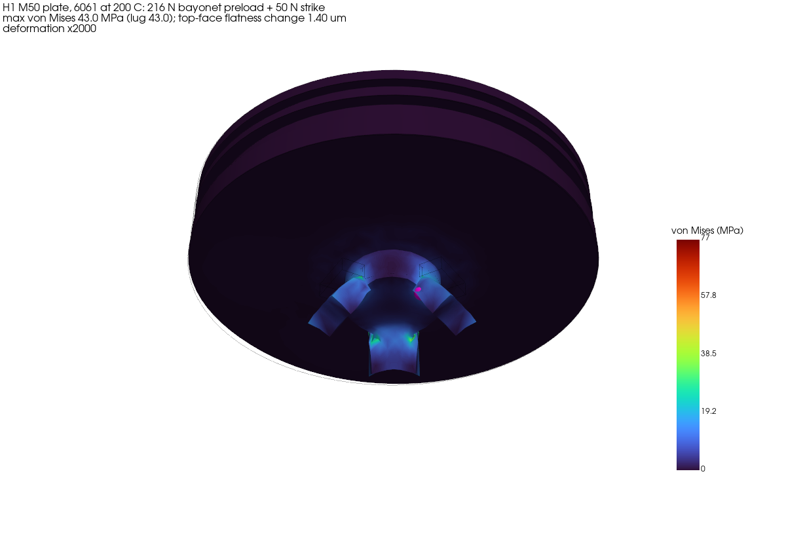
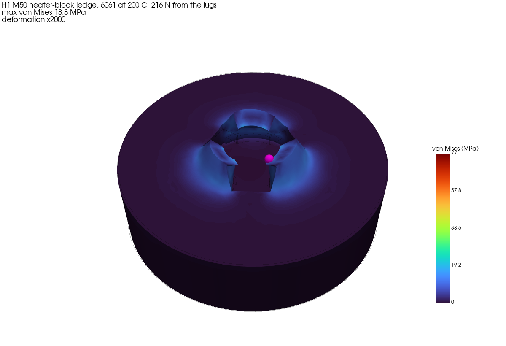
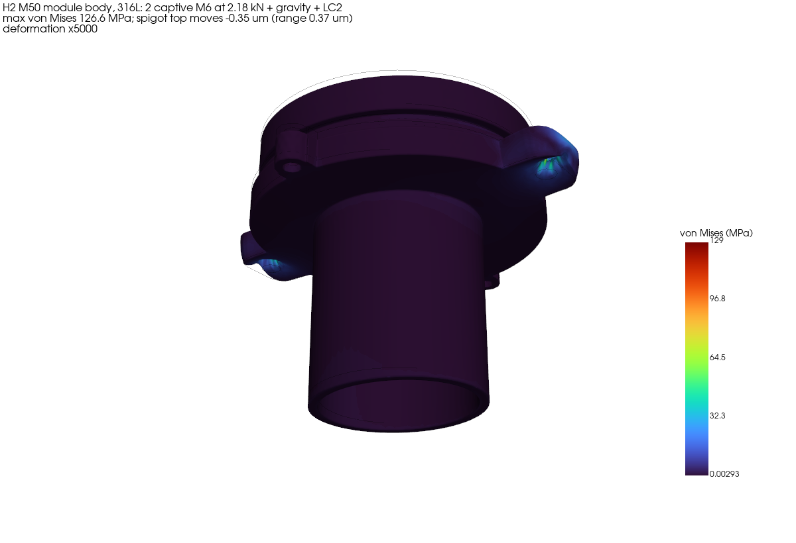
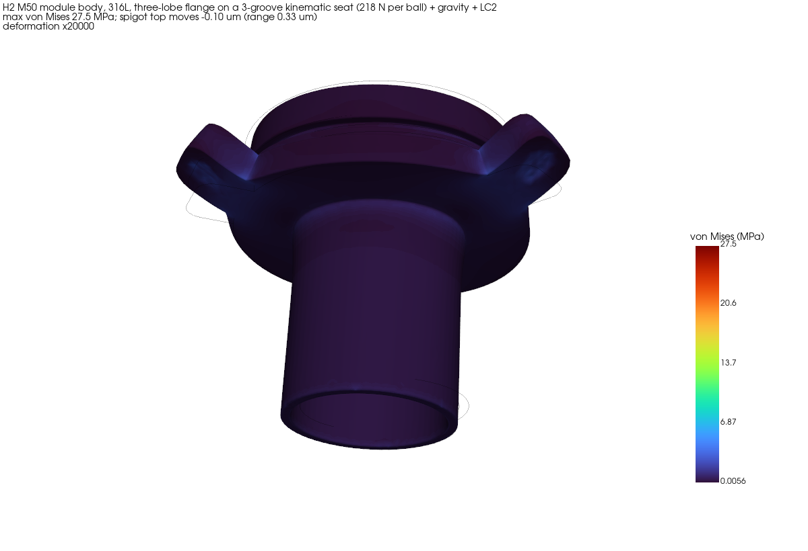

# How the swapped parts should be held: screws, zero-point clamps, magnets or kinematic seats

Written 2026-11-19 for [PR #266](https://github.com/vertical-cloud-lab/digital-alloy-lab/pull/266) (issue #260), in answer to:
"for things that are meant to be 'hot-swappable' in an automation friendly way, are we using screws/bolts or can we use
something else? Not sure what's standard or recommended here in the automation industry. Do we just stick with bolts because
robot arms can handle this kind of work? Do we try to use an electromagnet or similar to get the same kind of fastening going
on? Be thorough here."

| File | What it is |
|---|---|
| [`notes/2026-11-19-hot-swap-research.md`](notes/2026-11-19-hot-swap-research.md) | what LPBF machines, zero-point clamps, tool changers, magnets, kinematic couplings and robot screwdrivers are published to do; every number with its source |
| [`analysis/hotswap/joint_calcs.py`](analysis/hotswap/joint_calcs.py) → [`analysis/out/hotswap/joint_calcs.md`](analysis/out/hotswap/joint_calcs.md) | the loads on each swapped joint and the textbook sizing of each option: Shigley's bolted joints, Hertz contact, Almen–László disc springs, magnetic holding force against gap and temperature, Roark for the bent screw |
| [`analysis/hotswap/hotswap_fea.py`](analysis/hotswap/hotswap_fea.py) → [`analysis/out/hotswap/fea_hotswap.md`](analysis/out/hotswap/fea_hotswap.md) | CalculiX checks of the module flange (two screws vs a kinematic seat) and the bayonet lugs at 200 °C |

Nothing here has been built or bought. Vendor figures are the vendors' claims; the research notes mark which were read only in
a search-engine extract.

## Short answer

**For the parts a robot swaps often, don't use screws, and don't use plain electromagnets.** That means the build plate
(every build), the reservoir and the blade (each alloy change). Use what automation uses:
- a seat that centres the part;
- a lock held shut by springs, so it stays locked with the power or air off;
- a release that a robot or a small air cylinder works with a straight push.

That is the zero-point clamp of automated machining cells. Where an LPBF vendor names its plate interface, that's what it is:
System 3R, SCHUNK, AMF. SCHUNK's NSE-HT mini runs under a 200 °C bed on DMG MORI's LASERTEC 30 SLM. Robot screwdriving is an
assembly process, and no source uses it to exchange fixtures. Robots can turn screws, but every turned screw is a chance to
miss, cross-thread or gall in a powder-laden chamber.

**Magnets are a poor fit here:**
- 6061 and 316 give no force, so every part needs a ferritic insert.
- A Ø25 pole loses ~73 % of its force across a 0.1 mm gap, which one powder grain makes.
- Magnets are weak in shear.
- No small magnet is rated near the plate's 225 °C.
- A plain electromagnet drops whatever it holds on a power cut.

For the build plate that adds up to 7–33 samarium-cobalt pot magnets and a steel insert in every plate. For the module it
takes 3–12 fail-safe magnets.

**Screws stay where they're right:** joints that are opened rarely and must seal or carry an even preload. That is the lid,
gland plate, window, Z flange, legs and optics posts. It is also the build module while a person swaps it between campaigns.

| Interface | Swapped | Today | Recommendation |
|---|---|---|---|
| **Build plate** on the 200–225 °C heater block | every build, by a robot | 60° bayonet, no preload | **Robot cell: a drawbar.** A pull stud in the plate, a ball lock in the block, and disc springs and the release at the cold end of the hollow rod. Only passive parts sit at 225 °C, the robot places and lifts, and a small air cylinder pushes to release (141 / 280 / 656 N). **Until then:** keep the bayonet and add a 718 nickel disc spring (McMaster 97125K111) for the 0.1 MPa the graphite foil needs. L75's lugs would yield at that preload in CalculiX, so they need more metal. Not screws (§3.1) |
| **Build module** under the floor | between campaigns | 2 captive M6, dowel + diamond pin | **By hand: keep the captive screws** (24× against the worst load), at about half today's torque, with a non-galling screw or insert. **For a robot:** two spring-locked, air-released zero-point modules rated for the heat (STARK.easyclick FKM 150 °C, SCHUNK NSE-AM/HT 200 °C), or a three-groove kinematic seat with hardened vees preloaded by them. Replace the Z pot magnet with a switched coupling |
| **Heater stack** (not swapped, but heat-cycled) | – | M3 316 screws through Macor rings | Keep, with a light 302 disc spring so the block slides in its slots; Ti-6Al-4V screws are better if they can be sourced (§4) |
| **Reservoir** on the dock | each alloy | dovetail, 3 ball plungers, cam-opened shutter | Already fastener-free: 40 N detent hold against 2 N in transit |
| **Recoater blade** in its holder | each alloy | 2 × M3 316 | A Ø6 ball-lock pin (push-button, ~20× the 50 N strike), or two dowels and two magnets as a crash fuse |
| **Overflow jar**, **cover-slide drawer** | each build | KF-40 wing-nut clamp; drawer with an O-ring and pull tab | Fine for a person; a robot cell needs a lever-type KF clamp or a bayonet jar (not analysed) |

## 1. What LPBF machines and automation use

**For parts a robot swaps often, the standard is a clamp that locks by itself and opens on a signal.** It is neither a screw
nor a plain electromagnet:
- **Workholding:** a spring-locked, air-released **zero-point clamp** (EROWA, System 3R, SCHUNK VERO-S, AMF, STARK, Zimmer).
- **End effectors:** a **ball-lock tool changer** (ATI, SCHUNK SWS, Stäubli MPS).

They share five features, and these are what make them robot-friendly:
1. a pin or taper that centres the part to 1.5–15 µm;
2. a lock that holds with the air or power off;
3. release by 4–6 bar air or a 24 V motor, so the robot only places and lifts, with no torque;
4. cleaning air and a seat sensor, as options;
5. a capture window the robot has to hit, about ±0.4 mm for STARK and ±1 mm / ±2° for SCHUNK SWS-011.

**In LPBF:**
- **Where a vendor names its plate interface, it is a zero-point system:**
  - System 3R on 3D Systems' DMP machines;
  - SCHUNK on DMG MORI's LASERTEC 30 SLM: four NSE-HT mini 88-20 modules and one centring pin as the "thermal zero point", with
    the bed at 200 °C;
  - AMF on Matsuura;
  - TRUMPF.
- **Who automates what:**
  - Additive Industries moves plates with a robot.
  - Nikon SLM, EOS with Grenzebach, and Velo3D automate the whole cylinder or frame instead.
  - One Click Metal's interchangeable modules come with bayonet-locked plates (search-engine extract only).
- **System 3R names the problem with screws:** "manual build plate attachment and levelling … the unscrewing operation inside a
  powder environment".

**Temperature is the catch.** Most zero-point modules and tool changers are rated to 50–80 °C, which their seals and
electronics set. The hot versions found:
- STARK.easyclick with FKM seals, to 150 °C;
- AMF's AM modules, sealed for ≥ 150 °C;
- SCHUNK NSE-AM mini 78-20 and NSE-HT mini 88-20, to 200 °C, sealed against metal dust and rated for inert gas.

No actuated module rated above 200 °C turned up. Our heater block runs at 200–225 °C.

**Robot screwdriving is an assembly process.** No source uses it to swap a fixture or tool:
- cobot screwdrivers top out at 4–5 N·m and M5–M6;
- OnRobot's needs magnetic screws;
- the usual failures are missed pickups and cross-threading, which is the hard one to detect;
- stainless-on-stainless threads gall, and grit makes it worse.

**Magnets** hold ferrous parts in robot grippers and in big mould-clamping platens:
- **Temperature:** every small gripper or holding magnet found is rated to 40–80 °C.
- **Shear:** they hold only 22–35 % of their pull sideways.
- **Gap:** a Ø25 pole keeps 27 % of its force across a 0.1 mm gap and 7 % across 0.25 mm. One powder grain on the face is
  enough to do that.
- **Target:** they pull nothing on 6061 or 316; the target needs a ferritic plate 2.5–5 mm thick.
- **LPBF:** magnetic build plates appear only in patents (Blue Origin, GE).
- **Power loss:** an electromagnet that holds only while powered drops its load on a power cut. Electro-permanent ("power to
  release") units don't.

**Kinematic couplings** (three balls in three vees) are the precision way to seat a part under gravity, springs or magnets:
- **Clean:** they repeat to 0.05–1 µm in the lab.
- **Dirty:** at a robot's tool point, with dirt and varying preload, 50–110 µm was measured. Cleaning and the preload
  procedure mattered as much as the design.
- **Cycling:** steel-on-steel contacts fret to ~10 µm in a few hundred cycles; ceramic or polished stainless are recommended.

## 2. The interfaces and their loads

The loads come from [`joint_calcs.md`](analysis/out/hotswap/joint_calcs.md) §a. **Build module M50**, 2.21 kg in all:

| Load case (separating +) | M50, N | L75, N |
|---|---|---|
| LC1: build stroke at break-out, rod gland (2 × 2-114 FKM, 87 N) + bore seal + 20 mbar over | 133 | 138 |
| LC2: the Z arm pulls its pot magnet off the striker while the rod collar holds the piston | 217 | 218 |
| LC3: transit, +3 m/s² down | 28 | 29 |
| LC4: full vacuum (pushes the module up into its seat) | -692 | -691 |
| transit shear, 2 m/s² | 4.4 | 4.5 |
| radial O-ring (2-238) push-in / pull-out | 132 | 132 |

**The biggest load on the module joint comes from the Z coupling, not from the build.** Today the arm pulls the pot magnet
(44 lbf rated) off the striker during a swap, and the whole break-away force goes through the module flange. A switched Z
coupling, released before the arm drops, takes LC2 away and leaves 133 N.

**Build plate**, from the same file §b. The graphite foil under the plate needs a contact pressure, taken as 0.1 MPa (the
thermal FEA assumed h = 5,000 W/m²K). That is 23 / 173 / 424 N for
S25 / M50 / L75. It is far more than the recoater needs: 10 N drag and a 50 N strike, 10 mm above the face.

## 3. Options for each interface

### 3.1 Build plate

| | S25 | M50 | L75 |
|---|---|---|---|
| **(i) bare bayonet, today**: pressure from the plate's weight; edge lift on a strike | 0.56 kPa; 0.26 mm | 0.31 kPa; 0.31 mm | 0.28 kPa; 0.34 mm |
| **(ii) bayonet + 718 disc spring(s)** (97125K111): preload, twist torque, 6061 lug stress (hand; CalculiX) | 101 N, 0.28 N·m, 13 MPa | 216 N, 0.61 N·m, 28; 43 MPa | 530 N (2 springs), 1.49 N·m, 68; **107 MPa** |
| **(iii) drawbar**, 6 × Ø4 Si₃N₄ balls in a conforming groove: ball contact p₀, release push, heat down a Ø4 316 drawbar | 1,009 MPa, 141 N, 0.26 W | 1,301 MPa, 280 N, 0.26 W | 1,754 MPa, 656 N, 0.26 W |
| **(iv) 3 × M4 316 screws**: preload cold → hot (200 °C); screw stress vs its ~160 MPa at 200 °C | 1,383 → 2,633 N; 300 MPa | same | same |
| **(v) SmCo pot magnets** on a 430 insert in the plate, through the foil gap, at 225 °C | 7 magnets | 14 | 33 |

**(i) The bare bayonet needs a preload.** Today only the plate's weight presses it onto the foil, and a strike can rock it
until a lug meets the ledge.

**(ii) Bayonet plus a disc spring works, with two conditions:**
- **Allowable stress:** 6061-T6 held at 200–225 °C for long periods keeps only ~103–77 MPa (ASM). In CalculiX (§5) M50's lugs
  reach 43 MPa (2.4× / 1.8×), but **L75's reach 107 MPa and would yield**. L75 needs thicker or more lugs, a 17-4 PH insert, or
  the drawbar.
- **Contact under the plate:** a clamp at the centre leaves only 7–16 % of the face touching on a rigid support. The foil's
  compliance spreads that out, but a clamp nearer the rim would give a more even thermal contact. Neither is modelled.
- **Twisting needs something to push against.** The piston stack is not keyed against turning. The 0.3–1.5 N·m twist has to
  go through the bore seal's friction, or a key or a gripper has to hold the block.

**(iii) The drawbar is the machine-tool answer**: an HSK or SK spindle's pull stud, balls and disc-spring stack.
- **Hardware in the hot block:** only the balls and a hardened 17-4 sleeve. The springs and the release sit below the
  piston, out of the heat. That is how to get past the 200 °C limit of every actuated zero-point module found.
- **Robot motion:** a straight push. Release needs 656 N on L75; a Ø32 cylinder at 6 bar
  gives ~480 N, so L75 needs a Ø40.
- **Heat:** a Ø4 drawbar carries 0.26 W down the rod (316), against ~72 W of heater power.
- **Design details:** the groove must conform to the balls, since a flat would see 4,663 MPa
  against 17-4 H900's 1,872 MPa.

**(iv) Screws are the wrong choice for a heated plate**, even before the robot:
- Al grows 7 µm/m/K more than 316 across the grip. Heating to 200 °C adds 1,250 N to each M4.
- The screw then reaches 300 MPa against ~160 MPa, and the 6061 under its head
  117 MPa against 103 MPa. Both yield, so the joint loses preload every cycle.
- 6061-T6 also over-ages at 200 °C.

**(v) Magnets fail on temperature, the foil gap and the non-ferrous plate.** No small switchable magnet is rated near 225 °C.

### 3.2 Build module

| Option | Holds (N) | Against the worst load (LC2, 218 N) | Repeats | Rated to | Notes |
|---|---|---|---|---|---|
| **2 captive M6** (95966A705) into 18-8 inserts, F_i = 0.75 F_p | 4,364 | 24× (separation) | dowel + diamond pin, face contact | steel | 3.9 N·m dry, 2.4 N·m with anti-seize. The 18-8 screw in an 18-8 insert is the galling pair; the 4.2 mm reduced shank sets the proof load. Heating to 85 °C adds 98 N |
| **2 zero-point modules**: STARK.easyclick D085 (FKM) / SCHUNK NSE-AM mini 78-20 | 2 × 5,000 / 2 × 1,500 | 46× / 14× | < 10 / < 5 µm | 150 / 200 °C | spring-locked, opened by 4–6 bar air, seat check and blow-off available. Ø78–88 mm each: the flange needs arms to about x = ±95 mm, clear of the overflow funnel |
| **2 SCHUNK NSE-HT mini 88-20 V1** (ID 1460874; the part §3.2a places) | 2 × 500, 2 × 2,500 with turbo | 4.6× / 23× | < 5 µm | 200 °C | Ø88 × Ø73 × 20, 1.0 kg, opens at 6 bar, closes by spring; $2,680 each (MROSupply, re-checked 2026-11-23), sold without pins. **Not drawn (2026-11-23): no place for the right-hand one while the overflow jar stays removable (§3.2a)** |
| **Kendrion fail-safe magnets** (power to release) on a 430 plate | 78–250 each at 0 gap | needs 3–12 | – | coil 120 °C | lose half their force at 0.05 mm; only ~25–35 % in shear |
| **plain electromagnet** (Kendrion GTB040) | 301 at 0 gap, 84 °C | 1.4× | – | 550 °C | **drops the module on a power cut** |
| **3-groove kinematic seat**: Ø16 Si₃N₄ balls in 17-4 H900 or 440C vees, preloaded by one of the above | the preload | – | 0.05–1 µm clean (Slocum); ~1–2 µm offset from a crushed Al grain | – | 6061 or 316 vees yield at this preload |

**For a person swapping modules between campaigns, the captive screws are fine.** Run them at about half the torque. The
CalculiX check in §5 puts 127 MPa at the tabs at full preload, against 170 MPa for 316L. Use an MoS₂- or silver-plated screw,
or a Nitronic 60 insert, against galling.

**A robot cell would use two heat-rated zero-point modules on flange arms**, with the dowel and diamond pin or a hardened
kinematic seat for location. Either way, **replace the Z coupling's pot magnet**:
- McMaster 5679K95 is rated to 79 °C, and the thermal FEA puts its face at 68 °C, or 84 °C with powder in the gaps.
- Its break-away is the biggest load the module joint sees.
- A fail-safe "permanent electro" magnet, or a small ball lock like the plate's drawbar, would release on command before the
  arm drops.

### 3.2a Where two zero-point modules would go (layout check, 2026-11-22)

The part: **SCHUNK NSE-HT mini 88-20 V1, ID 1460874**: Ø88 × Ø73 × 20 mm, 1.0 kg, repeat < 0.005 mm, sold without clamping
pins ([schunk.com p/1460874](https://schunk.com/us/en/p/000000000001460874), read 2026-11-22 through the lab tunnel). Its
0.5 kN pull (2.5 kN with turbo) and 200 °C rating are in the table above.

Two of them must straddle the module, so that their pull acts inside the flange's contact. A single one off to the side tips the
module, and its spigot binds in the port. The under-floor layout was read off the model (M50, bounding boxes, z is negative under
the floor) to find a place for a pair:

| Pair | At the floor's underside (z −40 to −20) | At the gland plate (z −106 to −86) |
|---|---|---|
| left and right (x ±100) | right: the overflow funnel, x 78 to 122, y ±59 | right: the overflow jar, x 73 to 127, down to z −150 |
| front and back (y ±95) | front: the outlet plenum, y −106 to −75; back: the Z flange, y 60 to 108 | front: the module's own exit lane, x ±53; back: the Z bracket and actuator |
| front-right and back-left | front-right: the plenum's boot | front-right: the plenum's KF-25 port, the jar and the front-right leg |
| front-left and back-right | front-left: the plenum | back-right: the Z servo, x 34 to 94, y 28 to 110; a front-left one has to sit at x ≤ −99 to stay out of the exit lane, which is where the front-left leg is |

Only the left side is free: one module fits at (−100, 0). **So the pair doesn't fit until the overflow jar moves.** The jar has to
move anyway, because it has no way out (robot-ops.md, operations.md U4.7). With the jar gone from under the funnel, a pair at the
gland-plate level fits at (−100, +18) and (+100, −18):
- the right one 2.2 mm from the Z servo's corner and 16 mm from the front-right leg, the left one 16 mm from the back-left leg;
- 2.9 mm outside the L75 gland plate's path;
- on arms under the gland plate, which pass 4 mm over the base plate when the module drops 40 mm.

**Update 2026-11-23 (round 5, A1): the jar can't leave the funnel, so the pair still does not fit.** The jar now has a straight lane to
the front (robot-ops.md patch request 6, operations.md U4.7): its KF-40 joint is 26 mm lower (z −84), it is a 45 mm long 2 in. cup,
the outlet plenum's KF-25 port moved to the plenum's left end and the front-right leg to the right side (x 128–156, y 26–56). It has
to stay under the funnel at (100, 0):
- the overflow slot sits at x 90–110 because the blade's stroke ends at x = +100, and the funnel's outlet can't move sideways: a
  chute steep enough for fine Al powder (55–60°) loses 1.6–1.7 mm of height per mm of run, and there are 118 mm between the funnel's
  bottom (z −42) and the base plate (z −160);
- so the jar, its toggle clamp (r 35.5 at z −94 to −75) and its lane to the front (x 72.6 to 127.4) own the right-hand side under
  the floor.

**Every place the right-hand module could take on that side is blocked**, read off the model (M50; an NSE centre has to be ≥ 97 mm
from the module's axis to stay 2 mm outside L75's gland plate):
- in front of the jar, (+100, −18) or further forward: it stands in the jar's lane;
- under the jar: the jar and clamp hang to z −129, where the module would sit (z −106 to −86) with its arm under it;
- behind the jar: the Z servo hangs at x 34.5 to 93.5, y 27.7 to 109.5, from z −187 up to −84. At x = 100 an NSE needs y ≤ −16
  to clear its corner, but y ≥ +65 to clear the jar's cup;
- beside the jar, at x ≥ 172: the arm out to it sweeps the legs and the front-right optics post on the module's path.

**What it would take** (not done; it moves parts outside this task):
1. Fold the Z servo to the back of the actuator. That means extending the base plate's window back past y 114, and new bracket and belt
   housing in `modules_low.add_zstage`.
2. Move the funnel's outlet and the jar to the slot's front end, (100, −45). The funnel screws at (83/117, −40) move, and the jar keeps
   its lane.
3. Put the right-hand module behind the jar at (+100, +30), 5.2 mm from the back-right leg and 5.4 mm from the cup. Put the left-hand
   one at (−100, −30), 5.2 mm from the front-left leg and 2.9 mm outside L75's gland-plate path.
4. Route the outlet hose, which now runs back along x = −86 at z −145 to −109 (lpbf_low.py section 11), under or round the left
   module's arm.

**The pins:** VERO-S **SPC mini 20**, the clamping pin "with centering clearance ... without alignment function" (schunk.com
PGR_4245, read through the lab tunnel 2026-11-23). Not the SPA mini 20 (ID 0435610), which centres to < 5 µm: the dowel and diamond pin
already locate the module, and a second centring pair would fight them. The SPC's ID number and dimensions were not on the page as
read (the product list loads dynamically), so the pin is not drawn.

**The joint:** with the pull in place of the screws, 2 × 500 N = 1,000 N holds 4.6× the worst separating load (LC2, 218 N; joint_calcs.md,
re-run 2026-11-23), and 23× with turbo. The 132 N spigot O-ring and the module's 26 N weight are inside that.

They would hang from the floor on two posts each. Until then, the module keeps its two captive M6, and the robot job assumes they are
released. The robot side is drawn: the grip block on the handle (robot-ops.md).

### 3.3 Reservoir, blade, jar and drawer

- **Reservoir:** three 85015A47 ball plungers in 90° detents hold 40 N along the slide, against 2 N for 1 kg at
  2 m/s². The robot pulls ~40 N to remove it. Keep it as it is.
- **Blade:** two M3 316 screws clamp it with ~317 N of friction against a 50 N strike (6.3×), but every alloy change needs a
  screwdriver.
  - **Ø6 ball-lock pin** (pull-out 1,023 N, vendor): ~20×, and a gripper finger can press its button.
  - **Two dowels and two Ø10 NdFeB discs** in the holder: tool-free, but they hold only ~0.5× a 50 N strike. The blade knocks
    off in a crash, which also makes it a fuse.
- **Overflow jar and cover-slide drawer:** a person empties the jar and changes the slide. A robot cell would need a lever KF
  clamp or a bayonet jar. Not analysed.

## 4. The heater-stack screws

The heater block runs 88–132 K hotter than the piston head. At the M50 screw circle it grows 42–62 µm more than the head,
from the end of a build to its start. Two things follow.

| | S25 | M50 | L75 |
|---|---|---|---|
| block growth at the screw (build end / start), µm | 22 / 34 | 42 / 62 | 64 / 96 |
| 316 screw bending if the block can't slide, MPa (vs ~160 at 200 °C) | 105 / 158 | 239 / 359 | 368 / 553 |
| Ti-6Al-4V screw bending at build start, MPa (vs ~650) | 93 | 212 | 326 |
| largest spring preload that still lets the block slide (μ 0.3), N | ≤ 30 | ≤ 55 | ≤ 55 |
| heat through the Macor and screws at build start, W (thermal FEA): solid Macor, no screws → bored, with 316 screws → with Ti screws | 1.74 → 2.42 → 1.93 | 3.72 → 4.58 → 3.97 | 3.74 → 4.65 → 4.00 |
| of which through the screws, W: 316 / Ti | 1.33 / 0.79 | 1.64 / 0.96 | 1.66 / 0.96 |
| heater power for 200 °C at build start, W: no screws → 316 → Ti | 44.1 → 44.7 → 44.2 | 72.1 → 72.9 → 72.4 | 97.2 → 98.0 → 97.4 |

The growth and bending rows come from [`joint_calcs.py`](analysis/hotswap/joint_calcs.py), re-run on 2026-11-23 with the head
temperatures of the thermal FEA that now has the screws in it (the head runs 2–12 K warmer, so the growth fell 1–3 µm). They
still use the screw circles of the model snapshot the script reads (r = 9.4 / 20.1 / 30.2 mm). The model now has S25 and M50 at
r = 9.0 and 18 mm, which cuts their growth by 4 % and 10 %. The heat rows are from the thermal FEA
([`thermal.md`](analysis/out/thermal/thermal.md), "Heater-stack screws"): plate at 200 °C, chamber 25 °C, build start, with S25 on
its 3/8 in. rod and the current standoff radii.

**1. The block has to be able to slide, or the screw has to bend elastically.** If the head can't slide in its slot, the
growth bends a 316 M3 past yield. So either:
- **keep the 316 screw's preload at or below ~55 N:** a light 302 disc spring (McMaster 9713K54 in the model; ~116 N at its
  working deflection), tightened until the spring is just flat and then backed off a third of a turn (~20–30 N);
- **or use Ti-6Al-4V screws,** which take the growth elastically (219–335 MPa against ~650 MPa) and carry less heat. They need
  the stiffer 718 spring (97125K111) and a set deflection. McMaster's metric 316 pages don't list titanium M3 socket head
  screws, so these would come from a titanium-fastener vendor.

**2. The disc spring also carries the axial mismatch.** In a heat-up the block is hot before the screw. Without a spring, an
M3 is stretched by ~33 µm, past its proof load. With the spring the change is a few newtons.

**Heat** (thermal FEA, 2026-11-23; was a hand estimate of +1.6 W for 316 and +0.3 W for Ti on M50): the three 316 screws carry
1.6 W across the M50 break at build start, but boring the Macor for them takes 0.8 W off what the Macor carries, so the heater
needs 0.8 W more (72.9 W against 72.1 W; 1 %). Ti-6Al-4V screws carry 1.0 W and add 0.3 W. S25's M2.5 screws carry more than
its Ø5 Macor rings do (1.3 W against 1.1 W) and add 0.6 W. The screws are modelled as a calibrated ring in the axisymmetric mesh:
each screw's path from the insert threads, across the break and down its clearance hole in the head to the disc spring is worked
out in `thermal_module.stack_screw_link()`, and an end contact of zero or infinite conductance moves the three-screw conductance
by −19 % / +7 % (M50, 316). In the solved fields the ring passes heat over its temperature drop at 12.6 mW/K on M50 (316) and
7.2 mW/K (Ti), as calibrated to within 0.2 %, and so does L75's; S25's ring runs 5–6 % above its calibration. Either way the screws change no limit: the bore seal, gland O-rings and magnet move by ≤ 5 K on M50 and
L75. **Macor bearing
stress:** 1–13 MPa against its 345 MPa compressive strength.

## 5. CalculiX checks

What they show:
- **M50 bayonet:** comfortable at 200 °C with a 216 N disc spring.
- **L75 bayonet:** its 6061 lugs yield at 530 N.
- **Module flange:** two captive screws at full preload put a local 131 MPa peak at the head-bearing edge of the tabs (127 MPa on the older model); the mean bearing stress is ~52 MPa. Half the torque still leaves 12× against separation.
- **Kinematic seat:** loads the flange far less (27 MPa) and moves the spigot top less (0.10 µm against 0.35 µm).

**Re-run 2026-11-22 on the model at 9f45d80** ([`fea_hotswap.md`](analysis/out/hotswap/fea_hotswap.md), which has the current tables). The L75 lugs are unchanged at 107.1 MPa, so they still yield at 204 °C. The M50 lugs are 43.0 MPa and the ledge 18.8 MPa, within 2 % of the run below. The module flange went from 126.4 to 131 MPa, because the body now has its welded collar. The kinematic seat is 27.5 MPa. The tables below are from the earlier run on 1c7a977.

Generated by [`analysis/hotswap/hotswap_fea.py`](analysis/hotswap/hotswap_fea.py) from the model at commit 1c7a977. C3D10 (gmsh), ccx, SPOOLES. Contact is modelled as compression-only prescribed supports, solved by an active-set loop (no contact elements).

### H1 M50: bayonet lugs and ledge, 6061 at 200 °C (E 62 GPa), preload 216 N

| case | peak von Mises, MPa | in the lugs, MPa | vs 103 MPa (204 °C, 10,000 h) / 77 MPa (225 °C) | top-face flatness change, µm | plate face in contact |
|---|---|---|---|---|---|
| plate, preload | 42.9 | 42.9 | 2.40 / 1.79 | 0.23 | 16 % |
| plate, preload + 50 N strike | 42.9 | 42.9 | 2.40 / 1.79 | 1.40 | 16 % |
| block ledge | 19.4 | – | 5.30 / 3.96 | – | – |

### H1 L75: bayonet lugs and ledge, 6061 at 200 °C (E 62 GPa), preload 530 N

| case | peak von Mises, MPa | in the lugs, MPa | vs 103 MPa (204 °C, 10,000 h) / 77 MPa (225 °C) | top-face flatness change, µm | plate face in contact |
|---|---|---|---|---|---|
| plate, preload | 107.1 | 107.1 | 0.96 / 0.72 | 0.68 | 7 % |
| plate, preload + 50 N strike | 107.1 | 107.1 | 0.96 / 0.72 | 2.05 | 7 % |
| block ledge | 46.1 | – | 2.23 / 1.67 | – | – |

### H2 M50 module body (316L) on the chamber floor, gravity + LC2

| hold | peak von Mises, MPa | in the flange, MPa | vs S_y 170 (316L) | spigot top moves, µm (mean / range) | contact |
|---|---|---|---|---|---|
| 2 captive M6, 2 × 2,182 N | 126.6 | 126.6 | 1.34 | -0.35 / 0.37 | 35 % of the flange face; max gap 0.50 µm |
| 3-groove kinematic seat, 218 N per ball | 27.5 | 27.5 | 6.19 | -0.10 / 0.33 | 3 balls (axial + tangential fixed) |

## 6. What this changes, and what is left

**Changed in the model now** ([`fasteners.md`](fasteners.md)):
- the heater stack's screws and slots;
- the gland plate on a welded collar;
- real screws, inserts and holes at every joint, with McMaster part numbers.

The swapped interfaces keep their current hardware in the model: the bayonet, the captive screws, the blade screws and the
dovetail. The recommendations above are not drawn yet.

**To do next, in order:**
1. **Build plate:** draw the drawbar in the M50 module (pull stud, ball sleeve, disc-spring stack at the rod end, release
   cylinder on the Z arm), and run the thermal FEA with it. In the meantime, add the 97125K111 spring to the bayonet, and
   thicker lugs or a 17-4 socket for L75.
2. **Z coupling:** replace the 5679K95 pot magnet with a switched coupling, released before the arm drops. That also removes
   the module joint's biggest load.
3. **Build module, if a robot is to swap it:**
   - pick STARK.easyclick ET (150 °C) or SCHUNK NSE-AM mini (200 °C) and get prices;
   - extend the flange arms;
   - keep the dowel and diamond pin.

   Status 2026-11-22: the robot's handle is drawn (a grip block in front of the door; the robot module swap passes on S25, M50
   and L75, robot-ops.md). The clamps are not drawn: a pair fits under the floor only once the overflow jar moves (§3.2a).
4. **Blade:** a ball-lock-pin cartridge.
5. **Quotes:** none of the vendor parts above is quoted. The SCHUNK NSE-M mini 90 (manual) lists at $1,430 at one reseller, so
   expect ~$1–2k per powered module.

**Caveats:**
- The graphite foil's 0.1 MPa is assumed. No vendor's impedance-versus-pressure curve was read.
- The Kendrion, STARK and SCHUNK figures are the vendors' own.
- The kinematic-coupling repeatabilities were measured by others on other hardware.
- The CalculiX supports are compression-only, with no contact elements.
- No magnetostatic FEA was run. Magnet forces come from the vendors' force-versus-gap curves, a 430 material factor and the
  reversible temperature coefficients.
