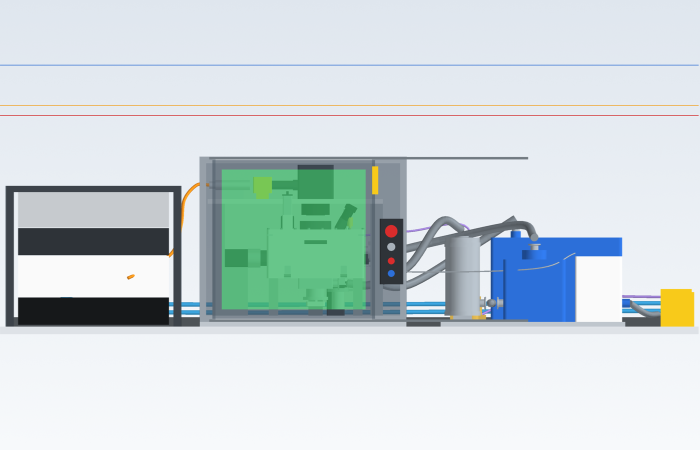
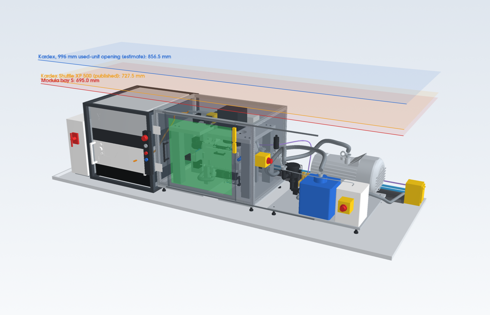
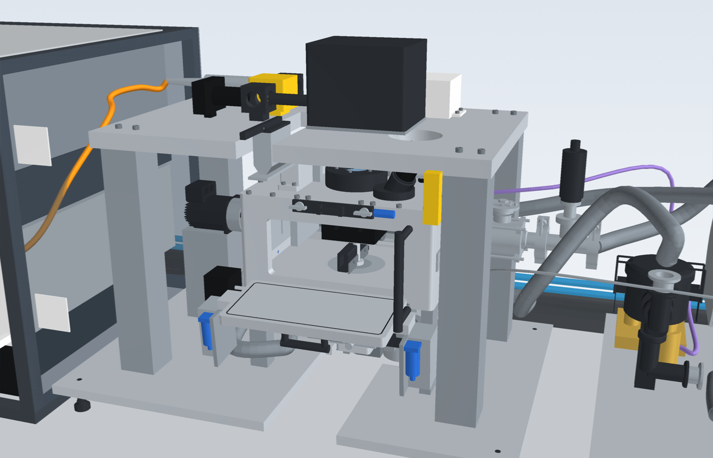
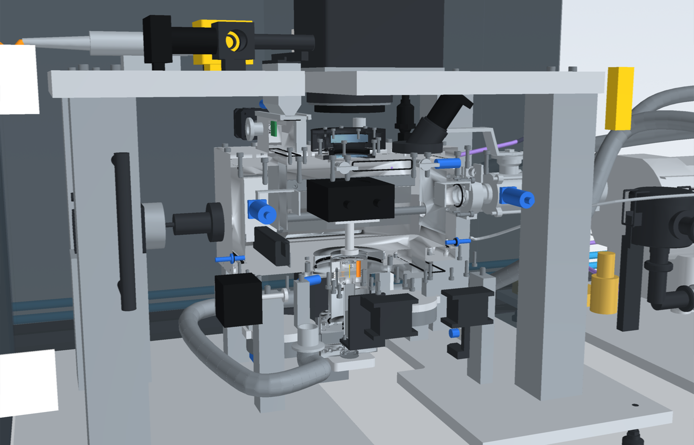
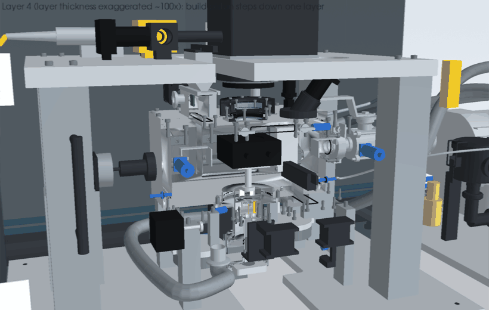
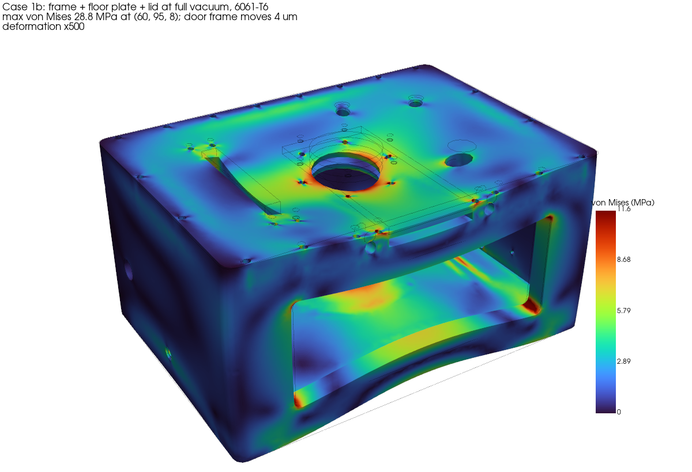

# Low-profile desktop LPBF for a VLM tray: layout, engineering checks and materials

Written 2026-11-17 for [PR #266](https://github.com/vertical-cloud-lab/digital-alloy-lab/pull/266) (issue #260). It answers
four requests:
- run MuJoCo, CalculiX and similar tools to check for interference, real fits and critical failure points;
- make the machine "horizontally distributed": shorter, with fewer limits on width;
- match chamber materials to the lab's other systems;
- follow published best practice for those materials.

Nothing here has been built, quoted or reviewed by BYU's LSO or EHS.

| File | What it is |
|---|---|
| [`cad/lpbf_low.py`](cad/lpbf_low.py) | parametric CadQuery model of the low layout (118 parts, each with its material and motion group) |
| [`cad/render_low.py`](cad/render_low.py) | renders the stills and GIFs in [`cad/img/low/`](cad/img/low/) |
| [`cad/out/desktop-lpbf-low.step`](cad/out/desktop-lpbf-low.step) | STEP export of the low model (7.8 MB; opens in Onshape, SolidWorks, FreeCAD) |
| [`analysis/interference.py`](analysis/interference.py) | exact interference and clearance sweeps, written to [`analysis/out/interference.md`](analysis/out/interference.md) |
| [`analysis/mujoco_check.py`](analysis/mujoco_check.py) | MuJoCo joint sweeps, actuator loads, door drop and tray transit, written to [`analysis/out/mujoco.md`](analysis/out/mujoco.md) |
| [`analysis/fea/fea.py`](analysis/fea/fea.py) | CalculiX FEA of the chamber, lid, door, recoater, Z arm, optics bridge and window, written to [`analysis/out/fea/fea.md`](analysis/out/fea/fea.md) |
| [`analysis/mass_budget.py`](analysis/mass_budget.py) | mass, centre of gravity and tip-over margin per module, written to [`analysis/out/mass.md`](analysis/out/mass.md) |

## 1. Why low, and how low

[byu-vcl PR 318](https://github.com/vertical-cloud-lab/byu-vcl/pull/318) puts the lab's instruments on vertical-lift-module
(VLM) trays. Every machine it could not place failed on **height**, not width:

| Envelope (byu-vcl PR 318) | Value |
|---|---|
| Tray, Kardex Shuttle XP 500 | 2450 × 864 mm; **2426 × 840 mm inside the rim** |
| Product height, Kardex (the only published figure) | **727.5 mm** |
| Product height, Modula bay S (the bay in the lab's Modula quote) | **695 mm** |
| Product height, 996 mm used-unit opening | ~856.5 mm (estimate) |
| Tray load | ~490 kg (Kardex, 2450 mm strong tray); 500 kg (Modula MC50D) |
| Services | one dock per tray at the back-right corner, mating sideways: mains, Ethernet, air, N₂, chilled water. A UPS rides on each powered tray |
| Robot access | a UR10e on a MiR250 reaches about 800 mm into the tray from the front |

The earlier single-frame model was about 1.2 m tall. The low layout is **564 mm tall** above the tray: 131 mm under
Modula's bay S and 164 mm under Kardex's 727.5 mm. It is 2.0 m wide and 0.6 m deep on the tray, and weighs 263 kg (§4.4).



## 2. Layout



The machine is three modules side by side, each on its own base plate and feet:

| Module | Contents | Footprint (mm) | Height above tray | Mass |
|---|---|---|---|---|
| Left: laser and controls | a 10U 19 in. rack holding the UPS (2U), 500 W single-mode fiber laser (3U), scan/laser controller PC (2U) and DIN-rail drawer (safety relay, ClearCore, 24 V, Pi 5); the operator panel (E-stop, key, emission lamp, reset) hangs on the rack's front post | 560 × 600 | 481 (rack 470, fiber loop above) | 109 kg |
| Centre: process | the chamber, the Z stage hung from the chamber floor, recoater, lid with dosing, window and camera, optics bridge with the f-theta and galvo, and the Class 1 guard with a sliding door | 660 × 480 | 564 | 81 kg |
| Right: gas and vacuum | scroll pump, sealed blower, cyclone + HEPA housing, O₂ and dew-point, argon manifold and regulator | 590 × 550 | 345 | 61 kg |

Utilities enter from the tray dock at the back-right corner and run along the back edge in a duct:
- argon to the manifold;
- chilled water to the laser;
- pump exhaust out;
- power and Ethernet to the rack.

The dock's gas line carries **argon, not N₂**. The lab's rule is argon for Mg-bearing powders, because Mg burns in N₂.

What made it low:
1. **A shorter f-theta.** An f = 160 mm lens (Thorlabs FTH160-1064 envelope: WD 182.5 mm, Ø90 × 50.2 mm) replaces f = 254 mm.
   - A 30 mm collimator gives a ~3.2 mm beam, so the spot stays at d ≈ 4M²λf/(πD) ≈ 75 µm. The Rayleigh range stays at about ±3.7 mm, because it depends only on the spot size.
   - The galvo then sits 233 mm above the powder instead of 349 mm.
   - Heriot-Watt's open-architecture rig used a 163 mm f-theta ([Bidare et al. 2017](https://doi.org/10.1016/j.addma.2017.06.007)).
2. **A folded Z stage hung from the chamber floor.**
   - The drive is a KR-class integrated actuator with a 2 mm lead, and its servo is folded back beside it on a 2:1 belt.
   - So nothing sits under the build cylinder except the 40 mm stroke and the lift arm.
   - The stage is referenced to the floor that holds the bore, which keeps the metrology loop short.
3. **Width for everything that doesn't have to be stacked.** The laser, pump, blower, filter and electronics each stand on the tray instead of under the chamber.

Robot- and automation-facing features:
- **The guard door slides sideways.** A UR10e on the aisle side has nothing swinging at it, and the guard-lock switch stays locked while lasing or off atmosphere.
- **The chamber door drops down on a bottom hinge.**
  - Open, it is a shelf level with the plate: the sill is 8 mm above the floor, and the cross-flow outlet moved into the floor so the door can go that low.
  - Two draw latches hold it. Under vacuum, the atmosphere holds it shut.
- **The hopper cartridge slides out to the front on a dovetail** and has a handle on its cap. It isn't lifted vertically, because the beam tube passes above it.





GIFs: [assembly](cad/img/low/assembly.gif) (13 steps), [motions](cad/img/low/motion.gif) (guard door, chamber door, cartridge, recoater, piston), [build cycle in section](cad/img/low/build-cycle.gif), [turntable](cad/img/low/turntable.gif).



## 3. Materials

The rows below combine two searches:
- the lab's own systems, from digital-alloy-lab, byu-vcl, powder-doser, caliber and the custom induction furnace;
- published guidance: Parker, vacuum outgassing data, Corning/Heraeus, IEC 60825-4, EOS, NFPA and the Aluminum Association.

Sources are numbered as in §6.

| Part | Material and treatment | Why | Lab precedent |
|---|---|---|---|
| Chamber body, lid, door | **6061-T6, machined from plate or block, bare and degreased inside.** Anodize only outside, if at all, and bond the chamber to ground with a strap to bare metal | 6061's H₂ outgassing after a bake is ~100× lower than 304L, and its water outgassing is about the same [4]. Anodized Al outgasses 41× more at 1 h and 68× more at 10 h [6]. Chromate conversion is a hydrated gel with hexavalent Cr [9]. For equal stiffness an Al wall weighs about 0.48× a stainless one, which matters on a 490 kg tray. Welding drops 6061's heat-affected zone to roughly O-temper strength, so the FEA's stresses are also checked against a ~110 MPa weld allowable (§4.3) | the lab already cuts 6061 plates ([PR 243](https://github.com/vertical-cloud-lab/digital-alloy-lab/pull/243)). The vacuum SOP's ≤ 0.1 Ω bonding check failed through an anodized bore, so no anodize on a ground path |
| Static seals: lid, door, window, KF rings | **FKM (Viton A), 75 Shore A, 3.53 mm cord.** Face glands 2.65 mm deep × 4.6 mm wide: 25 % squeeze, 80 % fill, keeping Parker's ≥ 10 % void even when warm. Sealing face Ra ≤ 0.8 µm, flanks Ra ≤ 1.6 µm. KF: Al ring + FKM | Permeability ×10⁻⁸ std cm³·cm/cm²·s·bar: O₂ 1.7 for FKM vs 195–450 for silicone; water 40 vs 8000 (silicone), 550–3700 (EPDM), 760 (NBR) [1][2]. FKM loses 0.07–0.09 % weight in vacuum and is rated to 204 °C [1]. The machine's ~2.3 m of seal lets in ~0.2 ppm O₂/h to a closed 10 L loop with FKM, against ~30 ppm/h with silicone *(calc)* | "FKM rather than silicone O-rings" ([PR 180](https://github.com/vertical-cloud-lab/digital-alloy-lab/pull/180#issuecomment-6805778636)); the induction furnace uses KF with elastomer rings on centering rings |
| Laser window | **UV fused silica** (Corning 7980 or Heraeus Suprasil 300x), AR 1064–1080 nm on both faces, Ø50.8 × 8 mm, O-ring mounted (designed as unclamped) | Bulk absorption 0.002 %/cm against 0.12 %/cm for N-BK7; CTE 0.57 against 8.3 ppm/K [13][14]. For pressure, t = r√(K·ΔP·SF/MR) with MR 52.4 MPa and K 1.25 gives 2.9 mm at SF 6 [15]. At 8 mm the SF is 44 (FEA 46, §4.3). Suprasil 300x's ~1 ppm OH heats less than 7980 | the induction furnace has quartz windows and a sapphire lid window |
| Cover slide | 1–2 mm fused silica under the window, **pressure-equalized**, swept by the gas knife, replaceable | At 400 W, an absorbing film of 0.5 % shifts focus by about −22 mm on fused silica; measured shifts were −22 to −30 mm, recovered after cleaning [19][20]. So the slide is a consumable and must never carry the pressure difference | – |
| Guard viewing window | OD 7+ at 1070 nm, rated to IEC 60825-4 for the guard's exposure time. A glass absorbing filter is preferred | A 6 mm PC panel (Uvex P1P10) is rated 102 kW/m² for 100 s (class T2) [24][25]. A 10 % specular reflection of 500 W at 150 mm from focus is ~150 W/cm², about 15× that *(calc)*. The design therefore keeps the beam inside the opaque chamber: no chamber viewport, the operator watches the layer camera, and the guard window never sees a direct or specular path | – |
| Recoater blade | **HSS, 1.5 mm, wide (rounded) nose**, the default in the model. Options: Y-PSZ zirconia where Fe pickup matters; FKM or silicone cord for curl-prone builds; carbon brush | EOS's own blade for AlSi10Mg, and it can be reground [27][28]. Silicone wear debris is a Si inclusion source [28]. Silicone is only for Al-Si alloys, where Si pickup doesn't matter | "avoid silicone near specimens"; one consumable set per alloy |
| Build plate | **6061-T6, Ø50 × 10 mm, one alloy per plate**. Use 5083-H321 when the plate is held at 200 °C | 6061 is what the lab already prints Al on. 5083 is not heat-treatable, so it doesn't over-age at 200 °C. AlSi10Mg needs 150–200 °C against cracking, and > 13 h at that temperature over-ages the part [29][31][32] | lab-made 6061 plates; 6000-series at Utah; "each plate kept to one alloy" |
| Piston seal | **Aramid felt + carbon-filled PTFE (or PFA) spring scraper.** Not wool felt, not bronze-filled PTFE | Wool holds water. Bronze adds Cu to Al powders. PFA absorbs < 0.02 % water and is rated to 260 °C; aramid felt to 204 °C [33][34]. NIST's AMMT uses a spring/felt seal [21]. This replaces the bronze-filled PTFE wear ring (McMaster 1465N1) in `mcmaster-parts.csv` | – |
| Powder-contact parts: cartridge, chute, overflow, filter housing | **304 SS** (McMaster 8989K418 tube for the cartridge) or passivated 316L; all metal, bonded and grounded (NFPA 77) | Conductive; no Cu/Zn. Keep Al dust away from rusty steel (thermite) [35][36]. NFPA 484:2022 has an AM chapter (§15) [37] | the lab's sieves are 304 SS, chosen over brass because they add no Cu/Zn; one funnel per material; a dedicated vacuum liner per alloy family |
| Gas loop and lines | **316L tubing**, double-ferrule fittings, KF-25 SS bellows hoses. No PU, nylon or PVC; PFA only in short runs | 2 m of 6 × 4 mm PFA adds ~9 ppm O₂/h to a closed 10 L loop *(calc)* [34][46]. PTFE is good only to about −40 °C dew point [43] | the atomizer's argon runs in 6/4 mm plastic tube: fine for an open purge, not for this closed loop |
| Relief valve | **316 SS body, FKM seat, 0.5 psi (34 mbar).** This replaces the nylon/Buna-N McMaster 4277T52 | Nylon is hygroscopic, and NBR loses 1–3.5 % weight in vacuum [1] | the induction furnace uses a 0.5 psi relief valve |
| Argon solenoid valves | Brass bodies (McMaster 8077K237) **on the supply side only**. Valves that see chamber gas are stainless with FKM seats | Brass outgasses ~1.5e-6 mbar·L/s/cm² at 1 h and is a Cu/Zn source [5] | – |
| Fasteners inside | **A4/316, vented** where they close a blind hole; stainless Helicoils in Al. No Zn or Cd plating; no anti-seize inside | Trapped-volume leaks; Zn sublimes and grows whiskers [39][41][42] | 304 M3 screws on the CubXL stirrer |
| Lubricant | PFPE (Krytox LVP), a thin film on O-rings only, if at all. Ask the vendor about fresh Al-Mg at 200 °C first | 1e-13 Torr at 20 °C [11]. PFPE breaks down on fresh Al/Mg/Ti under boundary lubrication [12] | "Apiezon rather than silicone grease" (caliber #16) |
| Process gas | **Ar 5.0** | Al and Mg form nitrides; Mg burns in N₂ | lab rule; AMAZEMET specifies 5N Ar for Al |
| Filter | HEPA in a sealed SS housing that valves off under argon. Spent elements are passivated under dry sand | Condensate is pyrophoric [35][38] | the rePOWDER's spent filters go in a grounded metal container under sand |
| Fixtures | **No 3D-printed polymer inside the gas envelope.** PLA/PETG only outside the chamber | Outgassing and static | the lab recommends "metal and bonded" in the dust space |

**Per-alloy consumables.** The lab already keeps one funnel per material and separate sieves, crucibles and plates per alloy.
Following that, these lift out and go with the alloy:
- the hopper cartridge;
- the blade;
- the build plate;
- the overflow jar;
- the filter element.

The interior is bare 6061 and seals only on FKM. A material change is then a wipe-down: IPA on the seals, as in the atomizer SOP. No elastomer or polymer surface stays behind to carry the last alloy over.

## 4. Engineering checks

### 4.1 Interference and fits (exact B-rep)

`analysis/interference.py` checks the whole assembly in three steps:
1. It meshes all 118 parts with manifold3d at a 0.05 mm chord.
2. It intersects every pair whose bounding boxes touch, in three machine states:
   - closed and parked;
   - recoater at the end of its stroke with the piston at the bottom;
   - doors open with the cartridge out.

   It also sweeps each of the five motion groups in 25 steps against everything else.
3. It re-checks every candidate with an exact OpenCascade boolean. It measures moving-part clearances with FCL. Designed contacts are listed, never dropped: a nut on its screw, a seal on its bore, a hose on its flange.

**The first layout had about 20 real clashes:**
- the drop-down door rotated into the chamber, because the hinge angle had the wrong sign;
- the recoater ball nut sat through the left wall;
- the optics-bridge posts went through the recoater motor;
- the camera stack hit the relief valve, and its top touched the bridge;
- the dosing stepper hit two lid screws;
- the overflow KF stub was buried in its funnel block;
- the plenum ports had no holes;
- the O₂ line ran through the blower and later through the open guard door;
- the argon line ran through a bridge post;
- the operator panel sat in the guard door's path.

All are fixed. **The current model has 0 interferences in every state and along every sweep.** The tightest moving clearances:

| Fit | Clearance | Basis |
|---|---|---|
| Piston Ø50.0 in bore Ø50.8 (honed) | 0.40 mm radial | the felt/PTFE seal closes it. At 200 °C the 6061 piston grows 0.21 mm on diameter, leaving 0.30 mm radial *(calc: 23.6e-6 × 180 K × 50 mm)* |
| Plate Ø50.0 in bore | 0.40 mm radial | same |
| Blade to plate and floor | 0.05 mm | the recipe gap; the blade passes but never touches |
| Recoater nut flange to dose chute, at park | 2.0 mm | |
| Guard door to guard panels | 2.0 mm | |
| Cartridge to load cell and dovetail, along the slide | 2.0 mm | |
| Door hinge knuckles | 0.5 mm axial | |

### 4.2 MuJoCo

`analysis/mujoco_check.py` splits every moving part, and every fixed part near its path, into convex pieces with CoACD:
946 geoms in 49 bodies. It loads them into MuJoCo 4.0.1 with a joint for each motion group.

1. **Joint sweeps with collision.**
   - The door, guard door and cartridge sweeps touch nothing.
   - The recoater and piston sweeps report only their designed contacts: the carriage on its rail, the nut on its screw, the rod in its seal bore, and the plate and seal in the bore.
   - Convex hulls fill the bore of a ring, so MuJoCo's penetration depths on those (up to 42 mm on the rod-seal flange) are artefacts.
   - The exact B-rep sweep in §4.1 is the authority, and it is clear.
2. **Actuator effort** over realistic moves, under gravity with contacts off:

   | Axis | Moving mass | Peak | Holding |
   |---|---|---|---|
   | Recoater (196 mm in 2 s) | 0.774 kg | 0.33 N | 0.0 N |
   | Piston (40 mm in 2 s) | 0.612 kg | 7.78 N | 5.62 N |
   | Chamber door (95° in 3 s) | 1.396 kg | 0.91 N·m | 0.28 N·m |
   | Guard door (470 mm in 2 s) | 1.123 kg | 1.02 N | – |
   | Cartridge (125 mm in 2 s) | 0.435 kg | 0.15 N | – |

   Inertia and gravity are negligible, so the servos are sized by process loads. On the recoater, 10 N of spreading force through
   the 10 mm-lead screw is 10 × 0.010 / (2π × 0.9) ≈ 0.018 N·m. On the piston, 6 N through the 2 mm lead and 2:1 belt is
   ≈ 0.001 N·m. A ClearPath-SD (≥ 0.4 N·m continuous) has 20× margin or more on both; what it buys is smoothness and encoder stiffness,
   not torque.
3. **Door drop: a finding.**
   - The hinge sits in front of the door's bottom edge, so gravity holds an unlatched door shut until it is pulled past **9.75°**. That is good: a released latch doesn't drop it.
   - Past that angle, though, the 1.396 kg door free-falls to **13.45 rad/s (1.68 m/s at its edge)** before hitting the open stop.
   - The fix is a rotary damper or a small gas strut on one hinge, so that the robot or a person never has to catch it.
4. **VLM transit.**
   - Setup: the three modules (masses and centres of mass from §4.4) stand on rubber feet (μ 0.5) on the tray, which takes smooth 0.3 s acceleration and braking pulses.
   - Up to **2 m/s² horizontally and ±3 m/s² vertically, nothing slides (worst 0.003 mm) or tilts.**
   - Combining 2 m/s² in X and Y with −3 m/s² vertically unloads feet and slides the modules up to 1.3 mm.
   - At 4–6 m/s² horizontally (0.4–0.6 g), the process module starts to rock on two feet. A static calculation puts tip-over at 0.75 g.
   - No Kardex or Modula acceleration figure was available (the lab's VLM vibration data repo is private), so these are assumed levels.
   - **Bolt or pin all three bases to the tray** regardless. That is standard for tray-mounted instruments, and it removes the question.

### 4.3 CalculiX FEA

`analysis/fea/fea.py` takes each body straight from `lpbf_low.build()` and does the following:
- meshes it in gmsh as quadratic tetrahedra (C3D10);
- tags the loaded and fixed faces geometrically;
- runs CalculiX 2.21 (ccx);
- reads the results back.

The table is [`analysis/out/fea/fea.md`](analysis/out/fea/fea.md). The load cases:

| Case | Load | Peak σ_vM | Deflection | Criterion | Result |
|---|---|---|---|---|---|
| 1 Chamber body + bolted lid, 6061-T6 | full vacuum | 9.1 MPa at a door-opening corner | 24 µm at the lid; door land 4 µm | SF ≥ 2 on yield, Goodman ≥ 2 | SF 30 on yield, 12 on a welded-HAZ allowable (110 MPa), Goodman 16: **pass** |
| 1 Chamber body alone, lid off (worst case) | vacuum, lid and door loads on their lands | 42.9 MPa (99.5th percentile 21 MPa) | 223 µm; door land 209 µm | same | SF 6.4; 2.6 on HAZ; Goodman 3.4: **pass**, but bolt the lid before pumping |
| 2 Lid, 16 mm 6061 | 1 atm plus the window, dosing and camera loads | 15 MPa | window seat sags 28 µm, tilts 8 µrad | SF ≥ 2; sag ≪ the ±3.7 mm Rayleigh range | SF 18: **pass** |
| 3 Door, 15 mm 6061 | 1 atm inside the O-ring | 8 MPa | 6.5 µm | SF ≥ 2; latch load at +50 mbar | SF 35; 60 N per latch against a 3.6 kN rating: **pass** |
| 4 Recoater block + arm + blade holder, first layout | 10 N up + 10 N drag; 50 N hit | 10 / 57 MPa | **blade 17 µm** | < 5 µm (1/6 of a 30 µm layer) | **fail** |
| 4 Same, as built (40 × 14 web, 18 × 19 holder) | same | 2.4 / 14.5 MPa | blade 3.4 µm (2.5 µm across the plate) | same | **pass**; hit SF 19 |
| 5 Z lift arm, 6061 | 50 N down + 10 N side at the rod | 11 MPa | rod 3 µm | plate tilt < 10 µm over Ø50 | 3.8 µm: **pass** |
| 6 Optics bridge, first layout (15 mm plate, 40 × 40 × 4 posts) | gravity + 4.8 kg of optics; modal | 2 MPa | lens bore sag 13 µm; **f1 = 79 Hz** (galvo sways in X) | f1 > 100 Hz | **fail** |
| 6 Same, as built (25 mm plate, 60 × 60 × 5 posts) | same | 1.1 MPa | sag 4.3 µm; f1–f4 = 133, 148, 235, 254 Hz | same | **pass** |
| 7 Window, Ø50.8 × 8 fused silica | 1 atm, simply supported on Ø48 | 1.15 MPa principal (Roark 1.08) | 0.7 µm | SF ≥ 6 against 52.4 MPa | SF 45: **pass** (2.9 mm would do at SF 6) |



Stresses everywhere are low. Every structural part is sized by stiffness, sealing or machining, not strength:
- the 16 mm walls are set by the O-ring groove and M5 bolt line;
- the blade holder by layer accuracy;
- the bridge by its first mode.

For aluminium that means a welded chamber is acceptable: even the lid-off case keeps an SF of 2.6 on a welded-HAZ allowable. That matters
because the other model's BOM sizes the chamber as a welded box of 1/2 in. 6061 (`mcmaster-parts.csv`).

### 4.4 Mass and stability on the tray

From `analysis/mass_budget.py`: **263 kg in total**, about half the 490–500 kg tray rating.

| Module | Mass (kg) | CoM above tray (mm) | Tips over at |
|---|---|---|---|
| Process | 81 | 252 | 0.75 g |
| Gas | 61 | 126 | 1.77 g |
| Rack | 109 | 197 | 1.24 g |
| Dock, duct, lines | 12 | – | – |

### 4.5 Critical points, ranked

1. **Recoater blade stiffness (fixed).**
   - As first modelled (a 12 × 8 mm arm and 14 × 11 mm holder cantilevered from the carriage block), a 10 N spreading load deflected the blade by 17 µm. That is more than half a 30 µm layer.
   - A 40 × 14 mm web and an 18 × 19 mm holder bring it to 3.4 µm, and a 50 N hit on a curled part stays far from yield.
   - It is the one load path that sets layer accuracy, so it gets measured at commissioning: dial indicator, known load.
2. **Optics-bridge resonance (fixed).**
   - The 15 mm plate on 40 × 40 × 4 posts had its first mode at 79 Hz, against a 100 Hz target. In that mode the galvo sways in X, so floor and VLM vibration would move the beam.
   - A 25 mm plate on 60 × 60 × 5 posts, as built, reaches 133 Hz with 4.3 µm of sag. The cartridge slot leaves the plate's two front corners as free tongues that carry the peak motion. A bolt-in key across the slot, removed only for a cartridge swap, would stiffen them further.
3. **The drop-down door slams (needs a damper).** It is self-closing up to 9.75°. Past that it free-falls and hits the open stop at 1.7 m/s at its edge (§4.2).
4. **Chamber under vacuum.**
   - The highest stresses are at the corners of the door opening and around the window bore.
   - With the lid bolted on, the peak is 9.1 MPa, a safety factor of 30 on 6061-T6. The worst case (lid off, chamber evacuated) is 42.9 MPa: a safety factor of 6.4, or 2.6 against a welded heat-affected zone.
   - The door land moves 4 µm with the lid on, but 209 µm with the top open. So **the lid is bolted down before the first pump-down**. The door O-ring has 0.88 mm of squeeze, so even the open-top case uses only a quarter of it.
   - Above the door opening the front wall is only a 20 mm rail (z 100–120), which is why the open-top case moves so much. Either bolt the lid with every screw, or lower the top of the opening to z 90.
   - The peaks sit on sharp CAD corners. **Specify R ≥ 3 mm at the door-opening corners and pocket floors** when the chamber is drawn for machining.
5. **Cover slide, not window.**
   - The 8 mm fused-silica window has a safety factor of 44.
   - The thing that fails in service is the cover slide fogging: 0.5 % absorption gives a focus shift of tens of mm.
   - Hence the gas knife, the pressure-equalized slide, and a recipe step that checks the melt-pool photodiode signal against the first layers.
6. **Piston fit at 200 °C.**
   - The radial clearance drops from 0.40 to 0.30 mm at temperature. That is fine.
   - The sliding seal must stay away from the hot plate: see [`requirements-later.md`](requirements-later.md) §1.
7. **Transit rocking at 0.4–0.6 g.** Bolt or pin the bases to the tray.
8. **Guard viewing window.**
   - A polycarbonate panel takes about 10 W/cm² for 100 s, and a stray specular reflection could exceed that.
   - So the design gives the beam no line of sight out of the chamber: no chamber viewport, and the layer camera has a 1070 nm blocking filter.

## 5. What changed against the tall model and BOM

- **Optics:** f = 160 mm f-theta and a 30 mm collimator (D ≈ 3.2 mm), instead of f = 254 mm and D ≈ 5 mm. The spot is the same ~75 µm.
- **Z stage:** a KR-class integrated actuator hung from the chamber floor, with the servo folded beside it, instead of a ball screw and rail under the cylinder.
- **Doors:**
  - the chamber door drops down on a bottom hinge (304 SS hinges, McMaster 1151A87-type), held by two draw latches (McMaster 1807A61);
  - the guard door slides;
  - the operator panel moves to the rack.
- **Stiffened after the FEA:**
  - the recoater arm is a 40 × 14 mm web and the blade holder 18 × 19 mm;
  - the optics bridge is a 25 mm plate on 60 × 60 × 5 posts.
- **Recoater hardware** follows `mcmaster-parts.csv`: 6709K33 rail and 6709K12 carriage, 4566N101 screw with 4566N401 nut, 9572K33 PTFE V-ring shaft seal.
- **BOM swaps the materials check asks for:**
  - the seal cord 1165N11 (0.070 in., 90A Viton) becomes **McMaster 96515K127** (0.139 in., 75A Viton, $2.64/ft, checked through the lab Pi on 2026-11-17). The gland is sized for it, and 75A seals rough vacuum at a lower bolt load than 90A. The splicing jig is 9262N11 ($47.54);
  - the piston wear ring 1465N1 (bronze-filled PTFE) becomes carbon-filled PTFE or PFA plus aramid felt;
  - the relief valve 4277T52 (nylon, Buna-N) becomes a 316 SS valve with an FKM seat;
  - the default blade is HSS (shim stock 9011K104 in the list is 18-8; use an HSS or tool-steel blank);
  - valves that see chamber gas are stainless with FKM seats.

## 6. Sources

Opened by the materials search on 2026-11-17 unless marked. Lab sources are linked inline in §3.

1. Parker O-Ring Handbook ORD 5700: https://nfc.arizona.edu/sites/default/files/2022-02/parker_o-ring_handbook.pdf
2. Marco Rubber, O-ring permeation: https://www.marcorubber.com/o-ring-permeation.htm
3. Outgassing of clean metals: https://arxiv.org/pdf/2006.07124v1
4. Al vs stainless outgassing after bake: https://arxiv.org/abs/2009.10560
5. Edwards, outgassing application note: https://www.edwardsvacuum.com/content/dam/brands/edwards-vacuum/general-vacuum/gated-downloads/application-notes/3601-2171-01-outgassing.pdf
6. MTM, aluminium anodizing and vacuum chambers: https://www.mtm-inc.com/aluminum-anodizing-and-vacuum-chambers.html
9. Chromate conversion coating: https://en.wikipedia.org/wiki/Chromate_conversion_coating
10. Pfeiffer centering ring data sheet: https://www.ajvs.com/library/Pfeiffer%20Centering%20Ring%20Data%20Sheet%20112ZRG040.pdf
11. Krytox grease data sheet: https://www.ajvs.com/library/Krytox_Grease_Data_Sheet.pdf
12. Nye, PFPE "brown sugar" breakdown: https://www.nyelubricants.com/brown-sugar-phenomenon
13. Corning 7980 data: https://valleydesign.com/wp-content/uploads/2023/11/corning-fused-silica-7980.pdf
14. Heraeus, fused silica for high-power NIR optics: https://www.photonicsonline.com/doc/synthetic-fused-silica-for-high-optical-performance-and-high-power-nir-optics-0001
15. Willistein, pressure-window tutorial: https://wp.optics.arizona.edu/optomech/wp-content/uploads/sites/53/2016/10/WillisteinTutorial1.pdf
19. Thermal focus shift from contaminated windows (LiM 2017): https://www.wlt.de/lim/Proceedings2017/Data/PDF/Contribution31_final.pdf
20. NIST AMMT: https://doi.org/10.6028/NIST.AMS.100-27
21. Lane et al., AMMT design (SFF 2016): https://utw10945.utweb.utexas.edu/sites/default/files/2016/093-Lane.pdf
23. IEC 60825-4:2022 sample: https://cdn.standards.iteh.ai/samples/22956/8708e03156404cdbaa4802f6628708f9/IEC-60825-4-2022.pdf
24. Uvex laser-window manual: https://www.uvex-laservision.de/media/c6/be/38/1664273634/GEB0001-GBA-Laserschutzfenster-24-languages_Rev00.pdf
25. Uvex P1P10 6 mm: https://www.uvex-laservision.de/en/laser-safety-windows/plastic-laser-safety-windows/laserschutzfenster-p1p10-6mm
27. EOS, recoater configurations: https://www.eos.info/content/blog/recoater-configurations-for-dmls
28. EOS, recoater material: https://www.eos.info/content/blog/2022/recoater-material-metal-additive-manufacturing
29. EOS AlSi10Mg data sheet: https://www.eos.info/metal-solutions/data-sheets/aluminium/pds-eos-aluminium-alsi10mg-eos-m-290-30um
31. AlSi10Mg plate preheat (JOM 2020): https://doi.org/10.1007/s11837-020-04523-8
32. https://pmc.ncbi.nlm.nih.gov/articles/PMC9100034/
33. Gore aramid felt: https://kr.gore.com/sites/default/files/2017-11/GORE-Filter-Bags-5724-acid-resistant-aramid-felt-475_0.pdf
34. Teflon PFA properties: https://www.teflon.com/es/-/media/files/teflon/teflon-pfa-properties-bulletin.pdf
35. Aluminum Association, safe handling of fine Al particles: https://www.aluminum.org/sites/default/files/2021-11/Safe_Handling-Aluminum_Fine_Particles.pdf
36. Aluminum Association, Al dust in collision shops: https://www.aluminum.org/sites/default/files/2021-11/Aluminum_Dust-Automotive_Collision.pdf
37. NFPA 484 (2022) listing (text paywalled, not read): https://shop.standards.ie/en-ie/standards/nfpa-484-2022-829245_saig_nfpa_nfpa_3055280
38. EOS, condensate handling: https://www.eos.info/content/blog/tackling-the-hidden-challenge-in-metal-am
39. MTM, galling and fasteners for vacuum: https://mtm-inc.com/galling-and-fasteners-for-vacuum-service.html
41. AVS 2012, vented screws: https://www2.avs.org/symposium2012/Papers/Paper_VT-TuP17.html
42. NASA, zinc prohibition: https://nepp.nasa.gov/npsl/Prohibited/zinc_prohibition.htm
43. Vaisala, tubing for dew-point sampling: https://docs.vaisala.com/r/M010091EN-G/en-US/GUID-D6FB51A8-7800-4861-9622-CA79D665799C
46. Labconco, gas permeation in glove boxes: https://labconco.com/articles/glove-boxes-the-effects-of-gas-permeation-and-eq

## 7. Re-running everything

Python 3.12, using [`analysis/requirements.txt`](analysis/requirements.txt). The FEA also needs CalculiX (`apt install calculix-ccx`), and gmsh needs `libglu1-mesa`. Rendering needs a display (`xvfb-run`).

```bash
python -m venv /tmp/venv && /tmp/venv/bin/pip install -r desktop-lpbf/analysis/requirements.txt
/tmp/venv/bin/python desktop-lpbf/cad/lpbf_low.py                      # STEP to cad/out/
/tmp/venv/bin/python desktop-lpbf/analysis/interference.py             # ~40 s
/tmp/venv/bin/python desktop-lpbf/analysis/mass_budget.py
/tmp/venv/bin/python desktop-lpbf/analysis/mujoco_check.py             # ~3 min the first time (CoACD), cached in /tmp/mj
OMP_NUM_THREADS=2 xvfb-run -n 117 -s "-screen 0 1920x1080x24" /tmp/venv/bin/python desktop-lpbf/analysis/fea/fea.py   # ~20 min; cases can be listed: 1 1b 2 ... 7
xvfb-run -a -s "-screen 0 1920x1080x24" /tmp/venv/bin/python desktop-lpbf/cad/render_low.py   # stills + GIFs, ~6 min
```

After any geometry change, run `interference.py` first. It is the fastest check, and it catches most mistakes: in this round, about 20.
