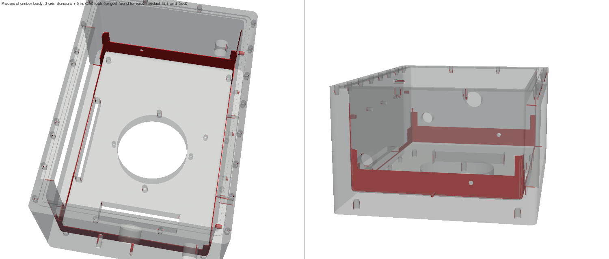
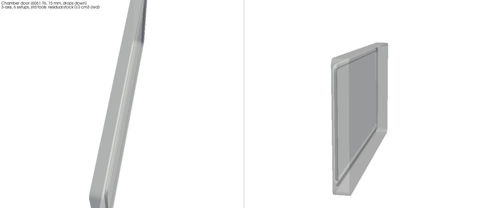
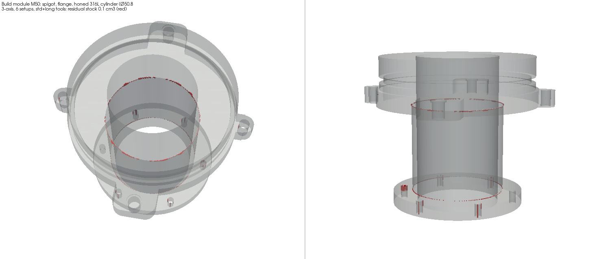

# Machining review: can BYU's shops make the machined parts? (issue #260, PR #266)

This is a review of the 37 machined parts in `cad/lpbf_low.py` (M50 module) by open-source CAM and scripted
design-for-machining (DFM) rules. It covers what BYU's shops list, what a 3-axis mill and a lathe can and cannot
reach, and the tools to buy. Nothing here has been quoted by a shop or checked by a machinist.

## Short answer

- **Most of it can be made at BYU.** Every machined part fits BYU's Haas mills in one setup, except the
  590 × 550 mm gas-module base plate, which needs one re-position or a waterjet outline. The largest milled part is
  the optics bridge (605 × 370 × 25 mm). The chamber body is cut from a 13 × 9.5 × 6 in. block. The Haas VF-4 in
  the ME Prototyping Lab (EB 117) travels 50 × 20 × 25 in., and Physics' VF-2SS travels 30 × 16 × 20 in. The Physical Facilities
  Manufacturing Shop (108 CTB) lists a CNC lathe with live tooling, TIG welding and wire EDM. It works by fee-paid
  work order and is open to all departments ([BYU shops](#byus-shops)).
- **Outsource the honing.** The Ø50.80 H7 bore (Ra ≤ 0.4 µm) has to be honed after the 316L module body is welded.
  No BYU shop lists a honing machine, and no Utah shop was found that advertises small-bore precision honing. The
  same goes for the S25 and L75 bores.
- **Two features cannot be machined as drawn. Change them before anyone writes a CAM program:**
  1. **The lid's cover-slide drawer slot** is an enclosed slot, 72 × 6 mm, running 146 mm in from the front edge. No
     straight tool reaches it, with standard or long tools: 11 cm³ stays uncut (red in
     [`cam_chamber_lid_std_long.png`](analysis/out/machining/cam_chamber_lid_std_long.png)). The fix is to mill it
     open from the lid's underside, as below.
  2. **Two of the recoater rail's M4 insert holes** in the inside face of the back wall sit at x = ±115/125 mm. That
     is outside the door opening (±110 mm), so no drill can be lined up on them from outside. Move them to
     |x| ≤ 100 mm or bolt the rail to a bar.
- **The 120 mm deep chamber pocket needs long tools or an extension holder.**
  - Standard-length end mills in an ER32 holder leave 29 cm³ in a band along the walls, because the holder hits the
    wall top.
  - The longest uncoated 3/4 and 1 in. carbide end mills found (5 in. overall) still leave 15.3 cm³: they don't
    reach the lowest ~30 mm of the walls.
  - The long set with 6 in. OAL tools (e.g. a 3/4 in. McMaster 8745A19, AlTiN, $307.93) gets it to 3.4 cm³.
  - A slim 32 mm extension holder with a 1/2 or 3/8 in. tool at 150 mm stick-out gets it to 0.9 cm³ (finishing
    cuts only).
  - What is left is the drawn corner and floor radii:
    - the R5 vertical corners would need a 3/8 in. tool at 12.6:1 length to diameter. Specify R ≥ 9.6 mm (3/4 in.
      tool) or R ≥ 12.7 mm (1 in. tool);
    - the R5 floor coves need a corner-radius tool with 120 mm reach.
- **Thin walls to fix:**
  - the lid-screw insert holes leave 1.2 mm to the O-ring gland and to the outer wall;
  - the heater block and the piston head have 0.4 mm webs;
  - the striker's counterbores break through;
  - the carriage-block bore leaves a 0.5 mm wall;
  - the lid's six M4 × 4 mm inserts for the window flange end 0.5 mm above the drawer slot. That leaves no room for
    the insert's prong or the tap's lead, and a crack there is a leak into the gas envelope.
- **Machine time, roughly:** 63 h of machine and setup time for one machine's 37 parts, plus about 30-40 h of CAM
  programming. That is at conservative removal rates (16 cm³/min in 6061, 3 cm³/min in 316L). An adaptive (HEM)
  roughing path on the VF-4 would probably cut the chamber's 10 h of roughing to 2-4 h (an estimate, not run).
  The chamber body alone is 15.5 h, because 78 % of its 12.1 L block becomes chips.
- **Tooling:** see [`tooling-bom.csv`](tooling-bom.csv) (115 lines).
  - **Buy for this job: $3,662**, plus two items not priced: metric STI plug gauges and the honing service.
  - Shop-standard tools, if a shop had none: $5,132 more.
  - Optional routes: $4,951, most of it a $3,769 roughness tester.
  - Prices are from McMaster-Carr and Lakeshore Carbide, fetched 2026-11-20 14:05-14:41 UTC.

## What was run

All scripts are in [`analysis/machining/`](analysis/machining/), and results and images are in
[`analysis/out/machining/`](analysis/out/machining/). The scripts used a frozen copy of `cad/` from 2026-11-20
13:53 UTC. The seal grooves another agent was adding at the time are not in it; they are covered by rule
[below](#features-from-the-seal-changes-not-in-the-model-copy-used).

| Step | Script | What it does | Run time |
|---|---|---|---|
| 1 | `inventory.py` | Builds the model with every joint hole cut. Classifies the parts as `render_build.py` does: 37 machined, 12 sheet, 86 bought, 28 fastener sets. Exports each machined part as B-rep and STL. | 14 s |
| 2 | `cam_ocl.py` | **OpenCAMLib 2023.1.11** (`BatchDropCutter`, `Waterline`; run in a Python 3.11 container because there is no wheel for 3.14). Drop-cutter grids, with a second drop for the tool holder, and waterline contours for the chamber body, lid, door and module body. | 62 s |
| 3 | `toolpaths.py` | Turns the OCL grids into zig-zag raster finishing paths and G-code (20-34 k moves per part, kept in `/tmp`). Draws them, and checks the stock-removal simulation against OCL. | 30 s |
| 4 | `cam_sim.py`, `per_setup.py` | Dexel/voxel 3-axis stock-removal simulation, described below. Also a setup count for all 37 parts, and the removal per setup. | 7 + 2 + 4 min |
| 5 | `residual_report.py` | Sorts the chamber's residual stock by cause. | 5 s |
| 6 | `dfm.py` | DFM rules on every B-rep: stock, holes, internal radii, sharp corners, webs, time. | 2 min |

How the simulation works:

- It voxelizes the part at 0.4-0.5 mm.
- For each of the six setup directions and each flat end mill (diameter, stick-out, holder diameter) it computes:
  - the part's height map from that side;
  - the cutter-location surface, as a grey dilation of the height map by the cutter disk;
  - a holder check: the tip can go no lower than the holder's own drop minus the stick-out;
  - the finished surface, as an erosion by the cutter disk, which is the swept volume of a dense raster.
- Everything above the finished surface is removable from that setup. Residual = stock − part − everything removable
  from any setup with any tool.
- The cutter-location surface matches OpenCAMLib's drop-cutter: median difference 0.0 mm for the chamber and −0.2 mm
  for the lid, and 97.5-100 % of points within one voxel ([`toolpaths.json`](analysis/out/machining/toolpaths.json)).

Two tool sets were run (sizes in `cam_sim.py`):
- **standard** (usually on hand): 1/16, 1/8, 1/4, 3/8, 1/2 and 3/4 in. at stocked lengths;
- **+long** (buy): 1 in. × 6 in., 3/4 × 6, 1/2 × 6, 3/8 × 4, 1/4 × 4 and a 1/8 in. long-reach.

Limits:
- flat end mills only (no ball or bull-nose), 3-axis only;
- no fixturing in the setup count;
- a voxel can't resolve features under ~2 voxels (Ø3.2 holes show as residual; they are drilled anyway);
- coaxial holes in opposite walls are merged into one long "hole" by `dfm.py` (Ø18 and Ø3.2 through both side walls
  of the chamber).

| OpenCAMLib toolpaths (blue raster, orange waterlines) | Residual stock, chamber body, standard vs long tools |
|---|---|
|  |   |

## Residual stock (what 3-axis milling can't reach)

| Part | Stock | Residual, standard tools | Residual, + long tools | Where, and what does it |
|---|---|---|---|---|
| Process chamber body (6061-T6) | 13 × 9.5 × 6 in. block, 12.15 L; part 2.73 L | **29.1 cm³** | **3.4 cm³** | Standard tools leave: - a band along the walls, z = 6-102 mm, 20.7 cm³: the holder hits the wall top, since the deepest standard stick-out is 63 mm and the pocket is 120 mm deep; - R5 vertical corners, 5.7 cm³. With long tools: - corners 0.7 cm³; - R5 floor coves 2.0 cm³ (a flat end mill cannot cut a cove); - the two rail insert holes in the back wall that sit outside the door opening's reach, 0.12 cm³ each (see above); - 8 mm³ slivers in the sharp corners of the door opening and the inlet slot (they take the radius of a 1/8 in. tool). Split by cause in [`residual_chamber.json`](analysis/out/machining/residual_chamber.json). |
| Chamber body, with the tool lengths actually found for sale ([`chamber_reach.py`](analysis/machining/chamber_reach.py)) | same | – | 15.3 cm³ with 5 in. OAL 3/4 and 1 in. tools; 0.9 cm³ adding a 32 mm extension holder (1/2 and 3/8 in. at 150 mm) | With 5 in. tools, a 12.3 cm³ band along the lowest ~30 mm of the walls stays uncut.  |
| Chamber lid (6061-T6, 16 mm) | 0.75 in. plate | **11.9 cm³** | **11.2 cm³** | The enclosed drawer slot. A 6 mm tall slot only admits a ≤ 1/8 in. tool from the front edge, and it is 146 mm deep.  |
| Chamber door (6061-T6, 15 mm) | 0.75 in. plate | 0 | 0 | As drawn (plain rectangular groove). The half-dovetail groove that replaces it is an undercut by definition, so it needs a dovetail cutter (below).  |
| M50 module body (316L weldment) | turned and welded | 0.25 cm³ | 0.06 cm³ | Slivers ≤ 0.8 mm thick at the tube-to-flange face (z = −30 mm). They come from the coincident faces of the fused weldment, and the post-weld boring removes them. The spigot's radial O-ring groove is reachable from the side, but it is turned on the lathe.  |

**Stock removal per setup** ([`per_setup.py`](analysis/machining/per_setup.py),
[`per_setup.json`](analysis/out/machining/per_setup.json); standard + long tools). "Only from this setup" is the
volume no other setup can reach, which is what makes the setup necessary.

| Part | Setup | Removable, cm³ | Only from this setup, cm³ | What needs it |
|---|---|---|---|---|
| Chamber body (9,424 cm³ of chips) | +Z (top) | 8,669 | 2,217 | pocket, lid gland, lid-screw inserts |
| | −Y (front) | 6,035 | 320 | door opening |
| | +Y (back) | 2,112 | 11.8 | inlet slot |
| | +X (right) | 2,244 | 9.4 | KF-25 port, side ports and bores |
| | −Z (floor) | 3,440 | 6.9 | inserts and dowels for the module, Z flange and legs |
| | −X (left) | 2,102 | 0.8 | recoater-screw bore |
| Lid (642 cm³) | −Y (front edge) | 468 | 34 | mouth of the drawer slot |
| | +Z / −Z | 390 / 389 | 10.2 / 9.1 | top-face inserts and counterbores / underside features |
| Door (249 cm³) | +Y (seal face) | 154 | 7.5 | O-ring groove |
| M50 module body | all | 988-1,248 | < 0.7 | everything is reachable from several sides; it is turned |

So the chamber body needs all six setups: the top, the floor and all four sides. Plan it as a block on
a fixture plate with a probe, not in a vise.

**Setups and undercuts for all 37 parts** come from the sweep in `cam_sim.json`: a greedy cover of every skin voxel
by the six directions, with a 1/8 in. tool of unlimited reach.
- 30 parts need 2 setups.
- These need more:
  - chamber body 5 with a thin tool of unlimited reach, 6 with real tools (table above);
  - build plate 5;
  - piston head 6;
  - camera adapter 5;
  - heater block, cover-slide drawer and module body 3-4.
- Skin that no direction reaches (undercuts and turned grooves):
  - build plate 20 %: bayonet lugs and gripper groove, so turn and groove it;
  - piston head 9 %: seal grooves;
  - camera adapter 9 %;
  - heater block 8 %: the bayonet socket's lug undercut, so an internal grooving tool on the lathe plus three milled entry slots;
  - gland plate 6 %;
  - the welded square-tube bridge posts 43 %: the closed inside of the tube, which is expected.

## DFM over every machined part

Full results are in [`dfm.json`](analysis/out/machining/dfm.json). Time = roughing at the MRR above + finishing 50 %
of the area at 40 cm²/min (6061) or 10 cm²/min (316L) + 0.3-2.5 min per hole + 20 min per setup (40 for the chamber
body).

| Part | Mat. | Stock (standard size) | Setups | Holes (from `joints.py`) | Smallest internal R / sharp internal edges | Thinnest web | Time, min |
|---|---|---|---|---|---|---|---|
| Process chamber body | 6061 | 13 × 9.5 × 6 in. block, 78 % removed | 6 | 35 STI (24 M5, 6 M6, 5 M4), Ø96, Ø25.4, Ø18 ×2, Ø6.4 ×2, Ø3.2 ×2 | R5 × 120 deep (3/8 in. at 12.6:1); sharp vertical corners in the outlet and overflow slots (162 mm of edge); door-opening and inlet-slot corners sharp | **1.18 mm** (M5 lid inserts to gland and outer wall) | 930 |
| Chamber lid | 6061 | 0.75 in. plate (5/8 in. if the 16 mm becomes 15.9) | 2 + slot | 20 × Ø5.5, 10 STI M4, Ø56, Ø22, 2 × Ø8 sensor ports | drawer slot unmachinable | 1.45 mm (M5 clearance holes to the edge) | 121 |
| Chamber door | 6061 | 0.75 in. plate | 2 | hinge and latch holes not drawn | R6 | – | 60 |
| Optics bridge | 6061 | 1.25 in. plate (1 in. if 25 → 25.4 mm) | 2 | 8 × M6 clearance, Ø80, Ø96 | – | – | 250 |
| Base plates (2) | MIC-6 | 0.75 in. (5/8 in. if 15 → 15.9 mm) | 2 | 8 × M8 tapped, 16 × M6 clearance + 4 cbore | R8 | 3.2 mm | 256 + 218 |
| M50 module body | 316L | weldment: Ø4 in. bar + 3/4 in. plate + tube + collar | 4 | Ø50.8 bore (hone), 6 × M4 tapped (collar), 2 × Ø6 dowel, 2 × captive-screw | – | 1.35 mm (flange tab holes to the edge) | 115 + honing |
| Gland plate | 316L | Ø3.375 in. bar | 2 | 6 × M4 clearance, 2 × M4 tapped, Ø15.98 rod bore | 2-114 grooves to add | 2.0 mm | 66 |
| Heater block | 6061 | Ø2.125 in. bar | 3 | 3 STI M3, 3 × Ø6.1 cartridge, 3 × Ø1.2 thermocouple (12.5 deep, 10.4:1) | sharp bayonet lug corners (38 mm of edge) | **0.4 mm** (Ø4.2 hole), 0.7-0.75 mm (TC and cartridge) | 72 |
| Piston head | 6061 | Ø2.125 in. bar | 6 | 3 × M8, 3 × Ø3.2, M5 cbore, Ø15.9 rod bore, M4 set screws | R1.7 × 11.5 (1/8 in. tool) | **0.4 mm** | 127 |
| Rod end | 316L | Ø1.625 in. bar | 2 | 3 × M3 tapped, Ø12.7, Ø5.6 × 29 (5.2:1) | – | 0.75 mm | 49 |
| Striker disc | 416 | Ø1.125 in. bar | 2 | 3 × M3 countersunk | – | **0.0 mm: the counterbores break out** | 44 |
| Recoater carriage block | 6061 | 1.75 in. plate | 2 | Ø24 bore | R2 | **0.53 mm** at the Ø24 bore | 49 |
| Camera adapter | 6061 | 1.75 in. plate | 5 | Ø22 | – | 1.2 mm | 108 |
| Overflow funnel block | 316L | 1 in. plate | 2 | Ø38 | sharp internal edges (228 mm) | 3.0 mm | 75 |
| 22 other parts | 6061 / Macor / 316L | plate or bar | 2 (build plate 5, drawer 3) | few | – | ≥ 1.0 mm (the Z-flange counterbores sit 1.0 mm from its edge) | 41-135 each |

### Holes and threads

- **Helical inserts (STI)**: 48 per machine (35 in the chamber body, 10 in the lid, 3 in the heater block). The McMaster
  91732A insert pages list these STI drills: M2.5 No. 37 (2.64 mm), M3 3.2 mm, M4 No. 19 (4.22 mm), M5 5.3 mm,
  M6 6.3 mm.
  - `joints.py` draws each insert hole at the insert's length plus a 1.5-3 mm tip at the screw size: M5 is 7.5 + 3.0 mm.
  - **Pronged inserts need room below for the prong and for the tap's lead.** For the 7.5 mm M5 insert, plan
    7.5 + ~2.5 mm (prong, about half a diameter) + 2 pitches = 11.6 mm. The model has 10.5 mm. Deepen the drill by
    about 1 mm, or use bottoming STI taps (the ones priced in the BOM are bottoming).
  - This is a rule of thumb; check it against the insert maker's chart.
- **Insert depth as drawn, against that rule:**

  | Inserts | Count | Drawn: insert + tip, mm | Needed (L + D/2 + 2P), mm |
  |---|---|---|---|
  | chamber top, M5 × 7.5 (lid screws) | 20 | 7.5 + 3.0 | 11.6 |
  | chamber floor, M5 × 7.5 (Z flange) | 4 | 7.5 + 1.5 | 11.6 |
  | chamber floor, M6 × 9 (legs) | 4 | 9.0 + 2.0 | 14.0 |
  | chamber floor, M6 × 12 (module flange) | 2 | 12.0 + 1.5 | 17.0 (the floor is 20 mm, so 3 mm left) |
  | back wall, M4 × 6 (rail) | 5 | 6.0 + 1.5 | 9.4 |
  | lid, M4 × 6 (metering base) | 4 | 6.0 + 3.0 | 9.4 |
  | lid, M4 × 4 (window flange) | 6 | 4.0 + 0.5 | 7.4: **no room above the drawer slot** |
  | heater block, M3 × 4.5 | 3 | 4.5 + 1.5 | 7.0 |

- **Tapped holes**: M3, M4, M6 and M8, all at or under 2.5 × D. The piston head's two radial M4 set-screw holes
  show as one 50 mm "hole" in `dfm.json` because they are coaxial. **Dowels**: 6 mm m6 pins → Ø6 H7, reamed.
- **Deep holes**: one Ø1.2 thermocouple hole is 12.5 mm deep (10.4:1). Peck it with a carbide micro-drill, or go
  to a Ø1.6 (1/16 in.) sheath. The Ø5.6 × 29 hole in the rod end (5.2:1) needs pecking.

### Features from the seal changes (not in the model copy used)

| Feature | Where | How it is cut | Tool (BOM) |
|---|---|---|---|
| 1.78 mm cord half-dovetail grooves, 1.32 deep × 2.3 wide (Parker; depth 1.27-1.37) | door and drawer faces | Rough with a 2 mm (or 1/16 in.) end mill, then one dovetail pass on one wall. An undercut, so a special tool. | dovetail O-ring cutter (G1), 2 mm end mill |
| 1.78 mm face grooves (2.3-2.6 wide) | dock slot, plenums, window flange, camera adapter, metering base, gland plate | 2 mm or 1/16 in. end mill, two passes; corners ≥ 1.2 mm radius | A |
| 3.53 mm lid face gland, 4.6 × 2.65 | chamber top face | 1/8 in. end mill, two passes (gland corners R4/R6 allow it) | A1 |
| 2-238 radial groove on the spigot OD, root Ø90.5 × 4.8 wide | module body, after welding | external grooving insert (3.1 mm), two plunges and a finish pass; same setup as the bore so it runs true to it | G2 |
| two 2-114 rod-gland grooves, Ø20.0 in a Ø15.93 throat (2.04 deep, ~3.6 wide) | 316L gland plate | Micro 100 internal grooving tool (min. hole 9.4 mm, 1.57 mm wide), three side-stepped plunges per groove | G3 + X4 holder |
| SAE J1926 O-ring-boss ports (in place of NPT) | chamber body and lid sensor and gas ports | port counterbore-and-step-drill set (cuts the spot face, thread relief and O-ring cone), then the straight-thread tap | H1-H4 |

### Tolerances and finishes the design needs

| Feature | Requirement | Source |
|---|---|---|
| O-ring glands (lid, door, window, drawer, gland plate) | depth and width ±0.05 mm; sealing face Ra ≤ 0.8 µm, flanks Ra ≤ 1.6 µm | `analysis/out/seals/seals.md` (Parker ORD 5700 checks at ±0.05 mm); `low-profile.md` materials table |
| Chamber top face (lid seal) | flat within 0.05 mm over 312 × 222 mm (suggested: ±0.05 on gland depth is already 6 % of the 0.88 mm squeeze) | inferred from the gland check |
| Module bore | Ø50.80 H7 (+0.030/0), Ra ≤ 0.4 µm, honed after welding; plate keeps a 0.15 mm cold gap | `cad/module_params.py`, `modules.md`, `build-sequence.md` |
| Spigot in the Ø96 port | 0.10 mm radial clearance (H7/g6 seized hot in the FEA): port Ø96.00 H7, spigot Ø95.80 ±0.02 (suggested); groove root Ø90.5 × 4.8 | `cad/module_params.py` (`SPIGOT_FIT`), `seals.md` §6 |
| Rod gland | 2 × 2-114 grooves Ø20.0, throat Ø15.93; polished seamless rod | `seals.md` §8 |
| Bayonet ramps | 0.4 mm rise over 40°; the disc springs work at ≤ 0.10 mm, so hold the ramp height to about ±0.02 mm (suggested) | `hot-swap.md` (ii) |
| Dowel holes | Ø6 H7 for m6 pins | `fasteners.csv` (93600A686) |
| Spigot OD and groove to the bore | concentric within ~0.05 mm (suggested; cut in one setup after welding) | – |

### Welding and honing (the M50 module body)

1. Turn the spigot from Ø4 in. 316L bar. Waterjet and turn the flange from 3/4 in. plate. Cut the cylinder from tube
   and the collar from plate or bar. Leave ≥ 0.5 mm on the bore diameter and on the spigot OD.
2. Tack the parts on a fixture with a copper or aluminium chill mandrel in the bore. TIG-weld the three circumferential
   seams with ER316L, short balanced passes, and an argon back-purge so the bore doesn't sugar. 316L shrinks at
   circumferential welds and pulls the bore in locally. That is why the bore is finished after welding, not before.
3. Optional stress relief: ME's Project Support Center lists heat-treat furnaces. Then, in one lathe setup on the
   tube's OD or a fixture:
   - face the spigot and flange;
   - turn the spigot OD and the radial groove;
   - bore to Ø50.80 −0.05.
4. Send it out for honing to H7 and Ra ≤ 0.4 µm. Check it with a bore gauge at three depths and two angles; the
   build plate's 0.15 mm cold gap is the margin.
5. Drill and tap the 6 × M4 collar holes and the flange's dowel and screw holes on the mill, located from the bore.

## BYU's shops

From public pages, fetched 2026-11-20 13:59-14:14 UTC.

| Shop | Who runs it | Published equipment |
|---|---|---|
| ME Prototyping Lab, EB 117 ([me.byu.edu/me-prototyping-lab](https://www.me.byu.edu/me-prototyping-lab); booking site [byuprojectslab.simplybook.me](https://byuprojectslab.simplybook.me/v2/)) | Students and faculty for class, club, capstone, research and personal projects. For CNC, a lab assistant programs the part from a STEP file and cuts it at a later appointment. | "DM1 and VF4 CNC mills"; manual mills; a collet lathe (< 1 in. stock), a Harrison lathe and a "Moriseiki or Kent" chuck lathe; waterjet; plasma table; CNC press brake; welding. **Haas VF-4: 50 × 20 × 25 in.** ([Haas](https://www.haascnc.com/machines/vertical-mills/vf-series/models/medium/vf-4.html)) |
| PF Manufacturing Shop, 108 CTB (formerly the PML; [pf.byu.edu](https://pf.byu.edu/transportation-and-manufacturing-services)) | Staff, fee-for-service by work order, open to all departments | "Multi-axis CNC mill"; "CNC lathe with live turret spindle capacity"; "Wire EDM"; GTAW, SMAW and GMAW welding, and laser micro-welding. No models or rates published. |
| MFGEN 101 CTB Machining Lab ([mfgen.byu.edu/101-lab-schedule](https://mfgen.byu.edu/101-lab-schedule)) | Manual machines only for students who took MFGEN 220 or ME EN 382; the TA or supervisor runs CNC, EDM, grinder and waterjet | lathes, mills, CNC, surface grinder, wire EDM, waterjet (fee), metal shear |
| MFGEN Foundry and Welding Lab, 140 CTB ([mfgen.byu.edu/weld-lab](https://mfgen.byu.edu/weld-lab)) | After a welding class or with proof of experience | SMAW, TIG and MIG |
| Physics & Astronomy shop ([news](https://physics.byu.edu/department/news/2020-08-new-mill-becomes-part-of-the-p-a-family)) | Department machinist; use by other departments not stated | **Haas VF-2SS** with 4th axis and probes, 30 × 16 × 20 in. ([Haas layout](https://haascnc.com/content/dam/haascnc/pdp_feed/mld/VF-2-2SS-2TR_MLD_11_2021.pdf)); Bridgeport knee mill |
| ME Project Support Center ([capstone.byu.edu](https://capstone.byu.edu/physical-prototyping-resources)) | Lends instruments | optical measuring microscopes, heat-treat furnaces |

- **Not found anywhere:** a honing machine, a CMM, a roughness tester, the waterjet makes, any welder model, any lathe
  swing, or machining rates.
- The page counting "three multi-axis CNC mills" is a
  [2019 Wayback copy](http://web.archive.org/web/20240811023217/https://pml.byu.edu/pml-research-support).
- Utah shops that list related work:
  - Wheeler Machinery (Salt Lake City): hydraulic-cylinder honing;
  - LACO Technologies (Salt Lake City): vacuum chambers, certified welders, helium leak test;
  - JawsTec (Lehi): stainless TIG on sheet.

Machine needs against these shops are in [`machines.csv`](machines.csv).

## Design changes that make it cheaper to machine

In order of payoff.

1. **Lid drawer slot (blocker).** Mill it from the lid's underside as an open pocket, 60 mm wide and 11 mm deep. Then
   widen its top 6 mm to 72 mm with a 1/4 in. keyseat (T-slot) cutter, which leaves 6 mm ledges for the drawer.
   - The 5 mm skin under the slot seals nothing: the drawer seals on the lid's front face, and the slot is already
     inside the gas envelope.
   - Or screw two 316 strips under an open slot.
   - As drawn it needs a 150 mm sinker-EDM electrode.
2. **Rail insert holes (blocker).** Keep every hole in the inside faces of the back and side walls within
   |x| ≤ 100 mm of the door opening, or mount the rail on a bar bolted through holes drilled from outside.
3. **Pocket corners and coves.** R5 × 120 mm deep needs a 3/8 in. tool at 12.6:1.
   - Use R ≥ 9.6 mm (3/4 in. × 6 in. end mill, 6.3:1, still a long-reach job) or R ≥ 12.7 mm (1 in., 4.7:1).
   - Make the floor coves match a stocked corner radius on a long tool (e.g. a 1/2 in. ball end, R6.35), or drop them.
   - The bigger saving is a **four-wall frame plus a bolted floor plate**. The pocket becomes a through-opening cut
     60 mm deep from each side with standard tools, the frame comes from 5 in. plate (120 mm walls), and the floor is
     a 20 mm plate. The cost is one more 3.53 mm face O-ring and 20 screws.
4. **Plates to stock thickness.** Make these dimensions match the plate as delivered, so only sealing faces are
   skimmed:
   - base plates 15 → 5/8 in. (15.9 mm) MIC-6, flat and ±0.13 mm thick as cast;
   - lid and door 16 / 15 → 5/8 in.;
   - optics bridge 25 → 1 in.

   That saves about 6 h of facing.
5. **Thin webs:**
   - lid inserts: use M4 inserts (OD 4.91 mm, 1.75 mm webs), or widen the wall by 3 mm;
   - heater block and piston head: ≥ 1.0 mm between holes;
   - striker counterbores: don't break out;
   - carriage-block bore: ≥ 1.5 mm wall;
   - module flange tabs: ≥ 2 mm past the holes.

   Drills wander (a rule of thumb is about 0.05 mm per 10 mm of depth), and inserts swell the wall when they go in.
6. **Window-flange screws in the lid.** Six M4 × 4 mm inserts on the Ø80 bolt circle end 0.5 mm above the drawer
   slot (0.7 mm web). Two fixes:
   - put the window flange's O-ring outside its bolt circle, so the screw holes sit inside the sealed area and a hole
     that cracks into the slot is harmless;
   - or space the holes unevenly so they miss the slot (|x| > 40 mm or y > 40 mm).
7. **Sharp internal corners** of the door opening (220 × 92 mm), the inlet slot (120 × 8) and the outlet and overflow
   slots: draw R ≥ 3.2 mm (1/4 in. tool), and give the mating plenums and funnel block the same radius.
8. **Half-dovetail grooves** are costly and tolerance-critical (`notes/2026-11-20-pain-points.md` P23). A plain
   rectangular groove with a moulded press-in seal avoids the dovetail cutter and its extra passes.
9. **Heater-block thermocouple holes:** Ø1.6 instead of Ø1.2 brings the depth ratio from 10.4:1 to 7.8:1
   (12.5 mm deep).

## Tooling

[`tooling-bom.csv`](tooling-bom.csv) lists one real product per tool, with vendor, part number, URL, price and fetch
time. Each row is flagged "usually on hand in a prototyping shop" or "buy for this job" and says which parts need it.

| Flag | Lines priced | Cost if bought |
|---|---|---|
| buy for this job | 41 (+ 2 unpriced) | **$3,661.88** |
| usually on hand in a prototyping shop | 48 | $5,132.39 |
| optional (only if that route is chosen) | 8 with a quantity (12 more listed at quantity 0) | $4,950.78 |

The biggest "buy" lines:
- SAE J1926 -4 port counterbore and step drill: $475.96;
- dial bore gauge 35-60 mm: $436.04;
- metric go/no-go thread plug gauges: $420.73 for M3, M4 and M6;
- 3/4 in. × 6 in. OAL end mill: $307.93;
- internal grooving tool and its quick-change holder: $353.19;
- CNMG inserts for 316L: $223.24;
- two dovetail O-ring cutters: $177.46;
- STI taps, drills and insert tools: $263.96 in all.

What the run found about the tools:
- **McMaster's STI taps are straight-flute only.** The BOM uses bottoming taps.
- **The installation tools also break off the prongs**, so the separate punches are optional.
- **No metric STI plug gauge is on McMaster** (inch only); it needs a gauge maker.
- **No 6 in. OAL uncoated 3/4 or 1 in. end mill was found.** McMaster's are AlTiN steel grades.
- **The widest Micro 100 internal groover is 1.57 mm**, so each 3.6 mm rod-gland groove takes three plunges.
- **The 1-1/4 in. boring bar reaches 127 mm**, which is enough for the M50 bore (about 90 mm).
- **Argon purge plugs or dams** for the module seams weren't priced; buy them from a welding supplier.

## Not checked

- Fixturing (how the chamber block is held for the ±X and ±Y setups).
- Chatter and deflection of the long tools.
- Thread-mill options.
- Ball and bull-nose tools in the simulation.
- The S25 and L75 modules (same features, other bore sizes).
- The hinges, latches and plenum screws, which `joints.py` doesn't draw yet.
- Any shop's real rates or queue.

Programming time and the removal rates are planning assumptions, not measurements.
