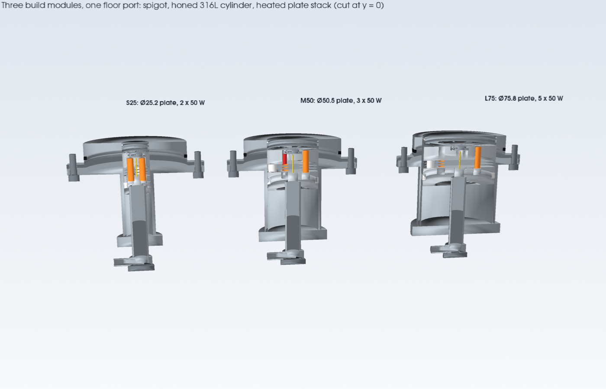
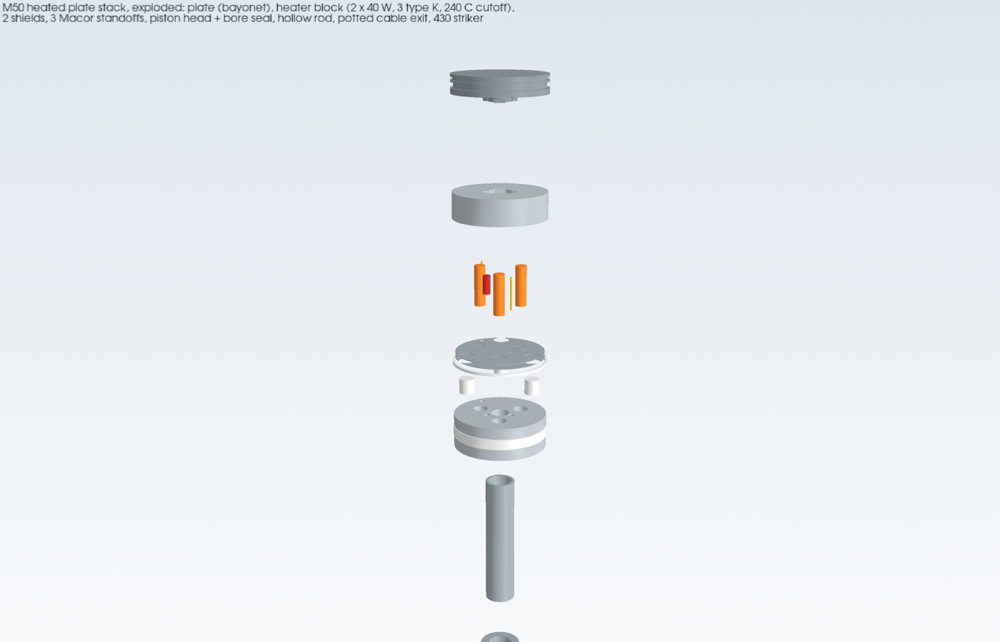
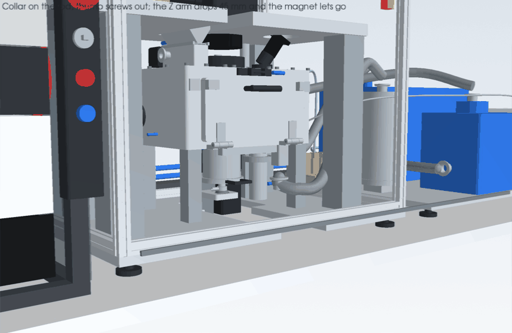
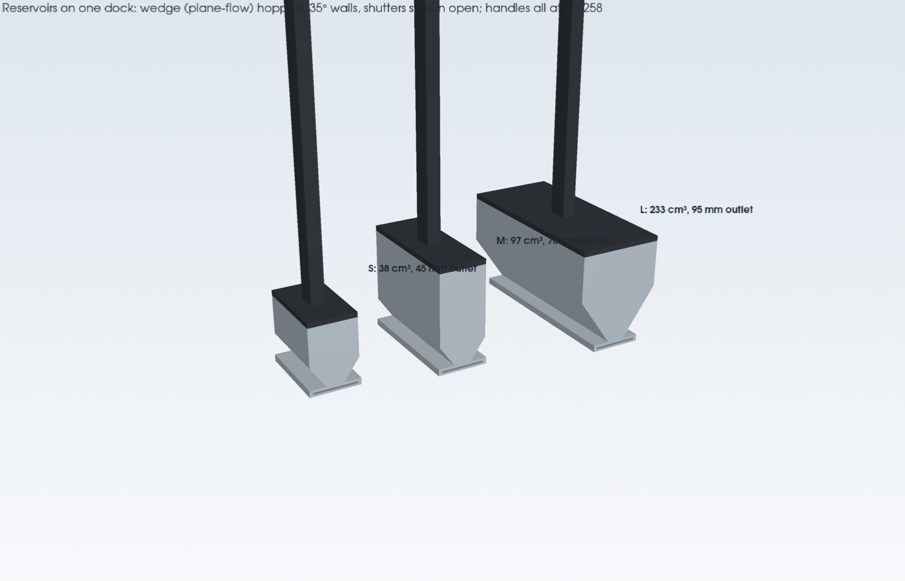
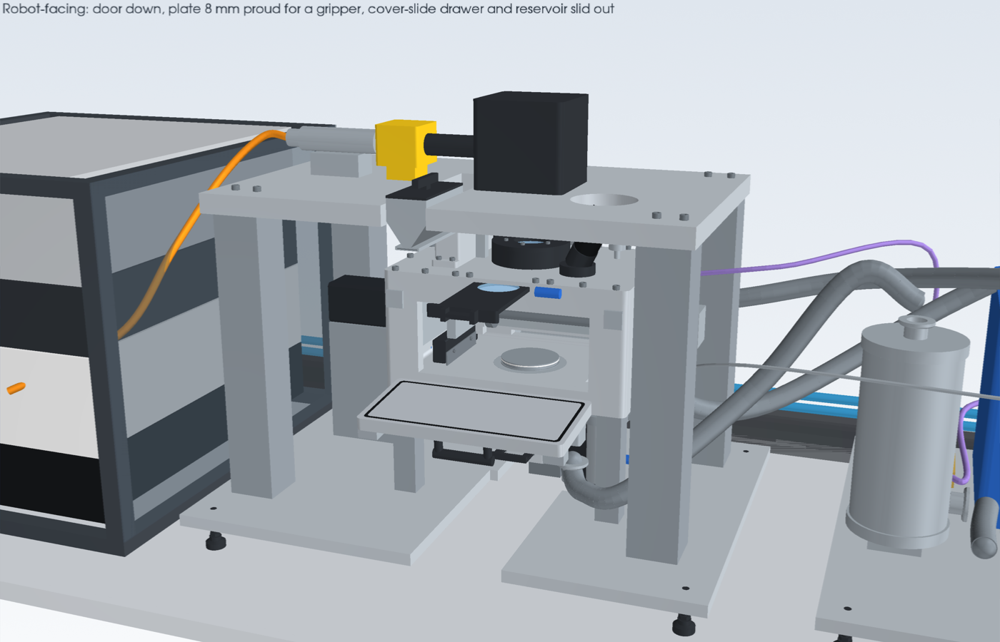
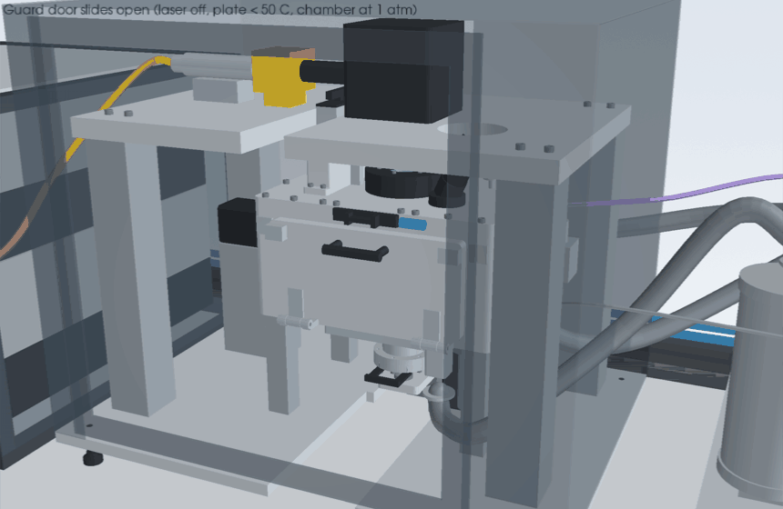

# Heated plate, swappable plates and hoppers, automation: as built in the low-profile model

Written 2026-11-17 for [PR #266](https://github.com/vertical-cloud-lab/digital-alloy-lab/pull/266) (issue #260), in answer to:
"implement these thoroughly and completely ... heated build plate; ability to swap out build plate sizes; ability to use
different hopper sizes; automation-friendliness (e.g., cleaning of chamber, removal of build plate)".
[`requirements-later.md`](requirements-later.md) set out what each needs. This note is what went into the low-profile model
[`cad/lpbf_low.py`](cad/lpbf_low.py), how it was checked, and the real parts behind it.

Nothing here has been built, quoted or reviewed by BYU's LSO or EHS. Prices are list prices read on vendor pages through
the lab Pi on 2026-11-17; machining is not priced.

| File | What it is |
|---|---|
| [`cad/module_params.py`](cad/module_params.py) | every number for the modules, reservoirs and interlocks; the CAD and the thermal FEA both read it |
| [`cad/modules_low.py`](cad/modules_low.py) | geometry: build module and heater stack, Z stage and coupling, reservoirs |
| [`cad/lpbf_low.py`](cad/lpbf_low.py) | the machine: `build(module="S25" / "M50" / "L75", reservoir="S" / "M" / "L")` |
| [`cad/render_modules.py`](cad/render_modules.py) | the stills and GIFs in [`cad/img/modules/`](cad/img/modules/) |
| [`analysis/thermal_module.py`](analysis/thermal_module.py) | CalculiX thermal FEA of each module → [`analysis/out/thermal/thermal.md`](analysis/out/thermal/thermal.md) |
| [`analysis/interference.py`](analysis/interference.py) | exact interference sweeps, now per variant → [`out/interference.md`](analysis/out/interference.md) (M50) and [`out/variants/`](analysis/out/variants/) |
| [`options-mcmaster.csv`](options-mcmaster.csv), [`options-vendors.csv`](options-vendors.csv) | 28 McMaster-Carr and 27 other-vendor parts, each read live from its own page (price, sold-as, key specs, URL, time) |

| Requirement | What the model has now |
|---|---|
| Heated build plate | a heater stack on every piston: plate on a bayonet, 6061 heater block with 24 V cartridges, three type K thermocouples and a 240 °C thermal cutoff, three Macor standoffs and two 316 shields, the bore seal on the cool piston head, a hollow rod that carries the leads out. Sized by FEA for 200 °C, 500 °C reserved |
| Swappable plate sizes | three build modules, Ø25 / Ø50 / Ø75, in one Ø96 floor port, coupled to the Z arm by a pot magnet. Blade, dose line, cross-flow and overflow are sized for Ø75 |
| Swappable hoppers | a fixed metering base; S / M / L reservoirs (38 / 97 / 233 cm³) on one dovetail dock, each with a shutter and an NFC tag; a load cell for inventory; a blanked side port for ≥ 500 cm³ |
| Automation-friendliness | the plate rises 8 mm proud for a gripper and a through-beam confirms it; cover-slide drawer; lift-out wall liners; 5 mm corners and floor coves; sensors that confirm each step; a module-swap path that the sweeps check |

## 1. Heated build plate

**The stack, top down** (plate top at z_p, 50 mm from the plate top to the piston-head bottom):

| Layer | Thickness | Material and parts |
|---|---|---|
| Build plate | 10 mm | 6061-T6, or 5083-H321 where it is held at 200 °C (see [`low-profile.md`](low-profile.md) §3). A Ø12 bayonet spigot with three lugs underneath; a 3 × 1.5 mm gripper groove around the rim |
| Heater block | 14 mm | 6061-T6 with the bayonet socket. **24 V, 50 W, Ø6 × 22 mm cartridges** (McMaster 3714N36, $30.14) in vertical holes from below: 2 / 3 / 5 in S25 / M50 / L75. **Three type K thermocouples**: control at the centre, edge, and an independent limit (McMaster 3871K606: ungrounded, 0.04 in. 316 sheath, 1,290 °F; $148.67). **Thermal cutoff** 240 °C in series with the heaters (Cantherm RT240, $1.06) |
| Thermal break | 8 mm | three Macor standoffs Ø8 (Ø5 in S25) cut from McMaster 8489K75 rod ($68.59, rated 1,470 °F), and two 0.005 in. polished 316 shields (McMaster 2317K275) in the argon gap |
| Piston head | 18 mm | 6061-T6 (Tier A) or 316L with a water channel (Tier B). Carries the bore seal (aramid felt + carbon-filled PTFE scraper) on the **cool** side, and pockets under the heaters for their leads |
| Hollow rod | 77 mm | 5/8 in. × 0.065 in. 316 tube (McMaster 11119N35; welded, so polish it for the O-ring gland). Inert inside: the leads run down it to a potted cable exit (Torr Seal) at the rod end, beside a 416 stainless striker |

**What the thermal FEA found** ([`thermal.md`](analysis/out/thermal/thermal.md): axisymmetric CalculiX, CAX8, 1 mm mesh, power within 0.6 % of a
0.5 mm mesh, energy balance closed to 0.03 %):
- **Where the heat goes.** 76–89 % of the heater power leaves through the plate's and block's radial gaps into the bore wall, and on
  through the spigot into the chamber floor. The plate top takes 6–18 %, the break only 5–6 %. That confirms the lumped estimate's
  conclusion, but the FEA losses are about twice as large (47 / 90 / 135 W against 24 / 49 / 76 W), because a 0.1 mm argon gap
  conducts far better than the lumped model allowed.
- **Finding 1: the first heater counts were too small.** With 1 × 40 W (S25) and 2 × 40 W (M50) the plate never reaches 200 °C
  (it levels at 179 and 182 °C). The worst steady loss at 200 °C is 47 / 90 / 135 W, so each module now carries ≥ 1.5× that in
  50 W cartridges: **2 / 3 / 5 × 50 W = 100 / 150 / 250 W**.
- **Finding 2: a 0.10 mm cold clearance seizes.** At the start of a build the 200 °C plate sits inside the spigot, which stays near
  45–55 °C. The Al plate grows far more than the stainless bore: hot clearance was +5 µm on Ø50 and **−36 µm on Ø75**. Plates are
  now **0.10 / 0.15 / 0.20 mm radial clearance cold** (S25 / M50 / L75), which leaves about 0.05 mm when hot, inside the
  0.05–0.15 mm containment range Edison gave. A larger gap also cuts the heater power (M50: 90 W at 0.10 mm, 68 W at 0.20 mm).
- **Finding 3: an unlimited heat-up overshoots.** Driving the installed power until the plate reaches 200 °C takes the block to
  325–364 °C, above the 240 °C cutoff and above some heaters' ratings. The control has to cap the block: a PID on the plate's
  control thermocouple whose output is limited by a block-temperature ceiling of ~225 °C. Heat-up then takes longer than the
  FEA's 2–5 min (not yet modelled with the cap).
- **Seals and magnet are inside their limits:** bore seal ≤ 123 °C (aramid/PTFE: 204 °C), spigot O-ring ≤ 54 °C, rod-gland
  O-rings ≤ 118 °C (FKM: 200 °C), coupling face ≤ 68 °C. The last is close to the 79 °C rating of the McMaster pot magnet
  (5679K95), with only 10 W/m²K at the rod end in the model; **use a samarium-cobalt pot magnet** (not priced) or a G10 washer under
  the striker.
- **Cool-down to 50 °C for the door interlock:** 15 / 26 / 36 min from the end of a build, heaters off.
- **Heat into the chamber:** up to 130 W (L75 at the start of a build), so a long build warms the chamber. With the floor edge at
  60 °C the heater power drops by ~17 %.
- **Tier B (500 °C, reserved):** M50 needs 243 W with a water-cooled 316L head and flange; the seals stay ≤ 162 °C. A 0.2 mm cold
  clearance closes to −65 µm, so Tier B plates need ≥ 0.3 mm. High-temperature cartridges for it: McMaster 3618K422 (120 V,
  1/4 × 1-1/2 in., 100 W, 1,400 °F, $95.22). Coolant flow interlock: AutomationDirect FSD75-AP-6H ($228).

The FEA above was run on the first heater counts and 0.10 mm gaps (that run is what found findings 1 and 2).
Re-run `python desktop-lpbf/analysis/thermal_module.py` for the final values in `module_params.py`.

**Control and interlocks:**
- 24 V heater supply Mean Well LRS-350-24 ($34.81), switched by a Crydom D1D12 DC solid-state relay ($85.22; 12 A, and L75 draws
  10.4 A, so give it a heat sink or use the 20 A D1D20). PID in the supervisor through the MAX31856 boards already in BOM line C5.
- **Independent over-temperature limit:** DwyerOmega CN708 ($204.60; type K, 16 A relay, manual reset) on each module's limit
  thermocouple, opening the heater supply. The 240 °C thermal cutoff in the block is the last line.
- **Door interlock:** the guard lock stays locked while the plate is above 50 °C, as well as while lasing or off atmosphere. The
  supervisor holds it from the control thermocouple. A second, hardware channel needs a second relay: the two-relay CNI32-AL-DC
  ($442.57) lists a 56-week lead time; a bimetal 50 °C thermostat (Sensata-Airpax 67F series; DigiKey lists the 67F050, normally
  open, $8.33) is the cheap route, in its normally closed version so that a broken wire keeps the door locked.
- The heater runs only when O₂ is below the set point under argon.
- Preheat temperature and time-at-temperature go into the dataset as recipe variables (requirements-later.md §1).

## 2. Swappable build-plate sizes: build modules

| Module | Bore (honed) | Plate, cold clearance | Cylinder blank (McMaster) | Heaters | Steady at 200 °C (FEA) | Powder, 15 mm build | Reservoir |
|---|---|---|---|---|---|---|---|
| S25 | 25.4 | Ø25.2, 0.10 mm | 89495K18, 1-1/4 × 0.188 in. 316, $66.07 / 6 in. | 2 × 50 W | 31–47 W | 18 g (12 cm³) | S, 38 cm³ |
| M50 | 50.8 | Ø50.5, 0.15 mm | 11119N55, 2-1/4 × 1/4 in. 316, $144.98 / ft | 3 × 50 W | 59–90 W | 72 g (49 cm³) | M, 97 cm³ (L for > 29 mm) |
| L75 | 76.2 | Ø75.8, 0.20 mm | 89495K4, 3-1/2 × 3/8 in. 316 (turn OD to 82.6), $188.68 / 6 in. | 5 × 50 W | 86–135 W | 163 g (111 cm³) | L, 233 cm³ |

Powder at 30 µm layers, 1.8 dose factor, AlSi10Mg, as in `requirements_budgets.py`. Every blank is bored and honed to H7 with a 3 mm wall.

**One port, one coupling:**
- **Floor port Ø96.** Each module's spigot (turned from a 4 in. 316 bar, McMaster 9260K5, $266.77 for 5 in.) fills it flush with
  the floor and seals with a radial FKM O-ring, **2-238** (groove Ø90.2; ID 88.5 mm, 2 % stretch). The O-ring row in
  `options-mcmaster.csv` is the 2-240 (9464K367), one size too large; swap it for 2-238 in the same FKM family.
- **Flange and screws.** A Ø100 flange with two tabs (cut from 316 plate: the 4 in. bar is too small for it) pulls up against the
  floor's underside with two captive M6 knurled screws (McMaster 95966A705, 18-8) into stainless helical inserts (91732A782).
- **Z coupling.** The hollow rod ends in a 416 stainless striker that sits on a pot magnet in the Z arm (McMaster 5679K95: Ø25 × 7 mm,
  44 lbf). The bore centres the piston and the magnet only has to pull it down, so it works as a floating joint with no backlash in
  the pull direction. MuJoCo puts the piston's holding force at 3.4 N against a 196 N magnet.
- **Bottom flange** carries a double FKM O-ring rod gland (2-114, McMaster 9464K982) and a front handle.

**Layout changes this forced** (all checked by the sweeps):
- **The chamber is 40 mm deeper (190 mm inside).** A ±50 mm dose line for Ø75 ran into the recoater carriage, nut and screw on the
  back wall. The chamber is now ~6.4 L instead of 5.0 L.
- **The blade holder is 18 × 31 mm (was 18 × 19).** The Ø75 blade is 104 mm long, so the holder cantilevers ~106 mm instead of
  66 mm. Deflection goes as L³/h³, so the deeper holder keeps the tip near the 3.4 µm the earlier FEA found. The dose chute now ends
  37 mm above the floor so the holder passes under it. The recoater FEA (case 4 in `analysis/fea/fea.py`) has not been re-run on
  this holder.
- **Cross-flow.** The inlet slot is 120 × 8 mm and the outlet slot 124 × 8 mm. The outlet plenum is now flat (16 mm) where the module
  passes under it, with a deeper boot at the right end for the KF-25 port. At 2 m/s the blower must move ~115 L/min for Ø75
  (requirements-later.md §2).
- **Overflow** moved to x = 90–110 mm, a 104 mm slot over a KF-40 jar with a 90 mm half nipple (~120 cm³).
- **Z stage.** It hangs lower: the heated stack plus the rod's travel (−42 to +8 mm) put the arm 181 mm below the powder plane at
  the bottom of a build. The process module's base plate gets a window for the arm, actuator and folded servo, and a slot to the
  front edge for the module's rod end. **The machine is still 564 mm tall.**

**Swapping a module** (by hand, between campaigns, with the chamber at atmosphere):

1. Plate out (§4), piston to z_p = 0, a clamp-on collar (McMaster 6435K35) on the rod under the bottom flange.
2. Undo the two thumb screws. The Z arm drops 45 mm: the magnet lets go, because the collar holds the piston.
3. Lower the module 40 mm so the spigot clears the port and passes under the outlet plenum, slide it 170 mm forward, raise it
   18 mm under the door hinges, 20 mm further forward, 12 mm more, and out over the guard sill. Unplug its M12 power and type K plugs.

The interference sweep runs this whole path (400 mm) for every module; it is clear. Keeping a build inert during a swap
(requirements-later.md §4, route 2) is not supported: the module leaves through the floor, so the port opens to air.

## 3. Swappable hoppers: metering base + reservoirs

- **Metering base (fixed):** a 6061 block on the lid with a fluted roller along Y over the full 100 mm dose line, its own PTFE
  V-ring shaft seal and NEMA 17 stepper. The dovetail dock, the NFC antenna and the docked sensor are on top.
- **Reservoirs:** 304 stainless wedge (plane-flow) hoppers with 35° walls over an 8 mm slot, from 0.036 in. sheet (McMaster 8983K56).
  The outlet slot sets the dose length for the module it serves: 45 / 70 / 95 mm. Every reservoir slides out to the front on the same
  dovetail, and every handle sits at z = 258 mm, so one gripper pose fits all three.

| Reservoir | Inside (x × y × z, mm) | Volume | Outlet | Covers |
|---|---|---|---|---|
| S | 26 × 46 × 36 | 38 cm³ | 45 mm | the full 40 mm stroke on Ø25 (33 cm³) |
| M | 26 × 72 × 56 | 97 cm³ | 70 mm | 29 mm on Ø50 |
| L | 48 × 110 × 56 | 233 cm³ | 95 mm | 32 mm on Ø75, or 71 mm (the full stroke) on Ø50 |

- **Shutter:** a spring-closed slide under the slot (McMaster 8969T3 316 springs), opened by a cam on the dock as the reservoir slides
  home, so a reservoir comes off full without spilling. Ball-plunger detents (85015A47) locate it.
- **Identity:** an on-metal NTAG213 tag on each reservoir (atlasRFIDstore 3001300, $2.30) carries alloy, lot and tare, read by a
  PN532 reader in the dock face (Adafruit 364, $39.95). An industrial alternative is the ifm DTI410 head (price on quote).
- **Weighing:** a 3 kg single-point load cell under the dock rails (Laumas ALLUE3, AutomationDirect, $122) on a NAU7802 24-bit ADC
  (SparkFun SEN-15242, $5.95), for inventory and a short-feed alarm. It cannot resolve one 0.04–0.33 g dose; as in requirements-later.md
  §3, dose mass is calibrated against roller turns for each powder, and the overflow jar is weighed after each build to close the
  mass balance.
- **≥ 500 cm³:** a blanked KF-16 port on the metering base's side is kept for a reservoir beside the chamber with an auger. Not modelled
  further. Under the beam tube there is no height for a taller reservoir.

## 4. Automation-friendliness

**Taking the plate out (route 1 of requirements-later.md §4):**
1. At the end of a build, the recoater sweeps loose powder into the overflow. Wait for the plate to cool below 50 °C (§1: 15–36 min).
2. Vent to atmosphere; the guard lock releases only now. The guard door slides open and the chamber door drops down.
3. The piston rises 8 mm above the floor (the axis now runs −42 to +8 mm). A heat-resistant through-beam across the bore at z = +5 mm
   confirms the plate is up: Omron E32-T61-S fibres (rated 350 °C, $547.09) and an E3NX-FA41 amplifier ($353.03).
4. A gripper takes the plate by its rim groove and turns it 60° to free the bayonet, then lifts it out. A new plate goes in the
   reverse way. The plate locates on the block's flat face and spigot, so a swap needs no re-levelling. After a swap, the layer
   camera or a touch-off confirms the plate height.

**Cleaning the chamber:**
- Internal corners are 5 mm, with 5 mm coves where the walls meet the floor. The blade path (|y| ≤ 52 mm) stays flat.
- **Lift-out liners** of 0.5 mm 316L (McMaster 2317K278) on the back and side walls take the condensate. They come out through the
  door and are washed. Each liner goes with an alloy family, like the lab's funnels and sieves.
- **Cover-slide drawer.** The cover slide sits in a drawer that pulls out of the lid's front edge, with an FKM O-ring on its front
  plate, so it is changed without lifting the lid (at atmosphere only). The slides are Ø2 in. × 3 mm fused silica (Edmund 25-250,
  $105 each at 6–25); an AR-coated 1 mm version is $315 (Edmund 11-742).
- **Vacuum.** McMaster sells one vacuum rated for metal dust: 5572N116 ($3,189.78; NEC Class II Div 1 and 2, Groups E, F, G; NFPA 484).
  It is a dry HEPA unit and needs 35 scfm of compressed air. A wet immersion separator is the safer choice for Al condensate
  (Ruwac MX200 series, recommended for aluminium; price on quote). Never compressed air (low-profile.md §3).

**Sensors that confirm every step**, so a supervisor, CubOS or a robot can drive the sequence and refuse a step that hasn't been confirmed:

| Step | Sensor | Part |
|---|---|---|
| plate up at the exchange height | fibre through-beam across the bore | Omron E32-T61-S + E3NX-FA41 |
| plate temperature (control, edge, limit) | 3 type K per module | McMaster 3871K606 → MAX31856 (C5) and CN708 |
| module seated | inductive, under the floor, sees the module flange | AutomationDirect PAM-AP-1H (M12, PNP), $12.50 |
| overflow jar present | inductive beside the jar | PAM-AP-1H |
| cover-slide drawer closed | inductive on the lid's front face | PAM-AP-1H |
| reservoir docked | inductive at the back of the dock | PAM-AP-1H |
| reservoir identity and fill | NFC tag + reader; load cell | NTAG213 + PN532; Laumas ALLUE3 + NAU7802 |
| O₂, pressure, door lock | as before (README §3.6–3.7) | |

## 5. Checks

- **Interference, exact B-rep** ([`interference.md`](analysis/out/interference.md), [`variants/`](analysis/out/variants/)): 141 parts per variant,
  M50/M, L75/L and S25/S. Five states (closed; recoater at the end with the piston at its bottom stop; plate exchange with the doors
  open and the plate up 8 mm; doors open with the reservoir and drawer out; module dropped with the arm released) and 25-step sweeps of
  8 motion groups: recoater, piston (−42 to +8 mm), chamber door, guard door, reservoir, drawer, Z-arm release and the whole module
  path. **0 interferences in every state and sweep, for all three variants.** Getting there found and fixed: the dose chute and the
  recoater drive (chamber made deeper), the arm and the longer blade, the holder and the chute, the stepper and the lid screws, the
  rail and the new corner fillets, the reservoir lid, the module path against the outlet plenum and the overflow clamp, and the module's
  handle against the guard sill.
- **MuJoCo** ([`mujoco.md`](analysis/out/mujoco.md)): the new drawer and Z-arm joints sweep clear. The piston carries 0.34 kg and needs
  4.2 N peak; the Z arm 3.7 N. MuJoCo moves each group on its own joint, so in the piston sweep the arm does not follow the rod and
  the contact it reports at −42 mm is not real; the exact check, which moves them together, is clear.
- **Mass** ([`mass.md`](analysis/out/mass.md)): 264 kg on the tray (was 254), process module 81.5 kg, tips at 0.73 g.
- **Thermal FEA:** §1.

## 6. Parts and money

Fetched prices for one machine with all three modules and reservoirs (the CSVs list every part, alternative and caveat):

| Line | What | Fetched parts |
|---|---|---|
| H1 | heater stacks: 10 cartridges, 9 thermocouples and plugs, Macor, shims, cutoffs, M12 power connectors | ~$2,190 |
| H2 | heater supply, DC SSR, limit controller | $325 |
| B1 | module cylinders, spigot bar, hollow rods | $693, plus plate for the flanges, welding and honing |
| B2 | O-rings, captive screws, inserts, pot magnet, striker, collars | $163 |
| R1 | reservoir sheet, detents, shutter springs | $73, plus fabrication |
| A1 | proximity sensors, fibre through-beam, NFC, load cell and ADC | $1,132 |
| A2 | liner sheet, six cover slides, metal-dust vacuum | $3,857 (the vacuum is $3,190) |

About $8,400 in parts, before machining and before Tier B. [`bom.csv`](bom.csv) carries these as lines H1–A2.

## 7. Open items

- **Re-run the thermal FEA** on the final heater counts and clearances, and add the block-capped heat-up.
- **Heaters.** McMaster's 24 V cartridge (3714N36) lists no temperature rating and has PTFE in its lead insulation; Slice
  Engineering's 50 W lists 250 °C. With the block near 210–240 °C, prefer a 400 °C-rated cartridge (E3D lists one, priced in GBP), or
  Tier B's 120 V cartridges.
- **Thermocouples cost $149 each at McMaster.** Probes from a thermocouple vendor are likely cheaper; not fetched.
- **Thermal cutoff and SSR:** the Cantherm RT240 lists only an AC rating; check its DC breaking rating at 24 V / 10 A.
- **Pot magnet:** SmCo instead of NdFeB (§1).
- **Recoater holder:** re-run the FEA's case 4 on the 18 × 31 holder.
- **Hardware door-lock channel** for "plate above 50 °C" (§1).
- **Inert module swap** (route 2) is not possible through the floor; if it is needed, the chamber door would have to dock to the
  glovebox (route 3).
