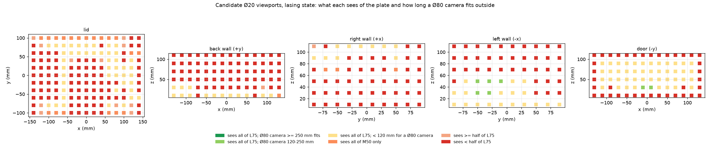
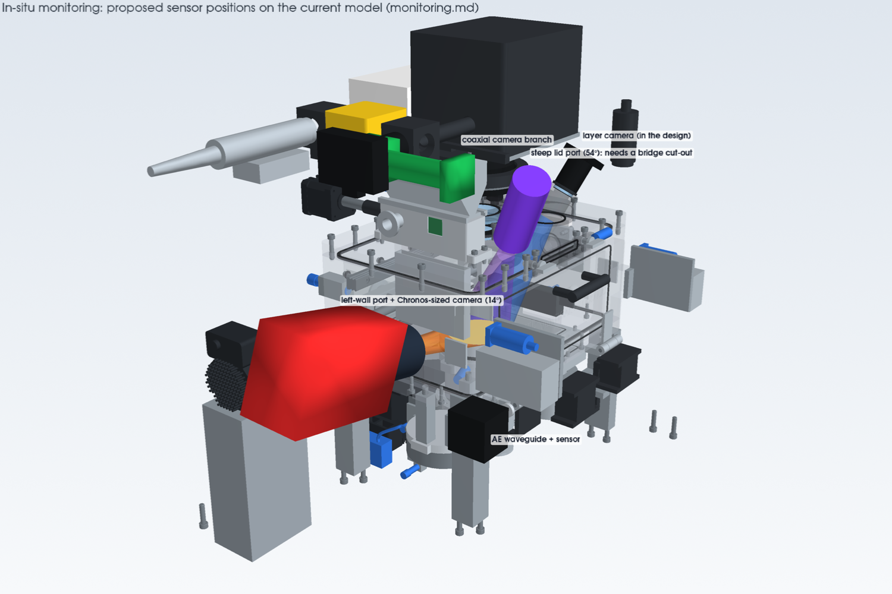
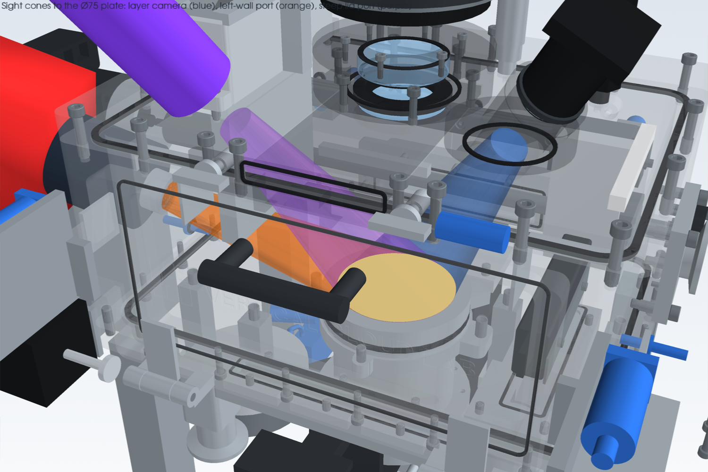

# In-situ monitoring: what the design has, and what to add (2026-11-25)

Sterling asked on 2026-11-25 whether a camera view of the chamber is already built in. The lab wants to record what happens in
the chamber as fully as possible (high resolution, frame rate and zoom), collect extensive metadata, and perhaps add an optical
pyrometer or other methods, especially for powder spreading, the melt pool, and when cracking happens during solidification.

This note answers from the model as it stands (`cad/lpbf_low.py`, 2026-11-25) and from the literature. Nothing here is bought,
drawn into the model or reviewed by BYU's Laser Safety Officer. The numbers come from new scripts:
- [`analysis/optics/monitoring_views.py`](analysis/optics/monitoring_views.py) checks 453 candidate viewports on the lid, walls and
  door against every part of the model, and checks room for each proposed instrument
  ([`views.md`](analysis/out/monitoring/views.md), [`fits.json`](analysis/out/monitoring/fits.json));
- [`analysis/optics/monitoring_optics.py`](analysis/optics/monitoring_optics.py) works out resolution, field, depth of field,
  temperature floors and data rates ([`optics.md`](analysis/out/monitoring/optics.md)).
- [`analysis/optics/render_monitoring.py`](analysis/optics/render_monitoring.py) draws the proposed sensors on the model (§3).

Edison's review of the same questions is in [`edison/monitoring-in-situ/`](edison/monitoring-in-situ/answer.md) (§8).

## 0. Short answer

**Yes, two views are already in the design, but neither is high-speed, high-zoom or thermal, and nothing listens for cracks.**

1. **The layer camera** ([`optics.md`](optics.md) §4.6, §8.5): a Raspberry Pi HQ camera (12.3 MP) with a 12 mm lens, looking
   through a Ø1 in. window in the lid, 33° off vertical. It sees the whole plate at 25–31 µm per pixel and takes stills after
   each spread and after lasing. Its lens at f/4 resolves only ~46 µm, so open it to f/2–2.8 (the planned 2.2° Scheimpflug wedge
   keeps the plate in focus). The same camera can film every build as a "dashcam": 40 fps at ~50 µm per pixel over the plate
   (2028 × 1520), or 120 fps over a ~66 × 49 mm crop (1332 × 990), per Raspberry Pi's camera documentation.
2. **The coaxial photodiode** (§4.5, §8.4): a Thorlabs PDA36A2 behind the dichroic that folds the beam into the galvo. It looks
   back down the beam, so it always sees the melt pool, but gives one brightness number per sample (≥ 100 kHz). The electrical I/O
   list hasn't settled what records it ("RTC6 analog in / DAQ").

**You can't get high resolution, high frame rate and high zoom in one camera, so plan three views and a listener:**

| What you want to see | What shows it | Where it fits (checked on the model) | Rough cost |
|---|---|---|---|
| Spreading, layer by layer | the layer camera, run at f/2–2.8 with two raking lights; later a 20 MP sensor (17 µm/px over the whole Ø75 plate) and a height map | the existing lid port; the back-wall light window already recommended in optics.md §9.2 | $0–3k |
| The melt pool, close up | a **coaxial camera** that looks down the beam path like the photodiode, at 7–8 µm/px over a ~1 mm field that follows the beam (NIST's AMMT does this at 10 kHz) | free room next to the photodiode chain above the optics bridge | $0.2k (Pi-class camera at ~500 fps) to $7k (Chronos 2.1-HD at 24 kfps on a folded arm) |
| Melt-pool temperature | a second coaxial channel for two-colour (ratio) pyrometry | the same branch | $1–3k |
| Spatter, plume, denudation, the powder heap | a **side high-speed camera**: Chronos 2.1-HD through a new viewport in the left wall, 14° above the plate | left wall at (−156, −20, 40): sees all of the Ø75 plate; 140–180 mm of room for the camera body | $7–10k with lens and light |
| Cooling through the solidification range | an InGaAs (1.3–1.7 µm) channel or SWIR camera; silicon sensors only see liquid aluminium | coaxial branch, or the left-wall port | $2–20k |
| **Cracking** | **acoustic emission** (AE): a contact sensor on the build module, recorded through at least an hour of cool-down | a sensor or waveguide on the module (§5.4) | $1–3k plus a digitizer |
| Putting it all on one clock | the scan controller's command log every 10 µs plus one multi-channel digitizer, NIST-style | rack / PB2 | $2.5–6k |

**What AE can and can't tell you about cracking.** AE is the only affordable in-situ method shown to catch cracking during LPBF of
a crack-prone aluminium alloy ([Seleznev et al. 2022](https://doi.org/10.1016/j.addlet.2022.100099), checked against CT).
- **The hot crack forming may make no sound.** A study that watched CM247LC crack with synchrotron X-rays while listening found
  that **the hot crack forming in the mushy zone gave no acoustic event**; the events came from the crack changing after it
  solidified ([Vaerenberg et al. 2026](https://doi.org/10.1016/j.addlet.2026.100430)). Raeker et al. (cited there) saw the same in
  single laser tracks: cold cracks gave a spike, hot cracks didn't.
- **Events come late.** Seleznev saw many events in the first minutes of a build and some up to an hour after the layer that
  caused them, including after the build ended.

So AE tells you *that* and roughly *when* a part cracked, layer by layer, but not the instant a hot crack opens. Only operando
X-ray imaging at a synchrotron shows that directly ([Fardan et al. 2026](https://doi.org/10.1007/s40964-026-01876-5)). In the lab,
measure what drives hot cracking instead: cooling rate and thermal gradient, which the two-colour and InGaAs channels give. CT and
metallography stay the ground truth.

**What to decide before the chamber frame is machined.** The frame's four walls are cut in one setup on the 4th axis
([`machining.md`](machining.md)). A port added then costs minutes; added later it means re-fixturing the frame.
1. **Machine a blanked Ø20 viewport in the left wall** on its line of sight from (−156, −20, 40) to the plate centre, with an
   adapter boss like the layer camera's, and cut a matching hole in the left liner.
2. **Cut the back-wall light window** that optics.md §9.2 already recommends (x ≈ −105, z ≈ 25).
3. **Build the coaxial pick-off as a 30 mm cage**, not an SM1 tube, so a camera and a second detector can be added without moving
   anything.
4. **Run a sync line and spare trigger outputs** from the RTC6 to the rack and to PB2.
5. **Leave a mount for an AE sensor** on the module's cool side, and consider a waveguide down the hollow rod (§5.4).

## 1. What's in the design now

| | Layer camera (BOM M6) | Coaxial photodiode (BOM T2) |
|---|---|---|
| Hardware | Pi HQ (Sony IMX477, 4056 × 3040, 1.55 µm pixels) + 12 mm C-mount lens; Thorlabs FESH0950 short-pass in front (blocks 970–1500 nm); 2.2° Scheimpflug wedge | Thorlabs PDA36A2 (Si, 350–1100 nm, switchable gain) behind a DMSP1000 short-pass dichroic (reflects 1070 nm into the galvo, passes 520–985 nm), FESH1000 + NF1064-44 filters |
| View | through the lid at (75, −45, 136), 33° off vertical, ~205 mm from the plate | down the beam: de-scanned by the galvo, so the melt pool stays put |
| Resolution | 25 µm/px across, 31 µm/px along the tilt (`layer_camera.py`); diffraction at f/4: ~46 µm; at f/2: ~23 µm | one number per sample; spatial resolution = its field at the plate |
| Speed | full-resolution stills per layer; video at 2028 × 1520 and 40 fps, 2028 × 1080 and 50 fps, or 1332 × 990 and 120 fps (Raspberry Pi's documentation) | ≥ 100 kHz (set by its gain) |
| Light | LED bar on the lid's underside (placeholder); optics.md §9.2 recommends raking light through a back-wall window | its own melt-pool emission |
| Recorded by | the Pi 5 in PB2 | not settled (electrical-io.csv L-16: "RTC6 analog in / DAQ") |

**What neither can do:** frame the melt pool fast enough to see it move (it crosses its own length in ~0.1–0.2 ms), see it
close up, measure temperature, see cooling below red heat, or detect cracks.

**One check before buying anything coaxial:** the basiCube 20's mirrors are coated for 1064 nm. Kozjek et al. (via Edison) found
one scanner's 1064 nm coating "almost completely blocked" 750–875 nm. That band is inside what the photodiode is meant to see.
Ask SCANLAB for the coating's reflectance curve from 400 to 1700 nm, or measure the scan head and f-theta end to end with a
broadband lamp and a fibre spectrometer before choosing filter bands.

## 2. What each question needs

### 2.1 Powder spreading
- **Layer images** catch streaks, short feed, spatter on the bed and raised part edges. The design's 25 µm/px is adequate for
  those. It won't resolve single 30–60 µm particles; 10–13 µm/px systems correlate better with pores (Lu et al., via Edison).
  Lighting matters more than pixels: raking light across the streaks, and several lights fired in turn (optics.md §9.2).
- **A height map** measures layer thickness and edges that stand up, which a single intensity image can't.
  - Fringe projection inside an LPBF chamber reached 6.8 µm lateral sampling and 0.47 µm single-point repeatability over
    28 × 15 mm ([Zhang et al. 2016](https://doi.org/10.1016/j.addma.2016.08.001)); in-machine vertical accuracy is more often
    ~10 µm (Edison).
  - **A near-free option to try:** steer the laser's red guide beam with the galvo and watch it with the layer camera at 33°. A
    height change Δz moves the spot sideways in the image by Δz·sin 33° = 0.54 Δz, so a 0.1-pixel centroid (2.5 µm) is ~5 µm of
    height. Speckle on powder will make it worse. Edison found no paper that did this with a scanner's pilot laser; it is an
    experiment, not a design.
- **Filming the spreading itself** (the powder heap ahead of the blade): Edison found no paper that did it at high speed inside an
  LPBF chamber. Do it on the phase-0 spreadability rig ([`README.md`](README.md) §5), in the open, with the same high-speed camera.
  In the chamber, the door and left-wall views see the blade's side and the spread layer (§3).

### 2.2 The melt pool
- **The coaxial photodiode** (in the design) shows lack of fusion, keyholing, a dirty slide and focus drift as changes in one
  signal.
- **A second coaxial channel** turns it into a two-colour (ratio) pyrometer, which separates hotter from bigger. Two Si bands
  (e.g. 700 and 900 nm) fit behind the existing dichroic. Calibrate the whole optical train, not the detectors alone: Hooper put a
  stabilised tungsten-halogen lamp in an integrating sphere inside the chamber ([Hooper 2018](https://doi.org/10.1016/j.addma.2018.05.032)).
  On AlSi10Mg, coaxial pyrometry over overhangs reported *lower* temperatures for hotter, deeper pools, because the signal mixes
  pool size and temperature (Sloane 2025, via Edison).
- **A coaxial camera** shows the pool's size and shape at every point of every track.
  - NIST's AMMT does exactly this ([Lane & Yeung 2020](https://doi.org/10.6028/jres.125.027), Table 1): a Mikrotron EoSens 3CL
    behind a beamsplitter, 8 µm/px, 120 × 120 px (0.96 mm), 10 kHz, 20 µs exposure, 850 ± 20 nm filter, each frame triggered
    from the scan command stream.
  - Through our f-theta (`monitoring_optics.py`):
    - **Resolution:** the return pupil is ~18 mm (the 1 in. dichroic at 45°), NA 0.056, which resolves 9 µm at 850 nm.
    - **Focus:** 850 nm focuses ~1.05 mm from the 1070 nm focus, so the camera is refocused, not the lens. A ±20 nm filter
      spreads focus over 0.22 mm (12 µm blur); a ±5 nm filter cuts that four-fold.
    - **Lateral colour:** the 850 nm view sits ~170 µm off the laser spot at the M50 edge and ~250 µm at the L75 edge. Map the
      spot's position in the frame against galvo angle, as Hooper did.
  - **Cameras that fit:**

    | Camera | Magnification | Tube lens f | Field at 8 µm/px | Frame rate | Fits |
    |---|---:|---:|---|---:|---|
    | monochrome IMX296 board (the Pi Global Shutter sensor; 3.45 µm) | 0.43 | ~69–75 mm | 1.0 × 0.8 mm (128 × 96 px) | ~536 fps (community-measured on a Pi 5) | yes, in the free box next to the photodiode |
    | Kron Chronos 2.1-HD (10 µm pixels) | 1.25 | 200 mm | 5.1 × 0.8 mm (640 × 96 px) | 24,046 fps | on a folded arm above the bridge at the front-left (checked free, x −420 to −200, y −170 to −70) |
- **A side high-speed camera** shows what the coaxial view can't: spatter trajectories, the plume, denudation beside the track and
  part edges rising (§3, §4). Research rigs run 10–50 kfps with a pulsed or CW diode light at 640–810 nm and a matching 10 nm
  filter (Bidare et al. 2018: 10 kfps full field, 50 kfps at ~5 µm/px; Mitchell et al.'s two cameras at 6.5 kfps and 21 µm/px, via
  Edison). Freeze-frame quality needs pulsed illumination (Cavitar CAVILUX class, $30–50k+ per Edison; quote only).

### 2.3 Temperature and cooling, which drive hot cracking
- **Silicon sensors see only liquid aluminium.** An Optris PI 08M (780–820 nm) reads down to 575 °C *apparent*. With aluminium's
  emissivity of 0.1–0.35, that is 619–678 °C true, at or above the liquidus of 6061 (652 °C), 7075 (635 °C) and AlSi10Mg
  (596 °C). The mushy zone, where hot cracks form, is below its floor.
- **Dynamic range** is the other reason to go longer in wavelength. A 1,800 K melt pool outshines solid metal at 600 °C by
  12,000× at 0.9 µm, 240× at 1.55 µm and 9× at 4 µm (`monitoring_optics.py`). One silicon detector can't span both; an InGaAs
  one nearly can.
- **So for cooling curves through solidification, use InGaAs (1.3–1.7 µm):**
  - *Coaxially:* the DMSP1000 reflects 1020–1550 nm back toward the laser, so an InGaAs channel needs a 1070 nm notch-type
    dichroic in its place.
  - *Off-axis:* a SWIR camera (Allied Vision Goldeye, Xenics Bobcat class, $8–20k used or entry-level per Edison) through the
    fused-silica left-wall window, with ND filters for the pool.
  - *Fixed spot:* a fast two-colour pyrometer in that band (Sensortherm METIS H322: 1.45–1.8 µm, 350–3,000 °C, 40–80 µs, smallest
    spot 0.8 mm). The spot is several melt pools wide, so it mixes liquid, solid and powder.
- **MWIR (3–5 µm)** sees near-ambient heat accumulation, but fused silica is opaque there: it needs a sapphire, CaF₂ or ZnSe window
  and costs more. Treat any single-band aluminium temperature as relative (layer to layer, track to track), not absolute.

### 2.4 Cracking
| Method | What it detects | Evidence | For this machine |
|---|---|---|---|
| **Structure-borne AE** | crack bursts, 1–3 ms long, spectra peaking near 100 kHz and reaching ~500 kHz | Seleznev 2022: Al92Mn6Ce2 in LPBF; a high-temperature broadband sensor (MISTRAS D9215) under each specimen, high-temperature grease, 40 dB preamp, 50–600 kHz filter, 2 MS/s at 18 bits; every CT crack site had AE activity, but three nearby cracks gave one event; many events in the first 5 min and during cool-down, some delayed up to an hour; no false-alarm rate. Vaerenberg 2026: hot-crack formation itself silent | first choice; mounting through the heated module is the hard part (§5.4) |
| Operando synchrotron X-ray | the crack forming, near the end of solidification | Fardan 2026, Vaerenberg 2026 (CM247LC, with AE synchronised) | beamtime with a purpose-built thin-specimen rig, not this chamber |
| Inline coherent imaging (ICI) | surface crack openings ≥ 7 µm | Fleming et al. 2023 (DED, CM247LC, checked against X-ray) | coaxial and costly; later |
| Airborne microphone | sound, 12–16 kHz bursts in one DED case | Nobari et al. 2026 review; Vaerenberg's optical microphone missed the crack events | cheap add-on for process regimes, not cracks |
| Layer images | surface-breaking cracks wide enough to see | none for LPBF hot cracks; typical openings are a few µm | won't catch them at 25 µm/px |
| Thermal | cooling rate and gradient (the cause), not the crack | Hooper 2018 (Ti-6Al-4V: 1–40 K/µs, 5–20 K/µm) | §2.3 |

## 3. Where sensors can look from (checked on the model)

`monitoring_views.py` puts a Ø20 window on a 20 mm grid over the lid, the four walls and the door (453 positions). It works in
the lasing state, with the blade parked at the +x end of its stroke. Each window's bore is drilled on its line of sight to the
plate centre. For each position it checks two things:
- **The sight volume:** every straight ray from the Ø20 aperture to the whole plate (M50 and L75), against every part. The host
  wall and the liner the bore passes through are left out, because the bore is cut through them.
- **The room outside:** how long a Ø44 and a Ø80 camera can be on that line before they hit a part (the guard, bridge, valves,
  latches and so on).

*The proposed instruments drawn as overlays on the model (guard, optics bridge and posts hidden; chamber see-through), from
[`render_monitoring.py`](analysis/optics/render_monitoring.py). They are not model parts.*

| Face | Sees all of L75 | Best view | What blocks the rest | Room outside |
|---|---|---|---|---|
| **Left wall (−x)** | 23 of 60 | **(−156, −20, 40): 14° elevation, whole L75 through the full Ø20, centre clear for a Ø40 aperture up to z 35** | the dose chute (bottom at z 37) above z ~45; at z 55 it hides a third of L75 | **Ø80 × 246 mm**, then the guard panel. A Ø120 body (Chronos-sized) gets 180 mm behind a 60 mm lens, 140 mm behind a 100 mm lens |
| Door (−y) | 46 of 84 | (±70, −126, 70–90): 26–32° | the door seal line and the frame | Ø80 × 141–152 mm to the guard door's window, but the camera would ride on the drop-down door |
| Lid | 45 of 165 | (−40…0, 60–80, 136): 57–62°; (−60, −80, 136): 54° | the drawer, the dose chute, the lid seal and screws, the window flange | **only ~30–80 mm before the optics bridge.** Through a cut-out in the bridge at the front-left, a Ø120 body fits 110 mm behind a 100 mm lens |
| Right wall (+x) | 10 of 60 | (156, −70…50, 90): 27–29° | the blade holder parked at x 91–109 during lasing, the vacuum port | ≤ 70 mm (bridge posts, the vacuum valve) |
| Back wall (+y) | 14 of 84 | only grazing views, 3–11°, at the far left | the ball screw and rail, the inlet plenum | ≤ 102 mm |

**What this means:**
- **A long-distance microscope doesn't fit off-axis anywhere inside the current guard.** The Infinity K2 DistaMax body is 290 mm,
  plus 65 mm for its CF-1 objective (working distance 215–530 mm), plus the camera (Chronos 2.1-HD: 155 × 96 × 67 mm). That is
  about 0.5 m. The left side can't grow: the rack module's side panel stands about 7 mm from the guard. **So close-up melt-pool video goes
  coaxial.**
- **The left wall is the side view.** At 14° elevation, distances along the view are foreshortened 4×. It is the angle for things
  that rise off the bed (spatter, plume, the powder heap, raised edges), not for melt-pool shape:

  | Left-wall camera | µm/px across / along the view | Field across (mm) | Depth of field |
  |---|---|---:|---:|
  | Chronos 2.1-HD + 50 mm f/4, full frame at 1,000 fps | 29 / 118 | 56 | 2.6 mm |
  | Chronos + 50 mm, 640 × 96 at 24 kfps | 29 / 118 | 19 | 2.6 mm |
  | Chronos + 75 mm f/4, 640 × 96 at 24 kfps | 16 / 65 | 10 | 1.0 mm |
  | IMX296 + 50 mm, 128 × 96 at ~536 fps | 10 / 41 | 1.3 | 1.4 mm |

  Keep tracks for side-view experiments along the in-focus band, which runs along y through the plate centre.
- **A steep second view** (54–62°, like the layer camera) needs a cut-out in the optics bridge. The bridge's first mode is
  128 Hz (FEA case 6b), so re-run that case before cutting. A compact camera (IMX296 + 50 mm lens: 11–14 µm/px over
  17 × 15 mm) fits; a Chronos doesn't.
- **The coaxial branch has room** above the bridge: a 60 × 138 × 60 mm box toward the front of the photodiode chain and
  146 × 70 × 60 mm further along −x are clear, as is the front-left arm for a folded Chronos (`fits.json`).
- **None of this changes the machine's 579.6 mm height.**

## 4. Recommended plan, in order

Prices are list prices found on 2026-11-25 or Edison's budget ranges; none is a quote.

| Step | What | Parts and prices | What it gives |
|---|---|---|---|
| **0. Before machining** | §0's five decisions: left-wall viewport (blanked), back-wall light window, 30 mm cage coaxial branch, RTC6 sync line, AE mount | machining time; a Ø1 in. fused-silica window and slide per port when used | the options stay open |
| **1. Clock and recorder** | log the scan commands every 10 µs; one digitizer for the photodiodes, AE, laser gate and a sync line from the RTC6 | PicoScope 4444 (4 differential channels, 14-bit, 20 MHz): $2,485 (Tequipment); or NI PCIe-6363-class, $3–6k (Edison) | every other signal becomes registered to x, y, power and layer (§5) |
| **2. Spectral check of the scan head** | measure 400–1700 nm transmission through the basiCube and the f-theta | borrow a fibre spectrometer and a broadband lamp, or SCANLAB's curve | which bands the coaxial sensors can use (§1) |
| **3. Layer camera tuned** | f/2–2.8 with the Scheimpflug wedge; raking light through the back-wall window plus a steep light by the camera, fired in turn; flat-field and HDR; record whole-build video | LEDs $20–60 (or ~$1,085 for a machine-vision bar), FESH-class filters $169 | ~25 µm resolution over the plate; streaks and short feed with contrast |
| **4. Acoustic emission** | one high-temperature broadband sensor and preamp on the module (§5.4); record through ≥ 1 h of cool-down; pencil-lead breaks to measure the path loss | MISTRAS D9215 or R15α with waveguide, 2/4/6 preamp: quote; $1–3k (Edison) | crack events per layer and after the build |
| **5. Two-colour coaxial** | a second PDA36A2 behind a dichroic, two narrow bands that the scan head passes | PDA36A2 $400.01 + a dichroic and two bandpass filters (~$0.5–1k, not priced) | melt-pool temperature trend, separated from pool size |
| **6. Coaxial camera** | start with a monochrome IMX296 board on a 75 mm achromat at 850 ± 5 nm (7.4 µm/px, ~1 mm field, ~500 fps) | ~$50–150 camera + ~$100–200 lens and filter (estimates) | the pool's size and shape everywhere on the plate, NIST-style |
| **7. Side high-speed camera** | Chronos 2.1-HD at the left-wall port with a 50–75 mm lens, an 808/850 nm diode light and a 10 nm filter | Chronos from $6,800 (Kron's comparison page); light ~$0.3–1k and filter ~$0.2k (Edison) | spatter, plume, denudation, 1,000 fps full frame to 24 kfps |
| **8. Cooling through solidification** | an InGaAs coaxial channel (needs the notch-type dichroic) or a SWIR camera at the left-wall port | InGaAs detector ~$0.5–1k; SWIR camera $8–20k (Edison) | the cooling curves that drive hot cracking |
| Later | height mapping (fringe projection), a Chronos on the coaxial arm (24 kfps at 8 µm/px), pulsed illumination, ICI, synchrotron beamtime | $5–50k+ each | |

**Steps 1–6 come to roughly $5–9k** with the PicoScope and AE at Edison's range, well inside the $20–40k Edison was asked about.
Step 7 brings it to ~$12–18k. Step 8 brings it to ~$20–38k with a SWIR camera, or ~$14–20k with an InGaAs coaxial channel instead.

Edison's own ranking ([`answer.md`](edison/monitoring-in-situ/answer.md) §7) puts AE first, the second coaxial channel second, an
entry-level high-speed camera third and the synchronised digitizer fourth. This plan puts the clock first, because without it the
other signals can't be tied to a track or a layer (P59 in [`notes/2026-11-20-pain-points.md`](notes/2026-11-20-pain-points.md)).

## 5. Metadata and synchronisation

### 5.1 One clock: the scan controller
- **Use the RTC6 as the master** for anything tied to the beam, as NIST's AMMT does. Store the job as an XYPT stream: x, y,
  power and a trigger word every 10 µs (100 kHz), one file per layer (Lane & Yeung 2020, §4.4). Each camera frame is fired by a
  trigger bit in that stream, so frame *n* has a known x, y and time.
- **The RTC6 can set its digital outputs from the job list**, in step with the vectors. Use them to fire cameras and to mark layer,
  part and hatch starts on the digitizer.
- **Positions are commanded, not measured.** SCANLAB lists no advanced diagnosis for the basiCube 20, and its tracking error is
  0.25 ms. At 1.1 m/s the spot trails the command by ~0.28 mm, so shift every signal by the tracking delay before mapping it, and
  tune the laser delays on a test pattern (P59: LLNL had to correct timing for galvo acceleration).
- **On the digitizer:** photodiodes, AE, the laser gate, the laser's analog power command, and a sync pulse from the RTC6 at each
  layer start. A 1 MS/s, 4-channel recording is enough for everything but raw AE, which wants 2 MS/s.

### 5.2 Slow channels and context
- **From the PLC** (Productivity1000, Modbus TCP to the Pi, 1–10 Hz): plate thermocouples and heater duty, O₂, dew point,
  pressure, blower speed or flow, recoater position and torque (ClearPath HLFB), Z position, door and drawer states. Time-stamp
  them on the Pi, which is kept on the lab's time server, and log the RTC6's layer-start pulses on the same Pi so the two clocks
  can be aligned.
- **Per layer:** layer images before and after the spread and after lasing, each with its light, exposure and camera temperature.
- **Per build:** recipe and scan file (with a hash), powder lot (the reservoir's NFC tag), plate and module IDs, cover-slide count,
  start O₂ and dew point, power-head reading, focus offset, the field-correction file's version, the software's git commit, and
  who or what ran it.

### 5.3 Format and volume
- **Format:** one HDF5 file per build, with a group per layer; or NIST's layout (per-layer CSV command files plus image stacks),
  whose AMMT datasets on data.nist.gov are the model to copy. ASTM F3490 covers data pedigree at a higher level.
- **Volume per hour of lasing** (`monitoring_optics.py`):

  | Stream | GB/h |
  |---|---:|
  | scan commands at 100 kHz | 4.3 |
  | two photodiodes at 200 kS/s | 2.9 |
  | raw AE at 2 MS/s | 14.4 |
  | layer-camera video | 6.8 |
  | coaxial IMX296 at 536 fps | 30 |
  | NIST-style coaxial camera, 120 × 120 at 10 kHz | 518 |

  Layer stills add ~37 GB per 500 layers as raw 12-bit images, four per layer. A Chronos at 640 × 96 and 24 kfps fills 32 GB in
  14 s, so it records chosen tracks, not builds.
- **Storage:** a fully instrumented build is 0.1–1 TB raw. Keep raw data for chosen layers and features (pool area, intensity,
  AE hits) for the rest, as NIST recorded one part per layer.

### 5.4 Acoustic emission through the heated module
The plate sits on graphite foil on the heater block, which stands on three stacks of Macor rings with radiation shields between
them ([`modules.md`](modules.md), [`hot-swap.md`](hot-swap.md)). Each interface loses ultrasound, and the foil most of all.
Three options, in order of effort:
1. **A sensor on the rod end** (≤ ~75 °C in round 5's thermal runs) **or the piston head** (~100–125 °C at the bore seal). It is simple, but has
   the most interfaces in the path.
2. **A waveguide:** a Ø3 mm 316 rod with a spring-loaded tip on the plate's underside, through the heater block and down the
   hollow rod to a room-temperature sensor. It is the path high-temperature AE uses. Its contact changes at every plate swap, so
   check it each time with a pencil-lead break.
3. **A high-temperature sensor on the heater block** (Edison gives ~500 °C for the D9215's piezo; confirm with MISTRAS). It needs
   a cable through the thermal break.

Before choosing, measure each path's loss on the bench with pencil-lead breaks (Hsu-Nielsen source) on a plate at room temperature
and at 200 °C. Seleznev's gas-pump noise needed waveform-based filtering, so record a baseline with the blower and pump running and the laser off.

## 6. Laser safety and window care
- Every camera sits inside the Class 1 guard. Every viewport passes scattered 1070 nm light, so every camera needs ≥ OD 4–6 at
  1070 nm in front of its sensor (a notch plus a short-pass, as the photodiode has), for the sensor's sake. Never fit an eyepiece
  to a viewport.
- Specular reflections off the plate leave within ~20° of vertical (optics.md §9.2). The lid ports at 28–36° off vertical sit near
  that cone, while the low left-wall port is far from it. Hot, curved spatter can still glint into any of them.
- Every viewport gets a cover slide. Low side ports face the spatter fan, so add a small argon purge across the window from the
  argon line and expect to change slides often, as for the laser window. Measure how often before deciding how many to stock.

## 7. Not done, or open
- **Not drawn in the model:** the left-wall viewport, the bridge cut-out, the coaxial camera and second detector, the AE mount or
  waveguide, the digitizer and the sync wiring. Two other runs were changing the model during this one, so this round added only
  new files.
- **Not in the BOM:** none of §4 is a BOM line yet. Most prices are list prices or Edison's ranges, not quotes.
- **Estimates, not measurements:**
  - the coaxial focus shift and lateral colour treat the f-theta as fused silica; the real lens corrects some of it;
  - the scan head's transmission outside 1064 nm is unknown (§1);
  - the IMX296's ~536 fps at 128 × 96 is a community measurement on a Pi 5;
  - the guide-laser height map (§2.1) hasn't been tried.
- **Not in the viewport check:** the door's and drawer's open states (the robot's), the cartridge out, cable routes, and the
  bridge's stiffness with a cut-out.

## 8. Edison's second opinion

[`edison/monitoring-in-situ/answer.md`](edison/monitoring-in-situ/answer.md) (LITERATURE_HIGH, 2026-11-25) agrees with this note
on AE first for cracking, a ratio channel on the coaxial path, entry-level high-speed imaging, and a common clock. What it added:
- the scan-head coating risk (Kozjek et al. 2026);
- the details of Seleznev's AE chain;
- Hooper's calibration method;
- the AlSi10Mg overhang caution on pyrometry;
- that no paper has filmed the powder heap inside a chamber.

Where this note differs:
- **AE timing.** Edison cites Fardan 2026 as validating AE timing for solidification cracking. The same group's Vaerenberg 2026
  says the hot crack's formation is silent and only its later change is heard. This note goes with the narrower reading (§0).
- **Long-working-distance optics off-axis.** Edison suggests a Navitar or K2-class microscope; §3 finds no room for one inside the
  guard, so close-up melt-pool video here goes coaxial.
- **The D9215's ~500 °C rating** is Edison's figure, not checked.

## 10. Edison's review of the modelled design

[`edison/r8-design-review/`](edison/r8-design-review/answer.md) (LITERATURE_HIGH, submitted 2026-11-25 08:37 UTC, fetched
21:14 UTC, with its full trajectory) was given §9's design and model results. It was asked three things: what conflicts with
published measurements, which failure modes others have hit, and the five biggest risks with the cheapest test for each.

**What it confirms:**
- **The regime.** 320 W on a 96 µm spot is P/d ≈ 3,330 W/mm. That sits inside the 3,000–3,500 W/mm "key-bowl" window that
  Leis et al. (2021) found best for AlSi10Mg: a shallow vapour depression in a conduction-shaped track, as
  [`melt-pool.md`](monitoring/melt-pool.md) §0 item 1 has it. An absorptivity of 0.35 lies between the conduction (~0.15) and
  transition (~0.43) values that Patel & Vlasea collected for Al.
- **Silicon can't see Al solidify.** A silicon camera at 0.875–1.05 µm was set up for ~700–2,200 °C, and an InGaAs camera was
  needed for 300–1,000 °C (Taminger et al. 2016, electron-beam freeform fabrication). This is the case for the SWIR camera in
  [`optics.md`](monitoring/optics.md) §0 item 6.
- **No published counterpart exists for the spatter fraction on the laser slide or for the thermophoresis factor.** Both are
  this machine's predictions, to be measured (risk 4 below; [`plume.md`](monitoring/plume.md) §7).

**Where it disagrees, and what we make of it:**
- **The two-colour pair is a regime index, not a thermometer.** Edison's reasons:
  - the ratio is a radiance-weighted average over the field;
  - the plume biases it: at NIST, plume radiation biased a solidification-temperature measurement on nickel by ~45 °C
    (Deisenroth et al. 2021);
  - near an overhang the ratio temperature moved the wrong way (Gutknecht et al. 2021).

  The notes already read the pair as a depression monitor ([`optics.md`](monitoring/optics.md) §0 item 5,
  [`melt-pool.md`](monitoring/melt-pool.md) §0 item 4). So label its output a regime index in the HDF5 file, not a temperature.
- **Plume attenuation may be higher than modelled.** Edison set plume.md's 0.05–0.2 % against 11–23 % measured in Yb-fibre
  welding at 1 atm, and ~2 % at 3 kPa (Brown et al. 2024, a review). Those welds differ from LPBF in three ways:
  - kW lasers with mm-deep keyholes;
  - the beam sits in its own plume for tens of ms at cm/s;
  - there is no cross-flow.

  To lose 11 % at 1070 nm, the column above our spot (19 mg/m² for AlSi10Mg, plume.md §3.4) would have to be ~90× denser as
  20 nm primaries, or only ~1.6× denser as fully grown 300 nm agglomerates. Grown fully in the beam path, our own columns
  would cost 3–11 % (6061 to 7075). So the answer hinges on how far the condensate grows in the < 1 ms before the scan and the
  cross-flow carry it off the beam, which nothing here models. It matters: optics.md §3 finds that a plume absorbing 0.05–0.2 %
  already adds 4–15 % to the photodiodes as emission. Treat 0.05–0.2 % as the low end; the test is in risk 2.

**The failure modes it lists, and where the notes stand:**

| Failure mode (Edison) | Where it's handled | Still open |
|---|---|---|
| The coaxial signal changes with scan angle: Brandau et al. 2022 saw it fall 36 % (solid) to 51 % (powder) across the field, with 30 % left at 18.5° | optics.md §3: calibrate the whole train with a lamp in an integrating sphere at several galvo angles. Our field reaches 9° (M50) and 13.6° (L75), inside Brandau's 18.5° | a map per band and per position, with an acceptance test (risk 1) |
| Ghosts, and 1070 nm into the coaxial path (0.1 % of 500 W is 0.5 W) | optics.md §0 items 1, 2 and 9: the DMSP1000 leaks 0.063 %; a FESH1000 at OD 6 behind it; a beam trap on cube1's far port; OD ≥ 8 in front of every camera | ghosts from the dichroics' second surfaces are not traced (fabrication.md §6 says the same of the LW window) |
| Dichroic and filter edges drifting with temperature (~0.01–0.02 nm/K, Edison's figure, unsourced) | – | 50 K moves an edge ~1 nm. The bands are 40 nm wide, but PD-B's 880 nm edge sits 5 nm above the 750–875 nm band that scanner coatings block. The spectral check (§4 step 2) decides, with the 950/10 fallback (optics.md §7) |
| Emissivity changing with oxide and alloy | optics.md §3: a 5 % band-to-band difference reads ±44 K | an oxide comparison in risk 2 |
| EMI from the galvo and servo drives | [`sync-and-data.md`](monitoring/sync-and-data.md) §2.3: one ground per chain, differential inputs, a signal duct away from the servo bus | the scan head's drivers are not in its list: record with the galvos moving and the laser off (risk 3) |
| AE noise from the gas loop and the recoater (Seleznev: 0.2 V → 2 V with the pump on) | §5.4 and sync-and-data.md §2.3 item 4: a noise floor with the blower, pump and servos running | what the waveguide picks up from the Z drive and recoater (risk 3) |
| Data volume | sync-and-data.md §3: 20–720 GB per build with features kept, raw data only for chosen layers | – |
| Calibration drift (slides, dichroics, AE coupling) | sync-and-data.md §1.5: a spot grid each build and a noise floor each layer; plume.md §4.5: slide transmission each build; §5.4: pencil-lead breaks at each plate swap | a lamp reference for the coaxial channels before each build |

**Its five risks, and the cheapest experiment for each.** The ranking is Edison's. The experiments are condensed; the
cross-flow test in risk 2 is ours.

| # | Risk | Cheapest experiment | When (§4) |
|---|---|---|---|
| 1 | The coaxial response changes across the field, and differently in each band, which corrupts the two-colour ratio | Laser off: step a stable lamp in an integrating sphere (or a diffuse target) over the field with the galvo, record every band against the RTC6 position, fit a map per channel, and repeat warm. Accept if the residuals are under 2–3 % (Brandau's reference-based system reached 1.8 %) and the ratio is flat | step 2, with the spectral check |
| 2 | The two-colour ratio read as a temperature | Single tracks on bare AlSi10Mg plate and on powder over a randomised power, speed and focus matrix. Record both raw channels, the ratio, coaxial frames, a side view and cross-sections; add an oxide comparison and an ND filter over one band. If the ~2,600 K follows depression onset and nothing else, it is a regime index. The same tracks at full and at reduced cross-flow test the plume's beam loss: a 5–10 % loss narrows a conduction track by ~3–5 % (width ~ √P) | commissioning, step 5 |
| 3 | AE buried in machine noise | Before any powder: record the noise with the pump, blower, recoater, Z servo, galvos and laser supply on, one at a time and together. Then pencil-lead breaks at several plate positions, pump off and on, through each AE path; run on battery power to find EMI | step 4, before choosing the path |
| 4 | Window and slide fouling drifting every optical signal | Weighed witness coupons beside the laser slide and the LW slide, and a fixed LED shining through each window. Equal laser-on doses with the purge off and on, and with the slide colder than, equal to and warmer than the gas | step 0's ports, first builds |
| 5 | Silicon can't see solidification | A heated Al coupon of known emissivity, viewed through the installed coaxial path at the planned exposures and stepped over 450–900 °C: find where each camera reaches SNR 5. Run one silicon + InGaAs single-track trial before buying a full SWIR camera | before step 8 |

## Sources
- Lane, B., Yeung, H. (2020). Process monitoring dataset from the additive manufacturing metrology testbed (AMMT): overhang part X4.
  J. Res. NIST 125:125027. https://doi.org/10.6028/jres.125.027 (Tables 1–2, §4.4; read 2026-11-25)
- Seleznev, M. et al. (2022). In situ detection of cracks during laser powder bed fusion using acoustic emission monitoring.
  Addit. Manuf. Lett. 3:100099. https://doi.org/10.1016/j.addlet.2022.100099
- Vaerenberg, R. et al. (2026). Acoustic monitoring of crack formation in powder bed fusion-laser beam of CM247LC.
  Addit. Manuf. Lett. 19:100430. https://doi.org/10.1016/j.addlet.2026.100430 (abstract read at research.chalmers.se)
- Fardan, A. et al. (2026). Unveiling crack mitigation pathways in PBF-LB of CM247LC: an operando X-ray radiography study.
  Prog. Addit. Manuf. 11:9831–9849. https://doi.org/10.1007/s40964-026-01876-5 (via Edison)
- Fleming, T.G. et al. (2023). In situ correlative observation of humping-induced cracking in DED of nickel-based superalloys.
  Addit. Manuf. https://doi.org/10.1016/j.addma.2023.103579 (via Edison)
- Hooper, P.A. (2018). Melt pool temperature and cooling rates in laser powder bed fusion. Addit. Manuf. 22:548–559.
  https://doi.org/10.1016/j.addma.2018.05.032
- Gutknecht, K., Cloots, M., Sommerhuber, R., Wegener, K. (2021). Mutual comparison of acoustic, pyrometric and thermographic laser
  powder bed fusion monitoring. Mater. Des. 210:110036. https://doi.org/10.1016/j.matdes.2021.110036
- Bidare, P., Bitharas, I., Ward, R.M., Attallah, M.M., Moore, A.J. (2018). Fluid and particle dynamics in laser powder bed fusion.
  Acta Mater. 142:107–120. Open copy: https://shura.shu.ac.uk/33281/
- Zhang, B., Ziegert, J., Farahi, F., Davies, A. (2016). In situ surface topography of laser powder bed fusion using fringe
  projection. Addit. Manuf. 12:100–107. https://doi.org/10.1016/j.addma.2016.08.001
- Pfaff, A. et al. (2023). Measuring the cooling behavior of melt pools in L-PBF by pyrometry. Materials 16:3647.
  https://doi.org/10.3390/ma16103647
- Kozjek, D. et al. (2026). Coaxial monitoring of meltpool for laser powder bed fusion process control. Strojniški vestnik –
  J. Mech. Eng. 72(9–10):253–271. https://doi.org/10.5545/sv-jme.2026.1837 (via Edison: scanner coatings blocking 750–875 nm)
- Sloane, A. (2025). Investigating the value of in-situ monitoring in the laser powder bed fusion of nickel-based superalloys
  (thesis; via Edison: the AlSi10Mg dual-pyrometer and layer-imaging summaries)
- Vallabh, C.K.P., Zhao, X. (2021). Single-camera two-wavelength imaging pyrometry for melt pool temperature measurement in LPBF.
  arXiv:2109.07472. https://arxiv.org/abs/2109.07472
- SCANLAB basiCube 20 page (interfaces, "advanced diagnosis options: no", tracking error 0.25 ms, 1.1 m/s marking speed at
  f = 160 mm; camera adapter listed as an add-on): https://www.scanlab.de/en/basicube-20 (read 2026-11-25)
- Kron Technologies, Chronos 2.1-HD (155 × 96 × 67.3 mm, 10 µm pixels, frame-rate table, 10 µs minimum exposure):
  https://www.krontech.ca/product/chronos-2-1-hd-high-speed-camera/ (read 2026-11-25); "from $6,800" from Kron's comparison page
  via search
- Edmund Optics, Infinity K2 DistaMax (single-port video lens 290 mm, $8,690; CF-1 objective 65 mm, WD 215–530 mm; CF-2
  WD 140–192 mm; via search, 2026-11-25)
- Optris PI 08M (780–820 nm; 575 °C floor at 27 Hz, 625 °C at 32/80 Hz, 750 °C at 1 kHz; $5,750 at Movitherm) and PI 1M
  (0.85–1.1 µm; $4,750), via search 2026-11-25
- Sensortherm METIS H322 (1.45–1.8 µm, 350–3,000 °C, 40–80 µs, 0.8 mm smallest spot), DirectIndustry listings via search
- PicoScope 4444, $2,485 (Tequipment, via search 2026-11-25)
- Raspberry Pi Global Shutter Camera (Sony IMX296, 3.45 µm, 30 µs minimum exposure; colour):
  https://www.raspberrypi.com/products/raspberry-pi-global-shutter-camera/ ; cropped-mode frame rates from a community
  measurement on a Pi 5 (https://gist.github.com/Hermann-SW/e6049fe1a24fc2b5a53c654e0e9f6b9c)
- Edison r8-design-review's sources (§10), all via Edison, not read here:
  - Leis, A., Weber, R., Graf, T. (2021). Process window for highly efficient laser-based powder bed fusion of AlSi10Mg with
    reduced pore formation. https://doi.org/10.18419/opus-11716
  - Patel, S., Vlasea, M. (2019). Melting modes in laser powder bed fusion. SSRN. https://doi.org/10.2139/ssrn.3490412
  - Taminger, K.M. et al. (2016). In-process thermal imaging of the electron beam freeform fabrication process. Proc. SPIE
    9861:986102. https://doi.org/10.1117/12.2222439
  - Deisenroth, D.C. et al. (2021). Measurement uncertainty of surface temperature distributions for laser powder bed fusion
    processes. J. Res. NIST 126:126013. https://doi.org/10.6028/jres.126.013
  - Gutknecht, K., Cloots, M., Wegener, K. (2021). Relevance of single channel signals for two-colour pyrometer process
    monitoring of laser powder bed fusion. Int. J. Mechatronics Manuf. Syst. 14:111. https://doi.org/10.1504/ijmms.2021.119152
  - Brown, B., Lough, C., Wilson, D., Newkirk, J., Liou, F. (2024). Atmosphere effects in laser powder bed fusion: a review.
    Materials 17:5549. https://doi.org/10.3390/ma17225549
  - Brandau, B., Mai, T., Brueckner, F., Kaplan, A.F.H. (2022). Angular dependence of coaxial and quasi-coaxial monitoring
    systems for process radiation analysis in laser materials processing. Opt. Lasers Eng. 155:107050.
    https://doi.org/10.1016/j.optlaseng.2022.107050
  - Caprio, L., Demir, A.G., Previtali, B. (2022). External illumination enables coaxial sensing of surface and subsurface
    molten pool geometry in LPBF. Metals 12:1762. https://doi.org/10.3390/met12101762
