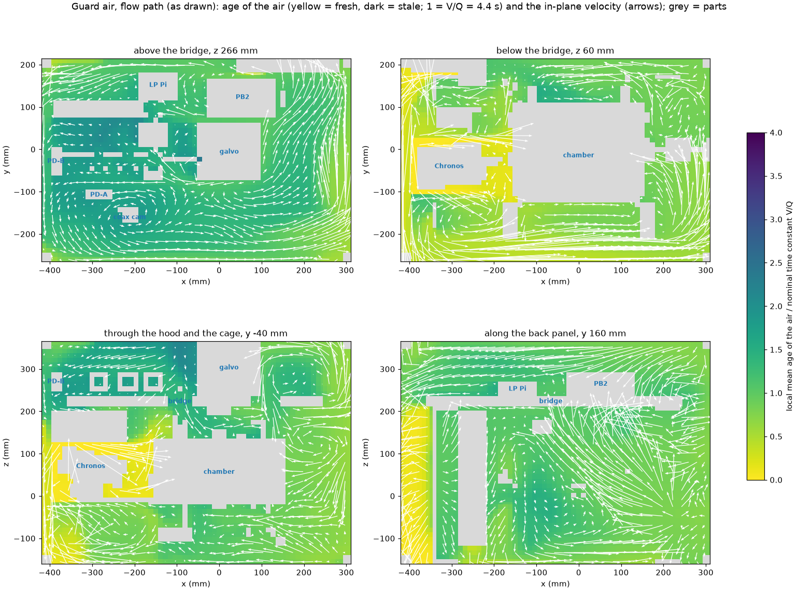
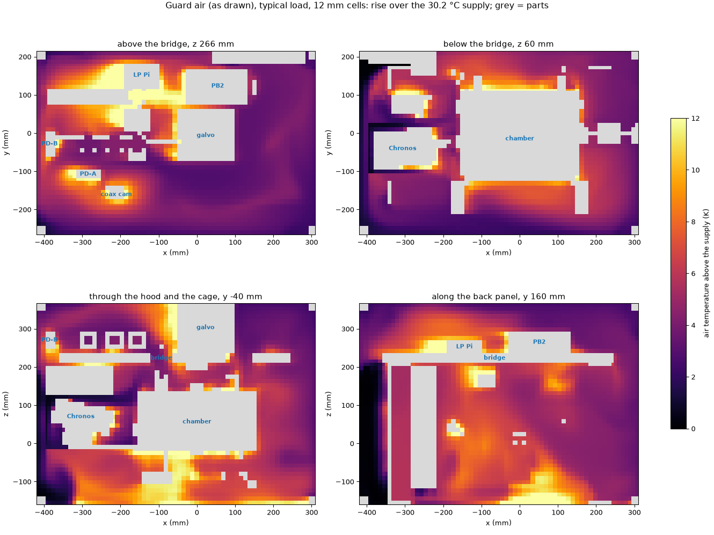

# Monitoring cooling: the cameras, photodiodes and Pis in the laser guard's air (2026-11-27)

Issue #260, PR 281. [`mechanics.md`](mechanics.md) Checks §7 flagged that the monitoring cameras sit in the Shuttle's air, 38–43 °C in
the busy case, at or above a 40 °C rating. This note reads the ratings, models the temperatures, and designs and draws the cooling.
Nothing here is built or measured. Vendor parts are envelopes from listed dimensions; where a size was not read off a drawing, the
part's name says "envelope".

| File | What it is |
|---|---|
| [`cad/monitoring_cooling.py`](../cad/monitoring_cooling.py) | the cooling parts' geometry and `draw()`, which `monitoring_parts._cooling()` calls. The analysis reads the same numbers |
| [`analysis/monitoring/cooling/cooling.py`](../analysis/monitoring/cooling/cooling.py) | the guard's heat balance, the fans against the system's resistance, each device's temperature, the traps' OD → [`cooling.json`](../analysis/out/monitoring/cooling/cooling.json), [`cooling.md`](../analysis/out/monitoring/cooling/cooling.md) |
| [`analysis/monitoring/cooling/trap_mc.py`](../analysis/monitoring/cooling/trap_mc.py) | 1070 nm transmission of the chevron light trap: a 2-D Monte Carlo ray trace with weighted rays |
| [`ratings.csv`](../analysis/out/monitoring/cooling/ratings.csv) | the vendors' operating ranges and dissipations, with URLs and read times |
| [`price_lookups_round3_cooling.csv`](../analysis/out/monitoring/fab/price_lookups_round3_cooling.csv) | the cooling parts' prices and data (fan curves, filter media, foils, reflectance sources), keys CL… |
| [`analysis/interference.py`](../analysis/interference.py) | nine designed contacts added for the cooling parts |
| [`analysis/monitoring/cooling/guard_cfd.py`](../analysis/monitoring/cooling/guard_cfd.py), [`guard_cfd_post.py`](../analysis/monitoring/cooling/guard_cfd_post.py), [`run_guard_cfd.sh`](../analysis/monitoring/cooling/run_guard_cfd.sh) | a coarse OpenFOAM CFD of the guard's air with the drawn vents, fans and hood → [`guard_cfd.json`](../analysis/out/monitoring/cooling/guard_cfd.json), [`guard_cfd.md`](../analysis/out/monitoring/cooling/guard_cfd.md) and two figures (§4.2) |

## 0. Short answer

1. **The cameras don't sit in the Shuttle's air. They sit in the guard's air, which is much warmer.** The guard is a closed box of bare
   1.6 mm aluminium (1.62 m² of panels; UA ≈ 3.9 W/K to the Shuttle by natural convection and the little a bare sheet radiates). Inside
   it, 100–190 W is released besides the chamber's own heat: the galvo (30–69 W), two servos, PB2, the Chronos (20–40 W), the
   photodiodes and the beam path's absorbers. **As drawn, the guard's air runs 26–44 K above the Shuttle's: 58 °C in the typical case,
   64 °C in the busy one, 86 °C in the worst one.** That is a lower bound: once the air passes the chamber's 60 °C wall the model
   counts nothing from the chamber, whose input in a typical build is ~300 W. Every camera, both photodiodes, the LED, the lenses,
   PB2's Pi and the galvo are over their ratings in every case (§3).
2. **Ratings, read on the vendors' pages today (§1):** Chronos 2.1-HD −20 to +40 °C, with its own variable-speed fan; Alvium 1800 U-030
   VSWIR −20 to +55 °C *housing*; Pi Global Shutter and HQ cameras 0–50 °C; Pi 5 0–70 °C, its SoC throttling from 80 °C; PDA36A2
   10–40 °C; the 850 nm LEDs 0–40 °C; PreAmp One −40 to +65 °C; Kowa LM50JC10M −10 to +50 °C. InnoMaker publishes no temperature or
   power for its IMX296 board. **The tightest rating in the guard is not a camera's: the basiCube 20 galvo is rated 25 ± 10 °C.**
3. **Drawn (§4):** a light-trapped inlet low in the back panel's left half, with a filter pad outside; a light-trapped exhaust in its
   right half, with two 120 mm 24 V fans (Delta AFB1224SH) on a plenum outside. They move **118 m³/h at 64 Pa** (§6). Part of the
   inlet air is ducted by a 60 mm fan over the side camera and down into a hood round its body. G-10 breaks go under the side camera
   bracket's root, which bolts to the chamber's floor plate, and into the LP camera's filter holder, which screws onto the boss on the
   60 °C lid. PB2 gets a 40 mm fan and the Pi its Active Cooler. The LP camera's Pi, which had no place in the model, is drawn in a
   fanless heat-sink case on the bridge. **The guard's air then sits 5–10 K above the air it is fed:** 5–6 K on the Shuttle's air,
   7–10 K on cooler air from the dock, which also takes in the warm Shuttle's heat through the panels.
4. **Fed from the Shuttle, that is enough in the typical case and not in the busy one.** At 30.2 °C the guard is at 35.6 °C: everything
   is in rating, with the galvo at its limit (35.6 against 35). At 38.0 °C the guard is at 42.7 °C: the photodiodes, the LED, the
   galvo and the coaxial camera's board are over, and the Chronos, in its hood, is at 38.5 against 40 (41.2 in the CFD, item 10).
   **So the cameras need the laser's answer (heat.md §2): air from outside the Shuttle, or chilled water.** Room air through a
   ventilated dock keeps everything in rating in the typical and busy cases (guard 28.7–29.3 °C; with the CFD's hot spots the warmest
   board, the LP camera's, is ~41 °C against 50, §4.2), once the base plate's open window under the chamber is covered (item 10). A
   chilled-water fan coil in the closed guard (not drawn) does nearly as well (33.6–34.5 °C), with the galvo close to its limit.
   Whichever is chosen for the laser should be sized for the guard too.
5. **The worst case (500 W continuous) still has one over, even with room air:** the coaxial camera's board, at 51.8 against 50 °C. The
   galvo heats the optics bridge 20 K above the guard's air, and the cage stands on posts on the bridge.
6. **The light traps meet the Class 1 requirement (OD 5.4) with black anodise; OD 7, the margin, needs hard black anodise or a foil
   lining.** Each trap is a stack of 1 mm blades bent to six legs,
   32 mm deep at a 10 mm pitch, with no straight line through it. For black hard anodise (11–20 % at 1 µm, NASA TP-3595) the trace
   gives OD 7.0–8.1 for the worst collimated beam and 7.9–9.2 for diffuse light, against **OD 5.4 needed** (safety.md §4.2, a direct
   500 W beam). Dyed black anodise (~29 % above 700 nm, Anoplate's chart) gives 6.1. Any finish under ~0.38 meets 5.4. Lining the
   blades with Thorlabs BKF12 foil (5.5 %) gives ~10. Thorlabs' black flocked paper, which is 66 % at 1 µm, would give only 3.5.
7. **Heat budget (heat.md §2):** fans that blow the guard's air into the Shuttle only move heat about inside it, plus their own 17 W.
   Ducting the supply and exhaust through a ventilated dock takes 250–360 W out of the Shuttle (−0.8 to −1.1 K) for 118 m³/h of room
   air. The fan coil puts 200–290 W on the chiller.
8. **Cost:** $700–1,280 for the drawn cooling (BOM M0-C1 to M0-C8 and M7-C1 to M7-C4). Of that, $480–1,060 is the sheet metal and
   traps, which are estimates (§8).
9. **The model:** 330 parts, 55 of them monitoring (was 318 and 43), ~4.2 kg more on the tray (the two traps are 2.4 kg of it). The
   height is unchanged at 579.6 mm and so is the x envelope. Interference: see §4.1.
10. **A coarse CFD of the guard's air (§4.2): the drawn vents work, but the devices on and under the bridge sit up to 4–6 K above
    the well-mixed air, the hood's air carries the Chronos's own heat, and the guard's floor is open.** OpenFOAM, steady, 12 mm
    cells: the exhaust leaves 5.0 K over the supply in the typical case, against cooling.py's 5.4 K. The inlet's air goes to the
    floor, forward along the left wall, along the front and up the right side to the exhaust: no short circuit along the back panel,
    no dead zone, and the air above the bridge is older (5.5 s against 3.3 s below) but no warmer on average. Round the devices it is
    warmer: the LP camera 11.7 K over the supply, its Pi 10.2, the coaxial camera 8.4, the photodiodes 5.9–6.8, PB2 6.7, the galvo
    6.2 (1–3 K less on a 9 mm grid, so ±3 K). In the typical case only the galvo is over (36.4 against 35 °C). In the busy case the
    CFD adds the LP camera's board (53.6 against 50) and the Chronos's hood air to §3's five. **The Chronos's 20 W warms its hood's
    20.4 m³/h by 3.1 K,** so in the busy case its air averages 41.2 °C (39.7 in its back half) against 40, not §3's 38.5; ~40 °C
    with the ~37 m³/h the exhaust's suction probably drives through the hood. **The base plate's Z-stage window and slot open the
    guard's floor to the Shuttle:** with cooling.py's fans and resistances they would take 133 of 160 m³/h, and the inlet 6. A cover
    with a brush strip round the Z stage is the cheapest fix, and dock air needs it.

## 1. Ratings

Read 2026-11-27 08:25–08:35 UTC through the lab tunnel; the URLs and the exact wording are in [`ratings.csv`](../analysis/out/monitoring/cooling/ratings.csv).

| Device | Where | Operating range (°C) | Ambient or case | Dissipation | Source |
|---|---|---|---|---|---|
| Kron Chronos 2.1-HD | side camera at LW | −20 to +40 | not stated (reads as ambient) | 40 W input rating (19 V, 40 W adapter); typical not published. Active cooling, variable-speed fan; the manual gives a sensor at 40–55 °C in a room | [krontech.ca](https://www.krontech.ca/product/chronos-2-1-hd-high-speed-camera/) and the 2.1-HD datasheet |
| Allied Vision Alvium 1800 U-030 VSWIR | route B, coaxial camera arm | −20 to +55 | **housing** | 2.0 W (USB), 2.2 W (5 V) | [alliedvision.com](https://www.alliedvision.com/en/products/area-scan-cameras/alvium/alvium-u/view/1243) |
| InnoMaker CAM-IMX296RAW | LP camera, coaxial camera | **not published** | – | not published (3.3 / 1.8 / 1.2 V rails) | [inno-maker.com](https://www.inno-maker.com/product/cam-mipi296raw-trigger/), user manual V2.02 |
| Raspberry Pi Global Shutter Camera (same IMX296) | the IMX296 boards' stand-in rating | 0 to 50, dry | ambient | not published | [product brief](https://datasheets.raspberrypi.com/gs-camera/gs-camera-product-brief.pdf) |
| Raspberry Pi HQ Camera | layer camera (existing) | 0 to 50, dry | ambient | – | [product brief](https://datasheets.raspberrypi.com/hq-camera/hq-camera-product-brief.pdf) |
| Raspberry Pi 5 | PB2; the LP camera's Pi | 0 to 70 | ambient; the SoC throttles from 80 °C, both CPU and GPU at 85 °C | ~4 W bare board active; PB2 8–12 W with its boards ([`power.md`](../analysis/out/electrical/power.md) §4) | [product brief](https://datasheets.raspberrypi.com/rpi5/raspberry-pi-5-product-brief.pdf), Raspberry Pi documentation |
| Raspberry Pi Active Cooler | PB2's Pi | not published | – | fan steps at 50, 60, 67.5, 75 °C | [product brief](https://datasheets.raspberrypi.com/cooling/raspberry-pi-active-cooler-product-brief.pdf) |
| Raspberry Pi Pico 2 | trigger generator in PB2 | −20 to +85 (70 ambient) | – | mW | [datasheet](https://datasheets.raspberrypi.com/pico/pico-2-datasheet.pdf) |
| Thorlabs PDA36A2 | coaxial photodiodes A and B | 10 to 40 | not stated | "actual usage < 5 W" each | [thorlabs.com](https://www.thorlabs.com/item/PDA36A2), manual rev D |
| Thorlabs M850LP1 (the M850L3 is discontinued) | BW light | 0 to 40, non-condensing | ambient; its casing runs up to 25 K above it | 5.1 W at 1.5 A | [thorlabs.com](https://www.thorlabs.com/item/M850LP1) |
| Thorlabs SOLIS-850C | optics.md's light through LP | 0 to 40 | housing ≤ 60 °C | 13.8 W | [thorlabs.com](https://www.thorlabs.com/item/SOLIS-850C) |
| MISTRAS PreAmp One, 28 V | AE preamp | −40 to +65 | not stated | < 1.0 W quiescent, < 2.1 W max | [mistrasgroup.com](https://www.mistrasgroup.com/products/acoustic-emission/preamplifiers/preamp-one-acoustic-emission-ae-pre-amplifier/) |
| Vallen AEP5 | AE preamp, alternative | −20 to +85 | not stated | 1.8 W | [vallen.de](https://www.vallen.de/sensors/preamplifiers/) |
| Omron E3NX-FA | in PB2 | −25 to +55 (one or two side by side) | ambient | ≤ 1 W | [omron.com](https://automation.omron.com/en/us/products/family/E3NX-FA) |
| Mean Well DDR-30G-5 | in PB2 | −40 to +85; full load to 60 °C | ambient | 85 % efficient | [meanwell.com](https://www.meanwell.com/Upload/PDF/DDR-30/DDR-30-SPEC.PDF) |
| Kowa LM50JC10M | side and LP lenses | −10 to +50 | – | – | [kowa-lenses.com](https://www.kowa-lenses.com/en/lm50jc10m-10mp-industrial-lens-c-mount) |
| SCANLAB basiCube 20 (context) | galvo on the bridge | **25 ± 10** | – | 24 V × ≤ 2.6 A; "air cooling: no" | [scanlab.de](https://www.scanlab.de/en/products/scan-systems/basicube/basicube-20) |

- **Ambient or case.** Only Allied Vision says *housing*. The others' ranges read as ambient, which here means the air round the part.
  For boards bolted to something warmer than that air (the LP camera on its boss, the coaxial camera and the Alvium on the bridge), §3
  checks the board's own temperature against the range.
- **The InnoMaker board has no rating,** so the Pi Global Shutter Camera's 0–50 °C, the same sensor on a similar board, stands in for it.
  Ask InnoMaker, or measure the board's temperature on the bench at 45 °C.
- **PB1 holds no Pi.** It is the power box beside the rack, outside the guard, and electrical.md already gives it a 27 CFM filter fan.
  The Pis are PB2's, on the bridge, and the LP camera's second Pi, which this round places beside it (§4).

## 2. The guard's air

`cooling.py` balances the guard as one well-mixed volume of air:

- **In:** the devices (galvo 30 / 69 W typical / worst, Z and recoater servos 20 W, dosing stepper 5–10 W, PB2 8–12 W, the LP camera's
  Pi 5–8 W, the Chronos 20–40 W, the two IMX296 boards 1.5–2 W, two PDA36A2 4–10 W, the LED 1–5 W, the AE preamp 1–2 W, the layer
  camera 1 W, and 5–12 W in the beam path). Most of these are the tray budget's or electrical's estimates; the camera numbers are the vendors' ratings, or half of them
  where only a rating is published. Then there is **the chamber's outside**, taken at **60 °C**, thermal.json's hot-chamber bound. It
  gives up its heat by natural or mixed convection over 0.27 m², radiates from bare 6061 (ε 0.1), and conducts down the four legs
  into the base plate. That comes to 40–130 W with the guard ventilated.
- **Out:** the panels, by natural convection on both faces and the little bare 5052 radiates (ε 0.07). The polycarbonate viewing
  window radiates more (ε 0.9). Heat also leaves down through the base plate. In total UA ≈ 3.9 W/K. With the cooling, add the exhaust
  flow, or the fan coil's 15 W/K to 20 °C water (an estimate for a 120 mm radiator and fan).

| Case | Shuttle air (°C) | As drawn (closed) | Vented, Shuttle air | Vented, room air from the dock (22 °C) | Closed, chilled-water fan coil (not drawn) |
|---|---:|---:|---:|---:|---:|
| typical build, rest of Shuttle 1 idling | 30.2 | **57.8** | 35.6 | 28.7 | 33.6 |
| typical build, PR 318's busy Shuttle | 38.0 | **63.8** | 42.7 | 29.3 | 34.5 |
| 500 W continuous, busy Shuttle | 42.6 | **86.1** | 48.8 | 31.7 | 39.2 |

(Guard air, °C. The Shuttle temperatures are `tray_budget.json`'s.) Where the heat goes in the typical case:

| | As drawn | Vented, Shuttle air | Vented, dock air | Fan coil |
|---|---:|---:|---:|---:|
| devices and fans (W) | 102 | 118 | 118 | 108 |
| chamber's outside at 60 °C (W) | 7 | 100 | 130 | 105 |
| out through the panels (W) | 109 | 16 | −4 (in) | 9 |
| out with the exhaust air, or into the coil (W) | – | 202 | 251 | 203 |

- **The closed guard is the problem, more than the Shuttle's temperature.** With ~100 W inside and 3.9 W/K out, it runs 26 K over its
  surroundings before the chamber adds anything. It stays well over them if the guess is wrong (typical case, `cooling.json`
  `sensitivity_typical_guard_air_c`): with painted panels (ε 0.9) it is at 50.5 °C, and with seams leaking 5 or 15 m³/h of air it is
  at 53.4 or 47.8 °C. An anodised chamber outside (ε 0.8) adds 0.8 K to the vented case.
- **The 60 °C chamber wall is a bound, not a result.** In a typical build the heaters put ~97 W into the module and the beam 210 W into
  the chamber. A 60 °C outside passes 40–130 W of that to the guard and its legs. The rest has to leave by the gas loop, or the
  chamber runs hotter than thermal.json assumes. Nobody has closed the chamber's own balance (§10).

## 3. Device temperatures, before and after

Each device's steady temperature comes from four terms:

- its own dissipation, into the air round it (natural convection, forced in the flow; ε 0.85 to the guard's inner surfaces);
- radiation from the 60 °C wall or lid where it faces one (the Chronos's front; the LP camera and lens over the lid);
- conduction through its mount: 1.3 W/K from the chamber's floor plate for the Chronos bracket, 0.1 W/K with the G-10 pad; 0.4 W/K
  from the LP boss for the LP camera, 0.017 W/K with the G-10 ring; 1 W/K from the bridge for the cage's devices;
- the optics bridge's own temperature: 70 % of the galvo's heat goes down its riser into a 25 mm plate. Its 0.12 m² could only shed
  30 W at ~40 K above the air, so most of it has to go that way.

The Chronos has its own fan, so it is taken as 25 W/m²K over its body and checked on the air it breathes. Bold marks a value over its
rating; the full set is in [`cooling.json`](../analysis/out/monitoring/cooling/cooling.json).

**Typical (Shuttle 30.2 °C):**

| Device | Rating (°C) | Checked on | As drawn | Vented, Shuttle air | Vented, dock air | Fan coil |
|---|---:|---|---:|---:|---:|---:|
| Chronos 2.1-HD | 40 | air in its hood | **57.8** | 30.7 | 22.5 | 33.6 |
| LP camera (IMX296) | 50 | board | **60.9** | 41.5 | 35.4 | 43.2 |
| Coaxial camera (IMX296) | 50 | board | **66.8** | 44.5 | 37.7 | 42.8 |
| Alvium U-030 VSWIR (route B) | 55 | housing | **68.3** | 45.9 | 39.2 | 44.3 |
| PDA36A2, each | 40 | air | **57.8** | 35.6 | 28.7 | 33.6 |
| BW 850 nm LED | 40 | air | **57.8** | 35.6 | 28.7 | 33.6 |
| AE preamp | 65 | case | 58.9 | 36.7 | 29.8 | 34.8 |
| Kowa lenses | 50 | air | **57.8** | 35.6 | 28.7 | 33.6 |
| PB2's air (Pi 5) | 70 | air | **82.3** | 39.9 | 33.0 | 37.8 |
| PB2's Pi 5 SoC | 80 | SoC | **99.8** | 57.4 | 50.5 | 55.3 |
| LP camera's Pi 5 SoC | 80 | SoC | 75.3 | 53.1 | 46.2 | 51.1 |
| basiCube 20 galvo (context) | 35 | air | **57.8** | **35.6** | 28.7 | 33.6 |
| optics bridge | – | – | 66.7 | 44.7 | 37.9 | 42.7 |

**Busy (Shuttle 38.0 °C):**

| Device | Rating (°C) | As drawn | Vented, Shuttle air | Vented, dock air | Fan coil |
|---|---:|---:|---:|---:|---:|
| Chronos 2.1-HD | 40 | **63.8** | 38.5 | 22.5 | 34.5 |
| LP camera (IMX296) | 50 | **62.3** | 47.8 | 35.9 | 44.0 |
| Coaxial camera (IMX296) | 50 | **72.7** | **51.5** | 38.3 | 43.8 |
| Alvium U-030 VSWIR | 55 | **74.2** | 52.9 | 39.7 | 45.3 |
| PDA36A2, each | 40 | **63.8** | **42.7** | 29.3 | 34.5 |
| BW 850 nm LED | 40 | **63.8** | **42.7** | 29.3 | 34.5 |
| AE preamp | 65 | 64.9 | 43.7 | 30.4 | 35.7 |
| Kowa lenses | 50 | **63.8** | 42.7 | 29.3 | 34.5 |
| PB2's air / SoC | 70 / 80 | **87.5 / 105.0** | 46.9 / 64.4 | 33.6 / 51.1 | 38.8 / 56.3 |
| LP camera's Pi SoC | 80 | **81.3** | 60.2 | 46.8 | 52.0 |
| basiCube 20 galvo (context) | 35 | **63.8** | **42.7** | 29.3 | 34.5 |

**Worst (500 W continuous, Shuttle 42.6 °C):** as drawn, everything is over, the AE preamp included (88 °C). Vented with the Shuttle's
air, the guard is at 48.8 °C, and the Chronos's hood air at 43.1 °C. All the cameras, the photodiodes, the LED, the galvo and both Pis'
SoCs (90, 84) are over. With dock air, only the coaxial camera's board (51.8 against 50, on a 53.0 °C bridge) is over. With the fan
coil, the coaxial camera (59.9), the Alvium (61.3), the galvo (39.2) and PB2's SoC (80.6) are over.

- **What each part of the cooling does.**
  - Ventilation does most of it, by taking the guard from 26–44 K over the Shuttle to 5–10 K over its supply.
  - The hood puts the Chronos in supply air instead of guard air, 4–6 K cooler. That keeps it in rating in the busy case on Shuttle
    air (38.5 against 42.7). The CFD (§4.2) finds less: the camera's own 20 W warms the hood's 20 m³/h by ~3 K, to 41.2 °C on
    average in the busy case.
  - The G-10 pad cuts the bracket's link to the 60 °C floor plate from 1.3 to 0.1 W/K, which takes 6.5 K off the Chronos's body
    (44 °C with it, typical vented case).
  - The G-10 ring cuts the LP camera's link to its 60 °C boss from 0.4 to 0.017 W/K. In the typical vented case that board would be
    54 °C without the ring, over its 50, and is 41.5 °C with it.
  - **PB2 sealed is the worst spot in the guard.** Its 8–12 W in a 160 × 90 × 60 mm polycarbonate box (UA 0.25 W/K) holds its air
    ~25 K over the guard's: 63 °C and an 81 °C SoC in the vented guard in the typical case, 69 °C and 87 °C in the busy one. The
    40 mm fan (~5 m³/h through a filtered vent) brings the box to ~3 K over the guard.
- **The SoC figures use Geekworm's own test of its P573 passive case** (+35 K over a 26.9 °C room after 20 minutes of four-core stress;
  not steady, [geekworm.com](https://geekworm.com/blogs/news/p573-copper-thermal-paste-raspberry-pi-5-cooling-test)), taken for both
  Pis at full load and half that at the cameras-and-supervisor load. The Active Cooler is taken as the same. These are estimates.
- **The coaxial cage** inherits the bridge's temperature through its posts. G-10 pads under the posts would put the cage's devices back
  near the air's temperature. The cost is ~1.8 µm/K at the plate of drift between cube 1 on the bridge and cubes 2 and 3 on G-10
  (mechanics.md Checks §4). They are not drawn; supply air from the dock does the same job.

## 4. What is drawn

| Part | Where | Size | BOM |
|---|---|---|---|
| Back panel openings | inlet x −394…−218, z −118…202; exhaust x 40…284, z 108…338 | 176 × 320 and 244 × 230 mm, cut in the 1.6 mm back panel | (S9) |
| Inlet light trap | inside the back panel, y 181.5…213.5 | 32 chevron blades, 1 mm, six legs, 10 mm pitch, 32 mm deep, in a 2 mm frame riveted to the panel | M0-C3 |
| Inlet filter | outside the back panel | 30 ppi polyurethane foam pad in a 1.5 mm frame (10 mm envelope). A dock duct can bolt on in its place | M0-C5, M0-C6 |
| Hood duct | plenum behind the inlet trap's right-hand part (x −283…−218), up to z 127…203, forward beside the bridge's back-left post, then over the side camera | 65 × 76 mm, then 178 × 76 mm; 1 mm sheet, riveted | M7-C1 |
| Hood fan | in the duct, blowing forward | Delta AFB0624H-A, 60 × 60 × 25 mm, 24 V | M7-C2 |
| Side camera hood | round the Chronos: sides, back and floor, with the duct's floor as its top; open at the lens end | x −396…−214, y −106…27, z −15…127; floor cut round the bracket plate | M7-C1 |
| Exhaust light trap | inside the back panel, y 181.5…213.5 | 23 blades, the same section | M0-C3 |
| Exhaust plenum and fans | outside the back panel, at the exhaust's top | 1.5 mm box y 216.5…226.5; two Delta AFB1224SH 120 × 120 × 25 mm with finger guards, out to y 254.5 | M0-C1, M0-C2, M0-C6 |
| G-10 pad | between the side camera bracket's root and the chamber's floor plate (x −162…−156) | 6 mm × 80 × 16 mm, notched round the through-beam's fibre head; the bracket's root is 6 mm shorter, so the camera stays put | M7-C3 |
| G-10 ring | the first 5 mm of the LP camera's filter holder, on the boss's retaining ring | Ø32 × Ø25.4 × 5 mm, SM1-threaded both ends; the holder is 5 mm shorter | M7-C3 |
| PB2 vent fan | on PB2's +x end wall, over a Ø38 hole | Noctua NF-A4x10 24V, 40 × 40 × 10 mm; a filtered vent at PB2's other end (not drawn) | M0-C7 |
| LP camera's Pi | on the bridge behind the fold mirror, left of the LP camera, x −190…−96, y 117…179 | Pi 5 in a fanless aluminium case, envelope 94 × 62 × 33 mm, on 0.5 mm pads | M7-C4 |

- **Why the back panel.** The left panel is 8.5 mm from the rack's vented side panel, and its air is the rack's exhaust. The front has the
  door, its rail and the robot's AprilTags. The top would add height. The back faces the dock, where any duct would come from, and has
  room inside above the bridge and beside its posts. The air comes in low on the −x side, passes the Chronos and the cage there, crosses
  over the bridge and PB2, and leaves on the +x side.
- **The traps are clear of the beam's straight-line paths.** The collimator's beam runs along x at y ≈ 95, z 271, from x −387 to the
  fold mirror at −155. The inlet stops at x −218 and z 202, and the exhaust starts at x 40, behind PB2.

### 4.1 Interference

[`interference.py`](../analysis/interference.py) with `LPBF_MONITORING=1`, 330 parts, on M50, S25 and L75. The cooling parts touch the
panel, the floor plate and the LP ring face to face, so they add no volume to any pair; nine designed contacts declare them anyway.

| Module | Run (UTC) | Static states | Motion sweeps | Peak memory |
|---|---|---|---|---|
| M50 | 09:27–09:31 | 0 interferences in all six | 0 in all eight | 3.57 GB |
| S25 | 09:31–09:34 | 0 interferences in all six | 0 in all eight | 3.65 GB |
| L75 | 09:34–09:38 | 0 interferences in all six | 0 in all eight | 3.54 GB |

The reports are [`interference-monitoring-M50-M.md`](../analysis/out/monitoring/mech/interference-monitoring-M50-M.md) and its S25
and L75 siblings. Tightest static gaps between the cooling parts and the rest (exact OpenCascade distances, closed state):

| Cooling part | Nearest other part | Gap (mm) |
|---|---|---:|
| exhaust trap | optics bridge's back edge (y 180) | 1.5 |
| LP camera's Pi case | the bridge under it (on 0.5 mm pads); the fold mirror's cage cube; the LP camera | 0.5; 1.3; 4.5 |
| exhaust plenum, outside | guard frame | 1.9 |
| hood duct | the bridge's back-left post; the bridge's underside; the BW LED | 2.0; 8.1; 9.5 |
| inlet trap | guard frame; the bridge's back-left post | 4.0; 6.5 |
| hood fan | the bridge's back-left post | 4.5 |
| PB2 vent fan | PB2's screws; PB2 (drawn beside its tabs) | 4.3; 6.3 |
| side camera hood | the Chronos; the door drive's bracket | 6.3; 14.0 |
| G-10 pad | the chamber body above the floor plate | 0.1 |

The frames, plenums, pad and ring are drawn touching what they fasten to.

### 4.2 The guard's air in CFD

§2 and §3 take the guard's air as one well-mixed volume. [`guard_cfd.py`](../analysis/monitoring/cooling/guard_cfd.py) checks the
drawn flow path with a coarse CFD of the guard's inside; [`guard_cfd_post.py`](../analysis/monitoring/cooling/guard_cfd_post.py)
reads it back into [`guard_cfd.json`](../analysis/out/monitoring/cooling/guard_cfd.json) and
[`guard_cfd.md`](../analysis/out/monitoring/cooling/guard_cfd.md). It is a screening model: steady, coarse, and without radiation.

**What it models.**

- **Geometry.** The model's parts (`lpbf_low.build(monitoring=True)`, 237 of them inside the guard) are exported as STL and become
  blocked cells of a Cartesian grid of the guard's inside, x −420…310, y −265…215, z −160…366. Cells are at most 12 mm, finer where a
  trap face, the hood, the ducts, the bridge, its posts or the chamber need an exact line: 68 × 46 × 50, **123,756 cells of air**. The
  chamber is one solid block, so its argon is not counted as guard air. The hood is a zero-thickness sheet; the frame is 20 × 20 mm
  bars. Left out: the KF-25 hoses, the fibre, the argon and O₂ lines, and 72 small parts the grid misses.
- **Flows: cooling.py's operating point.** 97.6 m³/h comes in over the inlet trap's face left of the hood's plenum (x −394…−283,
  z −118…202), at the supply temperature. The trap's last leg points down at 62°, so the air does too. The hood fan's 20.4 m³/h
  enters the hood where the duct drops into it, 0.5 K over the supply. 118 m³/h leaves through the exhaust trap's face, held at a
  fixed pressure. The traps' 25 Pa make the flow through each face near uniform, so the traps, the filter, the plenum and the ducts
  are not modelled inside.
- **Heat: cooling.py's typical load,** as a fixed power on each device's surfaces: the galvo 9 W (30 % of its 30 W), the optics
  bridge 26 W (the other 70 % and the beam path's 5 W), PB2 9.1 W with its fan, the Chronos 20 W, the LP camera's Pi 5 W, the servos
  10 W each, the stepper 5 W, the photodiodes 2 W each, the IMX296 boards 0.75 W each, and 1 W each for the LED, the AE preamp and the
  layer camera: 102.6 W. The exhaust fans sit outside the guard, so their 13.4 W, which cooling.py adds to the guard's air, is not
  in it. The chamber's outside (body, floor plate, lid, door, build module) is held at 60 °C, as in cooling.py. Half of the legs'
  conduction, 52 W (37 W in the busy case), goes in as a flux on the base plate's top, as cooling.py counts it. No radiation.
- **Panels.** The CFD's wall functions give the inside film. Outside, a fixed coefficient to the Shuttle's air: 2.6 W/m²K on the
  bare sides, 3.3 on the top and 6.5 on the window (cooling.py's convection and radiation). The base plate's top only takes the
  legs' flux.
- **Solver.** OpenFOAM v2406 `buoyantSimpleFoam`, steady, buoyant, k-ε with wall functions, air as a perfect gas
  ([`run_guard_cfd.sh`](../analysis/monitoring/cooling/run_guard_cfd.sh)). The steady solution keeps oscillating a little, as buoyant
  plumes do, so T and U are averaged over the last 600–800 iterations and the heat balance over the last 500.

**The air round each device.** "Air round it" is the mean of the air 12–36 mm from the device's cells, outside its own first layer
of cells. For the boards, PB2's box and the Pi's SoC, the checked value is cooling.py's, moved by the CFD's local air minus the
well-mixed air, in proportion to the air's share of the part's coupling. The coaxial camera's board follows the bridge (1 W/K
through its post), so it moves with the air round the bridge, 5.6 K over the supply. The CFD's own surface temperatures are not
used: without radiation and with wall functions on 12 mm cells they run 20–40 K too hot. Supply: 30.2 °C typical, 38.0 °C busy (the
Shuttle's air, §2).

| Device | Rating (°C), checked on | Air over the supply (K), typical: well-mixed / CFD; busy: well-mixed / CFD | Checked (°C), typical: well-mixed / CFD | Checked (°C), busy: well-mixed / CFD |
|---|---|---:|---:|---:|
| Chronos 2.1-HD, in its hood | 40, air | 0.5 / 3.1; 0.5 / 3.2 | 30.7 / 33.3 | 38.5 / **41.2** |
| coaxial cage | – | 5.4 / 7.5; 4.7 / 7.4 | – | – |
| coaxial camera (IMX296) | 50, board | 5.4 / 8.4; 4.7 / 7.7 | 44.5 / 45.0 | **51.5** / **52.5** |
| photodiode PD-A (PDA36A2) | 40, air | 5.4 / 6.8; 4.7 / 6.9 | 35.6 / 37.0 | **42.7** / **44.9** |
| photodiode PD-B (PDA36A2) | 40, air | 5.4 / 5.9; 4.7 / 5.9 | 35.6 / 36.1 | **42.7** / **43.9** |
| PB2 (Pi 5) | 70, PB2's air | 5.4 / 6.7; 4.7 / 6.1 | 39.9 / 41.2 | 46.9 / 48.3 |
| LP camera (IMX296) | 50, board | 5.4 / 11.7; 4.7 / 11.0 | 41.5 / 47.2 | 47.8 / **53.6** |
| LP camera's Pi 5 | 80, SoC | 5.4 / 10.2; 4.7 / 9.1 | 53.1 / 57.9 | 60.2 / 64.6 |
| galvo (basiCube 20) | 35, air | 5.4 / 6.2; 4.7 / 6.2 | **35.6** / **36.4** | **42.7** / **44.2** |
| BW 850 nm LED | 40, air | 5.4 / 7.1; 4.7 / 6.0 | 35.6 / 37.3 | **42.7** / **44.0** |

- **The guard is close to well mixed on average, not round the devices.** The exhaust leaves 5.0 K over the supply in the typical
  case and 4.4 K in the busy one, against cooling.py's 5.4 and 4.7 K, and its heat closes: 195 W in (102.6 W from the devices, 40 W
  from the 60 °C chamber, 52 W from the legs), 9 W out through the panels, 186 W out with the exhaust (−0.2 %, typical). The air
  above the bridge is not warmer on average (4.9 K over the supply, below it 5.3 K). But the devices on and under the bridge sit up
  to 6 K above the well-mixed air on this grid, 4 K on the 9 mm one: their own heat, the bridge's 26 W and the 60 °C lid stay near
  them.
- **Over its rating in the typical case: only the galvo,** at 36.4 against 35 °C (well-mixed 35.6). In the busy case on the
  Shuttle's air the CFD has §3's five over, and a little higher: the coaxial camera's board 52.5 against 50, PD-A 44.9 and PD-B
  43.9 against 40, the LED 44.0, the galvo 44.2. It adds two: **the LP camera's board, 53.6 against 50, and the Chronos's hood air,
  41.2 against 40.**
- **The hot spots** are the pocket under the bridge over the chamber's lid, where the LP camera hangs (11.7 K over the supply), and the
  corner behind the fold mirror, where the LP camera's Pi sits (10.2 K). Both are in rating in the typical case, with 3 K and 22 K to
  spare.

**The flow path.** [Figure](../analysis/out/monitoring/cooling/guard_cfd_flow.png): the local mean age of the air (OpenFOAM's `age`:
seconds since it came in) and the velocity in four sections.

- **No short circuit along the back panel.** The inlet trap points its air at the floor. It runs forward along the left wall, along
  the front panel to the right, and up the right side to the exhaust. Only 0.1 % of the exhaust's flow is younger than a quarter of
  the nominal time V/Q = 4.4 s, and 32 % of it leaves above the bridge.
- **The upper half is reached, more slowly.** The air comes up through the gaps round the bridge, mostly up the right side.
  Its mean age above the bridge is 5.5 s, below it 3.3 s. The air-change effectiveness is 0.57 (0.5 is a fully mixed room).
- **No dead zone.** Apart from a 0.03 L pocket inside the build module's flange, no air is older than 3 V/Q. The stalest air, 1.5–2
  V/Q, is above the bridge at the front left, round the coaxial cage, PD-A and the coaxial camera, and behind the chamber.
- **The inlet's direction doesn't matter.** Turned over, so that its air leaves upward, the trap changes no device's air by more than
  0.6 K and leaves the ages as they were (case `flip12`). Buoyancy and the exhaust's place set the path, not the trap's ~2 m/s jets.

**The hood.** The duct's air keeps the back half of the Chronos within 1.7 K of the supply. But the camera's own 20 W goes into the
hood's 20.4 m³/h, which warms it by 3.1 K on average and 5.3 K at the lens end. **So the hood does not hold the Chronos in supply
air, as §3 assumes:** in the busy case the hood's air averages 41.2 °C (39.7 in its back half), against §3's 38.5 °C and the
Chronos's 40 °C rating. Whether that is over depends on where the camera's own fan draws from, which Kron doesn't publish. Two
things help. **The hood's flow is probably larger than 20 m³/h:** the exhaust holds the guard ~40 Pa under the Shuttle, and the
hood's path runs in parallel with the inlet, so with cooling.py's resistances it carries ~37 m³/h (`network()`, `guard_cfd.json`
`network.sealed`). The CFD with that flow (case `hood12`, of which only the hood is read: the rest of the guard had not settled)
puts the hood's air 2.0 K over the supply on average and 1.2 K in its back half: ~40 °C in the busy case, at the rating. And the
dock's 22 °C air, §2's answer for the busy case, puts the hood's air at ~25 °C.

**The guard's floor is open.** The guard stands on the process base plate, and the plate has the Z stage's window, the slot to its
front edge for the module's rod end, and the folded Z servo's window under the chamber (`lpbf_low.build`). They open into the 37 mm
gap between the plate and the tray, which is open to the Shuttle all round: 0.041 m² of free area on this grid, three quarters of
the inlet's face, without its 37 Pa of filter and trap. With cooling.py's resistances and fan curves (`network()`,
`guard_cfd.json` `network.floor_open`), **the floor then takes 133 of 160 m³/h, the inlet trap 6 and the hood 21,** and the guard
sits only 1 Pa under the Shuttle. The CFD with the
floor open (case `floor12`) runs cooler on average (the exhaust 3.9 K over the supply, with more flow), but the air above the bridge
at the back left goes stale: 3.1 L older than 3 V/Q, 6.8 K over the supply, round the collimator, the LP camera's Pi and PB2.
**Worse, a dock duct on the inlet would then feed only a sixth of the guard's air; the rest would be the Shuttle's, unfiltered.**
The window and slot need a cover: a sheet-metal plate on the base plate's underside round the Z stage, with a brush strip where the
arm and the module's rod end pass. That is the cheapest fix the CFD points to, and it is needed before §2's dock air means anything.

**Fixes for the hot spots.** In the typical case the galvo is the only device over, by 0.1–1.4 K (9 and 12 mm grids), and it is
§2's galvo problem (the laser's decision). In the busy case the CFD adds the LP camera's board and the Chronos's hood air to §3's
list. No cheap change to the flow path fixes that: turning the inlet trap over does nothing, and the hot spots are where the bridge,
the lid and the devices' own heat meet. What fixes them is the supply: with the dock's 22 °C air, cooling.py's dock values moved by
the CFD's local excess put the warmest board, the LP camera's, at ~41 °C against 50, the galvo at ~30 °C and the photodiodes at
~31 °C. The cover over the base plate's window is what makes that supply reach the guard.

**Mesh and convergence.**

| Case | Cells | Exhaust over the supply (K) | Air above / below the bridge (K) | Coaxial camera / LP camera / LP Pi / galvo air (K over the supply) | Heat balance |
|---|---:|---:|---:|---:|---:|
| typical, 18 mm (`typ18`) | 45,912 | 4.9 | 3.0 / 4.3 | 4.6 / 5.5 / 4.3 / 3.5 | +1.3 % |
| typical, 12 mm (`typ12a`) | 123,756 | 5.0 | 4.9 / 5.3 | 8.4 / 11.7 / 10.2 / 6.2 | −0.2 % |
| typical, 9 mm (`typ9`) | 251,605 | 5.0 | 4.1 / 4.9 | 6.0 / 9.0 / 7.9 / 4.9 | −0.1 % |

- The exhaust's temperature, which the heat balance fixes, doesn't change with the grid. The air round the devices does: the 18 mm
  grid closes the gaps round the bridge to 2–4 cells, sends more of the air straight to the exhaust (4.4 % younger than V/(4Q),
  against 0.1 %) and puts the devices above the bridge 2–6 K cooler. The 9 mm grid keeps the flow path, the ages (5.2 s above the
  bridge, 2.9 s below), the exhaust and the heat balance, and puts the hot spots 1–3 K under the 12 mm values: the LP camera 9.0 K
  over the supply, its Pi 7.9, the coaxial camera 6.0, the galvo 4.9. The air round the devices is not grid-converged: read it as
  ±3 K, with the 12 mm grid, which all the other cases use, on the warm side. The conclusions hold on both grids: the galvo is over
  in the typical case (35.1 °C on 9 mm), the LP camera's board is over in the busy one (~51 °C on 9 mm), and the hood's air is 3.0 K
  over the supply.
- Every case is steady RANS that settles into a small oscillation, not a fixed point: the exhaust's temperature wanders by 0.07 K and
  the mean by 0.04 K over the last 500 iterations of the typical case, and the residuals stop at 3 × 10⁻³ for p_rgh and 5 × 10⁻⁴ or
  less for the rest. The fields are averaged.

## 5. The light traps: OD at 1070 nm

[`trap_mc.py`](../analysis/monitoring/cooling/trap_mc.py) traces the trap's section: a periodic stack of zigzag blades, light entering
from the guard's side, each surface reflecting a fraction ρ (30 % of that specularly for anodise, which keeps some of the rolled sheet's
shine; all diffuse for the foils), with weighted rays. The section is 2-D because the blades are long (176–244 mm against a 10 mm
pitch): a ray's component along the blades doesn't change its number of bounces, and a long blade's diffuse scatter seen in section
follows cos θ / 2. The frames' end walls only add bounces. 120,000 rays for diffuse light; for a collimated beam, 30,000 at each angle
from −85° to +85° in 5° steps, keeping the worst.

| Blade surface at 1064–1070 nm | ρ | Source | OD, diffuse | OD, worst collimated beam |
|---|---:|---|---:|---:|
| Thorlabs BKF12 black aluminium foil | 0.055 | Thorlabs' BKF12 graph, 8° AOI (price_lookups CL61) | 11.0 | 9.8 |
| black hard ("Duranodic") anodise, low reading | 0.12 | [NASA TP-3595](https://ntrs.nasa.gov/citations/19960029068) (1995) Fig. 3, Beckman DK2 sphere | 9.2 | 8.1 |
| black hard anodise, high reading | 0.20 | the same, LPSR sphere | 7.9 | 7.0 |
| dyed black anodise | 0.29 | Anoplate's chart, "~29 % above 700 nm" (CL93's note) | 6.8 | 6.1 |
| (sweep) | 0.40 | – | 5.8 | 5.3 |
| (sweep) | 0.50 | – | 5.1 | 4.6 |
| Thorlabs black flocked paper | 0.66 | Thorlabs' blackout-materials graph | 4.0 | 3.5 |

- **Required: OD ≥ 5.4**, safety.md §4.2's figure for a guard window or filter behind which Class 1 holds against a direct 500 W
  beam. OD 7 passes 50 µW, 38× under the 1.9 mW Class 1 limit. The light that normally reaches the traps is far weaker: each port lets
  ≤ ~1 W of diffuse 1070 nm into the guard (optics.md §5), which needs only OD 2.7.
- **Every path through the trap has at least five bounces.** The seed-to-seed spread is ±0.4 in OD at the BKF12 level.
- **Black anodise is enough if it is black at 1 µm.** Dyes that look black can be bright in the near infrared: Thorlabs' flocked paper
  is 66 % and its hardboard ~80 %. Order integral-colour (hard) black, measure a blade's 1064 nm reflectance before fitting, or line the
  blades with BKF12. Thorlabs says BKF12 is "not intended for use in laser safety applications", so the guard's leakage test with a
  power meter before first light (safety.md §14) stays the deciding check.
- **A stationary direct beam is a different fault.** A black blade absorbs ~90 % of a beam where the bare panel absorbs ~8 %, so a
  500 W beam held on a blade would melt it where the panel might survive. The traps are off every straight path of the beam (§4), and
  safety.md's burn test of the panels should include a trap.
- **Pressure drop:** the legs turn the air through 124° five times and 62° twice. Idelchik's sharp-bend loss
  (0.95 sin²(δ/2) + 2.05 sin⁴(δ/2)), ×1.5 for the low Reynolds number (~650), plus laminar friction and the porosity 0.37's
  contraction gives K ≈ 18 on the passage velocity: 25 Pa a trap at 118 m³/h. This is an estimate: measure the guard's flow when built.

## 6. Fans and flow

| Item | Value | Basis |
|---|---|---|
| Exhaust fans | 2 × Delta AFB1224SH: 192 m³/h free air, 107 Pa, 46.5 dB(A), 6.7 W each | Delta datasheet; curve read off its graph (CL5) |
| System at the operating point | **118 m³/h, 64 Pa**: filter 12, inlet trap 25, exhaust trap 25, plenum and guards 2 Pa | `operating_point()` |
| Quieter pair (AFB1224M, 35.5 dB(A)) | 78 m³/h at 31 Pa: the guard then runs ~9 K over its supply, too warm with Shuttle air | the same |
| Hood fan | Delta AFB0624H-A (60 mm, 2.2 W, 34 dB(A)): ~20 m³/h, 0.54 m/s along the camera | CL90 curve; duct K ≈ 6 (estimate) |
| PB2 fan | Noctua NF-A4x10 24V: 8.9 m³/h free air, 19 Pa, 19.6 dB(A); ~5 m³/h through PB2 | CL91; flow estimated |
| Filter | 30 ppi polyurethane foam, ~20 Pa at 1 m/s taken | no maker publishes a pressure drop for these: estimate |

Seam leakage is ignored. The exhaust fans hold the guard ~37 Pa under the Shuttle (the inlet filter's and trap's drop), so the seams
draw air in rather than letting it out. The fans take ~17 W from the 24 V CTRL rail (2 × 6.7 + 2.2 + 1.1 W).

## 7. What it does to heat.md's budget

| Configuration | Into the Shuttle | Out of the Shuttle | Shuttle change | Needs |
|---|---:|---:|---:|---|
| Vented into the Shuttle (as drawn) | +17 W (fans) | – | +0.05 K | nothing |
| Supply and exhaust through a ventilated dock | +17 W | 251 / 273 / 361 W (typical / busy / worst) | −0.8 / −0.8 / −1.1 K | 118 m³/h of room air at the dock: the same Kardex question as the laser's exhaust (heat.md §2 option 2) |
| Closed guard, chilled-water fan coil | +6 W | 203 / 218 / 288 W to the water | −0.6 / −0.7 / −0.9 K | chilled water at the dock (heat.md §2 option 1): add ~0.3 kW to the chiller's size |

(Shuttle change from tray_budget.json's still-air Shuttle, 5.5 W/m²K over 55.9 m².) **Recommendation: decide the guard with the
laser.** If the laser goes to chilled water, fit the fan coil (option M0-C9) and blank the drawn vents, or keep them for when the chiller
is off. If the dock is ventilated, duct the inlet from it and the exhaust into it. Until either is decided,
don't run the Chronos, the photodiodes or the galvo with the Shuttle's air above ~30 °C.

## 8. Parts and cost

From [`monitoring-bom.csv`](../monitoring-bom.csv) (rebuilt by `build_bom.py`), prices read today through the lab tunnel:

| ID | Part | Qty | USD |
|---|---|---:|---:|
| M0-C1 | Delta AFB1224SH 120 mm 24 V fans (Amazon marketplace; distributors blocked the tunnel) | 2 | 89.46 |
| M0-C2 | Qualtek 08130 finger guards | 2 | 2.06 |
| M0-C3 | the two light traps, black anodised: 55 bent blades and frames (estimate) | 1 | 300–650 |
| M0-C4 | Thorlabs BKF12 black foil, 305 mm × 15.2 m, to line the blades | 1 | 38.91 |
| M0-C5 | McMaster 30 ppi polyurethane foam pad, 1/4 in., 16 × 20 in | 1 | 9.85 |
| M0-C6 | exhaust plenum and the filter's frame (estimate) | 1 | 60–130 |
| M0-C7 | Noctua NF-A4x10 24V PWM for PB2 | 1 | 15.95 |
| M0-C8 | Raspberry Pi 5 Active Cooler (Adafruit) | 1 | 13.50 |
| M7-C1 | hood, duct and plenum, 1 mm aluminium (estimate) | 1 | 120–280 |
| M7-C2 | Delta AFB0624H-A 60 mm 24 V fan | 1 | 16.86 |
| M7-C3 | McMaster 85345K741 G-10 sheet, 1/4 in., 6 × 6 in | 1 | 20.31 |
| M7-C4 | Geekworm P573 fanless case for the LP camera's Pi | 1 | 13.00 |
| | **drawn cooling** | | **~700–1,280** |
| M0-C9 | option: chilled-water fan coil (Koolance HX-120YC radiator $52.94 read; fan, couplings, hose estimated) | 1 | 150–400 |
| M0-C10 | option, not recommended: TE Technology AC-094 Peltier cooler, 94 W at ΔT 0 (half the load; ~240 W more into the Shuttle) | 1 | 635 |

## 9. What this changes in files it doesn't own (not made here)

- **[`mechanics.md`](mechanics.md) Checks §7:** the flag should read: *"The guard's air is not the Shuttle's. Closed, it runs 26–44 K
  over it (cooling.md §2), and every camera, the photodiodes, PB2's Pi and the galvo are over their ratings. With the drawn vents it
  sits 5–10 K over its supply. That is in rating on 30 °C Shuttle air, but not on the busy case's 38–43 °C. The supply has to be
  room air from a ventilated dock, or a chilled-water fan coil, decided with the laser."* Its Chronos row becomes −20 to +40 °C (Kron),
  and the IMX296 row 0–50 °C (the Pi GS camera; InnoMaker publishes none). The bracket row gains the G-10 pad.
- **[`monitoring.md`](../monitoring.md):** add the cooling to §4 step 0 (M0-C1 to C8) and step 7 (M7-C1 to C4), and to §9's model list.
  §7 or the risks gain one line: the guard needs ventilation and a supply from outside the Shuttle, the same decision as the laser.
- **[`heat.md`](../heat.md) §2:** the galvo (25 ± 10 °C) and the guard's 100–190 W belong in the laser decision. The guard needs 118 m³/h of
  room air through a ventilated dock, or ~0.3 kW more chiller.
- **[`electrical.md`](../electrical.md):** PB2 (Hammond 1554JGY, IP66, sealed) overheats as specified, with its air at 63–69 °C and the
  SoC at 81–87 °C even in a ventilated guard. It needs the 40 mm fan, a filtered vent and the Active Cooler, which takes it to IP2x
  inside the guard. The 24 V CTRL rail gains ~17 W of fans. The LP camera's Pi now has a place: on the bridge, x −190…−96, y 117…179.
- **[`safety.md`](../safety.md):** two new light-trapped openings in the guard's back panel. Show them to the LSO, and include a trap in
  the panel burn test and the leakage check before first light.
- **README:** list this note with the other monitoring notes. **bom.csv:** no change; the cooling is in monitoring-bom.csv (steps 0 and 7).
- **`cad/lpbf_low.py` (the process base plate) and the BOM:** the Z stage's window, the slot for the module's rod end and the Z servo's
  window open the guard's floor to the Shuttle (§4.2). They need a cover on the plate's underside with a brush strip where the arm
  and the rod end pass, kept clear of the module's swap path. Not drawn or priced here.
- **`analysis/interference.py`:** it now needs ~3.6 GB. M50 peaked at 3.57 GB, and S25 at 3.46 GB in its first state with or without
  the cooling parts, so the round's 3 GB cap kills it right after meshing. It was run here with a 4 GB cap.

## 10. Not done / limits

- **The guard's air is a coarse CFD, not a measurement (§4.2).** §2 and §3 still use one well-mixed volume; §4.2 gives the local
  excess. The CFD is steady k-ε RANS on 12 mm cells with the parts as blocked cells, no radiation, the flows fixed at cooling.py's
  operating point, the chamber held at 60 °C and the legs' heat spread over the base plate. The air round the devices moves by
  2–6 K between the 18 and 12 mm grids and by 1–3 K between 12 and 9 mm, so read it as ±3 K; a finer or transient run would settle
  it. The worst load (500 W) was not run; the CFD's local excess would add ~0.5 K to the coaxial camera's board (§3's 51.8 °C with
  dock air) and ~5 K to the LP camera's. Seams are not modelled; with the base plate's window covered they are the guard's next
  leaks. The hood's flow is cooling.py's 20.4 m³/h in every case but `hood12`, though the network gives ~37 (§4.2). Put thermocouples at the LP camera, the
  coaxial camera and in the Chronos's hood in the built guard, and read the Chronos's own sensor.
- **The chamber's heat is a bound, not a balance.** Its outside is held at 60 °C. A typical build's ~300 W into the chamber is more than
  that releases; where the rest goes (gas loop, legs, a hotter wall) needs the chamber's own model.
- **Most dissipations are estimates:** the galvo's 30 W, the servos, the Chronos's 20 W (Kron publishes only 40 W input), the PDA36A2's
  2 W, the IMX296 boards' 0.75 W, PB2's 8–12 W (power.md). The 70 % of the galvo's heat into the bridge, the bridge's 9–20 K rise and
  the cage's 1 W/K posts are assumptions; measure the bridge's temperature on the built frame.
- **Pressure drops are estimated:** the trap's K from Idelchik's sharp-bend formula with a low-Re allowance, the filter's 20 Pa at
  1 m/s, the duct's K ≈ 6. The fan curves are read off Delta's graphs (±5 %). The fans' prices are Amazon marketplace listings whose
  authenticity wasn't checked: Digi-Key, Mouser and Newark blocked the tunnel.
- **The traps' OD is a 2-D trace with Lambertian-plus-specular surfaces.** Black anodise's reflectance at 1 µm comes from one NASA
  sample (hard anodise) and one anodiser's chart (dyed); no maker of black anodise publishes it. Measure a blade. The traps' end walls,
  frames and rivets are not traced, and neither is a stationary beam's burn-through.
- **The Chronos's fan** is taken as 25 W/m²K over its body; Kron publishes no flow. If it draws more than the duct's ~20 m³/h, it
  also pulls guard air in at the hood's open end. Its sensor runs 40–55 °C in a room (Kron's manual), so check its on-screen
  temperature in the built guard.
- **Not drawn:** the fan coil, PB2's filtered vent and Active Cooler (inside PB2, a closed envelope in the model), the G-10 shoulder
  washers, cables, the trap blades' rivets, and G-10 pads under the cage's posts (§3).
- **Not checked:** noise in the Shuttle (2 × 46.5 dB(A)); the filter's loading and when to change it; condensation on a fan coil (20 °C
  water against the Shuttle's dew point); the robot's reach against the hood, whose −y side stands 9 mm further toward the door than
  the Chronos did (the traps are on the back panel, away from the door and the AprilTags).
- **No LSO review** of the openings, and no shop review of the bent blades (55 blades, ~275 bends).

## Sources

- Vendor ratings: [`ratings.csv`](../analysis/out/monitoring/cooling/ratings.csv) (read 2026-11-27 08:25–08:47 UTC; URLs per row).
- Prices, fan curves, filter media and foils: [`price_lookups_round3_cooling.csv`](../analysis/out/monitoring/fab/price_lookups_round3_cooling.csv)
  (read 08:37–09:04 UTC).
- Reflectance at 1 µm: NASA TP-3595 (1995), *Evaluation of Thermal Control Coatings and Polymeric Materials Exposed to Ground
  Simulated Atomic Oxygen and Vacuum Ultraviolet Radiation*, Fig. 3 ([NTRS 19960029068](https://ntrs.nasa.gov/citations/19960029068));
  Thorlabs' BKF12 and blackout-materials reflectance graphs ([thorlabs.com](https://www.thorlabs.com/blackout-and-laser-safety-materials?tabName=Overview));
  Anoplate's black anodise chart (CL93's note).
- Idelchik, I.E., *Handbook of Hydraulic Resistance*, sharp bends in channels: ζ = 0.95 sin²(δ/2) + 2.05 sin⁴(δ/2).
- Incropera, F.P. et al., *Fundamentals of Heat and Mass Transfer*: natural convection on vertical and horizontal plates, laminar
  forced convection over a plate, radiation between grey surfaces.
- Geekworm's P573 test ([geekworm.com](https://geekworm.com/blogs/news/p573-copper-thermal-paste-raspberry-pi-5-cooling-test), read 08:41 UTC).
- This repo: `analysis/out/tray/tray_budget.json` (Shuttle air, loads), [`heat.md`](../heat.md) §2, `analysis/out/thermal/thermal.json`
  (the 60 °C chamber bound), [`power.md`](../analysis/out/electrical/power.md) §4 (PB2), [`safety.md`](../safety.md) §4.2 (OD 5.4),
  [`optics.md`](optics.md) §5 (1070 nm at the ports), [`mechanics.md`](mechanics.md) Checks §3, §4 and §7.
