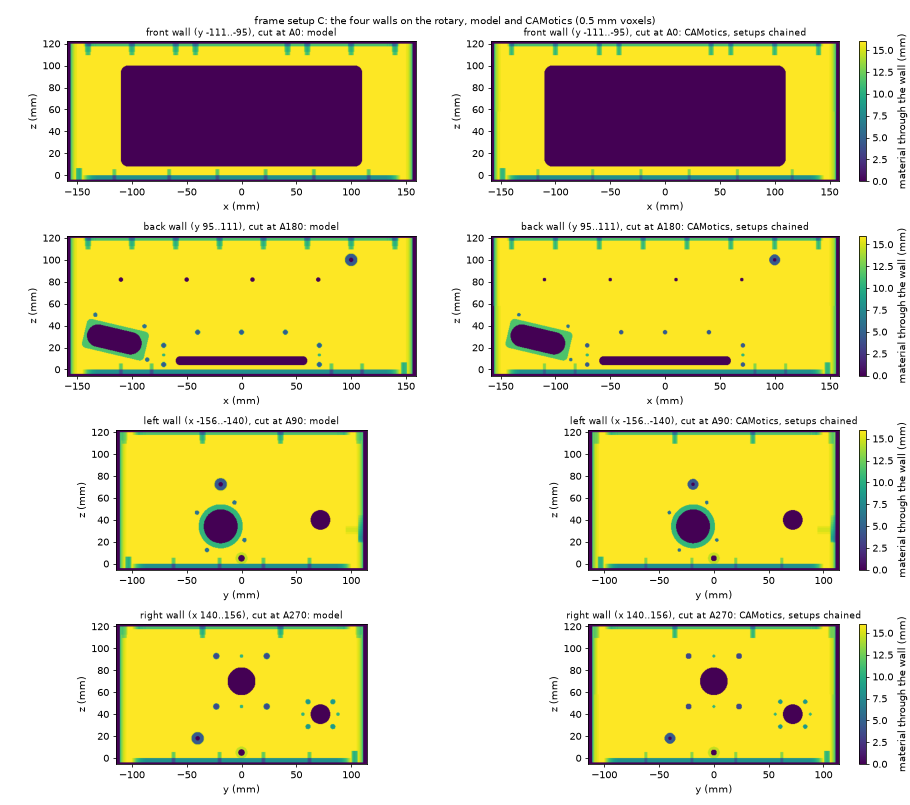
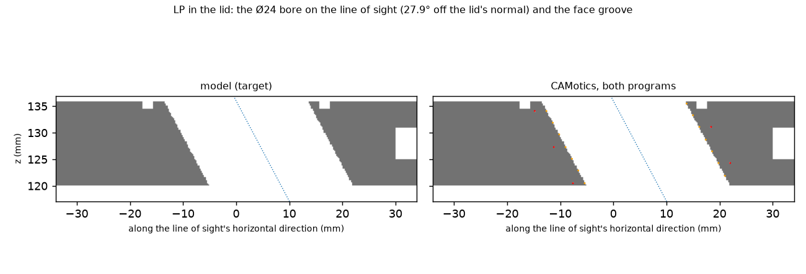

# Making and buying the monitoring hardware (2026-11-25; programs and quotes redone 2026-11-27)

This note covers how to make and buy what [`monitoring.md`](../monitoring.md) §4 proposes (steps 0–8): the new ports in the
chamber frame and lid, the small custom parts, and the bought parts with prices and lead times. The port positions come from
[`cad/monitoring_spec.py`](../cad/monitoring_spec.py), read at run time. The ports are drawn in the model
([`mechanics.md`](mechanics.md)); `cad/monitoring_parts.py` imports `frame_features.py`, so the model and the frame's CAM share
one geometry. Nothing here has been made, ordered or reviewed by a machinist or BYU's Laser Safety Officer; three flat parts
have online instant quotes.

> **2026-11-27.** The frame's two port programs were re-posted for the ports as drawn now (the LW seat Ø40.2 × 5.5 for the
> catalogue Ø40 × 4 window, the clamp ring's holes at 60°, the BW clamp frame's third screw moved) and checked again; LP is
> programmed for the first time, on a sine plate; the three flat parts were re-drawn and re-quoted; the hours follow. Three
> findings change the design (§0): the LP adapter's screw holes as drawn sit in its own O-ring groove, the LW clamp ring's
> holes were too close to its edge for SendCutSend's instant quote, and the BW clamp frame's third screw had 1.2 mm of metal.
> Later that day the A180 program gained the two M4 holes the BW light's bracket screws into (optics.md §4.1). They are drawn
> in `frame_features.py`, which the model and the CAM both read, and the frame's programs were checked again (§2).

Scripts (all in [`analysis/monitoring/fab/`](../analysis/monitoring/fab/)):
- [`frame_features.py`](../analysis/monitoring/fab/frame_features.py) draws the left-wall viewport (LW) and the back-wall light
  window (BW) on the frame, in a form setup C can cut, and checks them against the frame's other holes, corners and liners;
- [`lp_cam.py`](../analysis/monitoring/fab/lp_cam.py) programs the lid's LP (the bore on a sine plate, the groove and holes
  flat), simulates it in CAMotics and runs the holder check on it;
- [`oblique_ports.py`](../analysis/monitoring/fab/oblique_ports.py) works out what the 4th axis can and can't square up for each
  port, and what a window that isn't square to the sight line costs optically;
- [`cam_monitoring.py`](../analysis/monitoring/fab/cam_monitoring.py) programs the new frame features with the repo's own
  pipeline (`freecad_cam.py`, `camotics_sim.py`, `holder_check.py`, all unchanged), simulates and checks them;
- [`hours_monitoring.py`](../analysis/monitoring/fab/hours_monitoring.py) gives shop hours and outside prices for every custom
  part and feature;
- [`flat_parts_dxf.py`](../analysis/monitoring/fab/flat_parts_dxf.py) and [`scs_quote.py`](../analysis/monitoring/fab/scs_quote.py)
  draw three flat parts and price them on SendCutSend's instant-quote page;
- [`build_bom.py`](../analysis/monitoring/fab/build_bom.py) writes [`monitoring-bom.csv`](../monitoring-bom.csv) from the price
  lookups and the optics worker's [`optics-parts.csv`](optics-parts.csv).

## 0. Short answer

**Can the oblique bores be cut in setup C as it is clamped? Only part of the angle.**
- In setup C the frame turns about its own z axis (A along machine X). Turning about z brings any horizontal direction up to the
  spindle. So the rotary takes out a port's **azimuth**, its turn about z away from the wall's normal.
- It can't take out the **elevation**, the tilt down toward the plate. That is a turn about an axis across A, which would need a
  B axis (a trunnion) or a tilted fixture. The same holds for the lid on its 4th axis along x.
- **So the frame's ports are cut square to their faces, big enough to pass the sight line; LP, in the lid, is cut on its line
  of sight with the lid on a sine plate:**

| Port | Angle to the face's normal | The 4th axis takes out | It leaves | What to cut | Window |
|---|---:|---|---|---|---|
| LW, left wall | 14.8° | 7.3° (azimuth) | 12.9° (elevation) | **Ø31 bore normal to the wall at A90** (the clear Ø25 needs Ø30.5 across 16 mm), a Ø40.2 × 5.5 seat for the Edmund 36-983 window (Ø40 × 4) and 4 × M4 on Ø49.5, concentric with it | flat on the wall, 14.8° to the sight line: **0.10 mm of astigmatism, 3–5 µm of blur** against 10–29 µm pixels. Harmless |
| BW, back wall | 49° | 48.4° | 10.0° | **an obround slot 51.2 × 20.5 mm normal to the wall at A180** (a round bore would be Ø51), with a 58 × 27 mm rectangular seat | flat on the wall. A light window, so the angle doesn't matter |
| LP, lid, at (−40, 60) | 27.9° | 23.8° (about the lid's x) | 15.1° | **a Ø24 bore on the line of sight, with the lid on a 27.93° sine plate**: one helix. The adapter's face O-ring groove (2-025) and its four M4 holes flat, in the lid's top setup | **on the adapter boss, square to the line of sight**, as the layer camera's is: no astigmatism. Flat on the lid, a 3 mm window would add 9–13 µm of blur against 11.4 µm pixels |

- A tilted fixture for the frame would add a setup (~1.25 h), a fixture and a risk to the sealing faces, for viewports that
  work as well square to the wall. Not worth it. For LP it is: square to the lid the bore would be Ø31–33 and its face seal
  would overlap the window flange (mechanics.md §0 item 2).

**Every new feature is programmed and checked with the repo's pipeline** (FreeCAD 1.0.2, CAMotics 1.2.0, `holder_check.py`).
- **The frame:** FreeCAD re-posted the LW port at A90 and the BW port at A180 for the ports as drawn now; the A180 program
  also drills the two M4 holes for the BW light's bracket. They add **2.44 min at A90 and 5.11 min at A180** of cutting
  (G-code recount), no new setup and no new A index.
  - **CAMotics, on the frame's seven programs chained: 0 rapids through stock and no gouge deeper than 1 mm.** Leftover deeper
    than 1 mm is 0.025 cm³, all of it at the SAE-4 ports' threads and O-ring cones, which the port tool cuts.
  - **Holder, spindle, fixture and travel check: 0 collisions** in all seven setups. The tightest new clearance is still the
    1/4 in. end mill's shank, 2.76 mm from the stock in the BW slot. The drill for the bracket's holes stays 10 mm or more
    from the fixtures.
- **The lid (LP), new:** two programs, the lid flat (the groove and the four tap holes, 5.84 min) and the lid on the sine plate
  (the bore, 1.05 min). CAMotics on the lid: no gouge and no leftover deeper than 0.5 mm. Holder check: 0 collisions; the bore
  tool's holder passes 8.7 mm from the lid's top face where it rises toward the holder. They need two new tools: a 2.0 mm end
  mill for the 2.3 mm groove and a 1/2 in. end mill with 1-1/2 in. of flutes for the bore (§3.1).
- **The optics bridge's cut-out for the LP camera** (54.7 × 60.1 mm through 25 mm) is in no program; it is ~6 min of cutting
  in the bridge's own top setup.

**Three findings that change parts, made while programming and quoting:**
1. **The LP adapter's four M4 holes, as drawn, sit in its own O-ring groove** (r 16.9 from the port centre; the groove is
   r 15.6–17.9), and their heads would sit inside the boss body. Programmed instead on **Ø48, at ±60° and ±120° from the
   direction away from the lid's centre**: 4.1 mm of wall to the groove, heads clear of the boss, the flange's lugs 8.1 mm from
   the window flange. The model now has the same holes and lugs (`monitoring_parts.lp_adapter_holes()` and the boss's flange,
   changed when the workers were merged on 2026-11-27, §3.1).
2. **SendCutSend flagged the LW clamp ring** as drawn (4 × Ø4.5 on Ø50 in a Ø58 ring): 1.75 mm between each hole and the edge,
   and its instant quote wants 1.90 mm in 1/4 in. 6061, so the order would need a review. The holes moved to **Ø49.5**
   (`frame_features.py`): 2.0 mm, still 3.0 mm of wall between each tap drill and the window seat.
3. **The BW clamp frame's third screw** had 1.16 mm of metal round its hole once the frame was trimmed clear of the inlet
   plenum's flange. `frame_features.bw_hole3()` places it where it gets the most metal: **at the seat's lower +x corner,
   (x −85.99, z 9.09)**, 3.6 mm toward −x and 10.4 mm down: **3.35 mm of metal**, 1.5 mm of wall between its thread and the
   seat pocket, 2.1 mm to the nearest floor screw's hole. Moved ~3 mm straight along the slot, as first planned, its thread
   would break into the seat pocket; 2.25 mm gives the same 3.35 mm of metal but leaves 0.25 mm of wall.

**Hours and dollars.**
- The features on parts that are made anyway (frame, lid, optics bridge, heater block) add **about 5.7 h** of shop time;
  3.6 h of that is LP, which needs a setup of its own on the sine plate.
- The 14 small custom parts would take **48.3 h** if all were made here. Most are flat: **SendCutSend priced three of them
  on 2026-11-27 at $7.43–10.26 each** in 6061 plate (no account; they arrive Dec 1). The compound-angle boss for the lid camera
  is the one machined part worth buying ($379 at SendCutSend CNC for the layer camera's boss).
- Recommended: **about 12.8 h in house and about $516 outside**, plus three parts bought instead of made.

**Bought parts** ([`monitoring-bom.csv`](../monitoring-bom.csv), list prices read on the vendors' pages on 2026-11-25; the three
laser-cut parts re-quoted on 2026-11-27):

| Step | New | With used listings | Notes |
|---|---:|---:|---|
| 0. the ports' parts | $978–1,115 | $978 | windows, slides, gaskets, purge, the three laser-cut parts ($26.97 quoted), a beam trap cube 1 needs now |
| 1. clock and recorder | $2,257–2,457 | $2,001 | PicoScope 4444 $1,645 (used $1,389) |
| 2. spectral check | $0 | $0 | borrow a lamp and spectrometers (list prices in the BOM) |
| 3. layer camera tuned | $1,302–1,327 | $1,302 | 12 mm f/1.8 lens, raking LED bar |
| 4. acoustic emission | $1,111–3,211 | $1,095 | sensor and preamp are quote-only: estimated within Edison's $1–3k |
| 5. two-colour coaxial | $2,179 | $2,179 | the optics worker's parts ([`optics-parts.csv`](optics-parts.csv)) |
| 6. coaxial camera | $987 | $987 | the same |
| 7. side high-speed camera | $12,117 | $10,317 | Chronos 2.1-HD $6,800 (used $5,000) and $3,971 of pulsed 850 nm light; the steep lid camera is a ~$2.2k option |
| 8. cooling: InGaAs behind the DMSP1000 (route A) | $2,160 | $2,160 | the coaxial SWIR camera instead (route B, optics.md §0 item 6): $8,059 new; an off-axis SWIR camera at LW (route C): $9,502 new, $2,819 with a used camera |
| **0–8** | **$23,092–25,554** | **$21,020** | before shipping and tax |

Against monitoring.md's ranges: steps 0–6 $8,814–11,276 (it said $5–9k for steps 1–6; step 0 and the top of the
AE estimate make the difference); with step 7 $20,931–23,393 ($12–18k: the pulsed 850 nm LED and its driver, $3,971,
are the main overrun; monitoring.md had $0.3–1k for light); with step 8's InGaAs route $23,092–25,554 ($14–20k). Other
workers' BOM lines of 2026-11-27 are not in these sums.

**Lead times.** The Chronos 2.1-HD ships in 1–3 business days and the windows are in stock. The long poles are small parts:

- **Thorlabs PDA36A2** (photodiode B, step 5): 0 in US stock, "Lead Time" with no date.
- **Thorlabs B4C/M** (the kinematic platform in both cage cubes, steps 5–6) and **P1000K** (the InGaAs pinhole, step 8): in stock
  overseas only, a transfer of weeks. The XY translator CXY1A (option) shows a lead time too. Everything else the optics worker
  chose was in US stock at 07:53 UTC, though the SOLIS-850C had 1 and the FBH900-40 4.
- **The AE sensor and preamplifier** (step 4): MISTRAS and Vallen quote; lead time unknown until asked. Used ones on eBay ship
  in days.
- **The custom parts:** SendCutSend's laser parts arrive Dec 1 (quotes of 2026-11-27); its CNC (the lid camera's boss) took 6–15 days
  in the 2026-11-22 quotes. The features on the frame, lid and bridge ride on those parts' own setups.
- None of these is near the laser's 10–12 weeks (bom.csv L1). **Step 0 is the one that can't wait:** it has no long-lead part,
  but its decisions must be made before the frame is machined.

**Changes to the design from 2026-11-25** (items 1–4 are in the model now, mechanics.md; the three of 2026-11-27 are above):
1. **The LW window:** no Ø38.1 mm window with a NIR coating is catalogued. Use Edmund 36-983 (Ø40 × 4 mm, NIR I coat, $141, in
   stock) and cut the seat Ø40.2 × 5.5 mm (programmed). It also widens the gasket land from 3.6 to 4.6 mm.
2. **The BW port moves up 4 mm** (centre z 25 → 29.5, elevation 8.5° → 10.0°). Lower, its seat runs into the M4 floor screws
   under the back wall (they reach z 5.5).
3. **The lower back liner's left piece** must start at x −90.8, not −130.5. The BW opening spans the band's whole 16 mm height.
4. **The left liner** needs a Ø27 hole at (y −17.9, z 32.2).
5. **The coaxial branch, cameras, lenses, filters and lights in the BOM are the optics worker's**
   ([`optics-parts.csv`](optics-parts.csv)): photodiode bands at 700 and 900 nm, the camera at 955–990 nm, all clear of the
   750–875 nm stop band of 1064 nm galvo coatings. Its round Ø1 in. dichroics need C4W cubes on B4C/M platforms; Thorlabs'
   CM1-DCH/M takes only 25 × 36 mm optics, which also matters for the DMSP1000 already in optics-bom.csv (O5, O5c). The B4C/M was in
   stock overseas only today.
6. **The Chronos 2.1-HD has a 4/3 in. sensor.** The chosen Kowa 50 mm lens (2/3 in. image circle) covers the cropped high-rate
   modes; full frame at 1,000 fps needs the F mount and a full-frame lens.
7. **A beam trap on cube 1's far port is needed now**, monitoring or not (the optics worker's finding): Thorlabs BTC30, $258.03,
   5 W CW, in stock.

## 1. The oblique ports: what setup C can and can't do

[`oblique_ports.py`](../analysis/monitoring/fab/oblique_ports.py) ([`oblique_ports.json`](../analysis/out/monitoring/fab/oblique_ports.json))
takes each port's sight line from `monitoring_spec.py` and the host face's normal.

### 1.1 What the rotary can square up
- Setup C: the frame on the dummy-floor plate on the HRT210, A along machine X and the frame's z
  ([`machining.md`](../machining.md), setup C). Machine Z at index A is the model direction (−sin A, −cos A, 0). Any
  horizontal direction can be brought up, so the index can be any angle, not just 0/90/180/270.
- A port's sight line has a horizontal part and a vertical part. The index takes out the horizontal turn (the azimuth). The
  tilt toward the plate (the elevation) stays: the tool would have to lean across A.
- The lid: `setup_plan.json` puts it on the 4th axis along its x for one clamping. Turning about x takes out the sight line's tilt
  in the y–z plane, but not its tilt toward x.

| Port | Sight line (into the chamber) | To the face's normal | Index that takes out the turn | Tilt left |
|---|---|---:|---|---:|
| LW (−156, −20, 36) | (0.967, 0.124, −0.223) | 14.79° | A82.7 (azimuth 7.31°) | 12.89° |
| BW (−125, 111, 29.5), up from z 25 | (0.736, −0.654, −0.174) | 49.16° | A131.6 (azimuth 48.39°) | 10.01° |
| LP (−40, 60, 136), moved from (−60, −80) | (0.260, −0.390, −0.883) | 27.93° | 23.8° about the lid's x | 15.06° |

### 1.2 Three ways to cut an oblique viewport, and the choice for each port
1. **Tilt the part** so the tool runs down the sight line: a sine plate or angle plate for the leftover tilt, or a 5-axis or
   trunnion. The frame would leave the rotary for a fourth setup.
2. **3D-contour the bore** with vertical tools from both sides. The frame's walls can't be reached from inside on the rotary
   (the inner face looks at the A axis), so this works only for the lid, and it still leaves no flat seat square to the line.
3. **Cut it square to the face and make it big enough.** The bore holds the clear-aperture cylinder all the way through the wall.
   The window sits flat on the face, at the sight line's angle to it, or on a separate boss that is square to the line.

| Port | Round bore normal to the face that passes the clear aperture | A seat square to the sight line would be deeper on one side by | Window flat on the face: astigmatism, sideways shift | Blur that adds at the camera's NA |
|---|---|---:|---|---|
| LW (clear Ø25, 16 mm wall) | Ø30.1–30.5 (cut Ø31) | 10.6 mm across Ø40.2 | 0.10 mm; 0.33 mm (the 4 mm Edmund 36-983) | 3.2 µm (Chronos, 50 mm f/4), 4.6 µm (75 mm f/4), 4.5 µm (IMX296, 50 mm f/2.8) |
| BW (clear Ø20, 16 mm wall) | Ø48.5–50.7 (cut an obround 51.2 × 20.5) | 29.4 mm across Ø25.6 | 0.99 mm (3 mm) | none: it lights, doesn't image |
| LP (clear Ø20, 16 mm lid), at (−40, 60) | Ø31.0 (Ø33 cut) | 13.6 mm across Ø25.6 | 0.28 mm (3 mm); 0.19 mm (2 mm) | 13.3 µm at f/2.8, 9.3 µm at f/4 (3 mm window); 8.8 / 6.2 µm (2 mm) |

The blur is the astigmatism of a tilted plane-parallel plate (Smith, *Modern Optical Engineering*, plane-parallel plates) times
the object-side NA, with fused silica's n = 1.4525 at 850 nm. The NA is the lens's entrance pupil over its distance from the
plate (the sight line plus ~35 mm, assumed).

- **LW: way 3, at the existing A90 index.** The 14.8° window costs 3–5 µm of blur against 10–29 µm per pixel and a 15 µm
  diffraction limit. Refocus for the 1.3 mm focus shift. The camera mount outside sets the camera on the sight line; it seals
  nothing: a 5/8 in. plate with a fixed 13° wedge (mechanics.md Checks §3).
- **BW: way 3, as a slot.** The sight line is 49° off the back wall. A round normal bore would be ~Ø51 and run into the floor
  screws and the R8 corner. The obround follows the clear cylinder's footprint across the wall instead. A light window doesn't
  care about the 49° tilt; at that angle an AR-coated window reflects a few per cent more.
  - The other way is index A131.6, which takes out the 48.4°: a Ø24 bore along the sight line's horizontal direction. Its mouth on
    the outer face is still ~36 × 24 mm, because the face meets the bore at 48°, and the tool enters that sloping face, so the
    holder's clearance to the face's high side needs checking. Not programmed: the slot at A180 needs no new index and no new
    fixture check.
- **LP: way 1, the lid tilted, and a boss for the window, as the layer camera has** (since LP moved to (−40, 60),
  mechanics.md §3). Way 3 there would need a Ø33 bore whose face seal overlaps the window flange. So the Ø24 bore runs on the
  line of sight, cut with the lid on a sine plate (§3.1), and the window sits square to the line on the adapter boss, a
  separate small part like the layer camera's "viewport adapter + boss". A window flat on the lid would cost about a pixel of
  blur for the steep camera, which is meant to be the high-zoom view.

## 2. The frame's new features, programmed and checked

### 2.1 The features
[`frame_features.py`](../analysis/monitoring/fab/frame_features.py) ([`frame_features.json`](../analysis/out/monitoring/fab/frame_features.json))
cuts them into the frame as `inventory.py` exports it from the default build. 35.2 cm³ come off: the frame goes from 1,582.5 to
1,547.3 cm³. `cad/monitoring_parts.py` cuts the same solids into the model's frame: on a full build with the monitoring parts
(337 parts, 2026-11-27) its frame is 1,547.3 cm³ too.

| Port | Feature | Size | Where (model, mm) | Tool, as programmed |
|---|---|---|---|---|
| LW, A90 | window seat | Ø40.2 × 5.5 deep (the Edmund 36-983 window, Ø40 × 4, between two 0.75 mm FKM layers) | centred on the bore | T3 1/2 in. end mill, helix from the outer face |
| | bore | Ø31 through | axis along x at (y −18.97, z 34.15), the sight line's mid-wall point | T3, helix |
| | clamp-ring holes | 4 × M4 × 0.7, 8 deep (3.3 mm drill 10 deep) | on Ø49.5, from 60° (the ring's flat clears the through-beam's fibre head) | T6 3.3 mm drill; tap not programmed |
| | argon purge | SAE-4 (7/16-20) O-ring boss port + Ø4 passage through | (y −18.97, z 72.45), above the clamp ring | T9 1/4 in. end mill to the 25/64 in. tap drill; T6 through; port tool not programmed |
| BW, A180 | window seat | 58 × 27 mm, R4 corners, 4.5 deep (3 mm window between two 0.75 mm FKM layers) | 1 mm toward +x of the slot's middle | T9, adaptive |
| | slot | obround 51.2 × 20.5 through, long axis 13° below x | ends at (x −130.7, z 30.8) and (−101.3, 23.9), R10.25 | T9, adaptive (T3 found no helix entry in 20.5 mm) |
| | clamp-frame holes | 3 × M4 × 0.7, 8 deep | (−133.3, 49.9), (−88.5, 39.4) above the seat; (−86.0, 9.1) at its lower +x corner (was (−82.4, 19.5)) | T6; tap not programmed |
| | light-bracket holes | 2 × M4 × 0.7, 8 deep | (−141.0, 69.25) and (−129.5, 69.25), above the clamp frame, under the BW light's bracket (optics.md §4.1) | T6, after the clamp-frame holes; tap not programmed |

Checks on the model (`frame_features.json`):
- **The clear apertures are clear:** 0.000 mm³ of frame inside the LW's Ø25 and the BW's Ø20 sight cylinders across the walls.
- **Wall left to the existing holes:** LW bore 13.9 mm to the through-beam's counterbore, seat 8.6 mm to an M4 floor screw,
  clamp holes 9.5 mm or more. BW seat 2.5 mm to the outer R8 corner; clamp holes 6.1 mm and more, but the moved third one
  2.1 mm to a floor screw's hole below it.
- **The BW light's bracket holes** (`light_bracket` in the JSON; `gaps_to_existing_features`): the first one's thread is
  5.0 mm from the outer R8 corner, where the back face's flat ends (x −148); the second one's bottom is 6.0 mm from the back
  wall's inner face. Their threads are 8.8 mm or more from the clamp frame's outline and 21 mm or more from the seat pocket.
  On the full build each sits under the bracket's Ø4.5 clearance hole, on the same axis.
- **The LW clamp ring** (Ø58 × 6.35, ID 31): 2.0 mm of ring outside each Ø4.5 hole, 2.97 mm between its flat and the nearest
  hole, 3.0 mm of wall between each tap drill and the seat.
- **The BW clamp frame** as the model trims it (to the wall's flat face, its bottom edge, and 1 mm clear of the inlet plenum's
  flange): 4.25, 4.25 and 3.35 mm of metal outside its three holes (`clamp_frame.web_to_trimmed_edge_mm`). Before the move the
  third had 1.16 mm. `bw_hole3()` searches the seat's +x end on a 0.1 mm grid for the point with the most metal that keeps
  1.5 mm between the M4 thread and the seat pocket and stays above the floor screws.
- **The BW sits at z 29.5** (the spec moved it up from 25) so its seat clears the floor screws (they rise to z 5.5 at mid-wall;
  the seat starts at z 7.3). It keeps to the flat part of the back face (x ≥ −148; the seat starts at x −146.3). Elevation 10.0°.
- **The BW slot's −x end nicks the inside corner's R10 fillet** by up to ~1 mm where it breaks through. There is no seal there.
- **Liners:** the left liner needs a Ø27 hole at (y −17.9, z 32.2). The BW opening at the lower back liner spans x −122.4 to
  −90.8 and z 14.3 to 36.1, the whole of that 16 mm band, so the piece starts at x −90.8 instead of having a hole.
- **Interference** with the BW frame's screw moved (`interference.py`, `LPBF_MONITORING=1`, M50, 318 parts, 2026-11-27
  08:34–08:37 UTC): 0 interfering pairs in the six states and the eight sweeps, 33 designed joints; the report is the
  committed one but for its run time. The LW ring's holes moved after that run (0.25 mm inward, holes only); two re-runs
  at 09:18 and 09:20 UTC were killed at the 3 GB memory cap after meshing, before any state was checked.

### 2.2 How it was programmed
[`cam_monitoring.py`](../analysis/monitoring/fab/cam_monitoring.py) runs the repo's machining scripts without editing them,
here with FreeCAD 1.0.2 (the official conda AppImage, sha256 checked; see Run):
1. **Run 1:** `freecad_cam.py` on the frame as it is. This re-posts the six committed frame programs; their recounted times match
   [`machining.md`](../machining.md) round 6 (B 6.9, A 41.6, C0 10.5, C90 0.35, C180 2.2, C270 1.5 min).
2. **Run 2:** `freecad_cam.run_cam()` on the frame with the ports, for two jobs:
   - `frame_C90` unchanged. Its wall op found the LW seat, bore, clamp holes, purge port and passage by itself, and programmed them
     with the existing recoater bore and through-beam: seat before bore, as for the SAE ports.
   - `mon_C180`, new, after the existing `frame_C180`: the BW seat and slot (Adaptive inside their outlines), the clamp holes,
     and the two holes for the BW light's bracket (a second drill op with the same 3.3 mm drill, so no new tool change). The
     existing A180 job can't run on the new frame: its inlet-slot op profiles every inner wire of the back face, and the seat's
     outline is now one of them, so it would cut the seat through the wall. The one change to `freecad_cam.py`'s logic, made in
     memory, lets an op name its faces or edges.
3. The setup-C blocks join into one Haas program with the A moves (A0, A90 with the LW, A180, A180 again for the BW, A270; 18
   tool changes). It stays in `/tmp`: it is 0.75 MB, mostly the unchanged door block. The repo keeps the two programs the ports
   change, [`frame_C90_with_LW.ngc`](../analysis/out/monitoring/fab/gcode/frame_C90_with_LW.ngc) and
   [`mon_C180_BW.ngc`](../analysis/out/monitoring/fab/gcode/mon_C180_BW.ngc); the rest is machining.md's
   [`frame_C_haas.nc`](../analysis/out/machining/gcode/frame_C_haas.nc).
4. `camotics_sim.py` and `holder_check.py` ran on the whole chain (B, A, C0, C90, C180, mon_C180, C270) against the frame with
   the ports. Their outputs went to `/tmp`; the summary is
   [`cam_monitoring.json`](../analysis/out/monitoring/fab/cam_monitoring.json).

### 2.3 Results (2026-11-27)

| Program | Cutting, recount (min) | CAMotics (min) | Removed (cm³) | Rapids through stock | Holder/fixture collisions |
|---|---:|---:|---:|---:|---:|
| A90, before | 0.35 | 0.36 | 4.5 | 0 | 0 |
| A90 with the LW | 2.79 | 2.84 | 20.6 | 0 | 0 |
| A180 (unchanged) | 2.24 | 2.41 | 17.7 | 0 | 0 |
| mon_C180, the BW and the light bracket's holes | 5.11 | 5.28 | 18.4 | 0 | 0 |

- **The LW's ops:** seat (Ø40.2) 1.15 min, bore 1.01, purge port 0.12, the four clamp-hole drills 0.10, the passage 0.02 (recount).
- **The BW's ops:** seat 2.09 min, slot 2.77, clamp holes 0.08, the light bracket's holes 0.05 (the same 3.3 mm drill, so no
  new tool change).
- **CAMotics, whole frame:** the model with the ports is 1,548.9 cm³ on the 0.5 mm grid, and CAMotics leaves 1,555.5 cm³
  (+0.43 %).
  - No gouge deeper than 1 mm (deepest 0.5 mm, voxel noise).
  - Leftover deeper than 1 mm: 0.025 cm³ in 74 spots, deepest 1.22 mm, at the three SAE-4 ports' threads and O-ring
    cones (the purge port's at x −156, y −20 to −13, z 66–73), which the port tool cuts. The bracket's two holes add none
    deeper than 1 mm: the drill leaves only the 0.35 mm the tap cuts, as at the clamp-frame holes.
  - No loose pieces: the adaptive clears the BW slot, so no slug drops into the frame.
  - The walls, model beside CAMotics:

  
- **Holder check** ([`holder_check.py`](../analysis/machining/holder_check.py) on the chain): 0 collisions in all seven setups.
  - Tightest new clearances: the 1/4 in. end mill's shank 2.76 mm to the stock in the BW slot (its flutes 0.5 mm, the allowance);
    fixtures 10 mm or more at mon_C180, the bracket's holes included. At A90 the 1/4 in. end mill's flutes stay 3.85 mm from
    the dummy-floor plate at the through-beam counterbore.
  - The holder check's own chained stock: no gouge deeper than 1 mm; leftover deeper than 1 mm 0.182 cm³ in 39 spots, at the
    SAE-4 ports' thread rings and O-ring cones, which the port tool cuts (not programmed).
- **Not programmed, as before:** the M4 taps (9, with the bracket's two), the SAE-4 port tool, spot drills.
  `hours_monitoring.py` adds 0.4 min a tap and 1 min for the port tool.

### 2.4 Hours added to machining.md's totals
- **Frame:** no new setup and no new A index; the clamping is the same. CAM 0.37 h (LW) and 0.57 h (BW, with the bracket's
  holes): 0.015 h a hole as in `hours.py`, plus 0.25 h for each new feature that is not a plain hole (an assumption: `hours.py`
  has no rule for adding to a proven program). Run 0.09 h and 0.12 h with the taps. Inspecting the two new seats 0.25 h each.
- **The frame's programmed run time** goes from 65.1 to about 72.6 min.
- **The lid:** LP adds 3.6 h, most of it the sine-plate setup (§3.1).
- **Totals:** machining.md's 287.3 h with a 4th axis (302.3 h on 3 axes) over 57 parts grows by **5.7 h** for the features on
  the frame, lid, bridge and heater block.
  - Making all 14 new small parts here would add **48.3 h** more (to ~341 h).
  - With the recommended split (§3) the shop does **12.8 h** in all (to ~300 h), and about $516 of parts come from outside.

## 3. The lid, the bridge, the liners and the small parts

[`hours_monitoring.csv`](../analysis/out/monitoring/fab/hours_monitoring.csv) has every row. In-house cost is at $65/h, BYU's shop
rate for academic departments (`should_cost.py`). Outside prices:
- **three parts quoted on 2026-11-27:** SendCutSend's instant quote page, with no account and nothing put in a cart, through the
  lab tunnel, for the DXFs from [`flat_parts_dxf.py`](../analysis/monitoring/fab/flat_parts_dxf.py) as the model draws the parts
  now, driven by [`scs_quote.py`](../analysis/monitoring/fab/scs_quote.py)
  ([`sendcutsend_quotes.csv`](../analysis/out/monitoring/fab/quotes/sendcutsend_quotes.csv), with each file's sha256 and a
  screenshot): the LW clamp ring $10.26 for one, $6.95 each for 10 (6061-T6 1/4 in., 58.003 x 58.004 mm), the BW clamp frame $9.28 for one, $5.84 each for 10 (3/16 in.,
  72.948 x 61.897 mm), the LP blanking cap $7.43 for one, $4.96 each for 10 (1/4 in., 58.894 x 54.021 mm); all arrive as soon as
  Tue, Dec 1; shipping not shown. No DFM warning on any of the three at its
  thickness. (On 2026-11-25 they were $9.83, $9.87 and $11.44, for the older outlines.)
  - The LW ring as first drawn (holes on Ø50) priced at $10.26 too, but with a DFM flag: "Review Required: Hole-to-Edge
    Bridging ... The minimum hole to edge distance for instant quoting in this material is 1.90 mm"; it had 1.75 mm. On Ø49.5
    it has 2.0 mm and no flag.
- **the rest:** the closest instant quote already in [`outsourcing-quotes.csv`](../outsourcing-quotes.csv) (2026-11-22) for a
  part of the same kind, labelled "analogue".

### 3.1 LP in the lid, programmed

LP sits at (−40, 60, 136) ([`mechanics.md`](mechanics.md) §3). Its Ø24 bore runs on the line of sight to the plate centre, 62.1°
steep, so 27.9° off the lid's normal. The lid's 4th-axis clamping (along its x, `setup_plan.json`) takes out 23.8° of that and
leaves 15.1° ([`oblique_ports.json`](../analysis/out/monitoring/fab/oblique_ports.json)). So the bore gets a setup of its own.
[`lp_cam.py`](../analysis/monitoring/fab/lp_cam.py) programs it with the repo's FreeCAD pipeline (`freecad_cam.run_cam()` with
cam_monitoring.py's in-memory patch), simulates it in CAMotics and runs `holder_check.sweep()` on it
(results in [`cam_monitoring.json`](../analysis/out/monitoring/fab/cam_monitoring.json) under `"LP"`). There is no lid program
in the repo, so the stock is the lid as drawn without LP (inventory.py's default build).

| Program | Setup | Ops | Tool | Cutting, recount |
|---|---|---|---|---:|
| [`mon_lid_LP_top.ngc`](../analysis/out/monitoring/fab/gcode/mon_lid_LP_top.ngc) | the lid flat, top up (its own +z setup) | the adapter's face O-ring groove (2-025: ID 31.2, 2.3 wide, 1.32 deep), pocketed in three depths; four M4 tap holes, 3.3 × 8 | T15 2.0 mm end mill (new: the groove is narrower than T4's 1/8 in.); T6 | 5.84 min (groove 5.72) |
| [`mon_lid_LP_sine.ngc`](../analysis/out/monitoring/fab/gcode/mon_lid_LP_sine.ngc) | the lid on a sine plate at 27.93°, turned −33.69° on it so the plate's hinge runs square to the line of sight | the Ø24 bore: one helix, 1 mm a turn, from 1 mm above the mouth's high side to 0.5 mm past the exit's low side (33 mm along the tool) | T16 1/2 in. end mill with 1-1/2 in. of flutes, 50 mm out (new) | 1.05 min |

- **The sine plate.** 27.93° is a 2.3423 in. gauge-block stack on a 5 in. sine plate. Work zero in both programs is the LP centre
  on the lid's top face; in the sine setup the machine frame is the model turned by Rx(27.93°)·Rz(−33.69°) about it, and the
  lid's top face rises toward +Y. The lid sits on 1 in. parallels clear of the bore's exit. On 1/2 in. parallels the plate,
  which rises with the lid, came within 0.75 mm of the tool's end under the bore's high side.
- **Why T16.** With T3 (1 in. of flutes) the holder check put its shank 0.01 mm off the wall it had just cut: the bore is 33 mm
  deep along the tool on the plate. T16 keeps the bore at 1.9 × the tool's diameter, as a helix wants.
- **CAMotics** (0.2 mm grid over the lid within 36 mm of the port): the lid less both programs' cuts against the lid with the LP
  features. No gouge and no leftover deeper than 0.5 mm (5.1 mm³ and 8.2 mm³ in all, one voxel deep, along the bore's
  wall); no loose piece. The flat program removes 609 mm³, the bore 8,188 mm³. The bore meets nothing inside the lid: the
  cover-slide drawer slot is about 8 mm past its exit.

  
- **Holder check: 0 collisions** in both setups, no rapid through stock. On the sine plate T16's shank passes 4.25 mm and its
  side-lock holder 8.73 mm from the lid's rising top face; the plate, parallels and toe clamps are 10 mm or more away. Flat,
  T15's holder is 8.6 mm from the lid and T6 9.1 mm from a parallel.

**The adapter's screw holes, as drawn, break into the O-ring groove.** `monitoring_parts.lp_adapter_holes()` puts the four M4
3.5 mm in from the Ø40.8 adapter's edge: on r 16.9 from the port centre, inside the groove (r 15.6–17.9). Each tapped hole
would open in the groove floor under the O-ring, and an M4 head there would sit 49–102 mm³ inside the boss body, which leans
over the flange. `lp_cam.py` programs them where they clear both: **4 × M4 on Ø48, at ±60° and ±120° from the direction away
from the lid's centre**. That leaves 4.1 mm of wall between each thread and the groove, keeps each head (Ø7, +0.5 mm) and a key's
path 40 mm up clear of the boss, and puts the lugs the flange then needs 8.1 mm from the window flange (`"adapter_holes"` in the
JSON). The model has had the same change since the workers were merged on 2026-11-27: `lp_adapter_holes()` returns this pattern
and the boss's flange carries R5.5 lugs round each hole, as the cap does, so the model's lid and the programmed one now agree.
The blanking cap is drawn and quoted with the new pattern.

**The optics bridge's cut-out for the LP camera is in no program.** The repo programs only the frame and the floor plate. As
the monitoring model cuts it, it is a 54.7 × 60.1 mm hull through the 25 mm bridge: 74.6 cm³ and 50.8 cm² of wall, about
5.9 min at hours.py's rates (16 cm³/min roughing, 40 cm²/min finishing), in the bridge's own top setup. Its modal check is
mechanics.md Checks §5 (f1 128 Hz, −0.1 %).

### 3.2 Every item

| Item | Where / how | Hours in house | In house | Outside | Call |
|---|---|---:|---:|---:|---|
| LW port in the left wall: Ø40.2 x 5.5 window seat, Ø31 bore, 4 x M4 on Ø49.5, SAE-4 purge port + Ø4 passage | chamber frame, setup C at A90 (programmed, simulated, holder-checked) | 0.7 | $46 | - | make |
| BW port in the back wall: 58 x 27 R4 window seat 4.5 deep, 51.2 x 20.5 obround slot, 3 x M4 (the third at the seat's lower +x corner); 2 x M4 above it for the BW light's bracket | chamber frame, setup C at A180 (programmed, simulated, holder-checked) | 0.95 | $61 | - | make |
| LP in the lid, flat: the adapter's face O-ring groove (2-025, ID 31.2 x 2.3 x 1.32) and 4 x M4 on Ø48 | chamber lid, its +z setup (programmed in lp_cam.py, simulated, holder-checked) | 0.7 | $45 | - | make |
| LP bore Ø24 on the line of sight, the lid on a sine plate at 27.93 deg: a new setup on the lid | chamber lid on a sine plate (programmed in lp_cam.py, simulated, holder-checked) | 2.9 | $186 | - | make |
| Optics-bridge cut-out for the LP camera (54.7 x 60.1 mm through 25 mm, 74.5 cm3; in no program) | optics bridge, its existing +z setup (estimated) | 0.5 | $29 | - | make |
| Liner openings: Ø27 hole in the left liner; the lower back liner's left piece starts at x -90.8 (was -130.5) | lift-out liners (sheet, outsourced anyway) | 0.0 | $0 | $0.00 | outsource (with the liners) |
| AE waveguide hole Ø2.5 through the heater block and piston head (only for the waveguide option) | heater block, piston head: existing setups | 0.1 | $3 | - | make |
| LW window clamp ring, 6061, Ø58 x 6.35 with a flat, ID 31, 4 x Ø4.5 on Ø49.5 | new | 4.6 | $302 | $10.26 (quoted) | outsource (laser-cut plate) |
| LP blanking cap over the lid's face O-ring until the steep camera is bought, 6061 1/4 in., Ø40.8 with 4 lugs, 4 x Ø4.5 on Ø48 | new | 2.3 | $147 | $7.43 (quoted) | outsource (laser-cut plate) |
| LW blanking disc in place of the window until the camera is bought (Ø40 x 4, 6061) | new | 3.2 | $207 | - | buy instead: fit the Ø40 x 4 window from the start: it costs about what the blank does |
| LW purge nozzle inside the chamber | new | 4.6 | $299 | $79.18 (analogue) | buy instead: 1/8 in. 316 tube through a bored-through SAE-4 x 1/8 in. tube fitting, bent and flattened at the tip (estimate $40-70) |
| LW cover-slide holder (Ø30 x 1 slide) on the left liner | new | 2.2 | $142 | $22.85 (analogue) | outsource (sheet clip with the liner) |
| LW camera bracket (flat 6061 plate under a ball head or tilt mount; the camera's line is set by the head) | new | 2.4 | $153 | $27.12 (analogue) | outsource (laser-cut plate) |
| BW window clamp frame, 6061 3/16 in., 72.9 x 61.9 trimmed to the wall and the plenum's flange, 3 x Ø4.5 | new | 2.3 | $148 | $9.28 (quoted) | outsource (laser-cut plate) |
| LP adapter boss (compound angle; window seat on the line of sight; face O-ring on the lid), 6061 | new | 7.1 | $460 | $379.48 (analogue) | outsource (CNC) |
| LP window retaining ring | new | 4.5 | $292 | $257.00 (analogue) | buy instead: Thorlabs SM1 retaining ring or a laser-cut ring (should_cost.py: estimate $10) |
| LP cover-slide holder | new | 2.2 | $142 | $22.85 (analogue) | outsource (sheet clip) |
| AE sensor clamp on the rod end (spring-loaded, 6061) | new | 3.7 | $239 | $27.12 (analogue) | outsource (laser-cut plate) + bought spring |
| AE waveguide: Ø2 mm 316 rod, tip faced and polished; spring-loaded cool-end holder (PEEK or 6061) | new | 4.7 | $303 | $79.18 (analogue) | make |
| Coaxial camera adapter plate (IMX296 board on a 30 mm cage plate) | new | 2.3 | $147 | $10.00 | outsource (laser-cut plate) or print |
| Sync breakout box (bought enclosure, 6-8 BNC bulkheads drilled) | new | 2.4 | $155 | - | make (hand-drilled) |

- **Most of the "turned" parts are flat.** The LW clamp ring, the BW clamp frame, the LP cap, the camera bracket and the AE
  clamp are plates with holes: a laser service cuts them for $7–30 each. Made here, each takes 2–5 h, mostly CAM and setups.
  The BW clamp frame is quoted with the outline the model trims it to (72.9 × 61.9 mm), no longer a stand-in.
- **Bought instead of made:**
  - the LW blank: fit the window from day one; a turned blank costs more (3.2 h) than the window ($141);
  - the purge nozzle: a 1/8 in. 316 tube through a bored-through SAE-4 tube fitting, bent and flattened at the tip;
  - the LP window's retaining ring: a Thorlabs SM1 ring or a laser-cut ring.
- **The LP boss** is the one machined part to send out: SendCutSend CNC priced the layer camera's boss at $379.48 (2 for
  $219.48 each). Made here it is 7.1 h with a sine plate on the rotary. Its flange needs the four lugs of §3.1.
- **The lid:** the groove and the four holes ride on the lid's top setup; the bore needs the sine-plate setup (§3.1). The
  programmed holes stay out of the cover-slide drawer slot (x ±36, z 125–131 inside the lid); the bore ends about 8 mm short
  of it.

## 4. Bought parts

[`monitoring-bom.csv`](../monitoring-bom.csv) has one line per part: part number, vendor, quantity, unit price, the vendor's URL and
the UTC time it was read, stock or lead time, the cheapest used listing for the expensive items, and the step. The raw lookups,
with page notes, are [`price_lookups_optics.csv`](../analysis/out/monitoring/fab/price_lookups_optics.csv) (172 rows) and
[`price_lookups_cameras.csv`](../analysis/out/monitoring/fab/price_lookups_cameras.csv). Prices were read through the lab tunnel
on 2026-11-25, 06:45–08:00 UTC. They are list prices for one unit, before shipping and tax. No account was made and nothing was
put in a cart.

| Step | What it buys | New | With used listings | Options, not counted | Lines estimated or quote-only |
|---|---|---:|---:|---|---|
| 0. before machining: the ports' parts | LW window (Ø40 × 4, NIR AR) and 6 slides, BW window (custom), FKM sheet, LP face O-ring, purge valve and fittings, the three laser-cut parts (quoted 2026-11-27), slide holders, a beam trap for cube 1 (needed now) | $978–1,115 | $978 | - | M0-03, M0-06, M0-12, M0-16 |
| 1. clock and recorder | PicoScope 4444 + 4 TA271, 6 BNC cables, tees, RTC6 D-sub breakout, isolators, sync box, 4 TB SSD | $2,257–2,457 | $2,001 | $9,170 new / $1,800 used (M1-09) | M1-07, M1-08 |
| 2. spectral check of the scan head | borrowed lamp and spectrometers (not counted) | $0 | $0 | - | - |
| 3. layer camera tuned | 12 mm f/1.8 lens, 300 mm LED bar for raking light, a second light, switching, a second 1070 nm blocker | $1,302–1,327 | $1,302 | - | M3-05 |
| 4. acoustic emission | D9215-class sensor and 2/4/6-class preamp (quote: estimated), Molykote 41, pencil leads, SMA-BNC cable, sensor clamp | $1,111–3,211 | $1,095 | $23 new / $23 used (M4-06, M4-07) | M4-01, M4-02, M4-03 |
| 5. two-colour coaxial | the optics worker's branch: FESH1000, DMLP805, FBH700-40, FBH900-40, PDA36A2, achromat, 2 pinholes, cube 3, cage parts | $2,179 | $2,179 | - | - |
| 6. coaxial camera | DMSP950, mono IMX296 board, 75 mm achromat, FESH1000, cube 2, C-mount adapter, Pi cable, adapter plate | $987 | $987 | $216 new / $216 used (M6-08) | M6-09 |
| 7. side high-speed camera (and the steep lid camera) | Chronos 2.1-HD 8 GB, Kowa 50 mm lens, 850 nm filter, FESH1000, 850 nm LED (SOLIS) + pulsed driver, trigger cable, bracket | $12,117 | $10,317 | $13,444 new / $13,303 used (M7-09, M7-10, M7-11, M7-12, M7-13, M7-14, M7-15, M7-16, M7-17, M7-18) | - |
| 8. cooling through solidification | route A, InGaAs behind the DMSP1000: PDA20CS2, 2 × FELH1250, 100 mm lens + pinhole, a ~1180 nm dichroic cube (estimated), 2 × FESH1000 | $2,160 | $2,160 | $18,335 new / $11,652 used (M8-06 to M8-12: route B $8,059, route C $9,502, and the notch dichroic, not recommended) | M8-04 |
| **0–8** | | **$23,092–25,554** | **$21,020** | | |

### 4.1 Choices worth knowing
- **Coaxial branch, cameras, lenses, filters and lights follow the optics worker** ([`optics-parts.csv`](optics-parts.csv), its
  prices and dates; the BOM's `price_source` column says which file each price comes from). Its bands: photodiode A at 700 nm and B
  at 900 nm (40 nm FWHM, split by a DMLP805), the camera at 955–990 nm off a DMSP950, all clear of the 750–875 nm stop band of
  1064 nm galvo coatings (Edison r8-coaxial-radiometry). Round Ø1 in. dichroics go in C4W cubes on B4C/M platforms with FFM1
  mounts ($270.74 a cube); Thorlabs' CM1-DCH/M ($205.91) takes only 25 × 36 mm optics. What I added to its lines: stock at 07:53
  UTC, an SM1-to-C-mount adapter, the Pi cable, BNC cables, and a price for the beam trap it estimated (Thorlabs BTC30, $258.03,
  5 W CW).
- **The InGaAs route (step 8, A)** is the optics worker's: a PDA20CS2 behind the existing DMSP1000, which leaks 1625–1725 nm at
  3–30 %. It does not recommend the Semrock NFD01-1064 notch dichroic ($774.18), which has only a pulsed damage figure (1 J/cm²
  at 532 nm, 10 ns) and would carry 500 W. Its ~1180 nm splitter cube is unpriced; the BOM puts it at $602.50 from its note.
- **Windows and slides.** Edmund 36-983 for the LW (above). The LP window is a plain Ø25.4 × 3 mm fused-silica disc (Edmund 25-245,
  $86). **Slides:** laser-head protective glass costs about half of an optical window of the same size: Precitec Ø30 × 1.5 at $47.05
  ($41.17 at 6+) and Ø24.4 × 2 at $42.50, against Edmund's $101 and $86. Fibre-laser windows from Cloudray-type sellers looked
  like ~$9 in a search snippet; eBay blocked the tunnel, so size and coating are unconfirmed. Edison r8-viewports suggests
  plain borosilicate or soda-lime slides, which would be cheaper still.
- **The side camera.** Kron's store showed the Chronos 2.1-HD at $6,800 for 8 GB (the optics worker's read, 06:49 UTC) and, by
  07:00 UTC, a 10 % anniversary sale: $6,120 (8 GB), $6,480 (16 GB), $7,110 (32 GB), 1–3 business days. The BOM keeps $6,800. Two
  BNC trigger inputs and frame-strobe outputs, an isolated trigger on its AUX port, a REST API. **Its sensor is 4/3 in.**: the
  Kowa LM50JC10M's 2/3 in. image circle covers the cropped high-rate modes, not the full 19.2 × 10.8 mm frame. For full frame, order
  the F mount and a Nikon F lens (50 mm f/1.8G $239.95; a G lens has no aperture ring, so check Kron's mount or buy the D version).
- **The coaxial camera board.** The InnoMaker CAM-IMX296RAW mono ($69) has a trigger input and a CS seat. The Waveshare mono board
  is discontinued, and the Raspberry Pi Global Shutter Camera (colour) was out of stock or back-ordered at all five resellers checked.
- **The digitizer.** The PicoScope 4444 ($1,645 at TEquipment; GBP 1,115 at Pico; used $1,389) has four differential D9 inputs;
  single-ended BNC signals need TA271 adaptors ($24, 9 in stock). The NI USB-6366 (8 simultaneous 16-bit channels at 2 MS/s
  each) lists at $9,170 with a 16–17 week lead time; used ones start at $1,800. A Red Pitaya 4-input kit is $1,366 but out of
  stock until May 2027.
- **Acoustic emission.** Edison r8-ae-waveguide: a D9215 under the plate, coupled with Molykote 41 (McMaster 1252K32, $54.07,
  rated to 288 °C), is the set-up that has worked at 200 °C. MISTRAS's page gives the D9215 50–650 kHz and 540 °C for the sensor
  (its soft cable only 150 °C). MISTRAS and Vallen sell by quote. A cheap first test on the rod end (≤ 75 °C): a used R15a
  ($834–899) and MISTRAS's 5 V PreAmp One ($449.95 on eBay), which runs from USB power and so feeds the PicoScope with no
  decoupler.
- **Sync.** SCANLAB lists no separate RTC6 I/O board. The RTC6's brochure lists 16-bit DIO, 8-bit DO, 2-bit DIO and a 12-bit 0–10 V
  analog output, logic levels not stated. Its outputs go to a D-sub breakout (AutomationDirect ZL-RTB-DB25, $60) and two 4-channel
  isolator boards (Pololu 5740, $2.95 each) in a small box with BNC outputs.

### 4.2 Used options
| Line | New | Cheapest used listing read | Listing | What to check |
|---|---:|---:|---|---|
| M1-01 Digitizer: PicoScope 4444, 4 differential inputs, 12/14-bit, 20 MHz, 4 | $1,645 | $1,389 | [317129055097](https://www.ebay.com/itm/317129055097) (2026-11-25T06:54Z): used (Pre-Owned): PicoScope 4444 (used) (Pico 4444) | the D9 adaptors (TA271) and that it ships from abroad |
| M1-09 Alternative digitizer: NI USB-6366, 8 simultaneous 16-bit inputs at 2  | $9,170 | $1,800 | [307181669592](https://www.ebay.com/itm/307181669592) (2026-11-25T06:56Z): used (Pre-Owned): National Instruments USB-6366 USB X Series Multifunction DAQ 8-Channel (used) (NI USB-6366) | the variant (BNC, screw or mass termination) and the power supply |
| M4-01 AE sensor, high-temperature broadband (MISTRAS D9215 class; Seleznev 2 | $700–1,800 | $834 | [317770644974](https://www.ebay.com/itm/317770644974) (2026-11-25T06:51Z): new (Brand New): R15CL Acoustic Emission Sensor R15a (listed as new) (R15CL / R15a) | an R15a is resonant at 150 kHz and not rated for heat: fine on the rod end, not under the plate |
| M4-02 AE preamplifier 20/40/60 dB (MISTRAS 2/4/6 class) | $300–900 | $150 | [127880027110](https://www.ebay.com/itm/127880027110) (2026-11-25T06:54Z): used (Pre-Owned): Mistras IL-LP-WS in-line low-power AE preamplifier 26 dB 65-1100 kHz BNC/SMA (used) (MISTRAS | 28 V phantom power: needs a decoupler (Vallen DCPL2 class) to feed the PicoScope |
| M7-01 Kron Chronos 2.1-HD, 8 GB, mono (4/3 in. sensor; 24,046 fps at 640 x 9 | $6,800 | $5,000 | [840036095876](https://www.ebay.com/itm/840036095876) (2026-11-25T07:38Z): used (pulled from a working environment; dent on the lens): Kron Technologies CR-21-1.0-32C High Speed Camera  | colour (not mono), 32 GB, lens dented; check the sensor and memory |
| M7-09 Option: full-frame lens, Nikon F 50 mm f/1.8G (order the Chronos with  | $240 | $100 | [900049171921](https://www.ebay.com/itm/900049171921) (2026-11-25T07:41Z): used (Pre-Owned): Nikon AF-S Nikkor 50mm f/1.8G lens (used) (Nikon 2199) | a G lens: aperture control on Kron's F mount |
| M8-10 Route C: off-axis SWIR camera at LW, 640 x 512 class, InGaAs, GigE ( | $8,730 | $2,047 | [176713590028](https://www.ebay.com/itm/176713590028) (2026-11-25T06:48Z): used (Pre-Owned): Xenics XC251 (Bobcat 320 family) tested (used) (Xenics XC251) | interface (GigE or Camera Link), trigger input, 320 × 256; ships from China |

## 5. Time and cost

| | Shop hours | Outside | Bought | Calendar |
|---|---:|---:|---:|---|
| Features on the frame, lid, bridge, heater block | 5.7 h (3.6 h of it LP: the sine-plate setup 2.9 h, the groove and holes 0.7 h) | - | - | none extra but LP's sine-plate setup on the lid |
| 14 small custom parts, all made here | 48.3 h ($3,136 at $65/h) | - | - | ~2.5 weeks at 20 h/week |
| The same, as recommended | 7.1 h | $516 | 3 parts bought instead | Dec 1 for the laser parts; 6–15 days for the CNC boss |
| Bought parts, steps 0–8 (route A) | - | - | $23,092–25,554 ($21,020 with used listings) | days, except §0's lead-time items |

- **Total, as recommended:** about 12.8 h of shop time (~$831 at $65/h), about $516 of outsourced parts, and
  $23,092–25,554 of bought parts. The 3.0 h more than on 2026-11-25 is mostly LP's bore on the line of sight: a setup of its
  own on a sine plate (1.25 h for a large part as hours.py has it, 0.5 h to set the plate, 0.85 h of CAM), where the old Ø37
  bore normal to the lid rode on the lid's top setup. The BW light bracket's two holes add 0.05 h.
- **Two new tools** (not in tooling-bom.csv): a 2.0 mm 2-flute carbide end mill for the LP groove and a 1/2 in. × 1-1/2 in.
  LOC × 4 in. carbide end mill for the LP bore; tens of dollars each, not priced.
- **The long pole** is a back-ordered Thorlabs detector and two overseas Thorlabs parts (steps 5, 6 and 8), and the AE quotes
  (step 4). The machining isn't: every frame feature is in setup C's existing clamping and indexes, and the lid's sine-plate
  setup is a few hours.
- **Cheapest useful start** (steps 0, 1 and 3, and AE on the rod end with used parts): about $5,376.

## 6. Not done, and limits
- **`lp_cam.py` was not re-run after the model's holes moved** (2026-11-27, at the merge). Its "drawn" holes are the old ones in
  its JSON; the programmed ones were already where the model now draws them, so the programs don't change.
- **The LW ring's holes moved 0.25 mm inward after the interference run** (Ø50 → Ø49.5). Only holes moved, so no new contact,
  but the model was not re-checked with them: two re-runs were killed at the 3 GB cap the shared runner allows.
- **The sine-plate setup is drawn, not designed.** A 312 × 222 mm lid turned −33.69° on a 6 × 12 in. sine plate overhangs it on
  every side; a larger tilting table or an angle plate set to 27.93° may suit the shop better. The fixtures in the holder check
  are a 400 × 400 × 25 mm plate on 1 in. parallels and four toe clamps at the lid's ends; work zero (the LP centre on the top
  face) has to be picked up from the lid's datum edges or by probing the groove, which no set-up sheet describes yet.
- **The optics bridge's cut-out is estimated, not programmed** (no program in the repo covers the bridge). The liners and the
  small parts are estimated too.
- **The A131.6 index for the BW was not programmed or checked.**
- **Not programmed, so not simulated:** taps (9 on the frame, 4 on the lid), the SAE-4 port tool, spot drills, deburring.
  CAMotics models drills as flat-ended.
- **The optics of the tilted LW window** use a thin-plate formula with an assumed pupil distance; ghost reflections and the
  window's wedge are not modelled.
- **Outside prices:** three parts have SendCutSend instant quotes (sheet cutting only, no shipping, before any review by the
  vendor; the LW ring clears their 1.90 mm hole-to-edge rule by 0.1 mm); the rest are analogues, not quotes for these parts.
- **Prices are list prices on one day.** Kron's page showed a 10 % sale during these reads ($6,120 for 8 GB); the BOM keeps the
  optics worker's $6,800. Some prices came from search snippets and are labelled so. eBay listings change daily; none was
  checked for condition beyond the listing text.
- **Quote-only:** the AE sensor and preamplifier (MISTRAS, Vallen), SCANLAB's RTC6 I/O, a custom 1300–1700 nm notch dichroic,
  LUCID's own SWIR prices, Cavitar's pulsed light. Their totals use Edison's ranges or used listings, and say so.
- **The optics worker's lines** carry its prices and dates as it read them; I added stock only. Where we read the same page at
  different times (the Chronos), the BOM keeps its price and the note gives mine.
- **Laser safety:** none of the windows, cameras or lights has been reviewed by the LSO. The 808 nm 10 W source (M7-10) is
  Class 4: an option only with the LSO's approval.

## Run
FreeCAD 1.0.2 is the official conda AppImage from the GitHub release,
`FreeCAD_1.0.2-conda-Linux-x86_64-py311.AppImage`, sha256
`e00be00ad9fdb12b05c5002bfd1aa2ea8126f2c1d4e2fb603eb7423b72904f61` (the same as the release's SHA256 file), extracted with
`--appimage-extract` to `/tmp/fc/squashfs-root`. CAMotics 1.2.0 is the Docker image from
[`camotics.Dockerfile`](../analysis/machining/camotics.Dockerfile). On 2026-11-27 the frame's whole chain took 4–7 min in
CAMotics.
```
P=desktop-lpbf/analysis/monitoring/fab
FCMD=/tmp/fc/squashfs-root/usr/bin/freecadcmd
/tmp/heavy 3 env OMP_NUM_THREADS=1 /tmp/venv/bin/python desktop-lpbf/analysis/machining/inventory.py --out /tmp/fab-e/parts
/tmp/heavy 3 env OMP_NUM_THREADS=1 LPBF_MONITORING=1 /tmp/venv/bin/python desktop-lpbf/analysis/machining/inventory.py --out /tmp/fab-e/parts-mon
OMP_NUM_THREADS=1 /tmp/capmem 3 /tmp/venv/bin/python $P/frame_features.py
/tmp/venv/bin/python $P/oblique_ports.py
OMP_NUM_THREADS=1 /tmp/capmem 3 env FREECADCMD=$FCMD /tmp/venv/bin/python $P/cam_monitoring.py post
/tmp/heavy 4 sg docker -c "env OMP_NUM_THREADS=1 CAMOTICS_MEM=3g CAMOTICS_CPUS=1 /tmp/venv/bin/python $P/cam_monitoring.py sim"
/tmp/heavy 3 env OMP_NUM_THREADS=1 /tmp/venv/bin/python $P/cam_monitoring.py holders
/tmp/venv/bin/python $P/cam_monitoring.py summary
OMP_NUM_THREADS=1 /tmp/capmem 2 /tmp/venv/bin/python $P/lp_cam.py prep
OMP_NUM_THREADS=1 /tmp/capmem 3 env FREECADCMD=$FCMD /tmp/venv/bin/python $P/lp_cam.py post
/tmp/heavy 4 sg docker -c "env OMP_NUM_THREADS=1 CAMOTICS_MEM=3g CAMOTICS_CPUS=1 /tmp/venv/bin/python $P/lp_cam.py sim"
OMP_NUM_THREADS=1 /tmp/capmem 3 /tmp/venv/bin/python $P/lp_cam.py holders
/tmp/venv/bin/python $P/lp_cam.py summary
/tmp/venv/bin/python $P/flat_parts_dxf.py; xvfb-run -a /tmp/venv/bin/python $P/scs_quote.py OUT DXF STEPS...   # see its docstring
/tmp/venv/bin/python $P/hours_monitoring.py
/tmp/venv/bin/python $P/build_bom.py     # from the committed lookups and desktop-lpbf/monitoring/optics-parts.csv
OMP_NUM_THREADS=1 /tmp/heavy 3 env LPBF_MONITORING=1 /tmp/venv/bin/python desktop-lpbf/analysis/interference.py M50
```

## Sources
- Edison r8 answers, 2026-11-25: [`r8-viewports`](../edison/r8-viewports/answer.md) (window thickness, Robinson 1980; sacrificial
  slides), [`r8-ae-waveguide`](../edison/r8-ae-waveguide/answer.md) (D9215 under the plate with Molykote 41; waveguide 1.5–2 mm,
  150–250 mm, 10–20 N), [`r8-coaxial-radiometry`](../edison/r8-coaxial-radiometry/answer.md) (750–875 nm blocked by 1064 nm galvo
  coatings; 700/950 nm pair; InGaAs 1300–1550 nm).
- Kron Technologies, Chronos 2.1-HD store page (4/3 in. sensor; F, EF, MFT and C mounts; prices): https://www.krontech.ca/product/chronos-2-1-hd-high-speed-camera/ (read 2026-11-25T06:58Z)
- Every other price: the URL and time in its BOM line.
