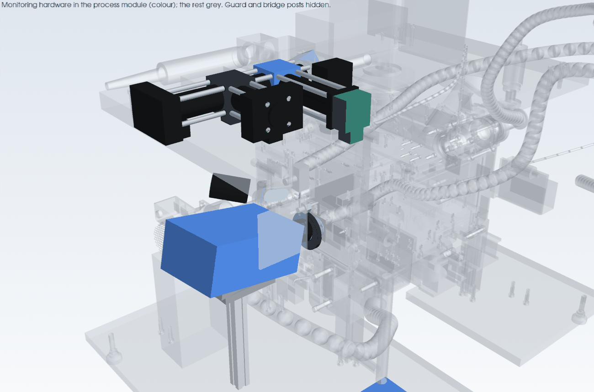
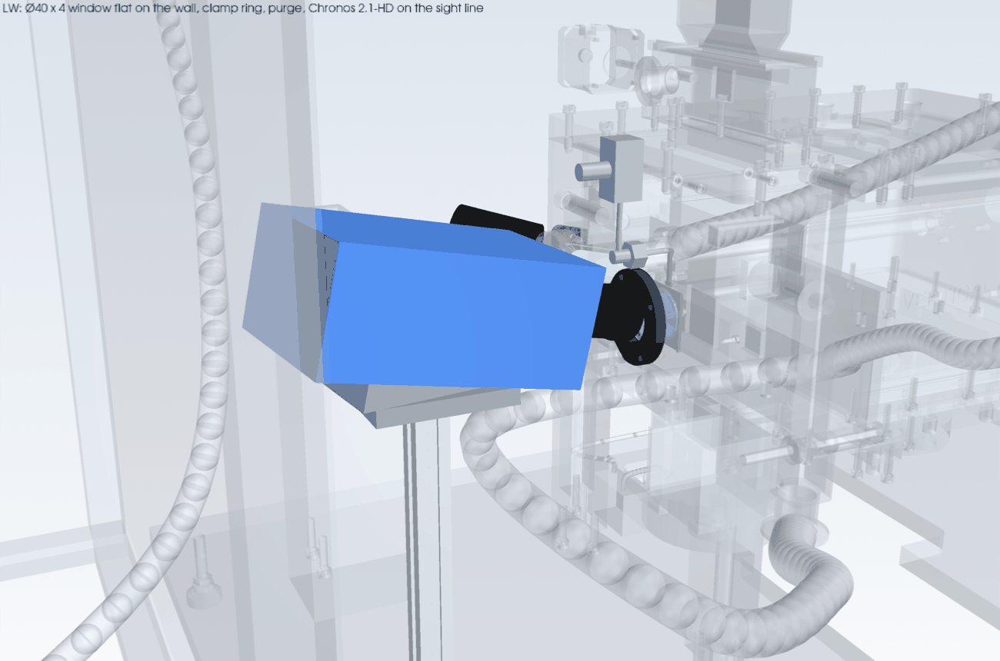
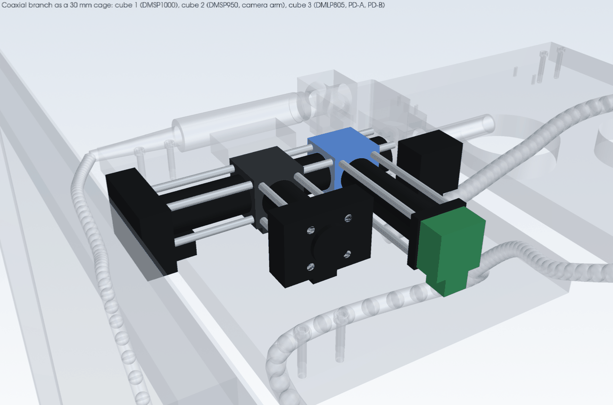
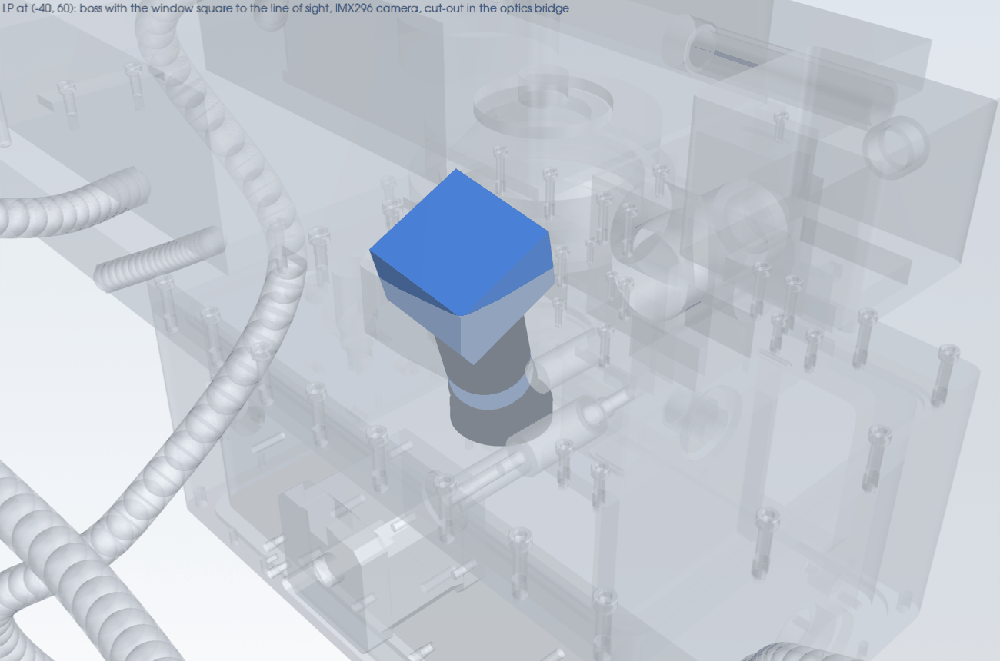
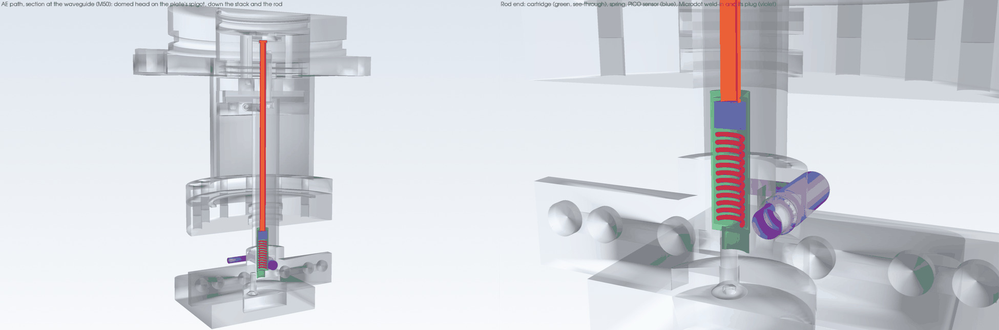
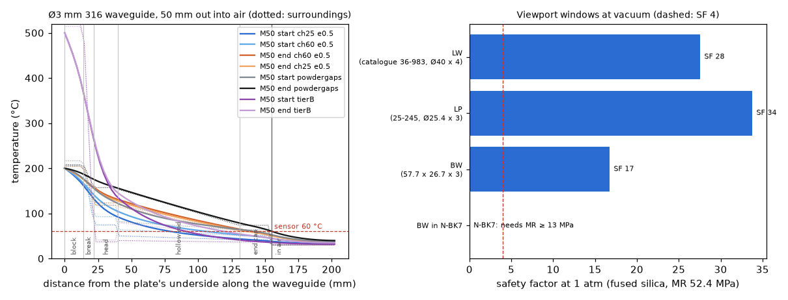
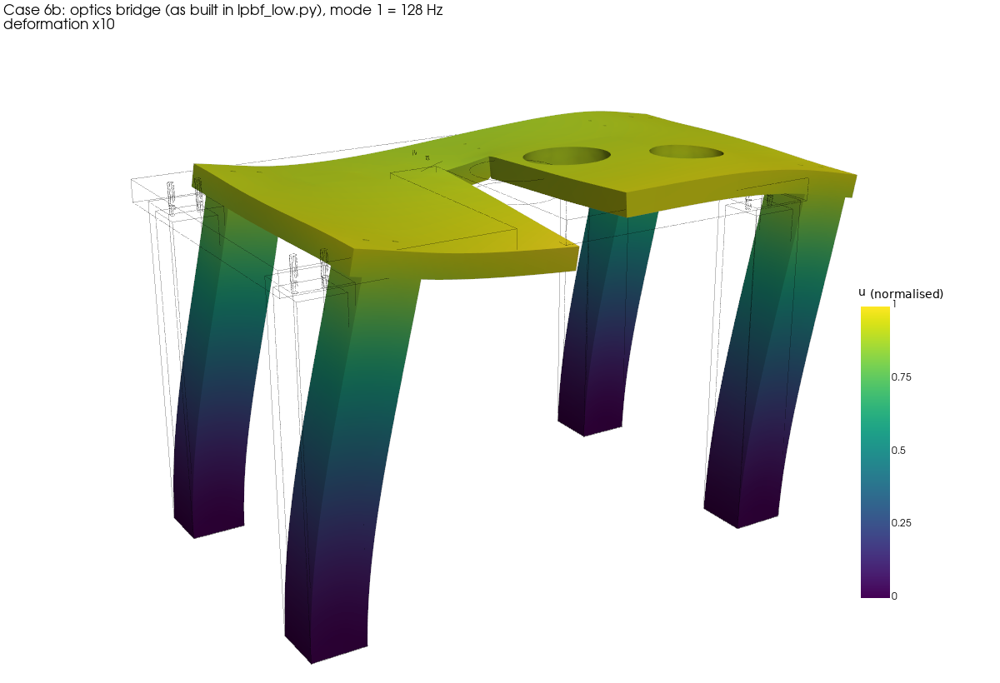

# Monitoring mechanics: the ports, windows, cameras, coaxial cage and AE path as parts of the model (2026-11-25)

Issue #260. [`monitoring.md`](../monitoring.md) §3–§5 and the other notes in this folder put three viewports (LW, BW, LP), a
side camera and a steep camera, a coaxial 30 mm cage, an acoustic-emission (AE) path and a digitizer on the machine, with
their positions in [`cad/monitoring_spec.py`](../cad/monitoring_spec.py). This note draws them into the low-profile model as
real parts, cuts the holes they need, and checks them against every other part. Nothing here is built. Vendor parts are
envelopes from listed dimensions, as elsewhere in the model. Where a dimension was not read off a vendor drawing, the part's
name says "envelope".

| File | What it is |
|---|---|
| [`cad/monitoring_parts.py`](../cad/monitoring_parts.py) | the parts and their cuts. Use `lpbf_low.build(monitoring=True)`, or set `LPBF_MONITORING=1` for scripts that call `build()` unchanged. It is off by default, so every existing output stays as it was |
| [`cad/monitoring_spec.py`](../cad/monitoring_spec.py) | the shared positions; §5 lists what this round changed in it |
| [`analysis/interference.py`](../analysis/interference.py) | with `LPBF_MONITORING=1`: the full check (static states and motion sweeps) on the model with the monitoring parts, written to [`interference-monitoring-M50-M.md`](../analysis/out/monitoring/mech/interference-monitoring-M50-M.md). Its default run is unchanged |
| [`analysis/optics/monitoring_views.py`](../analysis/optics/monitoring_views.py) `--drawn` | the ports' sight lines as drawn, with every monitoring part in the model: [`sight_drawn.md`](../analysis/out/monitoring/mech/sight_drawn.md) |
| [`analysis/monitoring/mech/render_parts.py`](../analysis/monitoring/mech/render_parts.py) | the five figures below |
| [`analysis/monitoring/fab/frame_features.py`](../analysis/monitoring/fab/frame_features.py) | the LW and BW ports as setup C cuts them. `monitoring_parts.py` imports it, so the model and the CAM share one geometry |

## 0. Short answer

1. **Everything fits.** The first interference run with the monitoring parts found 14 clashing pairs. Each was fixed by moving
   or trimming a monitoring part, except one: PB2, the Pi box on the optics bridge, moves 12 mm toward +x to make room for
   the steep camera. The final run finds no interference in any of the six machine states or the eight motion sweeps (§2.1).
2. **LP moves to (−40, 60), as plume.md §0 item 3 asks, but its bore runs on the line of sight.** There the sight line is
   62.1° steep. A bore normal to the lid, as fabrication.md planned for (−60, −80), would be Ø33 here, and the face seal round
   it would overlap the main window's flange (Ø100 on the lid's centre) by 5.9 mm. A Ø24 bore on the line of sight, like the
   layer camera's, leaves a Ø40.8 adapter 1.7 mm clear of that flange. The camera passes up through a cut-out in the optics
   bridge, inside the 66 × 67 mm the modal check used (−0.1 % on the first mode). (−20, 80) fails, because its line of sight
   meets PB2 above the bridge at (−35, 139). At the old (−60, −80) the camera blocks the reservoirs' way out (Checks §5).
3. **The LW window is the catalogue Edmund 36-983 (Ø40 × 4), flat on the wall.** Its clamp ring grows to Ø58 and then meets
   the plate-height through-beam's fibre head. So the ring gets a flat toward it, and its four screws move from 45° to 60°,
   which leaves 2.75 mm of metal between the flat and the nearest hole. The left wall's CAM program has to be re-posted for
   the new seat (Ø40.2 × 5.5) and holes. This runner has no FreeCAD or CAMotics, so it wasn't.
4. **The coaxial branch fits above the bridge as a 30 mm cage**, with the cubes where `monitoring_spec.COAX` puts them (x −155,
   −215, −285) and a post under every cube and every branch end. Photodiode B overhangs the bridge's −x edge by 38 mm on its
   rods, 14 mm from the process fibre and 22 mm inside the guard's side panel.
5. **The AE waveguide can't leave the rod end the way the checks assumed.** The rod end is the gas boundary. The striker and
   magnet sit under the rod's axis, the feedthroughs fill its front face, and the rod's bore is narrower than the block, so a
   straight waveguide has no way out. It is drawn screwed into the rod end's bore floor, with the sensor outside on the rod
   end's back face. What holds its domed tip on the plate at 10–20 N is the open question (§4).

## 1. What is drawn

| Group | Parts | Where | Drawn from | BOM |
|---|---|---|---|---|
| LW port | bore Ø31, seat Ø40.2 × 5.5, 4 × M4 at 60°, SAE-4 purge port and Ø4 passage (cut in the frame); window, 1.0 mm FKM gasket and flat ring (0.75 mm squeezed), clamp ring with a flat | left wall, bore centre (y −18.97, z 34.15) | `frame_features.lw_features()` | M0-01, M0-06, M0-13 |
| LW slide | Ø30 × 1.5 slide, held by a 0.5 mm 316 clip on the left liner; a Ø27 hole in the liner for the sight line and a Ø5 hole for the purge tube | liner's inner face, on the sight line | frame_features' liner hole | M0-02, M0-15 |
| LW purge | SAE-4 × 1/8 in. bored-through fitting; 1/8 in. 316 tube through the wall, bent down inside to a flattened tip 3 mm over the clip; needle valve outside, above the camera's line | (y −18.97, z 72.45) on the wall | fabrication.md §3 (bought, not made) | M0-08, M0-12 |
| Side camera | Chronos 2.1-HD (155 × 96 × 67.3), Kowa LM50JC10M (envelope Ø32 × 50), FBH850-10 + FESH1000 in a holder | on the LW sight line, lens front 15 mm off the clamp ring | monitoring_spec `SIDE_CAMERA` | M7-01 to M7-04 |
| Side camera bracket | 5/8 in. (15.9 mm) × 80 mm 6061 plate reaching 184 mm from the wall, on an angle root bolted to the floor plate's left edge, notched round the through-beam's fibre head; a fixed 13° wedge under the camera's middle | plate at z −15.9…0, y −78…2 | Checks §3 | M7-08 |
| BW port | obround slot 51.2 × 20.5, seat 58 × 27 × 4.5, 3 × M4 (cut in the frame); 57.7 × 26.7 × 3 fused-silica window, gaskets, clamp frame trimmed clear of the inlet plenum and the recoater sensor clamp; the lower back liner's left piece starts at x −90.8 | back wall, (−125, 111, 29.5) | `frame_features.bw_features()` | M0-03, M0-06, M0-14 |
| BW light | 850 nm mounted LED + collimator, envelope Ø40 × 60, on the BW sight line, 3 mm off the clamp frame | outside the back wall | §2.1 | M7-05 (§6) |
| LP port | Ø24 bore on the line of sight and a face O-ring groove (2-025) in the lid; Ø40.8 adapter boss (4 × M4, none on the window flange's side) carrying the Ø25 × 1 slide and the Ø25.4 × 3 window square to the line of sight; retaining ring | lid, (−40, 60, 136) | §3 | M0-07, M7-16 to M7-18 |
| LP camera | IMX296 board in a 40 × 40 × 30 housing, turned so a face (not a corner) faces PB2; Kowa 50 mm; filters; cut-out in the optics bridge | window top 34 mm and lens front 49 mm up the line from the port centre | monitoring_spec `LID_CAMERA`, `LP_GEOM` | M7-12 to M7-14 |
| Coaxial cage | cube 2 (DMSP950) and cube 3 (DMLP805) on posts, SM1 tubes, ER rods; camera arm to −y (FESH1000, AC254-075-B, cage plate, IMX296 board on a post); PD-A to −y and PD-B to −x (filter, AC254-050-B, pinhole, PDA36A2, each on a post); beam trap on cube 1's −y port. The old SM1 photodiode chain behind cube 1 is removed | above the bridge, y −25.25, z 271.1 | optics.md §2, `monitoring_spec.COAX` | M5-xx, M6-xx, M0-17, T2 |
| AE | Ø3 mm 316 waveguide, free in its holes, with a Ø4 head domed R50 on the plate's spigot (it hangs in a Ø4.4 counterbore in the socket floor when nothing holds it up), down the heater block, both shields, the piston head's Ø10 wire hole and the hollow rod to its foot on a MISTRAS PICO (Ø5 × 4, face up) in a 316L cartridge (Ø6.3 × 25.8) standing on the rod end's bore floor, a Lee LC 029BB 09S316 spring under the sensor and a stop cap over it; SST FA40102 Microdot weld-in in the rod end's cap with its plug (envelope); S25: the sensor in a strap on its rod end's back face; preamp on the process base plate | waveguide r 3.2 mm at 120°, cartridge r 2.8 at 126°, feedthrough at x +4.5, zc + 15; all move with the piston and leave with the module | §4 | M4-01, M4-02, M4-04, M4-06, M4-07, M4-09 (S25), M4-10 to M4-13 |
| Recorder | PicoScope 4444 and the sync breakout box on the 4U drawer's floor | rack | sync-and-data.md §2.1 | M1-01, M1-07 |

**Not drawn:** the trigger generator (a Pico 2 inside PB2, which is drawn as a closed box), cables, the argon line to the purge
valve, the InGaAs and SWIR options (step 8), the monitoring bulkhead plate on the guard (MN-28), and anything that would preload
the waveguide (§4).

## 2. Checks on the model

### 2.1 Interference

[`interference.py`](../analysis/interference.py) with `LPBF_MONITORING=1`, M50 module (318 parts):
- **No interference** in the six static states (closed; recoater at the end with the piston at the bottom; plate exchange;
  doors open with the reservoir and drawer out; module swap; calibration).
- **No interference** in the eight motion sweeps (recoater, piston, door, guard door, cartridge, drawer, Z stage, module path).
- **Tightest gaps that involve a monitoring part:** the AE sensor passes 1.7 mm under the gland plate's screws at the +8 mm
  plate-exchange overtravel, and sits 2.5 mm above the Z lift arm.
- **Designed contacts** (a window in its seat, a post on the bridge) are listed in the report's last table.
- **S25 and L75 too** (re-run on the merged branch, 2026-11-25 22:52–23:02 UTC): no interference in the same six states and
  eight sweeps, with 28 and 33 designed joints ([`S25`](../analysis/out/monitoring/mech/interference-monitoring-S25-S.md),
  [`L75`](../analysis/out/monitoring/mech/interference-monitoring-L75-L.md)).

Static clearances, nearest non-monitoring part (FCL distance on 0.2 mm meshes):

| Part | Nearest | Gap (mm) |
|---|---|---:|
| LP adapter boss | window flange | 1.9 |
| LP camera housing | optics bridge (edge of the cut-out); PB2 | 4.0; 5.5 |
| LW purge needle valve | lid and frame | 7.0 |
| BW LED | chamber body; recoater sensor post | 13.2; 17.3 |
| Photodiode B | process fibre; guard side panel | 14.1; 21.7 |
| Coaxial cube 2 | safety shutter | 13.1 |
| Chronos 2.1-HD | recoater motor standoff | 23.6 |
| Side camera bracket | a floor-plate screw's head (its root covers that screw's U-notch: take the bracket off to reach it) | 0.5 |
| AE preamp | the guard's bottom front rail | 5.0 |

The first run, and what changed:

| Pair | Overlap (mm³) | Fix |
|---|---:|---|
| PicoScope and its bracket × PB1 (the power box stands against the rack's left side) | 283,607 | moved onto the 4U drawer's floor, where sync-and-data.md §2.1 puts it first |
| AE preamp × recoater motor bracket, then × the bridge's front-left post | 3,420; 4,750 | moved to the base plate's front-left (x −265…−155, y −240…−180) |
| LW purge needle valve × Chronos and its lens | 3,245 | valve stood vertical above the fitting, tube bent up to it |
| LP camera × PB2 and PB2's screws | 758 | housing turned about its axis; PB2 moved 12 mm to +x ([`electrical_parts.py`](../cad/electrical_parts.py)) |
| BW clamp frame × inlet plenum's flange | 136 | frame trimmed 1 mm clear (§6) |
| LW clamp ring × side-camera filter holder | 60 | holder starts where its tilted rim is 1 mm off the ring |
| BW clamp frame × recoater sensor clamp | 16 | frame notched 1 mm clear under the clamp |
| BW LED × chamber body; × clamp frame | 10; 3 | a compact Ø40 × 60 source, its nearest edge 3 mm off the frame |
| LW clamp ring × through-beam fibre head | 7 | flat on the ring; holes at 60° ([`frame_features.py`](../analysis/monitoring/fab/frame_features.py)) |
| AE waveguide × striker disc | 3 | thread 3 mm deep, not 5 |
| *later:* the checks' 80 mm bracket plate × the door drive's bracket on the same face | 704 | plate moved to y −78…2, notched round the through-beam's fibre head |

### 2.2 Sight lines

[`monitoring_views.py --drawn`](../analysis/optics/monitoring_views.py) on the L75 build with every monitoring part, lasing state.
Only each port's own glass is left out:

| Port | Clear aperture down the line | M50 plate seen | L75 plate seen | What trims the full sight volume |
|---|---|---:|---:|---|
| LW | Ø25, clear | 17 of 17 points | 17 of 17 | the slide clip, the liner and the bore's edge, by tens of mm³; no test point is lost |
| BW | Ø20, clear | 17 of 17 | 16 of 17 | the slot and the lower back liner: one L75 rim point is unlit from the window's centre |
| LP (from its window, 30 mm up the line) | Ø20, clear | 17 of 17 | 15 of 17 | the lid's Ø24 bore and the boss: two L75 rim points |

The LP camera's own field (IMX296 + 50 mm at 203 mm: ~15 × 13 mm at 10.6–12 µm/px,
[`viewports.md`](../analysis/out/monitoring/optics/viewports.md)) sits on the plate centre, well inside what the port
passes. A lens wide enough to take in the whole L75 plate from there would lose its rim on one side.

### 2.3 Height and envelope

The machine is still 579.6 mm above the tray, and its envelope is unchanged (x −1172…1218). The guard is unchanged: the side
camera, its bracket and photodiode B all stand inside it.

## 3. LP at (−40, 60)

- **Why there:** plume.md §0 item 3: a port at (−40, 60), under the upper slot's sweep, collects ~50× less condensate than one
  at (−60, −80). Plume.md left the room outside to be checked on the model, with (−20, 80) as the fallback.
- **The bore:** at 62.1° the clear Ø20 cylinder needs a Ø31.7 hole normal to the lid (Ø33 cut). The face seal round it
  (2 mm land, a 1.78 mm cord's 2.3 mm groove, 2.5 mm outside) needs a Ø47.6 adapter, whose edge would sit 5.9 mm inside
  the main window's Ø100 flange. A Ø24 bore on the line of sight makes a 27.2 × 24 mm ellipse on the lid's top face. Round
  it, a 2-025 O-ring in a groove in the lid and a Ø40.8 adapter clear the flange by 1.7 mm (1.9 mm on the meshes). The four M4 screws sit on the
  side away from the flange.
- **The groove is in the lid**, as fabrication.md planned, so the adapter boss and the flat blanking cap that stands in for it
  until the camera is bought seal on the same O-ring. [`flat_parts_dxf.py`](../analysis/monitoring/fab/flat_parts_dxf.py)
  now draws the cap to the adapter's outline: a Ø40.8 disc, not the Ø64 one SendCutSend quoted.
- **The window** sits square to the line of sight on the boss (optics.md §0 item 10), its top face 34 mm up the line
  (`LP_GEOM`). The Ø25 slide sits in the boss under it, so the boss comes off to change it. The camera's working distance is
  203 mm (viewports.md).
- **The camera and the bridge:** no lens and camera stack stays under the bridge (Checks §5). The camera passes through a
  cut-out drawn as its outline through the 25 mm bridge plus 4 mm all round, about 55 × 60 mm. That is inside the 66 × 67 mm
  that `bridge_modal.py` checked. PB2's left tab then stood over the cut-out's edge and its screws within a few mm of the
  camera. Moving PB2 12 mm to +x leaves the housing 5.5 mm from PB2 and 4 mm of bridge round the tab's tapped holes.
- **(−20, 80):** its line of sight reaches the bridge's top at (−34.7, 138.9), inside PB2's footprint. It would need PB2 moved
  well clear, not 12 mm.

## 4. The AE path: a sprung waveguide on a sensor inside the rod

**Short answer.**
- **The spring sets the force, not the stack.** The Ø3 mm 316 waveguide slides free in its holes. Its Ø4 head, domed R50,
  presses on the plate's spigot. Its foot sits on a Ø5 mm sensor (MISTRAS PICO) inside a 316L cartridge that stands on the rod
  end's bore floor. A Lee Spring LC 029BB 09S316 under the sensor pushes sensor and waveguide up. The plate gets 11.2–19.2 N at
  every corner of the tolerances and thermal cases, or 13.3–16.8 N if the stop force is set with a shim at assembly
  ([`ae_preload.md`](../analysis/out/monitoring/mech/ae_preload.md) §2).
- **Heat hardly moves it.** The waveguide and the stack it runs through grow within 0.07 mm of each other, between assembly and a
  500 °C plate, which is 0.3 N on this spring.
- **The path loses 1–8 dB, against 26–52 dB through the stack to the rod end**, with a PFPE grease at both ends. At 500 °C (tier
  B) no grease lasts, and a dry tip loses 12–31 dB.
- **The sensor's lead leaves through a Solid Sealing FA40102 Microdot weld-in** in the rod end's cap, above the cross-drilling. The
  cap gets one spot face, a counterbore and a Ø5.18 hole (§4.7). The weld is laser or e-beam, not TIG.
- **It needs the bayonet's disc spring first.** Today's bare bayonet would be lifted 0.31 mm by the AE force, opening the foil.
  With the 97125K111 spring that hot-swap.md recommends, the foil keeps 197–205 N on M50, against the 173 N it needs.
- **S25 keeps the rod-end route.** Its rod's Ø7.7 bore has no room for a waveguide, a cartridge and the leads together.

**The previous run's design, checked.** It put the sensor in the rod end's bore with the spring on the bore floor, and an SMA or
Microdot weld-in on the back face. Three things break it:
- the bore floor under the waveguide is cut by the cross-drilling (a 4 mm trench that the left type K leads run along) and by the
  channel to the power sleeve, so a spring can't seat there;
- a weld-in on the back face can only sit at the type K row (the block is 16 mm tall), and every coaxial weld-in found has a gas-side
  body (FA40102: Ø4.83 × 6.0 and a 3.8 mm pin) that would then block the cross-drilling;
- nothing inside the rod end can be reached once the rod is welded on, so a sensor or a connector there could never be changed.

So the spring stands on a cartridge whose legs straddle the cross-drilling. The cartridge drops in, and comes out, through the
rod's top with the piston head off, and its sensor's lead joins the feedthrough's pigtail near the head. The feedthrough sits in
the cap, above the cross-drilling and the channel. The sensor inside the gas boundary sees argon and the rough-vacuum purge.

### 4.1 What is drawn (M50 and L75, `AE_CART` in `monitoring_parts.py`)

| Part | Size and place | Notes |
|---|---|---|
| Waveguide | Ø3 × 92.8 mm shaft (1/8 in. rod, M4-06) and a Ø4 × 1 head domed R50; axis r 3.2 at 120°, as before | slides in the Ø3.4 holes in the heater block and shields, the head in a new Ø4.4 × 1.3 counterbore in the socket floor; with nothing under it the head hangs there |
| Cartridge | turned 316L, Ø6.3 × 0.35 wall, 25.8 mm tall, axis r 2.8 at 126°, on the rod end's bore floor (zc + 9) | two legs either side of the cross-drilling; floor (spring seat) at zc + 13.9; a cap with the waveguide's Ø3.3 guide hole stops the sensor; a 2.8 mm slot for the sensor's lead faces the rod's axis |
| Spring | Lee LC 029BB 09S316: 316, OD 4.78, free 19.05, 3.94 N/mm; 15.88 mm at the stop, 15.28 mm with the plate on | drawn as a helix |
| Sensor | MISTRAS PICO, Ø5 × 4, face up; its side cable's boot through the slot | its face is 0.6 mm under the cap with the plate on |
| Feedthrough | SST FA40102 in the cap's back at x +4.5, zc + 15, on a 7.4 mm spot face 7.3 mm behind the axis; its mating 10-32 plug and cable as an envelope | gas side: a Ø4.83 × 6.0 body and the pin, in the bore's back-right quarter, 0.58 mm from the cartridge |

The waveguide is 93.8 mm long, against the 121 mm screwed into the bore floor before. The gas-side lead (a Kapton coax pigtail
pushed onto the pin, up the rod to an in-line 10-32 joint with the sensor's lead) is not drawn, like every other cable.

### 4.2 The spring and the stroke

The plate pushes the head down a pre-travel of 0.6 mm, set at assembly. With the plate off, the spring holds the sensor against
the cap and the head stands 0.6 mm above where the plate's spigot will be. With the plate on, the force is the spring's force at
the stop plus 0.6 mm of its rate. The spring has to take up:

| What moves the head | Range | Basis |
|---|---|---|
| pre-travel, as set | 0.6 ± 0.1 mm | lap the waveguide to length against a depth gauge from the socket floor |
| plate to plate | ± 0.1 mm | spigot length ± 0.05 mm, graphite foil ± 0.05 mm (assumed) |
| thermal: stack against waveguide, assembly to running | −0.070 to +0.029 mm | thermal.json's M50 cases (200 °C, powder in the gaps, 500 °C tier B) with the waveguide's own fin profile |
| the spring's free length and rate | ± 2 %, ± 10 % | catalogue tolerances (assumed) |
| module travel | 0 | the waveguide, cartridge and sensor all move with the piston and leave with the module |

Over the 48 corners the plate gets **11.2–19.2 N**, inside the 10–20 N wanted. Setting the stop force with a push gauge to 12.5 ±
0.5 N (a shim under the spring) narrows it to 13.3–16.8 N. The spring's shear stress is 623 MPa at the highest force, against 760
MPa allowed (45 % of the wire's ~1,690 MPa tensile, assumed). It runs at the cartridge's temperature, between the rod end's 37–74
°C and the foot's ≤ 118 °C (§4.3), where 316 spring wire loses little load (stainless springs are commonly used to ~250 °C; not
checked against Lee's data). Its shortest length in use leaves 6.1 mm to solid. Pressing the
head down with the plate off bottoms it in its counterbore at 20.4 N, before the spring can reach solid. The waveguide as a column
buckles at 879 N, 46× the force.

### 4.3 The sensor

The cartridge has to sit beside the heater and type K leads in the rod's Ø12.7 bore, so the sensor must be about Ø5. Read on the
makers' pages (2026-11-27, ae_preload.md's parts table):

| Sensor | Size (mm) | Band (resonance) | Peak sensitivity | Rating | Fits? |
|---|---|---|---|---|---|
| **MISTRAS PICO** | Ø5 × 4, side cable | 200–750 kHz (250) | 54 dB ref V/(m/s) | −65 to 177 °C | **yes: chosen** |
| QingCheng WM500/1 | Ø4.7 × 4.0, side cable | 100–1000 kHz (500) | > 58 dB | −20 to 120 °C | yes, but rated 120 °C, 2 K over the foot's worst case |
| MISTRAS Nano30 | Ø8 × 8 (12.8 across its boot) | 125–750 kHz (140) | 62 dB | −65 to 177 °C | no: a Ø9 cartridge leaves the leads ~1.3 mm |
| Vallen VS600-Z2, Fuji M31 | Ø4.75 × 5.3; Ø3 × 3 | 400–800 kHz; 350 kHz resonant | – | to 110 °C; to 80 °C | size yes; band or rating no |

All are quote-only, and no maker says anything about vacuum. MISTRAS's product page gives the PICO's seal as epoxy, so pump one
down on the bench before it goes in.

**The cost of fitting is the band's low end.** Crack AE in LPBF peaks near 100 kHz (Seleznev 2022), where the PICO is below its
band. The Nano30 would gain ~8 dB of sensitivity and the 100–200 kHz band, but it has no room. The WM500/1 covers 100 kHz in the
same envelope, but only its maker's sheet says so, and the foot's worst case (118 °C, below) is 2 K under its rating.
**Compare the PICO and the WM500/1 with pencil-lead breaks on the bench before buying two.** The PICO's integral cable ends in a
BNC 1 m away: ask MISTRAS for a ~0.3 m cable with a 10-32 plug, or fit one.

**Temperature.** The foot, taken as adiabatic (an upper bound), reaches 64–98 °C in the clean cases, 90–118 °C with powder in
the gaps and 79–95 °C at 500 °C, against the PICO's 177 °C (ae_preload.md §5). It is warmer than the old end cap (78 °C) because
the foot now sits 27 mm higher, in the rod, nearer the piston head.

### 4.4 Couplant

- **Tip, tier A (200 °C): Krytox LVP**, a PFPE vacuum grease rated −15 to 300 °C with a published 1e-5 Torr at 200 °C (Chemours
  TDS, via McMaster 10195K41, $178.91 per 2 oz). Put a dab on each plate's spigot underside when the plate is prepared. It is
  not silicone: Molykote 41 (the old M4-04) is a silicone oil with no vacuum data, and silicone vapour fouls windows.
- **Cold end: the same grease** on the sensor's stainless face, under 11–19 N. Grease, not a bond, so the sensor can be changed
  and no adhesive adds AE noise (US5000045A).
- **Tier B (500 °C): no grease lasts.** Use a dry, annealed aluminium foil (25–100 µm) under the head; the published dry-couplant
  rigs used silver, gold or copper foil at 25 MPa or more, far above this head's ~0.1–0.2 GPa Hertz peak over a 0.4–0.5 mm spot.
  An aluminium foil avoids a new metal pair on the 6061 plate (an inference, not checked). The dry tip costs 11–26 dB more.
- **The dome is R50, not the R25 the checks suggested.** At 200 °C 6061 keeps only ~103 MPa; R25 at 11–20 N peaks at 211–256 MPa
  and would dent the spigot under the bayonet's 60° twist. R50 peaks at 133–161 MPa, under 1.6 × 103.

### 4.5 The feedthrough

**Solid Sealing FA40102** (Microdot 10-32, grounded shield, Inconel pin, −269 to 450 °C, He leak < 1e-10 atm·cc/s, $34.50).
Its Ø6.35 flange sits in a Ø6.43 × 0.51 counterbore on a spot face in the cap's back, over a Ø5.18 hole into the bore; SST's
weld sheet NS40102 calls for 304L or 316L and a laser or e-beam weld (TIG not recommended), unlike the rod end's other
feedthroughs. Weld it, and push the pigtail onto its pin, before the rod is TIG-welded on, and heat-sink the pigtail through
that weld. Outside, only 3.3 mm of thread stands proud; the plug and its cable stand behind the cap, clear in every state and
sweep (§4.9). SST's own plug and cable (FA21382, $86.50) is rated to 75 °C, 1.5 K above the rod end's worst
case: take a PTFE 10-32 cable rated to 125 °C (CeramTec 14544-01-A, not priced). Lesker's SMA weld-in (IFTCG012011) and SST's
double-ended Microdot (FA49614) are too long for the 12.7 mm bore.

### 4.6 The plate, the swaps and the module

- **The plate.** The AE force pushes the plate up by 11–19 N. Today's bare bayonet holds it down only by its weight (0.53 N on
  M50), so the plate would rise until its lugs meet the ledge (0.31 mm) and the foil would open. With the 97125K111 disc spring
  (216 N on M50, 530 N on L75; hot-swap.md §3.1) the foil keeps 197–205 N and 511–519 N, above the 173 and 424 N it needs. **Fit
  that spring before the AE preload.**
- **A plate swap.** The robot (or a person) pushes up to 19 N more over the last 0.6 mm and twists 9 N·mm more (0.61 N·m for the
  bayonet). The head slides 3.4 mm across the greased spigot in the 60° twist. Check the coupling with pencil-lead breaks after
  every swap (monitoring.md §5.4).
- **A module swap.** Nothing moves inside the module. The 10-32 plug comes off with the type K and power plugs. The waveguide
  can't fall out while the module is upright: with the plate off it rests on the sensor, and with the cartridge out it hangs by its
  head. Turned over with its plate off, it would slide out of the socket.
- **Service.** Lift the piston head off the rod (two set screws), as for the leads: the waveguide comes with it, then the cartridge
  comes up the rod by its lead.
- **The robot cell's drawbar** (hot-swap.md) would take the rod's axis and the block's centre. It and this waveguide can't both
  pass the head's Ø10 wire hole; there, the drawbar itself would have to be the guide (Checks §6). Not resolved.

### 4.7 Added machining, and what the rod end's owners need

| Part | Feature | Size |
|---|---|---|
| Rod end (cap's back) | spot face, end mill | 7.4 × 7.4 mm flat, 7.3 mm behind the axis, centred x +4.5, zc + 15 (≤ 3.7 mm deep on the cap's curve) |
| Rod end | weld counterbore | Ø6.43 × 0.51 mm |
| Rod end | through-hole into the bore | Ø5.18, ~3 mm to the bore |
| Rod end | laser or e-beam weld of the FA40102 | outsourced (M4-13), before the rod is welded on |
| Heater block (socket floor) | counterbore for the waveguide's head | Ø4.4 × 1.3 mm, at r 3.2, 120° (the Ø3.4 hole through block and shields was already cut); it leaves 0.4 mm of wall to the control thermocouple's Ø1.2 hole over the hole's top 0.6 mm |
| Waveguide | Ø4 head domed R50 on a 1/8 in. rod, lapped to length | turned, or a button laser-welded on (M4-10) |
| Cartridge | turned 316L part with a pressed-in cap | M4-10 |

For **modules_low.py, hot-swap.md and electrical.md** (the model cuts these with `_cut` for now):
1. the cap's spot face, counterbore and hole, and the heater block's counterbore, in the default model;
2. electrical.md FT1: an eighth weld-in, FA40102, laser-welded, unplugged at a swap like the others;
3. the leads' routes past the cartridge (in front of it, and under its floor between its legs) and past the feedthrough's gas-side
   body and pin, which sit just above the channel's top edge: check with the real leads;
4. hot-swap.md: the bayonet's disc spring is now needed for AE as well, and the drawbar would displace the waveguide (§4.6).

### 4.8 S25

S25's 3/8 in. rod (ID 7.7) holds the heater and type K leads and nothing else. It keeps the sensor clamped on its rod end's back
face, as drawn before (26–52 dB, M4-09 as an option), or goes without AE. Its parts are unchanged, so its interference run
(2026-11-25) stands.

### 4.9 Interference

`interference.py` with `LPBF_MONITORING=1` (320 parts) finds **no interference on M50 or L75 in the six states or the eight
sweeps** ([`M50`](../analysis/out/monitoring/mech/interference-monitoring-M50-M.md) 09:19 UTC,
[`L75`](../analysis/out/monitoring/mech/interference-monitoring-L75-L.md) 09:25 UTC, 2026-11-27; 27 designed joints each).
The AE parts only touch where they are meant to (head on spigot, foot on sensor, sensor on spring, spring and cartridge on the
floor, feedthrough in its counterbore), each with no shared volume; the joints are declared in `interference.py`. Over the piston's
stroke and the +8 mm overtravel the nearest other parts are the rod glands, through the rod's wall: cartridge 1.98 mm, sensor
2.63 mm, spring 2.77 mm (1.9–2.8 mm on L75). The feedthrough and its plug stay more than 3 mm from everything in every
sweep, including the gland plate's screws at the overtravel, the Z arm dropping away and the module's way out. The runs peak at
3.5–3.6 GB, so they ran under a 4 GB cap; at 3 GB they are killed.

### 4.10 Not done / limits

- **Nothing is bought or built.** No pencil-lead break has been made on any of this: the loss budget is a 1-D estimate (Checks
  §6b), and the PICO's response below 200 kHz is not quantified.
- **Quote-only parts:** the PICO (and the WM500/1) have no public price; M4-01 carries an estimate. Whether MISTRAS will fit a
  ~0.3 m cable with a 10-32 plug is not asked.
- **Not confirmed with Solid Sealing:** the FA40102's laser weld on a spot face milled into the cap's curve, 4 mm from where the rod
  is TIG-welded on afterwards. The gas-side pigtail (Kapton coax, a push-on socket for the Ø1.07 pin, an in-line 10-32 joint) is
  not a chosen part; M4-13 is an estimate.
- **Assumed:** the spring's ± 2 % length and ± 10 % rate, its wire's 1,690 MPa and its relaxation at ≤ 118 °C; the grease film's
  1 GPa and 1–10 µm; the plates' ± 0.1 mm; the foil couplant for tier B (untested).
- **The leads are not drawn.** Their way past the cartridge (in front of it and under its floor) and past the feedthrough's
  gas-side pin, at the channel's top edge, is checked only as free space.
- **Not drawn:** the bayonet's 97125K111 disc spring this needs (hot-swap.md's), the pigtail and the cables, and anything that
  keeps the waveguide in if a module is turned over with its plate off.
- **Unresolved:** the robot cell's drawbar and this waveguide both want the rod's middle (§4.6).

## Checks

Run 2026-11-25 22:55 UTC by [`mech_monitoring.py`](../analysis/monitoring/mech/mech_monitoring.py) and [`bridge_modal.py`](../analysis/monitoring/mech/bridge_modal.py) (CalculiX); every number is in [`checks.json`](../analysis/out/monitoring/mech/checks.json) and [`bridge_modal.json`](../analysis/out/monitoring/mech/bridge_modal.json).

| Check | Result | In one line |
|---|---|---|
| 1. Windows and slides | pass | fused silica SF 17-34 at 1 atm (SF 4 wanted); a borosilicate BW window would need an abraded strength of 12.5 MPa, which nobody publishes: make it fused silica. Slides: < 1 K from the plate, spatter well inside fused silica's thermal-shock limit. |
| 2. Seals and clamps | pass with 1.0 mm FKM | the 0.75 mm the seats leave squeezes 1.0 mm sheet 15-35 %, but the BOM's 1/32 in. sheet only -7 to 18 %: **change M0-06 to 1.0 mm sheet**. Clamp screws at 2 N·m: lift-off margin 3.1 or more. |
| 3. Side camera bracket | pass | a 0.625 in. (15.9 mm) x 80 mm 6061 plate, 139 mm reach: f1 169 Hz (≥ 150 wanted, 2.5x the blower's 60 Hz), vibration 1.7 µm at the plate against a 25 µm pixel; 1/2 in. gives 121 Hz. A fixed 13° wedge, not a ball head. |
| 4. Coaxial cage | pass | 1.23 kg added; post every cube and each branch end; drift 1.8 µm/K at the plate; bridge sway 128 -> 124 Hz. |
| 5. Lid camera vs the bridge | pass (back-half LP) | at the spec's LP (-60, -80, 136) the camera fits the reservoir slot (19 cm³ of it) and **blocks the reservoirs' way out**; at the back-half LP (-40, 60, 136) it needs a cut-out of 66 x 67 mm, which moves f1 -0.1 % (to 128 Hz) and the higher modes -5.6 % at most. |
| 6. AE path | pass | a Ø3 waveguide reaches the end cap at 78 °C in the worst case (powder in the gaps) and is under 60 °C 25 mm out in 43 °C air; tip R >= 25 mm at 10-20 N (a Ø3 ball dents the plate); loss 3-9 dB greased vs 26-52 dB at the rod end; rod end 61 °C (74 with powder in the gaps). |
| 7. Temperatures at the ports | flag | windows and slides at wall temperature (25-61 °C), fine for FKM and fused silica; but a room-temperature purge makes the LW slide up to 30 K colder than a hot chamber's gas, which draws condensate (plume.md): warm the purge (≤ 1.6 W). The cameras sit in the Shuttle's air, 38-43 °C in the busy case, at or above a 40 °C rating. |

### 1. Windows and cover slides

| Window | Glass | Size (mm) | Unsupported span (mm) | Stress at 1 atm (MPa) | SF (MR 52.4) | Thickness for SF 4 (mm) | Centre deflection (µm) |
|---|---|---|---|---:|---:|---:|---:|
| LW (catalogue 36-983, Ø40 x 4) | fused silica | Ø40 × 4 | r 15.5 | 1.90 | 27.6 | 1.52 | 1.02 |
| LP (25-245, Ø25.4 x 3) | fused silica | Ø25.4 × 3 | r 10.5 | 1.55 | 33.8 | 1.03 | 0.51 |
| BW (57.7 x 26.7 x 3) | fused silica | 57.7 × 26.7 × 3 | 51.2 × 20.5 | 3.13 | 16.7 | 1.47 | 1.11 |
| BW in N-BK7 | N-BK7 | 57.7 × 26.7 × 3 | 51.2 × 20.5 | 3.13 | needs MR ≥ 12.5 | - | 0.99 |

- **LW slide** (Ø30 × 1.5): the hot plate puts at most 14.7 W/m² on it (L75, view factor 0.0123), a 0.400 K rise and 0.0080 MPa. A molten-Al droplet is a 635 K quench against fused silica's thermal-shock parameter of 1101 K.
- **LP slide** (Ø24.4 × 2): the hot plate puts at most 64.1 W/m² on it (L75, view factor 0.0536), a 0.864 K rise and 0.0173 MPa. A molten-Al droplet is a 635 K quench against fused silica's thermal-shock parameter of 1101 K.
- At +20 mbar every window carries 1/50 of these stresses. Bent at vacuum, each window is a weak meniscus lens with a focal length of 24,753 km or more: no optical effect.

### 2. Seals and clamps

The seats as programmed ([`fabrication.md`](fabrication.md), `frame_features.py`) bottom the clamp on the wall, with 0.75 mm left for each flat FKM gasket (under the window and over it). The squeeze then depends on the sheet and on the window's thickness tolerance, which the two gaskets share:

| FKM sheet | Squeeze: thinnest / nominal / thickest window | Within 15-35 %? | Most the glass bears (MPa) |
|---|---|---|---:|
| 1/32 in. (BOM M0-06): 0.79 mm | -7 / 6 / 18 % | no | 2.2 |
| 1.0 mm (layer camera, lpbf_low.py): 1.00 mm | 15 / 25 / 35 % | yes | 4.2 |

The glass touches only FKM, on both faces at the same radii, so the clamp puts no bending into it. Window thickness tolerance taken as ±0.2 mm.

| Port | Gasket area (mm²) | Gasket force, max (N) | +20 mbar (N) | Screws | Preload each at 2.0 N·m (N) | Margin against lift-off | Thread strip in 6061 (N) |
|---|---:|---:|---:|---:|---:|---:|---:|
| LW | 502 | 2108 | 2.5 | 4 × M4 | 2500 | 4.7 | 12,070 |
| BW | 581 | 2439 | 3.1 | 3 × M4 | 2500 | 3.1 | 12,070 |
| LP | 160 | 673 | 1.0 | 4 × M4 | 2500 | 14.8 | 12,070 |

- **O-ring option, LW:** AS568 2-026 (ID 31.47, 4.9 % stretch) in a Parker face gland (module_params FACE_1P78) from Ø33.0 to Ø37.6, squeeze 21-31 %; fits under the window.
- **O-ring option, LP:** AS568 2-020 (ID 21.95, 4.8 % stretch) in a Parker face gland (module_params FACE_1P78) from Ø23.0 to Ø27.6, squeeze 21-31 %; **does not fit** under the Ø25.4 window.

### 3. Side camera bracket (Chronos at LW)

The camera and lens (1.15 kg, pitch inertia 45 kg·cm²) sit 139 mm out from the left wall, on the sight line. One pixel is 25.3 µm across at the plate; a camera tilt of 1 µrad moves the view 0.176 µm. Excitation: side-channel blower (bom.csv G4, model not chosen): a 2-pole motor turns at 48-58 Hz on mains; recoater <= 600 rpm (10 Hz, electrical.md); base vibration 1 mm/s RMS assumed.

| 6061 plate, 80 mm wide | f1 (Hz) | f2 (Hz) | Static sag (µm) | Tilt (µrad) | Static image shift (µm) | Image motion at 60 Hz (µm) | OK |
|---|---:|---:|---:|---:|---:|---:|---|
| 0.25 in. (6.3 mm) | 43 | 166 | 92.5 | 1000 | 268.8 | 24.482 | no |
| 0.375 in. (9.5 mm) | 79 | 302 | 28.4 | 308 | 82.7 | 15.624 | no |
| 0.5 in. (12.7 mm) | 121 | 460 | 12.4 | 135 | 36.2 | 3.764 | no |
| 0.625 in. (15.9 mm) | 169 | 637 | 6.6 | 71 | 19.2 | 1.684 | yes |
| 0.75 in. (19.0 mm) | 220 | 830 | 3.9 | 43 | 11.5 | 0.928 | yes |
| 1 in. (25.4 mm) | 336 | 1256 | 1.8 | 19 | 5.2 | 0.382 | yes |

### 4. Coaxial cage on the bridge

- **Added mass:** 1.23 kg (estimated from the parts' sizes), centre of mass at (-260, -67, 268), 105 mm from cube 1: 1.27 N·m if it hung from cube 1's post alone. Put a post under each cube and under each branch's end.
- **Camera branch** (154 mm of rods off cube 2, unsupported): tip sag 0.47-47.0 µm, 0.99-100.2 µm at the plate against a 7.4 µm pixel there; its first mode 73-731 Hz. The sag is static and calibrates out, but the low end of that mode sits near the bridge's own 128 Hz: a post at the branch's end removes both.
- The added mass counts PD-A, which moves from cube 1's chain (already in fea.py case 6's 0.5 kg tap mass), so it is an upper bound.
- **Thermal drift:** 1.76 µm at the plate per K of difference between two 35 mm aluminium posts (0.24 px/K); 0.8 µm/K of steel rod against aluminium bridge along the beam (it loads the cube clamps, not the view); tilting cube 1 by 1 µrad moves the laser 0.32 µm against the coaxial view.
- **Bridge sway mode with the cage:** 128.2 → 124.5 Hz (mass scaling), above the 100 Hz criterion.

### 5. The steep lid camera and the optics bridge

| LP candidate | Camera envelope at the bridge's level (cm³) | of which in the reservoir slot (cm³) | in the plate (cm³) | f1-f6 with the cut (Hz) | Change in f1 |
|---|---:|---:|---:|---|---:|
| spec (-60, -80, 136) | 19.6 | 19.4 | 0.2 | 128, 141, 226, 241, 488, 538 | -0.0 % |
| back (-40, 60, 136) | 34.6 | 0.0 | 34.6 | 128, 141, 223, 235, 464, 508 | -0.1 % |

Uncut bridge on the same mesh (12,3,6): 128, 141, 226, 241, 488, 538 Hz (fea.py case 6b at hmax 10: 128, 141, 226, 240, 487, 536 Hz). Gravity sag at the lens: base -4.9 µm, spec -4.9 µm, back -5.5 µm.

With the lens front moved along the line (the boss's height isn't fixed yet), the camera envelope at the bridge's level, in cm³ (in the reservoir slot / in the plate):

| LP candidate | lens front +5 mm | lens front +10 mm | lens front +15 mm | lens front +20 mm | lens front +25 mm | lens front +30 mm | lens front +40 mm |
|---|---:|---:|---:|---:|---:|---:|---:|
| spec | 6 / 0 | 12 / 0 | 19 / 0 | 29 / 0 | 40 / 1 | 51 / 2 | 68 / 7 |
| back | 0 / 12 | 0 / 22 | 0 / 35 | 0 / 49 | 0 / 62 | 0 / 72 | 0 / 84 |

No standoff keeps a 50 mm lens and a 30 mm camera below the bridge: at the spec's position it always stands in the reservoir slot, at the back-half one it always needs the cut-out. A fold mirror or a shorter lens would.

### 6. Acoustic emission: waveguide or rod end

Ø3 mm 316 waveguide from the plate's underside through the heater block, the thermal break, the piston head, the hollow rod and its end cap (155 mm), then out into air:

| Module case (thermal.json) | Plate (°C) | Rod end (°C) | Sensor at the end cap (°C) | 25 mm out | 50 mm out | Length out for ≤ 60 °C (mm), air 30 / 43 °C |
|---|---:|---:|---:|---:|---:|---:|
| M50_start_ch25_e0.5 | 200 | 41.6 | 43.0 | 36.3 | 32.6 | 0 / 0 |
| M50_start_ch60_e0.5 | 200 | 51.4 | 53.0 | 41.1 | 34.7 | 0 / 0 |
| M50_end_ch60_e0.5 | 200 | 60.7 | 64.2 | 46.6 | 36.9 | 6 / 9 |
| M50_end_ch25_e0.5 | 200 | 58.7 | 62.1 | 45.6 | 36.5 | 3 / 5 |
| M50_start_powdergaps | 200 | 63.9 | 65.8 | 47.4 | 37.3 | 7 / 11 |
| M50_end_powdergaps | 200 | 73.5 | 77.9 | 53.3 | 39.7 | 17 / 25 |
| M50_start_tierB | 500 | 36.6 | 38.9 | 34.3 | 31.8 | 0 / 0 |
| M50_end_tierB | 500 | 49.8 | 52.9 | 41.1 | 34.7 | 0 / 0 |

| Tip radius (mm) | Preload (N) | Contact Ø (µm) | Peak pressure (MPa) | Dents the 6061 plate? |
|---:|---:|---:|---:|---|
| 1.5 | 10 | 117 | 1398 | yes |
| 1.5 | 20 | 147 | 1762 | yes |
| 10 | 10 | 220 | 395 | no |
| 10 | 20 | 277 | 497 | yes |
| 25 | 10 | 299 | 214 | no |
| 25 | 20 | 376 | 270 | no |
| 50 | 10 | 376 | 135 | no |
| 50 | 20 | 474 | 170 | no |

Bar velocity 4915 m/s.

| f (kHz) | Wavelength (mm) | d/λ | Phase-velocity drop, Ø3 (%) | same, Ø8 drawbar (%) | Dry tip R 1.5 (dB) | Dry tip R 50 (dB) | Greased flat tip (dB) |
|---:|---:|---:|---:|---:|---:|---:|---:|
| 100 | 49.1 | 0.06 | 0.07 | 0.5 | -20 | -11 | -0.03 |
| 300 | 16.4 | 0.18 | 0.60 | 4.3 | -30 | -20 | -0.26 |
| 500 | 9.8 | 0.31 | 1.68 | 11.9 | -34 | -24 | -0.68 |

- **Loss budget:** waveguide with greased ends 3-9 dB; sensor on the rod end 26-52 dB (graphite foil twice, two Macor contacts, the three Ø8 standoffs carrying 7.6 % of the block's area, head/rod/end cap).
- **Rod end:** at most 60.7 °C with clean gaps, 73.5 °C with powder in them (thermal.json), against ~75 °C for a sensor there; keep its preamp off the rod.
- **Where the loss is:** in the contacts, not the impedance mismatches. Al/Macor is 0.04 dB as a bonded interface (Edison's answer gives 1–2 dB for a 0.13–0.20 reflection coefficient, which is 0.07–0.18 dB); Al/316 is 1 dB. A dry point contact at the tip costs 10–34 dB at 100–500 kHz; a greased flat tip under 1 dB. Rod attenuation hardly matters: even 5 dB/m, ten times the value assumed here, is 1 dB over the guide.
- **Drawbar as the guide** (the robot cell's, hot-swap.md): at Ø8 mm its phase velocity drops 4 % at 300 kHz and 12 % at 500 kHz (Rayleigh-Love, rough past d/λ 0.3): fine to ~200 kHz, smeared above. It also adds the pull stud and ball-lock contacts to the path.

#### 6b. The waveguide's preload and cold end (2026-11-27)

Run by [`ae_preload.py`](../analysis/monitoring/mech/ae_preload.py) on the drawn design (`AE_CART`); every number is in
[`ae_preload.json`](../analysis/out/monitoring/mech/ae_preload.json) and [`ae_preload.md`](../analysis/out/monitoring/mech/ae_preload.md).
The table above (the end cap at 78 °C, 3–9 dB) was for the waveguide leaving the rod end into air, which can't be built (§4).

| Check | Result | In one line |
|---|---|---|
| Stroke | −0.070 to +0.029 mm | the stack (6061 block and head, Macor, 316 rod and rod end) and the waveguide's fin profile grow alike; the most is tier B, where the hot waveguide outgrows the water-cooled head |
| Force on the plate | 11.2–19.2 N (pass) | Lee LC 029BB 09S316 at 15.88 mm, 0.6 ± 0.1 mm pre-travel, plates ± 0.1 mm, spring ± 2 % length and ± 10 % rate, 48 corners; 13.3–16.8 N with the stop force shimmed to 12.5 ± 0.5 N |
| Spring | pass | 623 MPa at 19.2 N against 760 MPa; 6.1 mm to solid; the head bottoms in its counterbore at 20.4 N, before solid (1,297 MPa) |
| Tip | R50 (pass); R25 fails | on 6061 at 200 °C (E 62 GPa, ~103 MPa yield): R50 peaks at 133–161 MPa over a Ø401–486 µm spot; R25 at 211–256 MPa |
| Loss, plate to sensor | 1.0–8.0 dB (tier A); 12.2–31.4 dB (tier B, dry) | greased dome 0.03–0.7 dB by the film model, taken up to 3 dB; Al/316 1.0; rod 0.01–0.05; rubbing 0–1; greased cold end 0–1.4, up to 3; against 26.3–52.3 dB to the rod end |
| Sensor temperature | ≤ 118 °C (pass for the PICO) | the foot as an adiabatic fin end: 64–98 °C clean, 90–118 °C with powder in the gaps, 79–95 °C at 500 °C; PICO 177 °C; the WM500/1's 120 °C leaves 2 K |
| Plate | needs the disc spring | bare bayonet: lifted 0.31 mm (0.53 N of plate); with 97125K111 the foil keeps 197–205 N (M50, needs 173) and 511–519 N (L75, needs 424); twist +9 N·mm on 0.61 N·m |
| Column | pass | 92.8 mm pinned: P_cr 879 N, 46× the force |

- **Contact model:** the head as a Hertz contact plus a grease film round it (dk = K dA / h, h = h0 + r²/2R out to the head's
  edge, K ~1 GPa, h0 1 µm); the flat cold end as K A / h with 2–10 µm of grease; both as springs between two rods of the
  waveguide's impedance, as check 6 did. The film model makes a greased dome as good as a greased flat (both under 1.4 dB at
  500 kHz), and a dry dome 11–26 dB worse. The 3 dB upper bound per greased contact is check 6's (Edison: couplants < 5 dB).
- **Not in the budget:** the sensor itself. The PICO is 8 dB less sensitive than the Nano30 at their peaks and is below its band
  at 100 kHz. Pencil-lead breaks through the real path, PICO against WM500/1, settle it.

### 7. Temperatures at the ports

| Item | Temperature (°C) | Basis | Limit |
|---|---|---|---|
| outer windows (LW, BW, LP) | 25-60 | at the wall or lid temperature (thermal.json T_ch cases) | FKM gasket 200 C |
| inside cover slides | 25-60.9 | chamber gas/wall + 0.86 K from the plate's radiation (check 1) | fused silica: none |
| Chronos body and lens (outside the LW port) | 30 (typical) / 38-43 (busy VLM) | air in the guard = Shuttle air; the 60 C wall adds 0.23 W of radiation to its front face | Kron's operating range not found in the repo (machine-vision cameras: typically 0-40 or 0-45 C) |
| IMX296 lid camera and coaxial cage | 30-43 | above the lid/bridge, in the guard's air | InnoMaker board: check (Pi GS camera 0-50 C) |

- **Flag:** the busy-VLM air (38-43 C) is at or above a 40 C camera limit; the cameras need the same answer as the laser (heat.md §2: chilled water or a ducted exhaust).

**The LW slide with its argon purge.** The purge blows bottled argon across the slide's chamber face; the slide's other face looks at the outer window across the bore. plume.md (§4.3) found that a slide 10 K colder than the gas next to it collects 20–120× more condensate:

| Purge (L/min) | Exit speed (m/s) | h, purge side / window side (W/m²K) | Chamber gas (°C) | Purge gas (°C) | Slide (°C) | Colder than the gas (K) | Heater to warm the purge to the gas (W) |
|---:|---:|---|---:|---:|---:|---:|---:|
| 1 | 1.3 | 18 / 6 | 25 | 22 | 23.3 | 1.7 | 0.04 |
| 1 | 1.3 | 18 / 6 | 25 | 30 | 29.4 | -4.4 | 0.00 |
| 1 | 1.3 | 18 / 7 | 60 | 22 | 33.5 | 26.5 | 0.53 |
| 1 | 1.3 | 18 / 7 | 60 | 30 | 39.2 | 20.8 | 0.42 |
| 3 | 4.0 | 32 / 6 | 25 | 22 | 22.8 | 2.2 | 0.13 |
| 3 | 4.0 | 32 / 6 | 25 | 30 | 29.6 | -4.6 | 0.00 |
| 3 | 4.0 | 32 / 7 | 60 | 22 | 29.6 | 30.4 | 1.60 |
| 3 | 4.0 | 32 / 7 | 60 | 30 | 36.1 | 23.9 | 1.27 |

- With the purge off the slide sits 1.2-1.4 K above the gas (the plate's radiation): it repels condensate.
- **A room-temperature purge makes the slide up to 30 K colder than a hot chamber's gas**, which can undo what the purge gains (13–45×, plume.md). Warm the purge to the chamber gas: at most 1.6 W, a heater-taped stainless tube before the needle valve with a thermocouple, or take the purge from the recirculation loop.

### Sources

- Young, W.C., Budynas, R.G. (2002). Roark's Formulas for Stress and Strain, 7th ed.: Table 11.2 case 10a (disc, simply supported, uniform pressure), Table 11.4 case 1a (rectangle, simply supported).
- Corning HPFS 7980 fused silica: E 72.7 GPa, nu 0.16, CTE 0.52-0.57 ppm/K; 52.4 MPa abraded modulus of rupture (the value analysis/fea/fea.py case 7 uses). SCHOTT N-BK7 datasheet (E 82 GPa, CTE 7.1 ppm/K; no modulus of rupture published).
- Parker O-Ring Handbook ORD 5700: face-seal gland for 1.78 mm cord (cad/module_params.py FACE_1P78, pick_ring).
- ASME BPVC Section VIII-1, Appendix 2, Table 2-5.1: gasket factors m = 1.00, y = 200 psi for elastomer >= 75A.
- ISO 898-1 (M4 stress area 8.78 mm2), ISO 3506-1 (A4-70 proof stress 450 MPa); Shigley's Mechanical Engineering Design (preload 75 % of proof for reusable joints; T = K F d).
- Johnson, K.L. (1985). Contact Mechanics: Hertz sphere-on-flat; first yield at p0 = 1.6 Y.
- Graff, K.F. (1975). Wave Motion in Elastic Solids: bar velocity, Rayleigh-Love correction for a rod's longitudinal mode.
- Incropera, F.P. et al. Fundamentals of Heat and Mass Transfer: fin equation; conduction across an annular gas gap; radiation between concentric cylinders.
- Edison r8-ae-waveguide (desktop-lpbf/edison/r8-ae-waveguide/answer.md): waveguide sizes and preload (9-22 N), interface losses, ~13 dB for a 1.59 x 306 mm guide vs direct mounting (Zelenyak 2015), 145 mm guide 200 -> ~50 C (Kazys 2021), couplant < 5 dB (Xu 2024).
- The AE cold end's parts, read on the makers' pages through the lab's tunnel on 2026-11-27 (URLs and times in [`price_lookups_round3_ae.csv`](../analysis/out/monitoring/fab/price_lookups_round3_ae.csv) and ae_preload.md): MISTRAS PICO and Nano30 datasheets, QingCheng WM500/1, Vallen VS600-Z2, Fuji Ceramics' microminiature AE sensors; Solid Sealing FA40102 (drawing FA40102SL, weld sheet NS40102) and FA21382, Lesker IFTCG012011; Lee Spring LC 029BB 09S316, Century 60895SCS; Krytox LVP (Chemours TDS, McMaster 10195K41), Apiezon PFPE 501. Dry couplants: US4392380A, US6349599B1, US5000045A (patents.google.com).
- This repo: analysis/out/thermal/thermal.json (module thermal FEA), analysis/out/fea/fea.json (case 6b bridge modes), heat.md §2 (Shuttle air), analysis/out/monitoring/fab/frame_features.json (port seats and clamps), monitoring-bom.csv (windows and slides), monitoring/optics-parts.csv and analysis/monitoring/optics/parts.py (camera, lens, tube lens).

### Not done / limits

- **Bought parts' masses and sizes are estimates** (mech_inputs.ASSUMED): the Thorlabs cage parts from their size, the Kowa lens as Ø36 x 51 mm and 0.15 kg, the Chronos at the spec's 1.0 kg. Weigh or look them up before the bracket is cut.
- **Window thickness tolerance (+/-0.2 mm) and the FKM's compression modulus (6-12 MPa) are assumptions.** They set the gasket squeeze and force; check the windows' certificates and squeeze a sample of the sheet.
- **The bracket model is a plate cantilever.** The bolted root, the camera's own tripod thread and any adapter all add compliance and lower f1: take the next plate size up, or add a gusset, if the root isn't a stiff bolted face.
- **Vibration levels are assumed** (1 mm/s RMS at 60 Hz); the blower isn't chosen. Measure on the built frame with the blower and recoater running before trusting high-zoom side video.
- **The bridge modal runs use hmax 12** (fea.py's case 6b uses 10; the uncut bridge agrees within 0.5 % for modes 1-4) and the assumed camera envelope + 3 mm. A different camera or boss height moves the cut.
- **The AE numbers are 1-D estimates.** The tip and the cold end as contact springs (with a grease film round the dome), impedance mismatches at normal incidence, attenuation extrapolated to 100-500 kHz, interface ranges from Edison; the stroke from lumped temperatures and the waveguide's fin profile. Only pencil-lead breaks on the real stack (monitoring.md §5.4), PICO against WM500/1, settle the sensor and the coupling.
- **The waveguide's route is drawn (§4), its leads are not.** The cartridge shares the rod's Ø12.7 bore with the heater and type K leads; the leads' path in front of it and under its floor, and past the feedthrough's gas-side body, needs checking with the real leads. The spring's tolerances (± 2 % length, ± 10 % rate) and the foil's ± 0.05 mm are assumed.
- **Temperatures at the ports are lumped.** No CFD of the guard's air; Kron's operating range for the Chronos wasn't found.
- **Not checked:** the slide clips, the purge port's flow forces, the LP boss's stresses (its loads are grams), the cage's post clamps.

## 5. What this round changed in shared files

- **`cad/monitoring_spec.py`:** LP (−60, −80, 136) → (−40, 60, 136), seated on its axis (`seat="axis"`, `LP_GEOM`
  s_top 34 mm), lid-camera standoff 15 mm. LW window Ø38.1 × 5 → Ø40 × 4 (Edmund 36-983), slide 1.0 → 1.5 mm (the
  bought one). BW centre z 25 → 29.5: the CAM was programmed at 29.5; fabrication.md and monitoring.md §9 round it to 29.
- **`analysis/monitoring/fab/frame_features.py`:** the LW clamp ring's holes at 60° (were 45°) and a flat toward the
  through-beam's fibre head. Its JSON, and the DXFs from `flat_parts_dxf.py`, re-run. The SendCutSend quotes in
  `quotes/` are for the old ring (Ø56, holes at 45°) and the old LP cap (Ø64). Re-quote both.
- **`analysis/monitoring/fab/cam_monitoring.py` was not re-run.** `frame_C90_with_LW.ngc` still cuts the Ø38.3 × 6.5 seat
  and the 45° holes. Re-post it with FreeCAD and CAMotics (not on this runner).
- **`analysis/monitoring/optics/viewports.py` and `analysis/monitoring/fab/oblique_ports.py` re-run** on the new spec: at
  (−40, 60) the LP window sits square to its line, so it adds no astigmatism.
- **`cad/electrical_parts.py`:** PB2 at x −28 (was −40).
- **`cad/lpbf_low.py`:** a `monitoring` argument on `build()`, off by default.
- **`analysis/interference.py`:** the monitoring parts' designed contacts, and its own output file when `LPBF_MONITORING=1`.
- **`analysis/optics/monitoring_views.py`:** a `--drawn` mode (§2.2).
- **`analysis/monitoring/fab/build_bom.py`:** four SEL lines (§6).

## 6. Not done, and limits

- **The default model's checks after PB2's 12 mm move:** `interference.py` re-run on the merged branch (M50, S25 and L75,
  2026-11-25 22:40–22:52 UTC) gives the same results as before, with 0 interfering pairs and the same gaps; nothing changed but
  the run time. The renders were not re-made.
- **The BW clamp frame** is trimmed 1 mm clear of the inlet plenum's flange, which leaves 1.2 mm of metal outside its third
  screw's hole. Move that screw ~3 mm toward −x along the slot when the CAM is re-posted. The quoted DXF outline is the
  untrimmed one.
- **The BW light** is a compact mounted LED (Ø40 × 60 envelope). A source over about Ø37 × 100 doesn't fit between the
  wall, the recoater sensor post and the guard's back panel on this line. The BOM's M7-05 is a SOLIS-850C: at BW it would
  need a smaller head, or another place, which wasn't checked.
- **The LP's view of the whole L75 plate** is trimmed at its rim (§2.2). The planned camera's field isn't.
- **The LP bore's machining:** a Ø24 bore on the line of sight needs the lid tilted (sine plate or angle plate), as the layer
  camera's Ø30 bore does. `hours_monitoring.py` and fabrication.md §3 still describe a Ø37 bore normal to the lid and a Ø64
  cap, so their hours for it are low.
- **Envelopes, not drawings:** the Kowa lens (Ø32 × 50 here, Ø36 × 51 in the checks), the IMX296 housing (40 × 40 × 30), the
  AE sensor (Ø19 × 16), the preamp, the beam trap, the cage cubes (Thorlabs sizes not read off drawings), the LED.
- **The PicoScope** is drawn on the 4U drawer's floor, which the model draws as one closed envelope. The drawer's real layout
  (`cad/electrical.py`) wasn't checked for room.
- **The side camera's bracket** reaches 184 mm, to hold the camera body's back end. The checks sized it at 139 mm to the
  centre of mass. Its root is drawn as an angle on the floor plate's edge. The checks' warning stands: a bolted root is less
  stiff than their cantilever's, so take the next plate up or add a gusset if f1 must stay over 150 Hz.
- **Not drawn:** §1's list, and the waveguide's preload (§4).
- **Not reviewed:** no LSO review of the new ports, and no review by the shop.
- **BOM:** M0-03 (fused silica only), M0-04 (the LP cap's new outline), M0-06 (1.0 mm FKM sheet) and M7-08 (the 5/8 in. plate
  and wedge) changed in `build_bom.py`'s SEL list, which was re-run; prices are unchanged. M7-05 (the BW light, above) and the
  `in_model` column of the other drawn parts were left as they were.
