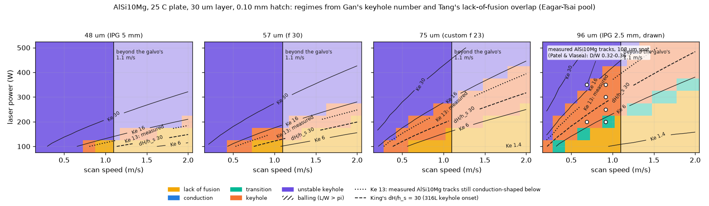
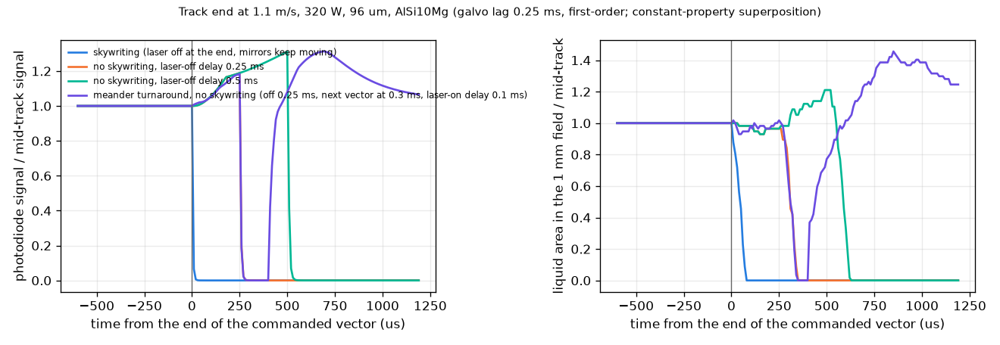

# Melt pool: the numbers the monitoring is sized on (2026-11-25)

[`monitoring.md`](../monitoring.md) proposes a coaxial photodiode, a coaxial camera at 8 µm/px over a ~1 mm field, a two-colour
pyrometer and an InGaAs channel. This note models the melt pool those instruments look at, so their range, resolution and
bandwidth can be checked before anything is bought. Nothing here has been measured on this machine.

The scripts are in [`analysis/monitoring/melt/`](../analysis/monitoring/melt/) and the outputs in
[`analysis/out/monitoring/melt/`](../analysis/out/monitoring/melt/). `report.py` writes every table below into
[`tables.md`](../analysis/out/monitoring/melt/tables.md), with more rows than are quoted here.

| Script | What it does |
|---|---|
| [`props.py`](../analysis/monitoring/melt/props.py) | temperature-dependent properties of AlSi10Mg, 6061, 7075 and pure Al, with sources (§1) |
| [`moving_source.py`](../analysis/monitoring/melt/moving_source.py), [`analytic.py`](../analysis/monitoring/melt/analytic.py) | Rosenthal, Eagar–Tsai, Gan's keyhole number, King's normalised enthalpy, P–v maps per spot (§2) |
| [`fv3d.py`](../analysis/monitoring/melt/fv3d.py), [`run_cases.py`](../analysis/monitoring/melt/run_cases.py) | 3D quasi-steady conduction in the beam's frame: finite volume, 0.2–1 million cells, Newton on enthalpy with AMG (§3) |
| [`transient.py`](../analysis/monitoring/melt/transient.py) | track ends and turnarounds with the galvo's lag, heat build-up between layers, time scales (§4) |
| [`evap.py`](../analysis/monitoring/melt/evap.py) | evaporation, recoil and vapour exit state → [`plume_source.json`](../analysis/out/monitoring/melt/plume_source.json) (§5) |
| [`plots.py`](../analysis/monitoring/melt/plots.py), [`report.py`](../analysis/monitoring/melt/report.py) | figures; what each camera band, the photodiode and a two-colour channel see; the tables |

**To rerun** (one core, ~1.5 h in all): `analytic.py`; `run_cases.py ref+val+sens+map`; `run_cases.py collect`; `evap.py`;
`transient.py`; `plots.py`; `report.py`, each under `OMP_NUM_THREADS=1` in `/tmp/venv`. The 3D fields go to `/tmp/melt_runs`
(not committed); everything the note quotes is in the committed JSON.

**Operating points:** IPG YLR-500 single-mode CW at 1,070 nm; the drawn 96 µm (1/e²) spot, with the 48, 57 and 75 µm options of
[`optics.md`](../optics.md) §9.1; 100–500 W; 0.2–1.1 m/s (the basiCube 20 marks at up to ~1.1 m/s); 30 µm layers; 0.10 mm
hatch; plate at 25 or 200 °C.

## 0. Short answers

1. **Regime at 96 µm and ≤ 1.1 m/s: transition.** A shallow vapour depression forms under the beam, but the pool stays
   conduction-shaped up to at least ~350 W at 0.69–1.1 m/s.
   - In the 3D model the surface reaches the alloy's boiling point at ~200 W at 1.1 m/s (peak 2,537 K against 2,535 K for
     AlSi10Mg) and passes it by ~770 K at 320 W and ~1,060 K at 400 W.
   - Measured AlSi10Mg tracks with a 108 µm spot stay at depth/width 0.32–0.36 from 200 to 350 W at 0.69–0.92 m/s (Patel &
     Vlasea, via Edison). Keyhole pores appear from ~0.4.
   - **The scaling laws disagree.** Gan's keyhole number calls keyhole mode (Ke > 6) from ~250 W for AlSi10Mg at 1.1 m/s, and
     predicts keyholes 130–250 µm deep where those tracks are 70–80 µm deep. Huang et al. found Al needs more: in an Al-Zn-Mg-Cu
     alloy the keyhole threshold sat ~2.5× higher in normalised enthalpy than in Ti-6Al-4V. **I trust the measured tracks** for
     Al in a powder bed.
2. **The pool against the coaxial camera (8 µm/px):** 200–440 µm long and 160–320 µm wide, so 25–55 × 20–40 px. The vapour
   depression is ~65–75 µm across (~9 px).
   - **A 1 mm field is tight.** The liquid trails up to ~340 µm behind the beam and the solidus up to ~480 µm on a 200 °C
     plate; the trailing direction turns with every hatch direction; and the 850 nm view sits 170–250 µm off the beam at the
     field edges (monitoring.md §2.2). Plan a **1.2–1.5 mm** field (150–190 px).
   - **A silicon camera at 850 nm sees only the hot core.** With the depression wall at full scale, a 12-bit sensor reaches
     down to ~1,170 K: a region ~180 × 180 µm, about half the pool's length. To reach the liquidus (870–925 K) it has to
     overexpose the core 50–150×. An InGaAs camera at 1,550 nm reaches ~800 K with the core in range: the whole pool and its
     mushy tail.
3. **Temperatures a pyrometer must span:** from the plate (25–200 °C) through the mushy zone (477–652 °C, 750–925 K) to the
   depression wall at ~2,500–2,900 K (2,763 K for AlSi10Mg; as low as ~1,840 K for 7075 while Zn keeps evaporating). The
   flat-surface model peaks at 3,000–3,600 K at 320–400 W; the real surface can't stay much hotter than the wall, because it is
   pushed down into a depression. Between 750 K and 2,763 K the radiance
   changes ~10⁴× at 1.55 µm and ~10⁷× at 0.85 µm.
4. **Cooling and solidification against bandwidth:** cooling at the liquidus is 0.2–2.6 × 10⁶ K/s (medians), in line with the
   0.8–0.95 × 10⁶ K/s published for the centre of AlSi10Mg pools. The **mushy zone lasts 22–72 µs for AlSi10Mg, 23–72 µs for
   6061 and 67–156 µs for 7075** at 1.1 m/s on a 25 °C plate, and 2–3× longer on a 200 °C plate.
   - A fixed-spot pyrometer needs ≥ 100 kHz and a spot ≤ ~50 µm to follow solidification. A METIS-class instrument (0.8 mm spot,
     40–80 µs) averages the pool, the mushy zone and the track.
   - A **coaxial camera reads cooling without the speed**: in the beam's frame the cooling curve is laid out along the track, at
     7 µs per 8 µm pixel at 1.1 m/s. It needs the InGaAs band to see the solidus.
   - **A coaxial two-colour channel (700/900 nm) reads the depression, not the cooling:** its ratio temperature over a 1 mm field
     is 2,567–2,574 K for AlSi10Mg whatever the speed and plate temperature, and drops to ~2,200 K when no depression forms.
5. **The galvo's speed cap does not force keyhole mode at 96 µm** up to ~350 W (measured tracks). Above that, and at 0.6 m/s
   from ~320 W (Ke ≈ 18, beyond any measured AlSi10Mg track), expect keyhole porosity risk. With the 48 µm spot every useful
   power at ≤ 1.1 m/s is deep in keyhole mode (Ke 47 at 320 W), which confirms the 96 µm collimator.
6. **What the photodiode sees at track ends:** without skywriting, the galvo's 0.25 ms lag slows the beam while it is still
   lasing. At 1.1 m/s the signal rises **19 %** with a 0.25 ms laser-off delay and **31 %** with 0.5 ms or at a meander
   turnaround, where the next track starts on the last one's heat (liquid area +46 %). At 0.6 m/s: 4–13 %. The rise lasts
   0.2–0.5 ms. With skywriting there is none. After laser-off the signal falls by > 95 % within ~50 µs: silicon doesn't see the
   cooling track.
7. **What the 200 °C plate changes:** the pool grows ~25 % in length and width (AlSi10Mg, 320 W, 1.1 m/s: 324 × 208 → 405 ×
   260 µm); the mushy time triples (45 → 142 µs at the surface centre); cooling at the liquidus halves; Gan's keyhole threshold
   falls from ~250 W to ~180 W. **The photodiode barely notices:** +3 % at 1.1 m/s, +5 % at 0.6 m/s, because its signal is
   dominated by the depression, whose temperature is pinned. The part does not accumulate heat between layers with an 8 s recoat
   (a 15 mm tall, 10 × 10 mm part starts each layer within 0.3 K of the plate). The baseline drift to watch is the plate's own
   ([`heat.md`](../heat.md): 240–288 °C in dense builds without module cooling).

**What this changes in the monitoring plan:**
- **Measure pool size and cooling with an InGaAs (0.9–1.7 µm) coaxial camera, not a silicon one.** At 850 nm silicon images only
  the region above ~1,200 K, and Al solidifies at 750–925 K. The IMX296 board of monitoring.md §4 step 6 will show the hot core,
  the depression and spatter, not the pool's edge or the cooling that drives cracking.
- **Make the coaxial field 1.2–1.5 mm**, not 1 mm.
- **Treat the coaxial photodiode as a detector of dwell, keyholing and lack of fusion, not a thermometer.** Its 520–985 nm band
  is dominated by the depression. Keep it, sample it at ≥ 200 kS/s, and log the plate thermocouple for baseline drift.
- **The two-colour channel (step 5) will report the depression wall's temperature**, ~2,570 K on AlSi10Mg and ~2,360 K on 6061.
  It is a good regime and alloy indicator but will not give cooling rates.
- **Use skywriting, or tune the laser-off delay on a test pattern,** before reading photodiode amplitudes. A mistuned delay makes
  20–30 % spikes at every vector end, the size of the anomalies the photodiode is meant to find.
- **Frame rates:** the pool and the depression oscillate at ~3–14 kHz (capillary estimates; Huang et al. measured 2.5–10 kHz in
  an Al alloy). Resolving that takes ≥ 20–30 kfps; freezing it takes ≤ 20 µs exposures. NIST's 10 kfps at 20 µs freezes the
  oscillations but doesn't resolve them.
- **Plan the photodiode's gain for a ~20× range.** From 200 to 400 W on AlSi10Mg the signal changes 0.25–1.37× (against
  320 W, 1.1 m/s), 6061 gives ~0.6×, and 7075 gives 0.1× if Zn evaporation holds its surface at ~1,840 K or ~0.7× if the surface
  is depleted of Zn.
- **The vapour is Mg-rich for AlSi10Mg and 6061 and Zn-rich for 7075**, whose bulk boils at ~1,400 °C. Expect Mg and Zn in the
  condensate on windows, and composition drift (§5).

## 1. Inputs

### 1.1 Properties ([`props.py`](../analysis/monitoring/melt/props.py))

| Alloy | Solidus / liquidus (°C) | Freezing range (K) | k solid, 25 °C / at solidus (W/m K) | k liquid at liquidus (W/m K) | Latent heat (kJ/kg) | Enthalpy to melt from 25 °C (kJ/kg) | Mean diffusivity to liquidus (mm²/s) | Boils at 1 atm, Raoult (°C) | Vapour there (mol %) |
|---|---|---|---|---|---|---|---|---|---|
| pure Al | 660 (spread over 655–665 for the solver) | 0 (10) | 237 / 211 | 95 | 397 | 1,070 | 80 | 2,469 | Al 100 |
| AlSi10Mg | 557 / 596 | 39 | 150 / 155 | 71 | 450 | 1,026 | 57 | 2,261 | Mg 71, Al 29 |
| 6061 | 582 / 652 | 70 | 167 / 189 | 87 | 390 | 1,041 | 63 | 1,981 | Mg 95, Al 5 |
| 7075 | 477 / 635 | 158 | 130 / 163 | 74 | 380 | 1,047 | 47 | 1,399 | Zn 77, Mg 23 |

Sources and assumptions (details in the script's docstring):
- **Solidus and liquidus:** ASM Handbook Vol. 2 for 6061 and 7075; AlSi10Mg as used elsewhere in this repo
  ([`preheat-and-plates.md`](../preheat-and-plates.md), [`monitoring.md`](../monitoring.md)).
- **Solid k and cp:** pure Al from Incropera & DeWitt (Table A.1); the alloys from their room-temperature handbook values with
  Al's temperature trend. For AlSi10Mg, [Van Cauwenbergh et al. 2021](https://doi.org/10.1038/s41598-021-85047-2) measured
  124 W/m K as built, 168 after stress relief and 183 built on a 200 °C plate (read 2026-11-25); the model's 150 sits between.
  Good to ~10–20 %.
- **Liquid k:** Wiedemann–Franz with liquid Al's resistivity, which reproduces the ~90–100 W/m K near melting of
  [Leitner et al. 2017](https://doi.org/10.1007/s11661-017-4053-6). The alloys' liquid resistivities are estimates.
- **Liquid Al density and viscosity:** [Assael et al. 2006](https://doi.org/10.1063/1.2149380). **Surface tension:** 0.914 N/m,
  −0.35 mN/m K (Smithells). Oxide and Mg change both.
- **Latent heat:** AlSi10Mg's 450 kJ/kg is an estimate; Si's latent heat raises it above Al's 397.
- **Vapour pressures:** Al from [Alcock et al. 1984](https://doi.org/10.1179/cmq.1984.23.3.309) (boils at 2,743 K; the CRC
  Handbook lists 2,792 K); Mg, Zn, Si and Cu by Clausius–Clapeyron from CRC boiling points and enthalpies. Over the alloy,
  **Raoult's law** (activity = mole fraction), good to about a factor of 2 for Mg and Zn in Al.
- **Powder layer:** 30 µm, 50 % packed ([`budgets.py`](../budgets.py)), k 0.2 W/m K until melted
  ([Rombouts et al. 2005](https://doi.org/10.1063/1.1948509) measured 0.1–0.3 W/m K on metal powders).

**The alloys' boiling points matter for the plume and the depression.** Mg and Zn are so volatile that the alloys' total vapour
pressure reaches 1 atm far below pure Al's 2,469 °C: AlSi10Mg at ~2,260 °C with a vapour that is 71 % Mg, 6061 at ~1,980 °C
(95 % Mg), 7075 at ~1,400 °C (77 % Zn). These are for the bulk composition; a surface depleted of Mg or Zn boils hotter.

### 1.2 Absorptivity

The largest single unknown. Values for Al at ~1,070 nm (via Edison r8-melt-plume):
- flat Al 0.047 and an Al powder bed 0.22 (ray tracing; [King et al. 2015](https://doi.org/10.1063/1.4937809));
- 0.15 in conduction, 0.425 in transition and 0.70 in keyhole mode, the values Patel & Vlasea adopt
  ([SSRN](https://doi.org/10.2139/ssrn.3490412));
- Al 1100 discs at 1.5 m/s: melting from 100 ± 15 W, keyhole from 265 ± 15 W, deep-keyhole absorptance saturating at ~0.78
  ([Trapp et al. 2017](https://doi.org/10.1016/j.apmt.2017.08.006)).

Two models are used:
- **Scaling laws:** Gan et al.'s Eq. 6, A = 0.7 [1 − exp(−0.6 Ke_m L_d*)], with the flat 0.047 as η_m and 0.15 as a floor. It gives
  0.25–0.37 for AlSi10Mg at 200–350 W and 0.92 m/s, and 0.4–0.6 at 0.6 m/s.
- **3D model: A = 0.35, fixed.** It reproduces the measured AlSi10Mg track widths to within −9 to +10 % from 200 to 350 W (§2.1),
  so the reference fields use it.

## 2. Scaling laws and process maps ([`analytic.py`](../analysis/monitoring/melt/analytic.py))

- **Rosenthal and Eagar–Tsai** ([`moving_source.py`](../analysis/monitoring/melt/moving_source.py)). Eagar–Tsai is integrated
  numerically and checked two ways: it tends to Rosenthal as the spot shrinks (0.4 K apart at a 2 µm spot), and it matches the
  stationary Gaussian's closed form to 0.01 %. Properties are averaged from the plate to the liquidus, with the latent heat folded
  into the heat capacity.
- **Keyhole number** ([Gan et al. 2021](https://doi.org/10.1038/s41467-021-22704-0), read 2026-11-25):
  Ke = A P / [(T_l − T₀) π ρ c_p √(α v r₀³)], with r₀ the spot radius.
  - Conduction below 1.4, transition 1.4–6, keyhole above 6. Keyhole depth e = 0.4 (Ke − 1.4) r₀.
  - Little fluctuation and almost no porosity below ~16; chaotic above ~30.
  - Their data: Ti-6Al-4V, Al6061 and 316 bare plates, 100–520 W, 0.3–1.2 m/s, with a YLR-500-class laser at 1,070 nm.
- **Normalised enthalpy** ([King et al. 2014](https://doi.org/10.1016/j.jmatprotec.2014.06.005), Eq. 2.6, read 2026-11-25):
  ΔH/h_s = A P / (ρ c T_m √(π α v σ³)), σ the Gaussian's standard deviation (a quarter of the 1/e² diameter). Keyhole from
  π T_b/T_m in theory (≈ 9 for AlSi10Mg), 30 ± 4 measured on 316L.
- **Lack of fusion:** (h/W)² + (t/D)² > 1 ([Tang et al. 2017](https://doi.org/10.1016/j.addma.2016.12.001)), hatch 0.10 mm.
  **Balling:** L/W > π ([Yadroitsev et al. 2010](https://doi.org/10.1016/j.jmatprotec.2010.05.010)).
- **Marangoni velocity scale:** u ≈ (|dσ/dT| ΔT)^(2/3) / (ρ μ W/2)^(1/3) ([Mukherjee et al. 2017](https://doi.org/10.1063/1.4976006)).

*Regime by Gan's keyhole number, lack of fusion by Tang's overlap, balling by Plateau–Rayleigh (Eagar–Tsai pool). Circles:
Patel & Vlasea's measured AlSi10Mg tracks, all conduction-shaped, drawn at their power and speed (their 108 µm spot gives a Ke
~16 % lower than 96 µm would). Dotted: Ke 13, the highest Ke among them. Dashed: King's ΔH/h_s = 30.
[`process_map_alloys.png`](../analysis/out/monitoring/melt/process_map_alloys.png) and
[`process_map_200C.png`](../analysis/out/monitoring/melt/process_map_200C.png) show the other alloys and the 200 °C plate; their
dotted line assumes AlSi10Mg's measured limit carries over.*

**Power at which each Ke is reached at 1.1 m/s, 96 µm:**

| Alloy, plate | Ke 1.4 (conduction ends) | Ke 6 (keyhole, by Gan) | Ke 16 (porosity risk) |
|---|---|---|---|
| AlSi10Mg, 25 °C | 112 W | 249 W | 449 W |
| AlSi10Mg, 200 °C | 80 W | 177 W | 320 W |
| 6061, 25 °C | 132 W | 294 W | > 500 W |
| 6061, 200 °C | 98 W | 218 W | 395 W |
| 7075, 25 °C | 129 W | 287 W | > 500 W |
| 7075, 200 °C | 95 W | 210 W | 377 W |
| pure Al, 25 °C | 145 W | 325 W | > 500 W |

**Spot options at 320 W and 1.1 m/s** (AlSi10Mg, 25 °C): Ke 47 at 48 µm, 34 at 57 µm, 18 at 75 µm and 9 at 96 µm. Only the
96 µm spot stays out of the chaotic-keyhole range at useful powers, as optics.md §9.1 concluded from intensity.

Other numbers from the same script (all in `tables.md`):
- **Péclet number** v r₀/α = 0.4–1.2. Al's high diffusivity makes the pool round-ish (L/W 1.2–1.7 in 3D), not steel's long
  teardrop.
- **Marangoni scale** 6–17 m/s, flow Péclet 15–60. CFD of Al pools reports 0.5–5 m/s (Edison). Either way convection, not
  conduction, carries the heat inside the pool, which is why the 3D model multiplies the liquid's k (§3.3).
- **Balling** (L/W > π) does not occur in the useful window.
- **Lack of fusion** (Tang) at 200 W and 1.1 m/s for every alloy on a 25 °C plate; the 3D model's 200 W pools (160–180 µm wide,
  62–72 µm deep) clear it narrowly.
- **Rosenthal** gives pools within 3–15 % of Eagar–Tsai's: at Péclet ~1 the pool is 2–4 times the spot, so the beam's shape
  matters little to the liquidus.

### 2.1 Against measured AlSi10Mg tracks

Patel & Vlasea's single tracks: AlSi10Mg, 108 µm spot, 30 µm layer (via Edison r8-melt-plume; I could not check the source, and
I paired the 0.688 m/s range ends with 200 and 350 W):

| P (W), v (m/s) | Measured W / D (µm), D/W | Rosenthal; Eagar–Tsai, A from Gan: W / D (µm) | Gan: A, Ke, keyhole depth (µm) | 3D model, A 0.35: W / D below powder top / D into substrate (µm) | 3D peak T (K) |
|---|---|---|---|---|---|
| 200, 0.917 | 185 / 67, 0.36 | 103 / 51; 120 / 41 | 0.25, 3.6, 47 | 199 / 75 / 45 | 2,363 |
| 250, 0.917 | 196 / 66, 0.34 | 134 / 67; 148 / 59 | 0.29, 5.3, 85 | 196 / 86 / 56 | 2,679 |
| 300, 0.917 | 202 / 70, 0.35 | 164 / 82; 174 / 76 | 0.34, 7.3, 128 | 214 / 95 / 65 | 2,977 |
| 350, 0.917 | 239 / 78, 0.32 | 192 / 96; 201 / 91 | 0.37, 9.5, 175 | 239 / 103 / 73 | 3,225 |
| 200, 0.688 | 205 / 73, 0.35 | 131 / 65; 145 / 57 | 0.31, 5.2, 81 | 186 / 82 / 52 | 2,392 |
| 350, 0.688 | 235 / 80, 0.34 | 240 / 120; 246 / 116 | 0.45, 13.1, 253 | 258 / 114 / 84 | 3,259 |
| 300, 0.917, A 0.30 / 0.40 | 202 / 70 | | | 201 / 87 / 57; 237 / 102 / 72 | 2,725; 3,192 |

- **The 3D model at A = 0.35 matches the widths** (−9 to +10 %); A between 0.30 and 0.35 fits 300 W best. The measured depths
  fall between the model's depth below the powder top and its depth into the substrate; Edison's summary doesn't say which
  surface the paper measured from.
- **Rosenthal and Eagar–Tsai underestimate the width by 14–44 % at 200–350 W, 0.917 m/s** with Gan's absorptivity: they have no
  Marangoni spreading and no powder layer. At 350 W and 0.688 m/s, where Gan's absorptivity reaches 0.45, they match it.
- **Gan's keyhole depth is 1.8–3.2× the measured pool depth** from 300 W. With the absorptivity that fits the widths, Ke says
  keyhole; the tracks say conduction. Either Ke, fitted on bare-plate X-ray data, doesn't carry over to Al powder tracks, or the
  absorptivity in Ke should be lower than the one that sets the width.
  [Huang et al. 2022](https://doi.org/10.1038/s41467-022-28694-x) (read 2026-11-25) point the same way: in Al7A77, an
  Al-Zn-Mg-Cu alloy, the keyhole transition sat at a normalised enthalpy of ~20 ± 3 against ~8 ± 3 for Ti-6Al-4V.
- **Cooling rates agree.** Van Cauwenbergh et al. (read 2026-11-25) give 9.5 × 10⁵ K/s at the pool centre and 1.6 × 10⁵ K/s at
  its boundary from cell spacing, and 8.3 and 4.4 × 10⁵ K/s from their heat-transfer model;
  [Leis et al. 2022](https://doi.org/10.3390/met12122000) (via Edison) calculate up to 1.2–1.75 × 10⁶ K/s over 250–450 W. The 3D model's
  medians for AlSi10Mg are 0.2–1.2 × 10⁶ K/s (§3.4).

## 3. The 3D model ([`fv3d.py`](../analysis/monitoring/melt/fv3d.py))

### 3.1 Method
- **Equation:** steady conduction in the beam's frame, ∇·(k∇T) + ρ v ∂H/∂x = 0, with H(T) the enthalpy including latent heat.
  - Enthalpy is the unknown, and Newton's method works on T(H), which has no spike. So the latent heat needs no smoothing; the
    apparent heat capacity dH/dT enters through the Jacobian.
  - k(T) lags one iteration. A per-cell damping stops cells cycling across the solidus kink.
- **Grid:** finite volume on half the domain (y ≥ 0), uniform over the pool (6 × 5 × 4 µm for the reference fields, 8 × 6 × 5 µm
  for the sweeps), stretched by 1.18 out to 6–9 mm. 0.2–0.95 million cells and 15–57 Newton iterations; 0.5–7 min each on one
  core with pyamg (Ruge–Stüben AMG + GMRES).
- **Boundaries:** plate temperature on the inflow face ahead of the beam, the far sides and the bottom; outflow behind.
  **Top:** the Gaussian beam integrated exactly over each face, minus evaporation (Hertz–Knudsen–Langmuir, 0.82 net, each
  element's latent heat of vaporisation) and radiation (ε 0.2).
- **Powder:** the top 30 µm carries 50 % of the mass flux and has k = 0.2 W/m K until the material at that (y, z) has melted
  upstream.
- **Marangoni:** the liquid's k × 2.5 (swept 1–3), ramped across the mushy zone.
- **Checks:** the heat balance closes to < 10⁻³ W in every run (absorbed = advected + conducted + evaporated + radiated). Grid:
  see §3.3.
- **Not modelled:** the free surface and the vapour depression; fluid flow, except through the k factor; Mg and Zn depletion at
  the surface (7075 is also run with the surface's Mg and Zn activity cut 10×, "fvol 0.1").

### 3.2 Pools

| Case (96 µm, A 0.35) | Liquid pool L × W × D (µm) | Pixels at 8 µm/px | Peak T, flat model (K) | Alloy boils / depression wall (K) | Si 850 nm, 12-bit: sees above (K); L × W (µm) | InGaAs 1,550 nm, 12-bit: above (K); L × W (µm) | Photodiode / AlSi10Mg 1.1 m/s 25 °C | Two-colour 700/900 nm reading (K) |
|---|---|---|---|---|---|---|---|---|
| AlSi10Mg 320 W 1.1 m/s 25 °C | 324 × 208 × 93 | 40 × 26 | 3,301 | 2,535 / 2,763 | 1,172; 176 × 176 | 797; 380 × 208 | 1.00 | 2,567 |
| AlSi10Mg 320 W 1.1 m/s 200 °C | 405 × 260 × 108 | 51 × 33 | 3,316 | 2,535 / 2,763 | 1,172; 192 × 168 | 797; 580 × 256 | 1.03 | 2,571 |
| AlSi10Mg 320 W 0.6 m/s 25 °C | 328 × 258 × 113 | 41 × 32 | 3,355 | 2,535 / 2,763 | 1,172; 196 × 184 | 797; 372 × 248 | 1.12 | 2,574 |
| AlSi10Mg 320 W 0.6 m/s 200 °C | 442 × 320 × 134 | 55 × 40 | 3,384 | 2,535 / 2,763 | 1,172; 204 × 192 | 797; 568 × 320 | 1.17 | 2,574 |
| AlSi10Mg 200 W 1.1 m/s 25 °C | 240 × 159 × 72 | 30 × 20 | 2,537 | 2,535 / 2,763 | 1,172; 144 × 144 | 797; 300 × 160 | 0.25 | 2,200 |
| AlSi10Mg 400 W 1.1 m/s 25 °C | 365 × 234 × 103 | 46 × 29 | 3,597 | 2,535 / 2,763 | 1,172; 196 × 184 | 797; 444 × 232 | 1.37 | 2,602 |
| 6061 320 W 1.1 m/s 25 °C | 254 × 191 × 84 | 32 × 24 | 3,122 | 2,254 / 2,508 | 1,123; 176 × 184 | 774; 324 × 192 | 0.59 | 2,357 |
| 6061 320 W 1.1 m/s 200 °C | 310 × 229 × 97 | 39 × 29 | 3,140 | 2,254 / 2,508 | 1,123; 192 × 192 | 774; 464 × 232 | 0.59 | 2,362 |
| 6061 320 W 0.6 m/s 25 °C | 258 × 220 × 100 | 32 × 28 | 3,174 | 2,254 / 2,508 | 1,123; 192 × 208 | 774; 320 × 224 | 0.63 | 2,363 |
| 6061 320 W 0.6 m/s 200 °C | 334 × 275 × 118 | 42 × 34 | 3,204 | 2,254 / 2,508 | 1,123; 216 × 200 | 774; 468 × 280 | 0.67 | 2,364 |
| 7075 320 W 1.1 m/s 25 °C | 244 × 204 × 79 | 30 × 25 | 2,993 | 1,673 / 1,839 | 966; 212 × 200 | 695; 388 × 208 | 0.10 | 1,791 |
| 7075 320 W 1.1 m/s 25 °C, fvol 0.1 | 261 × 205 × 85 | 33 × 26 | 3,229 | – / 2,541 | 1,130; 180 × 184 | 777; 372 × 200 | 0.69 | 2,396 |
| 7075 320 W 0.6 m/s 25 °C, fvol 0.1 | 276 × 246 × 103 | 34 × 31 | 3,284 | – / 2,541 | 1,130; 196 × 192 | 777; 364 × 248 | 0.76 | 2,402 |
| pure Al 320 W 1.1 m/s 25 °C | 233 × 172 × 80 | 29 × 22 | 3,093 | 2,743 / 2,907 | 1,197; 164 × 160 | 809; 268 × 168 | 0.91 | 2,572 |

Reading the table:
- **D** is below the powder surface; subtract ~30 µm for the depth into the solid.
- **Depression wall:** where the recoil pressure (0.54 p_sat) holds a hole of the beam's radius open against 1 atm and surface
  tension. The real surface can't stay much hotter, so every camera and photodiode number caps the field there.
- **Camera columns:** the depression wall at full scale on a 12-bit sensor; emissivity taken equal everywhere.
- **Photodiode:** 520–985 nm × silicon responsivity over a 1 mm field. **Two-colour:** the ratio temperature of 700 and 900 nm
  summed over the same field (grey body).

What the fields say:
- **Pools are short and wide** (L/W 1.2–1.7): Al conducts heat ahead of the beam (Péclet ~1).
- **The flat model's surface runs past the alloy's boiling point** (by ~770–850 K for AlSi10Mg at 320 W, ~350 K for pure Al,
  ~1,300 K for 7075) over a circle ~65–75 µm across (0.004 mm²). There
  the recoil pressure (1.2 bar at the wall temperature, up to ~8 bar at the flat peak) is 3–20× the capillary pressure of a
  50 µm dimple, so the real surface is a shallow depression at ~2,500–2,900 K: the transition regime of §0.
- **6061 runs smaller and cooler than AlSi10Mg** at the same power: higher k and liquidus, and its 1 % Mg boils off at a lower
  temperature (wall 2,508 K), which also cuts its photodiode signal to ~0.6×.
- **7075 depends on how fast Zn leaves.** With the bulk Zn activity at the surface, Zn evaporation takes 14–16 W (13–14 % of the
  absorbed power) and holds the wall at ~1,840 K. That is more Zn than the pool contains (§5), so the surface must deplete; with
  the activity cut 10× the wall is ~2,540 K and the pool 5–8 % bigger. The truth is in between, and the photodiode signal
  moves 7× across that range.
- **Silicon sees about half the pool; InGaAs sees all of it.** The Si 850 nm view at 12 bits ends at ~1,170 K, 140–220 µm
  long whatever the pool's length. Overexposing the core 10× moves the floor to ~1,010 K and 100× to ~890 K, if the sensor
  doesn't bloom. The InGaAs view reaches ~800 K, below the liquidus of every alloy, without overexposing anything.

### 3.3 Sensitivity (AlSi10Mg, 320 W, 1.1 m/s, A 0.35, 25 °C)

| Change | L × W × D (µm) | Peak T (K) | Cooling at liquidus, median (10⁶ K/s) | Evaporation (W) |
|---|---|---|---|---|
| reference: 6/5/4 µm grid, Marangoni factor 2.5, 30 µm powder | 324 × 208 × 93 | 3,301 | 0.69 | 4.5 |
| coarse grid (8/6/5 µm) | 320 × 205 × 93 | 3,270 | 0.72 | 4.2 |
| fine grid (4/3.5/3 µm, 0.95 million cells) | 323 × 211 × 93 | 3,332 | 0.69 | 4.9 |
| no Marangoni enhancement (f_M 1) | 282 × 204 × 72 | 3,899 | 2.10 | 33 |
| f_M 3 | 316 × 206 × 94 | 3,016 | 0.64 | 1.9 |
| bare plate, no powder layer | 303 × 185 × 84 | 3,137 | 0.86 | 2.6 |
| no evaporation sink | 330 × 208 × 95 | 3,426 | 0.69 | 0 |

- **Grid:** across the three grids L, W and D move by ≤ 3 % and the peak by ≤ 2 %; the reference grid sits within 1.5 % of the
  finest.
- **The Marangoni factor matters for depth, peak temperature and evaporation, not width.** Without it the pool is 23 % shallower,
  the flat peak 600 K hotter and evaporation 7× larger. From 2.5 to 3 almost nothing changes. Width, the quantity validated in
  §2.1, is insensitive to it.
- **The powder layer widens the pool by ~10 %** (against a bare plate): the melted layer conducts sideways while the powder
  beside it insulates.
- **Evaporation cools the flat peak by ~150 K** and shrinks the pool by ~3 %.

### 3.4 Solidification: cooling rate, G, R and hot cracking

| Case (25 °C plate unless noted) | Liquid at the surface centre (µs) | Mushy time, surface centre / range (µs) | Cooling at the liquidus, median / max (10⁶ K/s) | G at the liquidus (10⁶ K/m) | R (m/s) |
|---|---|---|---|---|---|
| AlSi10Mg 200 W 1.1 m/s | 219 | 23 / 22–44 | 1.22 / 1.87 | 1.1–15 | 0.04–1.1 |
| AlSi10Mg 320 W 1.1 m/s | 294 | 45 / 33–60 | 0.69 / 1.23 | 0.4–15 | 0.03–1.1 |
| AlSi10Mg 320 W 1.1 m/s, 200 °C | 368 | 142 / 87–146 | 0.34 / 0.54 | 0.15–17 | 0.01–1.1 |
| AlSi10Mg 320 W 0.6 m/s | 547 | 53 / 53–116 | 0.50 / 0.56 | 0.7–30 | 0.01–0.6 |
| AlSi10Mg 320 W 0.6 m/s, 200 °C | 737 | 181 / 158–214 | 0.20 / 0.26 | 0.19–9.5 | 0.01–0.6 |
| AlSi10Mg 400 W 1.1 m/s | 332 | 61 / 44–72 | 0.59 / 1.00 | 0.3–18 | 0.01–1.1 |
| 6061 200 W 1.1 m/s | 180 | 23 / 23–47 | 2.58 / 2.86 | 2.1–63 | 0.03–1.1 |
| 6061 320 W 1.1 m/s | 231 | 36 / 36–72 | 1.52 / 1.84 | 1.3–26 | 0.01–1.1 |
| 6061 320 W 1.1 m/s, 200 °C | 282 | 90 / 90–119 | 0.77 / 0.96 | 0.5–20 | 0.03–1.1 |
| 6061 320 W 0.6 m/s | 430 | 52 / 52–125 | 1.02 / 1.18 | 1.8–12 | 0–0.6 |
| 7075 200 W 1.1 m/s | 180 | 67 / 67–110 | 2.64 / 2.75 | 2.4–29 | 0.02–1.1 |
| 7075 320 W 1.1 m/s, fvol 0.1 | 237 | 115 / 115–156 | 1.66 / 1.79 | 1.4–31 | 0.05–1.1 |
| 7075 320 W 0.6 m/s, fvol 0.1 | 459 | 176 / 176–292 | 0.96 / 1.33 | 1.7–21 | 0.01–0.6 |

- **G and R** fall in the usual LPBF ranges: G from 10⁵ to 6 × 10⁷ K/m (highest at the bottom of the pool, where R → 0), R up
  to the scan speed at the surface centreline. G/R is 1.5–7 K s/mm², about 10⁴ times below what a planar front needs (ΔT₀/D_L
  ≈ 1.3 × 10⁴ K s/mm² for AlSi10Mg with D_L ≈ 3 × 10⁻⁹ m²/s, an estimate). Every alloy grows cells or dendrites.
- **Columnar or equiaxed:** without nucleants, LPBF Al alloys grow columnar grains epitaxially across layers. That is what lets
  6061 and 7075 crack, and Zr nanoparticle nucleants make them equiaxed and crack-free
  ([Martin et al. 2017](https://doi.org/10.1038/nature23894)). The model's G and R don't change that picture. I did not draw a
  columnar-to-equiaxed line, because I found no Al-specific constants to put on it.
- **Hot cracking:** cracks open in the last liquid films, and how long they stay open scales with the freezing range.
  - AlSi10Mg (39 K, mostly eutectic liquid that back-fills) spends 22–72 µs in its mushy zone at 1.1 m/s on a 25 °C plate; 6061 (70 K)
    23–72 µs; **7075 (158 K) 67–156 µs, 2–3× longer.** At 0.6 m/s 7075's mushy zone lasts up to ~290 µs.
  - The cooling rates are similar across alloys (0.6–2.6 × 10⁶ K/s at 1.1 m/s), so the thermal strain rate is similar. What
    differs is the freezing range and how much eutectic there is to heal a crack, which is why 6061 and 7075 crack and AlSi10Mg
    doesn't.
  - **A 200 °C plate stretches every mushy time 2–3×** and halves the cooling rate: lower strain rate, but films that stay open
    longer.
  - Cracking itself is what acoustic emission (monitoring.md §2.4) detects. What an InGaAs channel can measure is the cooling
    through 750–925 K that drives it.

## 4. Time-dependent pieces ([`transient.py`](../analysis/monitoring/melt/transient.py))

### 4.1 Track ends and turnarounds
- **Galvo:** a first-order lag with the basiCube 20's 0.25 ms tracking error as its time constant. At constant speed the beam
  trails the command by v × 0.25 ms (0.28 mm at 1.1 m/s, as monitoring.md §5.1 says); when the command stops, the beam slows as
  e^(−t/0.25 ms). This is a simplification of the real servo, for which SCANLAB gives only the tracking error.
- **Thermal model:** Eagar–Tsai kernels superposed along the actual path every 2 µs, with constant properties and the latent
  heat in the heat capacity. Its absolute temperatures aren't worth quoting; the ratios are what matter.
- **Photodiode:** 520–985 nm radiance × silicon responsivity over a 1 mm field centred on the beam, the surface capped at the
  depression-wall temperature, emissivity 0.15 liquid and 0.10 solid. AlSi10Mg, 320 W, 96 µm, A 0.35.

| Speed | Track end | Photodiode peak / mid-track | Liquid area peak / mid-track |
|---|---|---|---|
| 1.1 m/s | skywriting (laser off at the end, mirrors keep moving) | 1.00 | 1.00 |
| 1.1 m/s | no skywriting, laser-off delay 0.25 ms | 1.19 | 1.00 |
| 1.1 m/s | no skywriting, laser-off delay 0.5 ms | 1.31 | 1.21 |
| 1.1 m/s | meander turnaround without skywriting: laser off 0.25 ms after the command ends, next vector 0.3 ms after, laser-on delay 0.1 ms | 1.31 | 1.46 |
| 0.6 m/s | laser-off delay 0.25 ms | 1.04 | 1.00 |
| 0.6 m/s | laser-off delay 0.5 ms | 1.13 | 1.00 |
| 0.6 m/s | meander turnaround as above | 1.13 | 1.23 |

- **The rise builds over 0.2–0.5 ms and is set by the delays,** so a mistuned delay is a repeatable artefact at every vector end.
  It is also why every signal should be logged against the commanded positions (monitoring.md §5.1).
- **At a turnaround** the return track starts on the previous track's hot end, so its pool is 1.2–1.5× the mid-track pool for
  the first ~0.5 ms.
- **After laser-off** the photodiode signal falls by > 95 % within ~50 µs.

### 4.2 Heat build-up between layers
A 1D column (the part, bulk alloy) grows 30 µm per layer on a plate held at 200 °C. Each layer's absorbed energy (0.35 × 320 W
over the scan) goes into its top during the scan; then 8 s of recoat ([`heat.md`](../heat.md)).

| Part | Layer energy (J) | Scan time (s) | Top right after the scan, 15 mm tall (°C) | Top at the next layer's start, 15 mm (°C) |
|---|---|---|---|---|
| 10 × 10 mm, 1.1 m/s, 8 s recoat | 102 | 1.11 | 253 | 200.3 |
| 10 × 10 mm, 1.1 m/s, 2 s recoat | 102 | 1.11 | 259 | 211.7 |
| 20 × 20 mm, 1.1 m/s, 8 s recoat | 407 | 3.84 | 224 | 200.1 |
| 10 × 10 mm, 0.6 m/s, 8 s recoat | 187 | 1.87 | 273 | 200.4 |

- **The part doesn't drift from layer to layer.** A 15 mm Al column cools with a time constant of ~1.5 s, well inside an 8 s
  recoat. With a 2 s recoat it would start each layer ~12 K warm.
- **Within a layer it does:** the part's top warms 25–75 K over one layer's scan, so the last tracks of a layer see a hotter
  baseline than the first. From the 3D model that is ~+7 % in pool length and width per 50 K (the 25 → 200 °C step adds ~25 %).
- **The plate is the baseline drift to log.** [`heat.md`](../heat.md) finds dense M50 and L75 builds push the plate from 200 to
  240–288 °C unless the module is cooled. That changes the pool by ~+5–15 % and the photodiode by only ~1–2 %.
- **Not covered:** overhangs and thin walls standing on powder, where heat has no path down. That is where published photodiode
  signals rise most, and the 1D model says nothing about it.

### 4.3 Time scales, and what they ask of each instrument

| Time scale (96 µm) | Value | Source |
|---|---|---|
| Beam crosses its own spot | 87 µs at 1.1 m/s, 160 µs at 0.6 m/s | geometry |
| Pool passes a point (liquid at the surface centre) | 180–330 µs at 1.1 m/s, 430–550 µs at 0.6 m/s; +25–35 % on a 200 °C plate | §3.4 |
| Mushy zone (solidification) | 22–72 µs for AlSi10Mg and 6061, 67–156 µs for 7075 at 1.1 m/s; up to ~290 µs at 0.6 m/s; 2–3× on a 200 °C plate | §3.4 |
| Pool's lowest capillary mode, √(σk³/ρ)/2π with k = π/W | 2–5 kHz | `transient.py` |
| Depression's capillary mode (k = π/2r₀) | ~14 kHz | `transient.py` |
| Keyhole fluctuations measured in an Al alloy | 2.5–10 kHz, fastest in transition | Huang et al. 2022 |
| Keyhole fluctuations in simulation | ~10⁴ Hz, with small ~10⁶ Hz ripples | Gan et al. 2021 |
| Track-end rise | 0.2–0.5 ms | §4.1 |

| Instrument | Needs | Why |
|---|---|---|
| Coaxial photodiode | ≥ 100 kHz bandwidth, ≥ 200 kS/s | resolve the 87 µs spot transit and 2.5–14 kHz oscillations with margin; the PDA36A2's ≥ 100 kHz gain settings qualify |
| Fixed-spot pyrometer | ≥ 100 kHz and a spot ≤ 50 µm, to follow solidification | the mushy zone lasts 22–156 µs and is 25–170 µm long behind the pool; a 0.8 mm spot averages pool, mush and track |
| Coaxial two-colour channel | ≥ 100 kHz | it reads the depression (§3.2); useful for regime changes at the photodiode's rate |
| Coaxial camera | exposure ≤ 20 µs; ≥ 20–30 kfps to resolve oscillations, 0.5–10 kfps to measure pool shape | the pool is stationary in the de-scanned view; cooling is read along the track at 7 µs per pixel (1.1 m/s, 8 µm/px) |
| InGaAs channel | ~10⁴ dynamic range at 1.55 µm (750 K to 2,760 K); 12 bits reach ~800 K | §0 item 3, §3.2 |

## 5. Evaporation and the plume source ([`evap.py`](../analysis/monitoring/melt/evap.py) → [`plume_source.json`](../analysis/out/monitoring/melt/plume_source.json))

From each 3D surface field:
- **Mass flux:** Hertz–Knudsen–Langmuir per element, with 18 % recondensing (Anisimov 1968;
  [Knight 1979](https://doi.org/10.2514/3.61171)), and Raoult partial pressures over the bulk composition.
- **Three readings of the surface temperature:** **flat** (the field as solved, an upper bound), **wall** (capped at the
  depression-wall temperature, the best estimate for Al), **boil** (capped at the 1 atm boiling point, a lower bound).
- **Exit state:** Knight's jump conditions into 1.015 bar of argon at the hottest point: Mach number, vapour temperature,
  velocity, density. **Recoil pressure:** 0.54 p_sat.
- **Selective loss:** each element's evaporated mass against what one layer supplies (hatch × layer × density × weight fraction).
- **Measured losses, for calibration:** AlSi10Mg 57 % of its Mg and 6061 17 % (Li 2024 thesis, via Edison); 7075 ~12 % of its Mg
  and ~18 % of its Zn ([Velikajne et al. 2026](https://doi.org/10.3390/ma19050970), via heat.md). The JSON's `best` block uses
  these for Mg and Zn, and the wall reading for Al. The fractions come from builds at other parameters and are applied unchanged
  at every power and speed.

| Case (320 W, 25 °C, 96 µm) | HKL wall reading (µg/mm): total; Mg / Zn / Al | Best estimate (µg/mm; g per hour of lasing) | Best vapour (mol %) | Evaporation power, wall (W) | Exit: Mach, velocity (m/s), T (K) | HKL Mg asked of each layer (× its Mg) |
|---|---|---|---|---|---|---|
| AlSi10Mg 1.1 m/s | 0.26; 0.17 / – / 0.10 | 0.11; 0.46 | Al 85, Mg 15 | 2.1 | 0.43, 478, 2,326 | 5.9 |
| AlSi10Mg 0.6 m/s | 0.54; 0.34 / – / 0.20 | 0.22; 0.48 | Al 92, Mg 8 | 2.4 | 0.43, 478, 2,326 | 12.0 |
| AlSi10Mg 400 W 1.1 m/s | 0.37; 0.22 / – / 0.14 | 0.16; 0.64 | Al 89, Mg 11 | 3.0 | 0.43, 478, 2,326 | 7.9 |
| 6061 1.1 m/s | 0.35; 0.31 / – / 0.03 | 0.05; 0.19 | Al 68, Mg 32 | 2.2 | 0.43, 464, 2,111 | 3.9 |
| 7075 1.1 m/s, bulk activity | 1.23; 0.20 / 1.03 / 0.00 | 0.11; 0.44 | Zn 55, Mg 44 | 3.2 | 0.43, 265, 1,548 | 0.9 |
| 7075 1.1 m/s, fvol 0.1 | 0.54; 0.09 / 0.40 / 0.04 | 0.15; 0.60 | Al 40, Zn 33, Mg 27 | 1.8 | 0.43, 329, 2,140 | 0.4 |
| pure Al 1.1 m/s | 0.11; – / – / 0.11 | 0.11; 0.44 | Al 100 | 1.3 | 0.43, 477, 2,448 | – |

- **Mg and Zn losses are limited by supply, not by vapour pressure.** HKL asks AlSi10Mg's surface for 6–12 times all the Mg a
  layer brings, and 7075's for up to 12× its measured Zn loss; measured losses are 12–57 %. So the surface depletes, and Mg and Zn
  reach it only as fast as the liquid mixes. **For Mg and Zn use the `measured` block**, ~10× below HKL. Al's own vapour is not
  supply-limited.
- **So the vapour is ~0.05–0.25 µg per mm of track, mostly Al,** about 0.2–0.6 g per hour of lasing at 320–400 W. If the surface
  is fully depleted of Mg, the wall is hotter (~2,940 K for pure Al) and the Al vapour ~2–3× higher; the flat reading's upper
  bound is ~1.5 g/h. This is the condensate source for window fouling.
- **Evaporation takes ~2 % of the absorbed power** (1.3–3 W of 112–140 W), and 13–14 % for 7075 if its surface kept the bulk
  Zn.
- **Exit velocity ~265–480 m/s at Mach 0.43** at the edge of the Knudsen layer (~1,090 m/s, sonic, in the flat reading). Edison's
  sources give 20–300 m/s for the vapour jet and 38–97 m/s for the plume's ascent, so the jet slows within a few hundred µm as it
  mixes with argon. The vapour's volume flow is ~3 × 10⁻⁷ m³/s at room temperature, negligible beside the 140–200 L/min
  cross-flow.
- **Recoil pressure** at the wall is 118 kPa by construction (it is the definition of the wall temperature); at the flat model's
  peak, up to ~0.8 MPa.

`plume_source.json` documents its keys in a `keys` block. Per case: `inputs`, `pool`, `T_boil_1atm_K`, `T_wall_K`; for each
reading (`flat`, `wall`, `boil`) the per-element `m_dot_kg_s`, `loss_ug_per_mm`, `loss_fraction_per_pass`, `shift_per_layer_frac`,
`vapour_mole_fraction`, `evap_power_W`, `area_hot_mm2`; `exit` per reading (T_surface_K, p_sat_Pa, recoil_Pa, mach, T_vapour_K,
u_m_s, rho_vapour_kg_m3, M_vapour_g_mol, Q_vapour_m3_s); `measured` (Mg and Zn rates from measured losses); `best`.

## 6. Data for the optics: [`surface_fields.npz`](../analysis/out/monitoring/melt/surface_fields.npz)

| Key | Shape, units | What |
|---|---|---|
| `x_um`, `y_um` | (376,), (201,) µm | cell centres on a 4 µm grid: x −1,200 to +300 (beam frame; the beam is at 0 moving +x, the pool trails to −x), y ±400 |
| `T_K` | (case, x, y), K | surface temperature from fv3d.py (flat surface) |
| `T_capped_K` | same | min(T_K, T_wall_K): the reading to use for emission; inside the depression the surface sits near the wall temperature (2,763 K AlSi10Mg, 2,508 K 6061) |
| `liquid`, `mushy`, `above_boil` | same, bool | T ≥ liquidus; solidus ≤ T < liquidus; T ≥ the alloy's 1 atm boiling point (the depression's footprint, ~200–290 cells, ~65–75 µm across) |
| `cases` | (case,) str | case tags |
| `meta_json` | str | per case: alloy, P, v, spot, A, plate T, f_M, layer, solidus, liquidus, 1 atm boiling point, T_wall_K, peak T, pool L/W/D |
| `README` | str | the format in one paragraph |

Cases: AlSi10Mg and 6061 at 320 W, 96 µm, A 0.35, at 1.1 and 0.6 m/s, on 25 and 200 °C plates (8 fields). Emissivity is not
applied: use ~0.10–0.15 for liquid Al at ~1 µm and more for powder and oxide (Edison r8-coaxial-radiometry). Inside `above_boil`
the surface is a cavity, with a higher apparent emissivity than flat liquid.

## 7. Edison's second opinion (r8-melt-plume)

[`edison/r8-melt-plume/answer.md`](../edison/r8-melt-plume/answer.md) supplied the measured AlSi10Mg tracks, the absorptivities,
the cooling rates, the keyhole fluctuation band, the plume velocities and the Mg and Zn losses used above. I read Gan, King,
Huang and Van Cauwenbergh myself; the rest is as Edison reported it. Where this note and Edison differ:
- **Keyhole thresholds.** Edison quotes ΔH/h_s ≈ 10 as a general keyhole criterion, and Gan's Ke. With the absorptivity that fits
  the measured widths, both call keyhole for tracks that were conduction-shaped. I go with the measured tracks for AlSi10Mg.
- **Edison's "Ke ≈ (ΔH/h_m)/√π"** (via Huang et al.) is not Gan's definition. I used Gan's paper directly.
- **Peak temperature.** Edison cites ~3,360 K (a generic plume model, not Al) and says Al keyhole surfaces reach "well above"
  2,743 K. For these alloys Mg and Zn hold the depression wall lower, ~1,840–2,760 K; only pure Al's reaches ~2,900 K. The flat 3D
  model passes 3,000 K only because it can't form a depression.
- **Solidification time.** Edison's 0.18–1.0 ms is the time the pool takes to pass a point. The mushy time is 22–290 µs.
- **Mg loss in AlSi10Mg (57 %)** comes from a thesis Edison couldn't tie to a primary measurement. Treat it as an upper value.

## 8. Not done, and limits

- **No free surface and no flow.** The vapour depression, keyhole depth, spatter and humping are outside a conduction model.
  Where the surface passes boiling, the fields are a flat-surface upper bound; `T_capped_K` is the practical reading.
- **One absorptivity (0.35),** fitted to widths at 200–350 W and 0.69–0.92 m/s with a 108 µm spot. It probably rises at 0.6 m/s and
  as the depression deepens (Gan's Eq. 6 gives 0.5–0.6), so the 0.6 m/s pools are, if anything, too small.
- **The validation data are second-hand** (Patel & Vlasea via Edison), and I don't know which surface their depths are measured
  from.
- **Properties:** liquid conductivities, AlSi10Mg's latent heat and Raoult activities are estimates (10–20 %; ×2 for activities).
- **Surface depletion of Mg and Zn** is handled only by the `fvol` runs for 7075 and by calibrating to measured losses. It
  changes 7075's surface temperature by ~700 K and its photodiode signal by ~7×.
- **Galvo:** a first-order lag stands in for the basiCube 20's servo.
- **Not run:** overhangs and thin walls on powder; more than one turnaround; the 48/57/75 µm spots in 3D (scaling laws only);
  Scheil solidification paths and a crack-susceptibility index; spatter.
- **Evaporation:** no diffusion-limited regime below boiling, and Knight's jump treats the vapour as one species.

## Sources
- Gan, Z. et al. (2021). Universal scaling laws of keyhole stability and porosity in 3D printing of metals. Nat. Commun. 12:2379.
  https://doi.org/10.1038/s41467-021-22704-0 (read 2026-11-25: Eq. 1–2 and 6–7, regime bounds, fluctuation frequencies)
- King, W.E. et al. (2014). Observation of keyhole-mode laser melting in laser powder-bed fusion additive manufacturing.
  J. Mater. Process. Technol. 214:2915–2925. https://doi.org/10.1016/j.jmatprotec.2014.06.005 (read via OSTI 1502044: Eq. 2.6–2.7,
  30 ± 4)
- Huang, Y. et al. (2022). Keyhole fluctuation and pore formation mechanisms during laser powder bed fusion additive
  manufacturing. Nat. Commun. 13:1170. https://doi.org/10.1038/s41467-022-28694-x (read: Al7A77, 2.5–10 kHz, thresholds)
- Van Cauwenbergh, P. et al. (2021). Unravelling the multi-scale structure–property relationship of laser powder bed fusion
  processed and heat-treated AlSi10Mg. Sci. Rep. 11:6423. https://doi.org/10.1038/s41598-021-85047-2 (read: cooling rates,
  conductivities)
- Patel, S., Vlasea, M. Melting modes in laser powder bed fusion. https://doi.org/10.2139/ssrn.3490412 (via Edison: AlSi10Mg
  track sizes, absorptivities, D/W 0.4)
- Trapp, J. et al. (2017). In situ absorptivity measurements of metallic powders during laser powder-bed fusion additive
  manufacturing. Appl. Mater. Today 9:341–349. https://doi.org/10.1016/j.apmt.2017.08.006 (via Edison)
- King, W.E. et al. (2015). Laser powder bed fusion additive manufacturing of metals; physics, computational, and materials
  challenges. Appl. Phys. Rev. 2:041304. https://doi.org/10.1063/1.4937809 (via Edison: Al absorptivity 0.047 and 0.22)
- Leis, A. et al. (2022). Metals 12:2000. https://doi.org/10.3390/met12122000 (via Edison: cooling rates)
- Li, Y.-J. (2024). Additive manufacturing of 6061 and 7075 aluminium alloy with selective laser melting (thesis).
  https://doi.org/10.70675/5f083431z1407z40f1z83bfz19a675dc42f6 (via Edison: Mg and Zn losses)
- Velikajne et al. (2026). Materials 19:970. https://doi.org/10.3390/ma19050970 (via heat.md and Edison: 7075 Zn and Mg loss)
- Bitharas, I. et al. (2022). The interplay between vapour, liquid, and solid phases in laser powder bed fusion. Nat. Commun.
  13:2908. https://doi.org/10.1038/s41467-022-30667-z (via Edison: plume against cross-flow)
- Mayi, Y. et al. (2020). Laser-induced plume investigated by finite element modelling and scaling of particle entrainment in
  LPBF. J. Phys. D 53:075306. https://doi.org/10.1088/1361-6463/ab5900 (via Edison: plume 38–97 m/s)
- Guo, D. et al. (2024). Correlative spatter and vapour depression dynamics during LPBF of an Al-Fe-Zr alloy. Int. J. Extrem.
  Manuf. 6:055601. https://doi.org/10.1088/2631-7990/ad4e1d (via Edison: vapour jet 20–300 m/s)
- Martin, J.H. et al. (2017). 3D printing of high-strength aluminium alloys. Nature 549:365–369. https://doi.org/10.1038/nature23894
- Eagar, T.W., Tsai, N.S. (1983). Temperature fields produced by traveling distributed heat sources. Weld. J. 62:346s–355s.
- Rosenthal, D. (1946). The theory of moving sources of heat and its application to metal treatments. Trans. ASME 68:849–866.
- Tang, M., Pistorius, P.C., Beuth, J.L. (2017). Prediction of lack-of-fusion porosity for powder bed fusion. Addit. Manuf.
  14:39–48. https://doi.org/10.1016/j.addma.2016.12.001
- Yadroitsev, I. et al. (2010). Single track formation in selective laser melting of metal powders. J. Mater. Process. Technol.
  210:1624–1631. https://doi.org/10.1016/j.jmatprotec.2010.05.010
- Mukherjee, T., Zhang, W., DebRoy, T. (2017). Dimensionless numbers in additive manufacturing. J. Appl. Phys. 121:064904.
  https://doi.org/10.1063/1.4976006
- Anisimov, S.I. (1968). Vaporization of metal absorbing laser radiation. Sov. Phys. JETP 27:182.
- Knight, C.J. (1979). Theoretical modeling of rapid surface vaporization with back pressure. AIAA J. 17:519–523.
  https://doi.org/10.2514/3.61171
- Assael, M.J. et al. (2006). Reference data for the density and viscosity of liquid aluminum and liquid iron. J. Phys. Chem. Ref.
  Data 35:285–300. https://doi.org/10.1063/1.2149380
- Leitner, M. et al. (2017). Thermophysical properties of liquid aluminum. Metall. Mater. Trans. A 48:3036–3045.
  https://doi.org/10.1007/s11661-017-4053-6
- Alcock, C.B., Itkin, V.P., Horrigan, M.K. (1984). Vapour pressure equations for the metallic elements: 298–2500 K. Can. Metall.
  Q. 23:309–313. https://doi.org/10.1179/cmq.1984.23.3.309
- Rombouts, M. et al. (2005). Photopyroelectric measurement of thermal conductivity of metallic powders. J. Appl. Phys.
  https://doi.org/10.1063/1.1948509
- Incropera, F.P., DeWitt, D.P. Fundamentals of Heat and Mass Transfer, Table A.1; ASM Handbook Vol. 2 (1990); Brandes, E.A.,
  Brook, G.B. (eds.) Smithells Metals Reference Book, 7th ed. (1992), ch. 14.
- SCANLAB basiCube 20 (tracking error 0.25 ms; ~1.1 m/s marking speed at f = 160 mm), as cited in monitoring.md.
