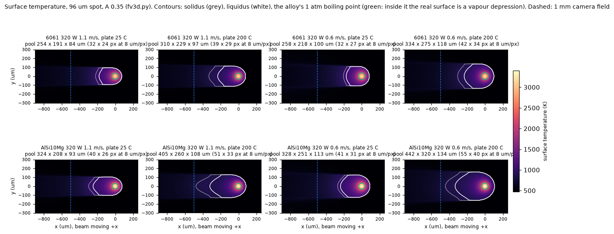
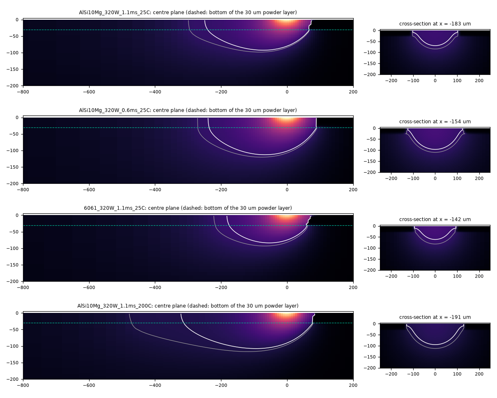
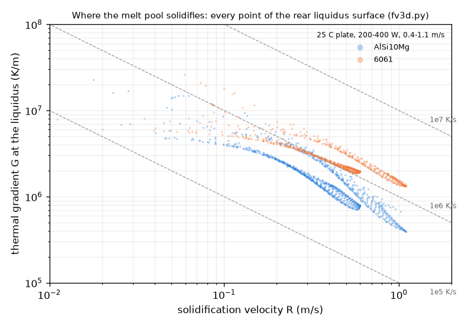

# Melt pool: the numbers the monitoring is sized on (2026-11-25)

[`monitoring.md`](../monitoring.md) proposes a coaxial photodiode, a coaxial camera at 8 µm/px over a ~1 mm field, a two-colour
pyrometer and an InGaAs channel. This note models the melt pool those instruments look at, so their range, resolution and
bandwidth can be checked before anything is bought. Nothing here has been measured on this machine.

The scripts are in [`analysis/monitoring/melt/`](../analysis/monitoring/melt/); outputs in
[`analysis/out/monitoring/melt/`](../analysis/out/monitoring/melt/). Every table below is generated by `report.py` into
[`tables.md`](../analysis/out/monitoring/melt/tables.md).

| Script | What it does |
|---|---|
| [`props.py`](../analysis/monitoring/melt/props.py) | temperature-dependent properties of AlSi10Mg, 6061, 7075 and pure Al, with sources (§1) |
| [`moving_source.py`](../analysis/monitoring/melt/moving_source.py), [`analytic.py`](../analysis/monitoring/melt/analytic.py) | Rosenthal and Eagar–Tsai, Gan's keyhole number, King's normalised enthalpy, P–v maps per spot (§2) |
| [`fv3d.py`](../analysis/monitoring/melt/fv3d.py), [`run_cases.py`](../analysis/monitoring/melt/run_cases.py) | 3D quasi-steady conduction in the beam's frame: finite volume, 0.25–1 million cells, sparse Newton + AMG (§3) |
| [`transient.py`](../analysis/monitoring/melt/transient.py) | track ends and turnarounds with the galvo's lag, heat build-up between layers, time scales (§4) |
| [`evap.py`](../analysis/monitoring/melt/evap.py) | evaporation, recoil and vapour exit state → [`plume_source.json`](../analysis/out/monitoring/melt/plume_source.json) (§5) |
| [`plots.py`](../analysis/monitoring/melt/plots.py), [`report.py`](../analysis/monitoring/melt/report.py) | figures, what each camera band sees, the tables |

Operating points: IPG YLR-500 single-mode CW at 1070 nm, the drawn 96 µm (1/e²) spot (48, 57 and 75 µm options from
[`optics.md`](../optics.md) §9.1), 100–500 W, 0.2–1.1 m/s (the basiCube 20 marks at up to ~1.1 m/s), 30 µm layers, 0.10 mm
hatch, plate at 25 or 200 °C.

## 0. Short answers

1. **Regime at 96 µm and ≤ 1.1 m/s: transition.** A shallow vapour depression forms under the beam, but the pool stays
   conduction-shaped up to ~350–400 W at 1.1 m/s.
   - The surface passes the alloy's boiling point from ~250 W at 0.92 m/s (108 µm spot; the 3D model's peak is 2,363 K at
     200 W and 2,679 K at 250 W against 2,535 K for AlSi10Mg).
   - Measured AlSi10Mg tracks with a 108 µm spot stay at depth/width 0.32–0.36 from 200 to 350 W at 0.69–0.92 m/s (Patel &
     Vlasea, via Edison); 0.4 is where keyhole pores start.
   - The scaling laws disagree. Gan's keyhole number puts keyhole mode (Ke > 6) at ≥ 250 W for AlSi10Mg at 1.1 m/s and
     predicts keyholes 130–250 µm deep where the measured pools are 70–80 µm deep. Huang et al. found the same for an Al-Zn-Mg
     alloy: its keyhole threshold sits ~2.5× higher in normalised enthalpy than Ti-6Al-4V's. **I trust the measured tracks**,
     not the scaling laws, for Al in a powder bed.
2. **The pool against the coaxial camera (8 µm/px, ~1 mm field):** 250–440 µm long and 190–320 µm wide, so 32–55 × 24–40 px.
   The whole pool fits in the field with room to spare. The vapour depression is ~70 µm across (~9 px). **But a silicon
   camera at 850 nm sees only the hot core**: with the depression wall at full scale, a 12-bit sensor reaches down to ~1,170 K,
   a region ~180 × 180 µm, about half the pool's length. An InGaAs camera at 1,550 nm reaches ~800 K, the whole pool and its
   mushy tail.
3. **Temperatures a pyrometer must span:** from the plate (25–200 °C) through the mushy zone (477–652 °C, 750–925 K) to the
   depression wall (~2,500–2,760 K). The flat-surface model peaks at 3,100–3,400 K; the real surface can't stay much above the
   wall temperature, because it is pushed down into a depression. In radiance that is ~10⁴ at 1.55 µm and ~10⁷ at 0.85 µm
   between the solidus of 7075 and the wall.
4. **Cooling and solidification against bandwidth:** cooling at the liquidus is 0.2–1.5 × 10⁶ K/s (median), in line with the
   8 × 10⁵ K/s published for AlSi10Mg. The mushy zone lasts **33–60 µs** (AlSi10Mg) and **36–72 µs** (6061) on a 25 °C plate,
   and **90–210 µs** on a 200 °C plate. A fixed-spot pyrometer needs ≥ 100 kHz and a spot ≤ ~50 µm to follow it; the METIS-class
   0.8 mm spot averages the whole pool. **A coaxial camera reads cooling without the speed:** in the beam's frame the cooling
   curve is laid out along the track, 7 µs per 8 µm pixel at 1.1 m/s.
5. **The galvo's speed cap does not force keyhole mode at 96 µm** up to ~350–400 W (measured tracks). Above that, and at
   0.6 m/s from ~320 W (Ke ≈ 18, beyond any measured AlSi10Mg track), expect keyhole porosity risk. With a 48 µm spot, every
   useful power at ≤ 1.1 m/s is deep in keyhole mode (Ke 47 at 320 W). The 96 µm collimator is the right choice.
6. **What the photodiode sees at track ends:** without skywriting, the galvo's 0.25 ms lag slows the beam while it still lases.
   At 1.1 m/s the signal rises **19 %** with a 0.25 ms laser-off delay and **31 %** with 0.5 ms or at a meander turnaround,
   where the next track starts on the last one's heat (liquid area +46 %). At 0.6 m/s: 4–13 %. These last 0.2–0.5 ms. With
   skywriting there is no rise. The signal goes to zero within ~50 µs of laser-off; silicon doesn't see the cooling track.
7. **What 200 °C preheat changes:** the pool grows ~25 % in length and width (AlSi10Mg 320 W 1.1 m/s: 324 × 208 → 405 × 260
   µm), the mushy time triples (45 → 142 µs at the surface centre), cooling at the liquidus halves, and Gan's keyhole threshold
   falls from ~250 W to ~180 W. **The photodiode barely notices:** +3 % at 1.1 m/s, +5 % at 0.6 m/s, because its signal is
   dominated by the depression, whose temperature is pinned. The part itself does not accumulate heat between layers with an 8 s
   recoat (a 15 mm tall 10 × 10 mm part returns to within 0.3 K of the plate); the plate's own drift (heat.md: up to 240–288 °C
   in dense builds without module cooling) is the baseline drift to log.

**What this changes in the monitoring design:**
- **Pool size and cooling need an InGaAs (0.9–1.7 µm) coaxial camera, not a silicon one.** Silicon at 850 nm images only the
  region above ~1,200 K; the solidification front of Al is at 750–925 K. The IMX296/Pi option of monitoring.md §4 step 6 is
  fine for the hot core, spatter and the depression, not for pool boundaries or cracking-relevant cooling.
- **The coaxial photodiode is a dwell, keyhole and lack-of-fusion detector, not a thermometer** (its 520–985 nm band is
  dominated by the depression). Keep it, sample it at ≥ 200 kS/s, and log the plate thermocouple for baseline drift.
- **Use skywriting, or tune the laser-off delay on a test pattern,** before reading anything from photodiode amplitudes: a
  mistuned delay produces 20–30 % spikes at every vector end, the size of the anomalies you want to find.
- **Frame rate:** the depression and the pool oscillate at ~3–14 kHz (capillary estimates; Huang et al. measured 2.5–10 kHz in
  an Al alloy), so ≥ 20–30 kfps for Nyquist, ≤ 20 µs exposures. NIST's 10 kHz at 20 µs undersamples these but freezes them.
- **Evaporation is Mg-dominated for AlSi10Mg and 6061, and Zn-dominated for 7075,** whose bulk boils at ~1,400 °C. Plan on
  Mg/Zn condensate on the windows and on composition drift (§5).

## 1. Inputs

### 1.1 Properties ([`props.py`](../analysis/monitoring/melt/props.py))

| Alloy | Solidus / liquidus (°C) | Freezing range (K) | k solid, 25 °C / at solidus (W/m K) | k liquid at liquidus (W/m K) | Latent heat (kJ/kg) | Enthalpy to melt from 25 °C (kJ/kg) | Mean diffusivity to liquidus (mm²/s) | Boils at 1 atm, Raoult (°C) | Vapour at that point (mol %) |
|---|---|---|---|---|---|---|---|---|---|
| pure Al | 655 / 665 (660 spread over 10 K for the solver) | 10 | 237 / 211 | 95 | 397 | 1070 | 80 | 2469 | Al 100 |
| AlSi10Mg | 557 / 596 | 39 | 150 / 155 | 71 | 450 | 1026 | 57 | 2261 | Mg 71, Al 29 |
| 6061 | 582 / 652 | 70 | 167 / 189 | 87 | 390 | 1041 | 63 | 1981 | Mg 95, Al 5 |
| 7075 | 477 / 635 | 158 | 130 / 163 | 74 | 380 | 1047 | 47 | 1399 | Zn 77, Mg 23 |

Sources and assumptions (details in the script's docstring):
- **Solidus and liquidus:** ASM Handbook Vol. 2 for 6061 and 7075; AlSi10Mg as used elsewhere in this repo
  ([`preheat-and-plates.md`](../preheat-and-plates.md), [`monitoring.md`](../monitoring.md)).
- **Solid k and cp:** pure Al from Incropera & DeWitt (Table A.1); the alloys from their room-temperature handbook values with
  Al's temperature trend; AlSi10Mg at 150 W/m K, aged in place on a 200 °C plate (as-built LPBF material is lower). Good to
  ~10–15 %.
- **Liquid k:** Wiedemann–Franz with liquid Al's resistivity, which reproduces the ~90–100 W/m K that
  [Leitner et al. 2017](https://doi.org/10.1007/s11661-017-4053-6) report near melting; the alloys' resistivities are estimates.
- **Density and viscosity of liquid Al:** [Assael et al. 2006](https://doi.org/10.1063/1.2149380). **Surface tension:** 0.914 N/m,
  −0.35 mN/m K (Smithells). Oxide and Mg change both.
- **Latent heat:** AlSi10Mg's 450 kJ/kg is an estimate (Si's latent heat raises it above Al's 397).
- **Vapour pressures:** Al from [Alcock et al. 1984](https://doi.org/10.1179/cmq.1984.23.3.309) (T_b 2,743 K; CRC lists
  2,792 K); Mg, Zn, Si, Cu by Clausius–Clapeyron from CRC boiling points and enthalpies. **Raoult's law** (activity = mole
  fraction) is used over the alloy. It is good to about a factor of 2 for Mg and Zn in Al.
- **Powder layer:** 30 µm, 50 % packed ([`budgets.py`](../budgets.py)), k 0.2 W/m K until melted
  ([Rombouts et al. 2005](https://doi.org/10.1063/1.1948509) measured 0.1–0.3 W/m K for metal powders).

**The alloys' boiling points are what matter for the plume.** Because Mg and Zn are so volatile, the alloys "boil" (total
vapour pressure 1 atm) far below pure Al's 2,469 °C: AlSi10Mg at ~2,260 °C with a vapour that is 71 % Mg, 6061 at ~1,980 °C
(95 % Mg), 7075 at ~1,400 °C (77 % Zn). These are for the bulk composition; a surface depleted of Mg or Zn boils hotter.

### 1.2 Absorptivity

The largest single unknown. Literature values at ~1,070 nm for Al (via Edison r8-melt-plume):
- flat Al 0.047 and an Al powder bed 0.22 (ray tracing; [King et al. 2015](https://doi.org/10.1063/1.4937809));
- 0.15 in conduction, 0.425 in transition, 0.70 in keyhole mode (the values Patel & Vlasea adopt;
  [SSRN](https://doi.org/10.2139/ssrn.3490412));
- Al 1100 bare discs at 1.5 m/s: melting from 100 ± 15 W, keyhole from 265 ± 15 W, deep-keyhole absorptance saturating at
  ~0.78 ([Trapp et al. 2017](https://doi.org/10.1016/j.apmt.2017.08.006)).

Two models are used:
- **Scaling laws:** Gan et al.'s Eq. 6, A = 0.7 [1 − exp(−0.6 Ke_m L_d*)], with the flat value 0.047 as η_m and 0.15 as a floor.
  It gives 0.25–0.37 for AlSi10Mg at 200–350 W, 0.92 m/s, rising to 0.5–0.6 at 0.6 m/s.
- **3D model: A = 0.35 fixed.** It reproduces the measured AlSi10Mg track widths to within 0–8 % from 200 to 350 W (§3.2), so
  it is the value the reference fields use.

## 2. Scaling laws and process maps ([`analytic.py`](../analysis/monitoring/melt/analytic.py))

- **Rosenthal and Eagar–Tsai** ([`moving_source.py`](../analysis/monitoring/melt/moving_source.py)): Eagar–Tsai is integrated
  numerically and checked against Rosenthal as the spot shrinks (agrees to 0.4 K at 2 µm) and against the stationary Gaussian's
  closed form (0.01 %). Properties are averaged from the plate to the liquidus, with the latent heat folded into the heat
  capacity.
- **Keyhole number** ([Gan et al. 2021](https://doi.org/10.1038/s41467-021-22704-0), read 2026-11-25):
  Ke = A P / [(T_l − T_0) π ρ c_p √(α v r_0³)], r_0 the spot radius. Conduction below 1.4, transition 1.4–6, keyhole above 6;
  keyhole depth e = 0.4 (Ke − 1.4) r_0; small fluctuation and almost no porosity below ~16, chaotic above ~30. Their data:
  Ti-6Al-4V, Al6061 and 316 bare plates, 100–520 W, 0.3–1.2 m/s, an IPG YLR-500 class laser at 1,070 nm.
- **Normalised enthalpy** ([King et al. 2014](https://doi.org/10.1016/j.jmatprotec.2014.06.005), Eq. 2.6, read 2026-11-25):
  ΔH/h_s = A P / (ρ c T_m √(π α v σ³)), σ the Gaussian's standard deviation (a quarter of the 1/e² diameter). Keyhole from
  π T_b/T_m in theory (≈ 9 for AlSi10Mg), 30 ± 4 measured on 316L.
- **Lack of fusion:** (h/W)² + (t/D)² > 1 ([Tang et al. 2017](https://doi.org/10.1016/j.addma.2016.12.001)), hatch 0.10 mm.
  **Balling:** L/W > π ([Yadroitsev et al. 2010](https://doi.org/10.1016/j.jmatprotec.2010.05.010)).
- **Marangoni velocity scale:** u ≈ (|dσ/dT| ΔT)^(2/3) / (ρ μ W/2)^(1/3)
  ([Mukherjee et al. 2017](https://doi.org/10.1063/1.4976006)).

*Regime by Gan's keyhole number, with lack of fusion by Tang's overlap and balling by Plateau–Rayleigh (Eagar–Tsai pool). Circles:
Patel & Vlasea's measured AlSi10Mg tracks (108 µm spot), all conduction-shaped. Dotted: Ke 13, the highest Ke among them.
[`process_map_alloys.png`](../analysis/out/monitoring/melt/process_map_alloys.png) and
[`process_map_200C.png`](../analysis/out/monitoring/melt/process_map_200C.png) show the other alloys and the 200 °C plate.*

**Power at which each Ke is reached at 1.1 m/s, 96 µm:**

| Alloy, plate | Ke 1.4 (conduction ends) | Ke 6 (keyhole, by Gan) | Ke 16 (porosity risk) |
|---|---|---|---|
| AlSi10Mg, 25 °C | 112 W | 249 W | 449 W |
| AlSi10Mg, 200 °C | 80 W | 177 W | 320 W |
| 6061, 25 °C | 132 W | 294 W | > 500 W |
| 6061, 200 °C | 98 W | 218 W | 395 W |
| 7075, 25 °C | 129 W | 287 W | > 500 W |
| 7075, 200 °C | 95 W | 210 W | 377 W |
| pure Al, 25 °C | 145 W | 325 W | > 500 W |

**Spot options at 320 W and 1.1 m/s (AlSi10Mg, 25 °C):** Ke 47 at 48 µm, 34 at 57 µm, 18 at 75 µm and 9 at 96 µm. Only
the 96 µm spot stays below the chaotic-keyhole range at useful powers, as optics.md §9.1 concluded from intensity.

Other numbers from the same script (all in [`tables.md`](../analysis/out/monitoring/melt/tables.md)):
- **Péclet number** v r_0 / α = 0.5–1.2: Al's high diffusivity makes the pool round-ish, not the long teardrop of steel.
- **Marangoni scale** 6–17 m/s, flow Péclet 15–60. CFD of Al pools reports 0.5–5 m/s (Edison); either way convection, not
  conduction, carries heat inside the pool, which is why the 3D model multiplies the liquid's k (§3.3).
- **Balling** (L/W > π) does not occur in the useful window; the Eagar–Tsai pools have L/W ≈ 1.1–2.3.
- **Lack of fusion** (Tang) at 200 W and 1.1 m/s for every alloy at 25 °C.

### 2.1 Against measured AlSi10Mg tracks

Patel & Vlasea's single tracks, AlSi10Mg, 108 µm spot, 30 µm layer (via Edison r8-melt-plume; I could not check the source,
and I paired the 0.688 m/s range ends with 200 and 350 W):

| P (W), v (m/s) | Measured W / D (µm), D/W | Eagar–Tsai, A from Gan: W / D (µm) | Gan: A, Ke, keyhole depth (µm) | 3D model, A 0.35: W / D below powder top / D into substrate (µm) | 3D peak T (K) |
|---|---|---|---|---|---|
| 200, 0.917 | 185 / 67, 0.36 | 120 / 41 | 0.25, 3.6, 47 | 199 / 75 / 45 | 2363 |
| 250, 0.917 | 196 / 66, 0.34 | 148 / 59 | 0.29, 5.3, 85 | 196 / 86 / 56 | 2679 |
| 300, 0.917 | 202 / 70, 0.35 | 174 / 76 | 0.34, 7.3, 128 | 214 / 95 / 65 | 2977 |
| 350, 0.917 | 239 / 78, 0.32 | 201 / 91 | 0.37, 9.5, 175 | 239 / 103 / 73 | 3225 |
| 200, 0.688 | 205 / 73, 0.35 | 145 / 57 | 0.31, 5.2, 81 | (running) | |
| 350, 0.688 | 235 / 80, 0.34 | 246 / 116 | 0.45, 13.1, 253 | (running) | |

- **The 3D model at A = 0.35 matches the widths** (0 to +8 %). The measured depths fall between its depth below the powder top
  and its depth into the substrate; the paper's reference surface isn't in Edison's summary.
- **Eagar–Tsai underestimates the width by 15–35 %** with Gan's absorptivity: it has no Marangoni spreading and no powder layer.
- **Gan's keyhole depth is 1.7–3× the measured pool depth** from 300 W. With the absorptivity that matches the widths, Ke
  says keyhole; the tracks say conduction. Either the bare-plate X-ray data that Ke was fitted on don't carry over to Al powder
  tracks, or the absorptivity in Ke should be lower than the one that sets the width. [Huang et al. 2022](https://doi.org/10.1038/s41467-022-28694-x)
  (read 2026-11-25) found the same direction in an Al-Zn-Mg-Cu alloy (Al7A77): its keyhole transition sits at a normalised
  enthalpy of ~20 ± 3 against ~8 ± 3 for Ti-6Al-4V.
- **Edison's other checks:** cooling rates of 8.3 ± 2.0 × 10⁵ K/s at the pool centre and 1.6–4.4 × 10⁵ K/s at its boundary for
  AlSi10Mg ([Van Cauwenbergh et al. 2021](https://doi.org/10.1038/s41598-021-85047-2)), up to 1.2–1.75 × 10⁶ K/s over
  250–450 W ([Leis et al. 2022](https://doi.org/10.3390/met12122000)). The 3D model's medians are 0.2–1.5 × 10⁶ K/s (§3.4).

## 3. The 3D model ([`fv3d.py`](../analysis/monitoring/melt/fv3d.py))

### 3.1 Method
- **Equation:** steady conduction in the beam's frame, ∇·(k∇T) + ρ v ∂H/∂x = 0, with H(T) the enthalpy including latent heat.
  Enthalpy is the unknown and Newton's method works on T(H), which has no spike, so the latent heat needs no smoothing; the
  apparent heat capacity dH/dT enters through the Jacobian. k(T) lags one iteration. A per-cell damping stops cells cycling across
  the solidus kink.
- **Grid:** finite volume, half domain (y ≥ 0), uniform over the pool (6 × 5 × 4 µm for the reference fields, 8 × 6 × 5 µm for the
  sweeps), stretched by 1.18 out to 6–9 mm. 0.25–0.95 million cells; 21–35 Newton iterations; 1.5–7 min each on one core with
  pyamg (Ruge–Stüben AMG + GMRES).
- **Boundaries:** inflow at the plate temperature ahead of the beam, outflow behind, plate temperature on the far sides and bottom.
  **Top:** the Gaussian beam integrated exactly over each face, minus evaporation (Hertz–Knudsen–Langmuir, 0.82 net, latent heat of
  each element) and radiation (ε 0.2).
- **Powder:** 30 µm layer with 50 % of the mass flux and k = 0.2 W/m K until the material at that (y, z) has melted upstream.
- **Marangoni:** liquid k × 2.5 (swept 1–3), ramped across the mushy zone.
- **Checks:** heat balance closes to < 10⁻³ W in every run (absorbed = advected + conducted + evaporated + radiated). Grid:
  8/6/5 µm against 6/5/4 µm changes L, W and D by ≤ 1 % and the peak by 1 % (§3.3).
- **Not modelled:** the free surface and the vapour depression, fluid flow (only through the k factor), and Mg/Zn depletion at
  the surface.

### 3.2 Reference fields

| Case (96 µm, A 0.35) | Liquid pool L × W × D (µm) | Pixels at 8 µm/px | Peak T, flat model (K) | Alloy boils / depression wall (K) | Si 850 nm, 12-bit: sees above (K), L × W (µm) | InGaAs 1550 nm, 12-bit: above (K), L × W (µm) | Photodiode vs AlSi10Mg 1.1 m/s 25 °C |
|---|---|---|---|---|---|---|---|
| AlSi10Mg 320 W 1.1 m/s 25 °C | 324 × 208 × 93 | 40 × 26 | 3301 | 2535 / 2763 | 1172, 176 × 176 | 797, 380 × 208 | 1.00 |
| AlSi10Mg 320 W 1.1 m/s 200 °C | 405 × 260 × 108 | 51 × 33 | 3316 | 2535 / 2763 | 1172, 192 × 168 | 797, 580 × 256 | 1.03 |
| AlSi10Mg 320 W 0.6 m/s 25 °C | 328 × 258 × 113 | 41 × 32 | 3355 | 2535 / 2763 | 1172, 196 × 184 | 797, 372 × 248 | 1.12 |
| AlSi10Mg 320 W 0.6 m/s 200 °C | 442 × 320 × 134 | 55 × 40 | 3384 | 2535 / 2763 | 1172, 204 × 192 | 797, 568 × 320 | 1.17 |
| 6061 320 W 1.1 m/s 25 °C | 254 × 191 × 84 | 32 × 24 | 3122 | 2254 / 2508 | 1123, 176 × 184 | 774, 324 × 192 | 0.59 |
| 6061 320 W 1.1 m/s 200 °C | 310 × 229 × 97 | 39 × 29 | 3140 | 2254 / 2508 | | | |
| 6061 320 W 0.6 m/s 25 °C | 258 × 220 × 100 | 32 × 28 | 3174 | 2254 / 2508 | | | |

D is below the powder surface; subtract ~30 µm for the depth into the solid. "Depression wall" is where the recoil pressure
(0.54 p_sat) holds a hole of the beam's radius open against 1 atm and surface tension; the real surface can't stay much hotter.
The camera columns assume the depression wall at full scale and a 12-bit sensor; emissivity is taken equal everywhere.

What the fields say:
- **Pools are short and wide** (L/W 1.2–1.7): Al conducts heat ahead of the beam (Péclet ~1).
- **The flat model's surface runs 550–850 K past the alloy's boiling point** over a ~70 µm circle (0.004 mm²). There the recoil
  pressure (~0.5–8 bar) is 3–20× the capillary pressure of a 50 µm dimple, so the real surface is a shallow depression at
  ~2,500–2,760 K. That is the transition regime of §0.
- **6061 runs cooler and smaller than AlSi10Mg** at the same power: higher k and liquidus, and its 1 % Mg boils off at a lower
  temperature (wall 2,508 K), which also halves its photodiode signal (0.59×).

### 3.3 Sensitivity (AlSi10Mg, 320 W, 1.1 m/s)

(running; see [`tables.md`](../analysis/out/monitoring/melt/tables.md))

### 3.4 Solidification: cooling rate, G, R and hot cracking

| Case | Time liquid, surface centre (µs) | Mushy time, surface centre / range (µs) | Cooling at the liquidus, median / max (10⁶ K/s) | G at the liquidus (10⁶ K/m) | R (m/s) |
|---|---|---|---|---|---|
| AlSi10Mg 320 W 1.1 m/s 25 °C | 294 | 45 / 33–60 | 0.69 / 1.23 | 0.4–15 | 0.03–1.1 |
| AlSi10Mg 320 W 1.1 m/s 200 °C | 368 | 142 / 87–146 | 0.34 / 0.54 | 0.15–17 | 0.01–1.1 |
| AlSi10Mg 320 W 0.6 m/s 25 °C | 547 | 53 / 53–116 | 0.50 / 0.56 | 0.7–30 | 0.01–0.6 |
| AlSi10Mg 320 W 0.6 m/s 200 °C | 737 | 181 / 158–214 | 0.20 / 0.26 | 0.19–9.5 | 0.01–0.6 |
| 6061 320 W 1.1 m/s 25 °C | 231 | 36 / 36–72 | 1.52 / 1.84 | 1.3–26 | 0.01–1.1 |
| 6061 320 W 1.1 m/s 200 °C | 282 | 90 / 90–119 | 0.77 / 0.96 | 0.5–20 | 0.03–1.1 |
| 6061 320 W 0.6 m/s 25 °C | 430 | 52 / 52–125 | 1.02 / 1.18 | 1.8–12 | 0–0.6 |

- **G and R** span the usual LPBF ranges: G 10⁵–3 × 10⁷ K/m (highest at the bottom of the pool, where R → 0), R up to the scan
  speed at the surface centreline. G/R is 1.5–6 K s/mm², four orders of magnitude below what a planar front needs (ΔT₀/D_L ≈
  10⁴ K s/mm² for AlSi10Mg), so every alloy grows cells or dendrites.
- **Columnar or equiaxed:** without nucleants, LPBF Al alloys grow columnar grains epitaxially across layers; that is what makes
  6061 and 7075 crack, and Zr nanoparticle nucleants make them equiaxed and crack-free
  ([Martin et al. 2017](https://doi.org/10.1038/nature23894)). The model's G and R don't change that picture; I did not draw a
  columnar-to-equiaxed line because I found no Al-specific constants to put on it.
- **Hot cracking:** the vulnerable stage is the end of solidification, and its length scales with the freezing range. AlSi10Mg
  (39 K, ~50 % eutectic that back-fills) spends 33–60 µs in its mushy zone on a 25 °C plate; 6061 (70 K) 36–72 µs and 7075
  (158 K) longer (§3.2 map runs). A 200 °C plate stretches every mushy time 2–3×, which lowers the strain rate the films see but
  also keeps them open longer. Cracking itself is what AE (monitoring.md §2.4) detects; the cooling is what an InGaAs channel can
  measure.

## 4. Time-dependent pieces ([`transient.py`](../analysis/monitoring/melt/transient.py))

### 4.1 Track ends and turnarounds
- **Galvo:** a first-order lag with the basiCube 20's 0.25 ms tracking error as its time constant (SCANLAB data sheet). At
  constant speed the beam trails the command by v × 0.25 ms (0.28 mm at 1.1 m/s, as monitoring.md §5.1 says); when the command
  stops, the beam slows as e^(−t/0.25 ms). This is a simplification of the real servo response.
- **Thermal model:** Eagar–Tsai kernels superposed along the actual path every 2 µs (constant properties, latent heat in the heat
  capacity). It gives no absolute temperatures worth quoting; the ratios are what matter.
- **Photodiode:** 520–985 nm radiance × silicon responsivity over a 1 mm field centred on the beam, the surface capped at the
  depression-wall temperature, emissivity 0.15 liquid / 0.10 solid.

| Speed | Track end (320 W, 96 µm, AlSi10Mg) | Photodiode peak / mid-track | Liquid area peak / mid-track |
|---|---|---|---|
| 1.1 m/s | skywriting (laser off at the end, mirrors keep moving) | 1.00 | 1.00 |
| 1.1 m/s | no skywriting, laser-off delay 0.25 ms | 1.19 | 1.00 |
| 1.1 m/s | no skywriting, laser-off delay 0.5 ms | 1.31 | 1.21 |
| 1.1 m/s | meander turnaround, no skywriting (laser off 0.25 ms after the command, next vector 0.3 ms after it, laser-on delay 0.1 ms) | 1.31 | 1.46 |
| 0.6 m/s | laser-off delay 0.25 ms | 1.04 | 1.00 |
| 0.6 m/s | laser-off delay 0.5 ms | 1.13 | 1.00 |
| 0.6 m/s | meander turnaround as above | 1.13 | 1.23 |

- The rise builds over 0.2–0.5 ms and is set by the delays, so a mistuned delay is a repeatable artefact at every vector end. The
  NIST AMMT logs commanded positions every 10 µs for this reason (monitoring.md §5.1).
- At a turnaround, the return track starts on the previous track's hot end, so its pool is ~1.2–1.5× the mid-track pool for the
  first ~0.5 ms.
- After laser-off the photodiode signal falls to near zero within ~50 µs: the cooling liquid (≲ 1,500 K) is ~10⁻⁴ of the
  depression's radiance in the silicon band.

### 4.2 Heat build-up between layers
A 1D column (the part, bulk Al alloy) grows 30 µm per layer on a plate held at 200 °C. Each layer's absorbed energy
(A 0.35 × 320 W over the scan) goes into its top; then 8 s of recoat (heat.md).

| Part | Layer energy (J) | Scan time (s) | Top right after the scan, 15 mm tall (°C) | Top at the next layer's start, 15 mm (°C) |
|---|---|---|---|---|
| 10 × 10 mm, 1.1 m/s, 8 s recoat | 102 | 1.11 | 253 | 200.3 |
| 10 × 10 mm, 1.1 m/s, 2 s recoat | 102 | 1.11 | 259 | 211.7 |
| 20 × 20 mm, 1.1 m/s, 8 s recoat | 407 | 3.84 | 224 | 200.1 |
| 10 × 10 mm, 0.6 m/s, 8 s recoat | 187 | 1.87 | 273 | 200.4 |

- **The part doesn't drift from layer to layer.** An Al column 15 mm tall cools with a time constant of ~1.5 s, well inside an 8 s
  recoat. With a 2 s recoat it would start each layer ~12 K warm.
- **Within a layer it does:** the part's top warms 25–70 K over one layer's scan, so the last tracks of a layer see a hotter
  baseline than the first. From the 3D model that is ~+5–10 % in pool size per 50 K (the 25 → 200 °C step adds ~25 %).
- **The plate is the baseline drift to watch:** [`heat.md`](../heat.md) finds dense M50 and L75 builds push the plate from 200 to
  240–288 °C unless the module is cooled. That changes the pool by ~+5–15 %, the photodiode by only ~1–2 %.
- **Not covered:** overhangs and thin walls standing on powder, where heat has no path down. That is where published
  photodiode signals rise most, and where the 1D model says nothing.

### 4.3 Time scales and what they ask of the instruments

| Time scale | Value (96 µm, 320 W) | Source |
|---|---|---|
| Beam crosses its own spot | 87 µs at 1.1 m/s, 160 µs at 0.6 m/s | geometry |
| Pool passes a point (liquid at the surface centre) | 230–300 µs at 1.1 m/s, 430–550 µs at 0.6 m/s (25 °C plate); +25–35 % at 200 °C | §3.4 |
| Mushy zone (solidification) | 33–72 µs at 25 °C, 87–214 µs at 200 °C | §3.4 |
| Pool's lowest capillary mode, √(σk³/ρ)/2π with k = π/W | 2–4 kHz | `transient.py` |
| Depression's capillary mode (k = π/2r₀) | ~14 kHz | `transient.py` |
| Keyhole fluctuations measured in an Al alloy | 2.5–10 kHz, fastest in transition | Huang et al. 2022 |
| Keyhole fluctuations in simulation | ~10⁴ Hz, and ~10⁶ Hz small ones | Gan et al. 2021 |
| Track-end rise | 0.2–0.5 ms | §4.1 |

**What that asks of each instrument:**

| Instrument | Needs | Why |
|---|---|---|
| Coaxial photodiode | ≥ 100 kHz bandwidth, ≥ 200 kS/s | resolve the 87 µs spot transit and the 2.5–14 kHz oscillations with margin (the PDA36A2's ≥ 100 kHz gain settings qualify) |
| Two-colour pyrometer (fixed spot) | ≥ 100 kHz and a spot ≤ 50 µm to follow solidification | the mushy zone lasts 33–72 µs and is 40–80 µm long behind the pool; a 0.8 mm spot averages pool, mush and track |
| Coaxial camera | exposure ≤ 20 µs; ≥ 20–30 kfps to resolve oscillations, 0.5–10 kfps to measure pool shape | the pool is stationary in the de-scanned view; cooling is read along x at 7 µs per pixel (1.1 m/s, 8 µm/px) |
| InGaAs channel | ~10⁴ dynamic range from 750 K to 2,760 K at 1.55 µm | §0 item 3 |

## 5. Evaporation and the plume source ([`evap.py`](../analysis/monitoring/melt/evap.py) → [`plume_source.json`](../analysis/out/monitoring/melt/plume_source.json))

From each 3D surface field:
- **Mass flux:** Hertz–Knudsen–Langmuir per element, 18 % recondensing (Anisimov 1968; [Knight 1979](https://doi.org/10.2514/3.61171)),
  Raoult partial pressures over the bulk composition. Three readings of the surface temperature: **flat** (the field as solved,
  an upper bound), **wall** (capped at the depression-wall temperature, the best estimate), **boil** (capped at the 1 atm boiling
  point, a lower bound).
- **Exit state:** Knight's jump conditions into 1.015 bar of argon at the hottest point: Mach number, vapour temperature,
  velocity, density. **Recoil pressure:** 0.54 p_sat.
- **Selective loss:** the evaporated mass of each element against what one layer supplies (hatch × layer × ρ × wt fraction).
- **Measured losses** for calibration: AlSi10Mg 57 % of its Mg and 6061 17 % (Li 2024 thesis, via Edison); 7075 ~12 % of its Mg
  and ~18 % of its Zn ([Velikajne et al. 2026](https://doi.org/10.3390/ma19050970), via heat.md). The JSON converts these to mass
  rates at each case's scan rate.

| Case | Vapour, wall reading (µg/mm) | Mg / Zn / Al (µg/mm) | Vapour mol % | Evaporation power (W) | Exit: Mach, velocity (m/s), T (K) | Recoil at the wall (kPa) | HKL Mg loss per layer (× the layer's Mg) | Measured Mg loss |
|---|---|---|---|---|---|---|---|---|
| AlSi10Mg 320 W 1.1 m/s 25 °C | 0.26 | 0.17 / – / 0.10 | Mg 65, Al 35 | 2.1 | 0.43, 478, 2326 | 118 | 5.9 | 0.57 |
| AlSi10Mg 320 W 1.1 m/s 200 °C | 0.27 | 0.17 / – / 0.10 | Mg 65, Al 35 | 2.2 | 0.43, 478, 2326 | 118 | 6.0 | 0.57 |
| AlSi10Mg 320 W 0.6 m/s 25 °C | 0.54 | 0.34 / – / 0.20 | Mg 64, Al 35 | 2.4 | 0.43, 478, 2326 | 118 | 12.0 | 0.57 |
| 6061 320 W 1.1 m/s 25 °C | 0.35 | 0.31 / – / 0.03 | Mg 91, Al 9 | 2.2 | 0.43, 464, 2111 | 118 | 3.9 | 0.17 |

- **Evaporation is limited by Mg supply, not by vapour pressure.** HKL asks for 4–12 times all the Mg a layer brings; measured
  losses are 12–57 %. So the surface is depleted and Mg reaches it only as fast as the liquid mixes. **For Mg and Zn, use the
  measured fractions** (`measured` in the JSON), which are ~10× below HKL. Al's own vapour (0.1–0.2 µg/mm here) is not
  supply-limited.
- **So the vapour is ~0.1–0.3 µg per mm of track,** mostly Al with some Mg: 0.4–1.2 g per hour of lasing at 1.1 m/s. That is
  the condensate source for the window-fouling estimates.
- **Evaporation takes ~2 % of the absorbed power** (2–2.5 W of 112 W).
- **Exit velocity ~460–480 m/s** at the Knudsen layer at Mach 0.43, ~1,090 m/s (sonic) in the flat reading. Edison's sources give
  20–300 m/s for the vapour jet and 38–97 m/s for the plume's ascent: the jet slows within a few hundred µm as it mixes with
  argon. Its volume flow is ~3 × 10⁻⁷ m³/s at room temperature, negligible against the 140–200 L/min cross-flow.
- **7075** (map runs): its bubble point is ~1,400 °C, so Zn leaves from the whole liquid surface, not just under the beam (see
  the JSON when the 7075 runs land).

`plume_source.json` keys are documented in its `keys` block: per case `inputs`, `pool`, `T_boil_1atm_K`, `T_wall_K`, then for
each reading (`flat`, `wall`, `boil`) the per-element `m_dot_kg_s`, `loss_ug_per_mm`, `loss_fraction_per_pass`,
`shift_per_layer_frac`, `vapour_mole_fraction`, `evap_power_W`, `area_hot_mm2`, and `exit` (T_surface_K, p_sat_Pa, recoil_Pa,
mach, T_vapour_K, u_m_s, rho_vapour_kg_m3, M_vapour_g_mol, Q_vapour_m3_s); `measured` holds the calibrated Mg and Zn rates.

## 6. Data for the optics: [`surface_fields.npz`](../analysis/out/monitoring/melt/surface_fields.npz)

| Key | Shape, units | What |
|---|---|---|
| `x_um`, `y_um` | (376,), (201,) µm | cell centres, 4 µm grid: x −1,200 to +300 (beam frame; beam at 0, moving +x, pool trails to −x), y ±400 |
| `T_K` | (case, x, y), K | surface temperature from fv3d.py (flat surface) |
| `T_capped_K` | same | min(T_K, T_wall_K): the reading to use for emission. Inside the depression the surface sits near the wall temperature (2,763 K AlSi10Mg, 2,508 K 6061) |
| `liquid`, `mushy`, `above_boil` | same, bool | T ≥ liquidus; solidus ≤ T < liquidus; T ≥ the alloy's 1 atm boiling point (the depression's footprint, ~200–290 cells, ~65–75 µm across) |
| `cases` | (case,) str | case tags |
| `meta_json` | str | per case: alloy, P, v, spot, A, plate T, f_M, layer, solidus, liquidus, 1 atm boiling point, T_wall_K, peak T, pool L/W/D |
| `README` | str | this table in one paragraph |

Cases: AlSi10Mg and 6061 at 320 W, 96 µm, A 0.35, at 1.1 and 0.6 m/s, on 25 and 200 °C plates (8 fields). Emissivity is not
applied: use ~0.10–0.15 for liquid Al at ~1 µm and more for powder and oxide (Edison r8-coaxial-radiometry). Inside
`above_boil` the surface is a cavity, whose apparent emissivity is higher than a flat liquid's.

## 7. Edison's second opinion (r8-melt-plume)

[`edison/r8-melt-plume/answer.md`](../edison/r8-melt-plume/answer.md) supplied the measured AlSi10Mg tracks, the absorptivities,
the cooling rates, the keyhole fluctuation band, the plume velocities and the Mg/Zn losses used above. Where this note and Edison
differ:
- **Keyhole thresholds.** Edison quotes ΔH/h_s ≈ 10 as a general keyhole criterion and Gan's Ke. With the absorptivity that matches
  the measured widths, both say keyhole for tracks that were conduction-shaped. I go with the measured tracks for AlSi10Mg.
- **Edison's "Ke ≈ (ΔH/h_m)/√π"** (via Huang et al.) is not Gan's definition; I used Gan's paper directly.
- **Peak temperature.** Edison cites ~3,360 K (a generic plume model, not Al) and says Al keyhole surfaces reach "well above"
  2,743 K. For these alloys the vapour pressure of Mg and Zn caps the surface lower: ~2,500–2,760 K at the depression wall. The
  flat 3D model reaches 3,100–3,400 K only because it can't form a depression.
- **Solidification time.** Edison's estimate of 0.18–1.0 ms is the time the pool takes to pass, not the mushy time; the model's
  mushy time is 33–214 µs.
- **Mg loss in AlSi10Mg (57 %)** comes from a thesis that Edison could not tie to a primary measurement; treat it as an upper
  value.

## 8. Not done, and limits

- **No free surface, no flow.** The vapour depression, keyhole depth and spatter are outside a conduction model. Where the
  surface passes boiling, the fields are a flat-surface upper bound (`T_capped_K` is the practical reading).
- **One absorptivity (0.35)** fitted to widths at 200–350 W and 0.92 m/s with a 108 µm spot. It probably rises at 0.6 m/s and with
  keyholing (Gan's Eq. 6 gives 0.5–0.6 there), so the 0.6 m/s pools are, if anything, underestimates.
- **The validation data are second-hand** (Patel & Vlasea via Edison) and I don't know which surface their depths are measured
  from.
- **Properties:** liquid conductivities, AlSi10Mg's latent heat and Raoult activities are estimates (10–20 %, ×2 for activities).
- **Galvo:** a first-order lag stands in for the basiCube 20's servo; SCANLAB gives only the 0.25 ms tracking error.
- **Not run:** overhangs and thin walls on powder; multi-track interaction beyond one turnaround; the 48/57/75 µm spots in 3D
  (scaling laws only); Scheil solidification paths and a crack-susceptibility index (Kou); spatter.
- **Evaporation:** no surface depletion of Mg and Zn, no diffusion-limited regime below boiling, and Knight's jump is for a
  single-species vapour.

## Sources
- Gan, Z. et al. (2021). Universal scaling laws of keyhole stability and porosity in 3D printing of metals. Nat. Commun. 12:2379.
  https://doi.org/10.1038/s41467-021-22704-0 (read 2026-11-25: Ke, Eq. 1–2 and 6–7, regime bounds, fluctuation frequencies)
- King, W.E. et al. (2014). Observation of keyhole-mode laser melting in laser powder-bed fusion additive manufacturing. J. Mater.
  Process. Technol. 214:2915–2925. https://doi.org/10.1016/j.jmatprotec.2014.06.005 (read via OSTI 1502044: Eq. 2.6–2.7, 30 ± 4)
- Huang, Y. et al. (2022). Keyhole fluctuation and pore formation mechanisms during laser powder bed fusion additive
  manufacturing. Nat. Commun. 13:1170. https://doi.org/10.1038/s41467-022-28694-x (read: Al7A77, 2.5–10 kHz, thresholds)
- Patel, S., Vlasea, M. Melting modes in laser powder bed fusion. https://doi.org/10.2139/ssrn.3490412 (via Edison: AlSi10Mg
  track sizes, absorptivities, D/W 0.4)
- Trapp, J. et al. (2017). In situ absorptivity measurements of metallic powders during laser powder-bed fusion. Appl. Mater.
  Today 9:341–349. https://doi.org/10.1016/j.apmt.2017.08.006 (via Edison)
- King, W.E. et al. (2015). Laser powder bed fusion additive manufacturing of metals; physics, computational, and materials
  challenges. Appl. Phys. Rev. 2:041304. https://doi.org/10.1063/1.4937809 (via Edison: Al absorptivity 0.047 / 0.22)
- Van Cauwenbergh, P. et al. (2021). Sci. Rep. 11:6423. https://doi.org/10.1038/s41598-021-85047-2 (via Edison: cooling rates)
- Leis, A. et al. (2022). Metals 12:2000. https://doi.org/10.3390/met12122000 (via Edison: cooling rates)
- Eagar, T.W., Tsai, N.S. (1983). Temperature fields produced by traveling distributed heat sources. Weld. J. 62:346s–355s.
- Rosenthal, D. (1946). The theory of moving sources of heat and its application to metal treatments. Trans. ASME 68:849–866.
- Tang, M., Pistorius, P.C., Beuth, J.L. (2017). Prediction of lack-of-fusion porosity for powder bed fusion. Addit. Manuf.
  14:39–48. https://doi.org/10.1016/j.addma.2016.12.001
- Yadroitsev, I. et al. (2010). Single track formation in selective laser melting of metal powders. J. Mater. Process. Technol.
  210:1624–1631. https://doi.org/10.1016/j.jmatprotec.2010.05.010
- Mukherjee, T., Zhang, W., DebRoy, T. (2017). Dimensionless numbers in additive manufacturing. J. Appl. Phys. 121:064904.
  https://doi.org/10.1063/1.4976006
- Martin, J.H. et al. (2017). 3D printing of high-strength aluminium alloys. Nature 549:365–369. https://doi.org/10.1038/nature23894
- Anisimov, S.I. (1968). Vaporization of metal absorbing laser radiation. Sov. Phys. JETP 27:182.
- Knight, C.J. (1979). Theoretical modeling of rapid surface vaporization with back pressure. AIAA J. 17:519–523.
  https://doi.org/10.2514/3.61171
- Assael, M.J. et al. (2006). Reference data for the density and viscosity of liquid aluminum and liquid iron. J. Phys. Chem. Ref.
  Data 35:285–300. https://doi.org/10.1063/1.2149380
- Leitner, M. et al. (2017). Thermophysical properties of liquid aluminum. Metall. Mater. Trans. A 48:3036–3045.
  https://doi.org/10.1007/s11661-017-4053-6
- Alcock, C.B., Itkin, V.P., Horrigan, M.K. (1984). Vapour pressure equations for the metallic elements: 298–2500 K. Can. Metall.
  Q. 23:309–313. https://doi.org/10.1179/cmq.1984.23.3.309
- Rombouts, M. et al. (2005). Photopyroelectric measurement of thermal conductivity of metallic powders. J. Appl. Phys. 97:024905.
  https://doi.org/10.1063/1.1948509
- Velikajne et al. (2026). Materials 19:970. https://doi.org/10.3390/ma19050970 (via heat.md / Edison: 7075 Zn and Mg loss)
- Bitharas, I. et al. (2022). The interplay between vapour, liquid, and solid phases in laser powder bed fusion. Nat. Commun.
  13:2908. https://doi.org/10.1038/s41467-022-30667-z (via Edison: plume and cross-flow)
- Mayi, Y. et al. (2020). Laser-induced plume investigated by finite element modelling. J. Phys. D 53:075306.
  https://doi.org/10.1088/1361-6463/ab5900 (via Edison: plume 38–97 m/s)
- Guo, D. et al. (2024). Correlative spatter and vapour depression dynamics during LPBF of an Al-Fe-Zr alloy. Int. J. Extrem.
  Manuf. 6:055601. https://doi.org/10.1088/2631-7990/ad4e1d (via Edison: vapour jet 20–300 m/s)
- Incropera, F.P., DeWitt, D.P. Fundamentals of Heat and Mass Transfer, Table A.1; ASM Handbook Vol. 2 (1990); Brandes, E.A.,
  Brook, G.B. (eds.) Smithells Metals Reference Book, 7th ed. (1992), ch. 14.
- SCANLAB basiCube 20 (tracking error 0.25 ms, ~1.1 m/s marking speed at f = 160 mm), as cited in monitoring.md.
