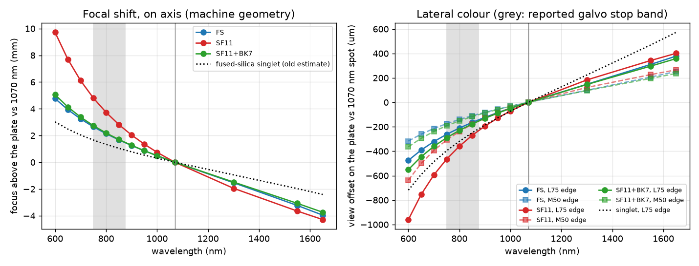
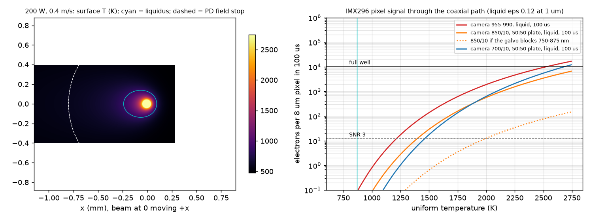

# Monitoring optics: real parts, checked numbers (2026-11-25)

This note turns the optics in [`monitoring.md`](../monitoring.md) into a design that can be bought and built: the coaxial branch
behind the existing DMSP1000, the side camera at the left-wall port (LW), the steep camera at the lid port (LP), and laser
safety at every viewport. It replaces two estimates in `monitoring_optics.py`: the f-theta treated as a fused-silica singlet,
and the radiometry left as floors. Geometry comes from [`cad/monitoring_spec.py`](../cad/monitoring_spec.py) and the model's P
block, read at run time.

Nothing here is bought, drawn into the model, measured, or reviewed by BYU's Laser Safety Officer. Vendor pages and data files
were read through the lab tunnel on BYU's network on 2026-11-25 (06:39–07:19 UTC). Prices are list prices as shown then, not
quotes. The parts list is [`optics-parts.csv`](optics-parts.csv).

| Script (`analysis/monitoring/optics/`) | What it does | Output (`analysis/out/monitoring/optics/`) |
|---|---|---|
| [`raytrace.py`](../analysis/monitoring/optics/raytrace.py) | small real-ray tracer: spherical and tilted plane surfaces, Sellmeier glasses | – |
| [`ftheta.py`](../analysis/monitoring/optics/ftheta.py) | three representative 1064 nm f-theta designs, traced 600–1700 nm with the window and slide | [`ftheta.md`](../analysis/out/monitoring/optics/ftheta.md), `.json`, `.png` |
| [`lines.py`](../analysis/monitoring/optics/lines.py) | NIST ASD plume lines against each candidate band | [`lines.md`](../analysis/out/monitoring/optics/lines.md) |
| [`radiometry.py`](../analysis/monitoring/optics/radiometry.py) | melt pool to detector, end to end; takes worker A's `surface_fields.npz` with `--fields` | [`radiometry.md`](../analysis/out/monitoring/optics/radiometry.md), `.json`, `.png` |
| [`viewports.py`](../analysis/monitoring/optics/viewports.py) | LW and LP cameras, windows, motion blur, light, 1070 nm at the ports | [`viewports.md`](../analysis/out/monitoring/optics/viewports.md), `.json` |
| [`parts.py`](../analysis/monitoring/optics/parts.py) | every vendor number used, with its source; writes `optics-parts.csv` | [`vendor-files.csv`](../analysis/out/monitoring/optics/vendor-files.csv) (URL and sha256 of each data file; the files stay in /tmp) |

Re-run: `python ftheta.py --reuse` (2 min; without `--reuse` it re-optimises the lenses, ~6 min), then `lines.py`,
`radiometry.py [--fields PATH]`, `viewports.py`, `parts.py`, each under a minute, under `/tmp/capmem 2`.

## 0. What changes the design

1. **Leave the NF1064-44 out of the coaxial branch; use a FESH1000 instead.** Thorlabs' data file shows the notch also blocks
   520–720 nm at OD 4.2–4.6, so it would kill a 700 nm channel. The FESH1000 gives OD 5.4–6.0 at 1064–1100 nm and passes
   500–985 nm at 98–99 %. It is $169.26 against $635.55.
2. **The DMSP1000 leaks 0.063 % at 1070 nm (OD 3.2), not "up to 10 %"** (optics.md §4.5), so the branch needs less blocking
   than planned. But the same leak sends 0.3–0.6 W of the *forward* beam (unpolarised 0.063 %, p-polarised 0.125 %) straight
   through cube1, out of its far face. **Put a beam trap on that port.** As drawn it is an open Class 4 stray beam.
3. **The f-theta's colour is 1.6–2.7 times the singlet estimate.** Three representative designs (§1) put 850 nm 1.7–2.8 mm
   above the 1070 nm focus (singlet: 1.05 mm), 700 nm 3.2–6.1 mm, and 1550 nm 3.1–3.6 mm below it. Every coaxial channel
   needs its own focus adjustment. Lateral colour is 0.65–1.2 times the singlet's: up to 0.6 mm at 700 nm at the L75 edge.
4. **Coaxial bands: 700/40 and 900/40 nm for the two-colour pair, 955–990 nm for the camera,** split by dichroics (DMSP950
   then DMLP805), with no plate beamsplitter. All three sit outside the 750–875 nm band that 1064 nm scanner coatings have
   been measured to block (Kozjek et al. 2026; Hooper 2018 saw 750–900 nm). They also avoid the metal lines from NIST ASD.
   The photodiodes then get 25–96 nA: SNR 40–155 at 90 kHz (40 dB).
5. **Silicon sees only the hot core of an aluminium pool, coaxially.** The IMX296 at 30 µs needs ≥ 1,420 K for SNR 3 in a
   pixel, and the photodiodes ≥ 1,000–1,240 K. The liquidus is 869–925 K. In one exposure the camera shows the hottest
   20–30 % of the liquid, so pool *size* from a silicon camera is an isotherm well above the liquidus.
6. **An InGaAs channel can go behind the existing DMSP1000.** Its typical transmission rises to 7–27 % at 1650–1700 nm. That
   is enough to match a notch-dichroic channel at 1550/12 nm: the PDA20CS2 sees solid metal at 770–850 K filling the field
   stop, at 9–90 kHz. **Don't replace the DMSP1000:** the only 45° notch dichroic found (Semrock NFD01-1064) has no CW rating
   and doesn't specify 1070 nm.
7. **The guard's viewing panel is transparent at 808–850 nm** (LW1P1/M: OD 0.28–0.33; Thorlabs' raw data). An 808 nm
   illumination laser over 0.5 W would make the machine Class 4 at 808 nm through its window. **Light the side camera with
   LEDs**, or get the LSO's review and a panel that blocks 808 nm first.
8. **Every camera needs OD ≥ 8 at 1070 nm; the layer camera has OD 5.1.** 0.1–0.4 W of diffuse 1070 nm reaches a 12.5 mm
   camera pupil at the ports, and a curved pool can glint up to ~1.4 W into the steep ones (§5). A FESH1000 behind each
   bandpass gives OD > 11. Add one ($169.26) behind the layer camera's FESH0950 before filming during lasing.
9. **Seat the LP window square to its line of sight.** On the lid's top face it is tilted 36° to the view. That gives
   0.67 mm of astigmatism, ~1.5 px of blur at f/5.6. The LW window's 14.8° tilt costs only 5 µm.
10. **Most 50 mm and 75 mm C-mount lenses don't focus at 176–197 mm.** The Kowa LM50JC10M (minimum object distance 100 mm) and
    Edmund's 35 mm #67-716 (165 mm) do. The 75 mm ones need ~15 mm of extension tube.
11. **By-product for optics.md §1.4: k ≈ 0.48–0.50 as drawn.** All three representative lenses give the same chief-ray ratio
    at the M50 and L75 edges with the galvo mirror 34.8 mm above the nose (0.65–0.67 at Thorlabs' 7.5 mm). That supports
    "L75 is out of reach" (it needs k ≳ 0.60). It is still not a measurement.

## 1. The f-theta outside 1064 nm

**What Thorlabs publishes.** The FTH160-1064's "Zemax (ZAR)" download holds one lens file,
`265-FTH160-1064-R1A - with-mirrors_BB.ZMX`: a black box. Its spec table gives:
- EFL 160 mm, ±28°, 12 mm beam, WD 182.5 mm, A2 12.3 mm;
- 3 elements plus an N-BK7 window;
- AR coating: < 0.3 % per surface at 1020–1080 nm and < 1.0 % at 450–700 nm.

Its 1064 nm field curvature is +0.20 mm on axis, and tangential/sagittal +0.02/−0.14 mm at 20°. The transmission curve
(FTH100-1064, same family and coating) is 0.87 at 850 nm, 0.91 at 950, 0.82 at 1300, 0.63 at 1550 and 0.58 at 1700 nm.

**What was done.** `ftheta.py` optimises three 3-element lenses at 1064 nm to those specs with real glasses: all fused silica (FS), all
N-SF11, and N-SF11 with N-BK7. They are **representative, not the real lens.** Then it traces them in the machine:
- the 2nd galvo mirror 39.6 mm before the first vertex, as drawn (A1 34.8 mm, against Thorlabs' 7.5 mm);
- the 9.53 mm window and the 2 mm slide;
- 600–1700 nm.

| At 1064 nm, Thorlabs' geometry | FS | SF11 | SF11+BK7 | Thorlabs |
|---|---|---|---|---|
| RMS spot 0° / 13.6° / 28° (Airy radius 17.3 µm) | 4 / 15 / 32 µm | 2.5 / 5 / 8 µm | 8 / 14 / 41 µm | "diffraction limited" |
| Distortion, max | 0.20 % | 0.07 % | 0.08 % | < 0.06 % (curve) |
| Field curvature T / S at 13.6° | +0.47 / −0.33 mm | +0.14 / −0.19 mm | +0.24 / −0.33 mm | ~+0.1 / ~0 mm (read off the graph) |

Only the SF11 design matches Thorlabs' published performance out to 28°. FS and SF11+BK7 are good inside the ±13.6° that the
L75 plate uses. They are there to bracket the unknown glass.

**Results in the machine (12 mm pupil)** (full tables in [`ftheta.md`](../analysis/out/monitoring/optics/ftheta.md)):

| | Singlet estimate | FS | SF11 | SF11+BK7 |
|---|---:|---:|---:|---:|
| Focus vs 1070 nm, 700 nm | +2.04 mm | +3.25 | +6.11 | +3.38 |
| 850 nm | +1.05 | +1.68 | +2.82 | +1.70 |
| 950 nm | +0.54 | +0.86 | +1.35 | +0.86 |
| 1550 nm | −1.97 | −3.23 | −3.65 | −3.07 |
| Lateral colour, 700 nm, M50 / L75 edge | 324 / 486 µm | 214 / 321 | 394 / 594 | 238 / 360 |
| 950 nm, M50 / L75 edge | 85 / 128 µm | 56 / 84 | 86 / 129 | 59 / 89 |
| 1550 nm, M50 / L75 edge (opposite side) | 313 / 469 µm | 207 / 310 | 227 / 342 | 196 / 296 |
| Focus spread over 850 ± 20 / ± 5 nm | 0.22 / – mm | 0.35 / 0.09 | 0.67 / 0.17 | 0.37 / 0.09 |

What it means:
- **The singlet underestimated the focal shift 1.6–2.7×.** In an f-theta with a negative first element the positive
  elements carry more power, and they sit where the marginal ray is high. Adding N-BK7 positives to an N-SF11 negative didn't
  colour-correct anything, because the negative element is weak.
- **Refocus each channel.** At the IMX296 with a 75 mm tube lens (m 0.47, m² 0.22) the 955–990 nm band needs 0.1–0.3 mm and a
  700 nm band 0.7–1.3 mm. Use an SM1 focusing tube with ±2 mm of travel. Each photodiode's pinhole sits at its band's own
  focus: 0.3–0.6 mm (700 nm) and 0.1–0.2 mm (900 nm) from the 1070 nm conjugate behind its f = 50 mm lens.
- **Keep bands narrow, or near 1070 nm.** ±20 nm at 850 nm smears focus over 0.35–0.67 mm (13–25 µm of blur at NA 0.0375).
  The 955–990 nm camera band (35 nm) gives 0.28–0.46 mm: 10–17 µm of blur, under the 32 µm Airy diameter. An FBH950-10 would
  sharpen it, at the cost of about three-quarters of the light.
- **Lateral colour moves each band's view off the laser spot,** radially, in proportion to the scan radius. The photodiode
  field stops are therefore Ø1.6 mm on the plate (§2): the pool (0.33–0.50 mm long) plus up to 0.6 mm of offset at 700 nm.
  The camera's ROI must allow ≤ 0.13 mm (18 px) of drift at 955–990 nm. Map it against galvo angle, as Hooper did.
- **Image quality off axis depends on the unknown glass.** At the M50 edge the RMS spot at 950 nm is 5–6 µm for SF11 and
  SF11+BK7, but 24 µm for FS, partly because our galvo sits 27 mm farther from the lens than its design. On axis all three are
  diffraction-limited.
- **An 18 mm return pupil is not worth it for imaging.** The lens is designed for a 12 mm beam. At 18 mm the FS design's RMS spot
  grows to 10–65 µm (SF11: 1–12 µm), against a 10.3 µm Airy radius at 950 nm. For the photodiodes the larger pupil still
  adds light (×2.25).
- **The laser itself, in our geometry:** the tangential focus at 1070 nm sits −0.65 (SF11) to −2.0 mm (FS) off the plate at
  the L75 edge (SF11+BK7: +0.73 mm). With the 2.5 mm beam (z_R ±6.1 mm) that grows the spot 1–5 % in one axis. The burn test (optics.md §4.2) at
  the field edges will show it.

## 2. The coaxial branch

Layout, using `monitoring_spec.COAX` (y −25.25, z 271.11):

| Position | Part | Does |
|---|---|---|
| cube1, x −155 | DMSP1000 (existing) | reflects 1070 nm into the galvo; passes 520–985 nm (T 0.96) on along −x; leaks 0.063 % at 1070 nm |
| cube1's far port | beam trap (≥ 1 W at 1070 nm) | takes the 0.3–0.6 W of forward beam the DMSP1000 lets through |
| after cube1 | FESH1000 | shared 1070 nm blocker: OD 6.0 at 1070 nm, T 0.98–0.99 at 500–975 nm |
| cube2, x −215 | DMSP950 | reflects 955–990 nm (R 0.93–0.97) to the camera arm (−y); passes < 930 nm (T 0.96) |
| camera arm | FESH1000 + AC254-075-B + IMX296 mono (InnoMaker CAM-IMX296RAW) | 7.4 µm/px; 128 × 96 px is 0.94 × 0.71 mm; ~500 fps cropped |
| cube3, x −285 | DMLP805 | reflects 520–790 nm (R 0.99) to photodiode A (side); passes 825–930 nm (T 0.97) to photodiode B (−x) |
| PD-A | FBH700-40 + AC254-050-B + P500K + PDA36A2 | 680–720 nm; Ø1.6 mm field on the plate |
| PD-B | FBH900-40 + AC254-050-B + P500K + PDA36A2 | 880–920 nm; Ø1.6 mm field |

Why these parts:
- **Dichroics instead of a 50:50 plate.** A plate halves every channel. The two dichroics give each channel nearly all of its
  band: the photodiodes get about twice the photocurrent of a plate layout.
- **Bands.** In the NIST line list, 700/40 contains only Ar I lines, and argon is excited only if there is a plasma, which
  Edison found no evidence of at these powers. 900/40 has Mg I 880.7 nm at its edge (weak) and Ar I 912 nm. 955–990 nm has
  Ar I 966 nm. Bands at 650 nm pick up Zn I 636 nm (7075), Ca I 644–649 nm and Li I 671 nm (trace). 750/40 holds the K I
  766/770 nm doublet ([`lines.md`](../analysis/out/monitoring/optics/lines.md)).
- **If the scan head's measured transmission is low at 880–920 nm** (Hooper's stop band ran to 900 nm), swap cube2 for a
  BSW26 50:50 plate and put FBH950-10 filters on the camera and PD-B. That gives roughly a seventh of PD-B's light, but it
  keeps the pair. The filters are SM1-threaded and the cube inserts removable, so the bands can follow step 2's measurement.
- **Tube lens:** f = 160 × 3.45/8 = 69 mm for 8 µm/px; the stock 75 mm doublet gives 7.4 µm/px. The image-side f-number is
  6.25: Airy radius 2.1 px at 970 nm. For a Chronos on the arm, AC254-200-B gives 8.0 µm/px (640 × 96 px = 5.1 × 0.77 mm).
- **Field stops:** a 500 µm pinhole (P500K) at the focus of an f = 50 mm doublet sees Ø1.6 mm of the plate (m = 0.31). The
  PDA36A2's photodiode is flush with its housing face and the SM1 boss stands 2.2 mm proud. A pinhole screwed onto it sits
  ~3–5 mm in front of the diode, and the f/2.8–f/4 cone behind the pinhole stays inside the 3.6 mm square.
- **1070 nm blocking:** DMSP1000 OD 3.2 + FESH1000 OD 6.0 + the FBH filters' OD > 5 (the camera gets a second FESH1000 instead).
  With the cat's-eye bound (441 W back into the lens, beam_path.md) the leak is ≤ 3 × 10⁻⁷ of each photodiode's pool signal
  and ≤ 1.3 × 10⁻⁵ of the camera's peak pixel. Diffuse returns are 10⁻¹⁰–10⁻⁹. The 0.27 W the DMSP1000 passes in the
  cat's-eye case lands on the FESH1000, which reflects it.

**InGaAs.** Two routes, compared with the same pool:

| Route | Change to the laser path | Band | Photocurrent, 320 W case | Coldest solid seen (field-filling), 40 / 60 dB |
|---|---|---|---:|---|
| (a) behind the DMSP1000: a short-pass pick-off (DMSP1180 class) after cube1 + FELH1250 + AC254-100-C + PDA20CS2 | none | 1625–1725 nm (DMSP1000 T 3–30 %, PD responsivity falls past 1650) | 12.8 nA | 847 / 772 K |
| (b) Semrock NFD01-1064 in place of the DMSP1000 + FBH1550-12 + PDA20CS2 | the 500 W beam reflects off a part with no CW rating | 1544–1556 nm | 22.7 nA | 847 / 777 K |

Route (a) needs no change to the 500 W path and reaches the solidification range of 6061 (855–925 K) and 7075 (750–908 K)
at 9–90 kHz. Two cautions:
- **Al I 1671.9 and 1675.1 nm fall in its band** (lines.md). Check with a spectrometer on the first builds, or narrow it to
  FBH1650-12.
- **The DMSP1000's transmission above 1600 nm is typical data, not a spec,** and it varies lot to lot. Check the unit in hand.

The coax agent read the same data as "no InGaAs channel behind the DMSP1000"; the radiometry says otherwise, because a 100 nm
band at 7–27 % carries as much light as a 12 nm band at 90 %.

**Cost** ([`optics-parts.csv`](optics-parts.csv)): the baseline branch adds **$3,108** in list prices, plus a beam trap (est.
$100–200). It drops the planned NF1064-44 ($635.55). Route (a) InGaAs adds ~$1,050 with its own pinhole, plus the unpriced
pick-off (~$330 if it is a Ø1 in. DMSP-series part).

## 3. Radiometry, end to end

**Chain.** Spectral radiance ε(λ, T)·B(λ, T):
- **Liquid:** a Drude model of liquid Al built from its measured DC resistivity (24.2 µΩ·cm at 933 K, Desai et al. 1984) and
  density (Assael et al. 2006). It gives 0.089 at 1 µm at the melting point, rising to 0.15 at 2,700 K, and falls 2–3 %
  from 700 to 900 nm. It is scaled to 0.12 at 1 µm (the midpoint of Edison's 0.10–0.15 for clean liquid Al) and checked at
  0.20 (Edison's effective LPBF value).
- **Solid:** grey ε = 0.2.

It is collected through NA 0.0375 (the 12 mm design beam), then through:
- the slide and window (3.5 % per face off their 1064 nm V-coat);
- the f-theta (Thorlabs' curve);
- two galvo mirrors, in two cases: "pass" (0.90) and "Kozjek" (0.02 at 750–875 nm);
- the DMSP1000, the dichroics and the filters (Thorlabs data);
- the detector's responsivity or QE.

The fields are this script's own Eagar–Tsai fields (AlSi10Mg, absorptivity 0.3, 96 µm spot, 200 °C plate, clipped at boiling):
200 W/0.4 m/s, 320 W/1.1 m/s and 350 W/0.8 m/s, giving pools 0.33–0.50 mm long and 0.07–0.12 mm² of liquid. **Worker A's
`surface_fields.npz` replaces them through `--fields`.** The loader reads its layout (`T_capped_K[case, ix, iy]`, the per-case
liquidus from `meta_json`). It was tested on a mock file in that layout, because the real one didn't exist yet in A's
worktree.

| 320 W, 1.1 m/s (ε 0.12 at 1 µm) | Signal | At 90 kHz (40 dB) | At 9 kHz (60 dB) | Saturates |
|---|---:|---:|---:|---|
| PD-A 700/40 | 35 nA (5.3 mV) | SNR 57 | SNR 146 | no: 10 V needs 70 µA |
| PD-B 900/40 | 76 nA (11 mV) | SNR 122 | SNR 313 | no |
| InGaAs (a) 1625–1725 | 13 nA | SNR 21 | SNR 58 | no |
| IMX296 peak pixel, 955–990 nm | 1.7 × 10⁸ e⁻/s | 30 µs: 5,050 e⁻, SNR 71 | | full well at 63 µs |
| Chronos 2.1-HD peak pixel, 955–990 nm, 24 kfps | 2.6 × 10⁸ e⁻/s | 10 µs: 2,620 e⁻, SNR 46 | 40 µs: ~10,500 e⁻ | ~57 µs (stand-in full well) |

- **Gain:** run the PDA36A2s at 30 dB (260 kHz) for tracks and 40 dB (90 kHz) for most work. 20 dB (1 MHz) gives SNR 11–44.
  None of these saturates. The 10 V output limit is 10³–10⁴ above the signal, so a keyhole spike or a spatter flash won't
  clip either.
- **Galvo blocking** changes nothing for the baseline bands (all outside 750–875 nm). It would cut an 850/10 camera 45-fold,
  to SNR 3 at 10 µs (the "alt" rows in radiometry.md).
- **Lowest temperature seen** (SNR 3, uniform patch):

  | Detector | Coldest liquid in one pixel or 0.05 mm² | Coldest solid filling the Ø1.6 mm field |
  |---|---|---|
  | IMX296 at 955–990 nm, 30 / 100 / 500 µs | 1,416 / 1,277 / 1,126 K | – |
  | Chronos at 955–990 nm, 10 / 40 µs | 1,717 / ~1,500 K | – |
  | PD-A 700/40 at 1 MHz / 90 kHz / 9 kHz | 1,937 / 1,744 / 1,620 K | 1,427 / 1,314 / 1,239 K |
  | PD-B 900/40, same gains | 1,669 / 1,486 / 1,373 K | 1,185 / 1,089 / 1,019 K |
  | InGaAs (a), same gains | 1,868 / 1,416 / 1,228 K | 1,008 / 847 / 772 K |

  Liquidus: AlSi10Mg 869 K, 6061 925 K, 7075 908 K. Silicon doesn't reach it, coaxially, at any useful rate. The InGaAs route
  is the only one that sees the mushy zone, and only as an average over the field.
- **Two-colour, 700/40 over 900/40:**
  - Sensitivity: a 1 % ratio error is 2.2 K at 1,000 K, 8.8 K at 2,000 K and 13.8 K at 2,500 K.
  - Error from non-grey emissivity: the Drude slope (ε700/ε900 = 1.02) reads +19 K at 2,000 K. A 5 % band-to-band difference
    (oxide, roughness) reads ±44 K, and 10 % reads ±88 K. 700/950 would do slightly better (±36 K for 5 %); 900/1650 with
    InGaAs ±27 K; 700/1650 ±16 K.
  - Mixing: over the whole pool the ratio reads 2,682–2,695 K against a 2,743 K peak. The ratio reports the hottest part of
    the pool, not its mean.
- **Plume:** vapour line emission is excluded by the band choice. Condensate continuum is not. An optically thin column
  (Ø0.3 mm over the pool, seen end-on) at 2,700 K adds 4 % (optical depth 0.001), 42 % (0.01) or 4× (0.1) of the pool's
  signal at 700 and 900 nm, and 4 %, 39 % and 3.9× at 1,550 nm. At Edison's 3,360 K model-plume temperature it is 3–4.5×
  more. So **the plume worker's optical depth decides whether coaxial pyrometry on aluminium reads the pool or the
  plume.** The script takes it as a parameter (`plume_tables`).
- **Calibrate the whole train** with a radiance source in the chamber, as Hooper did (a stabilised lamp in an integrating
  sphere), at several galvo angles. Brandau et al. 2022 saw the coaxial signal fall 36–51 % across the field (via Edison).

## 4. Side camera at LW and steep camera at LP

**Geometry** (monitoring_spec, `viewports.py`):

| Port | Centre | To plate centre | Elevation | Window tilt to the view | Window + slide | Astigmatism / blur at NA 0.035 | Ghost offset |
|---|---|---:|---:|---:|---|---|---:|
| LW | (−156, −20, 36) | 161 mm | 12.9° | 14.8° | Ø38.1 × 5 + 1 mm | 0.15 mm / 5 µm | 2.1 mm |
| LP | (−60, −80, 136) | 169 mm | 53.7° | 36.3° | Ø25.4 × 3 + 1 mm | 0.67 mm / 23 µm | 2.9 mm |
| BW (light) | (−125, 111, 25) | 169 mm | 8.5° | 49.0° | Ø25.4 × 3 mm | – | – |

- **Tilt:** the plates also move the focus ~2 mm and the boresight by up to 0.9 mm (LP), which focusing and calibration take
  out.
- **Ghosts:** the double-bounce ghost is a copy of the scene 2–3 mm away, at R² of the original: 6 × 10⁻⁶ with a 0.25 % AR coat
  and 1.2 × 10⁻³ bare. It matters only next to a saturated pool, so AR-coat both faces (monitoring_spec already says
  650–1050 nm AR for LW).
- **The tilt keeps window reflections out of the lens:** the reflected light is deviated by 2 × tilt (30° at LW).

**Lenses** (working distance = port distance + standoff: 176 mm at LW, 197 mm at LP):

| Camera + lens, port | f/# | µm/px across / along the plate | Rayleigh (µm) | Depth of field | Focuses here |
|---|---|---|---:|---:|---|
| Chronos 2.1-HD + Kowa LM50JC10M, LW | 2.8 / 4 / 5.6 / 8 / 11 | 25 / 113 | 10 / 15 / 20 / 29 / 40 | 1.3 / 2.1 / 3.3 / 5.6 / 9.0 mm | yes (MOD 100 mm) |
| Chronos + Edmund 35 mm #67-716, LW | 4 | 40 / 181 | 21 | 4.6 mm | yes (MOD 165 mm) |
| Chronos + Edmund 75 mm #74-054, LW | 5.6 | 13.5 / 61 | 14 | 1.3 mm | no: MOD 500 mm, needs ~15 mm of tube |
| IMX296 + Kowa LM50JC10M, LP | 5.6 | 10 / 13 | 23 | 2.6 mm | yes |

- **f/4–5.6 is the sweet spot with 10 µm pixels:** diffraction (15–20 µm) stays under the 25 µm pixel. f/8 starts to blur, and
  the depth of field at f/4 already covers a 2 mm deep band across the plate.
- **Coverage:** the 2/3 in. lenses cover a ~960 × 540 px centre of the Chronos sensor, which takes every high-speed ROI
  (640 × 96 at 24 kfps). The full 1920 × 1080 frame needs a 1.1–1.2 in. lens: the Fujinon HF50XA-5M ($748) covers 1.1 in.
  and focuses from 200 mm.

**Motion blur** (Chronos + 50 mm, 25 µm/px):
- The Chronos 2.1-HD's 10 µs minimum exposure smears spatter 0.4 px at 1 m/s, 4 px at 10 m/s and 8 px at 20 m/s. Barrett
  measured a 9.7 ± 6.7 m/s mean (via Edison).
- To freeze 20 m/s to 1 px takes ≤ 1.3 µs. That means pulsed light, which then sets the exposure (Cavitar CAVILUX, quote), or
  a Chronos 1.4 (1 µs minimum exposure, $4,500).
- Streaks are also useful: at a known exposure a streak's length is the particle's speed.
- The IMX296's 29–30 µs minimum exposure makes it a streak camera for spatter. Its job at LP is the slower view: spreading and
  part edges.

**Light for a 10 µs exposure at f/4** (Chronos, 640 × 96 field = 1.8 cm², half full well, powder reflectance 0.5 assumed
Lambertian):
- **On the plate:** 0.30 W/cm² from a narrow source; 0.98 W/cm² from an LED behind a 10 nm filter (only ~30 % of its
  30 nm spectrum passes). Use FBH850-40 with an LED.
- **Source power, by where it shines from** (delivery efficiency 0.3 for an LED, 0.6 for a fibre laser):
  - LP, steep: 2.7 W of LED or 1.1 W of laser;
  - BW, raking at 8.5°: 15 W of LED or 5.9 W of laser;
  - through LW itself with a 50:50 cube: 39 W of LED or 16 W of laser (the cube costs 4× and the 12.9° grazing angle 4.5×).
  - At 2 µs, multiply by five.
- **Recommendation:** a Thorlabs SOLIS-850C (2.7 W minimum, $1,377.86), pulsed by a DC2200 ($2,593.01), shining through LP
  (or a second steep port). That is just enough at 10 µs and comfortable at 20–50 µs. BW's raking light is for the layer camera; the side camera can use it at ≥ 50 µs.
  The AeroDIODE 808 nm 10 W fibre source ($6,490) or a CAVILUX is needed for 1–2 µs, and is Class 4 (§0 item 7).
- **Unverified:** whether the DC2200 can make clean 10 µs pulses. Its small-signal bandwidth is 250 kHz and no rise time is
  published. Check on the bench.
- **Self-emission:** the melt pool's own glow in a 10 nm band at 850 nm (ε 0.12, 2,500 K) has about the same radiance as
  powder lit at 0.18 W/cm². Both show in one frame, and hot spatter shows without any light.

## 5. Laser safety at the viewports

**1070 nm reaching each port at 500 W** (`viewports.py`; Lambertian return of reflectance 0.7 from the spot as an upper bound;
a curved pool's glints spread over ±40° as a bound for the steep ports):

| Port | Angle from the plate normal | Diffuse at the window | Into the window (Ø20–25) | Into a 12.5 mm camera pupil | Glint bound into the pupil |
|---|---:|---:|---:|---:|---:|
| LW | 77° | 0.10 W/cm² | 0.47 W | 0.12 W | – (outside the cone) |
| LP | 36° | 0.32 W/cm² | 0.99 W | 0.39 W | 1.3 W |
| BW | 81° | 0.06 W/cm² | 0.18 W | 0.07 W | – |
| layer camera (existing) | 33° | 0.36 W/cm² | 1.1 W | 0.44 W | 1.4 W |

- **Filter OD each camera needs: ≥ 8 at 1070 nm.** A 0.1–0.4 W return focused to the spot's image (a few pixels) is
  ~10⁴ W/cm² on the sensor. That damages it, and at QE 0.5–2 % it still fills a pixel ~10⁶ times over.
  - OD 8 brings it to < 10 % of full well in one frame.
  - FBH850-10 (OD > 5 to 1200 nm) + FESH1000 (OD 6.0) gives > 11. The coaxial branch already has ~14.
  - **The layer camera's FESH0950 alone is OD 5.1:** 10⁻⁶–10⁻⁵ W gets through it to the sensor, enough to saturate the
    spot's image in every video frame. Add a FESH1000 before recording during lasing.
- **Fit the filters before a camera is powered with the laser on;** an unfiltered camera at LP would lose pixels.
- **The Class 1 guard:** nothing changes at 1070 nm. Each port passes up to ~1 W of diffuse and glinting light into the guarded
  volume, which the 1.5 mm guard panels and the OD 7.8 viewing panel already contain (safety.md). Three new items for the LSO:
  1. **808–850 nm illumination lasers are not contained by the viewing panel** (OD 0.28–0.33). LEDs avoid laser
     classification; their eye safety falls under IEC 62471.
  2. **Every blanked port needs its blank back** before lasing when its camera is off. Or interlock it.
  3. **Never fit an eyepiece or an unfiltered camera** to a viewport (monitoring.md §6).
- **Specular reflections:** the beam's own specular return leaves within 1–7° of vertical (chief-ray angle k·θ plus the
  ±0.45° cone), so no port sees it. Glints from a curved or keyhole pool can reach the lid ports at 33–36° (bounded above).
  LW and BW at 77–81° from the normal see diffuse light only.

## 6. Edison's r8 answers: where this note agrees and differs

[`r8-coaxial-radiometry`](../edison/r8-coaxial-radiometry/answer.md), [`r8-viewports`](../edison/r8-viewports/answer.md) and
[`r8-melt-plume`](../edison/r8-melt-plume/answer.md) (2026-11-25).

**Agrees, and used here:**
- 700/950 nm as the practical pair through 1064 nm scan optics (Hooper 2018; Remani);
- the 750–875/900 nm coating stop band (Kozjek 2026; Hooper 2018);
- liquid Al ε 0.10–0.15 at 1 µm;
- the line list: Na D, K 766/770, Al 669, Al 877, Mg 881 nm (NIST ASD confirms Al I 877.3 and Mg I 880.7 nm);
- no laser-sustained plasma at these powers;
- calibrating the whole train;
- Barrett's spatter speeds;
- Bidare's 300 W lamp for 8 kfps;
- Thanki's 975 nm short-pass.

**Differs:**
- **Signal at 850 nm and 933 K.** Edison gives B = 1.4 × 10² W m⁻² sr⁻¹ µm⁻¹. Planck gives 3.5, 40 times less. Its "2.7
  photons per 10 µs" is really ~0.07. Its conclusion (useless at the melting point) gets stronger.
- **"Al melt pools ~660–900 °C; peak ~1200 K at 300 W."** That is the solidification range, not the pool. Edison's own
  r8-melt-plume puts keyhole surfaces above boiling (2,743 K), and Eagar–Tsai at 200–350 W reaches boiling at the beam. The
  silicon signals here come from that 1,500–2,700 K core.
- **"Use 950 ± 15 nm for the camera"** is right. Here it is 955–990 nm, set by the DMSP950 so that the photodiodes keep the
  rest.
- **"SCANLAB ProcessLine" monitoring coatings:** not verified here. Ask SCANLAB for a coating curve and any option, rather than
  assume a product.
- **Viewport OD "≈ 5.7 for the full beam"** is a scaling, not a calculation. §5 gives the power at each port; the OD here is
  set by the sensor, ≥ 8.
- **Edison's recommendation (c), a monitoring beamsplitter ahead of the f-theta, NIST-style:** this machine already picks off
  ahead of the galvo, which is the only option with a basiCube (no camera port). NIST avoids the f-theta entirely, which this
  layout can't.

## 7. Checks before buying

1. **Measure the scan head and f-theta from 500 to 1750 nm** with a fibre spectrometer and a halogen lamp: the plate up to
   cube1, at three galvo angles. It decides:
   - PD-B: 900/40 or the 950/10 fallback;
   - whether 850 nm is usable;
   - the InGaAs route (a) transmission.
2. **Ask Thorlabs for the DMSP1000's tested curve** above 1600 nm on the unit in hand, and the DMSP1180's curve.
3. **Bench-test the light:** the SOLIS-850C on the DC2200 at 10 µs pulses, measured with a fast photodiode.
4. **Check the Chronos's lens fit at LW:** 155 mm of body plus ~50 mm of Kowa lens against the 180 mm of room (fits.json).
5. **Get the Chronos full well and read noise from Kron.** A stand-in from a different Luxima sensor is used here.
6. **Fit FESH1000s to every camera** (and the layer camera) before any camera sees the laser.
7. **Put a beam trap on cube1's far port now**, whatever else is bought.

## 8. Not done / limits

- **The f-theta is representative.** Thorlabs' prescription is a black box, and the ZAR archive wasn't unpacked (its LZW
  variant didn't decode with standard tools). Three glass sets bracket it. Only SF11 meets the published field curvature to
  28°; FS and SF11+BK7 don't.
- **Galvo coating:** two bounds, no curve.
- **Emissivity:**
  - Drude, scaled to a literature level. Oxide, roughness and the keyhole's cavity effect are in the ±5–10 % non-greyness
    only.
  - Solid ε is grey 0.2; clean solid Al's 1.5 eV band near 800–830 nm is not modelled.
- **Fields:** Eagar–Tsai is crude. It has no latent heat, no keyhole, and is clipped at boiling. Worker A's fields go in with
  `--fields` when merged.
- **Plume:** column size, temperature and optical depth are parameters until the plume worker's numbers arrive.
- **Vendor data:**
  - IMX296 QE beyond 525 nm is read off FLIR's curve (±1 point).
  - The Chronos's QE above 900 nm is extrapolated, and its full well and read noise are a stand-in.
  - Lens MODs are vendor figures.
  - The DMSP1180-class pick-off and the beam trap are not priced.
- **Light budget:** Lambertian powder, which grazing angles break. The LED pulse capability is unverified.
- **Laser at the ports:** reflectance 0.7 and the ±40° glint cone are bounds, not models.
- **Not drawn:** no CAD. The cube positions are monitoring_spec's. The CAD worker needs:
  - the camera arm to ~100 mm along −y from cube2;
  - a beam trap on cube1;
  - the LP window seat square to its line of sight.
- **Not reviewed:** no LSO review.

## Sources

- Thorlabs, FTH160-1064 item page and f-theta family page (spec table; field-curvature and distortion graph; FTH100-1064
  transmission data), https://www.thorlabs.com/f-theta-scan-lenses, fetched 2026-11-25T06:39–06:41Z.
- Thorlabs product and family pages and raw data files for DMSP1000, DMSP950, DMLP805, NF1064-44, FESH1000, FESH0950, FELH1250,
  FBH filters, PDA36A2, PDA20CS2, AC254 doublets, P500K, cage parts, BSW26, SOLIS-850C, M850LP1, DC2200, LW1P1/M and LG1,
  fetched 2026-11-25T06:43–07:19Z; each part's URL and time is in optics-parts.csv, and each data file's sha256 in
  vendor-files.csv.
- Semrock (IDEX) NFD01-1064-25x36 and Di02-R1064-25x36, https://www.idex-hs.com/ (07:05Z).
- Teledyne FLIR, FFY-U3-16S2M EMVA 1288 report (IMX296 mono),
  https://softwareservices.flir.com/FFY-U3-16S2/latest/EMVA/EMVA.html (06:46Z); Balluff BVS CA-UB1-0016AG EMVA report (07:06Z).
- Kron Technologies, Chronos 2.1-HD and 1.4 pages, datasheets and user manual rev 1.3 (06:49–06:51Z).
- InnoMaker CAM-IMX296RAW page and user manual (06:49Z, 07:08Z).
- Kowa LM50JC10M (wilcoimaging.com, 07:14Z); Edmund Optics #59-872, #59-873, #67-716, #74-054, #54-668 (06:52–07:10Z); Fujinon
  HF-XA-5M (07:12Z).
- AeroDIODE 808 nm 10 W source (laserdiodesource.com, 07:03Z); Cavitar CAVILUX Smart UHS (07:03Z).
- A. Kramida, Yu. Ralchenko, J. Reader and NIST ASD Team, NIST Atomic Spectra Database (v5.12), https://physics.nist.gov/asd,
  line lists fetched 2026-11-25T06:44Z.
- I. H. Malitson, JOSA 55, 1205 (1965), fused silica; SCHOTT data sheets (N-BK7, N-SF11).
- P. D. Desai, H. M. James, C. Y. Ho, "Electrical resistivity of aluminum and manganese", J. Phys. Chem. Ref. Data 13, 1131 (1984).
- M. J. Assael et al., "Reference data for the density and viscosity of liquid aluminum and liquid iron", J. Phys. Chem. Ref.
  Data 35, 285 (2006).
- T. W. Eagar, N.-S. Tsai, "Temperature fields produced by traveling distributed heat sources", Weld. J. 62, 346s (1983).
- P. A. Hooper, "Melt pool temperature and cooling rates in laser powder bed fusion", Addit. Manuf. 22, 548 (2018),
  https://doi.org/10.1016/j.addma.2018.05.032 (via Edison r8).
- D. Kozjek et al., "Coaxial monitoring of meltpool for laser powder bed fusion process control", Stroj. Vestn. 72, 253 (2026),
  https://doi.org/10.5545/sv-jme.2026.1837 (via Edison r8).
- D. C. Deisenroth et al., "Measurement uncertainty of surface temperature distributions for LPBF", J. Res. NIST 126 (2021),
  https://doi.org/10.6028/jres.126.013 (via Edison r8).
- Barrett (2019, thesis), Bidare et al. (2018, Acta Mater. 142, 107), Thanki et al. (2023/2024), Brandau et al. (2022): via
  Edison r8-viewports and r8-coaxial-radiometry, not re-read.
- W. J. Smith, Modern Optical Engineering, 4th ed.: tilted-plate focus shift and astigmatism.
