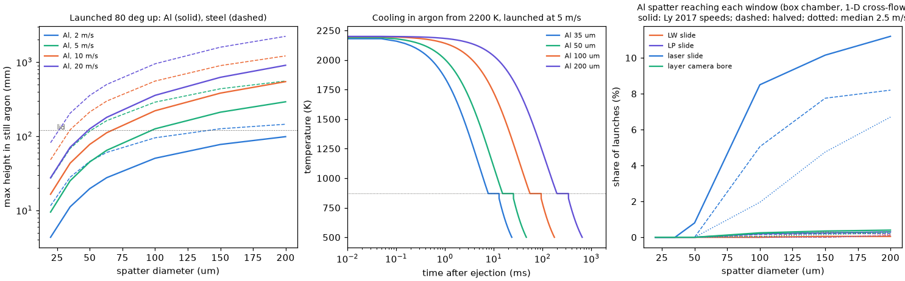
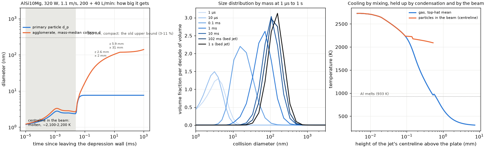
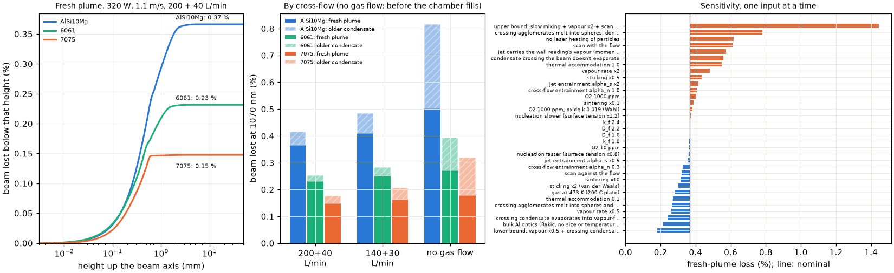
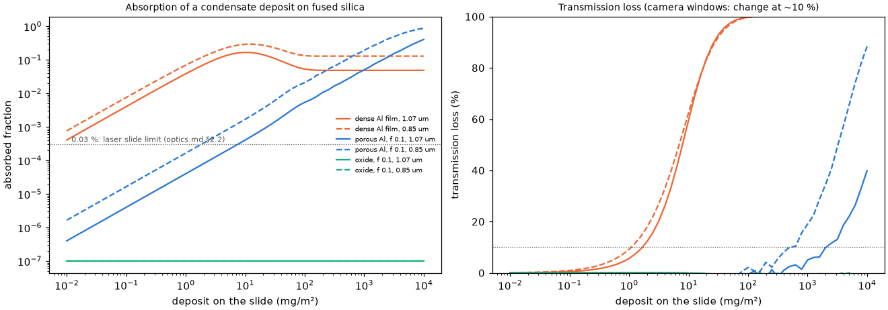

# Plume, condensate and spatter: what they do to the windows, the cameras and the beam (2026-11-25)

Issue #260. [`monitoring.md`](../monitoring.md) proposes a left-wall side camera (LW), a steep lid camera (LP) and a back-wall
light window (BW), each behind a cover slide, and an argon purge across the LW slide. This note asks what the vapour plume,
its condensate and the spatter do in this chamber's argon cross-flow: where they go, how much lands on each window and on the
laser's cover slide, how long the slides last, whether the LW purge is worth it, and what the cameras and the beam see.
Nothing here is built or measured. The geometry is the model's (`cad/lpbf_low.py`) plus the ports in
[`cad/monitoring_spec.py`](../cad/monitoring_spec.py), read at run time.

| File | What it is |
|---|---|
| [`make_case_plume.py`](../analysis/monitoring/plume/make_case_plume.py) | the CFD case: [`analysis/cfd/make_case.py`](../analysis/cfd/make_case.py) (imported, not edited) plus the LW, BW, LP and layer-camera bores as recesses with their own patches, an argon purge slot across the LW slide, the recoater where it stands during lasing, and finer cells at the LW |
| [`run_cases.sh`](../analysis/monitoring/plume/run_cases.sh) | writes and solves the cases with [`analysis/cfd/run_case.sh`](../analysis/cfd/run_case.sh) (OpenFOAM v2406 in Docker, 4 GB, 2 ranks) |
| [`particles.py`](../analysis/monitoring/plume/particles.py) | condensate (random walk) and spatter (drag and gravity) in the solved flow: fates, concentration next to each window, deposition |
| [`spatter.py`](../analysis/monitoring/plume/spatter.py) | spatter on its own: heights, ranges, a Monte Carlo against the chamber's windows, cooling, how long it glows for each camera, motion blur |
| [`plume_jet.py`](../analysis/monitoring/plume/plume_jet.py) | the vapour jet by hand: vapour pressure over each alloy, evaporation, jet speed and momentum, rise in the cross-flow, primary particle size, Mie extinction of the condensate |
| [`fouling.py`](../analysis/monitoring/plume/fouling.py) | the optics of a deposit on a slide, and hours to each window's limit |
| [`growth.py`](../analysis/monitoring/plume/growth.py) | the condensate's growth in the jet and the bed jet (nucleation, condensation, coagulation, sintering, laser heating, oxidation), the beam's loss and the coaxial glow (§3.4, §3.6) |
| [`summarize.py`](../analysis/monitoring/plume/summarize.py) → [`summary.md`](../analysis/out/monitoring/plume/summary.md) | every table below, regenerated from the JSON files |
| [`analysis/out/monitoring/plume/`](../analysis/out/monitoring/plume/) | `particles.json`, `spatter.json`, `plume_jet.json`, `fouling.json`, `growth.json` and the figures |

Edison's literature answers for this ([`r8-melt-plume`](../edison/r8-melt-plume/answer.md),
[`r8-viewports`](../edison/r8-viewports/answer.md) and, for the plume's growth and beam loss,
[`r9-plume-growth`](../edison/r9-plume-growth/answer.md)) are used throughout; §6 says where this note differs.

## 0. Short answer

With the gas layout gas-flow.md recommends (screens, 35 mm outlet channel, upper slot; 200 + 40 L/min, 2.95 m/s at 3 mm
over the plate):

1. **The bed jet removes the plume.** With worker A's source terms (320 W, 1.1 m/s: 0.47 g of AlSi10Mg condensate per
   hour of lasing, ~0.12 µg per mm of track, a 478 m/s jet off the keyhole wall), the plume's centreline tops out near
   the top of the 20 mm bed jet; Bitharas et al. saw only ~1 mm in a 2.1 m/s cross-flow (SS316) (§3). 100 % of the
   condensate released at 0.5–5 mm and 99.8 % of that released at 5–20 mm leaves through the floor slot within 20 s,
   most within 0.1 s (§1.2).
2. **The laser slide gets the least condensate and the most spatter.** The upper slot's sweep keeps 99.7 % of the
   condensate out of its recess. But 1.5–5 % of 100–200 µm Al droplets launched from the plate reach it, still molten
   (5–8 % at steel-like speeds), and no gas flow that spares the powder can stop them in 126 mm. **Spatter sets its life**:
   at an assumed 100 spatters per second of lasing, ~1,200–3,200 splats covering 8–19 % of its open area per hour of
   lasing (§4.4). Condensate comes next: it tolerates ~100× less deposit than a camera slide and would reach its
   absorption limit in ~30 h of lasing (§4.3). Inspect it after every build and stock slides for a change every few
   hours of lasing until the first builds measure the real rates.
3. **Move the steep lid port (LP) to the back half of the lid, under the upper slot's sweep.** At (−60, −80), where
   monitoring.md put it, the ceiling sweep carries the risen plume past it: it is the dirtiest window, ~12× the LW's
   deposit. Under the candidates at (−40, 60) and (−20, 80) the gas carries ~20× less condensate (10–40× across the
   runs), and a port drawn at (−40, 60) collects ~50× less (§1.2). Its room outside needs the CAD check.
4. **The left-wall port (LW) is the cleanest camera window,** and spatter almost never reaches it (≤ 0.1 % of launches
   in the CFD; it looks in at 13° through a 4 mm recess). **The purge cuts the condensate at its slide ~13× at 1 L/min
   and ~45× at 3 L/min,** and the deposit 4–6× by a turbulent-deposition model, more if its layer is laminar (§1.2). Fit
   the slot and a needle valve on a branch of the loop after the HEPA filter; run it for 7075, keyhole-mode work and long
   builds.
5. **Keep camera slides at or above the gas temperature.** Thermophoresis decides deposition: a slide 10 K colder than the
   gas collects 20–120× more condensate than an isothermal one; a few K warmer repels it (§4.3).
6. **How fast the camera slides foul depends on what the deposit looks like, which only a measurement will show.** As
   isolated nanoparticles, the dirtiest one (LP as placed) loses 10 % of its light in ~150 h of lasing, the others in
   thousands (AlSi10Mg at A's rate; 7075 about the same; ~6 h for the LP if 10 K colder than the gas). As a continuous
   film, the same mass costs the LP 10 % in ~0.3 h and the others in 3–10 h. Real condensate, chains of ~10 nm particles
   and partly oxidised, lies between. Nobody has published it for Al (Edison agrees), so check every slide's
   transmission each build (§4.5).
7. **The plume costs the beam ~0.6 % at 1070 nm** (AlSi10Mg at 320 W and 200 + 40 L/min; range 0.2–1.5 %). It is ~0.4 %
   for 6061 and 7075. Over loose powder it is ~1.2 %, and with no gas flow ~1.1 %, rising ~1 % per minute of lasing as the
   chamber fills (§3.4).
   - *Why no more:* a growth model (§3.6) finds that the beam keeps the condensate in its path at 2–5 nm, as molten
     droplets at ~2,100 K. It grows into ~60–140 nm fractal agglomerates only after the cross-flow has bent the jet off the
     beam, 1–3 mm up. So the 3–11 % that 300 nm particles would cost doesn't arise.
   - *Why no less:* the old 0.05–0.2 % undercounted the column and used bulk optics. Small, hot Al absorbs ~2.6× more per
     kg.
   - *Coaxial channels:* the beam-heated condensate adds ~2 % to the coaxial photodiodes (AlSi10Mg), not the 4–15 % optics.md
     assumed, while the plume dims the pool's light by ~1 %. The two nearly cancel, and the 700/900 ratio moves ~6 K.
   - It doesn't steer the beam. Old plume crosses the beam only where vectors are shorter than ~1 mm (§5).
   - *Testing it:* full against reduced cross-flow can't resolve it (the track narrows by < 0.1 %). The LW camera can, by
     the height and brightness of the beam's own glowing thread above the pool (§3.6).
8. **For the side camera: 10–20 µs exposures.** Al spatter moves at a few m/s, so 10 µs blurs it by under a pixel to
   ~3 pixels at 29 µm/px (§2.3). Above ~100 µs the plume's own light, about as bright in total as the pool's in a side
   view, swamps the image (Nagato et al. 2023). Through an 850 ± 5 nm filter, spatter glows above ~1,500 K: 100–200 µm
   droplets for 16–60 ms of flight, small ones for 2–4 ms. Everything else (entrained powder, > 80 % of the ejecta) shows
   only by the diode light.
9. **For the process:** 2–4 % of 100–200 µm spatter lands back on the plate (the layer camera's 25 µm/px sees it); the
   200 °C plate repels condensate by thermophoresis, so little settles on the bed; and the condensate of AlSi10Mg and
   6061 is mostly Al (A: 69–85 mol %), that of 7075 Zn and Mg (§3.1).
10. **At 140 + 30 L/min** (2.03 m/s at 3 mm): 2–3× more 100–200 µm spatter lands back on the plate (6–8 %), the LP gets
    half the condensate and the layer camera's bore 2–3× more; the rest is about the same (§1.3).

## 1. Condensate and spatter in the chamber's flow (CFD)

### 1.1 What was run

- **The gas layout is gas-flow.md's recommended one** (§0.5 there): screens in both slots, the 35 mm outlet channel, and the
  100 × 4 mm upper slot under the lid at z 114–118. It is the only layout that gives the operating point's 2.5–3.3 m/s over
  the plate. This run reproduces it: **2.95 m/s mean at 3 mm over Ø75 (2.60–3.33)** at 200 + 40 L/min, against 2.94
  (2.60–3.32) in gas-flow.md.
- **What's new in the gas volume** (`make_case_plume.py`), with the viewports from `monitoring_spec.py`:

  | Patch | What | As modelled |
  |---|---|---|
  | `lwSlide` | LW cover slide, left wall | Ø25 bore as a 22.2 mm square, its axis where the line of sight crosses the wall (y −18, z 33); slide 4 mm deep in the wall (assumed) |
  | `lwPurge` | argon across the LW slide | a 1.5 × 22 mm slot in the recess's top face, next to the slide, blowing down across it; a wall when off |
  | `bwWindow` | back-wall light window | Ø20 bore through the 16 mm wall at x −116, z 23; window on the outer face |
  | `lpSlide` | steep lid port at (−60, −80) | Ø20 bore, slide 4 mm into the lid (assumed) |
  | `lcWindow` | the layer camera's existing Ø30 bore | through the 16 mm lid at (71, −42); window at the lid's top face (the real one is higher, in the boss) |
  | `slide` | the laser's cover slide | as gas-flow.md: the Ø56 / Ø46 recess, slide at z 126 |

- **The recoater stands at the end of its stroke** (x 91–122), where the layer cycle leaves it while the laser runs and
  where monitoring.md checked the views. gas-flow.md had it at the park position (x −106), which would also blind the LW
  port.
- **Finer cells at the LW port** (1.5 mm across the wall, 2 mm over the recess): 285k cells against gas-flow.md's 178k.
  `checkMesh`: OK, no non-orthogonality.
- **Cases** (coarse mesh, k-ω SST, `simpleFoam`, 2 ranks; run one at a time on a shared runner):

  | Case | Bed + upper slot (L/min) | LW purge | Iterations |
  |---|---|---|---|
  | `p200` | 200 + 40 | off | 800 |
  | `p200_lw3` | 200 + 40 | 3 L/min | 400, from `p200` |
  | `p200_lw1` | 200 + 40 | 1 L/min | 200, from `p200_lw3` |
  | `p140` | 140 + 30 | off | 300, from `p200` |
  | `p200_lpback` | 200 + 40 | off; the LP port moved to the back-half candidate (−40, 60) | 500, from `p200` |

  The probe 3 mm above the plate centre held within 0.5 % over each case's last 100–200 iterations (−3.23 m/s at
  200 + 40 L/min, −2.24 at 140 + 30). The upper vortex wanders as in gas-flow.md §0.7.

- **Particles** (`particles.py`, frozen flow, one-way): condensate as 30,000 tracers per release band, 6,000 from each of
  five points (the plate centre and ±25 mm in x and y), tracked for 20 s. Two bands: 0.5–5 mm (conduction and keyhole
  onset, §3.2) and 5–20 mm (a hard keyhole's plume top). Spatter of 20–200 µm from the same five points with the three
  speed distributions of §2.1, 1,200–1,500 per size and distribution.

### 1.2 Condensate

**Where it goes** (`p200`, 200 + 40 L/min, LW purge off; 30,000 tracers per band, tracked for 20 s):

| Released | Out through the floor slot in 8 s / 20 s | Median time out | Passed within 30 mm of the beam axis under the lid | Entered: laser slide recess | LW | LP | layer-camera bore | BW |
|---|---|---|---|---|---|---|---|---|
| 0.5–5 mm | 99.5 % / 100 % | 0.04 s | 0.7 % | 0.03 % | 0.01 % | 0.32 % | 0.08 % | 0.02 % |
| 5–20 mm | 94.8 % / 99.8 % | 0.07 s | 7.4 % | 0.28 % | 0.21 % | 2.8 % | 0.86 % | 0.16 % |

- **The bed jet does its job.** Whatever stays in it leaves in a tenth of a second. Even a plume released 5–20 mm up mostly
  leaves; 5 % is still in the chamber after 8 s and 0.2 % after 20 s.
- **Little settles back on the powder.** The CFD is isothermal, but the 200 °C plate pushes sub-micron particles away by
  thermophoresis: 0.5 ν ∇T/T ≈ 2 mm/s across a ~2 mm thermal layer at 150 K difference (estimate, argon at 400 K), ~1,000×
  what Brownian and turbulent deposition carry toward it.
- **The upper slot keeps the laser slide's recess clear.** The gas under it moves toward the door at 0.45 m/s, and only
  0.03–0.28 % of the condensate enters its recess (gas-flow.md had 0.1–0.2 % for the same layout).
- **The steep lid port, where monitoring.md put it, is the dirtiest window.** The ceiling sweep carries the risen plume
  toward the door and right past it at (−60, −80): 0.3–2.8 % enters its recess, ~10× the laser slide's share.

**How much there is next to each window**, as a concentration per unit source rate (C/S, s/m³; multiply by the source in
kg/s for kg/m³). In brackets: how many of the 30,000 tracers visited, so the counting noise is ~1/√ of it:

| Where | Released 0.5–5 mm | Released 5–20 mm |
|---|---|---|
| Laser slide, the 2 mm under it | 2.6 (1) | 110 (15) |
| LW slide, the 2 mm in front of it | 0 (0) | 430 (23) |
| LP slide, the 2 mm under it | 230 (46) | 1,860 (434) |
| Layer-camera bore, its top 4.5 mm | 44 (6) | 440 (74) |
| BW window, the 2 mm in front of it | 74 (2) | 510 (15) |
| Over the plate, z 0–20 mm (for scale) | 130 | 240 |
| Along the beam axis, z 20–120 mm, r < 5 mm | 22 (219) | 270 (3,381) |
| **Under the ceiling where the lid candidates would open:** (−60, −80), the LP as placed | 84 (210) | 740 (1,896) |
| (−40, 60) | 4.7 (34) | 38 (248) |
| (−20, 80) | 3.8 (24) | 29 (195) |
| (80, 80) | 37 (42) | 510 (572) |
| **Along the left wall at the LW height (z 22–44), outside any recess:** y −60 | 110 (26) | 910 (329) |
| y −20 (the LW) | 47 (28) | 610 (319) |
| y +20 | 42 (29) | 420 (223) |
| y +60 | 67 (22) | 550 (167) |

- **Move the steep lid port to the back half of the lid, under the upper slot's sweep** (|x| < 50). Under the candidates
  at (−40, 60) and (−20, 80), which monitoring.md §3 also found clear (57–62° views), the gas carries **~20–25× less
  condensate** than at (−60, −80) (10–40× across the four runs). There the ceiling gas is fresh from the upper slot; the
  candidate at (80, 80), beside the slot's end, gains little. **Drawn there as a real port** (`p200_lpback`, the LP's
  recess and slide at (−40, 60)), it takes 0.05 % of the high-released condensate into its recess against 2.75 % at
  (−60, −80), none of the low, and its slide's deposit falls ~50× (0.17 against 8.1 mg/m²/h per g/h). It also moves the
  port's camera line away from the reservoir slot that monitoring_spec.py flags for (−60, −80). The room outside
  (30–80 mm to the optics bridge, monitoring.md §3) needs the CAD check.
- **The LW's own recess shelters its slide** from the low plume (no tracer reached it, against 47 in the wall layer
  outside), and a little from the high one (430 against 610). So keep the slide set back in its bore (4 mm here) rather
  than flush with the liner. Moving the LW along the wall changes little (420–910 along it).
- **The laser slide sees the least condensate of the five** (110 for the high release), but only 15 tracers made it, so
  read it as "a few times less than the camera windows".
- **The BW window**, low on the back wall beside the inlet slot (x −116, z 23), is as exposed as the LW. It is a light
  window, so it tolerates the most (§4).

**The LW purge, off, at 1 L/min and at 3 L/min** (`p200`, `p200_lw1`, `p200_lw3`; at 3 L/min the purge gas leaves the
1.5 × 22 mm slot at 1.5 m/s and crosses the slide at ~0.7 m/s):

| At the LW slide | Purge off | 1 L/min | 3 L/min |
|---|---|---|---|
| Gas 1 mm off the slide (m/s) | 0.015 | 0.22 | 0.82 |
| Friction velocity on it, u* (m/s) | 0.017 | 0.060 | 0.14 |
| Condensate in the 2 mm in front of it, C/S (s/m³), released 0.5–5 / 5–20 mm (tracers that visited) | 0 (0) / 430 (23) | 4.1 (13) / 33 (43) | 1.1 (6) / 9.3 (43) |
| In the whole recess (s/m³) | 5 (2) / 460 (63) | 33 (31) / 230 (212) | 13 (16) / 120 (162) |
| Deposition per unit source, 0.1 µm, isothermal (mg/m²/h per g/h of condensate) | 0 / 0.68 | 0.022 / 0.18 | 0.013 / 0.11 |

- **The purge keeps the condensate off the slide: ~13× less of it in front of the slide at 1 L/min and ~45× less at
  3 L/min** (high release). For the low release almost none reaches the slide either way.
- **The deposition falls less, ~4× at 1 L/min and ~6× at 3 L/min, in this model,** because the purge also scrubs the
  slide: its shear raises u* 3.5–8×, and Lai & Nazaroff's deposition velocity rises with it. That model is for a turbulent
  boundary layer; the purge's own layer is laminar (Re ≈ 100–160 at the slot), so the truth is likely nearer the 13–45×.
  If the slide is colder than the gas, the thermophoretic term doesn't depend on u*, and the purge cuts deposition the
  full 13–45×.
- **It pulls a little gas into the recess's mouth**: more tracers enter the recess with the purge on (0.5 % against
  0.2 %), but they stay out of the purged layer at the slide.
- The rest of the chamber doesn't notice 1–3 L/min against 240. Values elsewhere moved by up to ~2× between the runs
  (the left-wall layers by 0.5–2.6×, the laser slide's 2 mm layer by ~2×), which is the counting noise of volumes that a
  few tens of tracers visit, plus the upper vortex wandering. Read anything under a factor of ~2 as no difference.

### 1.3 Spatter in the flow

Share of Al spatter launches from the five plate points that end on each surface (`p200`; 1,200–1,500 per row):

| Speeds | d (µm) | Laser slide (Ø46 opening) | LW slide | LP slide | Back on the Ø75 plate | Floor | Outlet slot | Door side | Lid elsewhere |
|---|---|---|---|---|---|---|---|---|---|
| Al-like (median 2.5 m/s) | 20 | 0 | 0 | 0 | 0 | 26 % | 59 % | 16 % | 0 |
| | 50 | 0 | 0 | 0 | 0 | 3.4 % | 1.5 % | 95 % | 0 |
| | 100 | 1.5 % | 0.08 % | 0 | 2.5 % | 34 % | 4.6 % | 45 % | 3.8 % |
| | 150 | 3.1 % | 0 | 0 | 3.2 % | 31 % | 2.7 % | 28 % | 12 % |
| | 200 | 4.8 % | 0.08 % | 0 | 3.6 % | 25 % | 1.4 % | 21 % | 17 % |
| Half of Ly's | 100 | 4.1 % | 0 | 0.08 % | 1.5 % | 19 % | 3.7 % | 39 % | 15 % |
| | 200 | 6.3 % | 0 | 0.08 % | 1.9 % | 15 % | 0.9 % | 17 % | 28 % |
| Ly's (316L, Ti-6Al-4V) | 100 | 5.3 % | 0 | 0.17 % | 1.5 % | 21 % | 2.6 % | 18 % | 27 % |
| | 200 | 7.8 % | 0.08 % | 0.25 % | 0 | 2.5 % | 0.1 % | 14 % | 38 % |

The rest hits the drawer's rim round the laser slide (0.4–7 %), the side and back walls, and the parts in the gas. 20–50 µm
spatter never reaches a window: the bed jet takes it to the door (where the jet climbs, gas-flow.md §0) and the outlet. The
layer camera's bore and the BW window got none.

- **The laser slide is the window spatter finds.** It sits 126 mm straight above the plate, and droplets of 100–200 µm
  launched within ~10° of vertical at ≥ 5 m/s reach it while still liquid (§2.3). 1.5–5 % of them do at Al-like speeds,
  5–8 % at Ly's. No cross-flow that leaves the powder alone can turn them in 120 mm; gas-flow.md §3.6 found the same with
  its assumed launches.
- **The side and lid camera ports are almost out of spatter's reach:** 0–0.25 % per launch (one or two particles in
  1,200), within counting noise.
- **2–4 % of 100–200 µm spatter lands back on the plate**, on parts in progress, at Al-like speeds.


*`p200`. Left: share of Al spatter launches that hit each window, against size, for the three speed distributions. Middle:
condensate concentration next to each window per unit source, for the two release bands (log scale). Right: where Al
spatter lands on the floor at Al-like speeds; dashed: the Ø75 plate; green: the outlet slot.*

**At 140 + 30 L/min (`p140`, 2.03 m/s at 3 mm over the plate)**, against 200 + 40:
- **More spatter lands back on the plate: 6–8 % of 100–200 µm spatter at Al-like speeds, against 2.5–3.6 %.** The slower
  bed jet carries less of it past the plate's edge. The laser slide's share is the same (1.3–5 %): that spatter goes
  straight up.
- 20 µm spatter goes to the outlet more (70 % against 59 %), as the slower jet carries less of it up the door.
- Condensate leaves a little more slowly (99.3 / 91.5 % in 8 s for the two bands, against 99.5 / 94.8 %) but all of it is
  out by 20 s (99.2–100 %).
- The lid ports trade places: the slower ceiling sweep halves what reaches the LP (850 against 1,860 s/m³ next to its slide)
  and doubles to triples what reaches the layer camera's bore (1,300 against 440). The back-half lid candidates stay
  13–15× cleaner than (−60, −80).
- **The LW purge doesn't change spatter** (`p200_lw3` and `p200_lw1` match `p200` to within 0–4 of 1,200 launches per
  size): 3 L/min can't turn a 100 µm droplet.

## 2. Spatter on its own

### 2.1 What the literature gives for Al

| What | Al alloys | Steels, Ti-6Al-4V | Source |
|---|---|---|---|
| Speed | one laser-accelerated 36 µm particle went from 0.57 to 3.39 m/s in 350 µs (Al-Fe-Zr, synchrotron X-ray); mean speed rises linearly with intensity (AlSi10, AlSi7; values not retrieved) | hot entrainment 6–20 m/s (60 % of ejections), cold entrainment 2–4 m/s (25 %), recoil break-up of droplets 3–8 m/s (15 %); 316L in an EOS M290: mean 9.7 ± 6.7 m/s in one recording, 2.0 ± 2.0 m/s for one condition; molten spatter 3–8 m/s | Guo et al. 2024; Chebil et al. 2021; Ly et al. 2017; Barrett 2019; Ahmad 2019 (all via Edison) |
| Direction | mean −10° to −25° from vertical (backward), 70–80 % backward, at 350–500 W and 0.8 m/s; nearer vertical at 0.5 m/s | mean ~45° (Barrett) | Guo et al. 2024; Barrett 2019 |
| Size | more than half below 60 µm across at 4.24 MW/cm²; 140–160 µm droplets in every condition | ~90 % of ejecta within the 15–45 µm powder cut | Chebil et al. 2021; Williams 2022 |
| Kind | > 82 % solid (entrained powder), ~2 % jet spatter (Al-Fe-Zr) | 15 % molten, 60 % hot, 25 % cold (Ahmad) | Guo et al. 2024; Ahmad 2019 |
| Number | AlSi10Mg at 350 W, 1.6 m/s (VED 22 J/mm³, 200 °C plate): 10–20 particles under 63 µm and 2–6 over 63 µm in view at a time, in a 1.76 × 1.76 mm box behind the laser with 0.5 mm depth of field; more at higher VED | Barrett: ~1,500 tracked spatter events per second in an M290 | Nagato et al. 2023 (read), Barrett 2019 |

No count per mm of track and no speed distribution was found for Al. So the runs below use three speed distributions and
keep them apart:
- **fast**: Ly et al.'s mechanisms and speeds (6–20, 2–4 and 3–8 m/s), measured on 316L and Ti-6Al-4V;
- **half**: the same, halved;
- **Al-like**: lognormal, median 2.5 m/s, 95 % within 0.8–8 m/s, set from Guo's 3.4 m/s particle, Barrett's 2 m/s condition
  and Ahmad's 3–8 m/s for molten spatter.

Directions are uniform from 0 to 70° off vertical with a random azimuth: the scan direction turns from layer to layer, so
Guo's backward bias averages out over a build. Sizes are 20, 35, 50, 100, 150 and 200 µm, each run separately; the hit rates
in §4 weight them 35, 30, 20, 10, 4 and 1 % by number (Chebil's "more than half below 60 µm", Nagato's ~1 in 5 over 63 µm).
These are assumptions, and §4 gives their effect.

### 2.2 How high and how far

Schiller–Naumann drag in argon at 25 °C (1.65 kg/m³, 22.6 µPa·s) and gravity (`spatter.py`). Al at 2,670 kg/m³, steel at
7,900. Launched from 0.3 mm above the bed:

| d (µm) | v₀ (m/s) | Al: highest point, launched 80° up (mm) | Al: flight time, 80° (ms) | Al: range at 45°, still gas (mm) | Al: carried along the flow, 45° launch (mm) | Steel: highest point (mm) | Steel: range at 45° (mm) |
|---|---|---|---|---|---|---|---|
| 20 | 5 | 9 | 390 | 7 | 690 (it stays airborne) | 27 | 21 |
| 50 | 2 | 20 | 180 | 17 | 290 | 46 | 51 |
| 50 | 5 | 45 | 370 | 36 | 355 | 117 | 108 |
| 50 | 10 | 78 | 590 | 60 | 370 | 212 | 179 |
| 100 | 2 | 50 | 220 | 59 | 140 | 95 | 141 |
| 100 | 5 | 126 | 410 | 121 | 111 | 288 | 340 |
| 100 | 10 | 220 | 620 | 192 | 158 | 554 | 561 |
| 200 | 5 | 291 | 520 | 353 | 101 | 556 | 821 |

- **Al spatter flies a third to half as high as steel spatter of the same size and speed**, because it is a third as dense.
  Its Stokes relaxation time is 2.6 ms at 20 µm, 16 ms at 50 µm, 66 ms at 100 µm and 260 ms at 200 µm (×3 for steel).
- **The cross-flow takes the small spatter and leaves the big.** Particles up to ~50 µm are carried to the door and the
  outlet. 100–200 µm spatter is carried 100–160 mm along the flow over its 0.4–0.8 s flight, mostly inside the bed jet on
  the way up and down; on its way to the lid it crosses the jet in a few ms and keeps its line.
- **What reaches the lid (z 120–126 mm):** a 100 µm Al droplet needs ~5 m/s straight up, a 50 µm one ~16–20 m/s. With the
  fast speeds, 43–60 % of 100–200 µm Al spatter reaches the lid in a box chamber; with the Al-like speeds, 7–30 % (§1.3).
- **The LW port is hard to reach.** It looks in at 13° from 160 mm away, through a 4 mm recess. A particle must leave the bed
  within ~15° of horizontal toward −x and keep its speed for 140 mm. 0–0.1 % of launches do in the CFD (0–0.3 % in the
  box chamber), at every size and speed tried.



*Left: highest point of Al (solid) and steel (dashed) spatter launched 80° up in still argon; the dotted line is the lid.
Middle: cooling of Al droplets launched at 5 m/s from 2,200 K; the plateau is freezing. Right: share of launches reaching each
window in a box chamber with the 1-D cross-flow, for the three speed distributions.*

### 2.3 What the side camera sees of it

**Motion blur** is speed × exposure ÷ pixel (`spatter.py`; pixels at the plate from monitoring.md §3):

| Camera at the LW port | µm/px across the view | 2.5 m/s (Al-like median), 10 µs | 2.5 m/s, 30 µs | 5 m/s, 10 µs | 5 m/s, 100 µs | 10 m/s, 100 µs |
|---|---|---|---|---|---|---|
| Chronos 2.1-HD + 50 mm f/4 | 29 | 0.9 px | 2.6 px | 1.7 px | 17 px | 34 px |
| IMX296 + 50 mm f/2.8 (shortest exposure 30 µs) | 10 | – | 7.5 px | – | 50 px | 100 px |

- **Use 10–20 µs.** At the Al-like speeds (median 2.5 m/s) a 10 µs frame on the Chronos blurs spatter by under a pixel to
  ~3 pixels, so speed and direction can be read from two frames. At 100 µs every spatter is a streak, which is also a way to
  measure speed in one frame.
- **Nagato et al. 2023 saw the plume's light swamp a 645 ± 10 nm image above 100 µs**, even with 280 W of pulsed laser
  light. That is the other reason to keep exposures short, or to pulse the light.
- Edison's "≤ 2.9 µs for 10 µm of blur" is for a 10 µm pixel; at the LW port's 29 µm/px, 10 µs is enough.

**How long spatter glows.** Each droplet cools by convection (Ranz–Marshall, argon at the film temperature) and radiation
(emissivity 0.15), with latent heat over the freezing range. A Biot number of ~10⁻⁴ makes it one temperature throughout.
Convection carries ~10–30× more heat than radiation (at 2,000 K, from 200 down to 50 µm). A camera sees a droplet by its
own light while the photoelectrons per pixel stay above ~100 (5× a ~20 e⁻ read noise), with a grey emissivity of 0.15
and the blur spread over the pixels:

| Al droplet, launched at 5 m/s from 2,200 K | Liquid for | Chronos at LW, 850 ± 5 nm, 10 µs: glows above / for | Chronos, 450–950 nm, 10 µs | IMX296 at LW, 850 ± 5 nm, 30 µs | Layer camera (Pi HQ, its 400–650 nm IR-cut filter), 10 ms |
|---|---|---|---|---|---|
| 35 µm | 13 ms | 1,582 K / 2.1 ms (8 mm of flight) | 1,181 K / 4.5 ms (14 mm) | 1,816 K / 1.2 ms (5 mm) | 1,822 K / 1.1 ms |
| 50 µm | 26 ms | 1,554 K / 4.3 ms (16 mm) | 1,165 K / 8.9 ms (27 mm) | 1,763 K / 2.6 ms (11 mm) | 1,775 K / 2.5 ms (10 mm) |
| 100 µm | 94 ms | 1,514 K / 16 ms (60 mm) | 1,142 K / 33 ms (94 mm) | 1,681 K / 11 ms (45 mm) | 1,689 K / 11 ms (44 mm) |
| 200 µm | 342 ms | 1,489 K / 60 ms (203 mm) | 1,128 K / 121 ms (308 mm) | 1,623 K / 44 ms (164 mm) | 1,610 K / 46 ms (168 mm) |

- **Through a 10 nm filter at 850 nm, spatter is self-luminous only above ~1,500 K**: small spatter for the first few mm,
  100–200 µm droplets for most of their flight. Broadband (450–950 nm, behind the 1070 nm notch) adds ~400 K of range.
- **With an 808/850 nm diode light and the matching filter, the camera sees everything that crosses the beam of light**,
  hot or cold: entrained powder, which is most of the ejecta (> 82 % solid in Guo's Al-Fe-Zr), shows only by light. So the
  light, not the glow, is what makes powder entrainment and denudation visible.
- **The layer camera's 10 ms frames record only the hottest droplets**, as streaks 50 mm long at 5 m/s. Its stills between
  layers miss all of it.
- **Large droplets reach the lid still liquid.** A 100 µm droplet stays liquid for ~94 ms and reaches 126 mm in ~30–60 ms,
  so it hits the laser slide molten and sticks. A 50 µm one is solid after ~26 ms.

## 3. The vapour plume

**The source terms are worker A's** (melt-pool model, [`analysis/out/monitoring/melt/plume_source.json`](../analysis/out/monitoring/melt/plume_source.json)).
This note uses two of its readings and says which:
- **for the jet, its `exit` state at the depression wall** (`wall`: Knight jump at the hottest point, Mach 0.43);
- **for the condensate, its `best` reading**: Mg and Zn at the rates measured LPBF losses imply (its Hertz–Knudsen–Langmuir
  over-predicts Mg ~10×), and Al from the `wall` reading.

`plume_jet.py --source <file>` reads it (results under `worker_A` in `plume_jet.json`). The scenarios below the table are this
note's own cross-check, made before A's file existed: surface temperatures as scenarios, vapour pressures from
Clausius–Clapeyron anchored at each element's boiling point (CRC Handbook: Al 2,792 K and 294 kJ/mol, Mg 1,363 K and
127 kJ/mol, Zn 1,180 K and 115 kJ/mol, Si 3,538 K and 359 kJ/mol), and Raoult's law over the alloy.

| Worker A, 320 W, 96 µm, 200 °C plate (7075: 25 °C plate) | AlSi10Mg, 1.1 / 0.6 m/s | 6061, 1.1 / 0.6 m/s | 7075, 1.1 / 0.6 m/s |
|---|---|---|---|
| Depression wall: T_s, exit speed (Mach 0.43) | 2,763 K, 478 m/s | 2,508 K, 464 m/s | 1,839 K, 265 m/s |
| Vapour leaving the wall's hot area (`wall` reading, all elements) | 1.1 / 1.2 g/h | 1.4 / 1.6 g/h | 4.9 / 5.2 g/h |
| **Condensate, `best`** (g per hour of lasing) | **0.47 / 0.50** | **0.19 / 0.18** | **0.44 / 0.24** (0.61 / 0.42 with a Zn- and Mg-depleted surface) |
| … per mm of track | 0.12 / 0.23 µg | 0.05 / 0.08 µg | 0.11 / 0.11 µg |
| … its composition (mol) | 85 % Al, 15 % Mg | 69 % Al, 31 % Mg | 55 % Zn, 44 % Mg |
| Jet momentum length L_m at 200 / 140 L/min (this note) | 3.2 / 4.6 mm | 3.6 / 5.2 mm | 5.1 / 7.3 mm |
| Plume centreline 10 mm downstream, 200 / 140 L/min | 11 / 14 mm | 12 / 15 mm | 15 / 19 mm |
| Primary particles (this note's coagulation model) | 3 nm | 3 nm | 6 nm |

*From 200 to 400 W at 1.1 m/s A's `best` runs 0.10–0.64 g/h for AlSi10Mg and 0.07–0.24 g/h for 6061. At 200 W AlSi10Mg
has no jet (the wall stays below its boiling point). **Over loose powder (an overhang, A's `ovh_` cases) AlSi10Mg at 320 W
gives 1.5 g/h, 3.3× a track on solid metal**, and a jet whose centreline reaches 17–22 mm, the top of the bed jet.*

### 3.1 What evaporates, and when there is a jet

- **The alloys "boil" (total vapour pressure 1 atm) well below aluminium's 2,792 K:** AlSi10Mg at 2,549 K, 6061 at
  2,256 K and **7075 at 1,673 K**, because of their Mg and Zn (Raoult; A gets 2,539, 2,259 and 1,675 K).
- **Raoult puts Mg and Zn in the vapour** (59–96 mol % Mg over AlSi10Mg). **The measured losses say the surface runs out
  of them**: A's calibrated `best` vapour over AlSi10Mg and 6061 is 69–85 mol % Al. Over 7075 it stays Zn and Mg. So the
  condensate of AlSi10Mg and 6061 is mostly Al, and the deposit optics of §4.2 (Al) fit it.
- **Below the alloy's boiling point there is no jet.** Vapour diffuses into the argon over the hot spot. At 2,000–2,300 K
  that is 0.001–0.005 g per hour of lasing from a hot spot half the beam's area: almost nothing.
- **Above it, the vapour leaves as a jet.** Knight's (1979) jump conditions across the Knudsen layer, with 1 atm outside:

| Scenario (AlSi10Mg; 6061 and 7075 in `plume_jet.json`) | T_s | Vapour pressure | Jet speed | Mass out, from a Ø67 µm keyhole mouth | Momentum flux |
|---|---|---|---|---|---|
| Conduction, 2,000 / 2,300 K | 2,000 / 2,300 K | 0.15 / 0.44 atm | none | 0.0004 / 0.001 g/h | – |
| Keyhole onset, 1.2 atm | 2,607 K | 1.2 atm | 113 m/s (Mach 0.10) | 0.18 g/h | 5.5 µN |
| Keyhole, 2 atm (recoil + capillary pressure of a ~30 µm keyhole) | 2,771 K | 2 atm | 441 m/s (Mach 0.39) | 0.74 g/h | 90 µN |

- **The 2 atm row matches A's depression wall** (2,771 against 2,763 K, 441 against 478 m/s, Mach 0.39 against 0.43).
  Both jet speeds sit inside the 20–300 m/s to "hundreds of m/s" found for LPBF vapour jets (Guo et al. 2024; Bitharas
  et al. 2022) and above the 38–97 m/s plume ascent Mayi et al. (2020) measured at 0.57–1.14 MW/cm²; our peak intensity
  is ~10 MW/cm² at 350 W.
- **The mass leaving the wall overstates the condensate**, because its Mg comes from Raoult. A's `best` (0.47 g/h for
  AlSi10Mg) uses the measured Mg loss instead; it sits between this note's keyhole-onset (0.18 g/h) and 2 atm (0.74 g/h)
  rows. §4 uses A's `best`.

### 3.2 How high it gets in the cross-flow, and its tilt

The jet bends over within its momentum length L_m = √(J / ρU²) and then rises slowly, z ≈ 2.3 L_m (x / L_m)^(1/3)
(momentum-dominated jet in cross-flow; Hasselbrink & Mungal 2001). Without a jet, the hot gas rises as a bent-over buoyant
plume, Δz = 1.6 F^(1/3) x^(2/3) / U (Briggs). Cross-flow at 2.95 m/s (200 L/min) and 2.03 m/s (140 L/min) at 3 mm:

| Regime | L_m at 200 / 140 L/min | Centreline 10 mm downstream | 50 mm downstream |
|---|---|---|---|
| Conduction (no jet) | – | 0.4 / 0.6 mm | 1.1 / 1.7 mm |
| Keyhole onset | 0.6 / 0.9 mm | 3.6 / 4.6 mm | 6.2 / 7.9 mm |
| Keyhole, 2 atm | 2.5 / 3.7 mm | 9.2 / 11.8 mm | 16 / 20 mm |


*Left: vapour pressure over each alloy and its pure elements. Middle: AlSi10Mg's plume centreline at 200 L/min (solid) and
140 L/min (dashed); grey is the fixed layout's ~20 mm bed jet. Right: Mie mass coefficients of Al and alumina spheres.*

- **With A's source terms the jet reaches the top of the bed jet.** At 320 W its momentum (~140 µN for AlSi10Mg) gives
  L_m ≈ 3–5 mm and a centreline 11–19 mm up 10 mm downstream: the 2 atm row, and the 5–20 mm release band of §1.2.
- **Measured plumes are lower.** Bitharas et al. (2022, SS316 at 0.75 m/s) saw the plume "dissipated within the convective
  flow after propagating upwards for ~1 mm" in a 2.1 m/s cross-flow, which is the keyhole-onset row; Shi et al.'s review
  (2024) gives a visible plume 4–5 mm high and ~1.5 mm wide. The scaling is for a steady jet in a uniform cross-flow, and
  the vapour jet is a few hundred µm of hot gas that starts inside the bed's boundary layer, so read 1–20 mm as the range
  and both release bands of §1.2 as its two ends.
- **Tilt:** past ~1 mm the centreline runs only 5–10° above the bed, downstream. In the moving source's frame the gas
  speed is the cross-flow minus the scan: at 1.1 m/s, 1.85 m/s scanning with the flow and 4.05 m/s against it. Heights
  scale as U^(−2/3), so scanning with the flow lifts the plume ~1.4× and against it ~0.8×.
- **At 140 L/min every height is ~1.3× the 200 L/min one.**
- **The growth model's integral jet (§3.6) rises less:** ~4 mm up at 10 mm downstream and ~6 mm at 30 mm (AlSi10Mg, 200 + 40
  L/min). It carries only A's `best` vapour (0.44× the `wall` reading's momentum), and the condensate's latent heat keeps its
  mixture hot and spreading. That is nearer the measured plumes, and between §1.2's two release bands.

### 3.3 What it condenses into

- **Primary particles: 3–8 nm in a jet (3–6 nm with A's exit states), 30–110 nm without one** (`plume_jet.py`):
  free-molecular coagulation with full coalescence until the gas cools below ~900 K (650 K for Zn-rich 7075 condensate).
  In a jet the vapour mixes with argon and cools that far within 0.3–0.65 mm and 1–16 µs, so the particles have little
  time to grow. Without a jet it cools slowly in the hot boundary layer (~5 ms), and they grow larger.
- **Measured, for comparison (stainless steel, no Al data found):** primary particles 4–16 nm, median 9.4 nm, with a metal
  core and oxide shell above ~30 nm (Noskov et al. 2020), in chain-like agglomerates 0.5 to > 10 µm long (Noskov et
  al. 2022). The jet case agrees.
- **The growth model (§3.6) adds the beam and the latent heat.** While the jet runs up the beam, the condensate stays at 2–5 nm
  molten droplets at ~2,100–2,200 K. Out of it, the primaries freeze at ~7.6 nm within 0.1 ms, and agglomerates reach
  ~60 nm by 1 ms and ~140 nm by 1 s.
- So the condensate that reaches a window is agglomerates of ~3–15 nm particles, Al-rich from AlSi10Mg and 6061 and Zn-
  and Mg-rich from 7075 (§3.1), partly oxidised. How much depends on the chamber's O₂ (not modelled); in air, at the next
  slide change, the rest oxidises.

### 3.4 What it does to the beam and the coaxial signal

**The plume costs the beam ~0.6 % at 1070 nm for AlSi10Mg at 320 W, 1.1 m/s and 200 + 40 L/min, with a defensible range
of 0.2–1.5 %. For 6061 and 7075 it is ~0.4 %.** That replaces this note's earlier 0.05–0.2 %, which had two errors that
both made it low:
- it took the column above the spot at the vapour's own density (19 mg/m² for AlSi10Mg), where the cooled, mixed jet is up
  to ~10× denser;
- it read that column as ~20 nm primaries with bulk room-temperature aluminium's optics.

The growth model of §3.6 follows the vapour from the depression wall instead
([`growth.py`](../analysis/monitoring/plume/growth.py) → [`growth.json`](../analysis/out/monitoring/plume/growth.json)).
It finds three things:
- **The column on the beam axis is 21–40 mg/m²** (6061 to 7075), almost all of it below 3 mm. The jet runs up the beam for
  its first ~0.6 mm. Above that the bed's cross-flow bends it over, and only its edge still crosses the beam.
- **The condensate in the beam path stays small.** While the jet runs up the beam (~30 µs), the beam holds the condensate at
  2,100–2,240 K: molten droplets of 2–5 nm that keep re-evaporating. Once out of the beam they freeze as ~7.6 nm primaries
  and grow into fractal agglomerates: ~16 nm by 1 mm up, ~60 nm by 2.6 mm. **Nothing near 300 nm forms in the beam path,**
  so the 3–11 % that 300 nm compact particles would cost (§6) doesn't happen.
- **What raises the loss is that these are small, hot metal particles.** Electrons scatter at their surfaces, and the molten
  ones also scatter as in liquid Al. Both damp them, so they absorb 185–205 m²/kg in the beam, against 50–70 m²/kg for
  bulk room-temperature Al spheres of 2–20 nm. With bulk optics the loss would be 0.21 %. Scattering is under 1 % of it.

**Beam lost at 1070 nm** (320 W, 1.1 m/s, 200 °C plate, 100 ppm O₂, scan across the flow; worker A's `best` vapour):

| | AlSi10Mg | 6061 | 7075 |
|---|---|---|---|
| Condensate (A's `best`, g per hour of lasing) | 0.47 | 0.19 | 0.44 |
| Column on the beam axis (mg/m²) | 36 | 21 | 40 |
| **Fresh plume, 200 + 40 L/min** | **0.56 %** | **0.36 %** | **0.40 %** |
| … of which below 1 mm / 3 mm | 0.36 / 0.55 % | 0.28 / 0.36 % | 0.28 / 0.40 % |
| Older condensate: earlier tracks over a 10 mm part, plus the chamber's background (§1.2) | +0.05 % | +0.02 % | +0.03 % |
| **Total, 200 + 40 L/min** | **0.61 %** | **0.38 %** | **0.43 %** |
| Total, 140 + 30 L/min | 0.71 % | 0.44 % | 0.49 % |
| Total with no gas flow (~0.25 m/s of convection over the part, assumed), before the chamber fills | 1.13 % | 0.61 % | 0.70 % |
| … then, as the chamber fills (no flow, well mixed) | +1.2 % per min of lasing | +0.45 % per min | +0.85 % per min |
| Power absorbed in the plume (200 + 40 L/min) | 0.8 W | 0.5 W | 0.6 W |

*Edges, AlSi10Mg at 200 + 40 L/min: 0.18 % at 200 W, 0.70 % at 400 W, 0.67 % at 500 W (A's 400 W vapour), 0.65 % at
0.6 m/s, **1.15 % over loose powder** (A's overhang case) and 0.86 % for 7075 with a Zn- and Mg-depleted surface. Scanning
with the flow raises the fresh plume's share ~1.4× and scanning against it lowers it ~0.85× (§3.6).*

- **The range, and why.** At the nominal point (§3.6, one input at a time) the loss runs from 0.21 % (bulk Al optics) to
  0.80 % (vapour ×2). The combined pessimistic case is 1.44 %: slow jet mixing, ×2 vapour and scanning with the flow.
  Agglomerates that melt as they cross the beam and don't evaporate would give 0.78 %. So read **0.6 % as the central value
  and 0.2–1.5 % as the range** for AlSi10Mg, and 0.15–1 % for 6061 and 7075. The vapour rate and the small-particle optics
  are the two inputs that matter. The aerosol details (fractal dimension, sticking, sintering, nucleation rate) move it by
  under 5 %, because the particles in the beam stay molten and compact.
- **O₂ doesn't matter in the beam path at the machine's ≤ 100 ppm.** By 1–3 mm the jet has entrained too little argon to
  oxidise more than ~1–5 % of the condensate: 1000 ppm takes the loss from 0.56 to 0.52 %. Edison's r9 answer argued that
  the condensate is alumina at 100–1000 ppm (§6), but it is metallic Al while it is in the beam. It oxidises downstream:
  ~5 % by 1 ms, ~24 % by 10 ms, and ~60 % by 1 s, where a ~1 nm passivating shell stops it.
- **It doesn't steer or defocus the beam measurably.** Hot argon and metal vapour change the refractive index by ~10⁻⁴ over
  ~1 mm, which moves the beam by under a µm (estimate). Edison found no evidence of a plasma in CW LPBF of Al at 1 µm, only
  weakly ionised vapour (r8, r9). None is expected at ~10 MW/cm².
- **The coaxial channels see the plume twice: as a loss and as light.**
  - *Loss.* The pool's light crosses the same column on its way up. The plume absorbs 1.15 % of it at 700 nm, 0.88 % at
    900 nm and 0.72 % at 955–990 nm (AlSi10Mg), more in keyhole mode and over overhangs.
  - *Light.* The beam heats the condensate in its path to ~2,000–2,200 K (§3.6). In the photodiodes' Ø1.6 mm field
    (optics.md §3's method and pool signal), that glow adds **+2.0 % to PD-A 700/40 and +2.1 % to PD-B 900/40 for
    AlSi10Mg** and +0.8–0.9 % for 6061. It adds ~0 for 7075, whose Mg/Zn condensate evaporates in the beam rather than
    glowing (with Al's optics; §3.6).
  - *Range.* The glow is +0.8 % at 200 W, +3.3–3.7 % at 400–500 W and **+8.8 % over loose powder**. It is +4.5 % if the
    gas over the 200 °C plate is at 473 K, and +6.1 % if crossing agglomerates melt without evaporating; the combined
    pessimistic case gives +16 %.
  - *Camera.* At the beam centre the plume's radiance is 1.3 % of the depression's at 955–990 nm with emissivity 0.12, and
    0.45 % with 0.35.
  - *Net.* The two nearly cancel in each photodiode (net +0.8 % at 700 nm and +1.25 % at 900 nm), and the 700/900 ratio
    moves by ~0.4 %, ~6 K at 2,600 K, against the ±75–125 K a 90 kHz sample already carries (optics.md §3). They fluctuate
    with the keyhole and the plume.
  - **So optics.md §3's 4–15 % (taken from 0.05–0.2 % of absorption at 2,700 K over a Ø0.3 mm column) should become ~2 %
    (0.5–6 %; ~9 % over overhangs).**
- **Away from the spot, the chamber's background is negligible.** Along the beam axis (z 20–120 mm) the CFD gives C/S of
  22–270 s/m³ (§1.2): 0.3–3.5 mg/m² of ~1 s-old condensate at A's 0.47 g/h for AlSi10Mg. Its agglomerates are ~140 nm
  across, ~60 % oxidised, and absorb and scatter ~60 m²/kg, so they cost 0.002–0.02 % (§3.6).

### 3.5 What the side camera sees of the plume

- The hot vapour and fresh condensate glow. A side view through ~1.5 mm of plume at ~2,000 K, with an absorption optical
  depth of ~2 × 10⁻³ at 850 nm, is ~400× dimmer per unit area than a 2,500 K pool with emissivity 0.15. But at 13° the
  pool's projected area is tiny (0.2 × 0.3 mm × sin 13°) and the plume's is ~6 mm². **So in a side view the plume shines
  about as brightly in total as the pool** (estimate, continuum only; Al I, Mg I and Na lines fall outside 600–1000 nm per
  Edison, and K I 766/770 nm, if present as an impurity, falls inside it).
- It leans downstream, ~5–10° above the bed past the first mm, across the LW camera's view (the flow runs in −y, the camera
  looks along +x). Its length and tilt are a direct read-out of the cross-flow at the bed.
- The condensate cloud further downstream is too thin to see without light: an optical depth of ~10⁻³.

### 3.6 How far the condensate grows in the beam path (growth model)

Nothing in §1–§3.3 modelled the condensate's growth while it is still in the beam, and the beam loss turns on it (§6,
Edison's design review). [`growth.py`](../analysis/monitoring/plume/growth.py) does, for one parcel riding the jet's
centreline from the depression wall to 1 s later, in the beam's frame. Results:
[`growth.json`](../analysis/out/monitoring/plume/growth.json) (~1 s of CPU per case, 70 cases).

**What it models, and where each rate comes from:**
- **The jet.** A top-hat integral jet in a cross-flow (Lee & Cheung 1990): mass, momentum and enthalpy fluxes along the
  trajectory.
  - Entrainment is 2π b ρ_a (α_s |u − U cos θ| + α_n U sin θ). α_s = 0.08 reproduces Ricou & Spalding's measured jet
    entrainment, and α_n = 0.6 is the usual cross-flow term (Hoult, Fay & Forney 1969).
  - U is the bed jet's profile (gas-flow.md §0.5) combined with the scan, across the flow by default.
  - The exit state (478 m/s, 2,326 K for AlSi10Mg) is worker A's `wall` reading. The mass is A's `best` vapour, so the
    jet is 51 µm across.
  - The enthalpy carries the latent heat the condensate gives up and the beam power the particles absorb.
- **The aerosol.** A discrete-sectional model (Wu & Flagan 1988) from the single atom to ~4 µm, 2× in volume per section.
  - Coagulation uses Jacobson et al.'s volume-conserving scheme with Fuchs's kernel, valid from free-molecular to
    continuum.
  - Nucleation and condensation are collisions with the monomer. Clusters lose atoms by Kelvin-enhanced evaporation at
    their own temperature, with liquid Al's surface tension (Keene 1993), so the nucleation rate follows.
  - Agglomerates are fractal (D_f 1.8, k_f 1.3: DLCA, Sorensen 2011). One primary size relaxes at the solid-state
    sintering time 3kTN/(64πσD) (Koch & Friedlander 1990; Kruis et al. 1993) with Al's self-diffusion (Lundy & Murdock
    1962). It relaxes instantly while the particles are molten, with the melting point lowered by Gibbs–Thomson.
  - Mg (AlSi10Mg, 6061) or Zn (7075) condenses onto the particles once supersaturated.
  - O₂ from the entrained argon reacts on collision, and a ~1 nm shell passivates cold Al (Jeurgens et al. 2002).
- **The beam.** Each particle in the beam (w₀ 48 µm) absorbs and loses heat to the argon by free-molecular conduction
  (accommodation 0.3; Michelsen et al. 2015 review 0.1–0.4) and by evaporation. Its temperature sets its evaporation,
  sintering and glow.
- **The optics at 1070, 975, 900 and 700 nm.**
  - Compact particles use Mie theory, agglomerates RDG-FA (Dobbins & Megaridis 1991; Sorensen 2001).
  - Al starts from Rakić's n, k. Electron scattering at the particle's surface adds Drude damping v_F/r (Kreibig &
    Vollmer 1995), and so does liquid Al's resistivity when molten (24.2 µΩ cm, Desai et al. 1984).
  - Oxides take n 1.665, k 0. 7075's Mg/Zn condensate takes Al's optics, which is pessimistic (§4.2).
- **The loss and the glow.** The centreline's coefficients are integrated up the beam axis through the jet's Gaussian
  cross-section, so the jet stops counting once it has bent off the beam.



*AlSi10Mg, 320 W, 1.1 m/s, 200 + 40 L/min. Left: primary and agglomerate sizes against time; grey: while the centreline is
in the beam. Middle: the size distribution by mass from 1 µs to 1 s. Right: gas and particle temperatures against the
centreline's height.*

**How it grows** (AlSi10Mg, nominal; the centreline parcel):

| Time | Centreline: up / downstream | Gas (top-hat): T, speed | Particles | Primary | Agglomerate, mass-median collision diameter | Primaries each | Oxidised | m²/kg at 1070 nm: absorption + scattering |
|---|---|---|---|---|---|---|---|---|
| 1 µs | 0.10 / 0.00 mm | 2,200 K, 57 m/s | in the beam, molten at 2,230 K | 2.7 nm | 3.2 nm | 1 | 0.1 % | 176 + 0 |
| 10 µs | 0.35 / 0.02 mm | 1,210 K, 18 m/s | in the beam, 2,130 K | 2.5 nm | 2.8 nm | 1 | 0.2 % | 185 + 0 |
| 31 µs | 0.60 / 0.06 mm | 950 K, 9.5 m/s | leaving the beam | 4.3 nm | 4.7 nm | 1 | 0.5 % | 205 + 0 |
| 0.1 ms | 1.0 / 0.19 mm | 650 K, 5.2 m/s | frozen | 7.6 nm | 16 nm | 10 | 1 % | 137 + 0.5 |
| 1 ms | 2.6 / 2.5 mm | 370 K, 2.8 m/s | | 7.6 nm | 62 nm | 99 | 5 % | 126 + 4.6 |
| 10 ms | 5.9 / 31 mm | 314 K | | 7.6 nm | 104 nm | 217 | 24 % | 100 + 7.8 |
| 1 s | in the bed jet | 300 K | | 7.6 nm | 140 nm | 360 | 60 % | 53 + 7 |

- **The beam keeps the condensate small while the jet runs up it.** The beam holds the particles at 2,100–2,240 K, where
  they keep evaporating and recondensing as 2–5 nm molten droplets: 60–90 % of the vapour is condensed at any moment.
- **They grow only after the cross-flow has bent the jet off the beam** (by ~0.6 mm up). The primaries freeze at ~7.6 nm
  within ~0.1 ms, and agglomerates reach ~60 nm by 1 ms and ~140 nm by 1 s. By then the parcel is 2.5 mm, and then tens
  of mm, downstream.
- **The latent heat matters.** Condensing Al releases ~1.4 W in AlSi10Mg's jet, about seven times the vapour's sensible heat.
  It keeps the entrained argon above ~1,700 K for the first 0.2 mm and makes the jet spread faster.
- **0.8 W of the beam is absorbed in the plume** (AlSi10Mg, 200 + 40 L/min), about half the jet's own enthalpy flux. Most
  of it goes into the gas.



*Left: beam lost below each height on the axis (fresh plume, 200 + 40 L/min). Middle: fresh plume and older condensate for
each cross-flow (no gas flow: before the chamber fills). Right: AlSi10Mg's fresh-plume loss as each input moves.*

**Sensitivity** (AlSi10Mg, 320 W, 1.1 m/s, 200 + 40 L/min, fresh plume; nominal 0.56 %):

| Input | Low / high | Beam loss (%) | PD-A glow (% of the pool) |
|---|---|---|---|
| Fractal dimension D_f | 1.6 / 2.2 | 0.558 / 0.558 | 2.0 / 2.0 |
| Fractal prefactor k_f | 1.0 / 2.4 | 0.557 / 0.558 | 2.0 / 2.0 |
| Sticking (van der Waals ×2) | ×0.5 / ×2 | 0.58 / 0.54 | 1.4 / 2.7 |
| Sintering rate | ×0.1 / ×10 | 0.565 / 0.567 | 1.9 / 2.2 |
| Nucleation rate (cluster surface tension ×1.2 / ×0.8) | slower / faster | 0.558 / 0.558 | 1.9 / 2.1 |
| Vapour rate | ×0.5 / ×2 | 0.39 / 0.80 | 1.0 / 4.1 |
| O₂ | 10 / 1000 ppm (1000 with Wahl's oxide k 0.019) | 0.56 / 0.52 (0.54) | 2.0 / 1.8 |
| Scan direction | against / with the flow | 0.48 / 0.79 | 1.7 / 2.4 |
| Jet entrainment α_s | ×0.5 / ×2 | 0.62 / 0.52 | 3.9 / 1.0 |
| Cross-flow entrainment α_n | 0.3 / 1.0 | 0.63 / 0.51 | 2.7 / 1.5 |
| Jet momentum: A's `wall` vapour (×2.3) | – | 0.61 | 0.7 |
| Al optics: bulk Rakić, no size or temperature damping | – | 0.21 | 0.55 |
| No laser heating of particles | – | 0.62 | 0.8 |
| Agglomerates crossing the beam melt into spheres, without evaporating | – | 0.78 | 6.1 |
| Thermal accommodation | 0.1 / 1.0 | 0.557 / 0.553 | 2.4 / 1.2 |
| Gas over the plate at 473 K | – | 0.60 | 4.5 |
| Slow mixing (α_s ×0.5, α_n 0.3) + vapour ×2 + scanning with the flow | – | 1.44 | 16 |

- **The vapour and the optics are what matter.** The loss goes roughly as the square root of the vapour rate, because more
  vapour also drives a stronger jet that mixes faster. The size and temperature damping of the Al optics is a factor of
  2.6.
- **The aerosol's own details barely matter** (under 5 %): while the particles are in the beam they are molten droplets
  that the beam holds small.
- **The numbers are converged:** 4× finer coagulation steps with a 5× finer jet step move the loss by 2 % (0.558 →
  0.569 %); sections up to ~6 µm instead of ~4 µm change nothing (`growth.json`, `convergence`).
- **The glow is far more sensitive than the loss:** it rises ~8× from 2,000 to 2,500 K at 700 nm, and the particle
  temperature depends on the particle's size and shape.

**Against measurements:**
- **The jet looks like measured LPBF plumes.**
  - Its centreline (~2× the top-hat speed) rises at ~110 m/s at 0.1 mm and ~35 m/s at 0.35 mm, within the 38–97 m/s that
    Mayi et al. (2020) measured.
  - It bends over within 1–3 mm (0.2 mm downstream at 1 mm up, 2.5 mm at 2.6 mm up). Bitharas et al. (2022) saw ~1 mm of
    rise in a 2.1 m/s cross-flow.
  - It is ~4 mm high 10 mm downstream, against a visible plume 4–5 mm high (Shi et al. 2024). §3.2's scaling, with the
    `wall` reading's momentum, put it at 11 mm.
- **The sizes look like measured fume.**
  - Primaries of 7.6 nm against Noskov et al.'s (2020) 4–16 nm (medians 8–11 nm, stainless-steel LPBF).
  - Agglomerates of 60–140 nm from 1 ms to 1 s against a ~50 nm aerodynamic mode for AA6061 ablation (Kautz et al. 2023,
    D_f ≈ 2) and 149–240 nm in welding fume (Isaxon 2008).
  - Welding-fume models reach 100–200 nm in 0.5–2 ms (r9) from denser vapour. Here the cross-flow dilutes it faster.
- **Wahl et al. (2026) couldn't be rerun as such:** their power, speed and sheet weren't in Edison's excerpts, and the
  paper's pages were blocked to this runner. So a welding-like case was run with assumed inputs: 4 kW, a 0.3 mm waist,
  2–20 mg/s of Al vapour at the same exit state, 0.05 m/s, in still gas.

  | Welding-like case (assumed) | 2 mg/s | 7 mg/s | 20 mg/s |
  |---|---|---|---|
  | Metallic condensate (argon at 100 ppm O₂, or air with oxidation off) | 5.7 % | 12 % | 21 % |
  | Condensate oxidised on its first O₂ collision (air) | 0.35 % | 0.84 % | 1.8 % |
  | Share of the metallic loss below 5 / 10 mm | 22 / 33 % | 16 / 26 % | 10 / 19 % |

  - **Magnitude.** Metallic condensate gives the 11–23 % that welding measures on steel (Wahl ~13 %, Lou ~23 %). Wahl's
    ~3 % for Al in air sits between the model's metallic and fully oxidised limits, as partial oxidation in air would give.
  - **Height.** The model spreads the loss higher than Wahl measured: nearly all of their steel loss lay within 10 mm, and
    ~45 % of the Al loss within 5 mm. Their path also ran 4 mm down through the keyhole, which the model doesn't have.
  - **So the check says the model isn't 10× low for a metal plume. It doesn't validate the height profile, and nothing
    validates the LPBF number.**

**How to test it on this machine** (monitoring.md §10, risk 2):
- **Full against reduced cross-flow can't resolve this loss.** The model's total goes from 0.61 to 0.71 % between 200 + 40
  and 140 + 30 L/min. With width ∝ √P that narrows a track by 0.05 %, and moves the photodiode ~0.2 % (signal ∝ P²), far
  inside the 3–5 % track-to-track scatter. Even no gas flow, before the chamber fills, adds only ~0.5 % (width −0.25 %).
  - **That test can only falsify the model:** with ≥ 25 tracks per setting, a width difference above ~2 % between the two
    flows would mean condensate growing or collecting in the beam far beyond what is modelled.
- **The measurement that separates ~0.6 % from ~5 % is the beam's own glow, seen by the LW side camera.** The beam heats
  the condensate in its path to ~2,000–2,200 K.
  - *What the model predicts:* 90 % of that glow lies within 2.1 mm of the plate for AlSi10Mg (1.5 mm for 6061). At
    900 nm it is ~2 × 10⁻³ of the depression's radiance at emissivity 0.12: a thread ~0.1 mm wide (3 px at 29 µm/px), 17–70
    px above the pool.
  - *Seeing it:* at a ~100 µs exposure with the pool saturated, averaging ~100 frames along a track gives a signal-to-noise
    of ~15 for that column (estimate: ~20 e⁻ per pixel per frame against ~20 e⁻ of read noise).
  - *If the loss were 3–10 %* because absorbing condensate collects in the beam, the thread would be several to ~20×
    brighter (the glow scales with the power the condensate absorbs), and taller than 2–3 mm if the condensate builds up
    along the path. A loss carried by scattering (large compact particles) wouldn't show this way; the model makes
    scattering under 1 % of the loss, and the transverse measurement below would catch it.
  - *7075:* its thread should be ~40× fainter, because its condensate evaporates in the beam.
  - Run it with the 850/10 filter, at full and reduced cross-flow and on an overhang.
- **A transverse extinction measurement would read the optical depth directly:** 0.24–0.48 % across the jet at 0.25–3 mm
  up for AlSi10Mg (0.15–0.33 % for 6061) at 900 nm, against ≥ 3–5 % in the grown case. It needs an 850 nm light across the
  plate at that height, into a photodiode or the LW camera. The chamber has none yet: the BW window is a raking light for
  the layer camera.

**What the model can't know:**
- **How much vapour there is.** The loss goes as its square root. Over AlSi10Mg and 6061 it is mostly Al from the keyhole
  wall, which nobody has measured (§4.1).
- **The optics of 2–8 nm molten Al.** Nothing measured exists. The surface damping (v_F/r with A = 1) and liquid Al's
  resistivity are why the loss is 0.56 % and not 0.21 %.
- **The jet's first millimetre.** A 51 µm jet at Re ≈ 60, pulsing with the keyhole at 3–14 kHz, is modelled as a steady
  turbulent integral jet. α_s and α_n over ×0.5–2 give ±10 %.
- **What crosses the beam above ~0.6 mm.** About 35 % of the loss is from the jet's edge above 1 mm. Its agglomerates
  would heat to ~2,000 K in the beam, melt into spheres (0.78 %) and evaporate (less loss); neither is followed there.
- **The rest is approximate.**
  - The aerosol at the beam axis is the centreline parcel's, and there is one primary size.
  - RDG-FA is only approximate for metal primaries (|m| ≈ 10).
  - 7075's condensate is Mg nucleating, Zn condensing onto it, with Al's optics.
  - Spatter crossing the beam isn't included.
  - The older-condensate terms are estimates: m/(2UW) over a 10 mm part, the CFD's background, and a well-mixed chamber
    with no deposition when there is no gas flow.
- **No LPBF measurement checks the number.** Only the sizes and the jet are checked against measurements.

## 4. Window fouling

### 4.1 How much condensate there is

No fume rate for Al LPBF was found (Edison agrees). **This note uses worker A's `best` reading** (§3): Mg and Zn at the
rates measured composition losses imply (57 % of AlSi10Mg's Mg and 17 % of 6061's, Li 2024 via Edison; 12 % of 7075's Mg
and 18 % of its Zn, Velikajne et al. 2026), plus the Al its depression-wall reading evaporates. Nominal = the 320 W,
1.1 m/s case on a 200 °C plate. The **lower bound** counts only the measured Mg and Zn (with the Al that Raoult sends
with them: ×1.5 for AlSi10Mg, ×1.07 for 6061, ×1.0 for 7075), at 0.4–1.1 m/s:

| Alloy | Condensate, g per hour of lasing: A's `best`, nominal (A's cases) | Lower bound: measured Mg and Zn only |
|---|---|---|
| AlSi10Mg | **0.47** (0.10 at 200 W – 0.64 at 400 W; 1.5 over loose powder) | 0.035–0.095 |
| 6061 | **0.19** (0.07–0.24) | 0.021–0.058 |
| 7075 | **0.44** (0.24–0.61; 25 °C-plate cases) | 0.078–0.72 (Mg 19 %, Zn 3–30 %) |

- **Most of the AlSi10Mg and 6061 condensate is Al evaporated from the keyhole wall** (85 and 69 mol %), which no
  measurement constrains: that is why A's rate is 5–8× the Mg-only bound. It is the term to measure (§4.5).
- **7075 and AlSi10Mg make about the same mass; 6061 about 40 % of it.** 7075's is Zn and Mg.
- Every deposition rate below scales linearly with this source.

### 4.2 How much deposit each window can take

A deposit on fused silica, at normal incidence (`fouling.py`, characteristic-matrix method), with the same mass laid down
two ways:

| Window and limit | As a continuous Al film | As isolated Al nanoparticles, 10 % filled (Maxwell Garnett) |
|---|---|---|
| Laser slide: 0.03 % absorbed at 1070 nm (optics.md §2.2: beyond it the spot grows > 10 %) | 0.007 mg/m² (0.003 nm) | 7 mg/m² (2.7 nm equivalent) |
| Camera slide: 10 % less light at 850 nm | 1.1 mg/m² (0.4 nm) | 570 mg/m² (210 nm) |
| Light window: 20 % less light | 2.3 mg/m² | 1,070 mg/m² |



*Absorption and transmission loss against the mass deposited, as a continuous Al film (orange), isolated Al particles
(blue) and alumina (green), at 1070 nm (solid) and 850 nm (dashed).*

- **The two bounds are ~1,000× apart, and the truth is between them.** A deposit a few nm thick can't be a continuous
  film: it is islands of particles, so the left column overstates it. But the condensate comes as chains (§3.3), which
  absorb more per mass than isolated spheres, so the right column understates it. Oxidation pulls toward the right
  (alumina, MgO and ZnO absorb nothing here). Neither column includes the haze a thick porous deposit scatters, which
  will limit camera contrast before absorption does.
- **The laser slide is ~100× more sensitive than a camera slide** for the same deposit.
- **Both columns use aluminium's optics.** That fits AlSi10Mg and 6061, whose condensate is mostly Al by A's `best`
  (§3.1). 7075's is Zn and Mg: small metallic Mg particles absorb ~2.6× less than Al near 850 nm, where Al has an
  interband absorption (Im[(ε−1)/(ε+2)] is 0.010 for Mg, ε = −63 + 13i at 0.83 µm, Hagemann et al. 1975, against 0.025
  for Al, −60 + 44i, Rakić 1995), and the oxides absorb nothing. So for 7075, Al is the pessimistic choice.

### 4.3 How fast each window gets there

Deposition J = v_d × C next to each window (§1.2), with v_d from Lai & Nazaroff (2000) for a 0.1 µm agglomerate (mobility
size of a ~0.5 µm chain) and the CFD's friction velocity on each window. Source: worker A's `best` for AlSi10Mg at 320 W,
1.1 m/s, 0.47 g/h (7075 ≈ the same, 6061 × 0.4). **Per hour of lasing**, in `p200` (200 + 40 L/min, LW purge off):

| Window | v_d (m/s) | Deposit, released 0.5–5 / 5–20 mm (mg/m² per h) | Same, slide 10 K colder than the gas | Hours to its limit at 5–20 mm, isolated particles (continuous film) | Same, 10 K colder |
|---|---|---|---|---|---|
| Laser slide | 5.0 × 10⁻⁶ | 0.006 / 0.25 | (it runs warmer) | **29** (0.03) | – |
| LW slide | 1.6 × 10⁻⁶ | 0 / 0.32 | 0 / 22 | 1,800 (3.4) | 26 (0.05) |
| LW slide, 3 L/min purge (`p200_lw3`) | 1.2 × 10⁻⁵ | 0.006 / 0.054 | 0.06 / 0.52 | 11,000 (20) | 1,100 (2.1) |
| LP slide (−60, −80) | 4.3 × 10⁻⁶ | 0.46 / 3.8 | 12 / 97 | **150** (0.3) | 6 (0.01) |
| LP slide moved to (−40, 60) (`p200_lpback`) | 3.1 × 10⁻⁶ | 0 / 0.08 | 0 / 2.9 | 6,900 (13) | 190 (0.4) |
| Layer-camera bore | 1.5 × 10⁻⁶ | 0.03 / 0.32 | 2.2 / 23 | 1,800 (3.4) | 25 (0.05) |
| BW window | 0.9 × 10⁻⁶ | 0.03 / 0.22 | 3.8 / 26 | 4,900 (10) | 42 (0.09) |

*AlSi10Mg at A's 0.47 g/h; 7075 is about the same and 6061 about 0.4× (§4.1). Against the Mg-only lower bound the hours are
5–8× longer. The laser slide's v_d is for a downward-facing surface. Hours to the limit from the 5–20 mm release, which
A's jets reach (§3.2); the 0.5–5 mm release gives 7–40× longer (and none reached the LW slide). The near-face values
behind them rest on 15–430 tracers (§1.2), so take them to within ~2×.*

- **The size assumed here holds up.** The growth model (§3.6) puts condensate 0.1–1 s old at a mass-median collision
  diameter of ~120–140 nm (7.6 nm primaries, ~60 % oxidised at 100 ppm O₂), close to the 0.1 µm used for v_d.
- **Thermophoresis decides it.** A window 10 K colder than the gas next to it collects 20–120× more than an isothermal
  one: 0.5 × ν ∇T/T ≈ 1 × 10⁻⁴ m/s across a 2 mm layer, against 1–5 × 10⁻⁶ m/s for Brownian and turbulent
  deposition. The other way round, **a camera slide kept a few K warmer than the gas repels sub-micron condensate.** The
  laser slide, which absorbs some beam, is warmer than the gas already. A heated window costs a resistive ring or an ITO
  coating and a thermistor per port (not priced).
- **As isolated particles on a slide no colder than the gas, condensate costs the camera slides 10 % of their light in
  150 h of lasing (LP as placed) to thousands of hours (LW, layer camera, BW).** If it forms a continuous film, the LP as
  placed loses 10 % in ~0.3 h and the others in 3–10 h; 10 K colder, in minutes.
- **The laser slide is the most sensitive window.** With A's source and the high release, condensate takes it to the
  0.03 % absorption limit in ~30 h of lasing as isolated particles (~1,200 h from the low release), and within an hour as
  a continuous film. So the laser slide needs the per-build check for condensate too, not only for spatter (§4.4).

### 4.4 Spatter on the slides

Hits per hour of lasing, at an assumed **100 spatters per second of lasing** (this size mix is ~0.3 g/h, 1–3 % of the metal
deposited; no Al count was found) and a splat 2.75 d across for molten droplets of ≥ 50 µm (Pasandideh-Fard et al. 1996):

| Window (`p200`) | Al-like speeds: hits / splat area (mm²) per h | Ly's speeds | Its open area (mm²) |
|---|---|---|---|
| Laser slide | 1,160 / 133 | 3,220 / 311 | 1,660 (Ø46) |
| LW slide | ~30 / 2.5 (one particle in 1,200) | ~3 / 0.7 | 490 |
| LP slide | 0 | 93 / 8.9 | 310 |
| BW window, layer-camera bore | 0 | 0 | |

*At 140 + 30 L/min the laser slide gets the same (1,050 / 123 and 3,300 / 322).*

- **Spatter sets the laser slide's life, with condensate close behind.** At the assumed rate it gathers ~8–19 % of its
  open area in splats per hour of lasing. A molten Al splat in the beam absorbs part of the 25–120 W/mm² that crosses the
  slide at 500 W (a 3.2–5 mm beam there, optics.md §2.2) and can burn in or crack it. That is a consumable changed every
  few hours of lasing unless the real spatter rate is much lower. It scales directly with the spatter rate, which nobody
  has measured for Al; condensate alone would take it to its absorption limit in ~30 h (§4.3).
- **Where the beam crosses the slide matters most.** 126 mm above focus the beam is 3.2–5 mm across. With the spot at the
  Ø75 plate's edge its chief ray is tilted 13°, so at the slide it sits only ~7.5 mm off-centre (37.5 − 126 × tan 13°).
  The beam uses the central ~Ø20 mm of the Ø46 opening, about a fifth of it. Change the slide when splats appear there.
- **The camera ports barely see spatter:** under 1 % of their area per hour even at the fast speeds.

### 4.5 So: how often to change slides, and is the LW purge worth it?

| Window | What limits it | Change it | Notes |
|---|---|---|---|
| Laser slide | molten spatter (§4.4); condensate within ~30 h of lasing (§4.3) | **inspect after every build; expect to change it every few hours of lasing** until the splat count and its absorption are measured | it sees the least condensate of any window, thanks to the upper slot, but tolerates ~100× less |
| LW slide | condensate, slowly; spatter rarely | at the per-build transmission check, when it has lost ~10 % | the cleanest camera port; with the purge, cleaner still |
| LP slide at (−60, −80) | condensate: the dirtiest window | as LW, but it fouls ~12× faster | **move it to (−40, 60) or (−20, 80)**: ~50× less deposit when drawn at (−40, 60) |
| Layer-camera window | condensate in its 16 mm bore; its window sits higher, in the boss | rarely | already behind a deep bore |
| BW light window | condensate | rarely; it only has to pass light | 20 % loss is fine |

**The LW purge is worth fitting, cheaply, and running when it matters:**
- It cuts the condensate at the LW slide ~13× at 1 L/min and ~45× at 3 L/min (deposition 4–6× by the turbulent model,
  more for a laminar purge layer; §1.2), for 0.4–1.2 % of the loop's flow. Its gas should come from the loop after the
  HEPA filter (a needle valve on a branch, like the slide purge in gas-flow.md §0), not from the cylinder, so it costs no
  argon.
- The LW slide is already the cleanest camera window, so the purge matters most for 7075, for keyhole-mode parameters, and
  if the slide runs colder than the gas.
- Machining the slot into the LW adapter costs little when the adapter is made (monitoring.md §0 item 1), and it can stay
  shut.
- **Warming the slide does the same job by another route** (§4.3): a slide a few K above the gas repels condensate by
  thermophoresis. A purge and a warm slide together leave only spatter, which barely reaches the LW (§1.3).

**What to measure on the first builds** (none of it published for Al, per Edison):
- the transmission of every slide before and after each build (an LED and a photodiode through the slide, or the layer
  camera's flat-field), against lasing hours and alloy;
- the splats on the laser slide per hour of lasing, under a microscope, which gives the spatter rate this note assumes;
- the condensate on a witness slide at the LW and LP positions, weighed or measured by transmission;
- the spatter speeds, angles and counts with the LW camera itself (§2.3), which replaces the assumed launch.

## 5. When does the plume reach the beam path?

A scaling argument in place of a transient CFD of a plume puff (not run; §7):

- **The beam always crosses its own plume** in the first ~1–3 mm above the spot (§3.4, §3.6). That costs ~0.6 % at 1070 nm
  for AlSi10Mg (0.2–1.5 %) and can't be avoided. The cross-flow changes it only a little (0.56 % at 200 + 40 L/min, 0.64 % at
  140 + 30, 0.81 % with no gas flow), by how fast it bends the jet off the beam; it mostly decides how long the plume stays
  near the next track.
- **It crosses an older plume only if the gas is too slow to clear the plume's width between passes.** Successive hatch
  vectors are ~0.1 mm apart and, for a 10 mm vector at 1 m/s, ~10 ms apart. In that time the bed jet carries the plume
  20–30 mm downstream (2–3 m/s at 1–3 mm). The plume is ~1.5 mm wide (Shi et al. 2024). So the beam meets old condensate
  only if the gas over the spot is slower than ~1.5 mm / 10 ms ≈ 0.15 m/s: a 13–20× margin at 140–200 L/min.
- **The margin shrinks at short vectors and turnarounds.** A 1 mm vector at 1 m/s returns in ~1 ms, by when the plume has
  moved only 2–3 mm: about two plume widths. So small features, contours and the skywriting at vector ends are where the
  beam can see its own recent plume.
- **Scan against the flow when you can.** Moving upstream (+y) the beam runs away from its plume; moving downstream (−y) at
  1.1 m/s it chases a plume that moves only 1.85 m/s faster than it. It is also common practice (not checked here).
- **Off the plate centre the beam is tilted** (up to 13° at the Ø75 plate's edge with f = 160 mm), so above the spot it
  leans back toward the plate centre. At the upstream edge of the plate (+y) it leans downstream over its own plume and
  crosses it 0.2–1 mm downstream of the spot, 1–5 mm up (keyhole onset to hard keyhole, from §3.2's trajectories). That
  is the same near-field column as before, not old plume.
- **The upper chamber's slow recirculation is where old condensate meets the beam.** Along the beam axis above 20 mm the
  CFD's concentration is 0.2–1× the average over the plate's lowest 20 mm (C/S 22–270 against 130–240 s/m³): the
  condensate that rises out of the bed jet mixes through the upper chamber before it leaves. §3.4 shows it costs the beam
  0.002–0.02 %, and earlier tracks' plume over a 10 mm part ~0.03 % (0.3 % with no gas flow).

## 6. Against Edison's answers

[`r8-melt-plume`](../edison/r8-melt-plume/answer.md) and [`r8-viewports`](../edison/r8-viewports/answer.md)
(LITERATURE_HIGH, 2026-11-25). Where they agree with this note:
- a plume that rises ~1 mm before a ~2 m/s cross-flow takes it (Bitharas et al. 2022), 4–5 mm high and ~1.5 mm wide (Shi
  et al. 2024), with vapour-jet speeds of 20–300 m/s: §3.2's keyhole-onset row;
- no plasma at 1 µm in CW Al LPBF; the plume and its lines mostly outside 600–1000 nm;
- condensate primaries of ~10 nm in micron-long chains (Noskov et al., steel);
- large Mg and Zn losses from Al alloys, so a Mg- and Zn-rich vapour (§3.1);
- backward, mostly solid, Al spatter at a few m/s (Guo et al. 2024);
- nobody has published a window or cover-slide transmission loss per build hour for Al, nor a fume rate per joule: they
  have to be measured on this machine (§4.3).

Where this note differs or adds:
- **Mg loss of 57 % for AlSi10Mg.** Edison takes it from a 2024 thesis's compilation (Li 2024), with 17 % for 6061 and
  19 % Mg and 3–30 % Zn for 7075; worker A uses the first two and Velikajne et al. 2026 for 7075 (12 % Mg, 18 % Zn).
  Neither this note nor A has seen the primary sources behind Li's numbers. Losing 57 % of AlSi10Mg's 0.35 wt % Mg
  (0.2 wt %) takes keyhole-mode evaporation on most tracks; conduction-mode tracks would lose ~100× less (§3.1). Treat
  it as an upper value until the first coupons are analysed. It is only 13 % of A's AlSi10Mg condensate anyway; the Al
  from the keyhole wall is the rest, and nobody has measured it.
- **"Windows downstream receive more condensate."** In this chamber, with the upper slot sweeping the ceiling toward the
  door, that holds for the lid (the front lid port is the dirtiest window), but the two side windows are low and in
  recesses, and get ~10× less than the front lid port (§1.2).
- **"Exposure ≤ 2.9 µs to keep blur to 10 µm"** is right for 10 µm pixels; at the LW port's 29 µm/px, 10 µs keeps the
  blur near a pixel for Al spatter (§2.3).
- **Plume attenuation "a few percent per pass" from the welding literature** is too high for 200–350 W with this cross-flow:
  §3.4 and §3.6 give ~0.6 % at 1070 nm for AlSi10Mg (0.2–1.5 %), and ~0.4 % for 6061 and 7075.
- **Sacrificial cover slides of borosilicate or soda-lime glass** (r8-viewports) are fine for the camera ports, as long as
  each camera keeps its own 1070 nm blocking filter (monitoring.md §6); the laser slide stays fused silica (optics.md
  §2.2).
- **Edison's later review of the whole design** ([`r8-design-review`](../edison/r8-design-review/answer.md), monitoring.md §10)
  set this note's earlier 0.05–0.2 % against **11–23 % measured in Yb-fibre welding at 1 atm** (~2 % at 3 kPa; Brown et al.
  2024, a review). Grown into 300 nm agglomerates, our own columns would have cost 3–11 %, so the question was how far the
  condensate grows before the scan and the bed jet carry it off the beam. §3.6 now models that growth:
  - it doesn't grow in the beam path. The beam holds it at 2–5 nm molten droplets, and it agglomerates only after the jet has
    bent off the beam;
  - the loss is still ~3–5× the old figure (~0.6 % for AlSi10Mg), from a denser column and the damped optics of small hot Al;
  - the welding values come from kW keyholes with no cross-flow, the beam sitting in its own plume for tens of ms. A
    welding-like run of the same model gives 6–21 % for metallic condensate (§3.6).

[`r9-plume-growth`](../edison/r9-plume-growth/answer.md) (LITERATURE_HIGH, 2026-11-27, with its full trajectory) asked the
literature for exactly this.

Where r9 agrees with §3.6:
- no plasma or inverse Bremsstrahlung worth counting at 1070 nm and ~3–10 MW/cm²;
- nanometre primaries (Noskov et al.: 4–16 nm in stainless-steel LPBF fume; §3.6: 7.6 nm);
- 100–300 nm agglomerates need milliseconds of coagulation, by when the plume is out of the beam (§3.6: 62 nm at 1 ms,
  2.5 mm downstream);
- aluminium attenuates least of the metals in welding (Wahl et al. 2026: ~3 % for Al, ~13 % for steel, ~5 % for copper),
  absorption dominates, and most of it is near the keyhole;
- no LPBF plume-transmission measurement, no height-resolved LPBF fume sizing and no LPBF plume aerosol model exist.

Where §3.6 differs from r9:
- **"At 100–1000 ppm O₂ the condensate is predominantly Al₂O₃"** (from Kautz et al.'s ns ablation of 6061, sampled well
  downstream). In the beam path it isn't. By 1 mm the jet has entrained too little O₂ to oxidise more than ~1 %, and
  1000 ppm changes the loss by under 10 %. Oxide forms downstream (~60 % by 1 s, where a ~1 nm shell passivates the rest).
  Wahl's Al was welded in air, where oxidation is fast and the loss lower; the model gives 0.35–1.8 % with condensate
  oxidised on first collision.
- **"Most probably 1–3 %."** §3.6 puts the central value lower, ~0.6 % (0.2–1.5 %), mostly because the cross-flow bends
  the jet off the beam within ~1 mm. Its pessimistic corner (1.4 %) meets r9's range.
- **"20 nm Al₂O₃ primaries give ~0.1 %."** In the beam they are metallic and 2–8 nm, and their damped optics make them
  absorb ~2.6× bulk Al.
- **The single measurement r9 recommends, a coaxial probe beam through the plume (Wahl's method),** needs a full-penetration
  keyhole. A powder bed has none. On this machine the LW camera can see the beam's own glowing thread instead, and a
  transverse 850 nm extinction path would read the optical depth directly (§3.6, "How to test it").

## 7. Not done, and limits

- **Nothing is measured.** No Al fume rate, no Al spatter count per mm of track and no slide transmission loss per hour
  was found in the literature (Edison agrees). Every rate in §4 scales with two inputs: the condensate rate, worker A's
  `best` (most of it modelled Al evaporation, the rest measured Mg and Zn losses; 5–8× the Mg-only bound for AlSi10Mg and
  6061), and the spatter rate, an assumed 100 per second of lasing. The first builds should measure both (§4.5).
- **The CFD is isothermal and steady**, as in gas-flow.md: no 200 °C plate, no hot plume, no thermophoresis in the flow.
  - The plate's buoyancy lifts condensate out of the bed jet, and thermophoresis pushes it away from the hot bed (it
    doesn't land on the powder). The 5–20 mm release stands in for what rises.
  - The upper vortex wanders by ±25 % (gas-flow.md §0.7), so the lid windows' numbers are one snapshot.
  - Coarse mesh (285k cells; 1.5–2 mm at the LW recess, 2.25–4.5 mm elsewhere). The recesses are 2–6 cells deep, so the
    flow inside them is resolved only roughly. No mesh check was run for these cases.
- **Condensate is a tracer with turbulent and Brownian diffusion.** No agglomeration, no settling (under 0.1 mm/s), no
  thermophoresis in the random walk. Deposition is J = v_d × C next to the face, with v_d from Lai & Nazaroff (2000) for
  smooth surfaces and a thermophoretic term for a window 10 K colder than the gas. Tracer counts are 30,000 per release
  band, but the small control volumes in front of the windows are visited by only a few to a few hundred of them
  (`summary.md` lists the counts). So values there can move by 2× or more between runs, and more for the rarest (the BW
  window's and the laser slide's 2 mm layers, 9–23 tracers). The rankings and the large factors (the LP's ~20×, the
  purge's 13–45×) hold across the runs.
- **Spatter launch is assumed** (§2.1), and the fates of 100–200 µm spatter depend on it more than on the flow. Spatter is
  one-way coupled, without turbulent dispersion, and sticks wherever it first touches. Splat size is one formula
  (ξ = 0.5 Re^0.25).
- **Geometry.** Round bores are equal-area squares, straight through their wall rather than along the line of sight. The
  BW bore's 48° obliquity and the layer camera's boss above the lid aren't modelled. The cover-slide depths (4 mm) are
  assumptions until the CAD worker draws them. The LW purge is a 1.5 × 22 mm slot at 1.5 m/s (3 L/min); a real gas knife
  would be thinner and faster.
- **The plume's rise is a scaling, not a simulation.** The jet's exit state and mass come from worker A (its `wall`
  exit, its `best` mass; A's own limits apply, notably that Al evaporation from the keyhole wall is modelled, not
  measured, and that 7075 on a 200 °C plate wasn't in A's file during this run). The jet-in-cross-flow and buoyant-plume
  scalings are for steady jets in a uniform stream, not a few-hundred-µm jet starting inside the bed's boundary layer;
  the one measurement found (Bitharas et al., SS316) is ~10× lower. This note's own scenarios use Raoult's law with
  activity = mole fraction and an assumed keyhole mouth (0.7 × the spot).
- **The growth model (§3.6) is one parcel on the centreline of a steady integral jet.**
  - Its inputs that matter are A's vapour (the loss goes as its square root) and the optics of 2–8 nm molten Al (the damping
    model is a factor of 2.6). Neither is measured.
  - What the beam does to agglomerates crossing it above ~0.6 mm (melting, evaporating) isn't followed. Taken as melting
    without evaporating, the loss rises to 0.78 %.
  - Its jet and sizes match the measured LPBF plume heights and speeds and fume primaries. The welding check had to use
    assumed inputs: Wahl et al.'s power, speed and sheet weren't retrievable, the paper's open-access pages being blocked to
    this runner.
  - No LPBF beam-loss measurement exists to check it against.
- **The deposit's optics** bracket rather than predict: a continuous film overstates absorption, Maxwell Garnett spheres
  understate it for chain-like agglomerates, and neither includes the haze a thick porous deposit scatters.
- **Not run:** a transient puff (§5 is a scaling argument), the fine mesh, the upper slot at z 110–114 (gas-flow.md §0.1),
  purge flows other than 1 and 3 L/min, the LP at (−20, 80) as a real port (only (−40, 60) was drawn), and the Al-like
  and halved spatter speeds in `p200_lpback` (only Ly's). Moving the LP shifted other windows' values by up to ~2×, the
  same as the run-to-run noise (§1.2).

## 8. Re-running

Cases go to `/tmp/plume`; they are not committed. On a shared 4-core runner each coarse case took 10–25 min.

```bash
D=desktop-lpbf; M=$D/analysis/monitoring/plume; PY=/tmp/venv/bin/python
$M/run_cases.sh                                    # p200, p200_lw3, p140, p200_lw1, p200_lpback: make_case_plume.py + run_case.sh
for c in p200 p200_lw3 p140 p200_lw1 p200_lpback; do /tmp/capmem 4 $PY $M/particles.py /tmp/plume/$c; done   # ~10-15 min each
/tmp/capmem 2 $PY $M/spatter.py                    # ~1-2 min
/tmp/capmem 2 $PY $M/plume_jet.py                  # seconds; reads analysis/out/monitoring/melt/plume_source.json (--source)
$PY $M/fouling.py && $PY $M/summarize.py           # fouling.json (same --source), summary.md
/tmp/capmem 2 env OMP_NUM_THREADS=1 $PY $M/growth.py   # ~3 min, 70 cases: growth.json, growth_sizes.png, growth_loss.png (--quick: AlSi10Mg only)
```

Here `plume_jet.py` and `fouling.py` read worker A's file from its own worktree with `--source` (the file wasn't on this
branch yet); on the merged branch the default path is the same file.

`run_cases.sh` ran p140 and p200_lw1 for 300 and 200 iterations here (from p200's and p200_lw3's fields) to fit the
time; its defaults are 500 and 300. `particles.py` merges each case into its JSON when it writes it, so two cases can run
side by side; with 30,000 tracers per band and 20 s each case took ~10–15 min under load.

## Sources

Read for this note:
- Nagato, K., Ozawa, T., Neuenfeldt, M., Zanger, F., Zhao, M., Schulze, V. (2023). Enhancing the prediction quality of
  mechanical properties for powder bed fusion with laser beam by dynamic observation of flying particles. Mater. Des.
  227:111696. https://doi.org/10.1016/j.matdes.2023.111696 (open access; Table 1–3, Figs. 4 and 8: AlSi10Mg on an SLM280HL,
  83 µm spot, 200 °C plate, spatter counts, pulsed 640 nm illumination, plume light above 100 µs)
- Rakić, A. D. (1995). Algorithm for the determination of intrinsic optical constants of metal films: application to
  aluminum. Appl. Opt. 34:4755–4767. https://doi.org/10.1364/AO.34.004755 (n, k from refractiveindex.info's CC0 copy)
- Hagemann, H.-J., Gudat, W., Kunz, C. (1975). Optical constants from the far infrared to the x-ray region: Mg, Al, Cu,
  Ag, Au, Bi, C, and Al₂O₃. J. Opt. Soc. Am. 65:742–744. https://doi.org/10.1364/JOSA.65.000742 (Mg n, k via
  refractiveindex.info)
- Boidin, R. et al. (2016). Pulsed laser deposited alumina thin films. Ceram. Int. 42:1177–1182.
  https://doi.org/10.1016/j.ceramint.2015.09.048 (amorphous alumina n ≈ 1.67 at 0.8 µm, via refractiveindex.info)
- Li, Z. et al. (2022). A review of spatter in laser powder bed fusion additive manufacturing. Micromachines 13:1366.
  https://doi.org/10.3390/mi13081366 (its summary of Ly et al. 2017's mechanisms and speeds)
- Bitharas, I., Parab, N., Zhao, C., Sun, T., Rollett, A. D., Moore, A. J. (2022). The interplay between vapour, liquid, and
  solid phases in laser powder bed fusion. Nat. Commun. https://doi.org/10.1038/s41467-022-30667-z (full text via Europe PMC,
  PMC9135709: SS316, 0.75 m/s; "with the cross-flow [u_max ~2.1 m/s] the plume is dissipated ... after propagating upwards
  for ~1 mm"; vapour jet "of the order of hundreds of m/s")

From this run's other work:
- Worker A's melt-pool and evaporation model: `analysis/out/monitoring/melt/plume_source.json` (keys documented in its
  `keys` block; the `best` and `wall` readings are used here, §3). Its 7075 loss fractions are from Velikajne et al.
  (2026), Materials 19:970, https://doi.org/10.3390/ma19050970 (DOI checked to resolve; not read here).

Via Edison (r8-melt-plume, r8-viewports; not re-read here):
- Ly, S., Rubenchik, A. M., Khairallah, S. A., Guss, G., Matthews, M. J. (2017). Metal vapor micro-jet controls material
  redistribution in laser powder bed fusion additive manufacturing. Sci. Rep. 7:4085. https://doi.org/10.1038/s41598-017-04237-z
- Guo, D. et al. (2024). Correlative spatter and vapour depression dynamics during laser powder bed fusion of an Al-Fe-Zr
  alloy. Int. J. Extreme Manuf. 6:055601. https://doi.org/10.1088/2631-7990/ad4e1d
- Chebil, G. et al. (2021). Study of spatter ejections during laser-powder bed fusion process for aluminum alloys. J. Laser
  Appl. 33:042047. https://doi.org/10.2351/7.0000493
- Mayi, Y. et al. (2020). Laser-induced plume investigated by finite element modelling and scaling of particle entrainment in
  laser powder bed fusion. J. Phys. D 53:075306. https://doi.org/10.1088/1361-6463/ab5900
- Shi, G. et al. (2024). A review of the vaporization behavior of some metal elements in the LPBF process. Micromachines
  15:846. https://doi.org/10.3390/mi15070846
- Noskov, A. et al. (2020). Characterization of ultrafine particles emitted during laser-based additive manufacturing of
  metal parts. Sci. Rep. https://doi.org/10.1038/s41598-020-78073-z; Noskov, A. et al. (2022). A microscopy study of
  nanoparticles emitted during laser additive manufacturing with stainless steel powder. Mater. Lett. X 14:100139.
  https://doi.org/10.1016/j.mlblux.2022.100139
- Li, Y.-J. (2024). Additive manufacturing of 6061 and 7075 aluminium alloy with selective laser melting (thesis; the Mg and
  Zn loss compilation). https://doi.org/10.70675/5f083431z1407z40f1z83bfz19a675dc42f6
- Barrett, C. (2019). High speed stereovision in situ monitoring of spatter during laser powder bed fusion (thesis);
  Ahmad, A. (2019). Large scale selective laser melting: study of the effects and removal of spatter by the inert gas flow
  (thesis). https://doi.org/10.32657/10220/47940
- Williams, R. (2022). Maximising the utilisation of Ti-6Al-4V metal powder in the selective laser melting process
  (thesis). https://doi.org/10.17638/03157594

Models and methods:
- Knight, C. J. (1979). Theoretical modeling of rapid surface vaporization with back pressure. AIAA J. 17:519–523.
  https://doi.org/10.2514/3.61164
- Hasselbrink, E. F., Mungal, M. G. (2001). Transverse jets and jet flames. Part 1. Scaling laws for strong transverse jets.
  J. Fluid Mech. 443:1–25. https://doi.org/10.1017/S0022112001005146
- Briggs, G. A. (1975). Plume rise predictions. In Lectures on Air Pollution and Environmental Impact Analyses, AMS, 59–111
  (bent-over buoyant plume, Δz = 1.6 F^(1/3) x^(2/3) / U)
- Friedlander, S. K. (2000). Smoke, Dust, and Haze, 2nd ed. Oxford University Press (free-molecular coagulation, ch. 7–8)
- Lai, A. C. K., Nazaroff, W. W. (2000). Modeling indoor particle deposition from turbulent flow onto smooth surfaces.
  J. Aerosol Sci. 31:463–476. https://doi.org/10.1016/S0021-8502(99)00536-4
- Macleod, H. A. (2010). Thin-Film Optical Filters, 4th ed. CRC Press (characteristic-matrix method, ch. 2)
- Pasandideh-Fard, M., Qiao, Y. M., Chandra, S., Mostaghimi, J. (1996). Capillary effects during droplet impact on a solid
  surface. Phys. Fluids 8:650–659. https://doi.org/10.1063/1.868850
- Malitson, I. H. (1965). Interspecimen comparison of the refractive index of fused silica. J. Opt. Soc. Am. 55:1205–1209.
  https://doi.org/10.1364/JOSA.55.001205
- CRC Handbook of Chemistry and Physics (boiling points and enthalpies of vaporisation of Al, Mg, Zn, Si, Cu)
- OpenFOAM v2406 (`opencfd/openfoam-run:2406`), as in gas-flow.md; miepython 3.3.1 for the Mie efficiencies (3.4.0 for
  `growth.py`)

For the growth model (§3.6), cited for its rates and constants (not re-read here unless stated):
- Lee, J. H. W., Cheung, V. (1990). Generalized Lagrangian model for buoyant jets in current. J. Environ. Eng. 116:1085–1106.
  https://doi.org/10.1061/(ASCE)0733-9372(1990)116:6(1085); Lee, J. H. W., Chu, V. H. (2003). Turbulent Jets and Plumes:
  A Lagrangian Approach. Kluwer
- Ricou, F. P., Spalding, D. B. (1961). Measurements of entrainment by axisymmetrical turbulent jets. J. Fluid Mech. 11:21–32.
  https://doi.org/10.1017/S0022112061000834 (m/m0 = 0.32 (z/d)(rho_a/rho_j)^0.5, which alpha_s = 0.08 reproduces)
- Hoult, D. P., Fay, J. A., Forney, L. J. (1969). A theory of plume rise compared with field observations. J. Air Pollut.
  Control Assoc. 19:585–590. https://doi.org/10.1080/00022470.1969.10466526 (cross-flow entrainment, alpha_n ~0.6)
- Wu, J. J., Flagan, R. C. (1988). A discrete-sectional solution to the aerosol dynamic equation. J. Colloid Interface Sci.
  123:339–352. https://doi.org/10.1016/0021-9797(88)90255-X
- Jacobson, M. Z., Turco, R. P., Jensen, E. J., Toon, O. B. (1994). Modeling coagulation among particles of different
  composition and size. Atmos. Environ. 28:1327–1338. https://doi.org/10.1016/1352-2310(94)90280-1; Jacobson, M. Z. (2005).
  Fundamentals of Atmospheric Modeling, 2nd ed. Cambridge University Press, ch. 15 (the semi-implicit scheme)
- Fuchs, N. A. (1964). The Mechanics of Aerosols. Pergamon; Seinfeld, J. H., Pandis, S. N. (2016). Atmospheric Chemistry
  and Physics, 3rd ed. Wiley, Table 13.1 (the kernel) and ch. 9 (slip correction, mean free path)
- Sorensen, C. M. (2011). The mobility of fractal aggregates: a review. Aerosol Sci. Technol. 45:765–779.
  https://doi.org/10.1080/02786826.2011.560909; Sorensen, C. M. (2001). Light scattering by fractal aggregates: a review.
  Aerosol Sci. Technol. 35:648–687. https://doi.org/10.1080/02786820117868
- Dobbins, R. A., Megaridis, C. M. (1991). Absorption and scattering of light by polydisperse aggregates. Appl. Opt.
  30:4747–4754. https://doi.org/10.1364/AO.30.004747 (RDG-FA)
- Koch, W., Friedlander, S. K. (1990). The effect of particle coalescence on the surface area of a coagulating aerosol.
  J. Colloid Interface Sci. 140:419–427. https://doi.org/10.1016/0021-9797(90)90362-R; Kruis, F. E., Kusters, K. A.,
  Pratsinis, S. E., Scarlett, B. (1993). A simple model for the evolution of the characteristics of aggregate particles
  undergoing coagulation and sintering. Aerosol Sci. Technol. 19:514–526. https://doi.org/10.1080/02786829308959656
- Lundy, T. S., Murdock, J. F. (1962). Diffusion of Al26 and Mn54 in aluminum. J. Appl. Phys. 33:1671–1673.
  https://doi.org/10.1063/1.1728808 (D = 1.71 cm2/s exp(-142 kJ/mol / RT))
- Gündüz, M., Hunt, J. D. (1985). The measurement of solid-liquid surface energies in the Al-Cu, Al-Si and Pb-Sn systems.
  Acta Metall. 33:1651–1672. https://doi.org/10.1016/0001-6160(85)90161-5 (~0.15 J/m2 for Al, Gibbs–Thomson melting)
- Keene, B. J. (1993). Review of data for the surface tension of pure metals. Int. Mater. Rev. 38:157–192.
  https://doi.org/10.1179/imr.1993.38.4.157 (liquid Al 0.871 N/m at its melting point, -0.155 mN/m/K; Mg and Zn to ~10 %)
- Kreibig, U., Vollmer, M. (1995). Optical Properties of Metal Clusters. Springer. https://doi.org/10.1007/978-3-662-09109-8
  (surface damping v_F/r)
- Desai, P. D., James, H. M., Ho, C. Y. (1984). Electrical resistivity of aluminum and manganese. J. Phys. Chem. Ref. Data
  13:1131–1172. https://doi.org/10.1063/1.555725 (24.2 uOhm cm for liquid Al, as optics.md §3 uses)
- Michelsen, H. A. et al. (2015). Laser-induced incandescence: particulate diagnostics for combustion, atmospheric, and
  industrial applications. Prog. Energy Combust. Sci. 51:2–48. https://doi.org/10.1016/j.pecs.2015.07.001 (thermal
  accommodation of hot nanoparticles in Ar and N2)
- Filippov, A. V., Rosner, D. E. (2000). Energy transfer between an aerosol particle and gas at high temperature ratios in
  the Knudsen transition regime. Int. J. Heat Mass Transfer 43:127–138. https://doi.org/10.1016/S0017-9310(99)00113-1
- Lemmon, E. W., Jacobsen, R. T. (2004). Viscosity and thermal conductivity equations for nitrogen, oxygen, argon, and air.
  Int. J. Thermophys. 25:21–69. https://doi.org/10.1023/B:IJOT.0000022327.04529.f3 (argon viscosity, fitted)
- Jeurgens, L. P. H., Sloof, W. G., Tichelaar, F. D., Mittemeijer, E. J. (2002). Growth kinetics and mechanisms of
  aluminum-oxide films formed by thermal oxidation of aluminum. J. Appl. Phys. 92:1649–1656. https://doi.org/10.1063/1.1491591
  (a ~1 nm limiting oxide on cold Al)

Via Edison r9-plume-growth (2026-11-27; not re-read here):
- Wahl, J., Frey, C., Powell, J., Olschok, S., Reisgen, U., Hagenlocher, C., Graf, T. (2026). Measurement of beam
  attenuation by the vapor plume during full-penetration laser welding of stainless steel, aluminum and copper. Opt. Laser
  Technol. 204:116162. https://doi.org/10.1016/j.optlastec.2026.116162 (CC BY; abstract read via OpenAlex 2026-11-27, the
  full text was blocked to this runner)
- Brown et al. (2024), the welding-atmosphere review behind the 11–23 % (Lou et al.'s 23 % and ~2 % at 3 kPa), as cited in
  [`r9-plume-growth/references.txt`](../edison/r9-plume-growth/references.txt)
- Shcheglov, P. Yu. et al. (2011). Plume attenuation of laser radiation during high power fiber laser welding. Laser Phys.
  Lett. 8:475–480. https://doi.org/10.1002/lapl.201110010
- Kautz, E. J. et al. (2023), ns ablation of AA6061 in N2 and air: fractal agglomerates (D_f ≈ 2), Al2O3 and AlN; Isaxon
  (2008), GMAW fume; Vishnyakov et al. (2019), Tashiro et al. (2013) and Zeniya et al. (2010), welding-fume models; Ye et
  al. (2019), the 10 % LPBF plume-loss assumption: DOIs in [`references.txt`](../edison/r9-plume-growth/references.txt)
