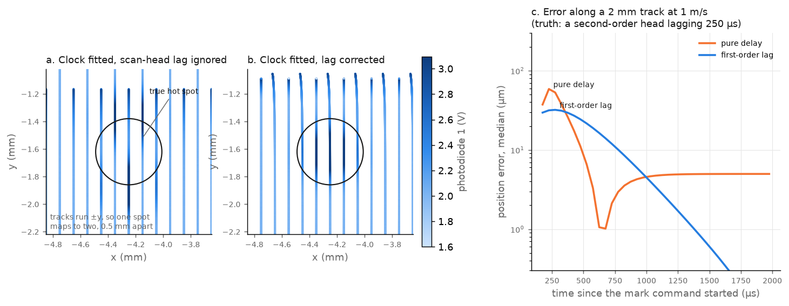

# Monitoring: triggering, timing, wiring, recording and storage (2026-11-25)

[`monitoring.md`](../monitoring.md) proposes the instruments: the layer camera, two coaxial photodiodes, a coaxial camera, a side
high-speed camera, acoustic emission (AE), and "one clock" (its §4 step 1 and §5). This note works out how each one is triggered,
timed, wired, recorded and stored, and how the monitoring can ask for a pause without touching the safety chain. It is part of
issue #260, on the branch stacked on [PR #266](https://github.com/vertical-cloud-lab/digital-alloy-lab/pull/266).

Nothing here is bought, wired or drawn in the model. Vendor documents were read on 2026-11-25, most of them through the lab's
network; each number cites its source (§6). Numbers we assumed say so. The scripts:

| File | What it is |
|---|---|
| [`monitoring-io.csv`](../monitoring-io.csv) | 28 proposed rows (MN-01 to MN-28) in [`electrical-io.csv`](../electrical-io.csv)'s columns: signal, source, destination, connector, cable, length, shielding, feedthrough |
| [`analysis/monitoring/sync/budgets.py`](../analysis/monitoring/sync/budgets.py) → [`timing_budget.md`](../analysis/out/monitoring/sync/timing_budget.md), [`data_budget.md`](../analysis/out/monitoring/sync/data_budget.md) | latency and jitter per path; GB per build for three builds |
| [`analysis/monitoring/sync/lpbf_h5.py`](../analysis/monitoring/sync/lpbf_h5.py) → [`schema_empty.h5`](../analysis/out/monitoring/sync/schema_empty.h5), [`schema.md`](../analysis/out/monitoring/sync/schema.md) | the HDF5 layout as data, an empty file with every group and field, the writer, the reader (`Build.pd_to_xy`) and a NIST-style CSV export |
| [`analysis/monitoring/sync/synthetic_build.py`](../analysis/monitoring/sync/synthetic_build.py) → [`synthetic_build.h5`](../analysis/out/monitoring/sync/synthetic_build.h5) (1.6 MB), [`reader_check.md`](../analysis/out/monitoring/sync/reader_check.md), [`reader_check.png`](../analysis/out/monitoring/sync/reader_check.png) | three synthetic layers with a drifting digitizer, a lagging scan head and a planted hot spot; the reader checked against the truth |

## 0. Short answer

**One master clock, the RTC6's 10 µs tick. Everything else either is fired by it or records one of its signals, so it can be
fitted to it.** What changes the design:

1. **The RTC6 cannot record the photodiodes: it has no analog input.** SCANLAB's comparison table lists two 12-bit analog
   *outputs* and 16-, 8- and 2-bit digital ports, and nothing that samples a voltage. [`electrical-io.csv`](../electrical-io.csv)
   L-16's "RTC6 analog in" can't work. The photodiodes, the AE and a copy of the laser gate go to one digitizer (PicoScope 4444,
   channels A-D, MN-01, MN-13, MN-14, MN-18).
2. **The digitizer's clock drifts against the RTC6's, so fit it every layer.** The PicoScope's timebase is ±50 ppm. Against an
   RTC6 assumed as good, that can be 3 ms over a 30 s layer, or 3.3 mm of beam travel at 1.1 m/s. Record the laser gate (LASERON)
   on channel D. Every gate edge's RTC6 time is known from the job, so a least-squares fit of the recorded edges gives the
   digitizer's offset and rate. On the synthetic build it recovers them to 0.04 µs and 0.8 ppm (§3.6).
3. **Correct for the scan head's lag, or every map is wrong by a melt-pool length or more.** The basiCube 20's tracking error is
   0.25 ms: 100 µm at 0.4 m/s, 275 µm at 1.1 m/s. With serpentine hatching the error flips sign every track, so one hot spot maps
   to two, 0.5 mm apart (figure in §3.6). Corrected and calibrated, the error is ~3 µm (±3 µs at 1.1 m/s).
4. **Fire the cameras from a small trigger generator that the RTC6 gates, not from list commands.** A list command can only change
   an output between vectors. A 536 fps camera needs a pulse every 1.87 ms *inside* a track, which would mean cutting every
   vector into frame-length pieces. Instead the RTC6 sets a "camera window" bit at each imaged mark (a "short" list command, which
   does not break the polygon), and a Raspberry Pi Pico 2 in PB2 sends a burst of frame triggers from that edge (MN-21). Restarting
   at each mark keeps its crystal's drift under ~4 µs.
5. **AE preamps take 28 V on their signal coax; a PicoScope doesn't supply it.** Add a decoupler between preamp and digitizer: the
   Vallen DCPL-24V-V1 (DIN rail, 8-30 V in, 28.5 V out) fits the drawer and runs from the 24 V CTRL rail (MN-18). Keep the preamp
   within ~1 m of the sensor and at ≤ 65 °C (the MISTRAS 2/4/6's rating): on a bracket off the module, not on the rod end, which
   reaches ~75 °C (monitoring.md §5.4).
6. **The Pi 5 records the cameras; the scan PC records the digitizer and the RTC6 log, and keeps the build file.** While
   scanning, the Pi writes ~15 MB/s against a ~500 MB/s NVMe link, and ships each layer's 95-534 MB to the PC in 0.9-4.9 s of the
   8 s recoat. A NIST-class coaxial camera (10 kHz, 144 MB/s) needs a frame grabber in a PC, not the Pi. The scan PC needs a NIC
   of its own for the RTC6, a USB 3.0 port for the digitizer, and ~2 × 4 TB of NVMe.
7. **A build is 20-720 GB with features kept and raw AE only while lasing; 0.23-1.6 TB with everything raw.** Copy each build to
   lab storage when it ends; keep raw data for chosen layers only.
8. **Monitoring adds nothing to the safety chain and can only ask to stop.** A hold at the next layer goes through the Pi
   supervisor. A stop goes to the RTC6 (not safety-rated). For a hazard it can ask the PLC to drop its own process permissive
   (S-12), never to set one. Two safety items: the new cable bulkhead on the guard must stay light-tight, and a *laser-diode*
   side light would be a Class 3B/4 laser and must be interlocked like the main one.
9. **Calibrate with the process laser, not the red guide beam.** The DMSP1000 dichroic reflects 1070 nm into the galvo and
   transmits 400-1000 nm (optics.md §4.5), so most of the IPG's red guide beam (optics.md §4.4) passes straight through it and never
   reaches the galvo; the NB1-K14 laser-line fold mirror may reflect little red as well (not checked). optics.md §4.4 plans to
   align and to measure k with the guide beam, and monitoring.md §2.1 to map heights with it: do the first two before the dichroic
   goes in, and treat the height map as needing another light.

## 1. Timing and triggering

### 1.1 What the RTC6 can output, and when

From SCANLAB's RTC6 brochure and comparison table (11/2026) and, where no RTC6 text was found, the RTC4 manual:

| Feature | RTC6 | What monitoring uses it for |
|---|---|---|
| Clock | **10 µs output period**; the 10 µs clock can be locked to an external n × 100 kHz laser clock | the master time base |
| Laser signals | LASER1, LASER2, LASERON on the 15-pin D-sub, **15 ns resolution, 20 mA**; laser delays in **1/64 µs** | LASERON is the sync reference (MN-01) |
| Digital I/O | **16-bit output and input**, 8-bit output, 2-bit output and input | camera window, layer start, track toggle, Chronos record end (MN-02 to MN-05) |
| Analog | **two 12-bit outputs, 0-10 V**; no analog input | ANALOG OUT1 is the laser's power set point (L-05) |
| List commands | ~8 million list positions; **"short" list commands change outputs "without interrupting polygonal traversal or laser switch-off"** | set a bit at a mark's start without changing the motion |
| Recording | 2 channels × 2²⁴ or 4 × 2²³ values, every n × 10 µs (`set_trigger` family: RTC4 manual p. 117 lists LaserOn, head status, SampleX/Y/Z and the corrected outputs) | the command log, NIST's "XYPT" |
| Data streaming | Ethernet board only: StreamParser reads up to 8 channels "independently of running jobs", RTC6 software ≥ 1.16.3 | the command log, continuously |
| External start and stop | RTC4: /START and /STOP, TTL active low; /STOP held low ≥ 10 µs aborts the list and turns all laser signals off | a non-safety stop request (MN-12) |
| Processing on the fly | two encoder inputs with 32-bit counters | option: count camera frames in the RTC6's own log (to confirm) |

**When an output changes, relative to the vectors.** The list runs in order on the 10 µs clock, and a mark or jump holds the list
until its last 10 µs step has gone out. So a list command can only change an output at a vector boundary: a mark's start, or after
it ends. Hatch tracks are separate marks with jumps between them, so a bit per track costs nothing. Inside a contour (one polygon),
only the "short" commands avoid ending the polygon. Which commands count as "short" is in the RTC6 manual, which we did not have.
LASERON follows the mark's start by LaserOnDelay and its end by LaserOffDelay, set in 1/64 µs steps. Every edge is therefore known
in RTC6 time from the job alone.

**What the log holds.** Record SampleX, SampleY, LaserOn and the output word every 10 µs: x and y as commanded, the gate, and the
bits (MN-24). The basiCube 20 lists "advanced diagnosis options: no", so plan on commanded positions only, shifted by a calibrated
lag (§1.4, §1.5). If it does return actual positions over SL2-100, record them too: SCANLAB's Open Interface Extension advertises
100 kHz position data on the RTC6 Ethernet. **One limit:** the 4-channel buffer holds 2²³ samples, 84 s at 10 µs. A dense L75 layer
at 0.4 m/s scans for ~79 s plus jumps, so it would overflow. Use the stream, two channels (168 s), or read the buffer during the
layer.

### 1.2 How each instrument is fired and time-stamped

| Instrument | Fired by | Mode | Time stamp | Good to |
|---|---|---|---|---|
| RTC6 command log | itself | 10 µs samples | RTC6 tick | exact (it defines time) |
| Laser gate copy (MN-01) | RTC6 LASERON | recorded on the digitizer, channel D | each edge = mark start + LaserOnDelay or mark end + LaserOffDelay | 1/64 µs |
| Photodiodes ×2 (MN-13, MN-14) | free-running digitizer | PicoScope 4444, 14-bit, all four channels sampled together, streamed at 2 MS/s | sample index → RTC6 µs by the per-layer gate-edge fit | ≤ 0.5 µs |
| AE (MN-16 to MN-18) | the same digitizer, channel C | streamed; hits extracted | as above, minus the acoustic path delay | ≤ 0.5 µs + path (3-40 µs, fixed) |
| Coaxial camera, monochrome IMX296 (MN-06, MN-07) | Pico 2 burst, gated by RTC6 bit 0 | external trigger on XTR: 1.8 V, active low; exposure = low pulse + 14.26 µs; frame rate = pulse rate | trigger k of a mark = window edge + set delay + k × period + measured latency; Pi SensorTimestamp only to find dropped frames | ±15 µs until measured |
| Side camera, Chronos 2.1-HD (MN-05, MN-08, MN-09) | Pico 2 → TRIG1 (BNC); RTC6 bit 3 → TRIG3 (isolated) | Exposure Trigger on TRIG1; Record End on TRIG3; Frame Sync Output on TRIG2 | frames counted back from the record-end edge; TIFFs carry the camera's time stamps | ≤ 0.5 µs (Kron) |
| Layer camera, Pi HQ | the Pi, after spreading and after lasing | stills | Pi clock (chrony to the lab's time server) + layer number | ~0.1 s; the scene is static |
| PLC slow channels | the Pi polls Modbus TCP at 1-10 Hz | | Pi clock | ~0.02 s plus the module's filtering |
| Pi clock ↔ RTC6 | RTC6 bit 1 (layer start) on a Pi GPIO | kernel edge time stamp | each layer's t0 tick ↔ UTC | ~0.1 ms (assumed) |

**The Chronos's I/O** (Kron manual 0.7.0 pp. 20-25 and 41; datasheet Rev 5): TRIG1 on the BNC and TRIG2 on the Aux plug are
inputs or outputs; TRIG3 is an isolated input on Aux pins 7 and 8 (Phoenix 1778890 plug). Input thresholds are set from 0 to
6-6.6 V; inputs take 30 V DC/AC, 50 V peak. Debounce samples every 10 ms, so turn it off. In Exposure Trigger mode the pulse
starts each exposure and the camera sets its length; the pulse rate must not exceed the frame rate set in the camera, or frames
drop. In Shutter Gating mode the pulse is the exposure (≥ 1 µs, and each exposure must end at least one frame period after the
last). Frame Sync Output is high while the shutter is open. Kron puts cameras synchronised from an external source "within 500 ns".
At 640 × 96 and 24,046 fps, 32 GB holds 15.5 s, so the Chronos records chosen tracks, not builds.

**The IMX296's trigger** (Raspberry Pi documentation): XTR is a 1.8 V input, so use a divider (1.5 kΩ in series and 1.8 kΩ to
ground from a 3.3 V output, Raspberry Pi's own example). If transistor Q2 is fitted, remove R11 first. Enable the mode with
`echo 1 > /sys/module/imx296/parameters/trigger_mode`, fix the gain and white balance (otherwise frames are dropped while they
settle), and raise libcamera's timeout. The delay and jitter from the XTR edge to the start of exposure are not published.
**Exposure sets the pulse width.** Edison estimates only a few photons per 8 µm pixel in 10 µs at 850 nm from aluminium near its
melting point, and suggests ≥ 50 µs or a 950 nm band ([`r8-coaxial-radiometry`](../edison/r8-coaxial-radiometry/answer.md) §3). A
50 µs exposure smears 55 µm of track at 1.1 m/s, so each frame is labelled at mid-exposure; the view is de-scanned, so the pool
itself stays put in the frame.

**A dedicated AE system instead of the PicoScope's channel C** (a 2 MS/s AE digitizer from MISTRAS or Vallen) powers its
preamps and extracts hits itself, but it runs on its own clock too. Give it the laser gate on a spare channel or a parametric input,
and fit it to the RTC6 the same way. The photodiodes still need the PicoScope.

### 1.3 The trigger generator (MN-21)

- **Why not list commands per frame** (§1.1): they would cut every vector. **Why not free-running cameras:** their frames have no
  tie to the vectors, and the Pi's frame time stamps are taken at readout, after the exposure, with interrupt jitter.
- **What it is:** a Raspberry Pi Pico 2 (RP2350, PIO state machines at 150 MHz) in PB2, powered and read over USB by the Pi.
  - *Inputs:* RTC6 bits 0-2, and the Chronos frame-sync output.
  - *Outputs:* XTR through the divider, Chronos TRIG1 through a 5 V buffer, and the side light's strobe.
  - *Bursts:* at each rising edge of bit 0 it waits a set delay, then pulses at a fixed period until bit 0 falls.
  - *Time-tagger:* it tags every input and output edge with its 150 MHz counter. Bits 0 and 1 have known RTC6 times, so the tags
    map onto the RTC6 clock.
- **Drift:** a ±50 ppm crystal (assumed) over a 70 ms track is ±3.5 µs, which is why it restarts at each mark. A whole-layer window
  would drift up to 1.5 ms in 30 s, and the tags would then have to correct it.
- **Fallback without firmware:** a two-channel function generator in external gated-burst mode gives the triggers but no tags.
- **Later:** lock the RTC6's 10 µs clock to an external n × 100 kHz oscillator (an RTC6 feature) and drive the generator from the
  same oscillator. Frames then fall exactly on the 10 µs grid. The PicoScope can't take an external clock, so its fit stays.

### 1.4 Timing budget

From [`timing_budget.md`](../analysis/out/monitoring/sync/timing_budget.md). A latency is a fixed delay that calibration removes;
the uncertainty is what is left. The position error is uncertainty × speed.

| Path | Element | Latency (µs) | Uncertainty (µs) | At 1.1 m/s (µm) | Source |
|---|---|---:|---:|---:|---|
| Beam | commanded → actual spot, data sheet value | 250 | ±25 (assumed ±10 %) | 27.5 | basiCube 20 page |
| Beam | the same, after the knife-edge test (§1.5) | 250 | ±3 (assumed) | 3.3 | ours |
| Laser | LaserOnDelay (1/64 µs steps) | set | 0.016 | 0.02 | RTC comparison |
| Laser | gate → light | ≤ 12 | ~1 (assumed) | 1.1 | IPG U3 sheet (electrical.md §11) |
| Photodiode | PDA36A2 at 30 dB (260 kHz), group delay | 0.61 | 0.1 | 0.1 | PDA36A table |
| Digitizer | 2 MS/s sample quantisation | 0 | 0.14 | 0.16 | PicoScope 4444 |
| Digitizer | clock against the RTC6, no fit, 30 s layer | 0 | up to 3,000 | 3,300 | ±50 ppm each (RTC6 assumed) |
| Digitizer | clock against the RTC6, per-layer fit | 0 | ≤ 0.5 | 0.55 | synthetic check (§3.6) |
| AE | elastic path: plate and stack / 150-250 mm waveguide | 3 / 39 | 2 / 10 | (time only) | ours / 15 µs per 76.5 mm (Zelenyak, via Edison) |
| Coaxial camera | XTR edge → exposure start | ~15 | ±15 | 16.5 | not published: measure (§1.5) |
| Side camera | Chronos exposure trigger | 0 | 0.5 | 0.55 | Kron |
| Layer camera, PLC, Pi clock | software stills / Modbus / GPIO time stamp | 1e5 / 2e4 / 50 | 5e4 / 1e4 / 50 | (slow) | ours |

**What a photodiode sample's (x, y) is worth:**

| Correction applied | Timing error (µs) | At 0.4 m/s (µm) | At 1.1 m/s (µm) |
|---|---:|---:|---:|
| none: digitizer started on a trigger, nominal rate, lag ignored (worst point of a 30 s layer) | 3,010 | 1,204 | 3,311 |
| clock fit, lag ignored | 250 | 100 | 275 |
| clock fit + lag from the data sheet | 25 | 10 | 27.5 |
| clock fit + lag calibrated | 3 | 1.2 | 3.4 |

**What is needed.** The spot is ~96 µm and crosses its own width in ~87 µs at 1.1 m/s. A quarter of a spot (24 µm) is 22 µs. Only
the last two rows meet that, and only the calibrated one leaves room for the coaxial camera's unknown trigger jitter.

**Static errors are separate from timing.** Taking SCANLAB's drift figures as optical angles (as its scan-angle figure is), the
basiCube 20 at f = 160 mm moves 4.8 µm per kelvin in offset and 6.1 µm per kelvin in gain at the L75 plate's edge. Over 8 h it
drifts up to 16 µm in offset and 9.5 µm in gain, with 0.3 µm repeatability. So repeat the spot grid (§1.5 step 1) at every build
start, after warm-up.

### 1.5 Aligning everything to the commanded (x, y): the calibration routine

| Step | When | What | Gives |
|---|---|---|---|
| 0 | once per correction file | SCANLAB's field correction, checked on a burned grid measured off the machine | the RTC6's mm |
| 1. Spot grid | each build, after warm-up (~1 min) | on a sacrificial plate at the build plane: jump to each point of a 5 × 5 grid (7 × 7 on L75), wait 1 ms, fire a 100 µs pulse at 100-200 W (assumed: enough to melt a dot, so it glows for the filtered coaxial sensors and leaves a mark) with bit 0 set; hold the layer camera's shutter open for the whole grid | the coaxial camera's spot pixel against galvo angle (the lateral colour of monitoring.md §2.2); each photodiode's response across the field (the f-theta's vignetting); the layer camera's long exposure of all the glowing dots, and a still of the marks afterwards (and the side camera, if it sees them), give each camera's plate-to-pixel homography |
| 2. Lag and laser delays | after any tuning or delay change (~2 min) | a step in the melt-pool glow, because the coaxial photodiodes see glow, not reflected 1070 nm (a notch and short-pass, OD 10, block it): a strip of 316L shim on a sacrificial aluminium plate, or a slot milled across one. Scan lines across the step in **both** directions at 0.4, 0.7 and 1.1 m/s at process power, recording photodiode 1. Fit an error function to each crossing | the forward and backward offsets from the commanded crossing time average to the lag + the photodiode delay; half their difference, times the speed, is how far the step is from where it was assumed, so it needn't be known in advance. If the lag changes with speed, use a first-order or second-order model, not a pure delay. Tune LaserOn/OffDelay on SCANLAB's dashed-line test, watching the photodiode for start spikes |
| 3. Camera exposure window | per camera setting (~5 min) | fire short laser pulses at a fixed time on a sacrificial spot; step the generator's delay in 1 µs steps (0.5 µs for the Chronos); plot frame brightness against delay. The photodiode records each pulse's glow, so its length can be taken out | latency from trigger to exposure start and end; the width of the edges is the jitter |
| 4. Digitizer skew | once | one fast edge into all four channels | channel-to-channel skew (the 4444 samples all channels together, so only cables and front ends) |
| 5. AE | each build | 5-10 pencil-lead breaks at marked spots (amplitude within ±3 dB of the baseline: Edison r8); one 100 µs laser shot on a sacrificial spot | coupling (the breaks); path delay and a timing check (the shot, a thermoelastic source at a known time, which the breaks don't have) |
| 6. Every layer, automatically | | clock fit RMS < 1 µs; frames = triggers; RTC6 log without gaps; noise floor with the laser off | flags in `/events` |
| 7. Ratio pyrometer | per optics change | Hooper's lamp in an integrating sphere (optics work) | the two-colour calibration |

## 2. Wiring

### 2.1 Where each box sits

| Place | What | Why there |
|---|---|---|
| **4U drawer** (rack) | Vallen DCPL-24V-V1 AE decoupler (DIN); DIN breakout of the RTC6's digital port; the gate tap on the existing laser-connector breakout (ZL-RTB-DB15); the PicoScope 4444 (190 × 170 × 40 mm), on the drawer floor beside the rails or, if the layout has no room, on a bracket on the rack's side | next to the RTC6 and the scan PC, so USB 3.0 stays short (1.8 m) and in the rack; the analog runs (3 m) are short enough for coax |
| **Scan PC** (rack) | RTC6 Ethernet on a NIC of its own; PicoScope on USB 3.0; build file on NVMe; the monitor process | it owns the RTC6, so it can stop it at once |
| **PB2** (on the bridge) | the Pi 5 (existing), the Pico 2 generator (new), CSI to the layer camera (CAM0) and the coaxial camera (CAM1) | CSI ≤ 0.5 m; the 1.8 V trigger stays 0.4 m long |
| **Coaxial branch** (30 mm cage above the bridge) | the IMX296 board; two PDA36A2s | in the beam path |
| **Left wall, inside the guard** | Chronos 2.1-HD; its light | the left-wall port (monitoring.md §3) |
| **Under the chamber floor** | the AE sensor (waveguide end or rod end); its preamp on a bracket ≤ 1 m away | the preamp must stay ≤ 65 °C (2/4/6) |
| **Guard** | a new monitoring bulkhead plate (MN-28) | where cables leave the guard |
| **Outside the guard** | two Thorlabs LDS12B (±12 V, linear) and the Chronos's adapter, on UPS outlets | mains stays outside; three more of the UPS's eight outlets |

**Power.** The monitoring adds ~50 W to the UPS: two LDS12B and the Chronos's 40 W adapter, against 684 W rated on a 1,500 W
unit. With ENERGY STAR's two points and no low-rate gain (~175 Wh, electrical.md §13.1), the held load of ~113 W lasts ~93 min,
still above the 41 min the L75 plate needs to cool. On the 24 V CTRL rail it adds only the decoupler (≤ 4 W). The Pico 2 runs from
the Pi's USB. **One Pi setting:** on a supply that isn't 5 A USB-PD, the Pi 5 limits USB peripherals to 600 mA (Raspberry Pi
documentation). PB2 feeds it from a DDR-30G-5, so check that limit, and the config.txt setting that lifts it, if USB devices are
added.

### 2.2 Channel map

The full rows, with connectors, are in [`monitoring-io.csv`](../monitoring-io.csv).

| Signal | From → to | Cable, length | Shield and ground |
|---|---|---|---|
| Photodiodes 1, 2 (MN-13, MN-14) | cage → isolated BNC bulkhead → drawer → PicoScope A, B (BNC-to-D9) | double-shielded RG-223 or RG-58, 3 m | shield on the differential **−** input, not the scope's ground; isolated bulkhead; signal duct |
| AE (MN-16 to MN-19) | sensor → preamp (≤ 1 m) → isolated BNC bulkhead → DCPL-24V-V1 → PicoScope C | RG-58, 3 m + 0.5 m | sensor face isolated from the module; decoupler supply floating (Vallen's requirement for the DCPL2); one ground, at the digitizer |
| Laser gate tap (MN-01) | laser-connector breakout → 10 kΩ → PicoScope D | RG-58, 0.5 m | the 10 kΩ keeps a monitoring-side fault from driving the IPG gate |
| RTC6 bits 0-3 (MN-02 to MN-05) | drawer → M12 8-pin bulkhead → PB2; bit 3 on to the Chronos's TRIG3 | shielded 4-pair, 2.5 m | shield at the drawer only; Schmitt receivers; TRIG3 is isolated |
| XTR (MN-06) | Pico 2 → IMX296 | twisted pair, 0.4 m | divider at the camera |
| CSI (MN-07) | IMX296 → Pi CAM1 | FPC ≤ 0.5 m (about 0.29 m straight: check the route) | away from the galvo's supply cable |
| Chronos (MN-08 to MN-11) | TRIG1 ← Pico 2; TRIG2 → Pico 2; Ethernet and power out through the bulkhead | RG-58 1.5 m; Cat6 S/FTP 3 m | |
| RTC6 log (MN-24) | RTC6 → scan PC, own NIC | Cat6 S/FTP, 1 m | not through the machine switch, so camera transfers can't delay it |
| PicoScope (MN-20) | drawer → scan PC | USB 3.0, 1.8 m | in the rack |

### 2.3 Grounds and noise

The noisy neighbours are the ClearPath servos' 48 V bus, the stepper drive, the heater's DC SSR (10.4 A, switched about once a
second), PB1's switched-mode supplies, the blower's drive and the scroll pump's inverter (the pump never runs while lasing). The
rules, on top of electrical.md §7:
1. Photodiode and AE cables run in the signal duct with the thermocouples, not with the 48 V servo, heater or AC cables, and
   cross them at right angles.
2. Each analog chain is grounded once, at the digitizer: differential inputs with the shield on the − input (the 4444 rejects
   60 dB to 1 MHz), isolated BNC bulkheads, an isolated AE sensor face, and a floating decoupler supply. The module's own bonding
   strap stays; the AE sensor must not be the module's ground path.
3. Digital lines are shielded, with the shield grounded at the source end only, and received on Schmitt inputs.
4. Record the noise floor with the blower, pump and servos running and the laser off, at every build (§1.5 step 6). Seleznev's
   gas pump raised AE noise ten-fold, from 0.2 to 2 V. Once, before the first powder, record it source by source (pump, blower,
   recoater, Z servo, the galvos marking a pattern with the laser off, the laser's supply) and then all together, with
   pencil-lead breaks pump off and on (Edison's design review, [`monitoring.md`](../monitoring.md) §10 risk 3). Vallen measured 13-15 dBAE more noise from a switched supply than from a
   linear one on its DCPL2; if the drawer's 24 V does the same, give the decoupler a linear supply.

### 2.4 New connectors and feedthroughs

- **Chamber: no new electrical feedthroughs.** The viewports are optical (other work). An AE waveguide leaving the rod end needs a
  gas seal around the rod and no pins: a bored-through compression fitting or an O-ring gland (MN-27). The rod end is hermetic
  since round 5 (electrical.md §13.3), and the hollow rod is open to the chamber gas.
- **Guard: one bulkhead plate (MN-28)** on the panel nearest the rack: three isolated BNC (two photodiodes, AE), one RJ45 (Chronos),
  one M12 8-pin (RTC6 bits), and a split cable entry for pre-terminated leads (the Chronos's and the LDS12Bs' power). No opening
  gives a line of sight, so the guard stays light-tight. Show it to the LSO.
- **Drawer:** DIN room for the decoupler and for the breakout of the RTC6's digital port (its connector type is to confirm with
  SCANLAB, as electrical.md §12 already says for the laser connector), and a place for the PicoScope.
- **PB2:** a Pico 2 (51 × 21 mm) and a buffer, next to what the Hammond 1554JGY already holds. To check against its layout.

## 3. Data

### 3.1 Rates and volumes per build

From [`data_budget.md`](../analysis/out/monitoring/sync/data_budget.md). Assumed: a 0.1 mm hatch at 1.0 m/s (100 mm²/s), 30 µm
layers, 0.2 s of jumps and an 8 s recoat per layer (heat.md), +10 % for delays, and AE kept 1 h after the build. monitoring.md
§5.3 gives the per-hour rates; this turns them into builds.

| Build | Layers | Lasing per layer | Build time | Baseline (GB) | Everything raw (GB) |
|---|---:|---:|---:|---:|---:|
| B1: S25, 25 % of the plate scanned, 5 mm tall | 167 | 1.3 s | 0.4 h | 20 | 230 |
| B2: M50, 25 %, 10 mm | 333 | 5.0 s | 1.3 h | 70 | 319 |
| B3: L75, 70 %, 25 mm, with the thermal dwell | 833 | 31.6 s | 15.0 h | 722 | 1,632 |

- **Baseline** (monitoring.md §4 steps 1-6): the RTC6 log, photodiodes kept at 200 kS/s, raw AE while lasing and AE hits the rest
  of the time, the coaxial IMX296 at 536 fps while lasing, layer stills (4 × 18.5 MB per layer) and video, and the PLC.
  - In B3 the coaxial camera is 384 GB, the AE 117 GB and the layer video 101 GB of the 722 GB.
- **Everything raw:** all four digitizer channels at 2 MS/s from the start of the build to 1 h after it (922 GB in B3), plus four
  Chronos bursts (128 GB).

### 3.2 What the Pi 5 can take, and what needs the scan PC

| Link | Capacity | Load | Source |
|---|---|---|---|
| Pi 5 NVMe | PCIe Gen 2 ×1 (5 GT/s), ~500 MB/s; Gen 3 possible but "not certified" | ~15 MB/s while scanning (coaxial camera + video) | Raspberry Pi documentation (PCIe); Raspberry Pi's 500 MB/s figure via search |
| Pi 5 cameras | two 22-pin MIPI connectors, all lanes routed: CAM0 layer camera, CAM1 coaxial | HQ 2028 × 1520 at 40 fps; IMX296 128 × 96 at ~536 fps (community measurement) | Raspberry Pi documentation; monitoring.md |
| Pi 5 → scan PC | Gigabit Ethernet, ~110 MB/s (assumed) | 95-534 MB per layer → 0.9-4.9 s of the 8 s recoat | data_budget.md |
| Scan PC ← PicoScope | USB 3.0; SDK streaming to 50 MS/s across channels | 4 × 2 MS/s = 16 MB/s | PicoScope 4444 datasheet |
| Scan PC ← RTC6 | its own Ethernet link | 1.2 MB/s | |
| Scan PC ← Chronos | Gigabit Ethernet | 32 GB per burst ≈ 5 min, so save between bursts or to its eSATA SSD | Kron datasheet |
| NIST-class coaxial camera | 120 × 120 × 8-bit at 10 kHz = 144 MB/s | needs a frame grabber (Camera Link or CoaXPress) in a PC; not on the Pi | Lane & Yeung 2020 |

**Why the digitizer is on the scan PC and not the Pi**, although Pico ships Linux and ARM drivers: it keeps the digitizer next to
the RTC6 log it is fitted to, keeps USB 3.0 inside the rack, and leaves the Pi's four cores for the cameras and the supervisor. A
third CSI camera (the steep lid port) needs a second Pi, because the Pi 5 has two camera connectors.

**The scan PC must have:** a NIC for the RTC6 alone plus one for the machine network; a USB 3.0 port; ~2 × 4 TB NVMe; 32 GB RAM
(assumed); Linux on amd64 for SCANLAB's library (electrical.md §3). None of this is priced here.

### 3.3 Storage

- **During a build:** the Pi writes each layer's camera data to its own NVMe (an M.2 HAT+) and pushes it to the scan PC during the
  recoat. The scan PC writes the build file in HDF5's single-writer, multiple-reader mode, so the monitor can read while it is
  written.
- **After a build:** the scan PC closes the build file (Chronos bursts stay as external files, referenced with their SHA-256),
  writes a manifest of hashes, and copies it all to lab storage (a NAS or BYU research storage) over the dock's Ethernet. It deletes
  its local copy only after the copy's hashes match.
- **What to keep:**
  - for the first builds of a new alloy or parameter set, everything raw;
  - after that, raw data for chosen layers (every tenth, and any layer with an event), and features for all of them: per-track
    photodiode statistics, AE hits with 2 ms snippets, coaxial frames reduced to pool area and intensity. NIST kept raw images
    for one part per layer.
- **Sizes:** a 4 TB drive holds ~5 B3 or ~57 B2 baseline builds. A year of 100 B2-sized builds is ~7 TB, plus a few raw campaigns
  at 0.2-1.6 TB each. Plan lab storage of tens of TB.
- **Compression:** lossless gzip with byte shuffle on every array (the layout's default). Noisy photodiode and AE samples compress
  little. Mostly-dark melt-pool frames and the smooth command log compress well. The 1.6 MB synthetic file is not a fair test.

### 3.4 The HDF5 layout: one file per build

The layout is defined once, as data, in [`lpbf_h5.py`](../analysis/monitoring/sync/lpbf_h5.py). Every field with its type,
units and meaning is listed in [`schema.md`](../analysis/out/monitoring/sync/schema.md). [`schema_empty.h5`](../analysis/out/monitoring/sync/schema_empty.h5)
holds every group, table and array, empty, with a layer template `/layers/_template`.

```
/                    schema, schema_version, build_id, created_utc, writer
/build               per build: run_by, recipe (+ sha256), scan file (+ sha256), alloy, powder lot (NFC tag), plate and module ids,
                     layer thickness, preheat set point, focus offset, spot, field correction file (+ sha256), cover-slide count,
                     start O2 and dew point, power-head reading, software commit, RTC6 software, instrument settings (JSON)
  /parts, /param_sets        parts on the plate; every laser and scanner parameter, including all RTC6 delays
/clocks              the clock domains and how each is tied to the RTC6
/calibration/timing  lag, laser rise, photodiode, gate-tap, AE-path and camera delays (§1.5)
/calibration/geometry          RTC6 mm per bit, coaxial spot pixel, homographies; /spot_grid table
/calibration/radiometry, /ae   bands, gains, dark levels; AE chain, threshold; /plb table (pencil-lead breaks)
/layers/L00001 ...   per layer: z, t0_tick (RTC6), t0_pi_ns and UTC, recoat times, dwell, plate temperature, hatch angle
  /rtc               10 µs rows: x_mm, y_mm, power_W, laser_on, dout (NIST's XYPT plus the output word)
  /tracks            per track: part, kind, parameter set, start and end (RTC6 µs), end points, speed, power, camera flag;
                     features filled after the layer: photodiode mean, std and max, ratio, frames, pool area, AE hits, flag
  /daq               pd1, pd2, ae, gate (int16 counts, volts per count as attributes); fs, clock fit (a, b, RMS, edges)
  /ae_hits           time, amplitude (dBAE), energy, rise, duration, counts, RMS, skewness, kurtosis, label; /ae_snippets raw
  /coax_cam          frames; trigger index, mid-exposure time, exposure, Pi time stamp, track, beam x and y
  /side_cam          Chronos bursts: file, sha256, frames, first-frame time, period, exposure
  /layer_images      after_spread_<light>, after_lasing_<light>, each with exposure, gain, sensor temperature, time
/slow                PLC channels at 1-10 Hz (electrical-io.csv ids in the field notes)
/ae_cooldown         AE hits after the last layer (≥ 1 h)
/events              anomalies, holds, stops, notes: time, layer, source, kind, severity, x, y, message
```

- **Time:** inside a layer, every fast time is µs on the RTC6 clock after that layer's `t0_tick`. UTC comes in through the Pi's
  time stamp of the layer-start bit.
- **Storage settings:** arrays are chunked, gzip-4 with shuffle and a Fletcher-32 checksum. Strings are UTF-8. Every attribute
  and field carries its units and meaning.
- **NIST style:** `export_nist_style()` writes NIST's per-layer `XYPT_L0xxx.csv` (X mm, Y mm, P W, trigger word, one row per
  10 µs) and a `DAQ_L0xxx.txt` per layer, so AMMT tools can read our builds (Lane & Yeung 2020 §4.4 and §5.3).

### 3.5 The reader: a photodiode sample → (x, y, layer)

`Build(path).pd_to_xy(layer, idx)` returns, for digitizer samples `idx`:
1. **RTC6 time:** `t = a + b · idx / fs`, from the layer's clock fit (`fit_clock`). The fit matches the recorded gate edges
   (mid-level crossings, interpolated within a sample) to the commanded ones (track start + LaserOnDelay, end + LaserOffDelay),
   growing the match window as it goes so a 100 ppm drift is followed. It then subtracts the photodiode's delay.
2. **Beam position at that time:** from the 10 µs commanded log through a model of the scan head. `lag1` is a first-order lag
   with time constant τ, which lags exactly τ at constant speed (SCANLAB's definition of tracking error). `delay` is a pure
   shift by τ.
3. **Track, laser state, layer, z:** the track whose commanded interval contains t − τ; whether the gate was on at the emission
   time; and the layer group's layer and z.

`Build.frames_check(layer)` rebuilds the trigger generator's schedule from the track table and its settings. It then matches each
coaxial frame's Pi time stamp to that schedule and lists the triggers that produced no frame.

### 3.6 The synthetic check

[`synthetic_build.py`](../analysis/monitoring/sync/synthetic_build.py) writes three layers in the layout and then checks the reader
against the simulation's truth ([`reader_check.md`](../analysis/out/monitoring/sync/reader_check.md)). What it simulates:
- three 2 × 2 mm squares per layer on an S25 plate, serpentine hatch at 1 m/s, scanned along x and y in alternate layers;
- a scan head that is a critically damped second-order system lagging 250 µs at constant speed. The reader is not told this model;
- a digitizer at 500 kS/s (smaller than 2 MS/s, for file size), started 1.23 ms early and running 73 ppm fast;
- a planted hot spot in layer 2;
- coaxial frames with random trigger jitter, and one dropped frame in layer 3.

| Mapping (layer 2, every lasing sample) | Median error (µm) | 95th percentile (µm) | At speed: median / 95th (µm) | Hot spot found off by (µm) | Its spread along the scan (µm) |
|---|---:|---:|---|---:|---:|
| first gate edge only, nominal rate, lag ignored | 257 | 265 | 261 / 266 | 40 | 261 |
| clock fit, lag ignored | 254 | 255 | 255 / 255 | 40 | 259 |
| clock fit + pure 250 µs delay | 5.0 | 53 | 4.9 / 5.0 | 2.5 | 68 |
| clock fit + first-order lag, 250 µs | 4.5 | 32 | 0.6 / 3.7 | 2.2 | 66 |

- **The clock fit** used 120 gate edges. It recovered the offset to 0.04 µs and the rate to 0.8 ppm, with 0.48 µs RMS per edge
  (the 2 µs sample spacing). In a 0.17 s layer the drift alone is only 12 µm, which is why the first row barely differs from the
  second. In a 30 s layer it would be 2-3 mm (§1.4).
- **The lag** is the large term. Uncorrected, the three tracks that cross the hot spot put it in two places 0.5 mm apart: its
  spread along the scan is 260 µm against its true ~66 µm.
- **The model** matters only near the start and end of each track, where the head accelerates. The pure delay also keeps a 5 µm
  offset, half a 10 µs tick: the RTC6 holds each command for a tick, while the reader interpolates between them. Calibration
  (§1.5 step 2) absorbs both.
- **The rest of the pipeline:** the frame check found the dropped frame. The per-track features and an anomaly event 2 µm from the
  planted spot were written back into the file.



*Layer 2 of the synthetic build. (a) and (b): photodiode 1 at each sample's mapped position near the planted hot spot (circle,
2σ). (c): median position error against time since the mark command started, for the two lag models the reader offers; the truth
is a second-order head.*

## 4. Interlocks: what monitoring touches, and how it asks for a pause

### 4.1 Rule
electrical.md §4: the safety controller owns every final element; the PLC, the Pi and the RTC6 only request. Monitoring is one more
requester. **It adds no safety input or output, it can only ask to stop, and its failure (a crashed PC, a pulled cable) must not
stop a build** unless the recipe requires monitoring. In that case the supervisor holds at the next layer when the monitor's
heartbeat stops.

### 4.2 Where monitoring touches the safety design

| Touch point | What it means | What to do |
|---|---|---|
| The guard (the Class 1 enclosure) | the cameras, coaxial branch, AE preamp and PB2 sit inside it; their cables must leave it | one light-tight bulkhead plate (MN-28); panels to reach cameras fastened with tools or interlocked; adjust cameras only with the laser off; any adjustment with the guard open and the laser on is alignment work under the LSO's SOP |
| Viewports | part of the gas boundary, not the laser boundary (the guard is) | a cracked window is an O₂ problem, which the PLC's O₂ permissive catches; blank plates when unused; feed the window purge downstream of the normally closed argon valves (G-07, G-08) so it shuts with them |
| The coaxial branch | in the beam path; the dichroic passes up to 10 % of back-reflected 1070 nm (optics.md §4.5) | the notch and short-pass filters (OD 10) protect the sensors; the cage is part of the beam enclosure, so close it with tubes or covers (optics work) |
| The side light | an 808/850 nm laser diode is Class 3B/4 | wire its enable through the laser chain (a K4/K5 auxiliary contact or a spare XS26 output) and add it to the SOP; an LED light avoids this |
| Power and pins | | monitoring takes nothing from safety-switched rails; no chamber feedthrough; the waveguide seal is mechanical |
| The robot | the UR12e reaches in through the guard opening | cameras and cables must stay out of its path (to check in the model) |

### 4.3 Asking for a pause

| Severity | What the monitor sees (examples) | Path | Latency |
|---|---|---|---|
| 0, 1: note, flag | a photodiode outlier, an AE hit | `/events` only | none |
| 2: hold at the next layer | many flags in a layer; a short feed seen in the layer image | monitor → Pi supervisor (REST) → the next layer's list isn't released (the thermal dwell already works this way); a person releases it or aborts | ≤ one layer |
| 3: stop now | sustained keyhole-like signal, spatter on the slide | the scan PC stops the RTC6 list (it owns the connection); a Pi-side monitor can pull /STOP low through MN-12 | ~10-100 ms in software (assumed); /STOP ≥ 10 µs |
| 4: hazard | glow on the photodiodes after the laser is off (possible fire), with the O₂ and pressure already in the safety chain | a request bit to the PLC over Modbus. The PLC may drop its own process permissive (S-12), which opens the laser loop through the safety controller and needs a manual reset | PLC scan + ≤ 500 ms (the laser loop's response, electrical-io.csv L-02) |

A stop (severity 3) ends the list and turns the laser signals off. The galvo stays powered and the laser loop stays closed. The
supervisor then aborts the build, or skips to the next layer: resuming mid-layer is not sensible. Nothing in this table can set a
permissive, reset the safety controller, or open the guard.

## 5. Not done, or open

- **No RTC6 manual.** The I/O counts, recording sizes, streaming and clock lock come from SCANLAB's 11/2026 brochures. The command
  names, /STOP and the measurement signals come from the RTC4 manual. To confirm with SCANLAB:
  - the digital port's connector type, levels and drive;
  - which list commands are "short";
  - whether `set_trigger4` or the stream can record the 16-bit input port or the encoder counters;
  - the StreamParser's channels and rates;
  - where /STOP is on the RTC6.
- **The basiCube 20's returns** over SL2-100 are unknown ("advanced diagnosis: no"), so this plan uses commanded positions shifted
  by a calibrated lag.
- **Not published, so to measure:** the IMX296's trigger-to-exposure delay and jitter, and its frame rate at 128 × 96 in trigger
  mode (536 fps was measured free-running by the community); the Chronos frame-sync output's voltage; the PDA36A2's own bandwidth
  table (the PDA36A's was used); the LDS12B's output grounding.
- **Not checked:** the PicoScope 4444 streaming 8 MS/s for hours on Linux, and the wiring of its BNC-to-D9 adapter; the Vallen
  decoupler with a MISTRAS 2/4/6 (current draw); the guard's actual cable entries; room in the drawer and in PB2.
- **Not written:** the Pico 2 firmware (PIO bursts and tags), the monitor's anomaly rules, the supervisor's hold and heartbeat.
- **Not priced, and nothing added to bom.csv:** the Pico 2, the Vallen DCPL-24V-V1 (quote), a second LDS12B, the bulkhead plate,
  the NVMe drives, an M.2 HAT+ and lab storage. The PicoScope's $2,485 is in monitoring.md §4.
- **Not drawn:** the bulkhead plate, the Pico 2 in PB2, the drawer's new parts, any cable route.
- **The synthetic build tests the code and the method, not hardware.** The second-order head, the photodiode model, the noise and
  the AE are assumptions.
- **EMI and ground loops** are not simulated (rules only, §2.3). The data volumes assume 100 mm²/s; compression on real data is
  not measured.
- **The guide-beam point (§0 item 9)** rests on the DMSP1000's transmission band as optics.md gives it, and on the U3's guide being
  red (optics.md §4.4: 0.1-1 mW, red); the dichroic's and the fold mirror's reflectance in the red are not checked.

**Changes this note implies in files it doesn't own** (not made here):
- [`electrical-io.csv`](../electrical-io.csv): L-16's controller becomes the PicoScope 4444, channel A (MN-13); merge MN-01 to
  MN-28 from [`monitoring-io.csv`](../monitoring-io.csv).
- [`electrical.md`](../electrical.md) §1.4:
  - the drawer gains the AE decoupler, a breakout for the RTC6's digital port and the PicoScope;
  - PB2 gains the Pico 2;
  - the scan PC gains a NIC for the RTC6 alone and ~2 × 4 TB of NVMe.
- [`monitoring.md`](../monitoring.md):
  - §0 item 4 and §5.1: the sync reference is the laser gate, fitted every layer, plus the camera-window and layer-start bits;
    positions are shifted by a calibrated lag;
  - §2.1: the guide-beam height map (§0 item 9 here).
- [`optics.md`](../optics.md) §4.4: aligning and measuring k with the guide beam has to happen before the DMSP1000 goes in.
- [`cad/monitoring_spec.py`](../cad/monitoring_spec.py) `DAQ`:
  - `where` is the 4U drawer;
  - the "RTC6 layer-start / sync" signal is the laser-gate tap (MN-01);
  - add the AE decoupler and the trigger generator.
- The model: the guard bulkhead plate (MN-28), the AE preamp's bracket, the waveguide's seal at the rod end (MN-27), and the
  contents of the drawer and PB2.

## 6. Sources

- SCANLAB, *RTC6* brochure and *RTC Comparison* table (both 11/2026): 10 µs output period, external clock lock, laser signals at
  15 ns and 20 mA, 16/8/2-bit digital ports, two 12-bit analog outputs, "short" list commands, recording 2 × 2²⁴ / 4 × 2²³,
  laser delays in 1/64 µs, data streaming on the Ethernet board only. https://www.scanlab.de/sites/default/files/2026-11/SCANLAB-RTC6-EN.pdf ,
  https://www.scanlab.de/sites/default/files/2026-11/SCANLAB-RTC-Comparison-EN.pdf
- SCANLAB, *RTC6 EtherBox* brochure (DIN rail, 12-30 V supply): https://www.scanlab.de/sites/default/files/2026-11/SCANLAB-RTC6-EtherBox-EN.pdf
- SCANLAB, StreamParser page (up to 8 channels, RTC6 software ≥ 1.16.3): https://www.scanlab.de/en/products/software/streamparser ;
  RTC control boards page: https://www.scanlab.de/en/products/control-electronics/rtc6 ; Open Interface Extension (100 kHz position
  data on the Ethernet board), via search
- SCANLAB, basiCube 20 page (tracking error 0.25 ms, step 0.58 ms at 10 mrad, drift and repeatability, SL2-100, no advanced
  diagnosis): https://www.scanlab.de/en/basicube-20
- SCANLAB, *RTC 4 Installation and Operation Manual*: /START and /STOP (p. 13), `set_trigger` (p. 117), `write_io_port` (EXTENSION 1).
  ManualsLib copy: https://www.manualslib.com/manual/1581336/Scanlab-Rtc-4.html
- Raspberry Pi documentation:
  - external trigger on the Global Shutter Camera (XTR 1.8 V, exposure = low pulse + 14.26 µs, R11, `trigger_mode`):
    https://www.raspberrypi.com/documentation/accessories/camera.html (source: github.com/raspberrypi/documentation,
    `accessories/camera/global-shutter-camera.adoc`);
  - PCIe Gen 2 ×1 and the uncertified Gen 3 (`computers/raspberry-pi/pcie.adoc`);
  - USB current limit (`usb-bus-on-raspberry-pi.adoc`);
  - CSI-2 lanes (`accessories/camera/csi-2-usage.adoc`).
- Raspberry Pi, "~500 MB/s" for the Pi 5's PCIe connector, via search (Raspberry Pi's *Double standards* article and Jeff
  Geerling's tests)
- Kron Technologies, Chronos 2.1-HD datasheet Rev 5: https://manuals.krontech.ca/chronos-2-1/FM-ENGR-50002-Chronos-2.1-HD-Datasheet-Rev5.pdf ;
  user manual, software 0.7.0, pp. 20-25 and 41 (a third-party copy of Kron's manual):
  https://makerhub.georgefox.edu/w/images/6/6f/RE-PDEV-10009-Chronos-User-Manual-Full-Software-Version-0.7.0.pdf ;
  *Triggering & Synchronizing Multiple Chronos Cameras* rev 0.1.0: https://assets.krontech.ca/2023/09/Triggering-and-Synchronizing-Multiple-Chronos-Cameras.pdf
- Pico Technology, PicoScope 4444 datasheet (Chinese edition; 14-bit at 50 MS/s, streaming 10 MS/s in PicoScope 6 and 50 MS/s
  through the SDK, ±50 ppm, simultaneous sampling, 1 MΩ ∥ 17.5 pF, 60 dB CMRR, D9 inputs, Linux and ARM drivers):
  https://www.farnell.com/datasheets/2265799.pdf
- MISTRAS, 2/4/6 preamplifier data sheet (20/40/60 dB, 18-28 V over the output BNC, 10 kHz-2.0 MHz at 40 dB, 20 Vpp into 50 Ω,
  -40 to +65 °C): https://cse.sc.edu/~adowney2/resources/data_sheets/mistras_2-4-6_Preampliflier_Product_Data_Sheet.pdf
- Vallen Systeme, AEP5 data sheet (34/40 dB, 28 V over the signal cable, 1.8 W, -20 to +85 °C): https://www.vallen.de/zdownload/DataSheets/Preamp/Datasheet_AEP5.pdf ;
  accessories specification §6 (DCPL2, PS4DCPL-V1 noise, DCPL-24V-V1: 8-30 V in, 28.5 V out, ≥ 10 kΩ load, ≤ 5 m to the ADC):
  https://www.vallen.de/zdownload/pdf/acc.pdf
- Thorlabs, PDA36A user guide (Rev E, 2017): bandwidth against gain (260 kHz at 30 dB, 150 kHz at 40 dB, 45 kHz at 50 dB), via
  search; the PDA36A2's own table was not read
- Lane, B., Yeung, H. (2020). Process monitoring dataset from the AMMT: overhang part X4. J. Res. NIST 125:125027.
  https://doi.org/10.6028/jres.125.027 (§4.4 XYPT files, §5.1 camera, §5.3 DAQ files; read 2026-11-25)
- Seleznev, M. et al. (2022). In situ detection of cracks during LPBF using acoustic emission monitoring. Addit. Manuf. Lett.
  3:100099. https://doi.org/10.1016/j.addlet.2022.100099 (via [`edison/r8-ae-waveguide`](../edison/r8-ae-waveguide/answer.md))
- Zelenyak, A.-M., Hamstad, M., Sause, M. (2015). Modeling of acoustic emission signal propagation in waveguides. Sensors
  15:11805. https://doi.org/10.3390/s150511805 (via Edison r8-ae-waveguide)
- Edison r8 answers in this repo: [`r8-ae-waveguide`](../edison/r8-ae-waveguide/answer.md) (AE chain, pencil-lead breaks ±3 dB),
  [`r8-coaxial-radiometry`](../edison/r8-coaxial-radiometry/answer.md) (exposures and bands for aluminium)
