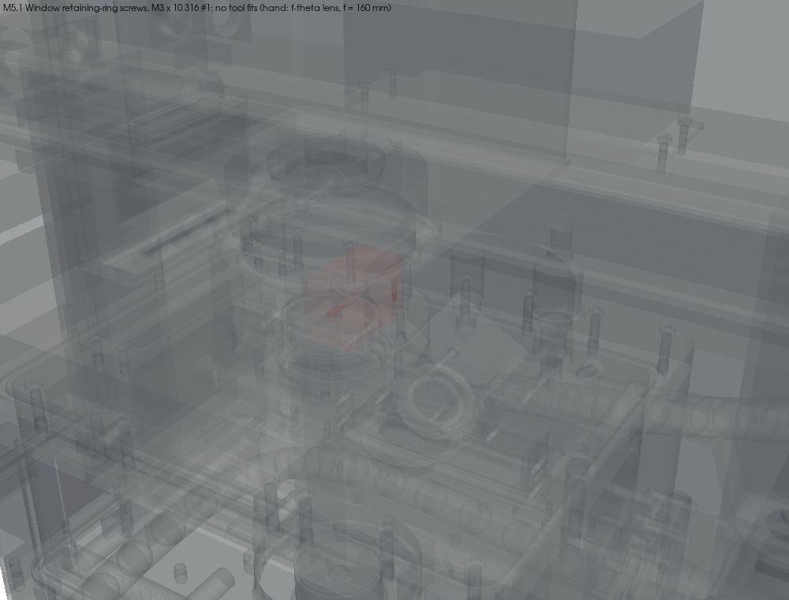
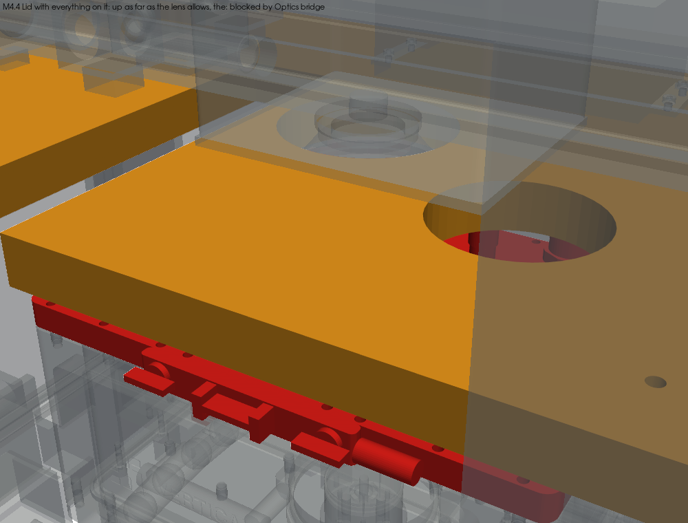
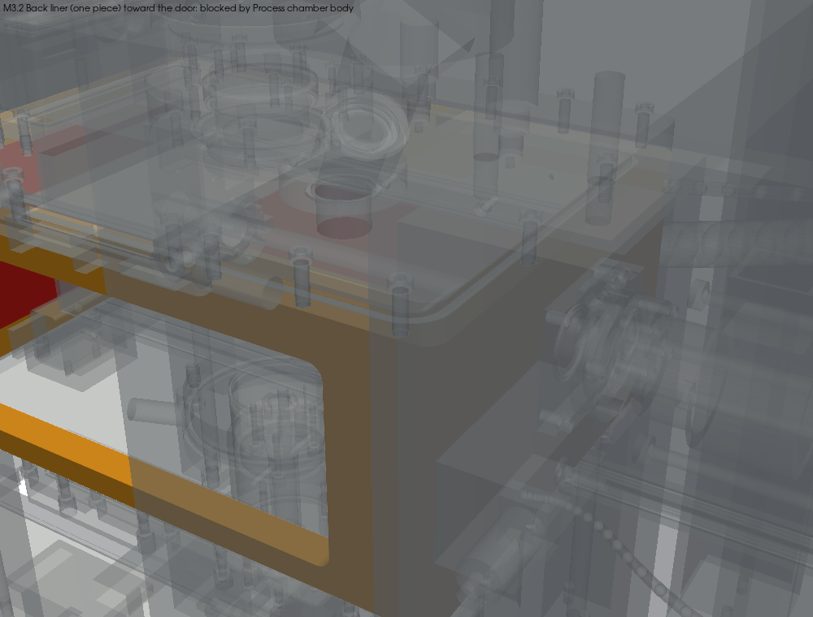
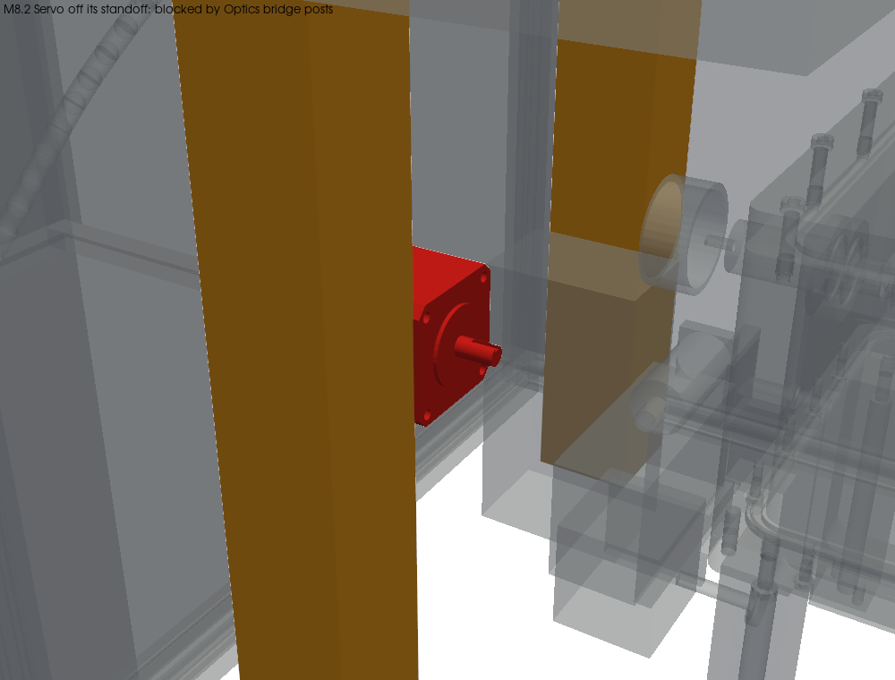

# Every hand operation, simulated step by step: assembly, use, maintenance, swap-outs

Written 2026-11-20 for [PR #266](https://github.com/vertical-cloud-lab/digital-alloy-lab/pull/266) (issue #260), in answer to
"simulate every step of every assembly, usage, maintenance, swap out, etc. type of operation" before anything is bought.
This note covers what a person does. Automated operations (the build loop, robot plate and reservoir handling) are
covered separately. Nothing has been built or tried on a mock-up.

> **Update 2026-11-23 (round 5, access fixes): U1.1, U2.2, M3.2 and M8.4 now pass.** U1, U2, M3 and M8 re-run on M50: 12 pass /
> 0 warn / 3 fail, against 3 / 0 / 7 in round 4 ([`results-M50-a2.md`](analysis/out/ops/results-M50-a2.md); M3 is now six removal
> steps instead of one; the full run in `results-M50.md` is from round 4 and was not repeated). The three fails left are M8.1-M8.3,
> the recoater servo. What changed:
> - **Reservoir pull tab (U1.1, passes).** The lid's 8 × 10 mm handle fin (z 248–258) ran under the enclosed beam tube
>   (y −35.25 to −15.25, z 262.7–282.7). A 6061 tab now carries the same fin 70 mm forward, to y −100, at the same height for S, M
>   and L. A hand pinches it 50–65 mm in front of the tube, with the forearm over the optics bridge (forearm bottom z 239.5, bridge
>   top 232.7). This is not the base-plate tab tried in round 4, which left the forearm between the lid and the bridge. The robot's
>   reservoir job now grips the tab too (robot-ops.md).
> - **Liners (M3.2, passes in six steps, tightest 0.36 mm).** Six parts. The side liners have their Ø22 ball-screw holes slotted
>   open to the back edge, are 15 mm shorter at the front and 88 mm tall (z 16–104; the door opening is 92 mm). Each steps 4 mm in
>   off the wall, slides 21 mm forward off the screw, moves in to x ±105, drops 6 mm and comes out through the door. The LED bar
>   moved from the right wall to the lid's underside (x 126–134, z 112–120), where it no longer traps the right liner; it now lights
>   the layer from ~40° instead of ~10°, which a recoat-defect camera may not like (not checked). The back liner is two bands behind
>   the ball screw, each split at x = 0: upper z 48–72 (between the screw, z ≤ 46, and the rail, z ≥ 74.5) and lower z 16–32. A
>   one-piece or full-height back liner can't pass the screw, which runs the chamber's width 16 mm in front of it. So the back wall
>   from z 32 to 48, behind the screw, is no longer lined. Each half comes forward with the recoater at the other end of its stroke
>   (the step now sets the recoater: `run_ops.py` takes a per-step state).
> - **Draw latches (U2.2).** Both 1807A61 latches sit on 6061 brackets bolted to the door's ears and point forward, so the levers
>   are at y −207 with the door shut, in front of the front-right optics post (y −185 to −125). The strikes moved to the chamber's
>   side faces (y −100 to −72). The pull is still straight back at the seal's centroid height (z 54), at x ±158. The ears now end at
>   x ±146 (were ±156). The latch cylinders ride on the brackets. **U2.2 passes**: the hand comes in from the front-left at 30° (approach
>   (−0.5, −0.85, 0)), with the door shut and the guard door at its full 515 mm. At the 470 mm the operation used before, the guard
>   door's left edge (x 140) is in front of the right latch, so a person opens it fully. U2.3 (left latch) passes from the front. The
>   right latch clears the post by 2.25 mm; in the door sweep a bracket passes 2.15 mm from the closed guard door's window (55°).
> - **Ferrotec feedthrough out to the front (M8.4).** With the left latch off the left side face, the unit and its coupling come
>   out 45 mm sideways (was 30), then forward. **M8.4 passes** (tightest 0.3 mm, to the ball screw). M8.1-M8.3 (the servo against
>   the front-left post and the bridge) still fail, as before: those need the bridge changes.
> - **Blade cartridge** (robot-ops.md patch 5): the holder sits in the arm's pocket on two Ø3 × 10 316 dowels (McMaster 93600A304)
>   and is held by two M6 ball plungers (85015A47) in the pocket's walls, so it comes out with a 40 N pull and no screwdriver. M2 (the
>   blade off the holder on the bench) is unchanged and was not re-run.
> - **Locating pins** (assembly.md patch 9): two Ø3 × 10 dowels each on the inlet plenum, the vacuum-port adapter and the bearing
>   cap, pressed into the frame's walls (six new Ø3 H7 holes in the frame: back wall at x ±71, z 13.25; right wall at y 0,
>   z 47 / 93 and at y 56 / 88, z 40).
>
> **Still failing every build: only the overflow jar (U4.5, U4.7).**
>
> **Update 2026-11-22 (round 4): M50 now 82 pass / 2 warn / 37 fail** (was 81 / 2 / 40 on 9c67f44), re-run on the model with
> the module's robot grip block and the 12U rack ([`results-M50.md`](analysis/out/ops/results-M50.md)). Three fails are gone:
> - **The gland plate and its rod O-rings are no longer trapped (M7.2).** The rod end stays welded. The gland plate comes out of
>   the bottom of the bore together with the heater stack and the rod (M7.2, passes, 0.15 mm). Then, on the bench, the two rod set
>   screws come out and the rod slides down out of the head and through the gland plate. The rod's top end is a plain Ø15.875
>   tube end in the gland's Ø15.93 throat.
> - **A1 assembles in the matching order and passes all 18 checked steps** (was 17 / 1). The gland plate goes onto the rod's top
>   end, the rod into the head, and the whole stack into the bore from below. So the rod end can be welded by the shop on the bare
>   rod, away from every O-ring. The old A1.20 (the welded end treated as a slide-on part) and M7.3 (the connector's O-ring left
>   out of the move) were errors in my list, and both are gone.
> - **S2.3:** the hand takes the module by the new grip block in front of the door (passes). S2.4, the swap path, still passes at
>   0.1 mm.
>
> **Tried and reverted:** a pull tab on the front of the reservoir's base plate for U1.1. The forearm still meets the optics
> bridge: there are 72 mm between the lid and the bridge, for a 65 mm forearm. U1.1 stays a fail; the robot takes the reservoir
> by the lid's fin and passes.
>
> **S25 and L75** (S1-S3, U1, U4) re-run on the same model: 8 pass / 0 warn / 3 fail each, as before (U1.1 and the overflow
> jar's U4.5 and U4.7). The hand takes the grip block on both (S2.3 passes); the block is in the same place on every module.
> **Still failing every build:** the overflow jar (U4.5, U4.7), the right draw latch (U2.2) and the reservoir's handle (U1.1).

**Results are for the final model at commit 9e6464a.** That model has the seal fixes (70779c5) and the real-part swaps
(17cac94): the guard door slides 515 mm, the draw latches are on the chamber's side faces, the rod end is welded with a
hermetic connector, the shaft seals are Ferrotec magnetic-fluid feedthroughs, the galvo is a basiCube 20 on a riser, the
rack is 11U and the guard is wider. An earlier run on the 13:54 model is in ea08af8.

## Short answer

- **21 operations, 160 steps, run on the M50 machine:**

  | Result | Steps |
  |---|---|
  | Pass | 78 |
  | Pass only with a plain hex key where a torque tool was wanted | 1 |
  | Fail | 40 |
  | No geometry to check (waiting, glovebox work, parts welded or placed by hand) | 41 |

  The 120 screws driven during assembly were each checked with real tools: a torque screwdriver, a T-handle and ISO 2936 /
  Bondhus hex keys, with a hand on each. Three of the 40 fails come from mistakes in my operation list, not the design
  (A1.20, M5.3, M7.3, below).
- **Three things done every build don't work as drawn:**
  1. **The overflow jar can't come out (U4.7).** After the clamp comes off it can drop only 10 mm before it reaches the
     base plate. Then the outlet plenum, its KF-25 port, the front-right leg, the jar sensor, the build module and the guard
     box it in. Fingers can't reach its clamp either (U4.5). The same on S25, M50 and L75.
  2. **The right draw latch can't be reached (U2.2).** The 515 mm guard-door travel fixed the old problem (the door
     covering the opening). But the latch now sits on the chamber's right side face, right behind the front-right optics
     post (x 180-240, y −185 to −125). The left latch passes.
  3. **New: no hand can reach the reservoir's handle from the front (U1.1).** The enclosed beam tube, moved onto the galvo's
     real axis, is in the way. The reservoir itself still slides out, with 0.85 mm to spare (U1.2).
- **Opening the window or the lid still means taking out the scan head:**
  - The window's six retaining-ring screws are under the f-theta lens, and no key fits (M5.1).
  - The lens can't come down past the window ring: it meets it after 20 mm (M6.1).
  - The galvo, now a basiCube 20 on a 10 mm riser, is 4 mm under the guard's top panel (M6.2). It was 26 mm before.
  - The lid can't slide out (M4.4). The dose chute hangs 83 mm into the chamber, and the pressure transducer meets the
    bridge after ~8 mm of lift. New: the manual vacuum valve stops the lid after 31 mm of forward travel.
- **Parts that are still trapped:**
  - The side liners are threaded onto the ball screw, and the back liner sits behind the carriage block (M3.2).
  - The gland plate and its two rod O-rings are trapped on the rod. The rod is now welded into a Ø22 end cap, and the
    plate's rod bore is Ø16 (M7.2). The hermetic connector does mean the heater and thermocouple leads now unplug instead
    of being potted.
  - The recoater servo can't come out past the front-left optics post (M8.2, M8.3). New: the left side draw latch blocks
    the Ferrotec feedthrough's way out to the front (M8.4).
  - The dosing stepper and roller feedthrough are boxed in by the bridge, the guard's back panel and the docked sensor (M9).
  - One lid screw (#4) is now under the roller feedthrough and coupling (M4.3). Two metering-base screws are under the
    roller feedthrough (A2.45).
- **The assembly order needs the same changes as before** (A2 below). There is now one more: the f-theta lens threads into
  an adapter ring under the bridge. Put the lens and ring under the bridge on the bench, then lower the bridge onto its
  posts. The lens can't go in from below once the window is on: it hits the window ring after 20 mm.
- **What works:**

  | Job | Tightest gap | Machines checked |
  |---|---|---|
  | Module swap | 0.1 mm, at the spigot | S25, M50 and L75; L75 now passes, since the path lifts at y −158 |
  | Plate swap: turn 60°, lift 20 mm, out over the door sill | 2.0 mm | all three |
  | Cover-slide drawer, with its new quarter-turn latches | 0.3 mm | M50 |
  | Blade swap, 2.5 mm key inserted by its long arm | 0.05 mm (blade over the sill) | M50 |
  | Reservoir slide-out, S, M and L | 0.85 mm | all three |
  | HEPA element, straight up | clear | M50 |
  | Left draw latch | clear | M50 |
  | Bench assembly of the build module | all but the welded rod end | M50 |
- **Time:** each build needs ~2.5 h of a person's time and waiting, besides the build itself:
  - ~50 min to load and start, including the purge and preheat;
  - ~1.5 h to finish, including the ~50 min cool-down;
  - ~10 min for the cover-slide check.

  Every operation that opens the chamber costs ~15 min of purge. Seal work adds a 1 h leak-up check.

## How it was checked

Scripts are in [`analysis/ops/`](analysis/ops/), and results in [`analysis/out/ops/`](analysis/out/ops/), including the full
per-step table [`results-M50.md`](analysis/out/ops/results-M50.md) and the JSON. The model is `cad/lpbf_low.py` at 9e6464a:
209 parts, 374 objects once each joint fastener is split out. The cad folder is an argument, so the checks re-run on any
model version.

- **Catalogue** ([`operations.py`](analysis/ops/operations.py)). There are 21 operations:
  - assembly: two, the build module on the bench and the process module in render_build's order, with the new bolted
    plenums, funnel, vacuum-port adapter and bearing cap;
  - use: four;
  - maintenance: twelve;
  - swap-outs: three.
  Each step has the machine state (door, guard door, piston, recoater, Z arm), the parts present at that moment,
  whether it opens the chamber to air, a rough time, and an interval where the notes give one.
- **Part paths** ([`checks.py`](analysis/ops/checks.py)). Each part is checked by assembly-by-disassembly: it must be able to
  leave, against the parts present at its step, along the animation's line or the documented path. When that line is
  blocked, the script tries the six axis directions, then two-leg paths (10 or 30 mm along one axis, then out along
  another). Three layers decide a collision:
  1. FCL finds touching pairs;
  2. manifold3d measures their shared volume;
  3. OpenCascade's exact boolean confirms anything over 0.5 mm³.
  "Gap" is the smallest FCL distance along the path, good to about 0.1 mm.
- **Tools** ([`tools.py`](analysis/ops/tools.py)). Each tool sits on the screw's axis, engaged 0.6 s deep in the socket. Its
  hand envelope is attached and it turns in 15° steps:
  - keys and T-handles pass with a free arc of at least 60°;
  - the ball-end key may also tilt 15° or 25°;
  - the torque screwdriver must fit at all.
  Each screw is also checked for withdrawal: its head has to come straight out over its full length.
- **Reach.** For jobs done by hand, a flat hand or a two-finger pinch sits at the point, with a 90 × 65 mm forearm
  running straight back toward the person.

Tool and hand dimensions (all pages read 2026-11-20 UTC):

| Tool | Model | Source |
|---|---|---|
| Hex key, short arm in / long arm in | ISO 2936 L1 standard 52, 58.5, 66, 74, 85 and long 77, 87.5, 93, 104, 120; L2 18, 20.5, 23, 29, 33 (s = 2, 2.5, 3, 4, 5) | ISO 2936:2014 Table 1, [public preview](https://cdn.standards.iteh.ai/samples/60231/7332b2e7eb6c448b9f8ca6c6ed518206/ISO-2936-2014.pdf), 13:56; matches [fasten.it](https://fasten.it/en/norms/norm/din_iso_2936) |
| Ball-end key | Bondhus 10952 / 10954 / 10956 / 10960 / 10964: 82 / 88 / 98 / 110 / 119 × 16 / 17 / 19 / 22 / 27, up to 25° | [bondhus.com ball end](https://bondhus.com/pages/ball-end), 13:57 |
| T-handle key | Wera 454 / 454 HF: 100 shaft; bar 65 / 77 / 77 / 99 wide, 32-49 along the axis, 15-22 thick | [Wera 454](https://www.wera.de/en/tools/454-t-handle-hexagon-screwdriver-hex-plus), [454 HF](https://www.wera.de/en/tools/454-hf-t-handle-hexagon-screwdriver-hex-plus-with-holding-function), 13:59 |
| Torque screwdriver | Wera 7441 class (1.2-3.0 N·m): 105 handle and ~50 chuck (155 overall), with a Wera 840/4 Z 50 mm bit showing 35. Handle Ø40 and chuck Ø16 **assumed** (Wera doesn't list them; Wiha TorqueVario-S handles are Ø36-41) | [Wera 7400 series](https://www.wera.de/en/tools/series-7400-kraftform-adjustable-torque-screwdrivers-01-30-nm-with-rapidaptor-quick-release-chuck), [840/4 Z](https://www.wera.de/en/tools/840-4-z-bits), 13:59-14:01; [Wiha](https://digicat.wiha.com/au/en/detail/3a5538c206cfe3fc09878949b14abb10), 14:00 |
| Hands | Flat hand 100 × 55; pinch 46 × 25; a 90 mm cylinder round a screwdriver handle; forearm 90 × 65 (**assumed**) | MIL-STD-1472H Fig. 57 (bare hand flat 55 × 100), [EverySpec](https://everyspec.com/MIL-STD/MIL-STD-1400-1499/MIL-STD-1472H_57041/), 14:03; hand breadth 96-98 and index finger 23 (95th percentile men), [FAA HFDS ch. 14](https://hf.tc.faa.gov/hfds/download-hfds/hfds_pdfs/Ch14_Anthropometry_and_biomechanics_Oct2009.pdf) and [App. B](https://hf.tc.faa.gov/hfds/download-hfds/hfds_pdfs/App_B_Tech_Ops_Anthropometrics.pdf), 14:05-14:10 |

MIL-STD-1472H Fig. 56 gives the access openings these tools need: an Allen-type wrench turning 60° needs 120 × 155 mm,
a screwdriver 110 × 120 mm, and a T-handle 135 × 155 mm. The chamber door opening is 220 × 92 mm.

## Results by operation (M50 machine, 9e6464a)

Time is hands-on time plus waiting (cool-down, purge, leak check), rough, for a trained person. Every operation is done
with the tray at the VLM's access opening, worked from the front (the guard door side).

| Op | What | Interval | Opens to air | Pass / warn / fail | Time |
|---|---|---|---|---|---|
| A1 | Build module on the bench (22 steps, 16 screws) | once per module | – | 17 / 0 / 1 (welded rod end, an error in my list) | ~1.4 h |
| A2 | Process module and tray (63 steps, 104 screws) | once | – | 39 / 1 / 13 | ~10 h |
| U1 | Fill and dock a reservoir | each build or alloy | yes, via the dock | 1 / 0 / **1** (handle behind the beam tube) | ~20 min |
| U2 | Plate in, door shut, purge, preheat | each build | yes | 2 / 0 / **1** (right latch) | ~35 min |
| U3 | Build loop | each layer | – | automated | ~1.5 h per 15 mm |
| U4 | Cool, plate out, overflow out, sieve | each build | yes | 2 / 0 / **2** (overflow jar) | ~1.5 h |
| M1 | Cover slide | inspect each build; change on fouling | yes | 2 / 0 / 0 | ~10 min |
| M2 | Recoater blade | each alloy | yes | 3 / 0 / 0 | ~15 min |
| M3 | Liners out, chamber cleaned | each alloy change | yes | 0 / 0 / **1** | ~1 h |
| M4 | Lid off (lid O-ring, chute, gas knife) | on a leak | yes | 1 / 0 / **3** | ~2 h, plus M6 |
| M5 | Window O-rings, window inside face | on fouling or a leak | yes | 1 / 0 / **2** (one an error in my list) | ~1.2 h, plus M6 |
| M6 | Galvo and lens out and back | only for M4 and M5 | no | 0 / 0 / **2** | ~2 h, with recalibration |
| M7 | Module on the bench: rod and bore seals, heaters, thermocouples | on wear or failure | – | 2 / 0 / **2** (one an error in my list) | ~1.2 h |
| M8 | Recoater feedthrough (Ferrotec), servo | on a leak or wear | yes | 0 / 0 / **4** | ~1.4 h |
| M9 | Roller feedthrough (Ferrotec), stepper | on a leak or wear | yes | 0 / 0 / **2** | – |
| M10 | Through-beam heads, inductive sensors | on failure | no | 0 / 0 / 4 (model limit, below) | – |
| M11 | Grease the rail carriage and ball nut | ~6 months (rule of thumb) | yes | 0 / 0 / 2 (model limit) | – |
| M12 | HEPA element | on HEPA pressure drop (P11) | the loop | 3 / 0 / 0 | ~1 h |
| S1 | Build plate | each build | yes | 1 / 0 / 0 | ~5 min |
| S2 | Build module | between campaigns | yes | 3 / 0 / 0 | ~30 min |
| S3 | Reservoir | each alloy | yes, via the dock | 1 / 0 / 0 | ~2 min |

The tightest clearances on the passing steps:

| Where | Gap |
|---|---|
| Module swap path, spigot to floor port | 0.1 mm |
| Blade swap, blade over the sill | 0.05 mm |
| Drawer in its slot | 0.3 mm |
| Plate out of the bore | 2.0 mm |
| Reservoir on the dovetail | 0.85 mm |
| Captive module screws, 5 mm key | 4.7 mm |
| Lid screws, torque screwdriver (assembly) | 5.2 mm |

## What fails, why, and the fix

Ranked by how often the job is done. Fixes have not yet been checked on the model.

| # | Step | Fails because | Fix |
|---|---|---|---|
| 1 | U4.5, U4.7 overflow jar, **each build** | After the clamp comes off, the jar (x 73-127, z −150 to −58) can drop ≤ 10 mm before the base plate. Then it is blocked on every side: front, outlet plenum and its KF-25 port; right, jar sensor, then the guard; left, build module; back, Z stage and back legs. The front-right leg also overlaps its lane. | Give the jar a lane to the front: move the outlet port and hose to x < 60, move the front-right leg out (or use thinner posts), and use a jar ≤ 75 mm tall on a quarter-turn bayonet so it drops 20 mm and slides forward. Or use an overflow drawer. |
| 2 | U2.2 right draw latch, **each build** (**fixed 2026-11-23**: latches on brackets on the door, see the update at the top) | The latch (x 156-188, y −110 to −30) is directly behind the front-right optics post (x 180-240, y −185 to −125). No hand reaches it from the front or at an angle. | Mirror the latch to the chamber's front face, or move the post 40 mm outboard (re-run the bridge FEA). |
| 3 | U1.1 reservoir handle, **each build or alloy** (**fixed 2026-11-23**: pull tab in front of the beam tube) | The enclosed beam tube, now on the galvo's real axis, passes where the hand has to be to grip the handle (z 258) from the front. | Route the beam tube clear of the slot over the reservoir, or give the reservoir a pull tab at the front of its plate. |
| 4 | M3.2 liners, **each alloy change** (**fixed 2026-11-23**: six liners, see the update at the top) | The side liners have closed Ø22 holes round the ball screw. The back liner sits behind the carriage block. | Slots open to the top edge in the side liners; a two-piece back liner. |
| 5 | M5.1, M6.1, M6.2 window | The ring screws (r = 32) are under the Ø90 lens, ~16 mm below it. The lens can drop only 20 mm before the window ring. The galvo is 4 mm under the guard top panel. The lens's 182.5 mm working distance fixes its height. | Ring screws on a bolt circle of r ≥ 60, outside the lens, where the bridge leaves ~42 mm for a short-arm key (use a torque-limiting key). Or a lift-off guard top panel plus a recalibration each time. |
| 6 | M4.2, M4.3, M4.4 lid | The chute hangs 83 mm into the chamber, but the lid can lift only ~8 mm before the transducer meets the bridge. Moving forward, it meets the manual vacuum valve after 31 mm. Lid screw #4 is under the roller feedthrough and coupling. The camera can't come out of the bridge's Ø80 hole. | Hang the chute and gas knife from the walls. Move the vacuum valve clear of the lid's path, and lid screw #4 clear of the feedthrough. A ~Ø100 camera hole. |
| 7 | M7.2 gland plate and rod O-rings (**fixed 2026-11-22 by the order, no part change**: see the update at the top) | The rod is welded into a Ø22 end cap, and the gland plate's rod bore is Ø16, so the plate and its two 2-114 rod O-rings are trapped between the piston head and the cap. The stack itself comes out of the bottom (M7.4, pass). | Take the gland plate out with the stack, then the rod out of the head and down through the plate on the bench. (A split gland plate or a clamped end cap was the earlier suggestion.) |
| 8 | M8.2-M8.4 recoater servo and feedthrough (**M8.4 fixed 2026-11-23**: the left latch is off the side face; M8.2, M8.3 still fail) | The servo (x −342 to −236) can't pass the front-left optics post or lift past the bridge. New: the Ferrotec unit's way out to the front is blocked after 126 mm by the left side draw latch. | Move the front-left post inboard, or fold the motor behind the chamber. Let the latch clear the feedthrough's path (or take the feedthrough out sideways once the servo is off). |
| 9 | M9.1, M9.2 dosing stepper and roller feedthrough | The stepper (now y 107-181) and the feedthrough are under the bridge, with the docked sensor above and the guard's back panel behind. | Extend the bridge's reservoir slot back past the stepper, so both lift out through it. |
| 10 | A2.45 metering-base screws | Two of four are under the roller feedthrough. | Move the tabs or screws clear of it. |
| 11 | A2.3, A2.5, A2.52: 20 M6 screws | There is 37 mm under the base plate on its feet. The leg-to-floor screws sit 134 mm up the bore, past the long key (120 mm). | Order: bolt legs and posts to the base plate on blocks, before the feet go on. Leg-to-floor screws with the chamber upside down and a 152 mm T-handle (Bondhus 15264). |
| 12 | A2.56 f-theta lens | It can't thread into its adapter ring from below once the window ring is on: there is 20 mm of room. | Order: lens and adapter ring under the bridge on the bench, then lower the bridge onto its posts. |
| 13 | A2.30 Z stage | The actuator hangs through the base plate's window; once the chamber is on the legs it has no way in. | Order: hang it before the chamber goes onto the legs. |
| 14 | A2.23, A2.24, A2.28, A2.2, A2.7, A2.9, A2.55 | Carriage, ball screw, blade holder, legs, outlet plenum, funnel; also the adapter ring, galvo riser and galvo as one group. The animation's straight lines are blocked. | Paths found free: carriage 30 mm +x, then −y (put it on the rail on the bench); ball screw along x; holder 10 mm −y, then up; legs +z; plenum −y; funnel +x; adapter ring from below. |
| – | A2.33, S2.2 module captive screws | Only the 5 mm key fits; the torque screwdriver hits the tray (WARN). | A short torque-limiting hex driver at hot-swap.md's half torque. |

**Errors in my operation list, not design fails:**

| Step | Error |
|---|---|
| A1.20 | Treats the rod end, now welded to the rod, as a slide-on part. |
| M5.3 | Doesn't remove the new FKM clamp ring before lifting the window. |
| M7.3 | Moves the hermetic connector without its O-ring. |

**Model limits:**
- M10 is the through-beam heads (now M6 threaded, with O-rings), the module-present sensor and the jar sensor. M11 is
  greasing the carriage and ball nut.
- All six fail only because of the crude straight forearm. Check them on a mock-up.
- Better still, let the sensors unplug outside the guard and give the carriage a grease line to the outside wall.

## Assembly order that works (changes to render_build.py's sequence)

1. Legs and optics posts onto the base plate with it on blocks, before the levelling mounts thread in.
2. Chamber upside down: Z stage, legs (leg-to-floor screws with a 152 mm T-handle), dowels. Then the chamber, right way up,
   goes onto the base plate. The Z stage drops through the base plate's window.
3. Outlet plenum from the front, funnel from the right, jar from below (after fix 1).
4. Recoater:
   1. carriage on the rail on the bench;
   2. rail and carriage into the chamber;
   3. ball screw through the left-wall bore;
   4. nut threaded on;
   5. feedthrough, bearing cap, motor;
   6. holder in along +y, blade.
5. Lid, window stack and dosing as drawn (with fix 10). Then the door, then the hinge pins slid in along x.
6. Bridge with the f-theta adapter ring and lens already under it, lowered onto the posts; riser and galvo on top. Then the
   guard.

## Where it can be done, and what it costs in purge

- **All of it is done at the VLM's access opening, from the front.**
  - Nothing is reachable with the tray in a bay.
  - The galvo can't be lifted for M6 without taking off the guard's top panel. It is 4 mm under it.
- **These open the chamber to air:** U1, U2, U4, S1-S3, M1-M5, M8, M9 and M11.
  - The HEPA job (M12) opens only the valved-off gas loop.
  - Each opening costs 2-3 vacuum-argon cycles, ~15 min (`budgets.py`).
  - Seal work adds the 1 h leak-up acceptance (pain-points P27).
- **Grouping:**
  - Plate, overflow and cover slide happen together each build, so they share one purge.
  - The blade and liners go with an alloy change.

## Pictures (failing cases, tool or part in red, blocker in orange)

| | |
|---|---|
|  U4.7 overflow jar against the outlet plenum |  M5.1 key on a window-ring screw under the lens |
|  M4.4 lid moving out |  M7.2 before round 4: the gland plate pulled down alone against the welded rod end (it now comes out with the stack and passes) |
|  M3.2 before round 5: the one-piece liners against the carriage block (they now pass) |  M8.2 recoater servo against the front-left post |

There are more in [`analysis/out/ops/`](analysis/out/ops/): M9.1, A2.3, A2.2, A2.5, A2.7 and A1.20 (that last one is an
error in my list, above).

## What was assumed and not checked

- **The full catalogue was run on the M50 machine only.** U1, U4 and S1-S3 were also run on S25 and L75, with their own
  reservoirs ([`results-S25.md`](analysis/out/ops/results-S25.md), [`results-L75.md`](analysis/out/ops/results-L75.md)).
  Both match M50: the overflow jar and the reservoir handle fail; the module swap, plate swap and reservoir slide-out pass.
- **Parts the model doesn't draw are not checked:** hinge and latch screws, the KF clamps' wing nuts, the rack and gas-module
  units' screws, cables and hoses as they are routed, and the guard's own fasteners. Paths are straight lines or two legs;
  threading motions (ball nut, f-theta lens) are not simulated.
- **The model treats the three liners as one part,** and the dose chute and gas knife as hung from the lid.
- **The guard panels are fixed.** No path may go through them, so every exit is through the guard door.
- **The torque screwdriver's handle and chuck diameters and the forearm size are assumed.** The hand points for the reach
  checks were chosen by hand.
- **Intervals:**
  - The notes give the cover slide, blade, liners and HEPA intervals (P11, P12, hot-swap.md).
  - The greasing interval is a rule of thumb, not checked against the vendor manuals.
- **Times** are estimates, not measurements.

## Re-run

```bash
OMP_NUM_THREADS=1 /tmp/capmem 4 xvfb-run -a -s "-screen 0 1280x960x24" \
    /tmp/venv/bin/python desktop-lpbf/analysis/ops/run_ops.py desktop-lpbf/cad M50      # ~4 min on 9e6464a
/tmp/venv/bin/python desktop-lpbf/analysis/ops/run_ops.py desktop-lpbf/cad L75 --no-png --only=S1,S2,S3,U1,U4   # ~1 min
```

`--only=U4,M3` runs some operations. `--no-png` skips the pictures. A changed model is tessellated again (~1 min).
