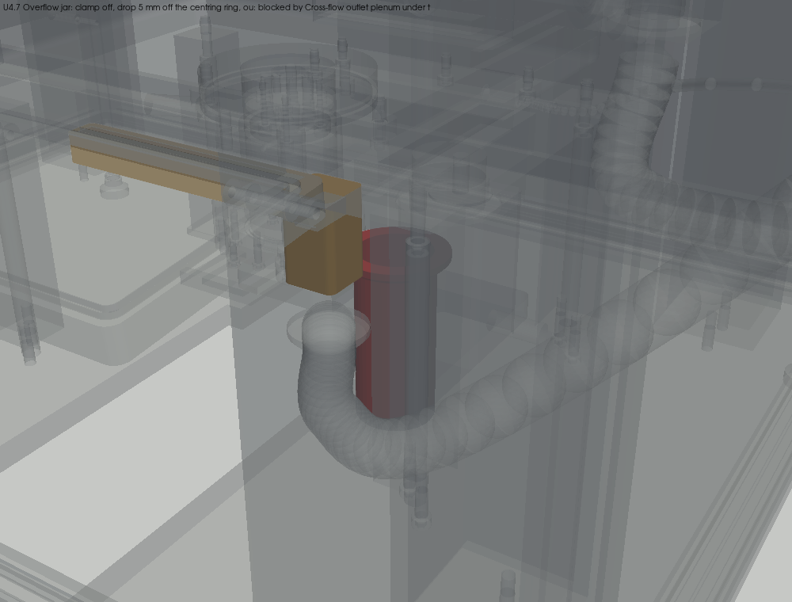
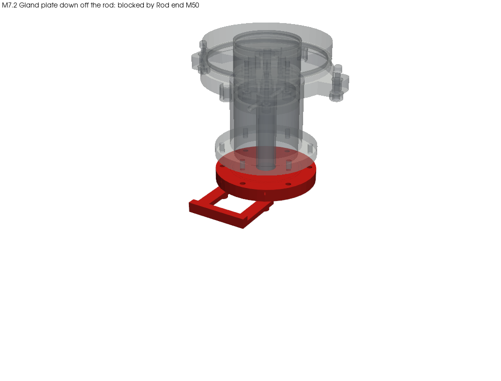
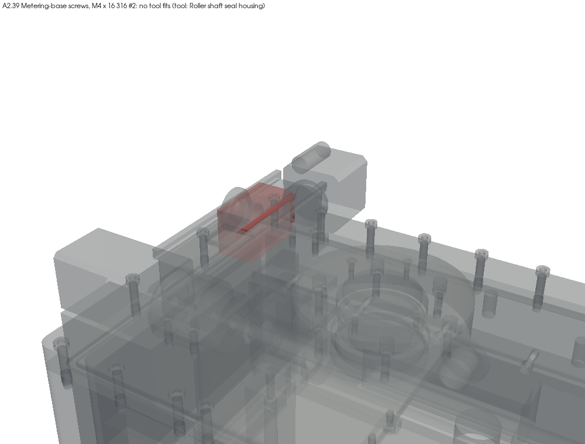

# Every hand operation, simulated step by step: assembly, use, maintenance, swap-outs

Written 2026-11-20 for [PR #266](https://github.com/vertical-cloud-lab/digital-alloy-lab/pull/266) (issue #260), in answer to
"simulate every step of every assembly, usage, maintenance, swap out, etc. type of operation" before anything is bought.
This note covers what a person does. Automated operations (the build loop, robot plate and reservoir handling) are
covered separately. Nothing has been built or tried on a mock-up.

## Short answer

- **21 operations, 154 steps, run on the M50 machine:** 76 steps pass, 1 passes only with a plain hex key where a torque
  tool was wanted, and 35 fail. The other 42 steps have no geometry to check (waiting, glovebox work, parts that are welded or
  placed by hand). The 93 screws driven during assembly were each checked with real tools: a torque screwdriver, a T-handle
  and ISO 2936 / Bondhus hex keys, with a hand on each.
- **Two things done every build don't work as drawn:**
  1. **The overflow jar can't come out.** Under the floor it is boxed in by the outlet plenum's boot and KF-25 port, the
     front-right chamber leg, the jar sensor, the build module and the guard (U4.7). Fingers can't reach its KF-40 clamp
     from the front either (U4.5).
  2. **The right-hand door latch can't be reached.** The open guard door still covers 40 mm of the guard opening, because
     it slides 470 mm and is 520 mm wide (U2.2).
- **Opening the window or the lid means taking out the scan head:**
  - The heads of the window's six retaining-ring screws sit 15-16.5 mm under the f-theta lens. No key fits (M5.1).
  - The lens can't drop out past the window stack (M6.1). The galvo can't lift off, because the guard's top panel is
    26 mm above it (M6.2).
  - The lid can't slide out under the optics either (M4.4). Its pressure transducer meets the bridge after ~8 mm of lift,
    but the dose chute hangs 83 mm into the chamber and hits the front wall.
  - So any window or lid-seal job also means a scan-field recalibration.
- **Some parts are trapped:**
  - The side liners are threaded onto the recoater ball screw (closed Ø22 holes), and the back liner sits behind the
    carriage. The liners don't lift out (M3.2).
  - The rod-gland plate is trapped on the rod by the potted rod end (Ø22 cap against a Ø16 bore). The heater and
    thermocouple leads are potted in the same place. So rod seals, heaters and thermocouples can't be changed without
    breaking the potting (M7.2, M7.3).
  - The recoater servo can't come out past the front-left optics post, so its shaft packing can't be serviced (M8).
  - The dosing stepper is boxed in by the optics bridge, the guard's back panel and the docked sensor, so the roller seal
    can't be serviced (M9).
  - One lid screw is under the dosing stepper (M4.3). Two metering-base screws are under the roller seal housing (A2.39).
- **The assembly animation's order or path needs to change in 12 places** (A2 below). Two are hard limits on the order:
  - 20 M6 screws can't be driven with the base plate standing on its levelling mounts. There is only 37 mm under it
    (A2.3, A2.5, A2.46).
  - The f-theta lens can't go in from below once the window is on (A2.50).
- **What works:**
  - The build-module swap path for M50 and S25. Its tightest gap is 0.1 mm, at the spigot. **L75's does not:** its
    handle, 13 mm further forward than M50's, meets the guard frame's bottom front rail at s = 202 mm, before the path
    lifts. `interference.py`'s L75 variant found the same thing.
  - The plate swap: turn 60°, lift 20 mm, out over the door sill, 2.0 mm gap.
  - The cover-slide drawer, 0.3 mm gap.
  - The blade swap, with a 2.5 mm key inserted by its long arm. Its tightest gap is 0.05 mm, the blade against the door sill.
  - The reservoir swap: S and M 1.1 mm gap, L 0.85 mm.
  - The HEPA element, straight up.
  - The whole bench assembly of the build module.
- **Time:** each build needs ~2.5 h of a person's time and waiting, besides the build itself:
  - ~50 min to load and start, including the purge and preheat;
  - ~1.5 h to finish, including the ~50 min cool-down;
  - ~10 min for the cover-slide check.

  Every operation that opens the chamber costs ~15 min of purge. Seal work adds a 1 h leak-up check.

## How it was checked

Scripts are in [`analysis/ops/`](analysis/ops/), and results in [`analysis/out/ops/`](analysis/out/ops/), including the full
per-step table [`results-M50.md`](analysis/out/ops/results-M50.md) and the JSON. The model is `cad/lpbf_low.py` with its 148
joint fasteners (`cad/joints.py`), read from a copy of `cad/` taken at the start (another agent was editing the seal
grooves). The cad folder is an argument, so the checks can be re-run on the final model.

- **Catalogue** ([`operations.py`](analysis/ops/operations.py)). There are 21 operations:
  - assembly: two, the build module on the bench and the process module in render_build's order;
  - use: four;
  - maintenance: twelve;
  - swap-outs: three.
  Each step has the machine state (door, guard door, piston, recoater, Z arm), the parts present at that moment,
  whether it opens the chamber to air, a rough time, and an interval where the notes give one.
- **Part paths** ([`checks.py`](analysis/ops/checks.py)). Each part is checked by assembly-by-disassembly: it must be able to
  leave, against the parts present at its step, along the animation's line or the documented path. When that line is
  blocked, the script tries the six axis directions, then two-leg paths (10 or 30 mm along one axis, then out along
  another). Three layers decide a collision:
  1. FCL finds touching pairs;
  2. manifold3d measures their shared volume;
  3. OpenCascade's exact boolean confirms anything over 0.5 mm³, so chord error on a sliding fit is not counted as a block.
  "Gap" is the smallest FCL distance along the path, good to about 0.1 mm.
- **Tools** ([`tools.py`](analysis/ops/tools.py)). Each tool sits on the screw's axis, engaged 0.6 s deep in the socket. Its
  hand envelope is attached and it turns in 15° steps:
  - keys and T-handles pass with a free arc of at least 60°, since a hex key can be re-indexed;
  - the ball-end key may also tilt 15° or 25°;
  - the torque screwdriver must fit at all.
  Each screw is also checked for withdrawal: its head has to come straight out over its full length.
- **Reach.** For jobs done by hand, a flat hand or a two-finger pinch sits at the point, with a 90 × 65 mm forearm
  running straight back toward the person.

Tool and hand dimensions (all pages read 2026-11-20 UTC):

| Tool | Model | Source |
|---|---|---|
| Hex key, short arm in / long arm in | ISO 2936 L1 standard 52, 58.5, 66, 74, 85 and long 77, 87.5, 93, 104, 120; L2 18, 20.5, 23, 29, 33 (s = 2, 2.5, 3, 4, 5) | ISO 2936:2014 Table 1, [public preview](https://cdn.standards.iteh.ai/samples/60231/7332b2e7eb6c448b9f8ca6c6ed518206/ISO-2936-2014.pdf), 13:56; matches [fasten.it](https://fasten.it/en/norms/norm/din_iso_2936) |
| Ball-end key | Bondhus 10952 / 10954 / 10956 / 10960 / 10964: 82 / 88 / 98 / 110 / 119 × 16 / 17 / 19 / 22 / 27, up to 25° | [bondhus.com ball end](https://bondhus.com/pages/ball-end), 13:57 |
| T-handle key | Wera 454 / 454 HF: 100 shaft; bar 65 / 77 / 77 / 99 wide, 32-49 along the axis, 15-22 thick | [Wera 454](https://www.wera.de/en/tools/454-t-handle-hexagon-screwdriver-hex-plus), [454 HF](https://www.wera.de/en/tools/454-hf-t-handle-hexagon-screwdriver-hex-plus-with-holding-function), 13:59 |
| Torque screwdriver | Wera 7441 class (1.2-3.0 N·m): 105 handle and ~50 chuck (155 overall), with a Wera 840/4 Z 50 mm bit showing 35. Handle Ø40 and chuck Ø16 **assumed** (Wera doesn't list them; Wiha TorqueVario-S handles are Ø36-41) | [Wera 7400 series](https://www.wera.de/en/tools/series-7400-kraftform-adjustable-torque-screwdrivers-01-30-nm-with-rapidaptor-quick-release-chuck), [840/4 Z](https://www.wera.de/en/tools/840-4-z-bits), 13:59-14:01; [Wiha](https://digicat.wiha.com/au/en/detail/3a5538c206cfe3fc09878949b14abb10), 14:00 |
| Hands | Flat hand 100 × 55; pinch 46 × 25; a 90 mm cylinder round a screwdriver handle; forearm 90 × 65 (**assumed**) | MIL-STD-1472H Fig. 57 (bare hand flat 55 × 100), [EverySpec](https://everyspec.com/MIL-STD/MIL-STD-1400-1499/MIL-STD-1472H_57041/), 14:03; hand breadth 96-98 and index finger 23 (95th percentile men), [FAA HFDS ch. 14](https://hf.tc.faa.gov/hfds/download-hfds/hfds_pdfs/Ch14_Anthropometry_and_biomechanics_Oct2009.pdf) and [App. B](https://hf.tc.faa.gov/hfds/download-hfds/hfds_pdfs/App_B_Tech_Ops_Anthropometrics.pdf), 14:05-14:10 |

MIL-STD-1472H Fig. 56 gives the access openings these tools need: an Allen-type wrench turning 60° needs 120 × 155 mm,
a screwdriver 110 × 120 mm, and a T-handle 135 × 155 mm. The chamber door opening is 220 × 92 mm.

## Results by operation (M50 machine)

Time is hands-on time plus waiting (cool-down, purge, leak check), rough, for a trained person. The VLM column: every
operation here needs the tray at the VLM's access opening, worked from the front (the guard door side). None needs the
tray out of the VLM, but the ones marked "blocked" can't be done at all as drawn.

| Op | What | Interval | Opens to air | Pass / warn / fail | Time |
|---|---|---|---|---|---|
| A1 | Build module on the bench (22 steps, 16 screws) | once per module | – | 18 / 0 / 0 | ~1.4 h |
| A2 | Process module and tray (57 steps, 77 screws) | once | – | 33 / 1 / 12 | ~10 h |
| U1 | Fill and dock a reservoir | each build or alloy | yes, via the roller | 2 / 0 / 0 | ~20 min |
| U2 | Plate in, door shut, purge, preheat | each build | yes | 2 / 0 / **1** (right latch) | ~35 min |
| U3 | Build loop | each layer | – | automated | ~1.5 h per 15 mm |
| U4 | Cool, plate out, overflow out, sieve | each build | yes | 2 / 0 / **2** (overflow jar) | ~1.5 h |
| M1 | Cover slide | inspect each build; change on fouling | yes | 2 / 0 / 0 | ~10 min |
| M2 | Recoater blade | each alloy | yes | 3 / 0 / 0 | ~15 min |
| M3 | Liners out, chamber cleaned | each alloy change | yes | 0 / 0 / **1** | ~1 h |
| M4 | Lid off (lid O-ring, chute, gas knife) | on a leak | yes | 1 / 0 / **3** | ~2 h, plus M6 |
| M5 | Window O-ring, window inside face | on fouling or a leak | yes | 2 / 0 / **1** | ~1.2 h, plus M6 |
| M6 | Galvo and lens out and back | only for M4 and M5 | no | 0 / 0 / **2** | ~2 h, with recalibration |
| M7 | Module on the bench: rod and bore seals, heaters, thermocouples | on wear or failure | – | 2 / 0 / **2** | ~1.2 h, plus re-potting |
| M8 | Recoater shaft packing, servo | on a leak | yes | 1 / 0 / **3** | ~1.4 h |
| M9 | Dosing roller seal, stepper | on a leak | yes | 0 / 0 / **2** | – |
| M10 | Through-beam heads, inductive sensors | on failure | no | 0 / 0 / 4 (model limit, below) | – |
| M11 | Grease the rail carriage and ball nut | ~6 months (rule of thumb) | yes | 0 / 0 / 2 (model limit) | – |
| M12 | HEPA element | on HEPA pressure drop (P11) | the loop | 3 / 0 / 0 | ~1 h |
| S1 | Build plate | each build | yes | 1 / 0 / 0 | ~5 min |
| S2 | Build module (between campaigns) | between campaigns | yes | 3 / 0 / 0 | ~30 min |
| S3 | Reservoir | each alloy | yes, via the roller | 1 / 0 / 0 | ~2 min |

The tightest clearances on the passing steps:

| Where | Gap |
|---|---|
| Module swap path, spigot to floor port | 0.1 mm |
| Blade swap, blade over the sill | 0.05 mm |
| Drawer in its slot | 0.3 mm |
| Plate out of the bore | 2.0 mm |
| Reservoir on the dovetail | 1.1 mm |
| Gland-plate screws, torque screwdriver | 4.2 mm |
| Captive module screws, 5 mm key | 4.7 mm |
| Lid screws, torque screwdriver | 5.2 mm |
| Stack screws, torque screwdriver | 2.1 mm |
| Rod set screws, torque screwdriver | 0.9 mm |

## What fails, why, and the fix

Ranked by how often the job is done.

| # | Step | Fails because | Fix (not yet checked on the model unless said) |
|---|---|---|---|
| 1 | U4.5, U4.7 overflow jar, **each build** | After the clamp comes off, the jar can drop ≤ 10 mm before it reaches the base plate. Then it is blocked on every side: front, outlet-plenum boot (x 72-100, down to z −65) and its KF-25 port and hose; right, jar sensor, then the guard panel; left, build module; back, Z stage and back legs. The front-right leg (x 120-150) also overlaps the jar's lane by 7.5 mm. Fingers can't reach the clamp past the leg and boot. | Give the jar a lane to the front: move the outlet port and hose to x < 60, move the front-right leg out (or split it into thinner posts), and use a jar ≤ 75 mm tall on a quarter-turn bayonet so it drops 20 mm and slides forward. Or put the overflow in a drawer that pulls out through the front. |
| 2 | U2.2 right door latch, **each build** | With the guard door slid 470 mm, its left edge is at x = 140, inside the 500 mm opening (x −320 to 180). The forearm to the right latch (x 100-124) hits it. | Let the door slide ≥ 510 mm and extend its rail from x 680 to 700. |
| 3 | M3.2 liners, **each alloy change** | The side liners have closed Ø22 holes round the ball screw, so they are threaded onto it. The back liner (z 16-72) sits behind the carriage (z 65-99) and the carriage block. | Cut the side liners' screw holes into slots open to the top edge. Make the back liner two halves, each lifted out with the recoater parked at the other end. |
| 4 | M5.1, M6.1, M6.2 window | The ring screws (bolt circle r = 32, head tops at z 166) are under the Ø90 lens housing, 15-16.5 mm below it (bottom at z 181-182.5). The lens can't come down, and the galvo can't lift off under the guard top panel (26 mm). The lens can't move up either: its 182.5 mm working distance fixes it. | Put the ring screws outside the lens footprint (bolt circle r ≥ 60). There the bridge's underside (z 207.7) leaves ~42 mm, room for a 2.5 mm key's 20.5 mm short arm and fingers. A torque tool still won't fit, so use a torque-limiting key. Or make the guard top panel lift-off and accept a recalibration each time. |
| 5 | M4.4, M4.3, M4.2 lid | The dose chute (z 37-120) hangs from the lid, so the lid has to rise 83 mm before it can slide out. But it can rise only ~8 mm before the pressure transducer meets the bridge, and ~18 mm before the window ring meets the lens. Lid screw #4 (x −100, y +107) is under the dosing stepper. The layer camera can't come out of the bridge's Ø80 hole along a straight line. | Hang the chute and gas knife from the chamber walls, so they come out through the door. The lid then needs only a few mm of lift, and should slide out the front once the reservoir, camera and transducer are off (not re-checked). Move lid screw #4 or the stepper. Enlarge the camera hole to ~Ø100. |
| 6 | M7.2, M7.3 module seals, heaters, thermocouples | The potted rod end (Ø22 cap, side outlet to r = 26) can't pass the gland plate's Ø16 rod bore or the Ø50.8 cylinder bore. So the gland plate is trapped on the rod, and the leads of every heater and thermocouple are potted in. The stack does come out of the bottom, taking the gland plate with it. | A vacuum-rated multipin connector at the rod end, or a split gland plate, so seals and heaters change without breaking the potting. |
| 7 | M8 recoater servo and shaft packing | The servo (x −316 to −216) can't pull forward past the front-left optics post (x −345 to −285) or lift past the bridge. | Move the front-left post inboard (in front of the chamber's left wall), or fold the motor behind the chamber with a belt. The bridge FEA needs a re-run either way. |
| 8 | M9 dosing stepper and roller seal | The stepper (y 74-114, z 143-185) sits under the solid part of the bridge. The docked sensor is above it, the guard's back panel behind, the posts to the sides. | Extend the bridge's reservoir slot back to y ≈ 120, so the stepper lifts out through it. |
| 9 | A2.39 metering-base screws | Screws #2 and #4 (y = +66) are 1 mm under the roller seal housing. No key fits, and they can't come out. | Move the tabs or screws clear of the Ø30 housing, e.g. x ± 22. |
| 10 | A2.3, A2.5, A2.46: 8 base-plate-to-leg, 4 leg-to-floor and 8 post-base M6 screws | With the plate on its levelling mounts there is 37 mm under it. The leg-to-floor screws sit 134 mm up the leg's bore, past the ISO long key (120 mm). | Order change: bolt legs and posts to the base plate on blocks, before the levelling mounts. Drive the leg-to-floor screws with the chamber upside down, using a 152 mm T-handle (Bondhus 15264) or an ISO extra-long key (165 mm). |
| 11 | A2.50 f-theta lens | It can't go in from under the bridge once the window ring is on. There is 16 mm of room and no straight or two-leg path. | Order change: thread the lens onto the galvo first, then lower the two onto the bridge from above, before the guard's top panel. |
| 12 | A2.24 Z stage | The actuator hangs 12 mm through the base plate's window. Once the chamber is on the legs over the base plate, it has no straight or two-leg way in. | Order change: hang the Z stage under the floor before the chamber goes onto the legs. It drops through the window with the chamber. |
| 13 | A2.18 carriage, A2.19 ball screw, A2.22 blade holder | The carriage wraps the rail. The screw passes through both side walls. The holder sits in a pocket in the block. | Order and paths: the carriage goes on the rail on the bench (free two-leg path: 30 mm +x, then −y); the ball screw goes in along x before the bearing housings; the holder goes 10 mm −y, then up. |
| 14 | A2.2, A2.7, A2.8 | The animation brings the legs, outlet plenum and overflow funnel up through the base plate. | Paths: legs from +z, plenum from −y, funnel from +x (each found free). |
| 15 | S2.4 on L75, module swap, **between campaigns** | L75's handle (y −85 from the module axis, z −146 to −138 after the 40 mm drop) reaches the guard frame's bottom front T-slot (y −265 to −245, z −160 to −140) at s = 202 mm, before the path's 18 mm lift at y −170. | Lift earlier: the 18 mm rise at y ≈ −150 instead of −170 (check that the module still clears the outlet plenum). Or make L75's handle 15 mm shorter, or raise the guard's bottom front rail. |
| – | A2.27, S2.2 module captive screws | Only the 5 mm key fits. The torque screwdriver hits the tray, with 124 mm under the heads (WARN). | A short torque-limiting hex driver, or a torque wrench with a hex bit on a ¼ in. drive, at hot-swap.md's half torque. |

**Model limits, not design fails.** M10 is the through-beam heads, the module-present sensor and the jar sensor. M11 is
greasing the carriage and ball nut. All six fail only because the straight 90 × 65 mm forearm is crude. A person with a
bent wrist probably reaches them, but each sits in a tight spot:

| Item | Where |
|---|---|
| Right through-beam head | under the vacuum valve and hoses |
| Left through-beam head | behind the front-left leg |
| Module-present sensor | beside the outlet plenum |
| Carriage and ball nut | 160-190 mm deep behind the blade holder |

Check these on a mock-up. Better still:

- make the fibre heads and sensors unplug from outside the guard;
- give the carriage a grease line to a fitting on the outside wall, or a sealed-for-life vacuum grease (pain-points P45).

## Assembly order that works (changes to render_build.py's sequence)

1. Legs and optics posts onto the base plate with it on blocks, before the levelling mounts thread in. The base-plate
   screws go in from below with a torque screwdriver.
2. Chamber upside down: Z stage, legs (leg-to-floor screws with a 152 mm T-handle), dowels. Then the chamber, right way up,
   goes onto the base plate. The Z stage drops through the base plate's window.
3. Outlet plenum from the front, funnel from the right, jar from below (after fix 1).
4. Recoater:
   1. carriage on the rail on the bench;
   2. rail and carriage into the chamber, with the carriage moved along to clear each rail screw;
   3. ball screw through the left-wall bore;
   4. nut threaded on;
   5. bearing housings, motor;
   6. holder in along +y, blade.
5. As drawn up to the lid, the window stack and the dosing (with fix 9).
6. Door, then the hinge pins slid in along x (the animation puts the pins in before the door).
7. Galvo with the lens already threaded in, lowered onto the bridge from above. Then the guard.

## Where it can be done, and what it costs in purge

- **All of it is done at the VLM's access opening, from the front.**
  - The rack covers the process module's left side and the gas module covers its right.
  - Nothing here is reachable with the tray in a bay.
  - The tallest job is lifting the galvo for M6 once the guard's top panel is off. That puts it ~635 mm above the tray,
    under Modula bay S's 695 mm.
- **These open the chamber to air:** U1, U2, U4, S3, M1-M5, M8, M9, M11, S1 and S2.
  - Reservoir swaps open it through the metering roller, which isn't a seal.
  - The HEPA job (M12) opens only the valved-off gas loop.
  - Each opening costs a purge: 2-3 vacuum-argon cycles to ≤ 100 ppm O₂ (`budgets.py`), ~15 min.
  - Seal work (M4, M5, M7, M8, M9) adds the 1 h leak-up acceptance (rate of rise and O₂ drift, pain-points P27).
- **Grouping:**
  - Plate, overflow and cover slide happen together each build, so they share one purge.
  - The blade and liners go with an alloy change.

## Pictures (failing cases, tool or part in red, blocker in orange)

| | |
|---|---|
|  U4.7 overflow jar against the outlet plenum |  M5.1 key on a window-ring screw under the lens |
|  M4.4 lid with the chute |  M7.2 gland plate against the potted rod end |
|  M3.2 liners against the carriage |  A2.39 metering-base screw under the seal housing |

There are more in [`analysis/out/ops/`](analysis/out/ops/): M4.3, M8.2, M9.1, A2.3, A2.24 and A2.50.

## What was assumed and not checked

- **The full catalogue was run on the M50 machine only.** U1, U4 and S1-S3 (reservoir, plate, module and overflow jobs)
  were also run on S25 and L75, with their own reservoirs ([`results-S25.md`](analysis/out/ops/results-S25.md),
  [`results-L75.md`](analysis/out/ops/results-L75.md)). They match M50, except L75's module path (fix 15).
- **Parts the model doesn't draw are not checked:** hinge and latch screws, the KF clamps' wing nuts, the rack and gas-module
  units' screws, cables and hoses as they are routed, and the guard's own fasteners. Paths are straight lines or two legs;
  threading motions (the ball nut, the f-theta lens) are not simulated.
- **The model treats the three liners as one part,** and the dose chute and gas knife as hung from the lid.
- **The guard panels are fixed.** No path may go through them, so every exit is through the guard door.
- **The torque screwdriver's handle and chuck diameters and the forearm size are assumed.** The hand points for the reach
  checks were chosen by hand, each ~30-40 mm above its grip point.
- **Intervals:**
  - The notes give the cover slide, blade, liners and HEPA intervals (P11, P12, hot-swap.md).
  - The rail and ball-screw greasing interval is a rule of thumb, not checked against the 6709K12 or 4566N401 manuals.
  - O-rings, packings and heaters are "on a leak or a failure".
- **Times** are estimates, not measurements.

## Re-run

```bash
cp -r desktop-lpbf/cad /tmp/ops-work/cad      # or point at the live cad folder
OMP_NUM_THREADS=1 /tmp/capmem 4 xvfb-run -a -s "-screen 0 1280x960x24" \
    /tmp/venv/bin/python desktop-lpbf/analysis/ops/run_ops.py /tmp/ops-work/cad M50      # ~7 min (+ ~2 min to tessellate a changed model)
```

`--only=U4,M3` runs some operations. `--no-png` skips the pictures.
