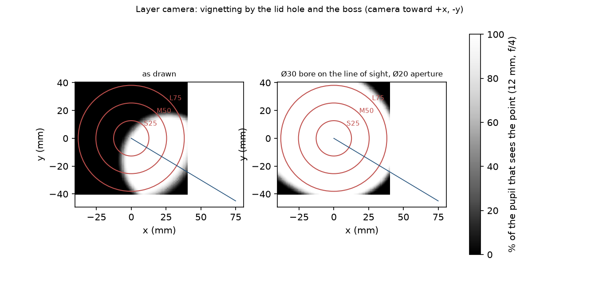
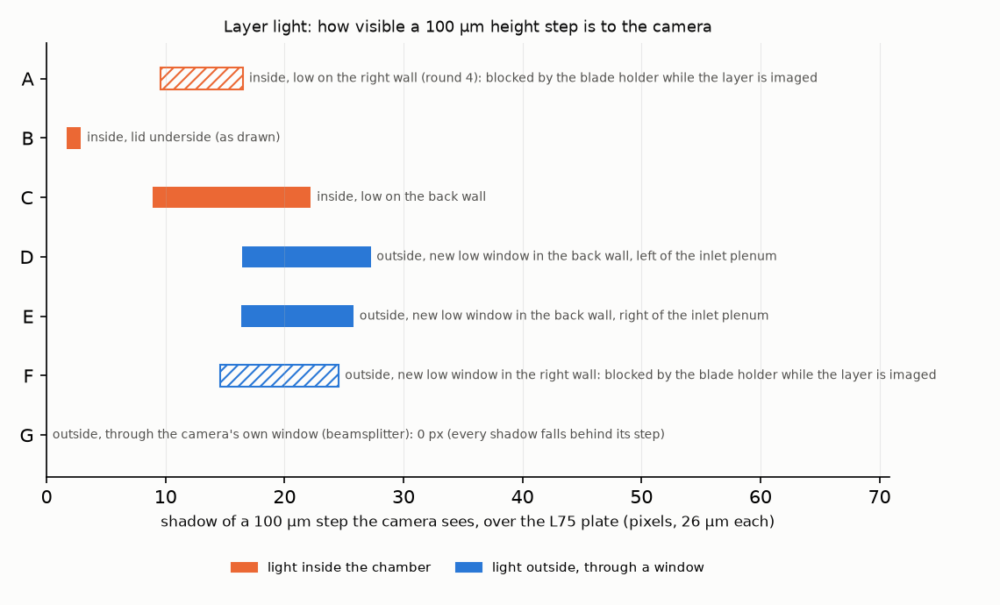

# Optics: the beam path checked end to end (2026-11-22)

For [PR #266](https://github.com/vertical-cloud-lab/digital-alloy-lab/pull/266) (issue #260). Sterling asked whether the
mechanical, electrical "and optical of course" components had been checked thoroughly. This note does the optics. It
follows the 500 W beam from IPG's single-mode fibre through the collimator, galvo, f-theta, chamber window and cover
slide to the plate, then covers power handling, laser-safety optics, the calibration and monitoring instruments, an
optics BOM, and what should change.

Nothing here has been built, measured, quoted by a vendor or reviewed by BYU's LSO. No lens prescription was used: the
f-theta is treated as a paraxial lens of f = 160 mm, and where an answer depends on data Thorlabs doesn't publish, it is
given as a range.

| File | What it is |
|---|---|
| [`analysis/optics/beam_path.py`](analysis/optics/beam_path.py) | Gaussian/ABCD beam with M², spot, depth of focus, focus position, apertures, field, irradiance, ghosts, back-reflection, safety optics → [`beam_path.md`](analysis/out/optics/beam_path.md) |
| [`analysis/optics/thermal_lens.py`](analysis/optics/thermal_lens.py) | thermal lens of the slide, window and f-theta: analytic, plus an axisymmetric finite-volume conduction solve → [`thermal_lens.md`](analysis/out/optics/thermal_lens.md) |
| [`analysis/optics/thermal_lens_ccx.py`](analysis/optics/thermal_lens_ccx.py) | CalculiX cross-check of one slide case → [`thermal_lens_ccx.md`](analysis/out/optics/thermal_lens_ccx.md) |
| [`analysis/optics/layer_camera.py`](analysis/optics/layer_camera.py) | the M6 camera from its mounted position: field, pixel size, depth of field, vignetting → [`layer_camera.md`](analysis/out/optics/layer_camera.md) |
| [`analysis/optics/optics_bom.py`](analysis/optics/optics_bom.py) → [`optics-bom.csv`](optics-bom.csv) | every optical element and instrument, with part numbers, prices, sources, the `bom.csv` line each replaces or adds, and the model part it maps to; totals in [`optics_bom.md`](analysis/out/optics/optics_bom.md) |

Re-run: `python desktop-lpbf/analysis/optics/<script>.py` (each takes under a minute; run under `/tmp/capmem 1.5`).

## 0. Recommendations, ranked: what changes what we buy or draw

Ranked by consequence. Section numbers point to the evidence. **2026-11-25 (§9):** keep IPG's affixed 2.5 mm collimator (96 µm)
and order it with the laser (§9.1, which also prices the alternatives); move the LED bar outside, behind a new window low in
the back wall (§9.2, not drawn); the window and slide are now drawn as the BOM parts (9.53 mm and Ø50 × 2 mm): focus shift
3.58 mm, shims 2.83 mm, and the galvo riser's bore opened to Ø56 so the lens can rise over its shim range (§9.3). With an L75
field-stop insert, the slide's Ø42.5 clear aperture is now the next limit (L75 needs k ≳ 0.60). The M50 build now draws a Ø41
field-stop insert, which passes M50 at every k in the drawn range; S25 and L75 keep the Ø36 stop (§9.3). **Round 6 (2026-11-23, §8):** items 1, 2, 7, 8 and 9 are now drawn in the model (lens raised 3.41 mm on ±3 mm of shims; IPG's 2.5 mm collimator, because no catalogued f ≈ 23 mm collimator exists; the coaxial tap; a calibration head on the plate; the camera's Ø30 bore), and item 3's galvo spacing is set by the real parts (35 mm, k 0.33–0.62): L75 is still out of reach.

1. **The collimator in the model doesn't give the spot the layout was designed for (§1.1).** The model draws IPG's
   standard 5 mm collimator under the f = 160 mm lens. That gives a **48 µm** spot with a ±1.5 mm Rayleigh range, not the
   ~75 µm that [`low-profile.md`](low-profile.md) assumes. Its "30 mm collimator gives a ~3.2 mm beam" (also the old part
   label in `vendor_parts.py`) is off too: with IPG's 140 mrad fibre divergence a 30 mm collimator gives D = 4.2 mm and a
   57 µm spot. **For ~75 µm the beam must be D ≈ 3.2 mm, from a collimator of f ≈ 23 mm (21–25 mm over IPG's
   130–150 mrad).** Ask IPG for it: its spec sheet offers "other diameters on request". IPG's series datasheet (rev 2/26) also lists a **2.5 mm** affixed collimator, which
   gives 92–96 µm with a ±6.1 mm Rayleigh range, still inside the 70–100 µm commercial range: that is the catalogue
   fallback. No third-party collimator with f ≈ 20–30 mm was found. The series datasheet also says 500 W single-mode
   lasers end in IPG's HLC-8 connector, while the quoted spec sheet says QBH-compatible, so confirm the termination
   before planning any third-party optic. The 5 mm collimator as drawn is usable, but it gives Al keyhole-level
   intensities at 300–400 W and is 2.5 times as sensitive to focus errors. **2026-11-25 (§9.1):** the 2.5 mm unit is the
   recommendation, not a fallback: its 96 µm spot is the EOS M 290's, it uses ~320 W at the galvo's marking speed, and no
   catalogue part gives 3.2 mm.
2. **As drawn, the focus is 3.4 mm below the powder (§1.3).** The model sets the lens's flange focal length from the
   powder plane, but the 8 mm window and 3 mm slide push the focus down by t(1 − 1/n) = 3.41 mm. That puts the plate
   0.9 Rayleigh ranges out with the 3.2 mm beam (spot 101 µm instead of 75) or 2.2 out with the 5 mm beam (117 µm
   instead of 48). **Raise the lens by the plates' shift (3.4 mm as drawn, 3.6 mm with the window and slide in the optics
   BOM), and give the f-theta adapter ring ±3 mm of focus adjustment** (shims under the lens's shoulder, or an M85×1
   lock ring), set by a burn test at process power.
3. **As drawn, the lid stack cuts off the outer ring of the L75 plate (§1.4).** How far the beam leans at the plate
   depends on the f-theta's chief-ray angle, which Thorlabs doesn't publish. Write it as k = (chief-ray angle at the
   plate) / (scan angle). Thorlabs designs the FTH160-1064 for the second galvo mirror 7.5 mm from the lens; the model
   has the basiCube's second mirror ~40 mm away, which makes the lens more telecentric. A thin-lens bound then puts k
   at **0.30–0.59**. Over that range the beam to the L75 edge (r = 38.1 mm) needs a field stop of Ø44–64 mm (drawn
   Ø36), a bore under the window of Ø42–63 mm (drawn Ø42) and a window clear aperture to match. A Ø2 in. window clears
   ~Ø46 mm, which is enough only for k ≥ ~0.55. **Measure k with the guide laser (§4.4) or get Thorlabs' Zemax black
   box before the lid is machined; then size the window (Ø3 in. if k < 0.55), its bores, and one field-stop insert per
   module.**
4. **The cover slide is uncoated and, at 500 W, a consumable that has to stay almost perfectly clean (§2.2, §2.3).**
   - The Edmund 25-250 slide (A2) is uncoated: its two faces send 6.7 % of the beam, 34 W, back toward the lens, the
     galvo and the fibre end, and their ghosts come to a focus in or near the f-theta (thin-lens estimate). **Buy
     AR-coated slides:** Edmund 36-299 (Ø50 × 2 mm, 1064 nm V-coat, $103 at 6–25), and trial Cloudray's Ø50 × 2 mm
     fibre-laser protective windows ($12–16, coating not stated) against it. A sapphire slide (Edmund 15-808, $950)
     cuts the thermal lens tenfold, but pays only if slides are cleaned and reused.
   - The slide's thermal lens grows the spot past +10 % once it absorbs about **0.03 %**. A light film (0.05 %)
     moves the focus 1.1–2.8 mm toward the lens; a fogged slide (0.5 %) moves it 10–23 mm; mech.md's 43.8 mm overstates
     it (§2.2). The ratio to the Rayleigh range doesn't depend on the beam size, so no collimator choice fixes this.
     **Inspect and swap the slide every build, and watch the coaxial photodiode's mean for drift during a build.**
5. **The f-theta has no CW rating, and its own absorption could move the focus by more than the depth of focus
   (§2.1–2.2).** Thorlabs gives the FTH160-1064 only a pulsed damage threshold. If the lens absorbs 0.05 % of 500 W, its
   thermal lens alone moves the focus 1.2 mm (5 mm beam) to 2.8 mm (3.2 mm beam), 0.75 Rayleigh ranges either way.
   Thorlabs lists it as three air-spaced elements plus a protective window that is **N-BK7**, not fused silica
   (FTHW75-1064), with < 0.3 % reflection per surface. **Ask Thorlabs for the element glass, the coating absorption and
   a CW rating; replace the protective window with a fused-silica one; and if Thorlabs can't answer, quote a
   fused-silica high-power f-theta.** In any case, find focus at process power, not at low power.
6. **A specular spot at the field centre sends the beam back into the fibre (§2.3).** A bare, polished plate, or a flat
   melt pool, within 3–5 mm of the lens axis acts as a cat's eye: up to ~440 W can couple back into the fibre core. The
   powder bed and real melt pools return far less, but the risk is real on first light and on bare plates. **Get IPG's
   back-reflection tolerance in writing (already open in L1); wire the laser's back-reflection alarm, if it has one, to
   the safety controller; bead-blast build plates; and make first light on powder, ramping the power.**
7. **The layer camera sees about half of each plate (§4.6).** The lid's Ø22 hole is drilled vertically, but the camera
   looks along a line 32.7° off vertical, so at the lid's underside the line of sight is 10.3 mm from the hole's centre.
   Only 40–56 % of each plate gets more than half the lens's light. **Drill the lid hole on the line of sight, at Ø30,
   with a Ø20 aperture under the camera window: then all three plates are fully seen.** Use a 12 mm C-mount lens
   (26 µm per pixel; the L75 plate fits the frame) with a ~2.2° Scheimpflug wedge, because the plate's near and far
   edges are ±21 mm apart along the line of sight.
8. **The power meter and the dump need cooling the machine no longer has (§4.1).** The quoted IPG laser is air-cooled,
   so L2 dropped to $0, but the BOM's dump (Thorlabs LB2L, $507.50) is water-cooled, no fan-cooled 500 W dump was
   found, and most 500 W heads are water-cooled too. **Buy the Gentec-EO UP55G-600F-HD-D0** ($3,033; fan-cooled, 600 W
   continuous) with a U-LINK USB interface ($816), and mount it where the shutter dumps the beam. It is then the dump
   and the power meter, and every build starts with a logged power reading at the collimated beam.
9. **The melt-pool photodiode (T2) has no way to look down the beam (§4.5).** A coaxial signal needs a 45° dichroic
   between the shutter and the galvo that reflects 1070 nm and passes the visible and near-IR glow, plus a notch and a
   short-pass filter (Thorlabs DMSP1000 $331.76, NF1064-44 $635.55, FESH1000 $169.26). The DMSP1000 has only a
   pulsed damage rating, so it is a commissioning part until Thorlabs gives a CW figure or a high-power HR1070/HT-VIS
   mirror is quoted. The fold also lets the collimator lie along y.
10. **BOM text to fix (§5):** L3 and L6 still describe f = 254 mm; L7 names a Ø1 in. 5 mm window (the model has
    Ø2 in. × 8 mm; Edmund 38-990, Ø50.8 × 9.53 mm with a 1064 nm V-coat, $295, is the nearest real part); A2's slides are
    uncoated; T1 has no 500 W head; T2 has no dichroic or filters; M6 has no lens, filter or Scheimpflug part; the
    README's block diagram says f = 254 mm. The optics BOM adds about $6.1k at the low end and $2.9k at the high end.

## 1. Beam path

### 1.1 Fibre, collimator and spot

**Fibre.** IPG's spec for the YLR-500-U3-SM-AC gives M² 1.05 typical, 1.1 max, and a bare-QBH divergence of
130/140/150 mrad full angle at 86 % ([quote notes](quotes/ipg-ylr-500-u3-sm-ac.md)). For a near-Gaussian beam 86 % is
the 1/e² definition, so the fibre's output beam is 2W₀ = 4M²λ/(πθ) = **10.2 µm** across (9.5–11.0 µm). IPG's mode-field
diameter is on neither the quoted spec sheet nor the YLR series datasheet (rev 2/26); this is the value its divergence
implies.

**Collimated beam and spot.** D = f_c·θ, and the spot is d = 4M²λf/(πD), the README's formula. With f = 160 mm, M² 1.1:

| Collimator | f_c (mm) | D (mm) | Spot (µm) | Rayleigh range (mm) | ±10 % spot growth (mm) |
|---|---|---|---|---|---|
| IPG standard, 5 mm beam (drawn) | 35.7 | 5.0 | 48 | ±1.53 | ±0.70 |
| IPG standard, 7.5 mm beam | 53.6 | 7.5 | 32 | ±0.68 | ±0.31 |
| f = 30 mm (low-profile.md) | 30 | 4.2 | 57 | ±2.17 | ±1.00 |
| **D = 3.2 mm (the 75 µm target)** | **22.9** | **3.2** | **75** | **±3.75** | **±1.72** |
| IPG affixed 2.5 mm (series datasheet) | 17.9 | 2.5 | 96 | ±6.14 | ±2.81 |

The spread over 130–150 mrad is a few µm (the full table is in `beam_path.md`). For other targets: 60 µm needs
f_c = 28.5 mm, 70 µm 24.5 mm, 80 µm 21.4 mm, 90 µm 19.0 mm.

**Which spot.** Commercial Al machines run 70–100 µm (README §3.2). A 48 µm spot at 350 W is 3.9 × 10⁷ W/cm² peak,
roughly 2.5 times the 75 µm spot's, which pushes Al into keyhole mode and narrows the process window. It also cuts
the Rayleigh range to 40 %, against every focus error below. So the 3.2 mm beam stays the target. Defocusing the 48 µm spot to
75 µm (1.8 mm out) works, but then the spot changes linearly with any focus error instead of quadratically.

### 1.2 Depth of focus against the layer, the plate growth and the powder surface

- **Layers** of 20–60 µm are 1.2–3.5 % of the 3.2 mm beam's ±1.72 mm (±10 %) depth of focus, and the powder plane doesn't move between layers anyway: irrelevant.
- **The plate stack grows ~112 µm at 200 °C** ([`powder-spreading.md`](powder-spreading.md)). The blade, not the plate,
  sets the powder surface, so once the blade gap is zeroed hot the powder plane stays at the focus. Even uncorrected,
  0.112 mm is 3 % of z_R (7.3 % with the 5 mm beam).
- **The bridge posts grow 70 µm** over a 50 K warm-up ([mech.md F](analysis/out/mech/mech.md)): negligible.
- **The powder surface doesn't rise** in this design, because the piston steps down each layer. On the engraver route
  (README §1b.2), where the tray is fixed, the surface rises by the build height (15–20 mm, 4–5 z_R), so that route
  needs its autofocus Z to follow every layer.
- **What does matter:** the plates' 3.4 mm shift (§1.3) and the thermal lens (§2.2), both larger than the depth of
  focus.

### 1.3 Where the focus lands

Fused silica has n = 1.4496 at 1070 nm (Malitson). A plate of thickness t in a converging beam moves the focus away by
t(1 − 1/n): 2.48 mm for the 8 mm window and 0.93 mm for the 3 mm slide, **3.41 mm** in all. The model places the
FTH160-1064's flange shoulder at z = 191.7 mm, its flange focal length, so the air focus is on the powder plane and the
real focus is 3.4 mm below it. The FTH160-1064 ships with its own Ø75 protective window (Thorlabs sells the FTHW75-1064
replacement), which its working distance already includes.

- **With the real parts in the optics BOM** (Edmund 38-990 window, 9.53 mm; Edmund 36-299 slide, 2 mm) the shift
  is 3.58 mm. They are drawn since 2026-11-25 (§9.3).
- **Fix:** raise the lens by the shift (shorten the 16 mm adapter ring to ~12.4 mm, so the lens's shoulder sits higher),
  and keep ±3 mm of shim adjustment for the lens's working-distance tolerance, slide changes and the thermal shift.
- **Slide tolerance:** Edmund's 3.00 ± 0.38 mm moves focus ±0.12 mm per slide. Small, but specify ±0.1 mm when
  ordering AR-coated slides.
- **Off axis** the plates' shift grows by only 0.001–0.009 mm at the L75 edge, their astigmatism is 0.02–0.13 mm, and
  they move the spot outward by 0.24–0.62 mm. The scan-field calibration absorbs that, so **calibrate with the window
  and slide in place.**
- **Spherical aberration** from 11 mm of glass at NA 0.01–0.016 is under λ/1000: negligible.

### 1.4 Apertures and clipping

- **Galvo.** The basiCube 20's Ø20 aperture is 4–6 beam diameters across: the clipped fraction is 10⁻¹⁴ (5 mm beam) to
  10⁻³⁴ (3.2 mm). The 7.5 mm option is still only 7 × 10⁻⁷. No diffraction ripple either: the aperture is well over the
  1.5–2× rule of thumb.
- **f-theta input.** The beam walks d·tanθ across the lens's Ø39 input as it scans. With the mirrors 30–60 mm above
  the nose, the L75 edge (θ = 13.6°) walks 7–15 mm, plus 3.75 mm for 1.5 beam radii, inside the 19.5 mm radius. The
  lens is specified for beams up to 12 mm, so 3.2–5 mm is well inside its design.
- **The lid stack** is the problem. The table gives the largest plate radius each opening passes with less than 0.1 %
  clipped, for three values of k, the chief-ray angle at the plate over the optical scan angle (k = 1 is a lens with
  its stop at the lens, k = 0 a telecentric one):

  | Beam | k | Lid bore Ø56 (z 120–125) | Drawer opening Ø46 | Field stop Ø36 (z 131–136) | Bore under window Ø42 | Retaining ring Ø44 |
  |---|---|---|---|---|---|---|
  | 5 mm | 0.3 | 32.4 | 26.1 | **19.7** | 23.8 | 25.8 |
  | 5 mm | 0.5 | 40.3 | 32.8 | **25.1** | 30.9 | 35.8 |
  | 5 mm | 0.75 | 59 | 49 | 39 | 50 | 60 |
  | 3.2 mm | 0.3 | 33.7 | 27.5 | **21.2** | 25.4 | 27.7 |
  | 3.2 mm | 0.5 | 42.0 | 34.6 | **27.1** | 32.9 | 38.5 |
  | 3.2 mm | 0.75 | 60 | 52 | 42 | 54 | 60 |

  Plates: S25 12.7, M50 25.4, L75 38.1 mm.
- **What k is.** Thorlabs doesn't publish it, but it does give the galvo geometry the lens is designed for: the second
  mirror A1 = 7.5 mm from the lens, 20 mm between mirrors. The basiCube 20's second mirror sits at the beam height,
  z ≈ 272.7, about 40 mm above the lens's nose (z 232.7). A stop farther from the lens makes it more telecentric. With a
  thin lens of f = 160 mm whose front principal plane lies between the lens body's middle and its rear principal
  plane (z 160), k = 1 − d/f gives **k ≈ 0.30–0.59 as drawn**, and 0.50–0.80 at Thorlabs' A1.
- **So, as drawn, the L75 edge is out of reach.** The clear diameter each opening needs for the L75 edge, < 0.1 %
  clipped:

  | Beam | k | Lid bore (drawn Ø56) | Drawer (Ø46) | Field stop (Ø36) | Bore under window (Ø42) | Above window (Ø44) |
  |---|---|---|---|---|---|---|
  | 5 mm | 0.30 | 64.9 | 64.4 | 63.8 | 63.3 | 61.4 |
  | 5 mm | 0.45 | 56.2 | 55.4 | 54.4 | 53.6 | 50.1 |
  | 5 mm | 0.60 | 47.5 | 46.4 | 44.9 | 43.7 | 38.8 |
  | 3.2 mm | 0.30 | 62.8 | 62.2 | 61.5 | 61.0 | 58.6 |
  | 3.2 mm | 0.45 | 54.1 | 53.2 | 52.1 | 51.2 | 47.4 |
  | 3.2 mm | 0.60 | 45.4 | 44.2 | 42.6 | 41.3 | 36.0 |

  A Ø2 in. window has ~Ø46 mm clear (Thorlabs WG42012-C: ≥ Ø45.7 mm), enough only for k ≳ 0.55. Below that the window
  goes to Ø3 in. and the flange, drawer and lid bore grow with it. M50 and S25 fit at any k in the range, except that
  the Ø36 field stop clips the M50 edge at k ≈ 0.3.
- **The field stop's job** is to keep a runaway galvo off the chamber walls. Its reach (beam centre on the stop's edge)
  is 23.9 / 30.5 / 48 mm at k = 0.3 / 0.5 / 0.75. One fixed stop can't both pass L75 and stop the beam just past S25,
  so a per-module insert (or one sized for L75, accepting a reach a little past it) is the honest design.

### 1.5 Field: scan angle, incidence, ellipticity and distortion

| Plate | r (mm) | Optical scan angle | Mirror angle | Angle at the plate (k 0.3–0.75) | Spot elongation |
|---|---|---|---|---|---|
| S25 | 12.7 | 4.5° | ±2.3° | 1.4–3.4° | 0.03–0.18 % |
| M50 | 25.4 | 9.1° | ±4.5° | 2.7–6.8° | 0.11–0.71 % |
| L75 | 38.1 | 13.6° | ±6.8° | 4.1–10.2° | 0.26–1.6 % |

- The FTH160-1064's field is 110.6 mm square; the L75 plate (76.2 mm) uses its central 69 %, so all three plates sit
  well inside it. The basiCube 20 scans ±0.35 rad optical (±56 mm at f = 160 mm); L75 needs ±0.24 rad. SCANLAB's
  "60 × 60 mm at f = 160 mm" (BOM L5's note) is for SCANLAB's own objective, not a limit of the scanner.
- Spot ellipticity is at most 1.6 % at the L75 edge, inside the 5 % spot-size spread that IPG's M² tolerance (1.05–1.1) allows.
- f-theta distortion and the plates' outward shift (0.24–0.62 mm at the L75 edge) are static, so the scanner's
  correction table takes them out. Thermal drift of the galvo is larger: ~0.24 mm at the plate over a warm-up
  ([mech.md F](analysis/out/mech/mech.md)). Calibrate warm, and re-register on fiducials every few hours.
- **Telecentricity** sets the cat's-eye zone (§2.3) and the lid-stack clipping (§1.4). Both need the real k.

## 2. Power handling

### 2.1 Irradiance on every surface at 500 W

Thorlabs rates CW damage by linear power density, P/D in W/cm, because CW damage is thermal. Both are given:

| Surface | 5 mm beam: Ø (mm), peak (W/cm²), P/D (W/cm) | 3.2 mm beam: Ø, peak, P/D | Rating found |
|---|---|---|---|
| Collimator output | 5.0, 5.1 k, 1.0 k | 3.2, 12 k, 1.6 k | IPG builds it for the laser |
| Shutter mirror and dump (closed) | 5.0, 5.1 k, 1.0 k | 3.2, 12 k, 1.6 k | LB2L dump 500 W at 1 L/min water; Gentec head 600 W, fan |
| Dichroic (if added; ×0.71 on its 45° face) | 5.0, 5.1 k, 1.0 k | 3.2, 12 k, 1.6 k | DMSP1000: pulsed only (9.5 J/cm², 12 ns) |
| Galvo mirrors (×0.71 on the 45° face) | 5.0, 5.1 k, 1.0 k | 3.2, 12 k, 1.6 k | basiCube 20: 1000 W at 1064 nm, 100 % duty, no cooling |
| f-theta input | 5.0, 5.1 k, 1.0 k | 3.2, 12 k, 1.6 k | **pulsed only, 5 J/cm² (10 ns)** |
| f-theta protective window (N-BK7) | 5.7, 3.9 k, 0.9 k | 3.7, 9.6 k, 1.4 k | pulsed only, 20 J/cm² |
| Chamber window (top / bottom) | 4.8 / 4.6, 5.6–6.0 k, 1.1 k | 3.1 / 2.9, 14–15 k, 1.7 k | Edmund 38-990: pulsed only (15 J/cm², 20 ns) |
| Cover slide (top / bottom) | 4.0 / 3.9, 8.0–8.2 k, 1.3 k | 2.6 / 2.5, 19–20 k, 2.0 k | Edmund 36-299: pulsed only (15 J/cm², 20 ns) |
| Plate (focus) | 0.048, 5.5 × 10⁷ | 0.075, 2.3 × 10⁷ | — |

Most of the beam path sees 1–2 kW/cm. **No catalogue part found states a CW rating at that level and 1070 nm.** The
only CW figure found for a transmissive part is Thorlabs' 350 W/cm for its -C coated UV fused-silica window
(WG42012-C, measured at 1540 nm as a certification test, which usually marks the test laser's limit rather than the
coating's): 3–6 times below our load. Laser-cutting protective windows are sold for "0–6 kW" heads (Cloudray/Raytools
Ø50 × 2 mm, $12–16), so the coating class exists. SCANLAB's 1000 W for the basiCube 20 is the one rating that covers
its part. **Ask every vendor for a CW rating at 1070 nm and a 3–5 mm beam when ordering.** A smaller beam raises the
irradiance 2.4× on every surface but the plate.

### 2.2 Thermal lensing

A plate that absorbs a fraction of the beam becomes a weak positive lens, because its centre is hotter, and fused
silica's index rises with temperature. `thermal_lens.py` solves the steady radial heat flow in the real slide and window
(rim held at the mount temperature, faces losing heat by radiation and convection in argon). It integrates the optical
path through the thickness, χ = dn/dT + (n − 1)(1 + ν)α = 9.87 × 10⁻⁶ /K for fused silica, and fits the
beam-weighted defocus. A lens h above the focus moves it toward the lens by Δz = h²D/(1 + hD).

| Element at 500 W, static beam | Absorbed | Focus shift, 5 mm beam | 3.2 mm beam | × z_R |
|---|---|---|---|---|
| Slide, clean, uncoated | 0.008 W | 0.04 mm | 0.09 mm | 0.02 |
| Slide, clean, AR both faces (2 × 30 ppm, assumed) | 0.033 W | 0.15 mm | 0.37 mm | 0.10 |
| Slide, light film 0.05 % | 0.25 W | **1.1 mm** | **2.8 mm** | 0.74 |
| Slide, fogged 0.5 % | 2.5 W | **10 mm** | **23 mm** | 6–7 |
| Slide, sooted 2 % | 10 W | 33 mm | 60 mm | 16–22 |
| Window, clean, AR | 0.038 W | 0.18 mm | 0.43 mm | 0.11 |
| Window, light film 0.05 % | 0.25 W | 1.1 mm | 2.8 mm | 0.74 |
| f-theta, fused silica, 0.02 % total | 0.1 W | 0.46 mm | 1.1 mm | 0.3 |
| f-theta, fused silica, 0.05 % total | 0.25 W | **1.2 mm** | **2.8 mm** | 0.75 |
| f-theta, N-BK7-type glass, 0.3 % total | 1.5 W | 5.7 mm | 13 mm | 3.6–3.7 |

- **The ratio to the Rayleigh range is the same for both beams.** The thermal lens scales as 1/w² and the Rayleigh
  range as 1/D², so a smaller or larger beam doesn't buy margin. Only absorption does.
- **The ±10 % spot-growth limit is 0.46 z_R.** The slide must absorb less than ~0.03 % to stay inside it, and a clean
  AR-coated window, slide and fused-silica lens already use ~0.5 z_R between them. So set focus at process power.
- **Check against the literature.** Measured shifts were −22 to −30 mm at 400 W with ~0.5 % absorption on a
  contaminated window ([LiM 2017](https://www.wlt.de/lim/Proceedings2017/Data/PDF/Contribution31_final.pdf), via
  low-profile.md). The model gives 8–18 mm at 400 W for this geometry: the same order.
- **Check against mech.md E.** mech.md gives 43.8 mm for 500 W at 0.5 %. Its lens power (P·dn/dT/2πkw²) agrees with
  the beam-weighted fit here (the fit is 0.49 of the centre's curvature). But it puts the slide 145 mm up, not 126 mm,
  and uses Δz = f²D with f = 160 mm. With the slide where the model has it, the same case gives 23 mm.
- **Time constants:** ~1 s for the beam-sized hot spot, ~110 s for the whole slide. A small coupon near the centre
  sees the static case; scanning spread over the plate lowers it.
- **The f-theta's own protective window is N-BK7** (FTHW75-1064, Ø75 × 2 mm), 186 mm above the focus. N-BK7 absorbs
  ~0.12 %/cm at 1 µm against ~0.002 %/cm for fused silica (low-profile.md), so this 2 mm plate takes ~0.15 W at 500 W
  and is worth ~0.35 z_R. (In the converging beam the beam radius grows in step with the height, so every plate's shift
  in Rayleigh ranges depends only on the power it absorbs and its χ/k: 0.15 W against the clean window's 0.038 W and
  0.11 z_R.) A fused-silica Ø75 × 2 mm
  replacement with a 1064 nm V-coat removes it.
- **CalculiX, Faas et al. and Edison** cross-checks are in §2.2a.

### 2.2a Cross-checks: CalculiX, the literature and Edison

**CalculiX** (`thermal_lens_ccx.py`): a 2° sector of the slide, C3D6 wedges at the axis and C3D8 bricks elsewhere, 840
elements, the absorbed power in the bottom element row, the rim held at the mount temperature and h = 10 W/m²K on the
faces. It agrees with the finite-volume solve within 1 %:

| Case (500 W) | ΔT centre, CalculiX / finite volume | Lens power, CalculiX / FV | Focus shift, CalculiX / FV |
|---|---|---|---|
| 3.2 mm beam, slide fogged 0.5 % | 302 / 296 K | 1.767 / 1.781 m⁻¹ | 22.9 / 23.1 mm |
| 5 mm beam, slide fogged 0.5 % | 257 / 253 K | 0.715 / 0.718 m⁻¹ | 10.4 / 10.5 mm |
| 3.2 mm beam, light film 0.05 % | 30.2 / 29.6 K | 0.177 / 0.178 m⁻¹ | 2.7 / 2.8 mm |

**Faas et al. 2018** measured the thermal focal shift of processing optics up to 525 W as Δf/z_R ≈ D*·P/(λM²), with
D* = 0.55 × 10⁻⁶ mm/W for a new fused-silica lens with a good wavelength-specific coating and 1.16–1.27 × 10⁻⁶ mm/W for
used uncoated lenses ([doi:10.1364/oe.26.026020](https://doi.org/10.1364/oe.26.026020), via Edison r5-optics-review).
At 500 W that is **0.23 z_R per good lens and 0.5 z_R per used one**. It confirms two things here: the shift in Rayleigh
ranges doesn't depend on beam size, and a multi-element f-theta plus window plus slide, all clean, already adds up to
about half a Rayleigh range. In this model, one good lens corresponds to ~0.015 % absorption.

**A sapphire slide cuts the thermal lens tenfold** for the same absorption (`thermal_lens.py`, c-plane, 2 mm): 0.5 %
fogging moves the focus 1.1 mm (5 mm beam) or 2.6 mm (3.2 mm beam), 0.7 z_R, against 6–7 z_R for fused silica. Its
conductivity (27 against 1.38 W/m·K) spreads the heat. It raises the "clean enough" limit from ~0.03 % to ~0.3 %.
Edison r5-optics-review suggests crystalline quartz, sapphire or the athermal glass aThermoXX for the window; the window
sits behind the slide and stays clean, so the slide is where the upgrade pays.

### 2.3 Ghosts and back-reflection

**Plane surfaces.** Uncoated fused silica reflects 3.37 % per face, a good AR coat ~0.25 %:

| Source | Power sent back toward the head | Into the fibre core | Comment |
|---|---|---|---|
| Uncoated slide, both faces | 2 × 16.8 W | 2–15 mW | the returned beam focuses 5–15 mm from the fibre end and is 0.7–2 mm across on the QBH connector |
| AR slide, both faces | 2 × 1.25 W | < 1 mW | |
| AR window, both faces | 2 × 1.25 W | < 1 mW | |

- **No window tilt is needed for the fibre.** A plane surface 126–183 mm above the focus returns a beam whose waist is
  250–370 mm out of place, so its overlap with the fibre mode is 10⁻⁴–10⁻³.
- **The real cost of the uncoated slide is the 34 W it sends back up the beam.** Most lands on the f-theta, the galvo
  mirrors' surroundings, the collimator and the QBH end. In a thin-lens estimate its ghosts converge in or just above
  the f-theta (z ≈ 218–236). AR coating cuts this 13-fold. A tilt only moves the ghost sideways, so it doesn't help.

**The melt pool and the plate (cat's eye).** A flat mirror at the focus sends the beam back along its own path into the
fibre core. Off axis, a non-telecentric lens tilts the returned cone by 2× the chief-ray angle, which decouples it:

| W into the core at R 0.9 (500 W) | r = 0 | 1 mm | 2 mm | 3 mm | 5 mm | 8 mm |
|---|---|---|---|---|---|---|
| 5 mm beam, k 0.3 / 0.75 | 441 | 416 / 308 | 350 / 104 | 263 / 17 | 104 / 0.05 | 11 / 0 |
| 3.2 mm beam, k 0.3 / 0.75 | 441 | 383 / 183 | 251 / 13 | 124 / 0.2 | 13 / 0 | 0.05 / 0 |

- These are upper bounds for a flat, specular, perfectly focused reflector. Powder scatters, and a melt pool is curved,
  so real returns are a small fraction of this. The NIST AMMT coating failure (README §3.2) shows the risk is real.
- **What protects the laser:** IPG's back-reflection tolerance (to be confirmed in writing, L1); a back-reflection
  alarm wired into the safety controller as a laser fault; bead-blasted plates; first light on powder at reduced power.
  A free-space isolator at 500 W randomly polarised is a specialist part (quote). Moving the plate off the lens axis
  doesn't help: to keep the axis off the L75 plate, its far edge would sit 81 mm off axis, outside the lens's 55 mm
  half-field.

## 3. Laser-safety optics

Same MPE (5 mW/cm², t ≥ 10 s at 1070 nm) and method as [`safety.md`](safety.md) §4 and `safety_calcs.py`:

| Beam state | Full angle | NOHD | safety.md |
|---|---|---|---|
| Bare fibre (unplugged QBH) | 130–150 mrad | 25–27 m | 25 m |
| Collimated, 5 mm / 3.2 mm | 0.30 / 0.47 mrad | 11.9 / 7.6 km | 11.9 km |
| Out of the focus, 5 mm / 3.2 mm beam | 31 / 20 mrad | **114 / 178 m** | 114 m |
| Specular off bare Al (R 0.9), 5 mm / 3.2 mm | 31 / 20 mrad | 108 / 169 m | 108 m |

- safety.md's numbers hold for the 5 mm beam. **With the 3.2 mm collimator the NOHD out of the focus grows to 178 m.**
  Either way it is "the whole room", so the enclosure, not distance, has to contain it.
- **Eyewear (S6, Thorlabs LG1)** is OD 7+ at 950–1080 nm, against the OD ≥ 5.4 needed (fetched 2026-11-22T06:02Z,
  https://www.thorlabs.com/certified-laser-safety-glasses?pn=LG1). Its EN 207 rating is D LB6: it holds 100 W/cm² for
  10 s. The collimated beam is 2.5–6 kW/cm², so the glasses protect against diffuse light and low-power alignment, not
  a direct hit at power.
- **The guard panel (S5, Thorlabs LW1P1/M)** is OD 7+ at 1060–1100 nm, rated D AB4 (1 W/cm² for 10 s), 3.2 mm acrylic.
  A 10 % specular reflection of 500 W at 150 mm from focus is ~150 W/cm² (low-profile.md), so it must never see a
  direct or specular path, which is what safety.md already requires.
- **Guard burn-through** (1.6 mm 5052, the same 1-D lower bound as safety_calcs.py, no conduction): at 150 mm past the
  focus, 0.39 s hot / 1.95 s cold with the 5 mm beam, 0.16 / 0.80 s with the 3.2 mm beam; 50 mm past it, 0.02–0.2 s;
  at the focus itself, under a millisecond. The smaller beam makes the
  guard's job harder, which is one more reason the chamber, not the guard, is the primary barrier. Only a test on the
  real panel settles it (safety.md §4.3).
- **The chamber has no viewport;** the camera window carries a 1070 nm filter (§4.6).

## 4. Calibration and monitoring

### 4.1 Power

- **Where to measure.** The beam can't be measured at the plate at full power: it is focused there, and a thermal head
  wants a few kW/cm² at most. So measure the absolute power where the beam is collimated, and the train's transmission
  separately:
  1. **At the shutter's dump port, at full power.** Mount a thermal head as the shutter's dump, or in place of it, so
     closing the shutter puts the collimated 3.2–5 mm beam on the head. At 500 W that is 2.5–6.2 kW/cm² averaged over
     the beam, so pick a head whose density rating covers it, or spread the beam with a short negative fused-silica lens
     in front of the head. Every build then starts with a logged power reading at no extra effort, which trends the
     laser.
  2. **Through the f-theta, window and slide, at ~50 W.** Put the head just above the window, then just below the slide,
     and compare with the dump reading. At 50 W the 2.5–4 mm beam is under 1 kW/cm². Expect ~1–2 % loss with AR-coated
     parts and ~8 % with the uncoated slide.
- **Which head.** No 500 W head is in the BOM (T1). The machine has no chiller (L2 is $0 with the air-cooled IPG),
  and of the heads found only 600 W fan-cooled ones avoid water (fetched 2026-11-22):

  | Head | Cooling | Rating | Density limit | Price | Interface |
  |---|---|---|---|---|---|
  | **Gentec-EO UP55G-600F-HD-D0** | fan | 600 W continuous, Ø55 mm | 45 kW/cm² (at 10 W CW; "may vary") | $3,033 | U-LINK USB $816 |
  | Ophir FL600A-LP2-65 | fan | 600 W, Ø65 mm | 11 kW/cm² at 600 W, 33 at 150 W | $3,302 | Juno USB $752, fan supply $52 |
  | Ophir FL600A-BB-65 | fan | 600 W | 7 kW/cm² at 600 W | $3,183 | as above |
  | Gentec UP55M-500W-H12-D0 | water, 1.5 L/min | 500 W | — | $1,969 | — |
  | Ophir 1000W-BB-34, L1500W-BB-50; Coherent PM1K-36C | water | 1000–1500 W | — | quote | — |

  The Gentec is rated continuous and its maker says its heads can double as dumps, so it can sit at the dump port
  permanently. Confirm its density rating at 500 W with Gentec for the 3.2 mm beam (6.2 kW/cm² averaged, 12 peak).
- **The commissioning dump** (L4, Thorlabs LB2L, $507.50) needs 1 L/min of water. No fan-cooled ≥ 500 W dump was found
  (Gentec's BD series is water-cooled too), so either run the LB2L from a tap with a flow switch during commissioning,
  or let the power head be the dump.

### 4.2 Focus

- **Burn tests set the focus, at process power.** The piston can raise the plate 8 mm (its exchange overtravel) and
  lower it 40 mm, so a Z-scan needs no extra hardware:
  1. On a bead-blasted 6061 plate, burn single 10 mm tracks at 350–500 W and 1 m/s, stepping the plate from −3 to
     +3 mm in 0.25 mm steps (0.1 mm near the minimum).
  2. Measure track widths under a microscope; the narrowest is the focus. Shim the lens to it.
  3. Repeat after 10 minutes of hatching a sacrificial plate at full power, so the beam has heated every optic in the
     train (with the shutter closed only the collimator warms). The difference is the clean train's thermal shift.
  4. Repeat after a build on a used slide. The difference is the slide's share.
- **A tilted coupon** (a 2–3° wedge) gives a continuous Z-scan in one track and is quicker for routine checks.
- **Optional caustic measurement:** a camera beam profiler behind a high-power beam sampler measures D and M² of the
  collimated beam (and so the collimator) before the galvo is fitted. Profiling the 75 µm focus itself at 500 W needs a
  focus monitor (PRIMES FocusMonitor, Ophir BeamWatch AM), a $20k-plus instrument; borrow one rather than buy it.

### 4.3 Scan field

- **Correction table.** Mark an 11 × 11 cross grid (7.5 mm pitch over Ø75) on black-anodised aluminium coupons, with
  the window and slide in place and the machine warm. Measure the crosses with a flatbed scanner at 2400 dpi (10.6 µm
  pixels; check its scale against a glass target) or a measuring microscope. Feed the errors to the scan controller's
  correction file (SCANLAB correXion pro with the RTC; a table for the other controllers).
  The f-theta's distortion, the plates' 0.24–0.62 mm outward shift at the L75 edge and the mirror mounting errors all
  come out in one step.
- **Drift.** The galvo drifts ~0.24 mm at the plate over a warm-up (mech.md F). Laser-mark two fiducial crosses outside
  each part and re-register on them with the layer camera every few hours. At 26 µm per pixel, centroiding finds a
  cross to ~5 µm.
- **The layer camera itself** is calibrated with a glass dot-grid target (§4.6).

### 4.4 Guide laser

- The IPG has a 0.1–1 mW red guide laser (Class 2M) on the same fibre. Use it to align the collimator, galvo and lens,
  to check the field stop, and to trace where ghosts go. For the 1070 nm beam itself at low power, a Thorlabs VRC2 card
  (absorbs 800–1700 nm, $100.63) shows where it lands.
- **Don't use it for focus or the field calibration.** The f-theta is coated and corrected for 1020–1080 nm. In fused
  silica, n is 1.4565 at 650 nm against 1.4496 at 1070 nm, so a fused-silica singlet's focal length is ~1.5 % shorter in
  the red: the red focus sits ~2.4 mm higher, and the field scale differs by ~1.5 %, 0.6 mm at the L75 edge. The real
  lens is several glasses, so treat these as the size of the effect.
- **It is the cheapest way to measure k** (§1.4) before the lid is machined: put a card on the plate, steer the galvo
  to the field edge, step the piston down 20 mm, and the spot moves outward by 20·tan(u′).
- **2026-11-25: do both before the DMSP1000 goes in.** The short-pass dichroic that folds the beam into the galvo passes
  92–97 % of the red guide beam straight through, so with it fitted almost none of the guide beam reaches the galvo
  ([`monitoring/optics.md`](monitoring/optics.md), [`monitoring/sync-and-data.md`](monitoring/sync-and-data.md) §0 item 9).
  After that, align and calibrate with the process beam at low power on the VRC2 card or a burn target.

### 4.5 Melt-pool monitoring

- **The coaxial photodiode needs a dichroic in the collimated beam.** As far as the brochure shows, the basiCube 20 has
  no camera or detector port, so the emission has to be picked off between the shutter and the galvo, where the galvo
  has already de-scanned it.
  - Fold the beam 90° with a 45° short-pass dichroic that reflects 1070 nm and passes 400–1000 nm: Thorlabs DMSP1000
    (T 520–985 nm, R 1020–1550 nm, IBS on UV fused silica, $331.76). The laser then reflects off a dielectric HR coat and
    never crosses the substrate, which avoids a thermal lens and astigmatism in a tilted plate. The DMSP1000 has only a
    pulsed rating (9.5 J/cm², 12 ns), so use it at reduced power until Thorlabs gives a CW figure, or quote a
    high-power HR1070/HT-VIS laser mirror.
  - Edison r5-optics-review describes the opposite layout (laser transmitted, emission reflected), which is also used.
    Reflecting the laser is the safer one at 500 W.
  - The fold lets the collimator lie along y, which real-parts.md suggested for the guard clearance.
- **Detector chain:** the PDA36A2 (T2, $400.01) behind a NF1064-44 notch (OD > 6 at 1042–1086 nm, $635.55) and a
  FESH1000 short-pass (OD > 4 at 1013–1500 nm, $169.26), with a f ≈ 30–50 mm lens. The dichroic leaks up to 10 % of any
  1070 nm light coming back up the beam; the two filters add OD 10.
  Set the gain for ≥ 100 kHz bandwidth: at 1 m/s a 75 µm spot crosses itself in 75 µs.
- **What it gives:** a scalar melt-pool intensity per scan vector, good for spotting lack-of-fusion, keyholing, a dirty
  slide (the mean falls) and focus drift. Calibrated temperature needs two-colour pyrometry, which is a later upgrade.
- **Off-axis:** the only view into the chamber is the layer camera's port. The Pi HQ camera's frame rate is for layers,
  not melt pools.

### 4.6 Layer camera (M6)

`layer_camera.py` traces rays from the three plates through the openings the model draws, to a sampled entrance pupil
(assumed 10 mm behind the lens front), and projects them onto the IMX477 sensor (4056 × 3040, 1.55 µm pixels):

| Lens | Pixel on the plate, across / along the tilt | Fits in the frame | Depth of field at f/4 (2 px blur) | Scheimpflug tilt |
|---|---|---|---|---|
| 6 mm CS-mount | 54 / 64 µm | all three | 31 mm | 1.1° |
| **12 mm C-mount** | **26 / 31 µm** | **all three** | 7.5 mm | **2.2°** |
| 16 mm C-mount (Raspberry Pi) | 19 / 23 µm | S25, M50 (not L75) | 4.1 mm | 3.0° |
| 25 mm C-mount | 12 / 14 µm | S25 only | 1.6 mm | 4.8° |

- **Vignetting as drawn:** only 56 / 46 / 40 % of the S25 / M50 / L75 plate gets more than half the pupil's light,
  with any of the lenses. The far half of every plate is dark. The cause is the lid's vertical Ø22 hole, which the
  tilted line of sight leaves 0.7 mm inside its edge at the lid's underside. Drilled on the line of sight at Ø22, S25 and
  M50 are fully seen and L75 84 %. **At Ø30 through the lid and boss with a Ø20 aperture under the window, all three
  plates are fully seen.**
- **Pixel size against the powder:** with the 12 mm lens a 30–40 µm D50 particle is 1.2–1.5 pixels. Single particles
  aren't resolved, but streaks, short feeds, spatter and lifted edges (≥ 100 µm) are 4 or more pixels wide. The 16 mm
  lens gives 19 µm on S25 and M50.
- **Depth of field:** the plate's near and far edges differ by ±7 / ±14 / ±21 mm along the line of sight (S25 / M50 /
  L75). Without a tilt, the L75 edges blur by ~290 µm at f/4 with the 12 mm lens. A **2.2° wedge** between the lens and
  the sensor (Scheimpflug) brings the whole plate into focus at f/2.8–4. At f/8 diffraction alone is 77 µm on the plate.
- **Lighting** (superseded: round 5 moved the bar to the lid's underside, and §9.2 recommends moving it outside, behind a low
  back-wall window). The model had an LED bar on the +x wall at z 30–38, 14° above the plate. Its light runs along x,
  parallel to the recoater's streaks, so streaks cast little shadow. Add a second bar on the back (+y) wall for light
  across them, and take one image per bar. Its specular reflection leaves away from the camera, so bare metal shows
  dark and powder bright, which is the contrast wanted. Inside the chamber the LEDs must survive vacuum cycles: no
  potting, no silicone.
- **The 1070 nm filter** is drawn as a coating on the camera window. As a real part it is a Ø25 mm short-pass filter
  behind a plain window: Thorlabs FESH0950 (rejects 970–1500 nm, $169.26). The HQ camera's own IR-cut filter isn't
  rated at 1070 nm.
- **Parts and prices** (fetched 2026-11-22T05:45Z): Raspberry Pi HQ camera $55 (Adafruit 4561; out of stock at Adafruit
  and PiShop), 16 mm C-mount lens $77.50 (Adafruit 4562), 6 mm CS-mount lens $49.30 (Adafruit 4563). A 12 mm C-mount
  lens wasn't priced (estimate $30–80).
- **Temperature:** the chamber reaches 61–78 °C over a 10 h build, and mech.md D puts the HQ camera's electronics at
  ~50 °C. Stand the camera off the boss on a short insulating tube, or give it an air feed.

## 5. Optics BOM and gaps

[`optics-bom.csv`](optics-bom.csv) lists 35 rows: every optical element and instrument, with part number, price, source
URL and fetch time, the `bom.csv` line each replaces or adds to, and the part in the model that stands for it. It is
written by [`analysis/optics/optics_bom.py`](analysis/optics/optics_bom.py), which also totals it
([`optics_bom.md`](analysis/out/optics/optics_bom.md)).

**Totals.** The rows with qty > 0 come to **$24,467–25,688**, without the laser (L1, whose quote is already in
`bom.csv`) and the collimator (IPG quote pending). The basiCube 20 ($12,000, `bom.csv` L5's high value) is half of it;
the shutter ($1,500–2,000) is an estimate; everything else is a fetched price or a small estimate. Optional rows
(qty 0): the beam profiler and sampler ($5,558.40), a sapphire slide ($950 each), an industrial f-theta
($2,500–6,000, estimate), a 500 W isolator (quote) and the Ophir head set ($4,106).

**Changes to `bom.csv` this implies** (not made here; `bom.csv` belongs to the coordinator):

| id | item | candidate | qty | low | high | basis | source |
|---|---|---|---|---|---|---|---|
| L3 | Collimator | IPG collimator for D ≈ 3.2 mm (f ≈ 23 mm) → ~75 µm at f = 160 mm; fallback IPG 2.5 mm affixed (92–96 µm); not the 5 mm (48 µm) | 1 | 0 | quote | quote | quotes/ipg-ylr-500-u3-sm-ac.md; IPG YLR datasheet rev 2/26 |
| L4 | Safety shutter + dump | industrial ≥ 500 W shutter (quote; nmLaser LST800 is only 300 W); LB2L dump for commissioning; the T1 head is the permanent dump | 1 | 507.50 | 2,000 | fetched + estimate | thorlabs.com/beam-blocks-and-traps?pn=BT610 (2026-11-22T05:48Z) |
| L6 | f-theta | **f = 160 mm**, Thorlabs FTH160-1064 + 2 spare FTHW75-1064 windows (high: an industrial fused-silica lens) | 1 | 1,255.84 | 2,500 | fetched | thorlabs.com/f-theta-scan-lenses (2026-11-22T05:36Z) |
| L7 | Chamber window | Edmund 38-990, Ø50.8 × 9.53 mm fused silica, 1064 V-coat (Ø3 in. if k < 0.55) | 1 | 295 | 295 | fetched | edmundoptics.com/p/…/39556/ (2026-11-22T05:53Z) |
| A2 | Cover slides (part of A2) | 12 × Edmund 36-299 (Ø50 × 2 mm, 1064 V-coat) instead of 6 × uncoated 25-250; 10 × Cloudray Ø50 × 2 mm to trial | 12 + 10 | 1,356 | 1,612 | fetched | edmundoptics.com/p/…/33156/ (05:48Z); cloudraylaser.com (05:46Z) |
| T1 | Laser power sensor | Gentec-EO UP55G-600F-HD-D0 (600 W, fan) + U-LINK | 1 | 3,849 | 3,849 | fetched | gentec-eo.com (05:58Z, 05:51Z) |
| T2 | Melt-pool photodiode | PDA36A2 + DMSP1000 dichroic + NF1064-44 + FESH1000 + lens and mounts | 1 | 1,686.58 | 1,836.58 | fetched + estimate | thorlabs.com (05:43–05:44Z) |
| M6 | Layer camera + lighting | Pi HQ ($55) + 12 mm C-mount lens + FESH0950 filter + 2.2° wedge + second LED bar | 1 | 284.26 | 394.26 | fetched + estimate | adafruit.com (05:45Z); thorlabs.com (05:44Z) |
| T3 (new) | Optics calibration | VRC2 card + anodised coupons + Edmund 57-983 dot target | 1 | 810.63 | 890.63 | fetched + estimate | thorlabs.com (06:03Z); edmundoptics.com (05:48Z) |
| F5 | (add to) | focus shims for the f-theta ring + three field-stop inserts | 1 | 75 | 200 | estimate | — |
| S5, S6 | (no price change) | OD 7+ at 1070 nm now confirmed for LW1P1/M and LG1 | | | | fetched | thorlabs.com (06:02Z) |

Against today's lines this raises the BOM by about **$6.1k at the low end and $2.9k at the high end** (L6 +$770 low;
L7 +$41 / −$505; A2 slides +$726 / +$982; T1 +$2,158 / −$151; T2 +$1,287 / +$1,437; M6 +$184 / +$94; T3 +$811 / +$891;
F5 +$75 / +$200). L1, L3, L5 wait on quotes.

**Model parts with no BOM line, or the wrong one:**
- The **enclosed beam tube, galvo riser plate, f-theta adapter ring and field stop** carry L4, L5, L6 and L7 in the
  model; the audit moved them to F5. They should carry F5 in `lpbf_low.py` too.
- The **camera window's "1070 nm blocking coating"** isn't a buyable part; it becomes a plain window plus a Ø25 mm filter
  (O21).
- The **gas knife** (tagged L7) has no slot, supply or flow (gas-flow.md §3.3).
- The **collimator** is drawn as IPG's 5 mm unit, while `vendor_parts.py`'s inventory still names the old envelope
  "f = 30 mm, D ≈ 3.2 mm"; neither gives 75 µm at f = 160 mm.

**BOM parts with nothing in the model:**
- the dichroic fold mirror, photodiode, filters and lens (T2, O5, O15–O18): not drawn, and the beam line has no fold;
- the 500 W power head (T1, O14) at the shutter's dump port;
- the second LED bar, the Scheimpflug wedge and the camera filter (M6);
- the field-stop inserts per module (one fixed stop is drawn);
- eyewear (S6), the calibration coupons, target and IR card: tools, no model part needed.

**Inconsistencies found in other files** (for their owners; not edited here):
- `bom.csv` L3 and L6 describe f = 254 mm and a 5 mm beam "for ~75 µm at f = 254 mm"; L5's note says the basiCube 20
  "at f = 160 has only a 60 × 60 mm field, so pair it with f = 254 mm" (it's SCANLAB's objective; §1.5); L7 names a
  Ø1 in. × 5 mm window.
- README §3 block diagram and §3.2 still say f = 254 mm; §3.2's "Rayleigh range about ±3.9 mm" is for f = 254 mm.
- `low-profile.md`: "a 30 mm collimator gives a ~3.2 mm beam" (it gives 4.2 mm with IPG's fibre), and the window and
  slide focus shift isn't in the layout.
- `mech.md` E: slide at z 145 (the model has 126) and Δz = f²D; with the model's height the 0.5 % case is 23 mm, not
  43.8 mm (§2.2).
- `quotes/ipg-ylr-500-u3-sm-ac.md` says QBH-compatible output; IPG's series datasheet says HLC-8 for 500 W
  single-mode. Its line "with D = 5 mm and f = 254 mm, the spot is about 76 µm" is right, but the layout now uses
  f = 160 mm.
- `vendor_parts.py`'s inventory still names the collimator "QBH, f = 30 mm, D ~ 3.2 mm" while drawing IPG's 5 mm unit.
- `lpbf_low.py` tags the beam tube, riser, adapter ring and field stop L4–L7; the audit moved them to F5.

## 6. Edison's second opinion (r5-optics-review)

[`edison/r5-optics-review/answer.md`](edison/r5-optics-review/answer.md) critiqued the same beam path with sources.

**Where it agrees with this note, and adds evidence:**
- Thermal focal shift is the main optical risk, contamination dominates it, and focus must be found by Z-scan burn
  tests cold and after a soak, then trended. Its Faas et al. figures (§2.2a) fit the model here.
- A marking-grade f-theta can't be qualified from a pulsed LIDT: get the CW absorption, the thermal-shift data and a
  warranty, or budget an industrial fused-silica lens (Sill S4LFT class).
- Back-reflection: get IPG's written limit, monitor reflected power, never fire on smooth bare plate at normal
  incidence, avoid stationary exposure at the field centre.
- A dedicated gas knife for the slide is needed in addition to the cross-flow. The model's knife has no slot and sits
  14–20 mm below the slide (gas-flow.md §3.3), so that is open. Slides every 1–3 builds for Mg/Zn alloys; replace on a
  measured criterion.
- Commissioning kit and melt-pool monitoring: a coaxial photodiode via a dichroic and notch filter first, an off-axis
  camera next, two-colour pyrometry last.
- Laser safety: no universal burn-through time exists for 1.6 mm aluminium; test the real guard. Edison prefers steel
  or a double wall. That is for safety.md; the smaller 3.2 mm beam makes the guard's job harder (§3).

**Where this note disagrees:**
- **"Use f = 254 mm with the 7.5 mm beam for edge-spot quality."** That pairing gives a 51 µm spot, not 75 µm. f = 254
  with the 5 mm beam gives 76 µm, but puts the galvo 116 mm higher: the machine stands 581 mm above the tray now, so
  697 mm, over the 695 mm VLM bay. The edge penalty it is avoiding is small here: the angle at the L75 edge is
  4–10°, a 0.3–1.6 % elongation, and a 3.2–5 mm beam uses a quarter to two-fifths of the lens's 12 mm design beam, so
  its field aberrations are far below their design limit. Keep f = 160 mm and fix the collimator (§0 item 1).
- **"Tilt the window 1–2° so its ghosts don't go back into the galvo and fibre."** The window's and slide's
  reflections couple only 10⁻⁴–10⁻³ of their power into the fibre core, because they return 250–370 mm out of focus
  (§2.3). A 1–2° tilt moves the ghost 1–4 mm at the lens, so it still lands on the lens and galvo; dumping it would take
  a ~20° tilt. AR coating both faces (and the slide) cuts the ghost power 13-fold, which is what helps. A tilt is
  harmless optically (astigmatism ~0.001 mm), so it is fine if the mount allows it, but it isn't needed.
- **"5 mm beam on a 20 mm aperture is less safe than 7.5 mm."** Both clip under 10⁻⁶ on the galvo (§1.4). The binding
  apertures are in the lid stack, and they favour a smaller beam.
- **Dichroic layout:** Edison describes the laser passing through the dichroic. Reflecting the laser off it keeps 500 W
  out of the substrate (§4.5).

## 7. What was and wasn't checked

- **Checked:** spot, Rayleigh range and depth of focus for every collimator option; where the focus lands in the model;
  clipping on the galvo, the lens input and every opening in the lid stack for three chief-ray assumptions; field
  geometry; irradiance on every surface; the thermal lens of slide, window and lens with two numerical models
  (finite-volume and CalculiX) against the analytic form, Faas et al. and LiM 2017; ghosts and fibre coupling of every
  plane surface; the melt-pool cat's eye; NOHD, eyewear OD and guard bounds against safety.md; the layer camera's
  field, pixel size, depth of field and vignetting by ray trace through the model's openings.
- **Not checked (needs data or hardware):** the f-theta's chief-ray angle, field curvature, element glass and CW
  absorption (Thorlabs doesn't publish them; its Zemax file is an encrypted black box, so ask Thorlabs to trace it at
  our pupil distance); IPG's mode-field diameter and back-reflection
  limit (open in L1); the basiCube 20's mirror clear aperture at full scan and its CW rating at our beam size; the
  ghost foci through the real lens (only a thin-lens estimate here); real melt-pool return fractions; LED and camera
  heat in the chamber; the guard burn test.
- **Assumed:** AR coatings absorb 30 ppm per face, fused silica 20 ppm/cm; the HQ camera's entrance pupil 10 mm behind
  the lens front; the slide's rim is at the drawer temperature; plates and lens are paraxial.

## 8. Round 6 (2026-11-23): the §0 patches drawn into the model

This round draws §0's items 1, 2, 7, 8 and 9 into `cad/lpbf_low.py` (section 9, the guard's top in section 12, and the camera
viewport in section 7) and re-runs the checks. `beam_path.py` and `layer_camera.py` now read the lens, galvo and camera
geometry from the model's `P` block instead of repeating it, and `beam_path.py` fails if the model's lens raise and its own
focus shift disagree by more than 0.01 mm. Vendor facts were fetched through the lab tunnel on BYU's network on 2026-11-23
(22:28–22:46 UTC); PDFs stay out of the repo, and their sha256 are given below.

### 8.1 Focus: the lens is raised 3.41 mm and shimmed ±3 mm

- `beam_path.py` §C: the 8 mm window and the 3 mm slide shift the focus by (8 + 3)(1 − 1/1.44956) = **3.41 mm**. `P["focus_shift"]`
  computes the same number, and the lens's output end moves from z 182.5 to **z 185.91**. As drawn, the focus lands at
  z = −0.001 mm. With the optics BOM's glass (Edmund 38-990, 9.53 mm; Edmund 36-299, 2 mm) the shift is 3.58 mm, so the focus
  would land 0.17 mm low, which the shims take up. **2026-11-25 (§9.3):** that glass is now drawn; the lens sits 3.58 mm
  higher on 2.83 mm of shims, and the focus lands at z +0.004 mm.
- **The shims.** The lens's shoulder bears on a 3 mm stack of rings (ID 85.5, OD 105) under a 13 mm M85×1 adapter ring (it was
  16 mm). Taking shims out or adding them moves the focus ±3 mm, set by the burn test (§4.2). The lens's ~12.5 mm thread
  engages the ring 9.5 mm at the nominal stack, and 6.5–12.5 mm over the range. McMaster sells no ring shim over 80 mm ID:
  metric steel stops at 80 × 100 and stainless at 70 × 90. So the rings are cut from 18-8 shim stock: 95055K25 (0.5 mm,
  $48.20), 95055K19 (0.25 mm, $36.75) and 95055K13 (0.1 mm, $32.48), all 150 × 1250 mm rolls (optics-bom O10).
- **What moves.** The bridge goes up 3.41 mm (z 211.11–236.11), and with it the galvo, the beam line and the guard's top.
  The galvo now sits on a 5 mm riser instead of 10 mm (§8.3), so the beam drops to z 271.11 (it was 272.7) and the galvo's
  top to 363.11 (it was 364.7). The guard's top is now set 3 mm over the galvo; before, it used the old 110 mm galvo envelope.
  It ends at z 367.6 (it was 369.2). **The machine is 579.6 mm tall (it was 581.2): 115.4 mm under the 695 mm Modula bay.**
- **A model bug fixed:** the 10 mm galvo riser had no hole, so the drawn beam passed through solid aluminium between the galvo and
  the lens. The 5 mm riser now has a Ø40 bore.

### 8.2 Collimator: no catalogue part gives the 3.2 mm beam, so IPG's 2.5 mm one is drawn

The search (optics-bom O2, O2b) found no catalogued collimator that is QBH, rated ≥ 500 W CW, and has f ≈ 20–25 mm:

| Maker / part | f | D with IPG's 130–150 mrad | Spot at f = 160 | Why not |
|---|---|---|---|---|
| IPG standard range (web page and DirectIndustry catalogue) | ≥ 50 mm (D25: 50/60/70/85 mm) | ≥ 6.5 mm | ≤ 37 µm | too long |
| Coherent / Optoskand collimating units | 50–250 mm | ≥ 6.5 mm | | too long |
| Wavelength Opto-Electronic COL-1070-D25-F30 (QBH) | 30 mm | 3.9–4.5 mm | 51–61 µm | f too long; the same page also says "50–250 mm", and its single-mode rating is unconfirmed |
| Sill S1ADX0220-328 | 20 mm | 2.6–3.0 mm | ~86 µm | an unhoused asphere, not a collimator |
| OZ Optics FLPC | – | ~0.5 mm | – | pigtailed, no QBH |

**So the model draws IPG's affixed 2.5 mm collimator: 92–96 µm at f = 160 mm, z_R ±6.1 mm.** That is inside the 70–100 µm
commercial range, but at the top of it. IPG publishes no drawing of this unit, so `vendor_parts.ipg_collimator_d25()` draws
the 5 mm unit's housing (Ø30 × 128 mm plus 78 mm of strain relief). That outline is assumed.

There are two routes to a smaller spot:
- **About 80 µm** (D 3.0 mm): add the Sill S6EXK0012-328 1.2× expander after the 2.5 mm collimator. It is catalogued for
  1030–1080 nm, with 12 mm clear aperture in and 26 mm out, 44.7 mm long, M30×1. The catalogue gives no power rating; ask
  Sill.
- **75 µm:** ask IPG ("other diameters on request") or Wavelength for a custom f ≈ 23 mm.

bom.csv L3 now says this. The termination question stands: IPG's quote says QBH-compatible, its series datasheet says HLC-8.

### 8.3 Galvo-to-lens spacing and the L75 reach

- **Thorlabs (f-theta page, Figure 1.3):** A1 = 7.5 mm is measured from the centre of the second galvo mirror to the
  lens's input face, A2 = 12.3 mm to its first lens vertex, and ΔM = 20 mm between the mirrors. All three are recommended
  values. The drawing (Rev A) gives Ø90 / M85×1 / Ø78 / Ø53 / Ø39 and 50.2 mm overall, with the nose face 41.0 mm above the
  flange. The thread length isn't dimensioned: scaled from the PDF it is ~12.5 mm, which `thorlabs_fth160_1064()` now draws (it drew 12.8).
- **SCANLAB (basiCube brochure, the 11/2026 edition, and the basiCube 20 page):** confirms 155 × 130 × 122 mm, the Ø20 input
  30 mm above the bottom face, and the 25.25 mm beam displacement. It does not publish the mirror positions, the output
  aperture or the objective interface: "objectives with optimised mounting kits" is an option with no details. Read off the
  bottom view, which is not a SCANLAB number, the second mirror sits over the output axis at the input beam's height, so
  30 mm above the mounting face (`VP.GALVO_M2`).
- **What that dictates.** The lens's Ø53 nose can't enter the galvo's output, so with the galvo bolted on the nose plane, the
  second mirror is at least **30 mm** from the lens, not 7.5 mm. The model draws **35 mm** (it was 40): the riser is 5 mm
  because the Ø18 beam tube has to pass 4.1 mm over the reservoir lids' grip plane (z 258) where it crosses the bridge slot.
  Reaching Thorlabs' 7.5 mm needs a galvo whose output takes the lens's nose, SCANLAB's own mounting kit (ask SCANLAB), or a
  scan head whose mirror is lower.
- **k as drawn: 0.33–0.62** on the thin-lens bounds (it was 0.30–0.59; Thorlabs' A1 would give 0.50–0.80). The 5 mm the
  riser lost is worth +0.03.
- **L75 reach as drawn** (`beam_path.md`, "L75 reach as drawn"; 2.5 mm beam, < 0.1 % clipped): **22.4 / 26.9 / 33.8 mm at
  k = 0.33 / 0.48 / 0.62**, every time limited by the Ø36 field stop. L75 (r 38.1) is not reached, and M50 (r 25.4) is only
  reached from k ≈ 0.45 up. With a per-module L75 field-stop insert (O13), the next limit is the Ø42 bore under the window:
  26.8 / 32.5 / 41.6 mm. So L75 is reached only for k ≳ 0.58. §0 item 3 stands: measure k with the guide laser, then size the
  window (Ø3 in. if k < 0.55), its bores and the field-stop inserts.

### 8.4 Coaxial photodiode tap and the power head

- **The beam line is now a Z-fold** (§4.5's layout). The collimator lies along x on a line 120 mm behind the galvo's input
  line (y = 94.75). A Thorlabs NB1-K14 laser-line mirror at x = −155 folds the beam to −y, through the shutter (now on the
  fold leg), onto the DMSP1000 dichroic on the galvo's input line. The dichroic reflects 1070 nm into the galvo. The melt
  pool's 520–985 nm light comes back de-scanned, passes the dichroic, and goes on along −x through an SM1 tube to the
  PDA36A2. The tube holds the FESH1000 and the NF1064-44 and an AC254-050-B lens. The laser reflects only off HR coats and
  never crosses a substrate. NB1-K14: R > 99.5 % at 1047–1064 nm and 0–45°; typically 99.80 % (s) and 99.41 % (p) at 1070 nm and 45°.
  Its CW figure is 20 kW/cm at 1070 nm (a Thorlabs certification measurement), which is 10 times our 1.6–2.0 kW/cm. It costs
  $172.87.
- **Clearances.** The shutter (x −187 to −123) stays 8 mm clear of the widest reservoir (x −115 to −65) in the bridge slot.
  The collimator's strain relief ends at x −387, inside the guard (x −420).
- The two 30 mm cage cubes (41.9 mm) and the PDA36A2 outline (22.4 × 50.8 × 71.1 mm) are assumed, not read off Thorlabs
  drawings.
- **The power head: the 600 W one doesn't fit.** Gentec's UP55G-600F-HD-D0 is 120 × 120 × 135 mm and weighs 2.75 kg. It is
  taller than the 120 mm chamber, so it can't sit on the plate. In the folded beam line there is no room for it at the
  shutter's dump port either: it would need a cut-out in the bridge. The fan-cooled 300 W UP55N-300F (92 × 92 × 117 mm) also
  hits the gas knife.
- **So the calibration fixture is Gentec's water-cooled UP55M-500W-H12-D0:** 89 × 89 × 43 mm, 0.81 kg, 500 W continuous,
  45 kW/cm², $1,969. It sits on a 6061 stand with a Ø24 foot on the plate, which fits S25 too, with its aperture at z 95,
  31 mm under the slide.
  - **Density at the head.** With the drawn 2.5 mm collimator the beam is 1.5 mm across there: 57 kW/cm² peak, or 29 kW/cm²
    over the 1/e² area, at 500 W. So measure the train's transmission at ~50 W (5.7 kW/cm² peak), as §4.1 already says, and
    ask Gentec before going higher.
  - **Water.** It needs 1.5 L/min at ≤ 22 °C, through 1/8 NPT fittings for 1/4 in. tube: tap water through the open chamber
    door, during calibration only.
  - **In the model.** The head and stand are tagged `calibration` and `context`, so they count toward no machine mass,
    envelope or inventory. `interference.py` has a new state, "calibration: power head on the plate, chamber door open", the
    only state in which they are checked.
  - T1 in bom.csv and optics-bom O14 now name this head (with the U-LINK, $2,785). The 600 W head is the alternative (O14c).
    The cost is losing §0 item 8's "every build starts with a logged power reading at the dump". That reading would need a
    dump-port head that fits the bridge.
- **AR-coated cover slides** are already the real parts in bom.csv A2 and optics-bom O12/O12b: 12 × Edmund 36-299 (Ø50 × 2 mm,
  1064 nm V-coat, $103 at 6–25), and 10 × Cloudray PW02FS50X2 to trial. The model still draws the 3 mm slide; the 2 mm one
  moves the focus 0.31 mm, inside the shims. (2026-11-25: the 2 mm slide is drawn now, §9.3.)

### 8.5 Layer camera: a Ø30 bore on the line of sight

- The lid's vertical Ø22 hole is replaced by a **Ø30 bore drilled on the camera's line of sight**. The bore continues through
  a Ø38 boss to a **Ø20 aperture** under the Ø1 in. window, and the retaining and flat rings open to Ø21.
- **The adapter seal had to move.** The bore's ellipse on the lid's top face is 30 × 35.7 mm, and that would cut the old 2-022
  groove (ID 25.8). The adapter grows from Ø50 to Ø64, and its face O-ring moves out to a **2-030** in a groove of ID 42.
  That leaves 3.2 mm of land outside the bore, at 2.4 % stretch (`MP.pick_ring`).
- **The window seal changed too.** A Ø20 aperture would also cut the window's old 2-017 groove (ID 17.6), so the window now
  sits on a 1 mm FKM flat gasket (ID 21, squeezed to 0.75 mm), the same material as the ring above it. `GLANDS` drops
  `camera_window`, and `camera_adapter` is now the 2-030.
- The boss is trimmed at the lid's top face so its wall closes on the adapter all round. Its old start, inside the 12 mm
  adapter, would have left the tilted Ø38 wall open on the uphill side.
- **`layer_camera.py` as drawn:** S25, M50 and L75 are all 100 % seen. Every edge point gets the full pupil with any of the
  four lenses at f/2.8–8; the only exception is the 25 mm lens at f/2.8–4, whose L75 edge falls to 88–99 %, and that lens doesn't
  fit L75 in the frame anyway. Before this round it was 56 / 46 / 40 %. With the 12 mm lens: 26 µm per pixel, all three
  plates in the frame, 2.2° Scheimpflug.

### 8.6 Checks re-run

| Check | Result |
|---|---|
| `beam_path.py` | focus as drawn z = −0.001 mm (the assert passes); k 0.33–0.62; L75 reach 22–34 mm (field stop) |
| `layer_camera.py` | 100 / 100 / 100 % of S25 / M50 / L75 seen (was 56 / 46 / 40) |
| `thermal_lens.py` | not re-run: the glass, its heights and the focus height are unchanged. The f-theta's thermal lens sits 3.4 mm higher, which is negligible |
| `optics_bom.py` | 39 rows; $23,863–25,317 without the laser (it was $24,467–25,688) |
| FEA case 6b (bridge first mode) | **f1 = 128 Hz** (pass, > 100 Hz; was 134), f1–f6 = 128, 141, 226, 240, 487, 536 Hz; lens-bore sag 5.0 µm (was 4.4). With the vendor masses (galvo 3.75 kg + lens 0.8 kg, was 2.5 + 0.6), 6.9 kg of optics in all, and posts 3.4 mm longer |
| Interference, exact (M50 / S25 / L75) | **L75 and S25: 0 interferences** in all 6 static states (including the new calibration state: 1551 and 1536 pairs) and 0 in all 8 sweeps; tightest gaps unchanged from the last run. M50 did not get a heavy slot before the deadline, so it was not re-run. A targeted exact check of every changed part against its neighbours on M50 (closed state) found only a fibre-against-rack-panel overlap from the first re-route; that route was put back below the guard bulkhead, and the S25 and L75 runs (same fibre) show it clear |

### 8.7 Not done, and for other owners

- **Not drawn:**
  - ~~the window stays the drawn 8 mm part, not the BOM's 9.53 mm Edmund 38-990~~: drawn 2026-11-25 (§9.3);
  - ~~the slide stays 3 mm, not the BOM's 2 mm~~: drawn 2026-11-25 (§9.3);
  - the single Ø36 field stop (section 7) is not yet the three per-module inserts (2026-11-25: the M50 insert, Ø41, is drawn;
    S25 and L75 keep the Ø36 stop, §9.3);
  - the head's water lines.
- **Still to get from vendors:**
  - the dichroic's CW rating;
  - SCANLAB's mirror positions and objective kit;
  - IPG's 2.5 mm collimator drawing and its termination (QBH or HLC-8);
  - Gentec's density limit for a 1.5 mm beam at 500 W.
- `analysis/assembly/sequence.py` changes (assembly is C's): F48b now names the camera window gasket, F54 carries the shims,
  F57 carries the new beam-line parts, and the F56/F56b grasp heights follow the riser and galvo, at 241.11 and 363.11. The
  assembly isn't re-run here.
- `analysis/seals/seals.py`'s camera row still describes the 2-022/2-017 seals.
- `fea.py` case 6 now uses the vendor masses: the basiCube 20 at 3.75 kg and the FTH160-1064 at 0.8 kg (it used 2.5 and 0.6).
  It also uses the new positions of the shutter, collimator, dichroic with the photodiode, and fold mirror.

Sources for this round:
- Gentec-EO product pages for the UP55M-500W-H12-D0, UP55G-600F-HD-D0 and UP55N-300F-H12-D0 (fetched 22:37–22:39Z);
- Thorlabs NB1-K14 (22:41Z) and the f-theta family page with Figure 1.3 (22:34Z; GIF sha256 3963043654b6b5a1…);
- the FTH160-1064 drawing PDF (sha256 fd59f665a79c0564…);
- the SCANLAB basiCube brochure (sha256 8ed910d5d41c6402…) and the basiCube 20 page (22:44Z);
- McMaster 95055K13/K19/K25 and its shim pages (22:36–22:44Z);
- the Sill Optics 2026 catalogue (sha256 59dcee21fe704a61…);
- the Wavelength Opto-Electronic collimator page (22:39Z);
- IPG's collimator range (22:29Z, 22:41Z).

## 9. 2026-11-25: which collimator, where the LED goes, and the window and slide as bought

Sterling asked on 2026-11-25 what the collimator options cost and why he would pick one, and what the trade-offs are for the
LED bar. This section answers both with sourced numbers. It also draws two round-5 leftovers: the window and the slide as
the BOM parts. New code: section I of [`beam_path.py`](analysis/optics/beam_path.py) (the process numbers for every
collimator option) and [`layer_light.py`](analysis/optics/layer_light.py) (what each light position shows, from the
model's geometry) → [`layer_light.md`](analysis/out/optics/layer_light.md). Vendor pages were fetched 2026-11-25
00:44–01:25 UTC, partly through the lab tunnel on BYU's network. No vendor has quoted anything here.

### 9.1 Collimator: which one, and why

**Short answer: keep IPG's affixed 2.5 mm collimator (96 µm spot), which the model already draws, and order it with the
laser.** It is IPG's own part, so it needs no extra optics or second vendor. Its spot matches the EOS M 290's, so published
Al process windows carry over. It is also the option most forgiving of focus errors. The cost is twice the power density on
every optic, so we need the vendors' CW ratings.

**Price, lead time and 500 W rating.** "Ask" means not published: ask with the laser order. IPG's quote lists the collimator
price as still to come.

| Option | Spot at f = 160 mm | Price | Lead time | 500 W CW rating | Fits the laser | Risk |
|---|---|---|---|---|---|---|
| IPG affixed 5 mm (in the quote) | 48 µm | ask; no IPG collimator price is published | with the laser, 10–12 weeks ARO | made for the laser; no figure published | affixed to the fibre | keyhole-level intensity in Al; least load on the optics (1.0 kW/cm) |
| **IPG affixed 2.5 mm (drawn)** | **96 µm** | ask | with the laser; ask if 2.5 mm is standard for this unit (the quote lists 5 and 7.5 mm, the series datasheet rev 2/26 lists 2.5, 5 and 7.5 mm) | as above | affixed | twice the 5 mm's load on every optic (2.0 kW/cm) |
| Wavelength Opto-Electronic COL-1070-D25-F30 | 57 µm | not published (quote form only) | not published | "< 1000W for 25mm Lens Diameter", 1030–1080 nm; single-mode not stated | QBH, so the laser would be ordered with its connector end instead of a collimator | the shortest catalogued QBH collimator found; Wavelength lists no F20 or F25 (its next is F41.5) |
| Custom collimator, f ≈ 23 mm (3.2 mm beam) | 75 µm | ask IPG ("other diameters on request") or Wavelength | unknown; custom | ask | either | none known, but no catalogue part exists |
| IPG 5 mm + a 1.5× beam expander used backwards (5 → 3.33 mm) | 72 µm | Jenoptik 1.5× (Edmund 73-122) $790; Sill S6EXK0015-328 (Edmund 70-164) $1,115; Edmund Vega 12-875 $385 | Edmund stock | Jenoptik: CW 5.0 MW/cm² (the only expander found with a CW figure); Sill 5 J/cm² (1 ns) and Vega pulsed only | free-space, after the collimator | two more lenses in the 500 W beam (each about +0.2 z_R of thermal shift when clean, Faas et al.); no room as drawn: the collimator ends 5 mm from the fold mirror's cube and its strain relief 33 mm inside the guard, so the Sill (44.7 mm) would push it 12 mm through the guard's wall and the Jenoptik (93 mm) 60 mm |
| IPG 2.5 mm + Sill 1.2× (S6EXK0012-328) | 80 µm | not published (ask Sill) | – | not published | free-space | as above |
| IPG 5 mm, run out of focus | 75 µm on the powder (48 µm at focus, 1.85 mm away) | $0 | – | – | – | the spot changes with every focus error (below) |

Also found, but they don't fit:
- **Longer focal lengths.** These give 7–12 mm beams and 23–34 µm spots:
  - IPG's D25 attachable collimators (f 50–85 mm, "up to 10 kW", no price);
  - Coherent's QBH collimating units (f 50 mm: $1,825 in Coherent's 2021 web shop, air-cooled, 3 kW).
- **Collimators sold only inside heads:**
  - Laser Mechanisms' FiberMINI starts at f 35 mm (4.9 mm beam, 49 µm);
  - Raytools/Cloudray collimating lenses start at f 60 mm.
- **The connector question.** Coherent and Laser Mechanisms both list HLC-8 as fitting their QBH receptacles. That settles
  the QBH vs HLC-8 question for any QBH option.
- **No prices found:**
  - IPG: its D25 F50 collimators have part numbers in IPG's own ordering table (P30-001459 air-cooled, P30-001354
    water-cooled) but no price anywhere; IPG and its distributors quote them.
  - eBay: no IPG collimator listing in search results, and listing pages refuse automated access even through the tunnel.
  - Optoskand/II-VI, and Thorlabs (no QBH collimator).

**Why one would pick each** (`beam_path.py` §I, M² 1.1, 140 mrad):
- **Baseline:** the EOS M 290's ~100 µm spot running AlSi10Mg at 370 W, 1.3 m/s, 0.19 mm hatch and 30 µm layers
  ([Liu & Gibbons, SFF 2023](https://utw10945.utweb.utexas.edu/sites/default/files/2023/027%20ControllingChemicalCompositionChangesinLaserPowderBedFusionofAlSi10Mg.pdf), EOSINT M 280).
- **Speed:** every option is scanned at 1.1 m/s, the basiCube 20's marking speed.
- **Keyhole number:** Ke ∝ P/√(V r³) (Gan et al. 2021), quoted against the baseline's.
- **Screening build:** three 10 × 10 mm coupons, 15 mm tall, an 8 s recoat (heat.md), hatch 1.9 × spot (the EOS ratio,
  assumed).

| Option | Spot (µm) | Peak at 350 W (× EOS) | Ke at 350 / 500 W (× EOS) | Power that matches EOS's Ke at 1.1 m/s | ±10 % depth of focus | Spot after a 1 mm focus error | Slide light film (0.73 z_R) | Screening build | Fibre-return zone (> 10 W) |
|---|---|---|---|---|---|---|---|---|---|
| IPG 5 mm | 48 | 4.1× | 3.1 / 4.4 | 113 W | ±0.70 mm | 57 µm (+19 %) | 1.1 mm → 59 µm | 93 min | r < 5.1 mm |
| Wavelength f 30 | 57 | 2.9× | 2.4 / 3.4 | 147 W | ±1.00 mm | 63 µm (+10 %) | 1.6 mm → 71 µm | 89 min | 4.3 mm |
| custom f 23 | 75 | 1.7× | 1.6 / 2.3 | 221 W | ±1.72 mm | 78 µm (+3.5 %) | 2.7 mm → 93 µm | 84 min | 3.3 mm |
| 5 mm + 1.5× backwards | 72 | 1.8× | 1.7 / 2.4 | 208 W | ±1.58 mm | 75 µm (+4 %) | 2.5 mm → 89 µm | 85 min | 3.4 mm |
| 2.5 mm + 1.2× | 80 | 1.5× | 1.4 / 2.1 | 243 W | ±1.95 mm | 82 µm (+3 %) | 3.1 mm → 99 µm | 83 min | 3.1 mm |
| **IPG 2.5 mm** | **96** | **1.0×** | **1.1 / 1.6** | **320 W** | **±2.81 mm** | **97 µm (+1 %)** | 4.5 mm → 119 µm | **81 min** | **2.6 mm** |
| 5 mm out of focus | 75 | 1.7× | 1.6 / 2.3 | 221 W | – (on the slope) | 55–101 µm | 1.1 mm → 53 or 104 µm | 84 min | 5.1 mm |

What the numbers mean:
- **Keyhole against lack of fusion.** Too much intensity turns the melt pool into a deep, unstable keyhole that leaves round
  pores; too little leaves unmelted gaps.
  - [Gan et al. 2021](https://doi.org/10.1038/s41467-021-22704-0) (X-ray imaging of Ti-6Al-4V, Al6061 and SS316) put the
    conduction-to-keyhole transition at a keyhole number of 1.4–6. At a given power and speed it grows as spot^−1.5, so the
    48 µm spot is 3.1× EOS's at 350 W.
  - The basiCube 20 marks at ~1.1 m/s, so a small spot can't be kept out of the keyhole by scanning faster. The 5 mm
    collimator would have to drop to ~113 W to match EOS, leaving most of the 500 W laser unused. The 2.5 mm one matches EOS
    at ~320 W.
  - At 500 W every option is above EOS's keyhole number at 1.1 m/s (the 96 µm spot by 1.6×). Full power needs ~2.7 m/s with
    skywriting, or a bigger spot.
  - Focus placement matters for AlSi10Mg. In [Zhou et al. 2019](https://doi.org/10.3390/ma12010073) (Concept Laser M2,
    320 W, defocus −2 to +2 mm, sign as the paper labels it), negative defocus gave keyhole pores. The best density and
    strength came at +0.5 mm.
- **Depth of focus.** The Rayleigh range scales with the spot squared: 6.1 mm at 96 µm, 1.5 mm at 48 µm.
  - The hot plate's 0.112 mm growth changes no in-focus spot by more than 0.3 %. The layer (20–60 µm) doesn't move the
    focus, because the piston steps down.
  - A light film on the slide moves the focus 0.73 Rayleigh ranges for any beam (thermal_lens.md), a 24 % bigger spot
    whichever collimator. What differs is the absolute error: 1 mm of focus error (shims, thermal drift) costs 19 % of the
    spot at 48 µm and 1 % at 96 µm.
- **Running out of focus** gives 75 µm for nothing, but the powder then sits on the slope of the caustic. ±1 mm of focus error
  gives 55–101 µm, and the light film 53 or 104 µm depending on the side. Not as a fixed setting.
- **Build rate barely differs for screening coupons.** The 8 s recoat dominates: 81 min with the 96 µm spot, 93 min with
  48 µm. Area rate (6.0 against 3.0 mm³/s) matters for bigger parts.
- **How well process windows carry over.** Published focus diameters:
  - EOS M 290 ~100 µm; M 400 and M 290 1 kW ~90 µm (EOS data sheets);
  - SLM 280 2.0 80–115 µm, SLM 125 70–100 µm;
  - Renishaw AM 400 70 µm, RenAM 500 80 µm;
  - TRUMPF TruPrint 1000 and 3000 80 µm;
  - Aconity MINI 80 µm.

  The 96 µm spot runs EOS's Al windows almost unchanged: at 350 W and the galvo's 1.1 m/s its keyhole number is 1.09× EOS's
  at 370 W and 1.3 m/s. 75–80 µm matches Renishaw, TRUMPF and Aconity. 48 µm matches none of them.
- **Galvo and f-theta.** No option fills more than 25 % of the basiCube 20's Ø20 aperture or 42 % of the FTH160-1064's 12 mm
  design beam, so none clips (§1.4). The 2.5 mm beam puts 2.0 kW/cm on every optic, twice the 5 mm's. Only the basiCube 20
  (1000 W) and the NB1-K14 fold mirror (20 kW/cm CW) have CW ratings. Ask SCANLAB, Thorlabs and Edmund for CW figures at a
  2.5 mm beam.
- **Back-reflection.** A flat, shiny spot near the field centre sends light back into the fibre (§2.3). The zone where more
  than 10 W returns shrinks as the beam narrows: r < 2.6 mm with the 2.5 mm beam, 5.1 mm with the 5 mm beam (k 0.48).
- **Lid stack.** The narrower beam reaches a little further: field-stop reach at k 0.48 is 27.0 mm with 2.5 mm, 24.3 mm with
  5 mm.

**Recommendation: keep the IPG 2.5 mm affixed collimator.**
- It arrives with the laser, with no second vendor and nothing to align.
- Its spot is EOS's, so published Al windows carry over.
- It uses ~320 W at the galvo's marking speed without going deeper into keyhole mode than EOS does.
- It tolerates focus errors and back-reflection best.
- **Alternative:** if IPG offers a 3.2 mm (75 µm) unit at the same price and lead time, take it if you would rather match
  Renishaw, TRUMPF or Aconity. Don't take anything that delays the laser.
- **Not recommended:** the 5 mm (48 µm) unit, running out of focus, and an expander. The expander only helps if no 3.2 mm unit
  is offered; it also needs a CW rating and a re-routed beam line (there is no room for it as drawn).

**What to put in the IPG order** (BOM L1 and L3):
1. **The unit:** YLR-500-U3-SM-AC, 5 m fibre, ending in IPG's affixed collimator with a **2.5 mm beam**. Ask:
   - whether 2.5 mm is standard for this unit;
   - its price and a drawing (length, diameter, mounting);
   - the beam diameter definition and divergence;
   - the lens material and coating, and the collimator's CW rating.
2. **On the same quote:** the 5 mm unit's price, and a 3.2 mm (f ≈ 23 mm) unit's price and lead time.
3. **Still open from the quote:** back-reflection tolerance and whether there is an alarm output; the STEP model; warranty;
   academic pricing.

### 9.2 LED bar: where it goes

**Short answer: take the bar out of the chamber.** Light the bed from outside, through a small new window low in the back
wall, left of the inlet plenum (x ≈ −105, z ≈ 25). The light comes in at 8–13° from the back-left, across the recoater's
streaks and toward the camera. A 100 µm streak wall, short-feed edge or raised part edge then casts a 16–27 pixel shadow the
camera sees, against 2–3 pixels from the lid as drawn. Nothing electrical, hot or outgassing sits in the argon. The window
is a new port, so it isn't drawn here.

**What each lighting angle shows** (the literature, verified by an agent 2026-11-25; DOIs resolve):
- **Low, raking light (about 10–20°)** shows what stands up from or dips into the bed: recoater streaks, hopping, short
  feed and super-elevated edges, through their shadows.
  - Foster et al., SFF 2015, p. 304: a flash group low on a side wall reveals linear perturbations that are "nearly
    impossible to detect" with the ceiling flash.
  - [Craeghs et al., SFF 2011](https://doi.org/10.26153/tsw/15289); [Kleszczynski et al., SFF 2012](https://doi.org/10.26153/tsw/15404).
  - [Pagani et al. 2020](https://doi.org/10.1016/j.addma.2020.101435) (the EOS M 290's low side light);
    [Tosoratti et al. 2025](https://doi.org/10.1007/s40964-025-01060-1) (a dark-field light ~15° above the plate).
- **The light must cross the feature.** Craeghs et al. lit streaks with light perpendicular to the coater's travel.
  - In Scime & Beuth's EOS M 290 images ([2018](https://doi.org/10.1016/j.addma.2017.11.009),
    [2018](https://doi.org/10.1016/j.addma.2018.09.034)) the light is a single LED array on the right-hand side. As we read
    their set-up, that runs along the recoater's travel. Streaking was among their hardest classes (76.9 % with the CNN,
    39.5 % with the earlier method); they blame the streaks' small size. That the light's direction also plays a part is our
    inference, not theirs.
- **Low and opposite the camera worked best for Kleszczynski et al. 2012:** "a light source placed close to the working
  surface and opposite to the camera produces the best quality". Option D below is both.
- **Steep light on the camera's side gives the best fused-against-powder contrast.**
  [Caltanissetta et al. 2018](https://doi.org/10.1016/j.addma.2018.09.017) had a camera 30° off vertical, like ours (33°).
  One LED strip on the camera's side at 29° off vertical gave Dice scores of 0.93–0.94 for the part outlines. Strips on the
  far side, near the mirror direction, gave 0.48–0.61.
- **Several lights fired in turn beat any one.**
  - Foster et al. 2015, and [Gobert et al. 2018](https://doi.org/10.1016/j.addma.2018.04.005): five sources, eight images a
    layer. In its conference version (Petrich et al., SFF 2017), all eight fused reached 80–90 % accuracy.
  - Tosoratti et al. 2025, and [Abdelrahman et al. 2017](https://doi.org/10.1016/j.addma.2017.02.001): multiple lighting
    conditions correlated.
- **No paper found tested a light shining in through a window from outside.** All the lights above were inside the
  chamber. Kleszczynski et al.'s camera was outside a machine window.

**The options, from the model** (`layer_light.py`; L75 plate, 12 mm lens at 26 µm per pixel).
- **Blade position:** the layer is imaged after the spread and after lasing, both with the blade holder at the end of its
  stroke (x 91–110).
- **Glare check:** "Fused metal dark" means the plate's mirror reflection of the light misses the camera by ≥ 37°, so fused
  metal shows dark and powder bright.

| Option | Elevation | Light vs the streaks (1 = across) | 100 µm step: shadow the camera sees | Fused metal dark? | Brightest / dimmest | Needs |
|---|---|---|---|---|---|---|
| A. inside, low on the right wall (round 4) | 11–20° | 0.12, along them | **blocked**: the blade holder sits between it and the plate | yes (89°) | – | a 2-pin feedthrough; it trapped the right liner |
| B. inside, lid underside (as drawn) | 34–51° | 0.12 | 1.7–2.9 px | yes (60°), on the camera's side as in Caltanissetta's best case | 2.6 | a 2-pin feedthrough: no free opening (electrical.md §13.2) |
| C. inside, low on the back wall | 10–23° | 0.98 | 8.9–22 px | yes (40°) | 9.5 | a feedthrough; stands in front of the lower back liner |
| **D. outside, new window low in the back wall, left of the inlet plenum (x −105)** | **8–13°** | **0.66** | **16–27 px** | **yes (37°)** | **4.3** | **a Ø20–25 window port and a Ø22 hole in the lower back liner** |
| E. as D, right of the plenum (x +105) | 8–13° | 0.66 | 16–26 px | yes (75°) | 4.3 | as D |
| F. outside, new window low in the right wall | 8–14° | 0.12 | **blocked** by the blade holder | yes | – | a window port |
| G. outside, through the camera's own window | 50–66° | 0.51 | 0 px: every shadow falls behind its step | yes (47°) | 1.7 | a beamsplitter cube in front of the lens, which moves it back so the Ø20 aperture vignettes, and crossed polarisers against the window's reflections |
| H. outside, through the laser window | 70–86° | – | – | – | – | only 12 of 108 rays from a ring at r 23–45 mm reach the plate, and only from r 23–30 mm, right against the beam's envelope and in its scatter: no |

**Inside against outside, the other trade-offs:**
- **Feedthrough.** Inside needs two pins through the wall.
  - No existing opening can take them (electrical.md §13.2). The only shareable one is the vacuum port, on the chamber side of
    the valve, and a KF-25 cross there pushes the valve through the guard.
  - Inside therefore means a new KF16 port plus an SST FA11643 ($108). Outside needs a window port instead.
- **Powder zone.** electrical.md §8 keeps electronics out of the Class II, Division 1 aluminium-dust zone. An inside LED
  would be the only electronics in the chamber apart from the module's sealed heaters.
- **Heat.** The chamber reaches 61–78 °C over a 10 h build (§4.6). Machine-vision LED bars are rated below that:
  - Effilux's adjustable bar lights at Edmund are rated −10 to 50 °C, IP40 (15-LED white bar, 24 V DC, $1,085; fetched
    2026-11-25T01:41Z through the lab tunnel, https://www.edmundoptics.com/p/15-led-white-adjustable-led-bar-light/4029/).
  - Advanced Illumination's EuroBrite and MicroBrite bars are rated 0–60 °C (Edmund's listings, search result only).

  Outside, the bar is at room temperature, and its few watts stay out of the chamber.
- **Water and vapours in the argon.**
  - A 90 × 8 × 1.6 mm FR-4 LED board (~2.1 g) loses 0.22–0.35 % of its mass in NASA's outgassing test (laminate, and board
    with solder mask), so 5–7 mg. As water that is 500–800 ppmv in the 11.3 L gas loop if it all came off. It comes off over
    hours at 60–80 °C.
  - For comparison, all the walls and seals give 13–36 ppm in the first hour, and the powder 2,500–5,000 ppmv
    (vacuum-and-purge.md).
  - Silicone potting and PVC wire are worse: Sylgard 184 has 0.48 % condensables (CVCM, what condenses on cold optics), PVC
    insulation 15.5 % TML. An inside bar must be unpotted with PTFE wire.
  - The NASA figures were pulled by the research agent and not re-checked here.
- **Fouling and cleaning.**
  - An inside LED collects condensate and spatter on its face. Tosoratti et al. warn that powder build-up and spatter degrade
    in-chamber lights. On the lid it comes off with the lid; low on a wall it sits in the powder and spatter.
  - Outside, only the window's inner face fouls. The back wall is upstream of the cross-flow: the inlet slot is in the back
    wall at z 4–12, the outlet in the floor at the door. So a back-wall window sees the cleanest gas.
  - It can be wiped when the back liners come out; the robot's liner jobs already reach there through the door.
- **Camera view and glare.**
  - Every option except G is dark field: the plate's mirror reflection misses the camera by ≥ 37°.
  - Low light makes spatter and track ripples glint at 19–35° slopes (D) or 42–58° (E). D glints more, which helps find
    spatter.
  - Low light is 4–5× brighter at the near edge of L75 than the far edge. Divide each image by a flat-field image of a fresh
    powder layer.
- **Laser safety.** A window passes 1070 nm. The plate's specular reflections leave within ~20° of vertical, so they can't
  reach a window 8–13° above the plate; scattered light can, and the Class 1 guard stops it. If the LSO wants the wall itself
  to stay a barrier, use a glass that blocks 1070 nm, e.g. a 950 nm short-pass like the camera's FESH0950 ($169.26).
- **Cost** (estimates unless fetched):
  - **D:** a window port, ~$100–300. Kurt J. Lesker KF40 viewports are $180 (Kodial) or $280 (fused silica), checked
    2026-11-25. A KF40 flange (Ø55) at x −100 overlaps the inlet plenum's flange (x ±78), so put it at x ≤ −106, or use a
    Ø1 in. window bolted on like the camera's. Add an LED bar ($20–60 for a plain 12/24 V bar; ~$1,085 for an industrial
    machine-vision bar such as Effilux's) and a liner hole.
  - **B with a feedthrough:** LED bar $20–60, FA11643 $108, and a KF16 port somewhere on the lid.
  - **G:** a 25 mm beamsplitter cube and polarisers, a few hundred dollars, plus re-checking the camera's vignetting.

**Recommendation: D, with a second light later.** Take the bar out of the chamber, and light the bed through a small window
low in the back wall, left of the inlet plenum (x ≈ −105, z ≈ 25, under the ball screw).
- **Why D:** it gives raking light across the streaks, which the spreadability scores need. Fused metal still shows dark, and
  the window fouls least there.
- **Later:** if fused-against-powder segmentation needs it, add a steeper light on the camera's side, as Caltanissetta found
  best, and fire the two in turn (Foster, Gobert).
- **Not drawn:** it's a new port in the chamber wall and a hole in the liner, both other owners' sections. The model keeps the
  bar on the lid as a placeholder. No feedthrough is bought.

### 9.3 Window and slide as bought, the shims, and the field-stop inserts

- **Drawn as the BOM parts** (`cad/lpbf_low.py` section 7; the P block's `win_t`, `slide_t`, `z_win0`, `z_slide0`).
  - **Window:** Edmund 38-990, Ø50.8 × 9.53 ± 0.20 mm, clear aperture Ø45.72, $295. Its top stays at z 156 under the clamp
    ring, so the seat is 1.53 mm deeper (bottom z 146.47).
  - **Slide:** Edmund 36-299, Ø50.00 ± 0.1 × 2.00 +0.15/−0 mm, clear aperture Ø42.5, 1064 nm V-coat, $121 each or $103 at
    6–25 (product pages fetched 2026-11-25T00:50Z).
  - **Slide seat:** the slide now sits on a 1.7 mm seat in a Ø50.4 pocket in the drawer (bottom z 127.0). Before, the pocket
    was Ø51.2 and cut through, so the drawn slide had nothing under it.
- **Focus shift:** (9.53 + 2.0)(1 − 1/1.44956) = **3.58 mm** (it was 3.41 mm with the drawn 8 + 3 mm). `beam_path.py`
  computes it from the model and checks it: the focus lands at **z +0.004 mm**.
- **Shims.**
  - The extra 0.17 mm comes out of the shim stack: **2.83 mm nominal**, was 3.00. The bridge, galvo, beam line and guard don't
    move, and the machine stays 579.6 mm tall.
  - From the 0.5, 0.25 and 0.1 mm shim stock, 5 × 0.5 + 0.25 + 0.1 = 2.85 mm is 0.02 mm off, which the burn test takes out.
  - 0–6 mm of shims now moves the lens 2.83 mm up (no shims) to 3.17 mm down (6 mm). The thread engages 9.67 mm at the
    nominal stack.
- **A latent bug, fixed.**
  - The lens's Ø53 nose sat flush with the bridge top at 3 mm of shims, under the galvo riser's Ø40 bore. With fewer shims it
    rises into the riser, so the "+3 mm" half of the focus range never existed. The 0.17 mm raise made it a 161 mm³
    interference.
  - The riser's bore is now **Ø56**. That clears the nose by 1.5 mm radially. At the top of the range the nose is 3.0 mm
    above the bridge top and 2.0 mm under the galvo's base.
- **Tolerances.**
  - Slide thickness (+0.15 mm) moves the focus up to 0.05 mm lower per slide (it was ±0.12 mm with the uncoated 25-250).
  - Window thickness (±0.20 mm) moves it ±0.06 mm once, which the burn test takes out.
- **Thermal lens** (`thermal_lens.py`, re-run with the 2 mm slide at z 127 and the 9.53 mm window at z 146.47, and now for the
  2.5 mm beam too).
  - Unchanged in Rayleigh ranges: light film 0.73–0.74 z_R, fogged 0.5 % 5.6–6.9 z_R.
  - The thinner slide runs hotter but bends the beam the same, because the lens power depends on the absorbed power, not the
    thickness. Light film: 42 K at the centre (was 30). Fogged 0.5 %: 422–427 K (was 296–302), which is hard on the coating;
    swap a fogged slide, don't run it.
  - With the drawn 2.5 mm beam, a light film moves the focus 4.5 mm.
  - **CalculiX** (`thermal_lens_ccx.py`, re-run on the 2 mm slide at z 127, with a 2.5 mm beam case added) agrees with the
    finite-volume solve within 1–2 %. Fogged 0.5 %, 3.2 mm beam: ΔT 426.6 / 422.1 K, focus shift 22.9 / 23.1 mm. Light film,
    2.5 mm beam: 4.4 / 4.5 mm.
- **The slide's clear aperture is now the next limit after the field stop.**
  - Edmund specifies 36-299 over Ø42.5 only. Counted as an aperture, it limits the L75 reach once the field stop is opened:
    26.7 / 31.8 / 39.4 mm at k 0.33 / 0.48 / 0.63 (2.5 mm beam).
  - So an L75 field-stop insert reaches the plate's edge only for k ≳ 0.60 (it was 0.58 with the Ø42 bore as the limit).
  - Beyond the clear aperture the slide is still glass, but its coating isn't specified there.
- **Field-stop inserts: the M50 one is drawn; S25 and L75 keep the Ø36 stop.**
  - **M50 (drawn 2026-11-25):** the M50 build has a **Ø41** insert in place of the Ø36 stop (`P["field_stop_d"]`,
    section 7). The fixed Ø36 stop clipped the M50 edge below k ≈ 0.45.
    - With the drawn 2.5 mm beam, the insert passes the M50 edge (r 25.4) with < 0.1 % clipped at every k in the drawn range:
      reach 25.9 / 31.1 / 39.1 mm at k 0.33 / 0.48 / 0.63, still set by the insert (`beam_path.md`, "M50 with its Ø41
      field-stop insert").
    - The margin at k 0.33 is 0.5 mm. A 3.2 mm beam would need Ø41.2 there and a 5 mm beam Ø43.5, so make the insert Ø42 if
      the collimator changes.
    - The cost is a longer runaway reach (beam centre on the insert's edge): 28.0 / 33.7 / 42.4 mm, against 24.6 / 29.6 /
      37.2 mm with Ø36. Both land on the module's top inside the floor port, not on the walls or liners, which the stop is
      there to protect.
  - **S25: no insert.** The Ø36 stop passes S25 at any k (it needs Ø21.8–24.9). A tighter S25 insert would only shorten the
    runaway reach, which already stays inside the floor port.
  - **L75: no insert until k is measured.** An insert only helps if k ≳ 0.60, because the slide's Ø42.5 clear aperture and the
    Ø42 bore under the window come next (§9.3 above). Measure k with the guide laser first (§4.4), then size the L75 insert,
    or move to a Ø3 in. window, its bores and a larger slide (§0 item 3).
  - How the insert is held and swapped isn't drawn. The ring (Ø55.8 × 5 mm) sits in the lid's Ø56 bore under the window
    flange, so either the flange comes off, or the ring drops out through the drawer slot (72 × 6 mm).
- **Checks re-run:**
  - `beam_path.py` (focus +0.004 mm, the assert passes), `thermal_lens.py`, `thermal_lens_ccx.py` and `layer_light.py` (new);
  - an exact check of every changed part against its neighbours: it found the lens against the riser (161 mm³) before the
    riser's bore was opened, and nothing after;
  - **`interference.py M50` (exact booleans): 0 interferences in all 6 static states and all 8 motion sweeps**, 1118 s under
    a 3 GB cap. The tightest gaps are unchanged except the slide's own: 2.0 mm to the lid at the drawer's −120 mm (it was
    1.0 mm).
  - **`interference.py S25 S`: 0 in all 6 static states and all 8 sweeps** (1516 s, 3 GB cap), with the same single change in
    the tightest gaps (the slide to the lid: 1.0 → 2.0 mm).
  - **`interference.py L75 L`: 0 in all 6 static states and all 8 sweeps** (1232 s), with the same single change.
  - The M50 run above was before the M50 insert. The insert only enlarges the stop's bore, and an exact check of it and every
    other changed part against their neighbours (M50 build) found nothing.
  - **`mass_budget.py`:** −21 g in all (riser −16 g, shims −4 g, window +7 g, M50 insert −4 g). Still 289.6 kg on the tray;
    the process module is still 91.4 kg and tips at 0.67 g.
  - Not re-run: the bridge FEA (case 6b). The lens moved 0.17 mm and the riser lost 16 g; nothing else on the bridge moved.

## Sources

1. IPG spec G22-29856 for YLR-500-U3-SM-AC, transcribed in [`quotes/ipg-ylr-500-u3-sm-ac.md`](quotes/ipg-ylr-500-u3-sm-ac.md).
2. Thorlabs FTH160-1064 and FTHW75-1064 specifications (A1, ±28°, distortion, N-BK7 window, AR, damage threshold), https://www.thorlabs.com/f-theta-scan-lenses, fetched 2026-11-22T05:36Z; earlier [`vendor-lookups.csv`](vendor-lookups.csv) (2026-11-13T23:45Z); drawing stn012046 (vendor-parts.csv).
3. SCANLAB basiCube 20 page and series datasheet, https://www.scanlab.de/en/basicube-20 and https://www.scanlab.de/sites/default/files/2025-06/SCANLAB-basiCube-Series-EN.pdf, fetched 2026-11-22T05:41Z.
3a. IPG YLR series datasheet (rev 2/26): affixed collimators 2.5 / 5 / 7.5 mm, HLC-8 for 500–4,000 W single-mode, https://cdn.ipgphotonics.com/6f98cba1-ae50-4feb-8635-b10901309bcd/IPG_YLR-Series_DS_EN_LTR.pdf, fetched 2026-11-22T05:44Z.
3b. Every price in this note: the URL and fetch time are in its row of [`optics-bom.csv`](optics-bom.csv) (Thorlabs, Edmund Optics, Gentec-EO, Ophir, Cloudray, Adafruit, nmLaser; fetched 2026-11-22T05:36–06:05Z through the lab's network).
4. I. H. Malitson, "Interspecimen comparison of the refractive index of fused silica", JOSA 55, 1205 (1965).
5. Corning 7980 data (k 1.38 W/m·K, dn/dT 9.6 × 10⁻⁶ /K near 1 µm, α 0.52 ppm/K), as used in [mech.md](analysis/out/mech/mech.md) E.
6. S. Faas et al., "Determination of the thermally induced focal shift of processing optics for ultrafast lasers with average powers of up to 525 W", Opt. Express 26, 26020 (2018), https://doi.org/10.1364/oe.26.026020 (via Edison r5-optics-review).
7. A. Laskin, "On the selection of materials for high-power laser optics…", Opt. Eng. 60, 115105 (2021), https://doi.org/10.1117/1.oe.60.11.115105 (via Edison r5-optics-review).
8. Focus shift with a contaminated window, LiM 2017 contribution 31, https://www.wlt.de/lim/Proceedings2017/Data/PDF/Contribution31_final.pdf (via low-profile.md).
9. ANSI Z136.1 MPE as tabulated in the NIU manual, via [`safety.md`](safety.md) and `safety_calcs.py`.
10. Raspberry Pi HQ camera (Sony IMX477, 4056 × 3040, 1.55 µm): https://www.raspberrypi.com/documentation/accessories/camera.html.
11. W. J. Smith, *Modern Optical Engineering*, 4th ed.: plane-parallel plate focus shift t(1 − 1/n) and astigmatism.
12. Edison r5-optics-review: [`edison/r5-optics-review/answer.md`](edison/r5-optics-review/answer.md) and its references.
13. Model geometry: [`cad/lpbf_low.py`](cad/lpbf_low.py) (parameter block P and section 7), [`cad/vendor_parts.py`](cad/vendor_parts.py).
14. Z. Gan et al., "Universal scaling laws of keyhole stability and porosity in 3D printing of metals", Nat. Commun. 12, 2379 (2021), https://doi.org/10.1038/s41467-021-22704-0 (keyhole number, its 1.4 and 6.0 thresholds; Ti-6Al-4V, Al6061, SS316), fetched 2026-11-25T01:00Z through the lab tunnel.
15. B. Liu and G. J. Gibbons, "Controlling chemical composition changes in laser powder bed fusion of AlSi10Mg", SFF 2023, https://utw10945.utweb.utexas.edu/sites/default/files/2023/027%20ControllingChemicalCompositionChangesinLaserPowderBedFusionofAlSi10Mg.pdf (EOSINT M 280, 370 W, 1300 mm/s, 0.19 mm, 30 µm), read 2026-11-25.
16. S. Zhou et al., "Impacts of defocusing amount and molten pool boundaries on mechanical properties and microstructure of selective laser melted AlSi10Mg", Materials 12, 73 (2019), https://doi.org/10.3390/ma12010073.
17. EOS: M 290 system data sheet (focus ~100 µm), https://www.eos.info/metal-solutions/metal-printers/data-sheets/sds-eos-m-290; AlSi10Mg process data sheet, 30 µm, M 290 (5.1 mm³/s), https://www.eos.info/metal-solutions/data-sheets/aluminium/pds-eos-aluminium-alsi10mg-eos-m-290-30um (2026-11-25). Other focus diameters (SLM 280 2.0 and SLM 125, Renishaw AM 400 and RenAM 500 sheet H-5800-4030-03-A, TRUMPF TruPrint 1000/3000 from archived trumpf.com pages, Aconity MINI https://aconity3d.com/products/aconity-mini/) were read by a research agent 2026-11-25T00:46–00:53Z.
18. Collimators, read 2026-11-25 by a research agent: Wavelength Opto-Electronic, https://wavelength-oe.com/laser-collimators/ (00:45Z); IPG D25 collimators, https://www.ipgphotonics.com/en/products/beam-delivery/collimators/collimators/d25-collimators (00:44Z); Coherent 102870X01 (archived web shop, https://web.archive.org/web/20211127084101/https://coherentinc.force.com/Coherent/beam-delivery-components/102870X01, 01:04Z); Laser Mechanisms FiberMINI, https://www.lasermech.com/products/fibermini/ (01:05Z); Cloudray product data (01:05Z).
19. Beam expanders, Edmund Optics product pages fetched 2026-11-25T01:20Z through the lab tunnel: 73-122 (Jenoptik 1.5×, 1064 nm: $790, 93 mm, apertures 16 / 40 mm, CW 5.0 MW/cm²), 70-164 (Sill S6EXK0015-328 1.5×: $1,115, 44.7 mm, 5.0 J/cm² at 1 ns), 12-875 (Vega 1.5×: $385, 85.8 mm, apertures 8 / 23 mm).
20. Edmund Optics 36-299 (https://www.edmundoptics.com/p/50mm-dia-1064nm-laser-debris-shield/33156/) and 38-990 (https://www.edmundoptics.com/p/508mm-dia-1064nm-10-fused-silica-window/39556/), fetched 2026-11-25T00:50Z through the lab tunnel.
21. Layer lighting, DOIs checked against Crossref by a research agent 2026-11-25:
    - L. Scime, J. Beuth, Addit. Manuf. 19, 114 (2018), https://doi.org/10.1016/j.addma.2017.11.009, and 24, 273 (2018), https://doi.org/10.1016/j.addma.2018.09.034;
    - B. Foster et al., "Optical, layerwise monitoring of powder bed fusion", SFF 2015, pp. 295–307;
    - M. Abdelrahman et al., Addit. Manuf. 15, 1 (2017), https://doi.org/10.1016/j.addma.2017.02.001;
    - T. Craeghs et al., SFF 2011, pp. 212–226, https://doi.org/10.26153/tsw/15289;
    - S. Kleszczynski et al., SFF 2012, https://doi.org/10.26153/tsw/15404;
    - C. Gobert et al., Addit. Manuf. 21, 517 (2018), https://doi.org/10.1016/j.addma.2018.04.005 (conference version: Petrich et al., SFF 2017);
    - F. Caltanissetta et al., Addit. Manuf. 24, 183 (2018), https://doi.org/10.1016/j.addma.2018.09.017;
    - L. Pagani et al., Addit. Manuf. 36, 101435 (2020), https://doi.org/10.1016/j.addma.2020.101435;
    - Tosoratti et al., Prog. Addit. Manuf. 10, 7659 (2025), https://doi.org/10.1007/s40964-025-01060-1.
22. NASA outgassing database values (FR-4, LED package, silicones, wire insulation), as pulled by a research agent 2026-11-25; not re-checked here.
23. Kurt J. Lesker KF-flanged viewports: https://www.lesker.com/viewports/viewports-kf-flanged-quartz-fused-silica.cfm (QF40-150-VPQ, $280) and https://www.lesker.com/viewports/viewports-kf-flanged-kodial-glass.cfm (QF40-150-VP, $180), checked 2026-11-25.
