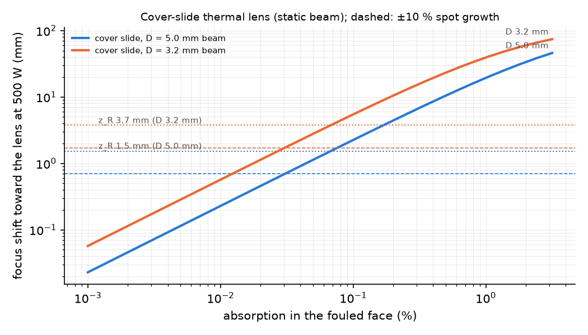

# Optics: the beam path checked end to end (2026-11-22)

For [PR #266](https://github.com/vertical-cloud-lab/digital-alloy-lab/pull/266) (issue #260). Sterling asked whether the
mechanical, electrical "and optical of course" components had been checked thoroughly. This note does the optics. It
follows the 500 W beam from IPG's single-mode fibre through the collimator, galvo, f-theta, chamber window and cover
slide to the plate, then covers power handling, laser-safety optics, the calibration and monitoring instruments, an
optics BOM, and what should change.

Nothing here has been built, measured, quoted by a vendor or reviewed by BYU's LSO. No lens prescription was used: the
f-theta is treated as a paraxial lens of f = 160 mm, and where an answer depends on data Thorlabs doesn't publish, it is
given as a range.

| File | What it is |
|---|---|
| [`analysis/optics/beam_path.py`](analysis/optics/beam_path.py) | Gaussian/ABCD beam with M², spot, depth of focus, focus position, apertures, field, irradiance, ghosts, back-reflection, safety optics → [`beam_path.md`](analysis/out/optics/beam_path.md) |
| [`analysis/optics/thermal_lens.py`](analysis/optics/thermal_lens.py) | thermal lens of the slide, window and f-theta: analytic, plus an axisymmetric finite-volume conduction solve → [`thermal_lens.md`](analysis/out/optics/thermal_lens.md) |
| [`analysis/optics/thermal_lens_ccx.py`](analysis/optics/thermal_lens_ccx.py) | CalculiX cross-check of one slide case → [`thermal_lens_ccx.md`](analysis/out/optics/thermal_lens_ccx.md) |
| [`analysis/optics/layer_camera.py`](analysis/optics/layer_camera.py) | the M6 camera from its mounted position: field, pixel size, depth of field, vignetting → [`layer_camera.md`](analysis/out/optics/layer_camera.md) |
| [`optics-bom.csv`](optics-bom.csv) | every optical element and instrument, with part numbers, prices, sources and the `bom.csv` line each replaces or adds |

Re-run: `python desktop-lpbf/analysis/optics/<script>.py` (each takes under a minute; run under `/tmp/capmem 1.5`).

## 0. What changes what we buy or draw

Ranked by consequence. Section numbers point to the evidence.

1. **The collimator in the model doesn't give the spot the layout was designed for (§1.1).** The model draws IPG's
   standard 5 mm collimator under the f = 160 mm lens. That gives a **48 µm** spot with a ±1.5 mm Rayleigh range, not the
   ~75 µm that [`low-profile.md`](low-profile.md) assumes. The model's label, "f = 30 mm, D ≈ 3.2 mm", is also off: with
   IPG's 140 mrad fibre divergence a 30 mm collimator gives D = 4.2 mm and a 57 µm spot. **For ~75 µm the beam must be
   D ≈ 3.2 mm, from a collimator of f ≈ 23 mm (21–25 mm over IPG's 130–150 mrad).** Ask IPG for it (its spec sheet
   offers "other diameters on request"), or buy a QBH collimator of that focal length, since the laser's default output
   is a QBH-compatible connector. If neither works, the 5 mm collimator with a 48 µm spot is usable but gives Al
   keyhole-level intensities at 300–400 W, and is twice as sensitive to focus.
2. **As drawn, the focus is 3.4 mm below the powder (§1.3).** The model sets the lens's flange focal length from the
   powder plane, but the 8 mm window and 3 mm slide push the focus down by t(1 − 1/n) = 3.41 mm. That puts the plate
   0.9 Rayleigh ranges out with the 3.2 mm beam (spot 101 µm instead of 75) or 2.2 out with the 5 mm beam (117 µm
   instead of 48). **Raise the lens 3.4 mm, and give the f-theta adapter ring ±3 mm of focus adjustment** (shims under
   its flange, or a fine-thread ring with a lock), set by a burn test at process power.
3. **The lid stack may cut off the outer part of the L75 plate (§1.4).** How far the beam leans at the plate depends on
   the f-theta's chief-ray angle, which Thorlabs doesn't publish. Written as k = (chief-ray angle at the plate) /
   (scan angle), the Ø36 field stop passes plates up to r = 19.7 mm at k = 0.3, 25.1 mm at k = 0.5 and 39 mm at
   k = 0.75, with the 5 mm beam. The plates are 12.7, 25.4 and 38.1 mm. The Ø42 bore under the window and the Ø50.8
   window itself also clip L75 at k ≤ 0.5. **Get the chief-ray data (Thorlabs' Zemax black box) or measure it with the
   guide laser before the lid is machined, and make the field stop an insert, one per module.**
4. **The cover slide is uncoated and, at 500 W, a consumable that has to stay almost perfectly clean (§2.2, §2.3).**
   - The Edmund 25-250 slide (A2) is uncoated: its two faces send 6.7 % of the beam, 34 W, back toward the lens, the
     galvo and the fibre end, and their ghosts come to a focus in or near the f-theta (thin-lens estimate). **Buy
     AR-coated slides.**
   - The slide's thermal lens grows the spot past +10 % once it absorbs about **0.01–0.03 %**. A light film (0.05 %)
     moves the focus 1.1–2.8 mm toward the lens; a fogged slide (0.5 %) moves it 10–23 mm; mech.md's 43.8 mm overstates
     it (§2.2). The ratio to the Rayleigh range doesn't depend on the beam size, so no collimator choice fixes this.
     **Inspect and swap the slide every build, and watch the coaxial photodiode's mean for drift during a build.**
5. **The f-theta has no CW rating, and its own absorption could move the focus by more than the depth of focus
   (§2.1–2.2).** Thorlabs gives the FTH160-1064 only a pulsed damage threshold. If the lens absorbs 0.05 % of 500 W, its
   thermal lens alone moves the focus 1.2 mm (5 mm beam) to 2.8 mm (3.2 mm beam), 0.75 Rayleigh ranges either way.
   **Ask Thorlabs for the glass, the coating absorption and a CW rating; if they can't give them, quote a fused-silica
   high-power f-theta.** In any case, find focus at process power, not at low power.
6. **A specular spot at the field centre sends the beam back into the fibre (§2.3).** A bare, polished plate, or a flat
   melt pool, within 3–5 mm of the lens axis acts as a cat's eye: up to ~440 W can couple back into the fibre core. The
   powder bed and real melt pools return far less, but the risk is real on first light and on bare plates. **Get IPG's
   back-reflection tolerance in writing (already open in L1); wire the laser's back-reflection alarm, if it has one, to
   the safety controller; bead-blast build plates; and make first light on powder, ramping the power.**
7. **The layer camera sees about half of each plate (§4.6).** The lid's Ø22 hole is drilled vertically, but the camera
   looks along a line 32.7° off vertical, so at the lid's underside the line of sight is 10.3 mm from the hole's centre.
   Only 40–56 % of each plate gets more than half the lens's light. **Drill the lid hole on the line of sight, at Ø30,
   with a Ø20 aperture under the camera window: then all three plates are fully seen.** Use a 12 mm C-mount lens
   (26 µm per pixel; the L75 plate fits the frame) with a ~2.2° Scheimpflug wedge, because the plate's near and far
   edges are ±21 mm apart along the line of sight.
8. **The power meter and the dump need cooling the machine no longer has (§4.1).** The quoted IPG laser is air-cooled,
   so L2 dropped to $0, but the BOM's dump (Thorlabs LB2L/M) is water-cooled and most 500 W heads are too. Pick a
   fan-cooled 500 W-class thermal head and mount it where the shutter dumps the beam, so every build starts with a power
   reading at the collimated beam.
9. **The melt-pool photodiode (T2) has no way to look down the beam (§4.5).** A coaxial signal needs a 45° dichroic
   between the shutter and the galvo that reflects 1070 nm and passes the visible and near-IR glow, plus a notch and a
   short-pass filter. The fold also lets the collimator lie along y.
10. **BOM text to fix:** L3 and L6 still describe f = 254 mm; L7 names a Ø1 in. 5 mm window (the model has Ø2 in. ×
    8 mm); T1 has no 500 W head; M6 has no lens, filter or Scheimpflug part; the README's block diagram says f = 254 mm.

## 1. Beam path

### 1.1 Fibre, collimator and spot

**Fibre.** IPG's spec for the YLR-500-U3-SM-AC gives M² 1.05 typical, 1.1 max, and a bare-QBH divergence of
130/140/150 mrad full angle at 86 % ([quote notes](quotes/ipg-ylr-500-u3-sm-ac.md)). For a near-Gaussian beam 86 % is
the 1/e² definition, so the fibre's output beam is 2W₀ = 4M²λ/(πθ) = **10.2 µm** across (9.5–11.0 µm). IPG's mode-field
diameter itself is not on the spec sheet; this is the value its divergence implies.

**Collimated beam and spot.** D = f_c·θ, and the spot is d = 4M²λf/(πD), the README's formula. With f = 160 mm, M² 1.1:

| Collimator | f_c (mm) | D (mm) | Spot (µm) | Rayleigh range (mm) | ±10 % spot growth (mm) |
|---|---|---|---|---|---|
| IPG standard, 5 mm beam (drawn) | 35.7 | 5.0 | 48 | ±1.53 | ±0.70 |
| IPG standard, 7.5 mm beam | 53.6 | 7.5 | 32 | ±0.68 | ±0.31 |
| f = 30 mm (the model's label) | 30 | 4.2 | 57 | ±2.17 | ±1.00 |
| **D = 3.2 mm (the 75 µm target)** | **22.9** | **3.2** | **75** | **±3.75** | **±1.72** |

The spread over 130–150 mrad is a few µm (the full table is in `beam_path.md`). For other targets: 60 µm needs
f_c = 28.5 mm, 70 µm 24.5 mm, 80 µm 21.4 mm, 90 µm 19.0 mm.

**Which spot.** Commercial Al machines run 70–100 µm (README §3.2). A 48 µm spot at 350 W is 3.9 × 10⁷ W/cm² peak,
roughly 2.5 times the 75 µm spot's, which pushes Al into keyhole mode and narrows the process window. It also halves
the Rayleigh range against every focus error below. So the 3.2 mm beam stays the target. Defocusing the 48 µm spot to
75 µm (1.8 mm out) works, but then the spot changes linearly with any focus error instead of quadratically.

### 1.2 Depth of focus against the layer, the plate growth and the powder surface

- **Layers** of 20–60 µm are 0.5–1.6 % of the 3.2 mm beam's ±1.72 mm (±10 %) depth of focus: irrelevant.
- **The plate stack grows ~112 µm at 200 °C** ([`powder-spreading.md`](powder-spreading.md)). The blade, not the plate,
  sets the powder surface, so once the blade gap is zeroed hot the powder plane stays at the focus. Even uncorrected,
  0.112 mm is 3 % of z_R (6.5 % with the 5 mm beam).
- **The bridge posts grow 70 µm** over a 50 K warm-up ([mech.md F](analysis/out/mech/mech.md)): negligible.
- **The powder surface doesn't rise** in this design, because the piston steps down each layer. On the engraver route
  (README §1b.2), where the tray is fixed, the surface rises by the build height (15–20 mm, 4–5 z_R), so that route
  needs its autofocus Z to follow every layer.
- **What does matter:** the plates' 3.4 mm shift (§1.3) and the thermal lens (§2.2), both larger than the depth of
  focus.

### 1.3 Where the focus lands

Fused silica has n = 1.4496 at 1070 nm (Malitson). A plate of thickness t in a converging beam moves the focus away by
t(1 − 1/n): 2.48 mm for the 8 mm window and 0.93 mm for the 3 mm slide, **3.41 mm** in all. The model places the
FTH160-1064's flange shoulder at z = 191.7 mm, its flange focal length, so the air focus is on the powder plane and the
real focus is 3.4 mm below it. The FTH160-1064 ships with its own Ø75 protective window (Thorlabs sells the FTHW75-1064
replacement), which its working distance already includes.

- **Fix:** raise the lens and bridge by 3.4 mm, or shorten the adapter ring by 3.4 mm, and keep ±3 mm of shim
  adjustment for the lens's working-distance tolerance and the thermal shift.
- **Slide tolerance:** Edmund's 3.00 ± 0.38 mm moves focus ±0.12 mm per slide. Small, but specify ±0.1 mm when
  ordering AR-coated slides.
- **Off axis** the plates' shift grows by only 0.001–0.009 mm at the L75 edge, their astigmatism is 0.002–0.13 mm, and
  they move the spot outward by 0.24–0.62 mm. The scan-field calibration absorbs that, so **calibrate with the window
  and slide in place.**
- **Spherical aberration** from 11 mm of glass at NA 0.01–0.016 is under λ/1000: negligible.

### 1.4 Apertures and clipping

- **Galvo.** The basiCube 20's Ø20 aperture is 4–6 beam diameters across: the clipped fraction is 10⁻¹⁴ (5 mm beam) to
  10⁻³⁴ (3.2 mm). The 7.5 mm option is still only 7 × 10⁻⁷. No diffraction ripple either: the aperture is well over the
  1.5–2× rule of thumb.
- **f-theta input.** The beam walks d·tanθ across the lens's Ø39 input as it scans. With the mirrors 30–60 mm above
  the nose, the L75 edge (θ = 13.6°) walks 7–15 mm, plus 3.75 mm for 1.5 beam radii, inside the 19.5 mm radius. The
  lens is specified for beams up to 12 mm, so 3.2–5 mm is well inside its design.
- **The lid stack** is the problem. The table gives the largest plate radius each opening passes with less than 0.1 %
  clipped, for three values of k, the chief-ray angle at the plate over the optical scan angle (k = 1 is a lens with
  its stop at the lens, k = 0 a telecentric one):

  | Beam | k | Lid bore Ø56 (z 120–125) | Drawer opening Ø46 | Field stop Ø36 (z 131–136) | Bore under window Ø42 | Retaining ring Ø44 |
  |---|---|---|---|---|---|---|
  | 5 mm | 0.3 | 32.4 | 26.1 | **19.7** | 23.8 | 25.8 |
  | 5 mm | 0.5 | 40.3 | 32.8 | **25.1** | 30.9 | 35.8 |
  | 5 mm | 0.75 | 59 | 49 | 39 | 50 | 60 |
  | 3.2 mm | 0.3 | 33.7 | 27.5 | **21.2** | 25.4 | 27.7 |
  | 3.2 mm | 0.5 | 42.0 | 34.6 | **27.1** | 32.9 | 38.5 |
  | 3.2 mm | 0.75 | 60 | 52 | 42 | 54 | 60 |

  Plates: S25 12.7, M50 25.4, L75 38.1 mm. Thorlabs doesn't publish k for the FTH160-1064. A thin-lens estimate with
  the mirrors where the model has them (z ≈ 273) gives k ≈ 0.3, but the lens's front principal plane is unknown, so k
  could be anywhere from about 0.3 to 0.8. **Until it is known, the lid stack as drawn cannot be relied on to reach the
  L75 plate edge.** At k = 0.3 even the window would have to be Ø64.
- **The field stop's job** is to keep a runaway galvo off the chamber walls. Its reach (beam centre on the stop's edge)
  is 23.9 / 30.5 / 48 mm at k = 0.3 / 0.5 / 0.75. One fixed stop can't both pass L75 and stop the beam just past S25,
  so a per-module insert (or one sized for L75, accepting a reach a little past it) is the honest design.

### 1.5 Field: scan angle, incidence, ellipticity and distortion

| Plate | r (mm) | Optical scan angle | Mirror angle | Angle at the plate (k 0.3–0.75) | Spot elongation |
|---|---|---|---|---|---|
| S25 | 12.7 | 4.5° | ±2.3° | 1.4–3.4° | 0.03–0.18 % |
| M50 | 25.4 | 9.1° | ±4.5° | 2.7–6.8° | 0.11–0.71 % |
| L75 | 38.1 | 13.6° | ±6.8° | 4.1–10.2° | 0.26–1.6 % |

- The FTH160-1064's 110.6 × 110.6 mm field is 2.9 times the L75 plate's width, so all three plates sit in its centre.
- Spot ellipticity is at most 1.6 % at the L75 edge, well inside the 3 % spread of IPG's M² tolerance.
- f-theta distortion and the plates' outward shift (0.24–0.62 mm at the L75 edge) are static, so the scanner's
  correction table takes them out. Thermal drift of the galvo is larger: ~0.24 mm at the plate over a warm-up
  ([mech.md F](analysis/out/mech/mech.md)). Calibrate warm, and re-register on fiducials every few hours.
- **Telecentricity** sets the cat's-eye zone (§2.3) and the lid-stack clipping (§1.4). Both need the real k.

## 2. Power handling

### 2.1 Irradiance on every surface at 500 W

Thorlabs rates CW damage by linear power density, P/D in W/cm, because CW damage is thermal. Both are given:

| Surface | 5 mm beam: Ø (mm), peak (W/cm²), P/D (W/cm) | 3.2 mm beam: Ø, peak, P/D | Rating found |
|---|---|---|---|
| Collimator output | 5.0, 5.1 k, 1.0 k | 3.2, 12 k, 1.6 k | IPG builds it for the laser |
| Shutter mirror and dump (closed) | 5.0, 5.1 k, 1.0 k | 3.2, 12 k, 1.6 k | dump rated 500 W (LB2L/M) |
| Galvo mirrors (×0.71 on the 45° face) | 5.0, 5.1 k, 1.0 k | 3.2, 12 k, 1.6 k | basiCube 20: 1000 W at 1064 nm (README §3.2) |
| f-theta input | 5.0, 5.1 k, 1.0 k | 3.2, 12 k, 1.6 k | **pulsed only, 5 J/cm² (10 ns)** |
| f-theta protective window | 5.7, 3.9 k, 0.9 k | 3.7, 9.6 k, 1.4 k | as above |
| Chamber window (top / bottom) | 4.8 / 4.6, 5.6–6.0 k, 1.1 k | 3.1 / 2.9, 14–15 k, 1.7 k | none (no part chosen) |
| Cover slide (top / bottom) | 4.0 / 3.9, 8.0–8.2 k, 1.3 k | 2.6 / 2.5, 19–20 k, 2.0 k | none (uncoated Edmund 25-250) |
| Plate (focus) | 0.048, 5.5 × 10⁷ | 0.075, 2.3 × 10⁷ | — |

Most of the beam path sees 1–2 kW/cm of linear power density. Thorlabs' own CW ratings for its -C coated optics are
given in the same unit (see the BOM notes for the values found). The f-theta and the galvo mirrors are the parts whose CW rating has
to come from the vendor: SCANLAB states 1000 W for the basiCube 20; Thorlabs states nothing for CW. A smaller beam
raises the irradiance 2.4× on every surface but the plate.

### 2.2 Thermal lensing

A plate that absorbs a fraction of the beam becomes a weak positive lens, because its centre is hotter, and fused
silica's index rises with temperature. `thermal_lens.py` solves the steady radial heat flow in the real slide and window
(rim held at the mount temperature, faces losing heat by radiation and convection in argon). It integrates the optical
path through the thickness, χ = dn/dT + (n − 1)(1 + ν)α = 9.87 × 10⁻⁶ /K for fused silica, and fits the
beam-weighted defocus. A lens h above the focus moves it toward the lens by Δz = h²D/(1 + hD).

| Element at 500 W, static beam | Absorbed | Focus shift, 5 mm beam | 3.2 mm beam | × z_R |
|---|---|---|---|---|
| Slide, clean, uncoated | 0.008 W | 0.04 mm | 0.09 mm | 0.02 |
| Slide, clean, AR both faces (2 × 30 ppm, assumed) | 0.033 W | 0.15 mm | 0.37 mm | 0.10 |
| Slide, light film 0.05 % | 0.25 W | **1.1 mm** | **2.8 mm** | 0.74 |
| Slide, fogged 0.5 % | 2.5 W | **10 mm** | **23 mm** | 6–7 |
| Slide, sooted 2 % | 10 W | 33 mm | 60 mm | 16–22 |
| Window, clean, AR | 0.038 W | 0.18 mm | 0.43 mm | 0.11 |
| Window, light film 0.05 % | 0.25 W | 1.1 mm | 2.8 mm | 0.74 |
| f-theta, fused silica, 0.02 % total | 0.1 W | 0.46 mm | 1.1 mm | 0.3 |
| f-theta, fused silica, 0.05 % total | 0.25 W | **1.2 mm** | **2.8 mm** | 0.75 |
| f-theta, N-BK7-type glass, 0.3 % total | 1.5 W | 5.7 mm | 13 mm | 3.6–3.7 |

- **The ratio to the Rayleigh range is the same for both beams.** The thermal lens scales as 1/w² and the Rayleigh
  range as 1/D², so a smaller or larger beam doesn't buy margin. Only absorption does.
- **The ±10 % spot-growth limit is 0.46 z_R.** The slide must absorb less than ~0.03 % to stay inside it, and a clean
  AR-coated window, slide and fused-silica lens already use ~0.5 z_R between them. So set focus at process power.
- **Check against the literature.** Measured shifts were −22 to −30 mm at 400 W with ~0.5 % absorption on a
  contaminated window ([LiM 2017](https://www.wlt.de/lim/Proceedings2017/Data/PDF/Contribution31_final.pdf), via
  low-profile.md). The model gives 8–18 mm at 400 W for this geometry: the same order.
- **Check against mech.md E.** mech.md gives 43.8 mm for 500 W at 0.5 %. Its lens power (P·dn/dT/2πkw²) agrees with
  the beam-weighted fit here (the fit is 0.49 of the centre's curvature). But it puts the slide 145 mm up, not 126 mm,
  and uses Δz = f²D with f = 160 mm. With the slide where the model has it, the same case gives 23 mm.
- **Time constants:** ~1 s for the beam-sized hot spot, ~110 s for the whole slide. A small coupon near the centre
  sees the static case; scanning spread over the plate lowers it.
- **CalculiX, Faas et al. and Edison** cross-checks are in §2.2a.

### 2.2a Cross-checks: CalculiX, the literature and Edison

**CalculiX** (`thermal_lens_ccx.py`): a 2° sector of the slide, C3D6 wedges at the axis and C3D8 bricks elsewhere, 840
elements, the absorbed power in the bottom element row, the rim held at the mount temperature and h = 10 W/m²K on the
faces. It agrees with the finite-volume solve within 1 %:

| Case (500 W) | ΔT centre, CalculiX / finite volume | Lens power, CalculiX / FV | Focus shift, CalculiX / FV |
|---|---|---|---|
| 3.2 mm beam, slide fogged 0.5 % | 302 / 296 K | 1.767 / 1.781 m⁻¹ | 22.9 / 23.1 mm |
| 5 mm beam, slide fogged 0.5 % | 257 / 253 K | 0.715 / 0.718 m⁻¹ | 10.4 / 10.5 mm |
| 3.2 mm beam, light film 0.05 % | 30.2 / 29.6 K | 0.177 / 0.178 m⁻¹ | 2.7 / 2.8 mm |

**Faas et al. 2018** measured the thermal focal shift of processing optics up to 525 W as Δf/z_R ≈ D*·P/(λM²), with
D* = 0.55 × 10⁻⁶ mm/W for a new fused-silica lens with a good wavelength-specific coating and 1.16–1.27 × 10⁻⁶ mm/W for
used uncoated lenses ([doi:10.1364/oe.26.026020](https://doi.org/10.1364/oe.26.026020), via Edison r5-optics-review).
At 500 W that is **0.23 z_R per good lens and 0.5 z_R per used one**. It confirms two things here: the shift in Rayleigh
ranges doesn't depend on beam size, and a multi-element f-theta plus window plus slide, all clean, already adds up to
about half a Rayleigh range. In this model, one good lens corresponds to ~0.015 % absorption.

**A sapphire slide cuts the thermal lens tenfold** for the same absorption (`thermal_lens.py`, c-plane, 2 mm): 0.5 %
fogging moves the focus 1.1 mm (5 mm beam) or 2.6 mm (3.2 mm beam), 0.7 z_R, against 6–7 z_R for fused silica. Its
conductivity (27 against 1.38 W/m·K) spreads the heat. It raises the "clean enough" limit from ~0.03 % to ~0.3 %.
Edison r5-optics-review suggests crystalline quartz, sapphire or the athermal glass aThermoXX for the window; the window
sits behind the slide and stays clean, so the slide is where the upgrade pays.

### 2.3 Ghosts and back-reflection

**Plane surfaces.** Uncoated fused silica reflects 3.37 % per face, a good AR coat ~0.25 %:

| Source | Power sent back toward the head | Into the fibre core | Comment |
|---|---|---|---|
| Uncoated slide, both faces | 2 × 16.8 W | 2–15 mW | the returned beam focuses 5–15 mm from the fibre end and spreads 0.4–1 mm wide on the QBH connector |
| AR slide, both faces | 2 × 1.25 W | < 1 mW | |
| AR window, both faces | 2 × 1.25 W | < 1 mW | |

- **No window tilt is needed for the fibre.** A plane surface 126–183 mm above the focus returns a beam whose waist is
  250–370 mm out of place, so its overlap with the fibre mode is 10⁻⁴–10⁻³.
- **The real cost of the uncoated slide is the 34 W it sends back up the beam.** Most lands on the f-theta, the galvo
  mirrors' surroundings, the collimator and the QBH end. In a thin-lens estimate its ghosts converge in or just above
  the f-theta (z ≈ 218–236). AR coating cuts this 13-fold. A tilt only moves the ghost sideways, so it doesn't help.

**The melt pool and the plate (cat's eye).** A flat mirror at the focus sends the beam back along its own path into the
fibre core. Off axis, a non-telecentric lens tilts the returned cone by 2× the chief-ray angle, which decouples it:

| W into the core at R 0.9 (500 W) | r = 0 | 1 mm | 2 mm | 3 mm | 5 mm | 8 mm |
|---|---|---|---|---|---|---|
| 5 mm beam, k 0.3 / 0.75 | 441 | 416 / 308 | 350 / 104 | 263 / 17 | 104 / 0.05 | 11 / 0 |
| 3.2 mm beam, k 0.3 / 0.75 | 441 | 383 / 183 | 251 / 13 | 124 / 0.2 | 13 / 0 | 0.05 / 0 |

- These are upper bounds for a flat, specular, perfectly focused reflector. Powder scatters, and a melt pool is curved,
  so real returns are a small fraction of this. The NIST AMMT coating failure (README §3.2) shows the risk is real.
- **What protects the laser:** IPG's back-reflection tolerance (to be confirmed in writing, L1); a back-reflection
  alarm wired into the safety controller as a laser fault; bead-blasted plates; first light on powder at reduced power.
  A free-space isolator at 500 W randomly polarised is a specialist part (quote). Moving the plate off the lens axis
  doesn't help, because L75 covers the axis wherever it sits.

## 3. Laser-safety optics

Same MPE (5 mW/cm², t ≥ 10 s at 1070 nm) and method as [`safety.md`](safety.md) §4 and `safety_calcs.py`:

| Beam state | Full angle | NOHD | safety.md |
|---|---|---|---|
| Bare fibre (unplugged QBH) | 130–150 mrad | 25–27 m | 25 m |
| Collimated, 5 mm / 3.2 mm | 0.30 / 0.47 mrad | 11.9 / 7.6 km | 11.9 km |
| Out of the focus, 5 mm / 3.2 mm beam | 31 / 20 mrad | **114 / 178 m** | 114 m |
| Specular off bare Al (R 0.9), 5 mm / 3.2 mm | 31 / 20 mrad | 108 / 169 m | 108 m |

- safety.md's numbers hold for the 5 mm beam. **With the 3.2 mm collimator the NOHD out of the focus grows to 178 m.**
  Either way it is "the whole room", so the enclosure, not distance, has to contain it.
- **Eyewear** for the direct beam needs OD ≥ 5.4 (safety.md: OD 6 minimum, 7 for margin). See the BOM row for S6's
  rating at 1070 nm.
- **Guard burn-through** (1.6 mm 5052, the same 1-D lower bound as safety_calcs.py, no conduction): at 150 mm past the
  focus, 0.39 s hot / 1.95 s cold with the 5 mm beam, 0.16 / 0.80 s with the 3.2 mm beam. The smaller beam makes the
  guard's job harder, which is one more reason the chamber, not the guard, is the primary barrier. Only a test on the
  real panel settles it (safety.md §4.3).
- **The viewing window (S5)** must never see a direct or specular path; the chamber has no viewport, and the camera
  window carries a 1070 nm filter (§4.6).

## 4. Calibration and monitoring

### 4.1 Power

- **Where to measure.** The beam can't be measured at the plate at full power: it is focused there, and a thermal head
  wants a few kW/cm² at most. So measure the absolute power where the beam is collimated, and the train's transmission
  separately:
  1. **At the shutter's dump port, at full power.** Mount a thermal head as the shutter's dump, or in place of it, so
     closing the shutter puts the collimated 3.2–5 mm beam on the head. At 500 W that is 2.5–6.2 kW/cm² averaged over
     the beam, so check the head's density rating, or use the 5 mm beam for this one measurement. Every build then starts
     with a logged power reading at no extra effort, which trends the laser.
  2. **Through the f-theta, window and slide, at ~50 W.** Put the head just above the window, then just below the slide,
     and compare with the dump reading. At 50 W the 2.5–4 mm beam is under 1 kW/cm². Expect ~1–2 % loss with AR-coated
     parts and ~8 % with the uncoated slide.
- **Which head.** No 500 W head is in the BOM (T1). The machine has no chiller any more (L2 is $0 with the air-cooled
  IPG), so a fan-cooled head is the practical choice. The candidates and prices are in [`optics-bom.csv`](optics-bom.csv).
- **The commissioning dump** (L4, Thorlabs LB2L/M) is water-cooled. Either run it from a tap with a flow switch during
  commissioning, or use the fan-cooled power head as the dump.

### 4.2 Focus

- **Burn tests set the focus, at process power.** The piston can raise the plate 8 mm (its exchange overtravel) and
  lower it 40 mm, so a Z-scan needs no extra hardware:
  1. On a bead-blasted 6061 plate, burn single 10 mm tracks at 350–500 W and 1 m/s, stepping the plate from −3 to
     +3 mm in 0.25 mm steps (0.1 mm near the minimum).
  2. Measure track widths under a microscope; the narrowest is the focus. Shim the lens to it.
  3. Repeat after 10 minutes with the beam in the dump at full power. The difference is the thermal shift of the
     collimator, galvo and f-theta (the window and slide are downstream of the dump).
  4. Repeat after a build on a used slide. The difference is the slide's share.
- **A tilted coupon** (a 2–3° wedge) gives a continuous Z-scan in one track and is quicker for routine checks.
- **Optional caustic measurement:** a camera beam profiler behind a high-power beam sampler measures D and M² of the
  collimated beam (and so the collimator) before the galvo is fitted. Profiling the 75 µm focus itself at 500 W needs a
  focus monitor (PRIMES FocusMonitor, Ophir BeamWatch AM), a $20k-plus instrument; borrow one rather than buy it.

### 4.3 Scan field

- **Correction table.** Mark an 11 × 11 cross grid (7.5 mm pitch over Ø75) on black-anodised aluminium coupons, with
  the window and slide in place and the machine warm. Measure the crosses with a flatbed scanner at 2400 dpi (10.6 µm
  pixels; check its scale against a glass target) or a measuring microscope. Feed the errors to the scan controller's
  correction file (SCANLAB correXion pro with the RTC; a table for the other controllers).
  The f-theta's distortion, the plates' 0.24–0.62 mm outward shift at the L75 edge and the mirror mounting errors all
  come out in one step.
- **Drift.** The galvo drifts ~0.24 mm at the plate over a warm-up (mech.md F). Laser-mark two fiducial crosses outside
  each part and re-register on them with the layer camera every few hours. At 26 µm per pixel, centroiding finds a
  cross to ~5 µm.
- **The layer camera itself** is calibrated with a glass dot-grid target (§4.6).

### 4.4 Guide laser

- The IPG has a 0.1–1 mW red guide laser (Class 2M) on the same fibre. Use it to align the collimator, galvo and lens,
  to check the field stop, and to trace where ghosts go.
- **Don't use it for focus or the field calibration.** The f-theta is coated and corrected for 1020–1080 nm. In fused
  silica, n is 1.4565 at 650 nm against 1.4496 at 1070 nm, so a fused-silica singlet's focal length is ~1.5 % shorter in
  the red: the red focus sits ~2.4 mm higher, and the field scale differs by ~1.5 %, 0.6 mm at the L75 edge. The real
  lens is several glasses, so treat these as the size of the effect.
- **It is the cheapest way to measure k** (§1.4) before the lid is machined: put a card on the plate, steer the galvo
  to the field edge, step the piston down 20 mm, and the spot moves outward by 20·tan(u′).

### 4.5 Melt-pool monitoring

- **The coaxial photodiode needs a dichroic in the collimated beam.** As far as the brochure shows, the basiCube 20 has
  no camera or detector port, so the emission has to be picked off between the shutter and the galvo, where the galvo
  has already de-scanned it.
  - Fold the beam 90° with a 45° short-pass dichroic that reflects 1070 nm and passes 400–1000 nm. The laser then
    reflects off a dielectric HR coat and never crosses the substrate, which avoids a thermal lens and astigmatism in
    a tilted plate.
  - Edison r5-optics-review describes the opposite layout (laser transmitted, emission reflected), which is also used.
    Reflecting the laser is the safer one at 500 W.
  - The fold lets the collimator lie along y, which real-parts.md suggested for the guard clearance.
- **Detector chain:** the PDA36A2 (T2) behind a 1064/44 notch (OD 6) and a 1000 nm short-pass, with a f ≈ 25–50 mm lens.
  Set the gain for ≥ 100 kHz bandwidth: at 1 m/s a 75 µm spot crosses itself in 75 µs.
- **What it gives:** a scalar melt-pool intensity per scan vector, good for spotting lack-of-fusion, keyholing, a dirty
  slide (the mean falls) and focus drift. Calibrated temperature needs two-colour pyrometry, which is a later upgrade.
- **Off-axis:** the only view into the chamber is the layer camera's port. The Pi HQ camera's frame rate is for layers,
  not melt pools.

### 4.6 Layer camera (M6)

`layer_camera.py` traces rays from the three plates through the openings the model draws, to a sampled entrance pupil
(assumed 10 mm behind the lens front), and projects them onto the IMX477 sensor (4056 × 3040, 1.55 µm pixels):

| Lens | Pixel on the plate, across / along the tilt | Fits in the frame | Depth of field at f/4 (2 px blur) | Scheimpflug tilt |
|---|---|---|---|---|
| 6 mm CS-mount | 54 / 64 µm | all three | 31 mm | 1.1° |
| **12 mm C-mount** | **26 / 31 µm** | **all three** | 7.5 mm | **2.2°** |
| 16 mm C-mount (Raspberry Pi) | 19 / 23 µm | S25, M50 (not L75) | 4.1 mm | 3.0° |
| 25 mm C-mount | 12 / 14 µm | S25 only | 1.6 mm | 4.8° |

- **Vignetting as drawn:** only 56 / 46 / 40 % of the S25 / M50 / L75 plate gets more than half the pupil's light,
  with any of the lenses. The far half of every plate is dark. The cause is the lid's vertical Ø22 hole, which the
  tilted line of sight leaves 0.7 mm inside its edge at the lid's underside. Drilled on the line of sight at Ø22, S25 and
  M50 are fully seen and L75 84 %. **At Ø30 through the lid and boss with a Ø20 aperture under the window, all three
  plates are fully seen.**
- **Pixel size against the powder:** with the 12 mm lens a 30–40 µm D50 particle is 1.2–1.5 pixels. Single particles
  aren't resolved, but streaks, short feeds, spatter and lifted edges (≥ 100 µm) are 4 or more pixels wide. That is
  finer than most layer cameras in the literature. The 16 mm lens gives 19 µm on S25 and M50.
- **Depth of field:** the plate's near and far edges differ by ±7 / ±14 / ±21 mm along the line of sight (S25 / M50 /
  L75). Without a tilt, the L75 edges blur by ~290 µm at f/4 with the 12 mm lens. A **2.2° wedge** between the lens and
  the sensor (Scheimpflug) brings the whole plate into focus at f/2.8–4. At f/8 diffraction alone is 77 µm on the plate.
- **Lighting:** the model has an LED bar on the +x wall at z 30–38, 14° above the plate. Its light runs along x,
  parallel to the recoater's streaks, so streaks cast little shadow. Add a second bar on the back (+y) wall for light
  across them, and take one image per bar. Its specular reflection leaves away from the camera, so bare metal shows
  dark and powder bright, which is the contrast wanted. Inside the chamber the LEDs must survive vacuum cycles: no
  potting, no silicone.
- **The 1070 nm filter** is drawn as a coating on the camera window. As a real part it is a Ø25 mm notch or short-pass
  filter behind a plain window. The HQ camera's own IR-cut filter isn't rated at 1070 nm.
- **Temperature:** the chamber reaches 61–78 °C over a 10 h build (mech.md D), and the HQ board's electronics are
  rated to about 50 °C. Stand the camera off the boss on a short insulating tube, or give it an air feed.

## 5. Optics BOM and gaps

## 6. Edison's second opinion (r5-optics-review)

[`edison/r5-optics-review/answer.md`](edison/r5-optics-review/answer.md) critiqued the same beam path with sources.

**Where it agrees with this note, and adds evidence:**
- Thermal focal shift is the main optical risk, contamination dominates it, and focus must be found by Z-scan burn
  tests cold and after a soak, then trended. Its Faas et al. figures (§2.2a) fit the model here.
- A marking-grade f-theta can't be qualified from a pulsed LIDT: get the CW absorption, the thermal-shift data and a
  warranty, or budget an industrial fused-silica lens (Sill S4LFT class).
- Back-reflection: get IPG's written limit, monitor reflected power, never fire on smooth bare plate at normal
  incidence, avoid stationary exposure at the field centre.
- A dedicated gas knife for the slide is needed in addition to the cross-flow. The model's knife has no slot and sits
  14–20 mm below the slide (gas-flow.md §3.3), so that is open. Slides every 1–3 builds for Mg/Zn alloys; replace on a
  measured criterion.
- Commissioning kit and melt-pool monitoring: a coaxial photodiode via a dichroic and notch filter first, an off-axis
  camera next, two-colour pyrometry last.
- Laser safety: no universal burn-through time exists for 1.6 mm aluminium; test the real guard. Edison prefers steel
  or a double wall. That is for safety.md; the smaller 3.2 mm beam makes the guard's job harder (§3).

**Where this note disagrees:**
- **"Use f = 254 mm with the 7.5 mm beam for edge-spot quality."** That pairing gives a 51 µm spot, not 75 µm. f = 254
  with the 5 mm beam gives 76 µm, but puts the galvo 116 mm higher, which the low-profile layout's VLM height doesn't
  have (581 mm against a 695 mm bay). The edge penalty it is avoiding is small here: the angle at the L75 edge is
  4–10°, a 0.3–1.6 % elongation, and a 3.2–5 mm beam uses a quarter to two-fifths of the lens's 12 mm design beam, so
  its field aberrations are far below their design limit. Keep f = 160 mm and fix the collimator (§0 item 1).
- **"Tilt the window 1–2° so its ghosts don't go back into the galvo and fibre."** The window's and slide's
  reflections couple only 10⁻⁴–10⁻³ of their power into the fibre core, because they return 250–370 mm out of focus
  (§2.3). A 1–2° tilt moves the ghost 1–4 mm at the lens, so it still lands on the lens and galvo; dumping it would take
  a ~20° tilt. AR coating both faces (and the slide) cuts the ghost power 13-fold, which is what helps. A tilt is
  harmless optically (astigmatism ~0.001 mm), so it is fine if the mount allows it, but it isn't needed.
- **"5 mm beam on a 20 mm aperture is less safe than 7.5 mm."** Both clip under 10⁻⁶ on the galvo (§1.4). The binding
  apertures are in the lid stack, and they favour a smaller beam.
- **Dichroic layout:** Edison describes the laser passing through the dichroic. Reflecting the laser off it keeps 500 W
  out of the substrate (§4.5).

## 7. What was and wasn't checked

- **Checked:** spot, Rayleigh range and depth of focus for every collimator option; where the focus lands in the model;
  clipping on the galvo, the lens input and every opening in the lid stack for three chief-ray assumptions; field
  geometry; irradiance on every surface; the thermal lens of slide, window and lens with two numerical models
  (finite-volume and CalculiX) against the analytic form, Faas et al. and LiM 2017; ghosts and fibre coupling of every
  plane surface; the melt-pool cat's eye; NOHD, eyewear OD and guard bounds against safety.md; the layer camera's
  field, pixel size, depth of field and vignetting by ray trace through the model's openings.
- **Not checked (needs data or hardware):** the f-theta's chief-ray angle, distortion, field curvature, glass and CW
  absorption (Thorlabs doesn't publish them; ask for the Zemax black box); IPG's mode-field diameter and back-reflection
  limit (open in L1); the basiCube 20's mirror clear aperture at full scan and its CW rating at our beam size; the
  ghost foci through the real lens (only a thin-lens estimate here); real melt-pool return fractions; LED and camera
  heat in the chamber; the guard burn test.
- **Assumed:** AR coatings absorb 30 ppm per face, fused silica 20 ppm/cm; the HQ camera's entrance pupil 10 mm behind
  the lens front; the slide's rim is at the drawer temperature; plates and lens are paraxial.

## Sources

1. IPG spec G22-29856 for YLR-500-U3-SM-AC, transcribed in [`quotes/ipg-ylr-500-u3-sm-ac.md`](quotes/ipg-ylr-500-u3-sm-ac.md).
2. Thorlabs FTH160-1064 and FTH254-1064, FTHW75-1064: [`vendor-lookups.csv`](vendor-lookups.csv), fetched 2026-11-13T23:45Z, https://www.thorlabs.com/newgrouppage9.cfm?objectgroup_id=6430; drawing stn012046 (vendor-parts.csv).
3. SCANLAB basiCube brochure (2025-06), https://www.scanlab.de/sites/default/files/2025-06/SCANLAB-basiCube-Series-EN.pdf, and README §3.2.
4. I. H. Malitson, "Interspecimen comparison of the refractive index of fused silica", JOSA 55, 1205 (1965).
5. Corning 7980 data (k 1.38 W/m·K, dn/dT 9.6 × 10⁻⁶ /K near 1 µm, α 0.52 ppm/K), as used in [mech.md](analysis/out/mech/mech.md) E.
6. S. Faas et al., "Determination of the thermally induced focal shift of processing optics for ultrafast lasers with average powers of up to 525 W", Opt. Express 26, 26020 (2018), https://doi.org/10.1364/oe.26.026020 (via Edison r5-optics-review).
7. A. Laskin, "On the selection of materials for high-power laser optics…", Opt. Eng. 60, 115105 (2021), https://doi.org/10.1117/1.oe.60.11.115105 (via Edison r5-optics-review).
8. Focus shift with a contaminated window, LiM 2017 contribution 31, https://www.wlt.de/lim/Proceedings2017/Data/PDF/Contribution31_final.pdf (via low-profile.md).
9. ANSI Z136.1 MPE as tabulated in the NIU manual, via [`safety.md`](safety.md) and `safety_calcs.py`.
10. Raspberry Pi HQ camera (Sony IMX477, 4056 × 3040, 1.55 µm): https://www.raspberrypi.com/documentation/accessories/camera.html.
11. W. J. Smith, *Modern Optical Engineering*, 4th ed.: plane-parallel plate focus shift t(1 − 1/n) and astigmatism.
12. Edison r5-optics-review: [`edison/r5-optics-review/answer.md`](edison/r5-optics-review/answer.md) and its references.
13. Model geometry: [`cad/lpbf_low.py`](cad/lpbf_low.py) (parameter block P and section 7), [`cad/vendor_parts.py`](cad/vendor_parts.py).
