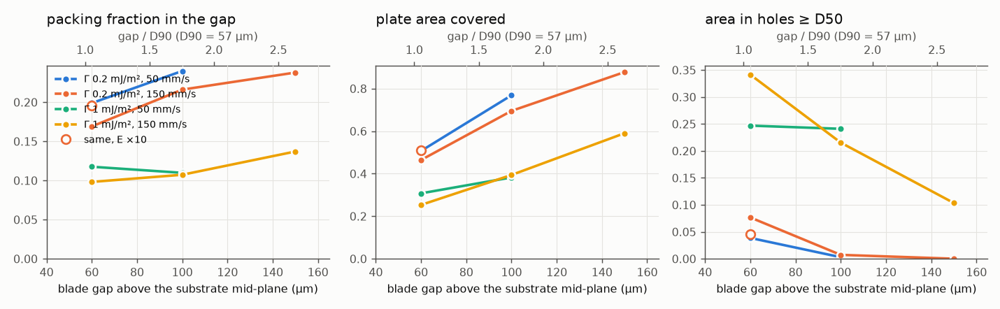
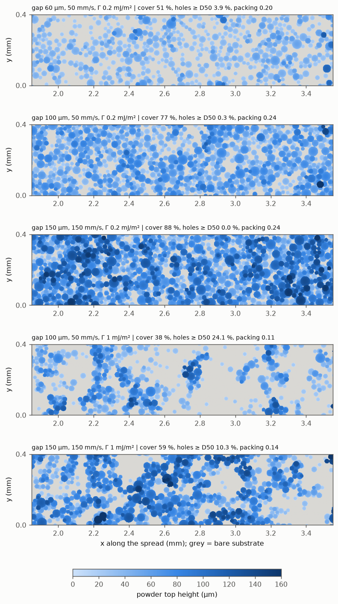
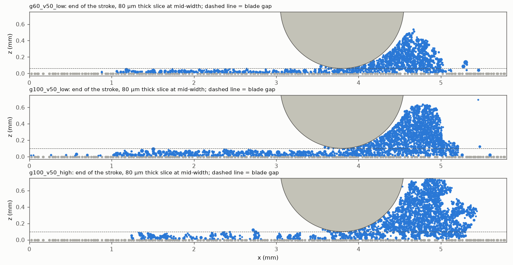
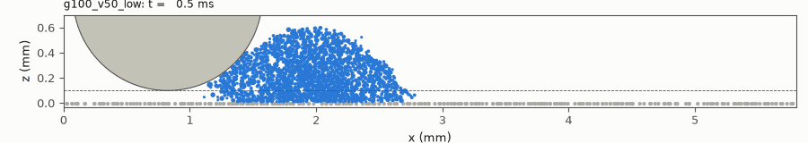

# Powder spreading: theory and DEM for the desktop LPBF (issue #260)

What one recoater pass does with our Al powders: a theory script (cohesion, gaps, speed, loads, the 200 °C plate,
cross-flow) and LIGGGHTS DEM runs of the HSS wide-nose blade. Nothing here has been checked on hardware. The DEM
uses a softened contact model, so read its absolute numbers as lower bounds and its trends as the result.

| File | What it is |
|---|---|
| [`analysis/powder/powder_theory.py`](analysis/powder/powder_theory.py) | theory numbers → [`out/powder/theory.md`](analysis/out/powder/theory.md), `theory.json` |
| [`analysis/powder/dem_spread.py`](analysis/powder/dem_spread.py) | writes, runs and post-processes one LIGGGHTS case; inputs as run are in [`analysis/powder/inputs/`](analysis/powder/inputs/) |
| [`analysis/powder/dem_figures.py`](analysis/powder/dem_figures.py) | the PNGs and the GIF below |
| [`out/powder/dem_results.md`](analysis/out/powder/dem_results.md), `g*.json` | results table and one JSON per case |

## Short answer

- **The blade barely feels the powder.** In the DEM the blade drag is 8–45 mN and the lift 8–170 mN per metre of
  blade. On the 70 mm M50 blade that is ≤ 3 mN of drag. The machine's real pile is 2–5× heavier per metre than the
  DEM's (20 against 4–11 mN/m for M50), so expect ≤ ~15 mN. The FEA's 10 N spreading case is ~1000× that. What loads the blade is a coarse
  particle jammed against the part: 0.3–1.3 N each *(calc)*, i.e. 0.1–0.4 µm of holder deflection. **The HSS blade
  and the 18 × 31 mm holder are stiff enough. The risk is streaks, not deflection.**
- **Cohesion matters more than the recoater settings.** Raising the work of adhesion Γ from 0.2 to 1.0 mJ/m² (Bond
  number of a D50 particle 13 → 66) halved the packing (0.24 → 0.11). It left 10–34 % of the plate in holes wider
  than D50 at every gap and speed tried. Slowing the blade helped only at the 60 µm gap (holes 34 → 25 %). Dry, fines-cut powder handled in argon
  buys more than any recoater change.
- **Gap.** For the drier powder (Γ 0.2), a 60 µm gap (≈ D90) covered 46–51 % of the plate. 4–8 % of the plate was
  in holes ≥ D50, and coarse particles were squeezed under the nose. 60 µm is the steady layer that 30 µm steps give
  at 50 % packing. A 100 µm gap (1.75 × D90) covered 70–77 % with < 1 % holes. 150 µm (2.6 × D90) covered 88 % with
  none. On a part with Rz 10 µm, 13 % of the powder mass is too coarse to pass a 60 µm gap *(calc)*.
- **Speed.** 50 mm/s instead of 150 mm/s gave +10–18 % packing and +9–11 % coverage for the drier powder. For the
  cohesive one it helped at the 60 µm gap and did nothing at 100 µm. A 100 mm stroke at 50 mm/s takes 2 s, which is negligible next to scanning. **Spread at
  ≤ 50 mm/s, and at 25 mm/s for a new powder.**
- **The layer comes out finer than the feed.** The > 43 µm fraction is 16–25 % in the layer against 28 % in the
  feed (27 % in the widest cohesive case), and D[4,3] drops by up to 3 µm. The coarse part stays in the pile and goes to the overflow, so sieve the overflow
  before reuse.
- **The 200 °C plate lifts its own top by ~110 µm** against a cold zero *(calc)*: the 10 mm plate, the 14 mm heater
  block and the Macor standoffs all grow. That is more than three 30 µm layers. **Zero the blade gap hot.** Log the
  drift too: the holder plus blade move ~0.9 µm/K, and a 180 mm aluminium Z path ~4 µm/K.
- **Cross-flow.** Laminar argon at 2–2.5 m/s puts the wall friction velocity at 0.7–1.0× the pick-up threshold of
  the coarsest (~60 µm) particles near the inlet (Shao & Lu). Cohesion holds the fines harder. At 4 m/s it is
  1.2–1.5×, so the coarse end starts to move. The 200 °C gas
  changes this by < 5 %. P54's headroom to 4 m/s therefore needs a pick-up test per powder. Keep the flow
  ≤ 2.5 m/s while the blade moves.
- **Dose.** At low cohesion the blade lays 12, 23 and 35 µm of solid-equivalent powder at 60, 100 and 150 µm gaps.
  `budgets.py` doses 27 µm per layer (1.8 × 0.5 × 30 µm). That is enough in steady state but short for first layers
  spread at 100–150 µm. **Dose by the gap, not by Δz**: about 2.5–3 for the first layers, then 1.8.

### Recommended settings (to confirm on the phase 0 rig)

| Powder | D90 (µm) | Δz | First layers on a bare plate | Steady gap over parts | Blade | Speed |
|---|---|---|---|---|---|---|
| Gas-atomised AlSi10Mg, 15/20–63 µm (D50 ~35 µm) | 52–57 | 30 µm | 120 µm (≥ 2 × D90 + Rz, as P02), on a 1–2 mm sacrificial base (P03) | builds itself to Δz/φ ≈ 75–150 µm; check it is ≥ 1.5 × D90 | HSS wide nose | 50 mm/s |
| Gas-atomised Al-Mg-Sc-Zr, 20–63 µm | ~55 | 30 µm | 120 µm | same | HSS (no silicone: Si pickup matters) | 50 mm/s |
| Fines-rich cut, 15–45 µm (D90 ~40) | ~40 | 20–30 µm | 90 µm | ≥ 60 µm | HSS; roller if holes persist | 25 mm/s |
| Ultrasonic (rePOWDER) Al alloys, d50 45–65 µm† | ~80–100 *(assumed)* | 40–60 µm | ≥ 200 µm | ≥ 150 µm | HSS | 50 mm/s |

† d50 range from the Edison feedback in [`edison-trajectories/informal-feedback-competitive-strategy.md`](../edison-trajectories/informal-feedback-competitive-strategy.md), not measured on our powders.

If a powder behaves like the Γ 1.0 case, no blade setting tried here gets the holes below 10 %. That is the case for
bringing the roller module forward. Haeri et al. (2017a) and Brocksieper et al. (2026, via Edison) found rollers give
denser or smoother layers than blades, and Jabri 2024 found forward rotation helps (README §3.3).

## 1. Inputs from the design

| Item | Value | Source |
|---|---|---|
| Layer step Δz | 30 µm (20–60 µm range) | `budgets.py`, README §3.3 |
| Recipe blade gap | 0.05 mm blade to plate | `low-profile.md` clearance table, `cad/lpbf_low.py` `blade_gap` |
| Blade | HSS, 1.5 mm thick, wide (rounded) nose; 45 / 70 / 95 mm dose lines (S25 / M50 / L75), Ø75 blade 104 mm | `low-profile.md` §3, `cad/module_params.py` |
| Holder | 18 × 31 mm 6061, 3.4 µm at 10 N (FEA case 4, 18 × 19 holder; the 31 mm one is not re-run) | `analysis/out/fea/fea.md`, `modules.md` |
| Speed | 20–100 mm/s, start at 10–50 | README §3.3 |
| Dose factor | 1.8 relative to a 50 % packed nominal layer | `budgets.py` |
| Plates | Ø25 / Ø50 / Ø75 modules, 200 °C (500 °C reserved) | `modules.md` |
| Powder | AlSi10Mg and Al-Mg-Sc-Zr, ~20–63 µm, D50 35–40 µm | Edison query, README |
| Cross-flow | 2 m/s design, ≥ 2.5 m/s measured target, headroom to 4 m/s | README, pain points P54 |

**PSD used everywhere here (assumed, not measured):** log-normal by volume, D50 36 µm, σ_ln 0.36, sieved 15–63 µm.
That gives D10 / D50 / D90 = 22.7 / 35.2 / 52.0 µm. Below 20 µm sits 4.7 % of the mass and 22 % of the particles.
The DEM tables quote gap/D90 against 57 µm, the D90 before the 63 µm cut. Against 52 µm the ratios are 10 % higher.

## 2. Theory ([`theory.md`](analysis/out/powder/theory.md) has every number)

**Cohesion.** Oxidised Al particles touch through their few-nm Al₂O₃ film. With A = 15 × 10⁻²⁰ J ([Bergström
1997](https://doi.org/10.1016/S0001-8686(97)00003-1)) and z₀ = 0.4 nm, two smooth D50 spheres would pull 1.4 µN,
a Bond number of ~2200. Nanometre asperities cut this sharply. The single-scale model of [Rabinovich et al.
2000](https://doi.org/10.1006/jcis.2000.7167) (λ = 200 nm) gives:

| asperity rms | F, D50 pair | Bo at 20 / 36 / 63 µm | JKR-equivalent Γ |
|---|---|---|---|
| 1 nm | 146 nN | 1090 / 227 / 53 | 3.4 mJ/m² |
| 3 nm | 42 nN | 345 / 65 / 14 | 0.98 mJ/m² |
| 10 nm | 11 nN | 100 / 18 / 3.5 | 0.27 mJ/m² |

The DEM's two levels bracket this range. Γ 0.2 mJ/m² (Bo 43 / 13 / 4) sits near rms 10 nm. Γ 1.0 mJ/m² (Bo 214 / 66 / 22)
sits near rms 3 nm and matches the DEM-calibrated AlSi10Mg values: 0.8 mJ/m² ([Ye 2026](https://doi.org/10.1080/27525783.2026.2694875))
and 0.5–3.5 mJ/m² ([Girnth 2024](https://doi.org/10.1007/s40964-023-00543-3)), both via Edison. Every size in the cut
has Bo > 10 at rms 3 nm (Bo > 3.5 even at rms 10 nm), so these powders are cohesive. The fines dominate: Bo grows as 1/D² for vdW.

**Moisture.** A full water meniscus between two D50 spheres pulls 4 µN (Bo ~6600). One meniscus on a 50 nm asperity
pulls 23 nN (Bo ~38), about the same again as all the dry vdW. In argon at a −40 °C dew point (RH 0.4 % at 25 °C) the
Kelvin radius is 0.09 nm, so no bridges form. At 30–50 % RH in lab air it is 0.4–0.75 nm, and asperity menisci form.
So filling and sieving in the glovebox and drying the powder (vacuum, ~200 °C, 2 h, as in the Edison answer) belong
to spreading, not only to hydrogen porosity (P15).

**What fits under the blade.** On a part with Rz 10 µm, the share of the powder mass too coarse to pass is 95 % at a
30 µm gap, 35 % at 50 µm and 13 % at 60 µm. Nothing is too coarse at 75 µm or more. On a bare plate the 60 µm figure
falls to 2 %. This is why the first layer on a bare plate jams at the 0.05 mm recipe gap, as Heriot-Watt's rigid
spreaders did at 50 µm ([Bidare 2017](https://doi.org/10.1016/j.addma.2017.06.007), P02).

**Speed.** At 50 mm/s the blade passes one D50 in 0.70 ms. At 150 mm/s it takes 0.23 ms. A particle needs 2.7 ms to
fall its own diameter. Faster spreading leaves less time for particles to drop into voids, so packing falls.
[Haeri 2017a](https://doi.org/10.1016/j.powtec.2016.11.002) found this, and so did Salehi 2023 via Edison (47 → 25 %
from 10 to 100 mm/s).

**Blade loads.** One 30 µm layer doses 0.036 / 0.144 / 0.326 g (S25 / M50 / L75). That is a pile weighing 8 / 20 /
34 mN per metre of dose line, so pushing it takes millinewtons. A 57–63 µm particle flattened 5–20 µm between the blade
and the part at ~1.3 GPa (hardness assumed) carries 0.3–1.3 N. At the holder's 0.34 µm/N that is 0.1–0.4 µm of
deflection.

**The 200 °C plate.** With a cool piston head, the plate top rises 42 µm (10 mm plate), 62 µm (14 mm block) and
7 µm (8 mm Macor): **112 µm in total**. Over the build, aluminium hanging below the recoater rail lowers the blade
edge by ~0.9 µm per K (31 mm holder + 18 mm HSS blade). A 180 mm aluminium Z path moves the plate ~4.3 µm per K. A
60 µm powder layer reaches plate temperature with a ~30 ms time constant, so the spread layer gives up its adsorbed
water at once, into the gas just above the plate. The dose pile stays cool until it crosses the plate. vdW cohesion
barely changes at 200 °C.

**Cross-flow.** This uses the threshold friction velocity of [Shao & Lu 2000](https://doi.org/10.1029/2000JD900304),
with a cohesion term of γ = 1.65 × 10⁻⁴–3 × 10⁻⁴ N/m. That is the same order as 1.5πΓR*/R for Γ 0.2–1 mJ/m². It is
compared with Blasius wall shear 20–50 mm from the nozzle:

| U (m/s) | u* at 20 / 50 mm (m/s) | threshold u*t, D 20 / 36 / 63 µm (m/s) | u*/u*t, worst |
|---|---|---|---|
| 2.0 | 0.16 / 0.13 | 0.26 / 0.20 / 0.18 | 0.88 |
| 2.5 | 0.19 / 0.15 | same | 1.04 |
| 4.0 | 0.27 / 0.21 | same | 1.48 |

These figures are for argon at 25 °C. At 200 °C the threshold rises ~25 % and the wall shear rises about as much. A
bed that the blade has just disturbed, and the loose top of the pile, lift more easily than this static estimate
suggests.

## 3. DEM (LIGGGHTS 3.8, one core)

**Set-up.** The domain is periodic across the blade (0.4 mm wide, ~7 × D90) and 5.8 mm along the spread. The blade
is a 1.5 mm HSS blade with a full-radius 0.75 mm nose, drawn as an STL mesh. It moves 3.0 mm at 50 or 150 mm/s after
the pile settles (2.5 ms at 10 g, then 1.5 ms at 1 g). The substrate is a flat wall with 1,292 fixed 30 µm spheres
standing 10 µm proud (35 % cover), in place of the last lased layer. The pile holds 1.8 × (0.5 × gap × travel ×
width) of solid powder, which is `budgets.py`'s dose factor applied to the gap: 3,773 / 6,288 / 9,433 particles at
60 / 100 / 150 µm. The contact model is Hertz–Mindlin with tangential history, SJKR cohesion and EPSD2 rolling
resistance, with ρ 2680 kg/m³, ν 0.30, e 0.60, μ 0.50 and μ_r 0.10 (Girnth 2024 and Ye 2026 ranges, via Edison).
The PSD is the one above, cut at 20 µm and put into six mass-weighted bins (22.6–56.4 µm). Each bin is its own atom
type, so cohesion can be set per size pair.

**Why E = 0.5 MPa, and how cohesion was scaled.** The real modulus is 75 GPa, which would need a ~2 ns time step.
Softening it 1.5 × 10⁵× gives:
- **Time step.** dt = 0.2 × the Rayleigh time of the smallest particle (R 11.3 µm): 9.0 × 10⁻⁷ s, or 72k steps for a
  50 mm/s pass. LIGGGHTS' own `check/timestep/gran` agrees: its only warnings are "dt is 20.000009 % of Rayleigh".
- **Overlaps.** The 99th-percentile powder–powder overlap at the end of each run is 0.5–3.1 % of the smaller
  diameter. Overlaps > 5 % appear only at the 60 µm gap: 5–17 contacts squeezed under the nose, which is the jam.
- **Contact time.** The Hertz contact time of a D50 pair is 3–8 % of the time the blade takes to move one D50.
- **Cohesion.** SJKR's pull-off force is (2/3)π³k³R*²/E*². Each type pair's k is set so that this equals JKR's
  1.5πΓR*: k = (9ΓE*²/(4π²R*))^⅓. So k scales as E^⅔, and each pair keeps the real pull-off force. The Bond numbers
  are therefore the physical ones.

What softening does not preserve is the adhesion *energy* per contact, which grows as E^−⅔. Soft particles stick
too readily on contact, and packing comes out low. A check run at 10× the modulus (5 MPa, gap 60 µm, 150 mm/s)
raised packing from 0.169 to 0.195 and coverage from 0.46 to 0.51. Holes fell from 7.7 % to 4.6 %. Lift on the blade
rose from 0.15 to 0.95 N/m because the jammed particles push back harder. **So the DEM packing and coverage are lower
bounds, and the high-cohesion case is pessimistic.**

**Results** (zone 1.85–3.55 mm, the steady part of the stroke; Γ is the work of adhesion; the full table with
roughness, segregation, dose used and blade forces is in [`dem_results.md`](analysis/out/powder/dem_results.md)):

| gap (µm) | gap/D90 | v (mm/s) | Γ (mJ/m²) | packing in gap | solid-equiv. layer (µm) | coverage | holes ≥ D50 | Sa (µm) | > 43 µm in layer (feed 0.28) | blade Fx / Fz (mN/m) | run (min) |
|---|---|---|---|---|---|---|---|---|---|---|---|
| 60 | 1.05 | 50 | 0.2 | 0.199 | 12.1 | 0.51 | 3.9 % | 17.9 | 0.16 | 37 / 170 | 8.5 |
| 60 | 1.05 | 150 | 0.2 | 0.169 | 11.8 | 0.46 | 7.7 % | 23.7 | 0.19 | 33 / 147 | 1.0 |
| 60 | 1.05 | 150 | 0.2, E × 10 | 0.195 | 13.0 | 0.51 | 4.6 % | 23.0 | 0.20 | 122 / 953 | 6.8 |
| 100 | 1.75 | 50 | 0.2 | 0.240 | 23.6 | 0.77 | 0.3 % | 24.8 | 0.20 | 11 / 14 | 10.8 |
| 100 | 1.75 | 150 | 0.2 | 0.216 | 21.7 | 0.70 | 0.7 % | 29.8 | 0.23 | 12 / 17 | 3.2 |
| 150 | 2.63 | 150 | 0.2 | 0.238 | 35.3 | 0.88 | 0.0 % | 33.8 | 0.25 | 8 / 8 | 3.5 |
| 60 | 1.05 | 50 | 1.0 | 0.118 | 7.7 | 0.31 | 24.7 % | 16.7 | 0.18 | 45 / 161 | 6.0 |
| 60 | 1.05 | 150 | 1.0 | 0.098 | 6.0 | 0.25 | 34.1 % | 12.6 | 0.19 | 30 / 114 | 1.9 |
| 100 | 1.75 | 50 | 1.0 | 0.110 | 11.2 | 0.38 | 24.1 % | 25.9 | 0.18 | 17 / 22 | 6.1 |
| 100 | 1.75 | 150 | 1.0 | 0.107 | 11.2 | 0.39 | 21.5 % | 27.2 | 0.19 | 20 / 28 | 3.0 |
| 150 | 2.63 | 150 | 1.0 | 0.137 | 20.4 | 0.59 | 10.3 % | 40.5 | 0.27 | 21 / 23 | 2.2 |

Notes on the columns:
- *Packing in gap* is the powder volume between the substrate mid-plane and the gap, divided by the free volume.
- *Coverage* is the share of the plate area under a particle, seen from above.
- *Holes ≥ D50* is the share of the area where a D50 disc fits without touching powder.
- Fx is drag and Fz lift, per metre of blade, averaged over the middle half of the stroke.

In every run, 74–90 % of the pile was still in front of the blade at the end, so no layer was short-fed.

*Packing, coverage and holes against the gap. The hollow marker is the 10× stiffer check.*

*Top views of the measured zone, shaded by powder height; grey is bare substrate. The Γ 1.0 layers break into clumps
with bare lanes between them.*

*End of the stroke in an 80 µm slice. The layer behind the blade is mostly one particle thick even at a 100 µm gap.
The pile rides on the nose.*

**Run times.** One core per case, `OMP_NUM_THREADS=1 /tmp/capmem 3 liggghts`:
- 1.0–3.5 min at 150 mm/s (28k steps);
- 6.0–10.8 min at 50 mm/s (72k steps);
- 6.8 min for the 10× stiffer check (89k steps).

Each case has 3,800–9,400 moving particles plus 1,292 fixed ones. LIGGGHTS warns that this contact-model combination
is not on its pre-compiled whitelist, which only means the generic (slower) code path. Dumps are in `/tmp/powder/`.

## 4. DEM against theory and the literature

- **Gap/D90.** Salehi 2023 (via Edison) needs ~2 × D90 for continuous layers of free-flowing powder and 3–4 × D90
  for cohesive ones. Burgess (via Edison) sees quality fall below ~1.5 × D90. Here the drier powder is near
  continuous at 1.75–2.6 × D90 and patchy at 1.05 × D90. The cohesive powder still has 10 % holes at 2.6 × D90.
  [Nan 2018](https://doi.org/10.1016/j.powtec.2018.07.030) traces empty patches to particles jamming in the gap. The
  DEM shows those jams (contacts squeezed > 5 %) only at the 60 µm gap, where theory puts 13 % of the mass above the
  clearance.
- **Adhesion.** [Meier 2019a](https://doi.org/10.1016/j.jmatprotec.2018.10.037) found particle size and adhesion
  are the critical influences on layer uniformity, and [Meier 2019b](https://doi.org/10.1016/j.powtec.2018.11.072)
  measured cohesion in fine metal powders. Here Γ outweighs gap and speed.
- **Speed.** The DEM loses 10–15 % of its packing from 50 to 150 mm/s (Γ 0.2), and Sa rises 5–6 µm.
  Brocksieper 2026 (via Edison) found AlSi10Mg layers markedly rougher at 250 mm/s than at 50–150 mm/s.
- **Packing.** The DEM's 0.17–0.24 for the drier powder is less than half the bulk density of gas-atomised
  AlSi10Mg (apparent 0.52, tapped 0.56: Kraner 2020 via Edison). It sits at the low end of Salehi's DEM range (15–33 %
  for 10–30 µm gaps) because the contacts are too soft, as above. Measured single-layer packing
  ([Wischeropp 2019](https://doi.org/10.1016/j.addma.2019.04.019), [Mindt 2016](https://doi.org/10.1007/s11661-016-3470-2))
  is what the phase 0 rig should reproduce.
- **Steady layer.** Lu 2026 (via Edison) and [Bidare 2017](https://doi.org/10.1016/j.addma.2017.06.007) put the
  steady powder layer at Δz/φ. With φ 0.2–0.4 that is 75–150 µm for 30 µm steps, not 60 µm. So the steady gap over
  parts ends up near the 1.5–2.5 × D90 that the DEM likes, but the first layers do not.
- **Size segregation.** The finer layer matches the gap-passage numbers at 60 µm. At 100–150 µm, where every
  particle fits, the drier powder's layer is still depleted in coarse particles, so it is dynamic: coarse particles
  ride the rolling pile.

## 5. What to change or check

**Recoater design**
1. **Zero the gap at temperature.** The plate top rises ~110 µm on heating, and the cold 0.05 mm recipe gap would
   become a strike. Add a hot touch-off (a gauge between blade and plate at 200 °C), or a non-contact height reading
   of the plate at each pass (an eddy-current or laser-line sensor on the carriage; not specified or priced here).
   Re-check after 30 min, since the slow drift is ~1–4 µm/K.
2. **Make the first-layer gap a recipe step.** Spread the first 3–5 layers at ≥ 2 × D90 + Rz (120 µm for the 15–63 µm
   powders) on a sacrificial base, then step to Δz.
3. **Dose by the gap.** The recipe should compute the dose from the gap and a deposit fraction measured on the rig
   (0.20–0.24 × gap for the drier powder, 0.10–0.14 for the cohesive one). Use ~2.5–3 on the 0.5 × 30 µm basis for the first layers, then 1.8.
4. **Speed default 50 mm/s,** 25 mm/s for new powders, with the S-curve finished before the plate edge.
5. **Jam detection needs a force sensor near the blade.** 1 N at the blade is ~1.8 mN·m at the 10 mm-lead screw
   *(calc)*, below what the servo's torque reading and the shaft seal's friction will resolve. Servo torque catches
   strikes (P08), not single jammed particles. A strain gauge on the holder web would catch both.
6. **Sieve the overflow** before reuse, since it is coarse-enriched.
7. **Keep the cross-flow ≤ 2.5 m/s while the blade moves.** Raise it for scanning only after the per-powder pick-up
   test.

**Blade choice.** The HSS wide nose stays the default for gas-atomised Al-Si and Al-Mg-Sc-Zr: loads are millinewtons
and its stiffness is not in question. Its weakness is the rigid nose at gaps near D90, where coarse particles jam.
Avoid that with the first-layer gap above, not with a softer blade. Keep the compliant cartridge for Al-Si builds
that strike curled edges (P01, P02). Bring the roller forward if a powder behaves like the Γ 1.0 case.

**Phase 0 spreadability rig, per powder, cold and at 200 °C:**
1. Weigh what one pass deposits on the plate at gaps of 60, 80, 100, 120 and 150 µm and speeds of 25, 50, 100 and
   150 mm/s. That gives packing and the deposit fraction for the dose (DEM: 0.20–0.24 of the gap as solid for the drier case).
2. Score coverage and holes ≥ D50 from the layer camera on the same grid. Find the gap where holes fall below 1 %
   (DEM: between 60 and 100 µm for dry powder).
3. Run the same powder as received, vacuum-dried, and after an hour in lab air. If it moves like the DEM's
   Γ 0.2 → 1.0, humidity control is critical.
4. Sieve what lands on the plate, the feed and the overflow, to check segregation (DEM: > 43 µm 16–25 % against
   28 %).
5. Heat to 200 °C and measure the plate-top rise against temperature (dial indicator or laser; expect ~110 µm).
   Then zero hot and repeat items 1–2.
6. Put a few 80–100 µm steel or Al balls on the plate and record the holder strain or servo torque. That calibrates
   the jam and strike signal.
7. Run the cross-flow at 2.5 and 4 m/s over a spread layer for 10 min. Weigh or image the loss to find each
   powder's pick-up limit (P54).
8. Compare HSS, the compliant cord, and later the roller on the most cohesive powder.

## 6. Limits

- **Soft contacts.** E is 1.5 × 10⁵× softer than real. Pull-off forces are right, but contact adhesion energy is too
  high, so packing and coverage are lower bounds. The only stiffness check (10×) moved packing by 15 %. A 75 MPa run
  would take ~10× longer per case and was not done.
- **Cohesion model.** SJKR with pull-off matched to JKR per size pair. There is no long-range vdW, no capillary
  bridges, no electrostatics and no gas. Γ is not calibrated to our powders: the two levels bracket the theory and the
  published AlSi10Mg calibrations.
- **Particles.** Spheres, with shape and satellites carried only by rolling friction. The PSD is assumed, not
  measured, and cut at 20 µm, which drops 4.7 % of the mass and 22 % of the particles (the most cohesive ones).
- **Geometry.** One pass over a fixed rough substrate, closest to an early layer over a part. It does not model
  spreading over loose powder from earlier layers, or the steady state.
- **Domain.** 0.4 mm wide and 1.7 mm measured, so holes larger than ~0.4 mm across cannot form and the statistics
  are thin. There is one seed per case, so the case-to-case noise is unknown; treat differences under ~0.02 in
  packing as noise.
- **Pile.** The DEM pile is lighter per metre than the machine's, so blade forces were scaled by pile weight. The
  jam force is a hardness estimate, not a simulation.
- **Thermal and cross-flow numbers.** These are hand estimates. The vertical stack heights are from `modules.md`.
  The aluminium length hanging below the recoater rail and the nozzle-to-plate distance were not taken from the CAD.
