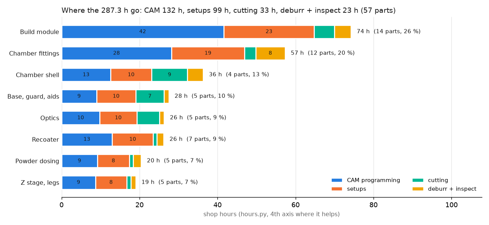
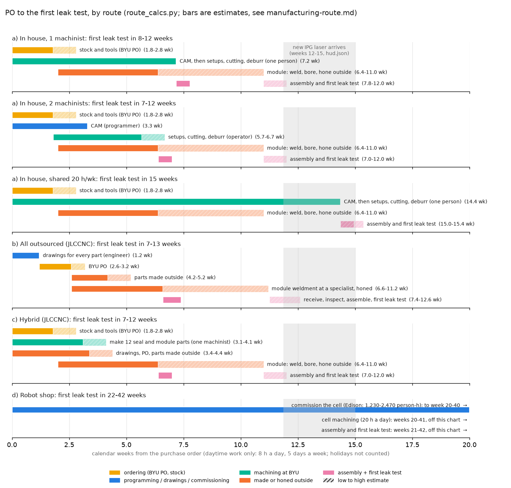

# Manufacturing route: where the 287 shop hours go, what each route costs and takes, and how to get the chamber made

Round 7, 2026-11-25, for [PR #266](https://github.com/vertical-cloud-lab/digital-alloy-lab/pull/266) (issue #260). Sterling
asked: is 287.3 h mostly the chamber; what do in-house and outsourced routes cost and take, daytime hours only; how do
others build chambers like this; should the chamber be printed (LPBF or DED) and touched up, or made another way; and would
more standard parts help. The numbers come from [`route_calcs.py`](../analysis/route/route_calcs.py). Nothing here has been
ordered, built or quoted by a person; the live quotes are instant web prices read on 2026-11-25.

## The answer

- **The 287.3 h is not the chamber.**
  - The frame and floor plate are 24.9 h (8.7 %). The whole shell (frame, floor, lid, door) is 36.3 h (12.6 %).
  - 46 % of the total is CAM programming (132 h) and 34 % is setups (99 h). Cutting is 33 h (12 %).
  - Each of the 57 parts carries a floor of about 3.5 h of CAM, setups and inspection, however small it is. 25 parts take
    4 h or less each: together 90 h, with 2.7 h of cutting.
- **Printing the chamber would not change that.** JLC3DP priced the frame and floor as one printed body at $4,826.37 in
  316L and $2,916.58 in its SLM aluminium, with a 3-day build (live, before review).
  - Finishing it here would still take 10-14 h, against 24.9 h to machine it. That saves 11-17 h, or 4-6 % of the total.
  - In aluminium it costs about the same as machining: $3,767 against $3,896 at $65/h. In 316L it is about $2k more, and
    21.8 kg instead of 7.4 kg.
  - The CAM for the machined frame and floor is already written and simulated.
- **What cuts the hours is making fewer parts at BYU.**
  - **The plan:** make only the 12 seal and module parts here (86 h of machining). Buy 12 as catalogue parts and send the
    other 33 to an instant-quote CNC service. JLCCNC's live prices for those 33 come to about $2,334 (7-day build plus
    2-4 days UPS); US instant-quote prices and estimates come to about $10.2k.
  - **BYU time:** 134 h, of which 90 h is machining and welding, and 44 h is drawings, receiving inspection and fitting
    the catalogue parts.
  - **Cost** (labour at BYU's $65/h, plus parts, stock and tools):

    | Route | All-in cost |
    |---|---:|
    | **Hybrid (recommended)** | **about $19.6k** |
    | All in house | $28.7k |
    | All outsourced to JLCCNC | $11.1k |
    | All outsourced at US prices | $33.2k |

    The all-JLCCNC route is the cheapest. But it rests on a frame price JLCCNC would only give as a manual quote, and on a
    Chinese shop holding Ra 0.8 µm seal lands from drawings.
- **Calendar time, PO to the first leak test.** Daytime only: 8 h a day, 5 days a week.

  | Route | Weeks |
  |---|---:|
  | All in house, one machinist | 8-12 |
  | All in house, two machinists | 7-12 |
  | All in house, shop shared at 20 h a week | 15 |
  | All outsourced | 7-13 |
  | Hybrid | 7-12 |
  | Robot shop | 22-42 |

  - **The module sets the date in most routes.** Its weld, bore and outside honing loop takes 3-6 weeks of honing that no
    shop has quoted.
  - **With a new IPG laser,** the laser (weeks 12-15) sets the first print in every route except the shared shop and the
    robot shop. With a used laser, the parts set it.
- **How others do it.**
  - **Small machines don't pump down.** None of the commercial machines with builds of 150 mm or less publishes a vacuum
    purge. They flow-purge glovebox-style enclosures to 0.1-0.3 % O₂: MySint100, TruPrint 1000, XM200, MetalONE.
  - **The machines that pump down are larger:** Renishaw AM250/400/500 and 3D Systems' DMP 320/350/500. They sell a
    "vacuum chamber"; no maker publishes how it is built.
  - **Research rigs buy stock vacuum hardware:** a CF spherical octagon, a Parr vessel, or a large vacuum chamber with an
    acrylic box inside.
  - **Diamond Light Source printed** an aluminium vacuum vessel of almost our size: 60 h on an SLM 500HL, £12,350 with
    machining (MEDSI 2018).
  - Our vacuum-purged, machined-plate chamber is the better choice for aluminium, because the vacuum step pulls water out
    of the powder. Edison agrees (r7).
- **Recommendation: route (c), the hybrid.**
  - Keep the machined through-frame and floor plate.
  - Get a honing quote before anything else; it is the long pole.
  - Ask JLCCNC for the frame's manual quote as a second source.
  - Keep the printed aluminium body as a fallback for when the VF-4 queue, not the money, is the constraint.

## 1. Where the 287.3 h go

From [`hours.csv`](../analysis/out/machining/hours.csv) (hours.py, round 6, 57 parts, a 4th axis where it saves a setup);
per part in [`route-hours-by-part.csv`](route-hours-by-part.csv) and by group in [`route-hours-by-group.csv`](route-hours-by-group.csv).

| Activity | Hours | Share | Basis (hours.py) | One-off or repeated |
|---|---:|---:|---|---|
| CAM programming | 132.1 | 46.0 % | 0.5 h + 0.6 h per setup + 0.015 h per hole, +1 h for lathe-and-mill parts: an estimate, no published rule | once: the programs are reused for another machine |
| Setups | 98.6 | 34.3 % | 0.75 h per vise setup, 1.25 h over 300 mm, +0.75 h for the first rotary setup (MMS survey median: 68-90 min) | every batch, whatever the quantity |
| Cutting | 33.2 | 11.6 % | dfm.py's conservative removal rates | every machine |
| Deburr + inspect | 23.2 | 8.1 % | 0.25 h a part, 1 h for a part with a sealing face | every machine |
| **Total** | **287.3** | | 302.3 h with 3-axis setups only | |

- **One-off against repeated.** CAM is 46 % and one-off, setups are 34 % and paid once per batch, and cutting plus
  deburr is 20 % and paid per machine. A second machine made later would take about 155 h. Two made together would take
  344 h, or 172 h each.
- **Per-part overhead.** CAM, setups and deburr add up to 254 h (88 %).

**By group** (the chamber's share in bold):

| Group | Parts | CAM | Setups | Cutting | Deburr + inspect | Total | Share |
|---|---:|---:|---:|---:|---:|---:|---:|
| Build module M50 and its clamps (body, gland plate, piston, plate, heater, rod end, handle, zero-point parts) | 14 | 41.6 | 23.2 | 5.2 | 4.2 | 74.3 | 25.9 % |
| Chamber fittings (drawer, windows, camera boss, feedthroughs, door hardware) | 12 | 28.2 | 18.7 | 2.9 | 7.5 | 57.2 | 19.9 % |
| **Chamber shell: frame, floor plate, lid, door** | **4** | **12.6** | **10.5** | **9.2** | **4.0** | **36.3** | **12.6 %** |
| Base plates, stands, guard and robot aids | 5 | 9.0 | 10.0 | 7.3 | 1.2 | 27.5 | 9.6 % |
| Optics bridge and beam path | 5 | 9.8 | 9.5 | 5.8 | 1.2 | 26.5 | 9.2 % |
| Recoater | 7 | 13.0 | 10.5 | 0.9 | 1.8 | 26.2 | 9.1 % |
| Powder dosing and overflow | 5 | 9.2 | 8.2 | 1.0 | 2.0 | 20.4 | 7.1 % |
| Z stage and legs | 5 | 8.7 | 8.0 | 1.1 | 1.2 | 18.9 | 6.6 % |

**The chamber, specifically:**

| | Hours | Share of 287.3 h |
|---|---:|---:|
| Frame (16.2) + floor plate (8.7) | 24.9 | 8.7 % |
| + lid (6.8) and door (4.6): the shell | 36.3 | 12.6 % |
| + the module body (7.2): spigot, flange, cylinder, weld | 43.5 | 15.1 % |

- **Frame and floor cutting.** Of their 24.9 h, cutting is 7.4 h by dfm.py's conservative rates, 3.3 h at vendor feeds
  plus 45 min on the waterjet, and 2.2 h in the posted G-code. The G-code figure leaves out the taps, reamers and port tool.
- **Their CAM is mostly done.** FreeCAD posted the programs and CAMotics cut them clean in round 6
  ([`machining.md`](../machining.md)). So most of their 8.5 h of CAM is already spent.

**Top 10 parts by hours:**

| Part | Group | Total | CAM | Setups | Cutting | Deburr + inspect |
|---|---|---:|---:|---:|---:|---:|
| Process chamber body (through-frame) | Chamber shell | 16.2 | 5.7 | 4.5 | 5.05 | 1.0 |
| Base plate, process module (MIC-6) | Base | 8.8 | 2.1 | 2.5 | 3.97 | 0.25 |
| Chamber floor plate | Chamber shell | 8.7 | 2.8 | 2.5 | 2.38 | 1.0 |
| Piston head M50 | Build module | 8.6 | 5.2 | 3.0 | 0.12 | 0.25 |
| Optics bridge | Optics | 8.2 | 1.9 | 2.5 | 3.53 | 0.25 |
| Base plate, gas module (MIC-6) | Base | 7.5 | 1.8 | 2.5 | 2.97 | 0.25 |
| Build module M50 (spigot, flange, honed 316L cylinder) | Build module | 7.2 | 4.1 | 1.5 | 0.58 | 1.0 |
| Camera viewport adapter + boss | Chamber fittings | 7.1 | 3.6 | 2.2 | 0.28 | 1.0 |
| Build plate M50 | Build module | 7.0 | 4.5 | 2.2 | 0.03 | 0.25 |
| Chamber lid | Chamber shell | 6.8 | 2.4 | 2.0 | 1.38 | 1.0 |

The top 10 are 86 h (30 %). The other 47 parts average 4.3 h each.

**The repo's other counts of the same work, and why they differ:**

| Source | Parts | Hours | Why it differs |
|---|---:|---|---|
| hours.csv, round 6 (this note) | 57 | 287.3 (302.3 with 3-axis setups) | the basis here |
| [`machining.md`](../machining.md) 48-part table (2026-11-20): CAM 116, setups 85, cutting 28, deburr 21 | 48 | 250 (264) | nine fewer parts (zero-point posts, plates and arms; the jar's grip fin; latch and sensor brackets; PB1 rails; the pull tab) |
| [`outsourcing.md`](../outsourcing.md) "make everything" (2026-11-22, model 9f45d80) | 82 | 329 | 268.2 h of machined parts (quantities multiplied, round-5 model), plus 41.5 h for 18 sheet parts and 19.0 h for 14 robot tooling items |
| [`robot-shop.md`](../robot-shop.md) "by hand" (2026-11-20) | 48 | 137 person-h | much smaller allowances: 35 h of CAM (0.7 h a part, against hours.py's 2.3 h) and 20 min a setup (against 45-75 min) |
| Edison r7 robot-build review, §5 (estimate) | 1 machine | 100-180 h machining; 360-740 h for the whole manual build | an outside estimate of the same job |
| Edison r7 chamber-route review, §5 (estimate) | 57 | 120-180 h achievable | with CAM templates (35-80 % less programming in the cited thesis), fixture plates and selective outsourcing |

- **The CAM and setup allowances are the uncertain inputs.** They are what separates 137 h from 287 h.
- **Nobody has timed them.** A BYU machinist's estimate for three representative parts (the frame, a bracket and a lathe
  part) would pin the total down better than any further modelling.
- **Out of scope here:** the 18 sheet parts (41.5 h if made here; outsourcing.md buys them cut and bent and welds five
  here) and the 14 robot tooling items (19 h). Neither is in the 287.3 h.

## 2. Labour, cost and calendar days, by route

[`route-routes.csv`](route-routes.csv) and [`route-schedule.csv`](route-schedule.csv) (every bar). Labour is costed at
**$65/h**, the academic labour rate of BYU's Prototype Manufacturing Lab:
- **Where $65/h comes from.** It was seen only as a search snippet of pml.byu.edu/labor. Non-academic work is $85/h and
  off-campus work $95/h.
- **The page is gone.** Fetched through the lab Pi at 05:33 UTC, that path now redirects to Physical Facilities'
  Transportation & Manufacturing Services page. That page publishes no rate, says the shop "operates with minimal cost to
  BYU departments", and asks for a work order to get an estimate.
- **The Internet Archive has no copy** of the labour page. Its 2024 copy of the pricing page only links to it.

| Route | BYU labour h | Labour at $65/h | Outside $ | Stock + tools $ | Total at $65/h | at $95/h | labour free | Weeks to first leak test | Critical path |
|---|---:|---:|---:|---:|---:|---:|---:|---:|---|
| a1. All in house, one machinist full-time | 291 | 18,934 | 400 (honing) | 9,317 | 28,652 | 37,390 | 9,717 | 7.8-12.0 | machining, then honing |
| a2. All in house, two machinists (one programs, one runs) | 291 | 18,934 | 400 | 9,317 | 28,652 | 37,390 | 9,717 | 7.0-12.0 | honing loop |
| a3. All in house, shop shared at 20 h a week | 291 | 18,934 | 400 | 9,317 | 28,652 | 37,390 | 9,717 | 15.0-15.4 | machining |
| b1. All outsourced: JLCCNC + a US specialist for the module | 72 | 4,680 | 6,456 | 0 | 11,136 | 13,296 | 6,456 | 7.4-12.6 | the module weldment |
| b2. All outsourced: US instant quotes + job shops | 72 | 4,680 | 28,494 | 0 | 33,174 | 35,334 | 28,494 | 7.4-12.6 | the module weldment |
| **c1. Hybrid: 12 made here, 12 bought, 33 to JLCCNC** | **134** | **8,716** | **4,529** | **6,377** | **19,622** | **23,646** | **10,906** | **7.0-12.0** | **honing loop** |
| c2. Hybrid with US instant quotes | 134 | 8,716 | 11,872 | 6,377 | 26,966 | 30,988 | 18,249 | 7.0-12.0 | honing loop |
| d. Robot shop (robot-shop.md cell; Edison's commissioning estimate) | 1,430-2,850 | 92,950-185,250 | 400 | 9,317 + $329,339 equipment | 432,006-524,306 | | 339,056 | 22-42 | commissioning |

**What each route includes:**

- **a. All in house.**
  - **Hours:** 287.3 h of machining plus 4 h of TIG welding: the module weldment (3 h, outsourcing.md) and the rod into
    the rod end (1 h).
  - **Outside:** honing, at $400 a bore (should_cost.py's estimate; unquoted).
  - **Stock and tools:** $5,598 of stock from should_cost.csv, and $3,718.70 of tools to buy (machining.md round 6).
  - **Machines:** with one machinist, the VF-4 and the lathe never compete. The lathe carries 15 parts and about 28 h of
    setups and cutting; the VF-4 carries the rest. A second operator on the lathe would save roughly a week; that isn't
    modelled.
- **b. All outsourced.**
  - **Engineering here: 72 h.** That is a drawing for every part (2 h for each of the 13 seal parts, 0.5 h for the others)
    and receiving inspection, inserts and rework (1 h a seal part, 0.25 h for the others). Both are estimates.
  - **Why drawings are needed:** to call out Ra 0.8 µm, flatness and threads. JLCCNC asks for a drawing as soon as
    threads are selected, and SendCutSend takes no tolerances.
  - **b1 prices:**
    - JLCCNC's live prices for 62 of the 64 pieces (×quantity, default spec). The five 316L and 416 parts are scaled ×3.74,
      JLCCNC's 304-to-6061 ratio on 2026-11-22.
    - The frame at $800, an estimate ($400-1,500), because JLCCNC gave it a manual quote only.
    - The process base plate at the gas plate's $194 scaled by area.
    - The module body at a US specialist, $1,200 (Edison r5's range is $600-1,800), because JLCCNC can't weld or hone it.
    - Shipping, $746.51.
  - **b2 prices:** should_cost.csv's US prices (SendCutSend live, the rest estimates), the frame at $7,000 (Edison r5,
    $4,000-10,000), and the module at $1,200.
  - **Lead times (both estimates):** the module 4-8 weeks; a US job shop's frame 3-6 weeks.
- **c. Hybrid.**
  - **Made here (12 parts):** the frame, floor plate, lid, door and cover-slide drawer, which carry the seal faces; and the
    module body, gland plate, rod end, hollow piston rod, piston head, heater block and build plate, which will change in
    thermal testing. That is 86.1 h of machining and 4 h of welding.
  - **Bought (12 parts):** catalogue swaps (§5), at 8 h to fit and about $1,235.
  - **Outsourced (33 parts):** with 36 h of drawings and receiving here. c1 adds ~3/4 of the JLCCNC shipping (an estimate).
- **d. Robot shop.**
  - **The cell:** [`robot-shop.md`](../robot-shop.md) needs 60-78 person-hours in the cell for 48 parts, including 35 h of
    CAM, but not commissioning. It lists $329,339 of priced equipment.
  - **Commissioning** (Edison r7 robot-build review §5, its estimates): 1,230-2,470 person-hours and 20-40 weeks for two
    graduate students. That makes 1,430-2,850 person-hours to make one machine with the cell, against 360-740 by hand.
    It breaks even only after 5-10 identical machines.
  - **Edison's advice:** build the first machine mostly by hand, with the arms loading and unloading long mill runs.

**The calendar model** (assumptions; the script's docstring has them all):

- **Working time.** Daytime only: 8 h a working day, 5 a week; calendar days = working days × 7/5.
- **Holidays.** Not counted. BYU's Thanksgiving and winter breaks would add about 2 and 6 working days to a schedule that
  spans them. An order placed in December lands its machining in the winter break.
- **Purchase orders.** An order of $3,500 or more from one vendor needs a BYU purchase order: "allow ten days to two weeks
  plus shipping" (capstone.byu.edu, via the data worker's lead-time table: [`leadtime-lookups.csv`](../analysis/robotbuild_data/leadtime-lookups.csv), compiled into hud.json by [`build_hud.py`](../analysis/robotbuild_data/build_hud.py)). Stock
  arrives in 12-20 calendar days (hud.json: McMaster plus the PO step).
- **CAM** needs only the model, so it starts on day 0. Setups wait for stock.
- **Two machinists:** one programs (CAM, 16.5 working days) and one sets up, cuts and deburrs (155 h). The programmer stays
  ahead of the operator throughout.
- **The module's honing loop** (estimates):
  - turn the body, 1 working day;
  - wait for a welder (BYU's 140 CTB weld lab or the PF welding shop), 2-5 days;
  - weld and bore, 1 day;
  - ship, 2 days each way;
  - hone, 3-6 weeks.

  No honing shop publishes a lead time ([`outsourcing.md`](../outsourcing.md) §4). The loop ends 23-41 working days after
  stock arrives.
- **Purchased parts for the leak test** arrive in 12-22 calendar days: pump, valves and gauges, seals, inserts (hud.json
  lines G2, G7, G8, B2, FX). They are never the long pole. The laser isn't needed for a leak test.
- **Assembly to the first rate-of-rise test:** 3-5 working days for two people (estimate).
- **The first print needs the laser.** A new IPG takes 83-105 calendar days including the PO (weeks 12-15); a used one
  3-8 days (hud.json, line L1).

**How this compares with the data worker's numbers.** hud.json's "ready" weeks are 12.9-16.0 for the split and 19.1-20.3
all in house. Those differ from these for two reasons:
- they use outsourcing.md's 152 h and 329 h at 20 shop hours a week;
- they count every purchased part, the laser included.

Here, routes a1-c2 assume a dedicated machinist, and a3 is the 20 h-a-week case. "Ready" here means the first leak test.

## 3. How others build chambers like this

From a survey of makers' spec sheets and papers. The full table is [`route-chamber-survey.csv`](route-chamber-survey.csv):
46 rows, 30 commercial and 16 academic or open-source, each with its source URL and fetch time (2026-11-25, 05:30-05:49
UTC). Edison's literature review is [`edison/r7-chamber-route/answer.md`](../edison/r7-chamber-route/answer.md).

| Machine | Build size (mm) | How the O₂ comes out | O₂ | Gas | Source (fetched 2026-11-25 UTC) |
|---|---|---|---|---|---|
| Renishaw RenAM 500Q/S | 250 × 250 × 350 | vacuum ("fully sealed vacuum chamber", to 5 kPa abs), Ar back-fill, +10 mbar | 1,000 ppm in 15-20 min; < 100 ppm for Ti | < 1,200 L a fill, < 50 L/h building | [data sheet](https://www.renishaw.com/media/pdf/en/b4ae617a0a30464daf86cbdaba24764e.pdf) 05:35 |
| Renishaw AM250 / AM400 | 250 × 250 × 300 | vacuum, then ~600 L Ar | < 1,000 ppm; < 100 for Ti | < 30-50 L/h building | [Renishaw](https://www.renishaw.com/en/31885.aspx) 05:31 |
| 3D Systems DMP Flex 350 / Factory 500 | 275 × 275 × 420 / 500³ | "vacuum chamber": pump down and Ar back-fill | < 25 ppm (vendor) | not published | [3D Systems](https://3dsystems.com/3d-printers/dmp-flex-350) 05:31 |
| 3D Systems ProX DMP 320 | 275 × 275 × 420 | "vacuum-cycled and filled with argon at 130 mbar" | < 100 ppm (paper) | Ar 1.5-4 bar | [arXiv 2409.12475](https://arxiv.org/pdf/2409.12475) 05:40 |
| Aconity MINI / MIDI | Ø140 × 190 / Ø170 × 200 | flow; **vacuum option < 2 mbar** | < 100 ppm | purge < 60 L/min, build < 5 L/min | [Aconity](https://aconity3d.com/products/aconity-mini/) 05:33 |
| EOS M 290 | 250 × 250 × 325 | flow ("flooding") + recirculation | measured 731 ± 98 ppm in Ar 5.0 | 750 L flood, then 50 L/min | [EPFL](https://www.epfl.ch/research/domains/m2c/equipment/eos-metal-3d-printer); [Chalmers 2019](https://research.chalmers.se/publication/510755/file/510755_Fulltext.pdf) 05:34-05:40 |
| TRUMPF TruPrint 1000 | Ø100 × 100 | flow; glovebox | ≤ 3,000 ppm standard, 100 ppm option | N₂ or Ar | [flyer](https://headland.au/static/d87e49df79ca2401f7a6403c8d0f506c/TRUMPF-TruPrint1000-flyer-EN-1-1.pdf) 05:30 |
| Sisma MySint100 | Ø100 × 80 | flow (inferred); integrated glovebox | 0.1 % | < 0.3 L/min | [EPFL listing](https://www.epfl.ch/research/domains/m2c/?p=527) 05:30 |
| SLM Solutions SLM 125 | 125³ | flow (Ar) | not published | purge 70 L/min, build 2 L/min | [brochure](https://www.multistation.com/voy_content/uploads/2017/09/slm125.pdf) 05:36 |
| DMG MORI LASERTEC 12 / 30 SLM | 125 × 125 × 200 / 300³ | flow (Ar) | not published | LT30: 70 L/h | [DMG MORI](https://us.dmgmori.com/products/machines/additive-manufacturing/powder-bed/lasertec-12-slm) 05:30 |
| Xact Metal XM200C / G | 127³ / 150³ | Ar purge; glovebox option on G | not published | not published | [data sheet](https://cdn.goengineer.com/xact_metal_3d_printer_xm200c_technical_data.pdf) 05:40 |
| Sharebot MetalONE | 65 × 65 × 100 | flow (inferred); optional N₂ generator | not published | 2.5 L/min | [flyer](https://www.multistation.com/voy_content/uploads/sites/4/2023/08/flyer_metalone.pdf) 05:34 |
| Velo3D Sapphire | Ø315 × 400 | flow at ambient pressure, gas-tight seals | < 10 ppm (vendor) | not published | [product brief](https://3dprint.com/wp-content/uploads/2022/03/Sapphire-and-1Mz-Product-Brief-Mar-2022.pdf) 05:36 |
| One Click Metal, AO Metal, Farsoon FS121M, Concept Laser Mlab, EOS M 100, Prima Print Sharp 150 | 100-150 class | not published (Prima: < 100 ppm, snippet) | | | survey CSV |

**Research and open builds:**

| Build | What it is | How the O₂ comes out |
|---|---|---|
| NIST AMMT ([J. Res. NIST 125.027](https://doi.org/10.6028/jres.125.027)) | a large vacuum chamber, with an acrylic build enclosure inside it | pumped to 0.1 Pa and back-filled, repeated to the setpoint; < 500 ppm during a 2020 build |
| LLNL in-situ X-ray rig ([OSTI](https://www.osti.gov/servlets/purl/1438740)) | an off-the-shelf stainless CF spherical octagon | turbo-pumped |
| APS in-situ rig ([PMC5472560](https://pmc.ncbi.nlm.nih.gov/articles/PMC5472560/)) | a custom stainless vacuum chamber | not stated |
| MIT high-pressure testbed ([arXiv 2107.01744](https://arxiv.org/pdf/2107.01744)) | a bought Parr pressure vessel | not stated |
| Georgia Southern student build | a student-welded aluminium chamber | not stated |
| UCSD student build | no sealed box at all | argon nozzles, < 1 % O₂ |
| DTU OpenAM | open source | cross-flow, no vacuum stated |

**What this says:**

- **Who pumps down.** Of the 19 commercial machine families whose purge method is stated or can be inferred, 8 pump down
  and 11 only flow-purge.
  - Six pump down as standard, and all six are production machines with 250 mm or larger beds (Renishaw and 3D Systems).
  - Aconity offers a pump-down as an option (< 2 mbar).
  - No machine with a build of 150 mm or less publishes a vacuum purge.
- **What the chambers are made of** is almost never published.
  - Edison estimates welded stainless sheet with machined flanges for most commercial machines. That is its estimate,
    not a sourced fact.
  - The small machines put a glovebox round the build instead: MySint100, TruPrint 1000, XM200G, One Click Metal's
    unpacking station.
- **Research rigs that describe their chamber bought one:**
  - LLNL: a stock CF chamber.
  - MIT: a Parr pressure vessel.
  - NIST: a big vacuum chamber, with a plain acrylic box inside where the powder is.
  - The only aluminium chamber found is a student-welded one at Georgia Southern.
- **A printed vacuum vessel of our size exists.** Diamond Light Source printed an aluminium vessel 262 × 300 × 200 mm,
  4 kg, with 3-12 mm walls, 17 ports and 70 tapped holes ([MEDSI 2018](https://proceedings.jacow.org/medsi2018/papers/tuph34.pdf),
  fetched by the helper at about 05:40).
  - It took 60 h on an SLM 500HL and cost £12,350 including machining, against £19,750-22,600 quoted for a fabricated
    stainless vessel.
  - Its authors expected a printed stainless version to cost twice as much.
  - It reached 1 × 10⁻⁶ mbar on O-rings.
- **What flow purging reaches.** Flow-purged machines run at roughly 700-3,000 ppm in practice. EOS M 290 measured
  731 ± 98 ppm; TruPrint 1000 is ≤ 3,000 ppm standard. Pump-down machines claim 25-100 ppm.
- **Ours sits with the pump-down machines,** and is more thorough: 1 mbar three times, 1-2 ppm O₂ in theory
  ([`vacuum-and-purge.md`](../vacuum-and-purge.md)).
- **Why the vacuum matters for aluminium: water.** Van Cauwenbergh et al. (2019) printed AlSi7Mg after a vacuum
  pre-cycle at ~3 ppm O₂. Parts held 13 ± 4 ppm hydrogen, against 45 ± 11 ppm in the powder. Edison r7 §3.3 recommends
  the vacuum purge for aluminium on the same grounds.
- **Where the sources disagree.** Edison lists the DMP Flex 100 as vacuum-cycled, citing a paper that ran a ProX DMP 320.
  The survey found no vacuum claim in the Flex 100's own specs.

## 4. The chamber alternatives

Each option is priced for one chamber body (frame + floor, or its equivalent). The full text, with sources, is in
[`route-chamber-options.csv`](route-chamber-options.csv); catalogue chambers are in
[`route-catalogue-chambers.csv`](route-catalogue-chambers.csv) and print, DED and HIP sources in
[`route-am-services.csv`](route-am-services.csv).

| Option | Cost of the body | Lead time | BYU hours | Vacuum and O₂ | Design changes | Risk | Verdict |
|---|---|---|---|---|---|---|---|
| **1. Machined 6061 through-frame + bolted floor (now)** | $3,896 at BYU (stock $2,278 + 24.9 h × $65); JLCCNC floor $83.68, frame manual quote (estimate $400-1,500); a US job shop $4-10k (Edison r5) | 3-4 days on the VF-4 within the queue | 24.9 h, CAM mostly done | designed for 1 mbar and < 1 × 10⁻³ mbar/min; 1-2 ppm O₂ in theory | none | low | **keep** |
| 2a. LPBF 316L, frame + floor as one body, then machined | $4,826.37 (JLC3DP live, before review) + ~$270 UPS (estimate) + 10-14 h finishing: $5,876 at $65/h | 3-day build + review + 2-4 days UPS: ~1.5-2 weeks | 10-14 h (estimate) | machined LPBF 316L reaches the 1 × 10⁻⁹ mbar·L/s detection limit (Romanescu et al. 2023) and outgasses like wrought (LAL Orsay, IPAC'19); no HIP at 16 mm walls (Edison r7); one seal fewer, -0.45 ppm O₂/h | +1-1.5 mm stock on seal faces, bores and datums; stress relief on the plate (JLC3DP lists none: ask); supports or self-supporting shapes at the door opening's 220 mm top edge and the horizontal bores; the floor O-ring and 18 screws go; 21.8 kg instead of 7.4 | medium: ±0.4 % as built (±1.2 mm over 312 mm); a pore opened by facing a land; price subject to review | $1,980 more than machining for 11-15 h less shop time |
| 2b. LPBF aluminium (JLC3DP "Aluminum 6061"; AlSi10Mg elsewhere), one body, then machined | $2,916.58 (JLC3DP live) + ~$200 + 8-12 h: $3,767 | ~1.5-2 weeks | 8-12 h (estimate) | an AlSi10Mg cold-atom chamber with a 2.5 mm skin held < 1 × 10⁻¹⁰ mbar (Cooper et al. 2021) | as 2a, at 7.3 kg; confirm the alloy (JLC3DP states 172 W/m·K, 15 % elongation, ≤ 150 °C service) | medium | **fallback**: about the same money as machining, 13-17 h less shop time |
| 3. DED (wire-arc or laser-wire) 316L walls on a 316L plate, machined all over | $4-12k with machining (helper's estimate); Edison $3-8k + machining | 4-8 weeks (estimate); quote-only vendors | no saving: every face from 0.7-1.8 mm stock, in 316L | porosity 0.1-0.5 % (Edison r7), little vacuum data | near-net walls, stock everywhere | high for one part | no |
| 4. Welded box from cut plate (316L or 5083), machined after welding | $1.2-3.5k (Edison r7 estimate); SendCutSend cuts 6061 to 0.75 in., 316 to 0.25 in., no 5083; its welding excludes 6061 and is "not gas-tight" | 2-4 weeks + a qualified welder | ~20-33 h: 8-15 h of TIG + the same top, bottom and wall setups (estimate) | fine if helium-tested; Meyer Tool: under 0.5 ft³ with 0.5 in. walls, machining from plate is usually cheapest (ours is 0.23 ft³) | welded corners, stress relief, 6061 HAZ ~110 MPa | 0.5-2 mm distortion (Edison r3), weld porosity | no |
| 5. Catalogue vacuum chamber, modified | Ideal Vacuum 6 × 12 × 12 in. short cube kit P109160 $4,150.04 (sale); LACO 12 in. cube with door $5,850; Lesker BX1212S $7,995 | "arrives 2026-12-24"; welded cubes 6-8 weeks | ~15-25 h to re-machine 5 of 6 plates (estimate) | certified, fine | none fits 312 × 222: ~336 × 336 × 184 outside, 11.7 L inside against 6.4 L; every port, slot and the tray layout move | high (redesign) | no |
| 6. Purge-only enclosure (extrusion or sheet, gaskets) | $500-1,500 (estimate) + machined port plates | 1-2 weeks | ~10-15 h (estimate) | flow-purged machines: 700-3,000 ppm; purge-only gloveboxes 0.5 % (Ossila); 100 ppm takes ~86 L for the 11.3 L loop if perfectly mixed, 2-3 times that in practice; no water is pulled from the powder | drop the pump; 100-250 L a purge + 2-5 L/min building, against ~35 L of back-fill and ~50 sccm now | hydrogen porosity in aluminium | no, for an aluminium-screening machine |
| 7. Bolted box of six plates, O-ring in every joint | waterjet plates ~$300-600 + machining (estimate) | as 1 | ~28 h (estimate) | 8 three-way O-ring junctions | glands on every edge | medium-high | no |
| 8. Casting (A356 from a printed sand mould, or investment 316) | $4.5-12k one-off (Edison r7); a printed mould ~€450 (estimate) + pour + machining + $50-200 impregnation | 6-12 weeks; quote-only foundries | as 1 | castings are more porous than plate (Meyer Tool): impregnate and helium-test | draft, casting walls | high for one part | no |

**What printing would and wouldn't do:**

- **It saves 11-17 h (4-6 % of 287 h)** and removes one seal (the floor O-ring and its 18 screws).
- **It doesn't remove the finishing.** Every O-ring land (Ra ≤ 0.8 µm, 0.025 mm flat), the Ø96 port, the insert holes,
  the KF bore and the door land still need the mill. As-built surfaces are Ra 3.2-12 µm and ±0.4 % (JLC3DP's stated
  spec).
- **Leak-tightness isn't the risk.** No published AM vacuum part needed HIP. 316L LPBF walls have been gas-tight at
  0.3 mm (Grinschek et al. 2022). As-printed or sawn flange faces leaked at 10⁻⁷ to 10⁻⁵ mbar·L/s until they were
  machined (LAL Orsay, IPAC'17).
- **The real risks:**
  - distortion over 312 mm;
  - the supports inside a closed box;
  - a vendor that lists no stress relief;
  - a first-article helium check that BYU would run after machining.
- **BYU's own metal printer is too small.** The PML lists a DMLM machine; a search snippet of a BYU page names a Concept
  Laser M2, with a 250 mm-class bed. The 312 × 222 body can't lie flat on that bed at any angle (helper's fit check). On
  end it would need about 2.5 times the layers and supports inside the box.
- **When to print the aluminium body:** if the VF-4 queue rather than money becomes the constraint. Add the machining
  stock first.

## 5. Standard parts instead of custom ones

[`route-standard-parts.csv`](route-standard-parts.csv). "After" is the time to fit the catalogue part here
([`outsourcing.md`](../outsourcing.md)'s 1 h basis; 0-0.5 h where it drops straight in).

| Custom part (hours now) | Catalogue replacement | Hours after | Saved | Catalogue $ (estimate) | What it costs the design |
|---|---|---:|---:|---:|---|
| Window flange (5.8) + retaining ring (4.7) | stock fused-silica viewport on a standard flange, AR-coated for 1070 nm to order | 1.0 | 9.5 | 515 | the lid's window seat becomes a standard port, and the cover-slide drawer must still shield it: a medium redesign |
| f-theta adapter ring (4.7) | Thorlabs SM-thread adapter, if one exists for the lens's M85 × 1 (not checked) | 1.0 | 3.7 | 125 | none if it exists |
| Field-stop aperture (4.5) | SM2 iris or fixed aperture in a lens tube | 1.0 | 3.5 | 105 | the per-module aperture becomes a tube insert |
| Enclosed beam tubes (3.7) | SM1 lens tubes and couplers | 1.0 | 2.7 | 100 | none |
| Camera window retaining ring (4.5) | SM1 retaining ring | 0 | 4.5 | – | the boss needs an SM1 thread |
| Recoater motor standoff (4.7) + bracket (3.7) | stock NEMA 23 bracket | 1.0 | 7.4 | 95 | the motor sits where the stock hole pattern puts it |
| Door handle (3.5), guard-door handle (3.6) | catalogue pulls | 2.0 | 5.1 | 148 | check the robot's grip on a catalogue pull |
| Macor standoff rings (4.5) | stock alumina or Macor washers | 0.5 | 4.0 | 72 | stand-off height set by stock thickness |
| Striker disc (4.6) | stock 416 or 430 disc | 0.5 | 4.1 | 75 | none |
| Chamber legs, PB1 rails, zero-point posts (11.7) | cut-to-length precision ground bar or 80/20 extrusion, drilled | 4.5 | 7.2 | – | holes and slots move to suit the stock |
| AprilTag plates (4.0) | printed tags bonded to stock sheet | 0.3 | 3.7 | – | none |
| Base plates (16.3) | MIC-6 cut to size by the supplier + a waterjet profile, drilled here | 8.2 | 8.1 | – | none (outsourcing.md's hybrid) |
| **The 15 swaps above** | | | **63.5** | ~1,235 | |
| Optics bridge posts (6.2) | 80/20 extrusion posts | 2.0 | 4.2 | – | re-check the stiffness under the aligned beam path: consider |
| Draw-latch brackets, door drive bracket, shaft and disc (10.8) | toggle latches with keepers; a D-bore hub | 3.0 | 7.8 | – | re-check latch force against the door seal's squeeze: consider |
| Chamber shell, drawer, module body and gland plate, metering base, camera boss, heater block, build plate (80.7) | none that keeps the design | 80.7 | 0 | – | keep custom |

**Where standardising makes the design worse:**

- **A catalogue chamber:**
  - The nearest catalogue box is 336 × 336 mm outside against our 312 × 222.
  - It holds 11.7 L against 6.4 L, so there is nearly twice the gas to purge.
  - It has a full-face door and no ports where ours are.
  - It moves everything on the VLM tray (option 5).
- **KF or ISO stubs** would have to be welded to a box (option 4).
- **The module** keeps its honed bore, spigot, bayonet heater and plate, and gland plate. Nothing in a catalogue holds a
  Ø50.8 H7 bore at Ra 0.4 µm against a moving piston seal in 316L. A honed tube (CRC SSHT-2000X2250, call for price)
  still needs honing after the flange is welded on, unless the weld moves away from the bore.
- **The cover-slide drawer's dovetail seal, the doser and the compound-angle camera boss** have no catalogue equivalent.
- **The swaps save 63.5 h (22 %)** but only touch parts that were already small.
- **The bigger saving is not making the small parts at all** (route c). Outsourcing a part removes its CAM and setups
  completely, where a swap leaves about an hour of fitting.

## 6. Recommendation

**Route (c), the hybrid**, with these numbers (route c1):

| | |
|---|---|
| Made at BYU | 12 parts: frame, floor plate, lid, door, cover-slide drawer; module body (turned, welded, bored), gland plate, rod end, hollow piston rod, piston head, heater block, build plate |
| BYU hours | 134: 86.1 machining + 4 welding + 8 fitting catalogue parts + 24 drawings + 12 receiving inspection |
| Catalogue swaps | 12 parts, ~$1,235 (§5) |
| Outsourced | 33 parts to JLCCNC, $2,334 (live, 7 days + 2-4 days UPS); $10,237 if sent to US instant-quote shops instead |
| Honing | outside, $400 estimate, 3-6 weeks estimate: **get a real quote first** |
| All-in cost | $19.6k at $65/h ($23.6k at $95/h; $10.9k if student labour) against $28.7k all in house |
| PO to first leak test | 7-12 weeks, set by the honing loop; the new IPG laser (weeks 12-15) then sets the first print |

**Why this route:**

- **It removes the part of the 287 h that is per-part overhead on small parts.** For those, CAM and setups are 90 % of the
  time and the outside price is $13-130 a part.
- **It keeps at BYU the parts whose seal faces and fits we need to control and rework,** and whose CAM (frame, floor) is
  already done.
- **It is no slower than all in house with two machinists,** and it needs one.

**Next steps, in order:**

1. **Honing quote.** Ask Engis, Lee's Grinding or Condor (outsourcing.md) for price and lead time on a Ø50.8 H7, Ra 0.4 µm
   bore in a 316L weldment. It sets the date in three routes.
2. **Shorten the loop if the quote is long.** Either bore and roller-burnish here, if the boring holds H7 (Elliott tools,
   $148-476, outsourcing.md), or move the flange weld away from the bore so a pre-honed tube needs no re-honing.
3. **Drawings for the 33 outsourced parts.** About 24 h. Call out threads, inserts and the five seal faces (camera boss,
   feedthrough spacer, bearing housing, overflow funnel, metering base) at Ra 0.8 µm.
4. **Check BYU's purchasing.**
   - Can a Chinese instant-quote vendor be paid on a PO?
   - Are the parts EAR99? They should be: nothing here is controlled.
   - Is splitting into orders under $3,500 allowed? Most universities forbid it.
5. **A machinist's estimate for three parts,** to replace hours.py's CAM and setup allowances (§1).
6. **Hedges.**
   - JLCCNC's manual quote for the frame. A US fallback for the outsourced parts is $10.2k.
   - The JLC3DP aluminium body ($2.9k, about two weeks) if the VF-4 queue slips. It needs the design-for-AM changes in
     §4 first.

**Not recommended:**

- **Printing the chamber to save hours.** It saves 4-6 %.
- **DED, casting, a welded box, a catalogue chamber, or purge-only.** See §4.
- **The robot shop for one machine.** 1,430-2,850 person-hours and 22-42 weeks, against 291 h and 7-12 weeks by hand.

## 7. Quotes obtained on 2026-11-25, and what couldn't be obtained

**How the quotes were read:**

- In headed Chromium on a virtual display, through the lab Pi's SOCKS tunnel (BYU network).
- No account, no login and no personal details; nothing was ordered or put in a cart.
- Every row is in [`route-quotes.csv`](route-quotes.csv) (77 rows, [`quotes_csv.py`](../analysis/route/quotes_csv.py)),
  with screenshots in [`img/`](img/).
- The parts were exported from the model at 0eac946 by [`export_chamber.py`](../analysis/route/export_chamber.py) (frame,
  floor, lid, door, and the one-piece body) and `analysis/outsourcing/export_parts.py` (all 64 machined pieces).

| Service | Part | As quoted | $ | Lead time | UTC |
|---|---|---|---:|---|---|
| JLC3DP | frame (1,594.8 cm³, 312 × 222 × 124) | SLM 316L | 2,833.47 | standard build 3 days; UPS DDP 2-4 business days, $180.40 | 05:37 |
| JLC3DP | frame | SLM "Aluminum 6061" | 1,716.66 | – | 05:36 |
| JLC3DP | frame | SLM Ti TC4 | 3,471.39 | – | 05:37 |
| JLC3DP | one-piece body (frame + floor, 2,725.2 cm³, 312 × 222 × 140) | SLM 316L | 4,826.37 | standard 3 days; both bodies ship for $453.13 | 05:40 |
| JLC3DP | one-piece body | SLM "Aluminum 6061" | 2,916.58 | – | 05:39 |
| JLC3DP | one-piece body | binder-jet 316L | – | not offered (max 100 mm cube) | 05:39 |
| JLCCNC | floor plate / lid / door | 6061, no finish, ISO 2768-m | 83.68 / 64.99 / 33.74 | standard 6 days + UPS 2-4 business days | 05:44 |
| JLCCNC | lid | ±0.05 mm | 73.30 | as above | 05:46 |
| JLCCNC | frame | 6061 | manual quote | "2-4 hours" after an order is submitted (needs an account) | 05:41 |
| JLCCNC | all 64 machined pieces of the model, default spec | 6061, bead blast + anodize, ISO 2768-m | 2,437.49 (62 priced; $3,145.84 × quantities) | standard 7 days ($2,249.48 for 12 days, $3,747.92 for 3); UPS DDP $746.51 for 83.9 kg | 06:00-06:17 |

**Read the JLC prices as lower bounds:**

- Both say the final price is subject to review.
- The CNC prices assume no drawing, no threads, ISO 2768-m and the default anodize. Threads need a drawing upload, and the
  earlier run found they add about 25 %.
- The five 316L and 416 parts were quoted as 6061; route b scales them by 3.74.

**Not obtained:**

- **Craftcloud:** the upload opens a settings dialog whose "Confirm & continue" accepts its Terms of Use. Closing it
  cancels the upload. As on 2026-11-22, the terms were not accepted on the lab's behalf.
- **PCBWay 3D printing:** a reviewed request-for-quote form.
- **Xometry, Protolabs and Hubs:** need an account or a declaration (outsourcing.md). The helper's published-rate search
  found Xometry at $7.71/cm³ on a small part, and Unionfab at $0.61/cm³ for 316L.
- **DED, HIP, casting, honing, welded-box fabrication, helium leak tests:** all quote-only. They are labelled estimates
  above.
- **US argon prices** sit behind Airgas, Linde and Norco logins. The helper's estimate is $100-300 a refill for a UHP
  300 cylinder; it is not used in a total.
- **BYU's current shop rate:** the old page is gone (§2).

## Files

| File | What it is |
|---|---|
| [`route_calcs.py`](../analysis/route/route_calcs.py) | every number above; writes the CSVs, figures and `route-summary.json` (also `/tmp/robotbuild/data/route.json` for the video's chapter 60) |
| [`export_chamber.py`](../analysis/route/export_chamber.py), [`quotes_csv.py`](../analysis/route/quotes_csv.py) | the parts uploaded for quotes; the quotes CSV |
| [`route-hours-by-part.csv`](route-hours-by-part.csv), [`route-hours-by-group.csv`](route-hours-by-group.csv) | §1 |
| [`route-routes.csv`](route-routes.csv), [`route-schedule.csv`](route-schedule.csv) | §2 (the Gantt's bars) |
| [`route-chamber-survey.csv`](route-chamber-survey.csv) | §3: 46 machines and builds, sources and fetch times |
| [`route-chamber-options.csv`](route-chamber-options.csv), [`route-catalogue-chambers.csv`](route-catalogue-chambers.csv), [`route-am-services.csv`](route-am-services.csv) | §4 and its sources (63 and 70 rows) |
| [`route-standard-parts.csv`](route-standard-parts.csv) | §5 |
| [`route-quotes.csv`](route-quotes.csv), [`img/route-quote-*.png`](img/) | §7 |
| [`edison/r7-chamber-route/`](../edison/r7-chamber-route/) | Edison's LITERATURE_HIGH review: query, answer, references, artifact, full trajectory |

Re-run: `/tmp/venv/bin/python desktop-lpbf/analysis/route/route_calcs.py` (reads only committed files; about 5 s).

**Sources** (besides the CSVs, which carry a URL and fetch time on every row):
- BYU Physical Facilities' [Transportation & Manufacturing Services page](https://pf.byu.edu/transportation-and-manufacturing-services),
  fetched through the lab Pi at 05:33 UTC: the Manufacturing Shop, formerly the PML, with CNC mills, a CNC lathe, wire
  EDM, GTAW and a DMLM machine; "minimal cost to BYU departments"; no rate published.
- Edison r7, chamber route: [`answer.md`](../edison/r7-chamber-route/answer.md). Edison r7, robot-build review, §5:
  [`answer.md`](../edison/r7-robot-build-review/answer.md).
- The papers cited by name:
  - Cooper et al. 2021, [arXiv:1903.07708](https://arxiv.org/abs/1903.07708);
  - Vovrosh et al. 2018, [arXiv:1710.08279](https://arxiv.org/abs/1710.08279);
  - Grinschek et al. 2022, Mater. Des. 223, 111174;
  - Romanescu et al. 2023, via Edison r7;
  - Van Cauwenbergh et al. 2019, via [`vacuum-and-purge.md`](../vacuum-and-purge.md);
  - LAL Orsay's 316L beam tubes, [IPAC'19 WEXXPLS3](https://proceedings.jacow.org/ipac2019/papers/wexxpls3.pdf)
    (outgassing) and [IPAC'17 WEPVA043](https://proceedings.jacow.org/ipac2017/papers/wepva043.pdf) (helium leaks);
  - Diamond, [MEDSI 2018 TUPH34](https://proceedings.jacow.org/medsi2018/papers/tuph34.pdf);
  - Meyer Tool, via [`route-catalogue-chambers.csv`](route-catalogue-chambers.csv).
- The data worker's lead times ([`leadtime-lookups.csv`](../analysis/robotbuild_data/leadtime-lookups.csv), compiled into
  hud.json by [`build_hud.py`](../analysis/robotbuild_data/build_hud.py)): the BYU PO rule, IPG's 10-12 weeks ARO, stock and
  vacuum parts.
