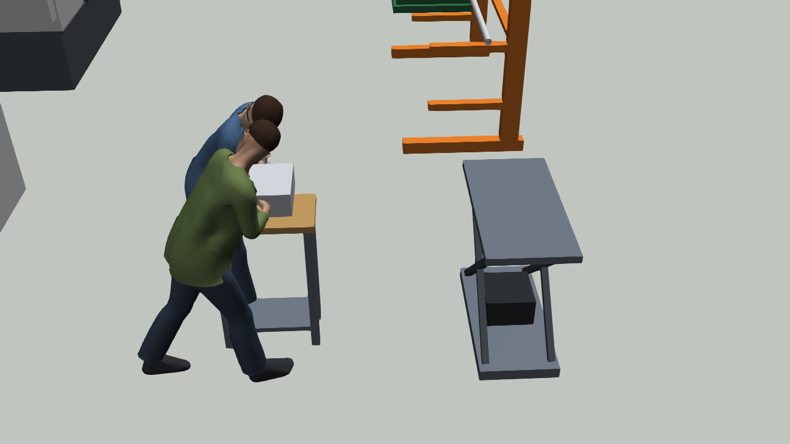
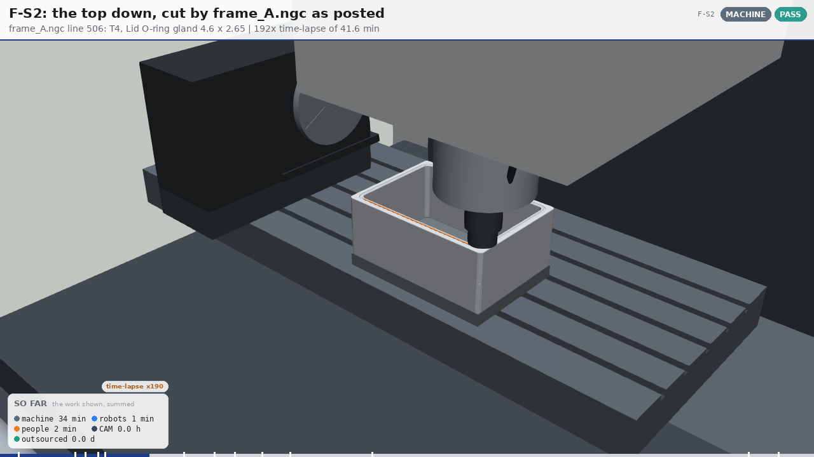
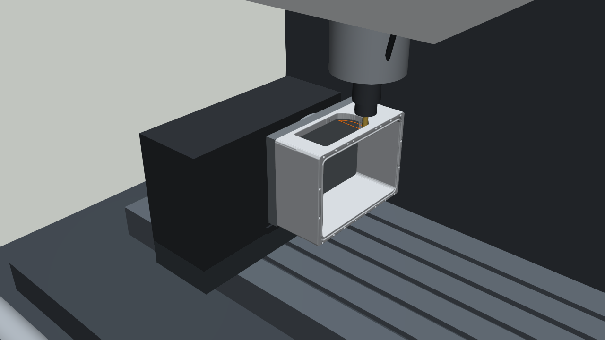
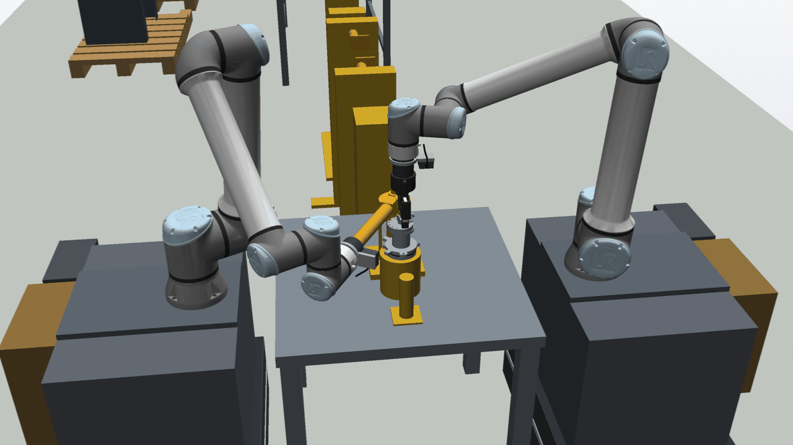
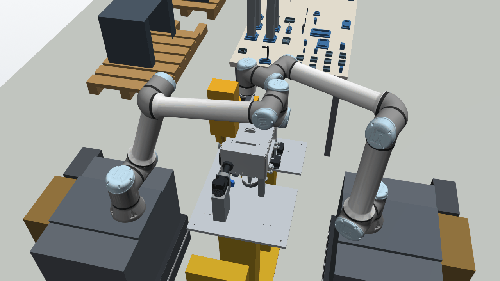
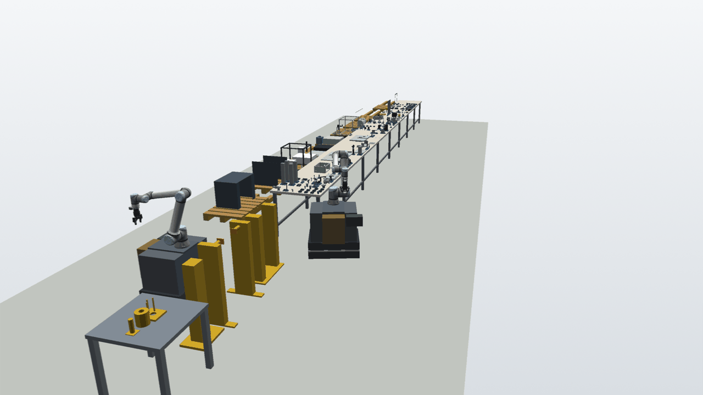
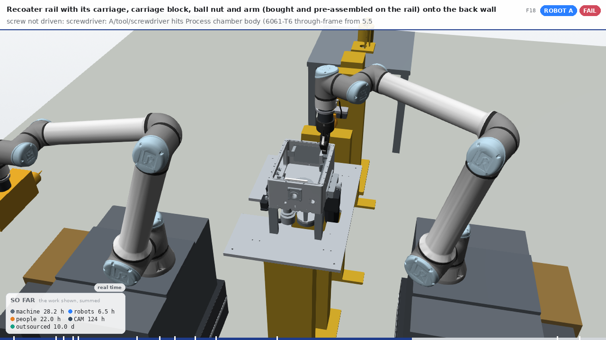
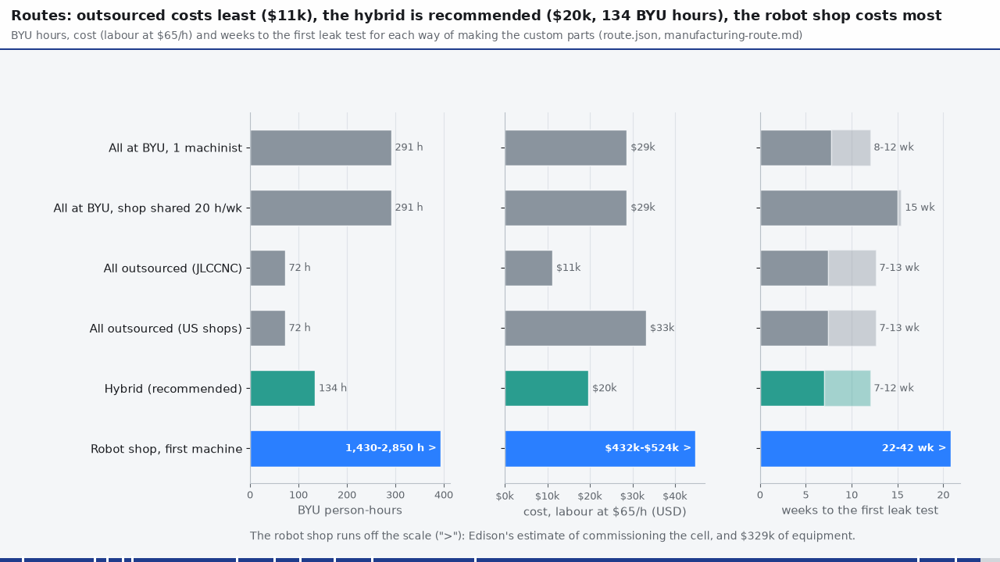

# The desktop LPBF built by two mobile manipulators: the video (round 9, 2026-11-27)

For [issue #260](https://github.com/vertical-cloud-lab/digital-alloy-lab/issues/260) and PR 266. Sterling asked on
2026-11-25 to see the build carried out **by** two UR12e arms, each on a MiR250, using the full set of parts spread
along a long table; every machining step and the assembly (screws, seals, tightening), with a person only where one is
really needed; and, on screen, the running cost by category (new against used, with the expensive items one by one),
the lead times (the long ones, and how short they get bought used), and time estimates for machining and assembly.

**Video:** [`cad/img/robotbuild/robot-build.mp4`](../cad/img/robotbuild/robot-build.mp4) (40 min 56 s, 29,473 frames at 12 fps, 1280 x 720, 41.5 MB; composed 2026-11-27 (12:11 UTC) from the frames rendered in round 9; round 8's cut is in the history at 670dcf8). **On YouTube, public: [youtu.be/B9k2RO6CxCM](https://youtu.be/B9k2RO6CxCM)** (uploaded 2026-11-27, subscribers not notified; the robot-build video's first upload).
YouTube chapter list: [`chapters.txt`](../cad/img/robotbuild/chapters.txt); four frames of every chapter:
[`contact-sheet.jpg`](../cad/img/robotbuild/contact-sheet.jpg); what went in: [`compose.json`](../cad/img/robotbuild/compose.json).










## Round 9 (2026-11-27): what round 8's audit still found

Sterling, 2026-11-27: "Deal with the stuff above, including my note on YouTube uploads" (round 8's list of what its frame
audit still found and what it had not done; and: a major change goes up on YouTube public without notifying subscribers, a
trivial or partial one unlisted). Round 8's frames and plans were lost with its runner, so every chapter was planned and
rendered again. Five workers ran in parallel (people and the other chapters, the shop, the assembly planner, the assembly
renderer and audit, and the bracket's programs), every heavy job queued on one memory ledger. Nothing here has been built.

| What round 8 left | Round 9 | Where |
|---|---|---|
| People moonwalked: `people.py`'s gait didn't lock the stance foot (0.3-1.0 m of slip per metre walked) | Each person has a `Gait`: footprints planned along the body's path; a planted foot never moves; a foot that has to move steps on a raised arc to the next footprint; each leg solved by two-bone IK to its foot, the pelvis dropping as far as both legs need. Turns, side-steps and backing up come from the path; standing still is both feet planted. `people.carry()` puts two people's hands on a load's edges with their bodies clear of it. Self-test (a walk, turns, side-steps, a carry): 0.0 mm stance slip, 0 gliding frames. `walk.py` had a bug that could swap the feet mid-walk and report slip that wasn't there; fixed | [`people.py`](../cad/robotbuild/people.py), [`walk.py`](../cad/robotbuild/walk.py), [`walk_selftest.json`](../analysis/out/videoqa/walk_selftest.json), [the carry](../cad/img/robotbuild/round9/r9-foot-lock-carry.gif) |
| The assembly planned in four processes (the agent harness stops a background job after 30 minutes), with forced cuts at F39 and F51 where both MiRs restarted at the dock | **Run 13 planned and recorded the whole assembly in one detached process (08:36-09:21 UTC).** Run 14 re-planned F54 to the end on top of run 13's recording, every arm and MiR restored where run 13 left them, so nothing jumps at the join. 105 of 110 checked steps pass (run 12: 99 of 108), 125 of 129 screws (124), 62 of 77 table picks planned (57 of 74), 175 of 175 MiR moves clear (163 of 167). Replaying the recording as it is drawn (`rec_check.py`, the planner's own meshes): 0 arm-arm or arm-part pairs over 1.5 mm in 24,649 samples | [`round9_run13.md`](../analysis/out/assembly/round9_run13.md), [`assembly.md`](../assembly.md) round 9 |
| Collisions the audit found in the assembly's plans: the two nutrunners into each other, arm A's wrist through a screw, its fingertips in the galvo, the gripper in the module handle, MiR A in the table's stretchers, MiR B on the zero-point air line, the trunnion's jaws in their stands, the hoist hook through the module | **Causes found and fixed in the planner:** after a failed screw attempt the planner left the arm where the recording didn't have it (now put back, and parked before the other arm tries); **the planner never checked the arms' wrist cameras and tool changers** (`cell.Checker.collisions` dropped them after the first check, since round 7; it found arm A's camera 50 mm into the floor plate); the push home was recorded with the fingers open; the turn-overs now take the handle's grip block, approached with the gripper open; the stretchers are cross rails in the planner's table model and the drawn one; a coiled line is its coil's box; the trunnion's stands have bearing bores; the hook is planned 300 mm over the part and recorded | [`round9_run13.md`](../analysis/out/assembly/round9_run13.md) |
| Drawing faults in 40 and 41: seal tools inside the module (one left there to the end), the person's legs in a MiR's tool stand | The seal tools go back to their stand when their step ends; parts are drawn at 12,000 triangles so bores stay open; a part an arm still holds no longer follows the opening gripper; the person walks in from the aisle on clear floor, out of the cameras' sight lines, at 450 mm/s; a cut is forced only where something really jumps, and arm jumps under 5 deg are a short labelled move | [`asm_render.py`](../cad/robotbuild/asm_render.py) |
| Holds: three blocked by Fixture B; the door's not tried | **F51b** closes the door's two draw latches over their strikes before the hinge pins, so the latches hold it on its cord. **F33b and F37b can't have a hold:** the vacuum gripper placing the Ø100 window flange and retaining ring covers both bolt circles, so their screws are run down snug in a star pattern (the first screw tilts the part 0.3 deg at most). **F43** is blocked by Fixture B with the roles either way round | [`two_hands.json`](../analysis/out/assembly/two_hands.json) |
| Nine failing steps, and nobody drawn doing them | **Five fail** (F15, F18, F26, F27, F57; C00d, F45d, F48b and F54 now pass). After each failed attempt a person walks in on locked feet and sets the part or drives the screw with a hand driver, time-lapsed to the estimate (5 min a part, 1 min a screw). Not drawn: the person at F18's screw (no clear spot round Fixture B; a card says so) and at F57 | [`assembly.md`](../assembly.md) |
| Shop collisions: 20 (13 pairs), 29 (22), 30 (not audited), 31 (2), 32 (2) | The pallet on the jack's forks and clear of the rack, crates apart, flaps and tape before the unbox; the VF-4's sill trim, hollow column hood, column moved back so the table's travel clears it, rotary and fixtures apart; the lathe's door foot out of its base; the wash basket not drawn inside the washer; two-person lifts by `people.carry()` and a side-by-side lift that reaches (palm error at most 18 mm, was 160-200 mm). `audit_rec.py` recorded only the first 2,000 faces of a re-meshed stock (round 8's "cutter 39 mm in the stock"); fixed | [`robot-shop.md`](../robot-shop.md) round 9 |
| Chapter 30's audit ran out of memory | `scene_audit.py` streams (drops its BVHs every 200 frames): a synthetic chapter-30 recording that killed the old code at 3 GB within 9 frames peaks at 746 MB. Every frame of every chapter is audited | [`scene_audit.py`](../cad/robotbuild/scene_audit.py) |
| Integration: the process fiber through the laser's box and the rack; the DIN drawer's ears in the rack posts | The fiber leaves the laser's rear panel and bends at 75-77 mm (IPG's minimum is 70 mm) up the slot beside the rack units, through grommeted holes, to the collimator; the rack frame is 580 mm tall (was 560), so the drawer clears its rails; the person walks on screen | [`lpbf_low.py`](../cad/lpbf_low.py) |
| The machining workflow (round 7's open points: MiR drives between stations, unloading the lathe, the 4th-axis bolt-up; the vise bracket had no program) | MiR A drives VF-4 to lathe and deburr to measuring (pivot, drive, pivot; every pose swept with FCL); the lathe shuts, runs and opens, and arm A takes the turned part out along its checked loading path run back; arm A bolts the frame to the HRT210's platter with the nut runner (four M8, planned, 25 s). **New chapter 31b:** the recoater motor bracket cut by its own FreeCAD 1.0.2 programs (op 1 face and outline, op 2 turned over; 3.06 min), the cutter only on program lines (600 of 600 frames, worst 0.00005 mm off), the voxel simulation removing 152.2 cm³ against 152.2 for blank minus part. There is no lathe program: FreeCAD 1.0.2's CAM has no turning, so the slug's profile in 31 stays illustrative | [`gcode/parts/README.md`](../analysis/out/machining/gcode/parts/README.md), [`ch_programs.py`](../cad/robotbuild/ch_programs.py) |

**The camera check on the finished file** ([round 9](../analysis/out/videoqa/camera-round9-video-exact.json), same limits as round 8, with each chapter's window from compose.json's exact frame counts, `video_qa.py --compose-json`):

| Chapter | Round 8: jumps a minute, median run, result | Round 9: jumps a minute, median run, runs under 2 s, p95 speed (fw/s), result |
|---|---|---|
| The hall: two mobile manipulators, one long table | 8.6, 5.9 s, pass | 7.5, 6.4 s, 0 %, 0.06, pass |
| The parts: cost and lead time | 9.8, 5.7 s, pass | 9.4, 5.9 s, 0 %, 0.05, pass |
| Time estimates: machining, routes, assembly | 0.0, 30.0 s, pass | 2.0, 30.4 s, 0 %, 0.00, pass |
| Receiving and unpacking | 6.5, 6.1 s, pass | 6.4, 8.6 s, 0 %, 0.02, pass |
| The stock: two people carry the 5.5 in. plate | 7.5, 7.9 s, pass | 2.6, 22.8 s, 0 %, 0.09, pass |
| Machining the chamber: the VF-4 and its 4th axis | 4.4, 10.2 s, pass | 2.8, 20.8 s, 9 %, 0.03, pass |
| Machining the other parts: vise, lathe, saw | 6.8, 9.9 s, FAIL | 2.0, 30.6 s, 0 %, 0.01, pass |
| Finishing: welding, honing, deburring, washing, measuring, kitting | 5.5, 9.8 s, pass | 5.0, 9.9 s, 0 %, 0.01, pass |
| The arms' custom tools and fixtures | 5.7, 4.6 s, pass | 7.1, 4.6 s, 0 %, 0.08, pass |
| Assembly 1: the build module, by two UR12e on MiR250s | 6.5, 5.0 s, pass | 3.6, 8.6 s, 0 %, 0.01, pass |
| Assembly 2: the chamber and the process module, by two UR12e on MiR250s | 10.3, 3.9 s, FAIL | 4.7, 8.7 s, 7 %, 0.01, pass |
| Onto the VLM tray: rack, gas module, hoses, leak check | 8.7, 4.9 s, pass | 8.1, 5.4 s, 0 %, 0.01, pass |
| Time and cost: in-house, outsourced, robot shop | 2.3, 11.2 s, pass | 2.8, 11.2 s, 0 %, 0.00, pass |
| **Whole video** | 8.1, 5.7 s, pass | 4.7, 8.0 s, 4 %, 0.02, pass |

Every chapter passes. Chapters 31 and 41 failed in round 8. With the windows taken from `chapters.txt`, as round 8 measured them
([`camera-round9-video.json`](../analysis/out/videoqa/camera-round9-video.json)), 30 and 32 failed narrowly on short runs, and
the shortest run in each was not in the chapter at all. `chapters.txt` gives each start to the nearest whole second, so
chapter 30's window, for example, began at 5:18 while the chapter begins at 318.5 s, and the last 0.5 s of chapter 29 counted
as a short run of chapter 30. Round 8's per-chapter numbers carry the same error.

<!-- audit -->
**The audit of every drawn frame** (as in round 8: `scene_audit.py` on every recorded frame, penetration deeper than 1.5 mm,
round 8's pairs in brackets; `walk.py` for people's stance feet, gliding and the MiRs):

| Chapter | Frames audited | Pairs over 1.5 mm (round 8) | Worst | The largest | Stance-foot slip, max per stance (round 8) | Gliding frames | MiR reversing | MiR sideways, max per frame |
|---|---|---:|---|---|---|---:|---|---|
| 00-intro | 669 of 669 | 0 (0) | 0.0 |  | op 0 | 0 | mirA 0.0 m (longest 0 mm), mirB 0.0 m (longest 0 mm) | mirA 0.0, mirB 0.0 |
| 10-parts | 2,064 of 2,064 | 0 (0) | 0.0 |  | op 0 | 0 | mirA 0.0 m (longest 0 mm), mirB 0.0 m (longest 0 mm) | mirA 0.0, mirB 0.0 |
| 20-receiving | 448 of 448 | 0 (13) | 0.0 |  | op 0 (473) | 0 | mirA 0.0 m (longest 0 mm), mirB 0.0 m (longest 0 mm) | mirA 0.0, mirB 0.0 |
| 29-stock | 275 of 275 | 0 (22) | 0.0 |  | op 0, op2 0 (1033) | 0 | - | - |
| 30-machining-chamber | 2,854 of 2,854 | 42 (not audited (69 in 200 frames)) | 84.4 | op/coat / op2/coat (84.4 mm, 21 fr); op/shoes / op2/shoes (46.9 mm, 31 fr) | op 0, op2 0 (1400) | 0 | mirA 0.0 m (longest 0 mm) | mirA 0.0 |
| 31-machining-parts | 1,088 of 1,088 | 0 (2) | 0.0 |  | - | 0 | mirA 0.0 m (longest 0 mm), mirB 0.0 m (longest 0 mm) | mirA 0.0, mirB 0.0 |
| 31b-machining-programs | 736 of 736 | 0 ((new)) | 0.0 |  | - | - | - | - |
| 32-finishing | 1,001 of 1,001 | 0 (2) | 0.0 |  | op 0 | 0 | mirA 0.0 m (longest 0 mm), mirB 0.0 m (longest 0 mm) | mirA 0.0, mirB 0.0 |
| 38-tools | 1,008 of 1,008 | 0 (-) | 0.0 |  | - | - | - | - |
| 40-assembly-module | 2,974 of 2,974 | 29 (221) | 10.5 | A/gr/left_finger_tip/0 / o24 (10.5 mm, 4 fr); A/gr/right_finger_tip/0 / o24 (10.5 mm, 4 fr) | op 34 | 0 | mirA 0.8 m (longest 300 mm), mirB 0.1 m (longest 150 mm) | mirA 0.1, mirB 0.2 |
| 41-assembly-chamber | 13,640 of 13,640 | 238 (209) | 40.6 | kt/long table top / o253 (40.6 mm, 4 fr); kt/long table top / o254 (40.6 mm, 4 fr) | op 383 (327) | 0 | mirA 3.8 m (longest 500 mm), mirB 0.9 m (longest 440 mm) | mirA 0.1, mirB 0.1 |
| 50-integration | 1,070 of 1,070 | 0 (4) | 0.0 |  | op 0 | 0 | mirrA 0.0 m (longest 0 mm), mirrB 0.0 m (longest 0 mm) | mirrA 0.0, mirrB 0.0 |

What it still finds:
- **41, the chamber (238 pairs, round 8: 209; worst 40.6 mm, round 8: over 100 mm).** None of round 8's large ones are left
  (the MiR tool stands, the trunnion's jaws, the hoist hook, the seal tools, the nutrunners). What remains comes from the plan
  and the model more than the drawing: 101 fingertip pairs in the parts the fingers hold (worst 16.9 mm), 82 part-in-part pairs
  as parts slide home (worst 37.5 mm, the liners into the chamber body), a staged put sinking the floor plate's dowels and
  inserts 40.6 mm into the table top (frame 277), the ring pad and liner wand about 20 mm into parts, and the person's hand
  28 mm into the chamber body where they set a part. 23 more overlaps are parts at their designed positions, listed apart. Only
  41's last slice has the fix that stops a released part following the opening fingers, so earlier releases may sit about 2 mm
  off their seats.
  **Classified pair by pair** in [`round9_41_pairs.md`](../analysis/out/videoqa/round9_41_pairs.md):
  - 175 of the 238 are real clipping a viewer could see, in at least 1,278 of 13,640 frames (9.4 %). The causes:
    - 73 parts in parts away from their seats;
    - 45 fingers closed past the part;
    - 30 from the staged put into the table top;
    - 16 parts just off their seats;
    - 7 tools through the part they work on;
    - 2 the person's hands;
    - 2 an arm link through a screw.
  - 0 are artifacts of the drawn meshes: every pair reads the same depth on the planner's 0.1 mm meshes.
  - 63 are fingertips within 5 mm on the part they hold.
  - Of round 8's 209, 71 are gone, and 100 are new, 76 of them fingertips on parts.
  - Chapter 40's 29 pairs are 17 real, 0 artifacts and 12 fingertip contacts.
- **40, the module (29 pairs, round 8: 221; worst 10.5 mm, round 8: 78.1 mm):** fingertips up to 10.5 mm in the module handle
  during the turn-overs.
- **30, the chamber's machining (42 pairs; its first full audit):** 25 are the two people at the lifts (coats and shoes
  touching side by side at the load's ends, fingers 31-42 mm into the cart top and 34 mm into the edge clamps, a foot 25 mm under
  the sill); arm A's forearm through a work light the planner is told to ignore (18.5 mm); the nut runner 8.6 mm into the MiR's
  finger stand while the arm turns (the drive check now includes the tool, but these frames were rendered before that); the deck
  blocks not travelling with the MiR (25 mm); the cutter inside the stock for 1-6 frames a tool (up to 23 mm).
- **People's feet:** 0.0 mm stance slip and 0 gliding frames in every chapter except the assembly's: 40 (max 34 mm a stance)
  and 41 (95th percentile 34 mm, one stance 383 mm); neither has gliding frames.
- **Everything else** (00, 10, 20, 29, 31, 31b, 32, 38, 50): 0 pairs over 1.5 mm.
<!-- /audit -->

**Two numbers that don't match:** hud.json's 8.9 assembly person-hours include two steps the assembly chapters don't draw
(M25, 120 min, and M02, 3 min), so the video's person clock runs about 2.3 h lower; robot-hours agree (3.32 h in the frames
against 3.40 h). With the rack now 580 mm, some generated outputs (the inventory, mass and audit files and
`analysis/out/electrical/enclosures.md`) still say 560 mm.

## Round 8 (2026-11-26): what changed, and what the checks still find

Sterling, 2026-11-26, on round 7's cut: "moonwalk, motion sickness, collisions and interference, dummy tool paths instead of
real ones ... I don't think we have a vacuum chuck lift. Probably just a two person job for that part. The thought was also that
the two robots would be working in tandem with each other similar to how a human has two hands, holding something down for
example." His byu-vcl pings, read through the API, are in
[`notes/2026-11-26-byu-vcl-video-lessons.md`](../notes/2026-11-26-byu-vcl-video-lessons.md). Every frame and trajectory of round 7
was lost with its runner, so every chapter was planned and rendered again in this round.

| What he named | Round 7 | Round 8 | Where |
|---|---|---|---|
| Dummy tool paths | the cutter traced an invented ellipse while the part switched between precomputed states | the chamber's eight posted programs (FreeCAD 1.0.2, regenerated and committed in [`analysis/out/machining/gcode/`](../analysis/out/machining/gcode/)) are parsed, timed and cut in a 0.75 mm voxel simulation; chapter 30 draws the cutter only on program lines (program and line number on screen), the table carrying the part in X/Y and the head in Z, the stock as the simulation leaves it. Simulated minutes are within 0.07 min of the CAM's recount for every setup; removed volume is within 1.2 % of blank minus part | [`gcode_sim.py`](../cad/robotbuild/gcode_sim.py), [`gcode_sim.json`](../analysis/out/videoqa/gcode_sim.json) |
| No vacuum lifter | a person lifted the blank, the core and the frame with a jib and vacuum tube lifter | two people lift by hand, every load against a two-person guideline of 2/3 x (23 + 23) = 30.7 kg (NIOSH's load constant, HSE L23's team rule). A new chapter, 29, has two people carry the 30.0 kg plate as delivered (inside the guideline, only just); its core is cut out by waterjet before the VF-4, as the programs assume, so the VF-4 loads are 7.7, 6.5 and 10.0 kg | [`shop_chapters.py`](../cad/robotbuild/shop_chapters.py), [`analysis/out/shop/shop_person.json`](../analysis/out/shop/shop_person.json) |
| Two hands | 16 steps used both arms; holds had been designed out where one arm couldn't hold while the other drove | a part on a face seal floats on it until screws engage (the seal needs 10-100x the part's weight to squeeze), so the placing arm holds it while the other arm drives the first two screws: the module's gland plate (M19, 252 N against 10 N), the outlet plenum (C04, 439 N against 6 N) and the lid (F30, 2,737 N against 26 N, held by a vacuum cup). Three more need a hold and can't have one yet (window flange, retaining ring, metering base: arm B's upper arm meets Fixture B); the door before its hinge pins was not tried. 19 steps now use both arms | [`analysis/out/assembly/two_hands.json`](../analysis/out/assembly/two_hands.json), [`round8_run12.md`](../analysis/out/assembly/round8_run12.md) |
| Moonwalk: MiRs | the bases slid along their lanes, 402 m of it in reverse | every one of 167 moves is pivot, drive forward, pivot (248 pivots at 30 deg/s, an estimate); reversing only in 29 docking legs of at most 0.5 m (6.9 m in all); every pose swept with FCL against the cell, the long table and the other MiR: 163 clear, 4 not (F45, F45b: MiR B's cabinet on the zero-point air line, as in run 10) | [`mir_route.py`](../analysis/assembly/mir_route.py), [`mir_drives.json`](../analysis/out/assembly/mir_drives.json) |
| Moonwalk: people | people glided with their legs still; walk cycles were not tied to the distance covered | the gait phase now follows the distance walked and people no longer slide standing still (4 gliding frames are left, in chapter 30), but the frame audit shows that `people.py`'s gait itself does not lock the stance foot: planted feet still slide 0.3-1.0 m per metre walked, so the two-person carries in chapters 20, 29 and 30 still moonwalk. Chapter 50's person changes place only across cuts. **Not fixed:** it needs a foot lock in people.py | [`walk.py`](../cad/robotbuild/walk.py), the audit table below |
| Motion sickness | the assembly chapters picked a new view for nearly every motion: 84 and 103 jumps a minute, steady stretches of 0.2-0.4 s | fixed tripods per place in the cell, one shot per step chosen by occlusion, changed only by a cut, never moved inside a shot; the shop chapters lost their orbiting camera; chapter 30's cutting shots ride on the VF-4's table; the tools turntable slowed. The whole video now passes the camera check (8.1 jumps a minute against 42.9; median shot 5.7 s against 0.4 s); 31 and 41 still fail narrowly | [`camera_rig.json`](../analysis/out/assembly/camera_rig.json), the camera check below |
| Collisions and interference | only the planned arm paths were checked | every rendered frame is recorded ([`audit_rec.py`](../cad/robotbuild/audit_rec.py)) and audited: everything that moves against everything visible, penetration deeper than 1.5 mm, a short list of allowed contacts ([`scene_audit.py`](../cad/robotbuild/scene_audit.py)); people's stance feet, gliding, and MiR sideways slip and reversing ([`walk.py`](../cad/robotbuild/walk.py)) | the audit table below |

**The camera check on the finished file** ([`video_qa.py`](../cad/robotbuild/video_qa.py) on the MP4's pixels; [round 7](../analysis/out/videoqa/camera-round7-video.json), [round 8](../analysis/out/videoqa/camera-round8-video.json)). Limits: at most 10 jumps a minute, a median steady run of at least 4 s, at most 15 % of runs under 2 s (where a chapter has six or more jumps), and a 95th-percentile camera speed of at most 0.14 frame widths a second (the 7-second panning rule). Chapter 30's first render failed it (11.1 jumps a minute, a median run of 1.9 s, 0.95 frame widths a second): at 49-192x time-lapse the VF-4's table, which fills the picture, jumped to wherever the tool was in each frame. Its cutting shots now ride on the table, so the part stays still and the spindle moves over it, as in a CAM simulation.

| Chapter | Round 7: jumps a minute, median run, result | Round 8: jumps a minute, median run, runs under 2 s, p95 speed (fw/s), result |
|---|---|---|
| The hall | 5.0, 2.2 s, FAIL | 8.6, 5.9 s, 11 %, 0.06, pass |
| The parts | 8.6, 3.9 s, FAIL | 9.8, 5.7 s, 3 %, 0.06, pass |
| Time estimates | 3.9, 15.4 s, pass | 0.0, 30.0 s, 0 %, 0.00, pass |
| Receiving and unpacking | 6.5, 6.1 s, pass | 6.5, 6.1 s, 20 %, 0.02, pass |
| The stock | (new) | 7.5, 7.9 s, 50 %, 0.08, pass |
| Machining the chamber | 11.5, 0.3 s, FAIL | 4.4, 10.2 s, 0 %, 0.01, pass |
| Machining the other parts | 4.5, 10.7 s, pass | 6.8, 9.9 s, 29 %, 0.01, FAIL |
| Finishing | 4.7, 11.9 s, pass | 5.5, 9.8 s, 0 %, 0.01, pass |
| The arms' custom tools and fixtures | 11.6, 3.1 s, FAIL | 5.7, 4.6 s, 0 %, 0.07, pass |
| Assembly 1 | 84.1, 0.4 s, FAIL | 6.5, 5.0 s, 0 %, 0.01, pass |
| Assembly 2 | 102.9, 0.2 s, FAIL | 10.3, 3.9 s, 26 %, 0.01, FAIL |
| Onto the VLM tray | 0.9, 34.0 s, pass | 8.7, 4.9 s, 8 %, 0.01, pass |
| Time and cost | 2.8, 10.6 s, pass | 2.3, 11.2 s, 0 %, 0.00, pass |
| **Whole video** | 42.9, 0.4 s, FAIL | 8.1, 5.7 s, 14 %, 0.02, pass |

Two chapters still fail narrowly: 41 (10.3 jumps a minute, a median run of 3.9 s, 26 % of runs under 2 s; mostly the cuts where a fetch from the table is cut out, and the forced cuts at F39 and F51) and 31 (29 % of runs under 2 s).

**The audit of every drawn frame** ([`scene_audit.py`](../cad/robotbuild/scene_audit.py), [`walk.py`](../cad/robotbuild/walk.py); per chapter in [`analysis/out/videoqa/`](../analysis/out/videoqa/)). Every renderer ran with `ROBOTBUILD_AUDIT=1`, so [`audit_rec.py`](../cad/robotbuild/audit_rec.py) recorded each frame's meshes and poses as drawn. The audit replays them and checks everything that moves against everything visible and at least 30 % opaque: python-fcl BVH collision on the recorded triangles, then a translational penetration depth (26 directions, bisection-refined) and containment by winding numbers; pairs deeper than 1.5 mm count unless they are on the short allowed list (a person's own clothing layers, a screw, insert or dowel in its hole, a driver's socket on its screw, a held part in the fingers holding it, a load in the hands carrying it). Pairs of parts that never move against each other are listed apart as the CAD's own overlaps. `walk.py` follows each person's lowest shoe through each stance and each MiR's footprint: stance-foot slip, gliding (the body moving while both feet are planted), and MiR sideways slip and reversing.

| Chapter | Frames audited | Pairs over 1.5 mm | Pair-frames | Worst | The largest | Stance-foot slip, max per stance (mm) | Gliding frames | MiR reversing | MiR sideways, max per frame (mm) |
|---|---|---:|---:|---|---|---|---:|---|---|
| 00-intro | 669 of 669 | 0 | 0 | 0.0 |  | - | 0 | mirA 0.0 m (longest 0 mm) | mirA 0.0 |
| 10-parts | 2,064 of 2,064 | 0 | 0 | 0.0 |  | - | 0 | - | - |
| 20-receiving | 446 of 446 | 13 | 907 | >100 | obj/pallet / rack_ctx/static 0 (>100 mm, 252 fr); obj/crate 0 / rack_ctx/static 0 (>100 mm, 233 fr) | op 473 | 0 | - | - |
| 29-stock | 186 of 186 | 22 | 475 | >100 | obj/plate / op2/glove (>100 mm, 71 fr); obj/plate / op/glove (93.8 mm, 73 fr) | op 1033, op2 955 | 0 | - | - |
| 30-machining-chamber | not audited | 0 | 0 |  |  | op 1289, op2 1400 | 4 | - | - |
| 31-machining-parts | 629 of 629 | 2 | 118 | 20.1 | vf4/door L/0 / vf4/front/1 (20.1 mm, 59 fr); vf4/door R/0 / vf4/front/1 (20.1 mm, 59 fr) | - | - | - | - |
| 32-finishing | 925 of 925 | 2 | 80 | >100 | obj/basket / wash/static 3 (>100 mm, 76 fr); obj/basket / wash/static 2 (5.2 mm, 4 fr) | - | 0 | - | - |
| 40-assembly-module | 3,448 of 3,448 | 221 | 17238 | 78.1 | o19 / o503 (78.1 mm, 181 fr); A/gr/base/0 / o24 (78.1 mm, 140 fr) | - | 0 | mirA 0.5 m (longest 150 mm), mirB 0.1 m (longest 150 mm) | mirA 0.1, mirB 0.2 |
| 41-assembly-chamber | 10,325 of 10,325 | 209 | 57072 | >100 | mirA/A tool stand / op/trousers (>100 mm, 192 fr); jaws / st/Trunnion stands (87.5 mm, 10325 fr) | op 327 | 1 | mirA 3.5 m (longest 500 mm), mirB 1.4 m (longest 440 mm) | mirA 0.1, mirB 0.1 |
| 50-integration | 996 of 996 | 4 | 643 | >100 | m/158 Process fiber / m/7 Fiber laser source, 500 W single-mode, IPG YLR-5 (>100 mm, 593 fr); m/158 Process fiber / m/5 19 in. rack frame (19.3 mm, 26 fr) | - | 0 | - | - |

**What it still finds** (none of it fixed in this cut; each is a renderer, scene or people.py fix, not a design change):
- **People still moonwalk when they walk.** `people.py`'s gait (vendored from byu-vcl PR 318) does not lock the stance foot: in a synthetic walk with the gait phase tied to the distance (2 pi per stride), the planted foot still slides 0.34-1.0 m per metre walked. On screen: chapter 20 (95th percentile 0.46 m per stance), 29 (0.85-0.90 m) and 30 (0.90-1.18 m), the two-person carries. Chapter 50's person never walks on screen (changes place only across cuts). The fix is a foot lock in people.py (pin the stance foot, solve the leg) before anyone walks on screen again.
- **41, the chamber (209 pairs):** the person's legs in MiR A's tool stand (frames 429-452, 3881-3904, 4384-4419); the hoist hook 50 mm through the build module (3297-3376); the two nutrunners 31 mm into each other (3635-3641); arm A's wrist through a screw (1414-1417) and its fingertip 44 mm into the galvo (10073, 10109); the trunnion's jaws 88 mm into their stands in every frame (the fixture model). MiR A reverses 3.5 m in 11 docking legs (longest 0.5 m), MiR B 1.4 m.
- **40, the build module (221 pairs):** the seal tools (spigot mandrel and pusher, ring loader) drawn up to 78 mm inside the module and its screws, one left inside from frame 2792 to the chapter's end; the 2F-85's body 78 mm in the module handle (2958-3024, 3169-3241); MiR A 34 mm into the long table's stretchers while it turns (342-347).
- **29 and 30, the two-person lifts:** the people's gloves and coats inside the plate and the stock they carry (over 100 mm), their legs in the cart; in 30 (audit not finished: it ran out of its 3 GB cap on the two re-skinned people; 200 of 1,626 frames checked, 69 pairs) a person's shoes, trousers and coat through the VF-4's front and table (frames 107-140), and the VF-4 head model inside its column.
- **20, 31, 32:** the pallet and a crate driven into the stock rack's upright, a tray through the receiving bench, arm B's fingertips 42 mm into it; the VF-4's doors 20 mm through its front panel; the wash basket inside the wash station's body.
- **50, integration:** only the machine CAD's own overlaps (the process fiber through the laser's box and the rack, the DIN drawer's ears in the rack posts) and a 4 mm brush of a glove.
- **00 and 10:** nothing over 1.5 mm; MiR A drives 3.15 m nose first with no reversing or side slip.

## How it is made

Each chapter is rendered on its own, as raw 1280 x 720 frames with one line of metadata per frame
([`cad/robotbuild/README.md`](../cad/robotbuild/README.md), [`common.py`](../cad/robotbuild/common.py)). Then
[`compose.py`](../cad/robotbuild/compose.py) draws every panel over the frames with PIL
([`panels.py`](../cad/robotbuild/panels.py)) and streams them into one H.264 file (12 fps). So the numbers on screen can
change without re-rendering any 3-D, and every chapter shares one look:

- **Caption bar** (top): what is happening, and a second line with the numbers and sources. At its right end, who is
  working (robot A, robot B, person, machine, outsourced, supplier) and the step's result (pass, fail, redesign, person
  needed).
- **Clocks** (bottom left): the running machine, robot, person and CAM hours and outsourced days. Each frame carries
  the real-world time it stands for (`proc_s`: 1/12 s for a robot motion shown in real time, much more in a time-lapse)
  and what it adds to each counter (`add`); the clocks are the running sums over the whole video. There is no calendar
  clock: the frames' summed time is work time, not weeks from the order, which chapter 15 and the summary give from
  [`manufacturing-route.md`](manufacturing-route.md) (7-12 weeks from the purchase order to the first leak test on the
  recommended hybrid route). A chapter that sets no `add` is counted from who is working (each robot, person or machine named
  counts the frame's time). A tag over the clocks says how fast the frame runs ("real time", or "time-lapse xN" from
  the frame's `proc_s`). The clocks are hidden where no project time passes (the hall, the parts tour, the estimates
  and the summary).
- **Cost panel** (right, chapter 10): the running total of the kit at spec (the laser chain as specified, the cheapest
  listed option on every other line), new against used where a sensible listing exists; the current category with its
  new and used cost; and its big items, the one in close-up highlighted, each with its new and used price and lead
  time. The BOM's cheapest-to-premium range is the second line (its low end mixes in under-spec substitutes, such as a
  $3.3k laser).
- **Lead-time panel** (right, chapter 10): every order's lead time in weeks from placing it to the part at BYU, new and
  used side by side, the longest first, long ones (six weeks or more new) marked; the item in close-up highlighted.
- **Chart** (right, chapter 50): the leak check's pressure curve, drawn up to the frame's time.
- A thin progress bar along the bottom edge with a tick at each chapter; each chapter's title shows for its first
  seconds.

The person is byu-vcl PR 318's ([commit 9740ba8](https://github.com/vertical-cloud-lab/byu-vcl/tree/9740ba8)
`vertical-lab/people.py`): MakeHuman's CC0 base mesh with its skeleton and skin weights, posed every frame (a walk cycle,
two-bone arm IK to hand targets, a lean, the head turned to what it looks at). It is vendored as
[`cad/robotbuild/people.py`](../cad/robotbuild/people.py), in the colours of the PR branch's other MakeHuman figure
(`render_scale.PERSON_COLOURS`: a long-sleeved T-shirt, jeans, trainers) and with safety glasses. Each shoe is the convex
hull of its foot (people.py MODEL_V 108; the foot pushed out 9 mm, as before, showed its toes). MakeHuman's files are
fetched at run time (sha256-pinned) and never committed.

## The chapters

Rendered in this cut (from [`compose.json`](../cad/img/robotbuild/compose.json)):

| Chapter | Starts at | Frames | Length |
|---|---|---:|---:|
| `00-intro`: The hall: two mobile manipulators, one long table | 0:00 | 669 | 0:56 |
| `10-parts`: The parts: cost and lead time | 0:56 | 2,064 | 2:52 |
| `15-estimates`: Time estimates: machining, routes, assembly | 3:48 | 366 | 0:30 |
| `20-receiving`: Receiving and unpacking | 4:18 | 448 | 0:37 |
| `29-stock`: The stock: two people carry the 5.5 in. plate | 4:56 | 275 | 0:23 |
| `30-machining-chamber`: Machining the chamber: the VF-4 and its 4th axis | 5:18 | 2,854 | 3:58 |
| `31-machining-parts`: Machining the other parts: vise, lathe, saw | 9:16 | 1,088 | 1:31 |
| `31b-machining-programs`: Machining the other parts: vise, lathe, saw | 10:47 | 736 | 1:01 |
| `32-finishing`: Finishing: welding, honing, deburring, washing, measuring, kitting | 11:48 | 1,001 | 1:23 |
| `38-tools`: The arms' custom tools and fixtures | 13:12 | 1,008 | 1:24 |
| `40-assembly-module`: Assembly 1: the build module, by two UR12e on MiR250s | 14:36 | 2,974 | 4:08 |
| `41-assembly-chamber`: Assembly 2: the chamber and the process module, by two UR12e on MiR250s | 18:44 | 13,640 | 18:57 |
| `50-integration`: Onto the VLM tray: rack, gas module, hoses, leak check | 37:40 | 1,070 | 1:29 |
| `60-summary`: Time and cost: in-house, outsourced, robot shop | 39:09 | 1,280 | 1:47 |

| Chapter | What it shows | Where its motion comes from | Time |
|---|---|---|---|
| 00 The hall | The hall from above, then a fly-over: the robot shop (the shop worker's machine models, [`equipment.py`](../cad/robotbuild/equipment.py), at the stations of [`analysis/shop/shop_cell.py`](../analysis/shop/shop_cell.py), beside the bench), the 12 m table with every part on it as delivered ([`kit_table.py`](../cad/robotbuild/kit_table.py), machined parts as their stock blanks, parts over 12.5 kg on pallets behind lane B), the assembly bench ([`analysis/assembly/cell2.py`](../analysis/assembly/cell2.py)), both MiR250 + UR12e (PR 318's meshes), a person and a 355 ml can | Only MiR A drives, along its own empty lane with its arm parked (1 m/s, 0.3 m/s²: shop_cell's MiR speed); no arm moves | No project time |
| 10 The parts | The camera runs along the table zone by zone (stock, sheet, motion, gas, optics, electronics, seals, frames) and closes in on the big items: the MIC-6 plate, the laser, galvo, f-theta lens, collimator, shutter, scan card and PC, UPS, safety controller, zero-point clamps, scroll pump, O2 analyzer, blower and the rack. Then the long leads, each with its own beat: the IDEC guard switch (27 weeks), the Omron K8DT relay (out of stock until March 2027), the laser (12-15 weeks new, about a week used) and the honing (3-6 weeks, estimate); it ends on the totals at spec and the weeks to ready-to-assemble. Cost and lead-time panels as above | Camera only | No project time |
| 15 Estimates | Three cards: making the custom parts (287 shop hours: CAM, setups, cutting, deburr and inspection); the routes (BYU hours, cost, weeks to the first leak test; the recommended hybrid keeps 134 hours at BYU and takes 7-12 weeks); the assembly (steps, robot-hours, person-hours, failures) | None (2-D) | No project time |
| 20-32, 40, 41 | Round 8. The shop chapters ([`shop_chapters.py`](../cad/robotbuild/shop_chapters.py)): receiving; 29, two people carry the plate as delivered to a cart for the waterjet; 30, the chamber frame and floor plate on the VF-4 and HRT210, cut by the posted programs (the cutter on program lines, the stock from [`gcode_sim.py`](../cad/robotbuild/gcode_sim.py)'s voxel simulation, two people at every lift, the arms clamping); 31 and 32 as in round 7 without the orbiting camera (the vise bracket has no posted program, so its invented path is gone and only the clock runs). The assembly chapters, replayed from run 12's recording ([`round8_run12.md`](../analysis/out/assembly/round8_run12.md)): fixed tripods, one shot per step; every MiR move pivot-drive-pivot; the second arm holding a part on its seal while the first drives the first two screws (M19, C04, F30); every arm motion drawn, time-lapsed where long; after each chapter's first 4 drives and 8 picks a fetch is an ellipsis (checked and timed, cut, with a line saying so); a pick or move the planner couldn't plan is a card, never an animation; a step that fails shows its attempt with a FAIL badge. Run 12 was planned in four processes (the CI harness stopped the first after F28), so chapter 41 has forced cuts at F39 and F51 where both MiRs restart at the trunnion dock | Collision-checked plans (cell.py's FCL checks, IK branches, RRT-Connect; the shop's clips with FCL on meshes); the machining from the posted G-code; the people's lifts scripted, their loads' paths checked with FCL | Real time for the arms, time-lapsed where a step is long (each frame says how much); machining time-lapsed at the programs' real minutes |
| 38 The tools | Each custom tool and fixture the arms use, one at a time on a turntable: the spigot mandrel and pusher, ring loader, rod bullet, roller, pin caps, small-part nozzle, the liner wand, ring pad and pin pusher (the three added in round 7 because a step failed without them), the screwdriver with its bit extension, the angle-head nutrunner, the vacuum gripper, the trunnion, Fixtures P and B, the kitting nests and the MiR's tool stand, each with what it is for, its cost and its size ([`ch_tools.py`](../cad/robotbuild/ch_tools.py); the meshes are the planner's own, [`tooling.py`](../analysis/assembly/tooling.py), costs from [`assembly-tooling.csv`](../assembly-tooling.csv)) | None: a turntable | No project time |
| 50 Integration | sequence.py's tray steps at the Kardex VLM: T01 the 84 kg process module onto the tray by a person with a lift table; T02 the 12U rack and its units (UPS 23 kg, laser 40 kg, PC, DIN drawer); T03 the gas module (scroll pump 26 kg); T04 the hoses and lines; T05 the tray dock; T06 the leak check (rate of rise) | A person's moves, keyframed (walk cycle, hand targets); the arms stay parked beside the opening because none of T01-T06 is planned for them | Time-lapsed: 4.25 h of a person's work (the data worker's estimates for T01-T05) and 1.25 h of pumping and reading |
| 60 Summary | Charts: the clocks' totals over the whole video; the machine's cost at spec by category, new against used; parts in hand and ready to assemble by buying route; person-hours to make the parts by hand and in the robot shop; the assembly's robot- and person-hours; time and cost by route (in-house, outsourced, hybrid, robot shop); where a person is needed; where the arms failed or a part was redesigned; Edison's estimate of commissioning the cell against building one machine by hand; and a closing card: a feasibility study, not a business case | None (2-D) | No project time |

## Caveats

- **The assembly chapters replay runs 13 and 14** (round 9): run 13 planned and recorded everything in one process; run 14 re-planned F54 to the end on top of it, starting every arm and MiR where run 13 left them. 105 of 110 checked steps pass, 125 of 129 screws, 62 of 77 table picks; the 15 picks the planner couldn't plan are cards, not animations.
- **Five assembly steps still fail** (F15, F18, F26, F27, F57): the video shows each failed attempt with a FAIL badge, then a person doing it (except at F18's screw and F57), time-lapsed to the estimates' 5 min a step or 1 min a screw. Their next changes are in [`assembly.md`](../assembly.md).
- **The integration chapter's person and lift table are illustrations, not plans.** The steps and who does them are
  sequence.py's (T01-T06). The lift table drawn is the shop's (Vestil SCTAB-1000-2040-AC, 20 x 40 in, 1,000 lb, from
  [`robot-shop-equipment.csv`](../robot-shop-equipment.csv)); whether it rises to the tray's 857 mm and rolls is not
  checked. Its times are estimates. The leak check's curve is the expected one from [`seals.md`](../seals.md) section 7
  (pump-down to 1 mbar in about a minute; a rise of about 8 × 10⁻⁴ mbar/min against the 1 × 10⁻³ pass line), not a
  measurement.
- **The intro's and the parts tour's motions are camera moves and one MiR driving an empty lane**; the arms stay in
  cell2's park pose.
- **Costs and lead times** are the data worker's ([`lead-times.md`](lead-times.md), [`hud.json`](hud.json)). New is at
  spec: the CW laser chain (laser, collimator, scan head, f-theta lens, scan card) as specified and the cheapest listed
  option on every other line; bom.csv's cheapest-to-premium range is shown as a second line. Used is the sensible eBay
  and surplus listings of [`cost/used-options.csv`](../cost/used-options.csv) re-based on today's BOM, new elsewhere.
  Lead times include BYU's purchase-order time where an order needs one. The routes are the route worker's
  ([`route.json`'s source, manufacturing-route.md](manufacturing-route.md)); the robot shop's hours are Edison's
  estimate ([`edison/r7-robot-build-review/answer.md`](../edison/r7-robot-build-review/answer.md) section 5), not a
  measurement.
- The 3-D frames are flat-shaded software renders at 12 fps; small parts are simplified as in the CAD (most screws are
  shown only where the assembly chapters drive them).

## Rebuild

From the repo root, under `xvfb-run -a -s "-screen 0 1920x1080x24"` and `/tmp/capmem 3G` (frames go to
`/tmp/robotbuild/frames`, never into the repo):

```
python desktop-lpbf/cad/robotbuild/ch_intro.py          # 00-intro
python desktop-lpbf/cad/robotbuild/ch_parts.py          # 10-parts (ch_parts.py meta: the numbers only)
python desktop-lpbf/cad/robotbuild/ch_estimates.py      # 15-estimates
python desktop-lpbf/cad/robotbuild/ch_integration.py    # 50-integration
python desktop-lpbf/cad/robotbuild/ch_summary.py        # 60-summary
python desktop-lpbf/cad/robotbuild/shop_chapters.py 20 29 30 31 32   # the shop (after shop_chamber_cache.py and analysis/shop/shop_clips.py; robot-shop.md)
python desktop-lpbf/cad/robotbuild/asm_render.py module|chamber      # 40, 41 (after run_assembly.py with ASM_RECORD; slices: asm_slices.py, merge_parts.py)
python desktop-lpbf/cad/robotbuild/ch_programs.py      # 31b-machining-programs (after analysis/machining/parts_cam.py: gcode/parts/README.md)
python desktop-lpbf/cad/robotbuild/ch_tools.py         # 38-tools
python desktop-lpbf/cad/robotbuild/compose.py           # the MP4, chapters.txt, contact sheet, compose.json
python desktop-lpbf/cad/robotbuild/video_qa.py desktop-lpbf/cad/img/robotbuild/robot-build.mp4 --chapters desktop-lpbf/cad/img/robotbuild/chapters.txt
python desktop-lpbf/cad/robotbuild/scene_audit.py run <chapter>   # with every renderer run under ROBOTBUILD_AUDIT=1; walk.py likewise
```
