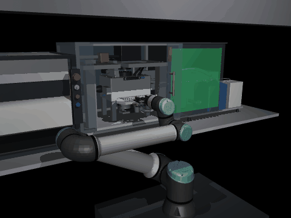
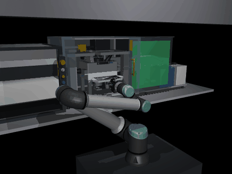
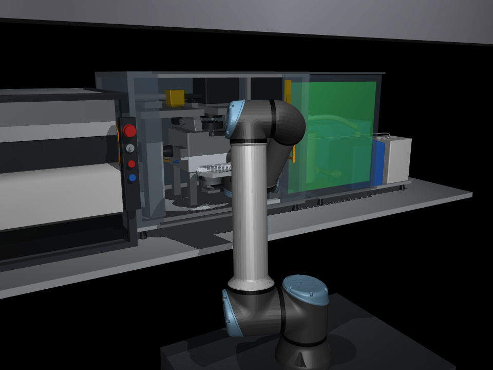
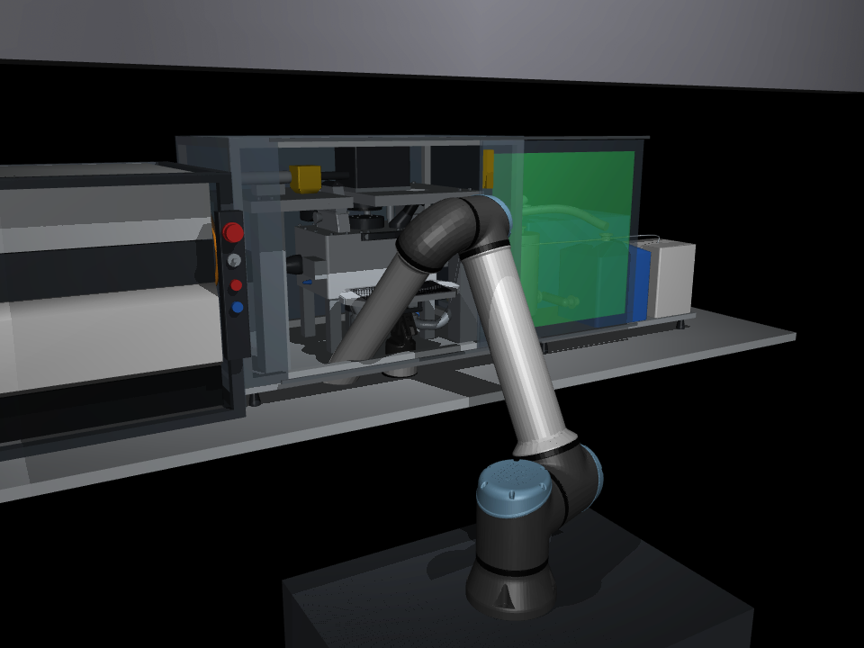

# Robot tending: a UR10e + Robotiq 2F-85 on a MiR250, simulated in MuJoCo

Written 2026-11-20 for PR #266 (issue #260). Script: [`analysis/robot/robot_ops.py`](analysis/robot/robot_ops.py).
Results:
- [`analysis/out/robot/robot_ops_final.json`](analysis/out/robot/robot_ops_final.json): the **final model, commit 9e6464a**,
  run directly from `desktop-lpbf/cad` at 15:53 UTC. Covers the guard door, chamber door open and close, plate exchange, drawer
  and overflow jar.
- [`robot_ops_B.json`](analysis/out/robot/robot_ops_B.json): the earlier copy of the model (13:54 UTC, before 9e6464a), every
  operation. The reservoir, blade cartridge, liner and module-swap rows come from this run only; they were not re-run on the
  final model.
- [`robot_ops_test.json`](analysis/out/robot/robot_ops_test.json): the drawer only, base level with the tray (earlier model).

| Plate exchange (stepped fingertips) | Chamber door closing (handle lift, then a push on the face) |
|---|---|
|  |  |
|  |  |

The GIFs and stills show placement B from the front left (azimuth +60°). The stills are the frame with the tightest clearance
of each operation. In both, the arm comes up from the low base, and the wrist (plate) or forearm (door) passes through the front of the process module. That is the posture problem in item 4.

## Short answer

**As drawn, the robot can do none of the operations end to end.** The arm is strong enough for all of them, with plenty of
reach. What stops it is what it would grip:

1. **The stock 2F-85 can't work inside the chamber.** Its fingers reach only ~60 mm past a 75 × 85 × 109 mm housing. The
   chamber is 120 mm tall, and the plate's centre is 111 mm behind the door's outer face. So the plate, blade holder and liners
   need **custom stepped fingertips** (modelled: a 45 mm drop, a 120 mm blade and a 10 mm crank at the tip).
2. **The plate's grip band is level with the door sill.** The plate stands 8 mm proud, and the sill is also 8 mm above the
   floor. A finger low enough to hook the 3 × 1.5 mm groove (z 1–4 mm) can't pass over the sill. A cranked tip and a two-step
   approach fix this: go in over the sill, then drop 9 mm inside. The other fix is to raise the exchange height to about +16 mm.
3. **Several parts have nothing a gripper can hold, or need far more force than a cobot should push:**
   - the guard door has no handle;
   - the chamber door has draw latches, and closing it needs about 1.4 kN of O-ring squeeze with the 1.78 mm cord now drawn
     (2.8 kN with the original 3.53 mm cord; [`seals.md`](seals.md));
   - the drawer needs 350 N to seat;
   - the jar has a KF wing-nut clamp;
   - the blade is held by two M3 screws;
   - the module is held by two captive M6 thumb screws;
   - both side liners are threaded on the recoater ball screw, and the back liner sits 2.4 mm behind the carriage block.
4. **Where the robot stands matters as much as the machine.** With the base level with the tray top, 350 mm in front of the
   tray, the forearm rises 58 mm into the VLM's 695 mm lintel (Modula bay S). With the base 350 mm lower and 250 mm in front,
   the wrist and forearm pass low and hit the chamber body, the open door, the process base plate and the tray in most
   operations.
   - The paths here are straight Cartesian moves, with one IK branch picked per operation. No path planner was run.
   - So these collisions say "this posture doesn't fit". They don't prove that no path exists.

**Torque and force are not the limit.**
- Peak joint torque stays ≤ 39 % of the UR10e's limits in every operation (≤ 35 % on the final model).
- The one exception is the drawer's 350 N push, which takes the elbow to 99 % with the base level with the tray.
- Every pull or push the steps need (10–40 N) is 5–30× below what the arm can apply at that pose. The heaviest payload is the
  build module, 2.5 kg in the earlier model and 2.67 kg in the final one, against 12.5 kg.

## Cell assumptions

- **Robot:** UR10e and Robotiq 2F-85 from [mujoco_menagerie](https://github.com/google-deepmind/mujoco_menagerie) at commit
  `370c43965323c0944b433b202aac5058b5f907a9` (2026-11-10). They are downloaded to `/tmp` by the script and not committed.
  - Licences: both are BSD-style (UR10e: © 2018 ROS-Industrial Consortium; 2F-85: © 2013 ROS-Industrial). See each folder's `LICENSE`.
  - Joint torque limits are the menagerie's: 330 / 330 / 150 / 56 / 56 / 56 N·m.
  - Payload 12.5 kg and reach 1300 mm are UR's figures. The F/T sensor range of 100 N is UR's e-Series figure, from memory: not re-read in this run.
- **The tray is not extended.** It sits in the VLM's access opening, and the robot reaches into the bay over the tray's front edge (y = −432 mm).
- **The lintel** is the Modula bay S product height (695 mm above the tray), 100 mm deep, at the tray's front edge.
- **Base x = 0,** in line with the plate. Two placements were run:
  - **A:** base level with the tray top, 350 mm in front of its edge, (0, −782, −212) mm. Drawer only.
  - **B:** base 350 mm below the tray top, 250 mm in front of its edge, (0, −682, −562) mm. Every operation.
  - The MiR250's deck height and the VLM's opening height above the floor were not looked up, so both placements are guesses.
- **The machine** is the `lpbf_low.build()` model with the M50 module and reservoir M: the final model (commit 9e6464a) for
  `robot_ops_final.json`, and a copy taken at 13:54 UTC for `robot_ops_B.json`. Between the two:
  - the guard door's travel went from 470 to 515 mm;
  - the door got side draw latches and a 1.78 mm cord;
  - the drawer got a half-dovetail seal groove.
  - Every part within 560 mm left and 1010 mm right of the plate is loaded as convex pieces: a hull when the part fills ≥ 90 % of its hull, CoACD otherwise.
  - Fasteners are hulls.
  - Parts that move in an operation are free bodies.
- **Clearance** is MuJoCo's contact distance with a 40 mm margin, from the robot, gripper and held part to the machine.
  - Contacts between the grasped part and its own seat are listed separately.
  - The exact re-measure (FCL against a 0.05 mm tessellation of the B-rep part) is in the script. In this run it returned −1 m for penetrating pairs, so no exact clearances are quoted.

## Results (placement B unless noted)

Each operation runs approach → grasp → act → retreat in 1–6 mm steps. "IK" means every step was solved to < 1 mm and < 0.5°.
"Tightest" is the most negative clearance outside the seat contacts. The design notes come from the CAD numbers and from
seals.md and hot-swap.md, not from the simulation.

| Operation | Steps | IK | Tightest clearance (mm) and pair | Force needed / arm can apply (N) | Pass / fail and reason | Design fix |
|---|---|---|---|---|---|---|
| Guard door open / close (final model, 515 mm) | 5 | no (slide unreachable in this posture) | −91: upper arm vs process base plate; close on the handle +3.5 | 30 / 225 | **Fail as drawn: no handle.** The door's only feature is a 4 mm edge, 2 mm from the fixed panel | Ø12 bar handle on 45 mm standoffs at x = −310 (modelled); robot standing nearer the door's middle |
| Chamber door open (final model) | 3 (+ unlatch) | approach no; swing yes | Swing clear 2.5° → 30°, then −80: forearm vs base plate. Approach −3.9: pad vs the drawer's pull tab (convex pieces, unconfirmed) | 10 / 311 | **Fail as drawn: draw latches.** The robot can pull the door to 30° on the handle. Past that the arm runs into the base plate, and at 95° the handle ends up under the door (z −41 mm). So it lets go at 30°, and only a damper stops the door slamming | Pneumatic over-centre clamps with a clamp-closed sensor (seals.md). A rotary damper or gas strut, so the robot only pulls past 10° and the damper lowers it. Without one the door free-falls to 1.7 m/s (mujoco.md) |
| Chamber door close (final model) | 4 | approach no | Handle lift clear 92.5° → 27.5°; face push clear 22.5° → 0° | 12–15 / 158–312 | **Feasible in two grips:** lift on the handle to ~27°, then push the outer face closed. **Seating fails:** ~1.4 kN squeeze (1.78 mm cord) vs ~100 N force mode | Clamps pull it home (above) |
| Plate exchange (out, then the reverse in; final model) | 9 | no (over the sill and out) | −72 to −88: wrist 3 and gripper housing vs chamber body (earlier model: −71 to −77, wrist vs open door) | 0.6 N·m twist (hot-swap.md) | **Fail with the stock gripper** (geometry, item 1). With stepped fingertips, IK solves every step inside the chamber; in this posture the wrist then hits the chamber's front | Stepped, cranked fingertips with a lip for the groove. A drawbar instead of the 60° bayonet, so no twist (hot-swap.md). Raise the exchange height to ~+16 mm or lower the sill. Re-plan with the base level with the tray and the wrist above the shelf |
| Cover-slide drawer (final model) | 4 | approach no (B); yes (A) | −2.1: pad vs chamber lid (convex pieces, unconfirmed; earlier model −3.8 vs chamber body); −58: forearm vs lintel (A, earlier model) | pull 20 / 553; **seat 350 / 552 (B), 353 (A)** | **Fail on force:** seating needs 350 N, 3.5× the force-mode range. The 350 N is seals.md's figure for the drawer's earlier seal; the half-dovetail groove now drawn was not re-sized here. The pull is fine | Half-dovetail cord plus a cam latch or a robot-pushed toggle (seals.md). A positive pull tab (an undercut), not two 6 mm posts. Finger notches or a vacuum cup to lift the Ø50.8 slide out of its 0.2 mm pocket |
| Reservoir, stock fingers (earlier model) | 4 | no | −13: follower vs galvo; −10: wrist 3 vs optics bridge | 40 / 451 | **Fail:** the 85 mm housing is wider than the bridge's 56 mm slot, and the fin sits under the beam tube | Stepped fingertips (next row), or a handle reaching forward past the bridge (y < −200) |
| Reservoir, stepped fingertips (earlier model) | 4 | **yes** | −36: wrist 2 vs chamber door (posture B); −13: coupler vs galvo while carrying it out | 40 / 497 | **Reachable.** Clear except posture B's wrist and the coupler over the galvo | Carry it out lower (z −15 mm) or slide it 20 mm further before lifting. Base level with the tray |
| Overflow jar (final model) | 4 | no | −87: upper arm vs base plate; the jar path runs into the front-right leg | – | **Fail:** the jar sits under the chamber at x 72–128 mm. The leg (x 75–105), the outlet-plenum boot (x 72–100) and the outlet hose block the front, and the KF wing-nut clamp needs turning | Move the overflow to a front or side port the robot can reach. A lever KF clamp or a bayonet jar (hot-swap.md) |
| Blade cartridge, holder + blade (earlier model) | 6 | no (over the sill and out) | −112: forearm vs base plate (posture B) | 40 / 220 | **Fail as drawn: 2 × M3 screws.** With stepped tips the grip is reachable (recoater driven to x = 0) | Ball-lock pin or detent cartridge (hot-swap.md). Lift 12 mm to clear the sill |
| Liner, right side (earlier model) | 4 | no (way out) | −80: wrist 2 vs open door | – | **Fail as drawn: captive.** Both side liners have Ø22 holes round the recoater ball screw (y 72, z 40), and the back liner is 2.4 mm behind the carriage block (z 25–99) | Slot the screw hole open to the back edge and shorten the liner 15 mm at the front, so it slides 22 mm off. Split the back liner at the carriage, and lift each piece with the carriage parked at the other end. Add a pull tab |
| Build module swap (earlier model) | 8 | no (last 140 mm) | −20: gripper spring link vs guard's bottom T-slot; −60: wrist 1 vs tray | – (2.5 kg) | **Fail as drawn: 2 captive M6 thumb screws.** The path is mostly reachable. The housing clears the guard's bottom rail by only 0.5 mm on paper | Zero-point modules (STARK.easyclick or SCHUNK NSE, hot-swap.md). Raise the guard sill rail, or exit 20 mm higher |

Reach margin (UR10e arm length minus shoulder-to-wrist distance) is ≥ 342 mm in every step. The closest to the joint limits
is 2π, never approached.

## What was not done

- **No path planner.** The paths are straight Cartesian moves, and the IK seed picks one branch per operation. The negative
  clearances above are mostly the wrist or forearm in the wrong posture.
  - The next step is to run the same frames with a collision-aware planner (`mink` with collision avoidance, or a sampling
    planner in joint space), at placement A plus a lintel-aware elbow.
  - It should also run a short sweep of base height (−400 to 0 mm against the tray top) and standoff (150–400 mm).
- **No exact clearances.** The FCL re-measure ran but returned −1 m for penetrating pairs. Every near-miss in the table is still from convex pieces.
- **Not re-run on the final model:** the reservoir (stock and stepped fingertips), the blade cartridge, the liner and the
  module swap. Their geometry in the swept region didn't change in 9e6464a as far as the change list says, but that wasn't
  checked by a run.
- **The final run used a smaller IK seed set** (96 instead of 240) and re-seeds at most once every 12 steps. That brought it
  from 16 min to 5 min. It also changes which IK branch is picked, so some clearances moved by 10–15 mm against the earlier run.
- **Not checked:**
  - MiR250 docking accuracy;
  - the UR10e's force-mode limits (only the joint-torque bound and the 100 N sensor range are used);
  - the 2F-85 grip on a 4 mm band of the plate rim;
  - the guard-lock actuator's pull-out force. The 30 N for the guard door is an assumption.

## Re-running

```bash
ROBOT_HULL_ONLY=1 OMP_NUM_THREADS=1 MUJOCO_GL=egl /tmp/capmem 4 /tmp/venv/bin/python -u desktop-lpbf/analysis/robot/robot_ops.py \
    --cad desktop-lpbf/cad --base 0,-682,-562 \
    --ops plate_exchange,drawer,overflow_jar,guard_door,chamber_door_open,chamber_door_close --render --tag _final   # ~5 min with the cache
```

Drop `--ops` to run all eleven operations. `--render` writes GIFs and stills for the plate exchange and the chamber door closing.

CoACD on the threaded fasteners took ~45 min the first time. Set `ROBOT_HULL_ONLY=1` to hull every part that isn't cached yet.
The cache is `/tmp/robot-work/mj`.
