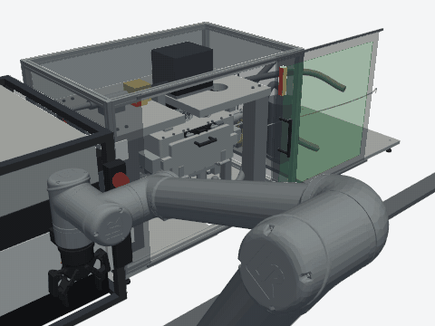
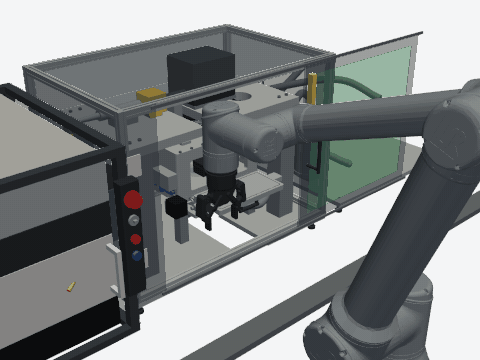
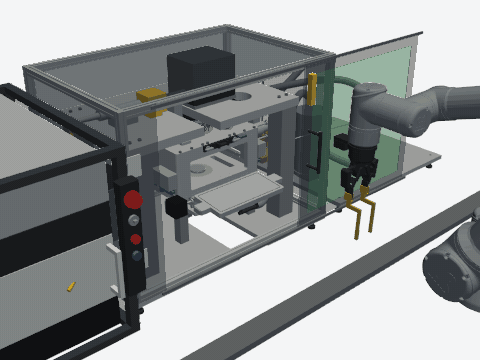
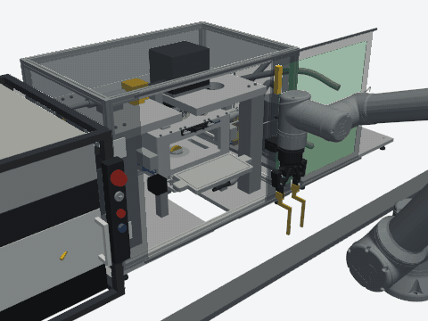
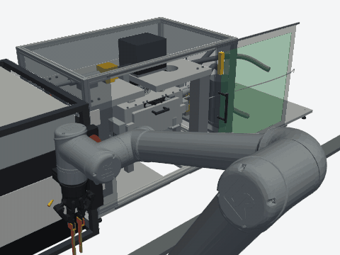
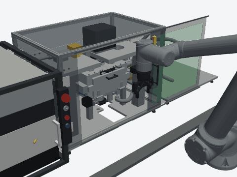
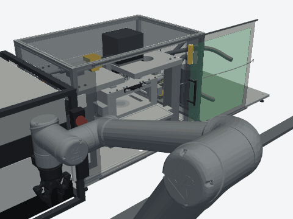
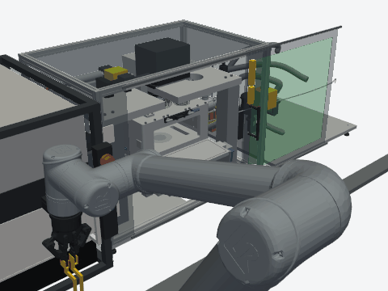
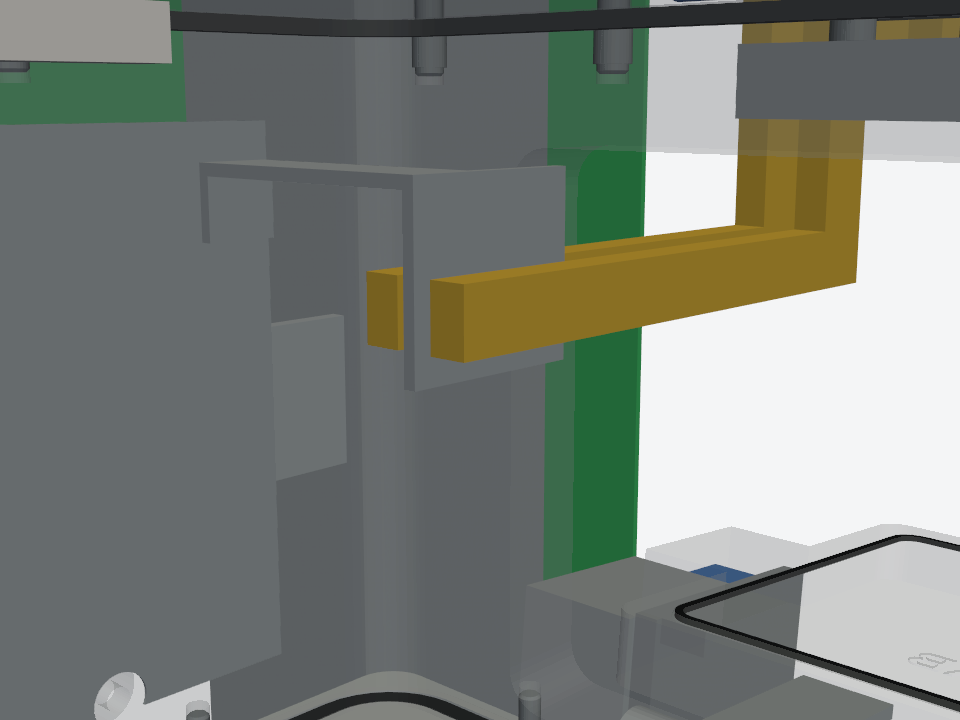

# Robot tending: every job planned and audited the byu-vcl PR 318 way

> **Update 2026-11-25 (round 6): the liner, reservoir and blade-cartridge jobs have run, and all four pass on M50** (section "Round 6"
> below, [`ops_r6.md`](analysis/out/robot/ops_r6.md)). On the first run only the reservoir passed.
> - **Liners:** the round-5 pull tab sat 15 mm outboard of the door opening's side, so the plate fingers cut 3 mm into the opening's
>   side at all seven MiR positions. Each tab is now a hanger whose grip plate stands 44 mm in from the liner, inside the opening
>   (`cad/automation.py`, `add_liner_tabs`; 0 interferences).
> - **Blade cartridge:** its two ball plungers count as soft parts during the pull, because their balls retract.
>
> Both liners and the blade pass from x −450, with 1.6, 1.6 and 2.0 mm closest and 33.7 % elbow. **The overflow jar's round-5
> failure is explained:** at the cup's height the 2F-85's coupling and the D405's clamp ring reach 3.5 mm below the top of the guard's
> bottom front rail. The jar job now grips the round-6 grip fin, an I-section like the module's.
>
> **On the merged round-6 model (PR branch 4e95878: the jar at the slot's front end with its fin, two SCHUNK NSE-HT zero-point clamps
> instead of the captive M6), every job passes on M50, and the jar and the module swap also on S25 and L75** ([`ops_r6b.md`](analysis/out/robot/ops_r6b.md)).
> - **Jar:** from x +400, 2.0 mm, 30.8 % elbow, 22.7 s.
> - **Module swap:** from x +300, 0.5 mm, 52–55 % wrist 1, 26.0 s, with no screws to turn. That needed a fix to the module job: its path now starts where
>   the pads' centre is after they close. Before, it dragged the module 3.6 mm sideways during the 40 mm drop, which a soft floor plate had hidden.
>
> **Still not simulated:** the jar's toggle clamp coming off.
>
> **Update 2026-11-23 (round 5, A1): the overflow jar has a straight way out to the front** (section "Round 5" below). The jar stays
> under the funnel. Its KF-40 joint is 26 mm lower and it is a 45 mm 2 in. cup on an MKS 100318805 toggle clamp. The outlet plenum's
> KF-25 port and hose moved to the plenum's left end, and the front-right leg moved to the right side. The hand operations U4.5 and
> U4.7 now pass (operations.md). **The robot still can't take the jar** ([`ops_a1.md`](analysis/out/robot/ops_a1.md)). In all six MiR
> positions tried, reaching level to the cup at z −102 fails in one of three ways: the wrist camera meets the guard frame, the
> forearm meets the guard door's handle, or the arm runs out of reach. The cup sits 55 mm lower than the module's grip block, which
> the robot does reach. The fix is a grip fin on the jar, forward to y ≈ −150 in front of the hinge knuckles at z ≈ −50, as the
> module has; it is not drawn.
> **The zero-point modules are still not drawn**: with the jar under the funnel, the right-hand NSE-HT has no place
> ([`hot-swap.md`](hot-swap.md) §3.2a lists what it would take), so the two captive M6 stay and the module job still assumes them released.
>
> **Update 2026-11-22 (round 4): the build module swap passes on M50, S25 and L75** ([`analysis/out/robot/ops_w3.md`](analysis/out/robot/ops_w3.md)).
> The module's handle now ends in an I-section grip block in front of the door's hinge knuckles, in the same place on every module
> (`cad/modules_low.py`, `MP.MODULE_GRIP`), so the gripper takes it level from the front instead of reaching under the chamber. The
> job follows the model's path to +4 mm, lifts the module 66 mm clear of the floor's front edge and carries it out over the guard
> sill, with the MiR at x = +300 mm. The clamp is still the two captive M6, which the job assumes released: two SCHUNK NSE-HT
> mini 88-20 don't fit under the floor until the overflow jar moves ([`hot-swap.md`](hot-swap.md) §3.2a). Section "Round 4" below
> has the numbers; the reservoir and blade jobs were re-run on this model too.
>
> **Update 2026-11-21 02:00 UTC (coordinator):** the bayonet plate exchange now passes on M50, S25 and L75 ([`analysis/out/robot/ops_bayonet_fix.md`](analysis/out/robot/ops_bayonet_fix.md)), after the thermal cutoff was lowered 1 mm out of the lugs' path (`cad/modules_low.py`, patch request 3 below). So 10 of the 12 jobs pass; the build-module swap and the overflow jar still need the changes listed.

Written 2026-11-20/21 (22:15–01:15 UTC) for [PR #266](https://github.com/vertical-cloud-lab/digital-alloy-lab/pull/266) (issue #260),
in answer to Sterling: "For mujoco, in relation to the UR12e ... make sure you're aligning with what's described in byu-vcl PR 318.
I'm also fine if we need a tool or attachment to make this work in terms of automation, but we need to make sure the workflow is
actually going to work, regardless of how we do it." This replaces the earlier note's straight-line MuJoCo study (its scripts and
outputs, `analysis/robot/robot_ops.py` and `analysis/out/robot/robot_ops_*.json`, are kept for the record).

| File | What it is |
|---|---|
| [`analysis/robot/ops.py`](analysis/robot/ops.py) | every job: IK branches with lookahead, RRT-Connect, Cartesian lines, the 1.5 mm audit, movers, clearances, torques, tip-over, cycle time, GIFs |
| [`analysis/robot/cell.py`](analysis/robot/cell.py) | the cell: UR12e + 2F-85 + D405 on a MiR250 at byu-vcl PR 318's layout, the Kardex opening, FCL scene, planner, statics |
| [`analysis/robot/eoat.py`](analysis/robot/eoat.py) | the robot's tools: plate fingers, straight caps, vacuum wand with grip fin |
| [`cad/automation.py`](cad/automation.py) | the machine's robot features, added to `lpbf_low.build()` by one hook line |
| [`analysis/robot/automation_check.py`](analysis/robot/automation_check.py) | interference sweep of those features ([`automation_interference.md`](analysis/out/robot/automation_interference.md)) |
| [`analysis/robot/door_mj.py`](analysis/robot/door_mj.py) | the chamber door's own motion in MuJoCo ([`door_mj.json`](analysis/out/robot/door_mj.json)) |
| [`analysis/out/robot/ops.md`](analysis/out/robot/ops.md), [`ops.json`](analysis/out/robot/ops.json) | results of the final run, every step of every job |
| [`robot-tooling.csv`](robot-tooling.csv) | robot-side tools and machine-side parts, with prices and sources |

## Short answer

**With what is now drawn, the UR12e on its MiR250 passes byu-vcl PR 318's audit end to end for all 14 of its jobs on the M50 machine:
the guard door both ways, opening the chamber door (and closing it with its new actuator), the build plate out by the drawbar path
and by the bayonet (both also on S25 and L75), the cover-slide drawer, the reservoir, the blade cartridge, cleaning the chamber
with a vacuum wand, (since 2026-11-22) the build module swap, and (since 2026-11-25, round 6) both side liners and the overflow jar.
On the round-6 model the module swap and the jar also pass on S25 and L75. The module is now held by two zero-point clamps that
release air opens, so the swap needs no screwdriver. The jar's toggle clamp coming off is still not simulated.** Every frame was
checked: the arm, its tools and what it holds against the whole cell (machine, VLM, MiR, ballast, tool stand), handled parts only
up to 1.5 mm deep into their own fixtures, and every moving part against everything else. The arm is never the limit: peak static
torque is about a third of the UR12e's limits (the module's 158 N push takes the elbow to 64 %), and with PR 318's 131 kg ballast
the MiR250 would need at least 5× each job's force to tip or slide.

It took these machine features, drawn in [`cad/automation.py`](cad/automation.py) and interference-free:
- a handle on the guard door;
- a rotary actuator that opens and closes the chamber door;
- air cylinders that throw the door's draw latches;
- wing heads on the drawer's latch studs;
- a grip fin on the blade cartridge and hanger pull tabs on the side liners (round 6);
- AprilTag plates for re-registration.

The robot side needs three tools in PR 318's pattern, with no tool changer: cranked "plate fingers" and straight long caps that slip
over the 2F-85's fingertips from a stand on the MiR, and a vacuum wand with a clamp-on grip fin
([`eoat.py`](analysis/robot/eoat.py)).

**Still not robot-ready, each with its fix:**
- **Closing the chamber door by hand-like motion fails.** No arm path lifts it from 95° past the guard's frame and rails, in 16
  combinations of MiR position and grasp. So the door gets its own actuator, which closes it in 2 s with the arm parked (passes).
  The robot can still pull it open.
- **The bayonet plate fails, on a model clash.** Twisting the plate runs its lugs into the thermal cutoff, whose top sits in the
  lugs' channel. The drawbar path passes on S25, M50 and L75, so the drawbar is the way (hot-swap.md agrees).
- **The build module swap passes (motion since 2026-11-22, clamps since 2026-11-25).** The gripper couldn't reach the old handle under
  the chamber past the door's hinge knuckles, and the last 140 mm of the path brought the arm too close to its own base. The handle's
  grip block sits in front of the knuckles, and the job lifts the module 66 mm before the last 140 mm. Since round 6 two SCHUNK NSE-HT
  zero-point clamps hold the module instead of the two captive M6, and release air opens them, so no person turns a screw
  (hot-swap.md §3.2a).
- **The overflow jar passes since round 6, by its grip fin.** Round 5's cup grasp failed: at z −102 the gripper's coupling and camera
  clamp don't pass over the guard's bottom rail (section "Round 6"). **Still not simulated:** its MKS toggle clamp coming off (lever
  pushed, clamp lifted off forward) and going back on. The job starts with the clamp already off. A lever the fingers push, or a
  pneumatic KF clamp, would close that gap.

## Results

Final run (`ops.py --render`, on the model as built at 23:56 UTC, with the chamber body as a through-frame plus a bolted floor plate). The drawer, blade cartridge and vacuum were re-run at 00:46–01:10 UTC after the last fixes, on the same model. **Rows re-run on 2026-11-22:** the build module on S25, M50 and L75 ([`ops_w3.md`](analysis/out/robot/ops_w3.md), 06:22–06:32 UTC), and the five jobs the MiR does from the rack's side (x −390 to −450: chamber door open, drawer, reservoir, blade, vacuum) on the final model with the 12U rack ([`ops_w3_rack.md`](analysis/out/robot/ops_w3_rack.md), 06:49 UTC). All pass; clearances moved by up to 3.6 mm because the planner found other branches. **Rows re-run on 2026-11-25 (round 6,
[`ops_r6.md`](analysis/out/robot/ops_r6.md), 01:04–01:19 UTC):** the reservoir, the blade cartridge and the two side liners (new rows).
They ran on the model as merged after round 5 (4b2232e) plus this round's liner tabs. **The jar and module rows** are from the merged
round-6 model (PR branch 4e95878, [`ops_r6b.md`](analysis/out/robot/ops_r6b.md), 02:53–03:21 UTC). On that model every other M50
job passes too: the rows marked "round 6 model". The S25 and L75 bayonet rows are superseded by the 02:00 update above. Each job was tried at up to 12 MiR positions along the opening (and grasp variants); the table gives the first that passes, or the one that got furthest. **Clearance** is the smallest FCL distance from the robot, its tools and what it holds to anything it may not touch. **Torque** is the peak static joint torque against the UR12e's limits (330/330/150/56/56/56 N·m). **Force** is the largest the job applies, against the 100 N force mode. **CoG margin** is how far the MiR250's centre of gravity (base, cabinet, 131 kg ballast, arm, tool and payload) stays inside its wheels at the worst frame; the tip-over forces are in the forces section. **Time** is the arm's own time from the planned paths; add ~5 s for a tag read after docking and ~20 s for each cap change.

| Job | Module | MiR arm x (mm) | Result | Blocking step, or the first collision | Min clearance (mm), pair | Peak torque | Force (N) / limit | Payload (kg) | CoG margin (mm) | Time (s) |
|---|---|---|---|---|---|---|---|---|---|---|
| Guard door open (515 mm) (round 6 model) | M50 | 450.0 | **pass** |  | 1.9, ur/gr/camera / Guard-position switch IDEC HS6B-12B05 | 31.8 % elbow | 30 / 100 | 0.0 | 200.0 | 8.2 |
| Guard door close (round 6 model) | M50 | 450.0 | **pass** |  | 26.1, left_finger_tip / Guard-door handle for the robot (Ø | 32.8 % elbow | 30 / 100 | 0.0 | 200.0 | 8.5 |
| Chamber door open (pull to 20 deg, then the drive) (round 6 model) | M50 | -450.0 | **pass** |  | 2.5, ur/gr/right_finger_tip / Guard-door handle for the robot (Ø | 32.5 % elbow | 15 / 100 | 0.0 | 199.0 | 15.0 |
| Chamber door close (its actuator; robot parked) (round 6 model) | M50 | 0.0 | **pass** |  | 20.1, wrist2 / Guard door rail (top + bottom) | 30.8 % elbow | 0 | 0.0 | 206.0 | 3.5 |
| Build plate out, drawbar (round 6 model) | M50 | 450.0 | **pass** |  | 1.3, ur/cap/right_finger_tip / Chamber floor plate (6061-T6, 20 m | 33.7 % elbow | 5 / 100 | 0.053 | 191.0 | 24.7 |
| Build plate out, bayonet (2 x 30 deg twists) (round 6 model) | M50 | -450.0 | **pass** |  | 0.6, held: build plate / Cartridge heaters M50 (3 x 50 W, 24 V, Ø6 x 22) | 33.7 % elbow | 5 / 100 | 0.053 | 194.0 | 28.6 |
| Cover-slide drawer: wings off, drawer out (round 6 model) | M50 | -450.0 | **pass** |  | 1.8, ur/gr/left_finger_tip / Drawer-closed sensor (inductive M12, o | 31.7 % elbow | 20 / 100 | 0.0 | 199.0 | 27.5 |
| Reservoir off the dock and out (round 6: the pull tab at y −84) | M50 | -390.0 | **pass** |  | 3.5, held: reservoir / NFC reader antenna (in the dock's side face) | 33.6 % elbow | 40 / 100 | 0.385 | 202.0 | 23.0 |
| Blade cartridge out (round 6: off its dowels and ball plungers) | M50 | -450.0 | **pass** |  | 2.0, held: blade cartridge / Recoater ball nut (flange on the +x fa | 33.7 % elbow | 40 / 100 | 0.197 | 199.0 | 22.3 |
| Right side liner out (round 6: hanger tab) | M50 | -450.0 | **pass** |  | 1.6, held: right side liner + its tab / Chamber door (open, 95°) | 33.7 % elbow | 20 / 100 | 0.07 | 199.0 | 23.6 |
| Left side liner out (round 6: hanger tab) | M50 | -450.0 | **pass** |  | 1.6, held: left side liner + its tab / Chamber door (open, 95°) | 33.7 % elbow | 20 / 100 | 0.073 | 199.0 | 24.5 |
| Build module out (round 6: zero-point clamps opened by release air; grip block; lift 66 mm, then out) | M50 | 300.0 | **pass** |  | 0.5, held: build module / Z mounting flange (bolted under the floor) | 53.3 % wrist 1 | 106 out, 158 in / 100 | 3.456 | 188.0 | 26.0 |
| Overflow jar out (round 6: by its grip fin; toggle clamp off, drop 8 mm, straight out, lift 60 mm) | M50 | 400.0 | **pass** |  | 2.0, held: overflow jar + grip fin / Overflow-jar present sensor | 30.8 % elbow | 10 / 100 | 0.384 | 196.0 | 22.7 |
| Chamber vacuum, 3 lanes (wand from the MiR cradle) (round 6 model) | M50 | -450.0 | **pass** |  | 3.0, wand (ATEX vacuum wand, collar, crevic / Chamber floor plate (6061-T6, 20 mm, b | 35.4 % elbow | 0 | 0.0 | 198.0 | 31.2 |
| Build plate out, drawbar | S25 | 450.0 | **pass** |  | 1.0, held: build plate / Thermal cutoff S25 (240 C, in seri | 33.7 % elbow | 5 / 100 | 0.014 | 191.0 | 24.6 |
| Build plate out, bayonet (2 x 30 deg twists) | S25 | -450.0 | **fail** | twist the plate 30 deg (half): held: build plate vs Thermal cutoff S25 (240 C, in series with the heat | 0.0, held: build plate / Thermal cutoff S25 (240 C, in seri | 33.4 % elbow | 5 / 100 | 0.014 | 195.0 | 29.2 |
| Build module out (round 6: zero-point clamps; grip block; lift 66 mm, then out) | S25 | 300.0 | **pass** |  | 0.5, held: build module / Z mounting flange (bolted under the floor) | 54.7 % wrist 1 | 106 out, 158 in / 100 | 3.143 | 189.0 | 26.0 |
| Overflow jar out (round 6: by its grip fin) | S25 | 400.0 | **pass** |  | 2.0, held: overflow jar + grip fin / Overflow-jar present sensor | 30.8 % elbow | 10 / 100 | 0.384 | 196.0 | 22.7 |
| Build plate out, drawbar | L75 | 450.0 | **pass** |  | 1.0, held: build plate / Thermal cutoff L75 (240 C, in seri | 33.7 % elbow | 5 / 100 | 0.12 | 191.0 | 24.9 |
| Build plate out, bayonet (2 x 30 deg twists) | L75 | -450.0 | **fail** | twist the plate 30 deg (half): held: build plate vs Thermal cutoff L75 (240 C, in series with the heat | 0.0, held: build plate / Thermal cutoff L75 (240 C, in seri | 32.9 % elbow | 5 / 100 | 0.12 | 194.0 | 29.7 |
| Build module out (round 6: zero-point clamps; grip block; lift 66 mm, then out) | L75 | 300.0 | **pass** |  | 0.5, held: build module / Z mounting flange (bolted under the floor) | 52.1 % wrist 1 | 106 out, 158 in / 100 | 3.732 | 188.0 | 26.0 |
| Overflow jar out (round 6: by its grip fin) | L75 | 400.0 | **pass** |  | 2.0, held: overflow jar + grip fin / Overflow-jar present sensor | 30.8 % elbow | 10 / 100 | 0.384 | 196.0 | 22.7 |

GIFs and stills (`analysis/out/robot/ops_<job>_<module>.gif`, `_tightest.png`: the first collision frame, or else the tightest):

| Guard door open (515 mm) (M50) | Guard door close (M50) | Chamber door open (pull to 20 deg, then the drive) (M50) |
|---|---|---|
|  |  |  |
| Chamber door close (its actuator; robot parked) (M50) | Build plate out, drawbar (M50) | Build plate out, bayonet (2 x 30 deg twists) (M50) |
|---|---|---|
|  |  |  |
| Cover-slide drawer: wings off, drawer out (M50) | Reservoir off the dock and out (M50) | Blade cartridge out (M50) |
|---|---|---|
|  |  |  |
| Build module out (M50, round 6: zero-point clamps) | Overflow jar out by its grip fin (M50, round 6) | Chamber vacuum, 3 lanes (wand from the MiR cradle) (M50) |
|---|---|---|
|  |  |  |
| Right side liner out (M50, round 6) | Left side liner out (M50, round 6) | The plate fingers on the right liner's hanger tab, seen from inside the chamber |
|  |  |  |

Not in the table:
- **The robot's own door close** (`ops.py --jobs chamber_door_close`; [`door_close_attempt.json`](analysis/out/robot/door_close_attempt.json)).
  A lift lug on the door's top corner, taken from the front at 95° and lifted along the door's arc, failed in all 16 combinations
  of MiR position (x −450 to +300) and grasp tilt (−60° to +20°). The wrist or forearm hit the guard's frame or rails, or no
  branch reached the lug past the VLM's front. The lug was dropped and the door got its actuator.
- **The liners** (2026-11-23; run 2026-11-25, round 6): patch request 7 is drawn, and `ops.py` has `liner_right` and `liner_left`.
  Each job puts the lips on the side liner's tab, then moves it 4 mm in, 21 mm forward off the ball screw, in to x ±105, down 6 mm
  and out through the door, with the recoater at the other end of its stroke. The same path passes as hand operation M3 (tightest
  0.36 mm). Round 6 ran them: they failed on the round-5 tab and pass on the hanger tab (section "Round 6"). The reservoir job grips
  the pull tab at y −84, and the blade job lets the holder slide off its two dowels and plungers; both pass (round 6).
- **The build module's force column** gives the removal (106 N down: the spigot O-ring's 132 N less the module's 26 N) and the
  insertion (158 N up). Since round 4 the job passes, and both forces are over the 100 N force mode (round 4, still open).
- **Tight but passing:**
  - the guard-door approach passes 1.9 mm from the guard-lock switch;
  - the plate fingers' lower blades ride 1.0–1.3 mm over the floor and past the thermal cutoff;
  - the vacuum nozzle runs 3 mm over the floor (by design);
  - each side liner, lowered 6 mm to pass the door opening, slides out 1.6 mm over the open door (round 6; the same path as hand
    operation M3, whose 88 mm liner has 2 mm above and below in the 92 mm opening);
  - on the round-6 model the bayonet plate passes 0.6 mm from the M50 cartridge heaters as it twists, and the module 0.5 mm from the
    Z mounting flange on its own path.

  A real program would keep 5–10 mm away from the switch, the floor and the thermal cutoff.
- **The vacuum misses one strip**: the strip under the dose chute (x < −60 mm, |y| ≤ 50 mm) is out of the level wand's reach. That
  is the recoater's park and dose zone, where powder collects, so it needs a narrower nozzle or a person with the same wand.

## Round 4 (2026-11-22): the build module swap

**Changed in the model** (commits e0e1a23 and 9297709, `cad/modules_low.py`, `cad/module_params.py`):
- **The module's handle.** The two side arms under the gland plate stay. A riser in front of the collar carries an arm forward,
  4 mm under the outlet plenum (z −52 to −40), to an I-section grip block:
  - at y −156 to −126 and z −69 to −25, in front of the door's hinge knuckles (their front is at y −138, their underside at z −20);
  - in the same place on S25, M50 and L75 (`MP.MODULE_GRIP`), so one grasp serves all three;
  - the 2F-85's stock pads close on its 40 mm web; the 5 mm flanges above and below take the 106 N pull and the 158 N push by form
    closure, with ±4 mm of vertical capture for the 22 mm pads;
  - 6061, about 0.25 kg, made in-house.
- **The job** (`ops.py`, `job_module`): the MiR stands at x = +300 mm. The gripper comes in level along +y and closes on the web. It
  follows the model's path to (0, −190, +4), lifts the module 66 mm (the spigot stays 19 mm under the door handle), then carries it
  140 mm forward over the guard sill and up to the MiR's rack. The first variant tried passes on all three modules.
- **Audit fixes on the way:**
  - the floor port is in the floor plate since the frame and floor plate were split, and the job's fixture list had missed it;
  - the floor plate is now tessellated at 0.05 mm: at 0.4 mm the Ø96 port's chords sat 0.3 mm inside the spigot's 0.1 mm fit;
  - during the straight 40 mm drop, the floor plate, the dowel and diamond pin, and the captive screws' floor inserts are soft
    (the screws are drawn screwed in; `interference.py` checks those fits exactly);
  - the riser moved 6 mm back, because the robot found its L75 pass at the guard's bottom front rail too tight (1.9 mm exact). It
    is 7.9 mm now.

| Job | Before (2026-11-21) | After (2026-11-22, [`ops_w3.md`](analysis/out/robot/ops_w3.md)) |
|---|---|---|
| Build module out, M50 | fail: the camera meets the door while reaching under the chamber | **pass**: 0.5 mm, 55.7 % wrist 1, 2.92 kg, centre of gravity 190 mm inside the wheels, 26.0 s |
| Build module out, S25 | fail | **pass**: 0.5 mm, 57.0 % wrist 1, 2.63 kg, 191 mm, 26.0 s |
| Build module out, L75 | fail | **pass**: 0.5 mm, 54.5 % wrist 1, 3.19 kg, 189 mm, 26.0 s |
| Reservoir, M50 | pass, on the 13:54 UTC model | **pass** on the final model: 1.9 mm (cap to the beam tube), 33.4 % elbow, 24.2 s |
| Blade cartridge, M50 | pass, on the 13:54 UTC model | **pass** on the final model: 2.0 mm (cartridge to the recoater's ball nut), 33.7 % elbow, 22.3 s |
| Chamber door open, drawer, vacuum (M50, MiR at x −450) | pass, on the 23:56 UTC model | **pass** on the final model, with the rack now 12U (560 mm) beside them: 0.9, 1.8 and 3.0 mm |

The 0.5 mm is the module flange's tab passing the overflow clamp's wing during the drop, as drawn before; `interference.py` finds
the same gap. **Jobs passing on M50: 11 of 12** (was 10): only the overflow jar fails. The module swap also passes on S25 and L75.

**Still open for the module:**
- **The clamp.** It is still the two captive M6, and the job assumes a person has released them. Two SCHUNK NSE-HT mini 88-20
  (ID 1460874, Ø88 × 20 mm) fit under the floor only once the overflow jar moves ([`hot-swap.md`](hot-swap.md) §3.2a).
- **The forces.** The 106 N pull and 158 N push are over the 100 N force mode. Run that part under position control with a
  200 N PFL limit; zero-point clamps would pull the last millimetre themselves.

## Round 5 (2026-11-23, A1): the overflow jar gets a way out; the zero-point modules still don't fit

**Changed in the model** (`cad/lpbf_low.py` sections 3, 4, 5 and 11, `cad/joints.py`; commits d8ec123, 9481fc5, 4344f5d):

| What | Before | Now | Why |
|---|---|---|---|
| KF-40 joint under the funnel | z −58, 16 mm weld stub | z −84, 42 mm weld stub | the toggle clamp's side links (z −89 to −79) pass 4.5 mm under the module flange's tabs when the module drops (tabs z −70 to −60) |
| Jar | 90 mm KF-40 half nipple, ~120 cm³, bottom z −150 | KF-40 flange with an 11 mm Ø38.1 neck (the toggle clamp's lower lip wraps 9.5 mm under the joint) on a 2 in. × 0.065 in. 316L cup, 45 mm overall, ~65 cm³, bottom z −129 (−137 dropped) | it passes 3 mm over the guard's bottom front rail (top z −140) on the way out; a wider cup meets the Z servo's corner (x 93.5, y 27.7) |
| Clamp | McMaster 4518K73 wing-nut clamp | **MKS 100318805** toggle clamp, NW40, aluminium, $23.34 (mks.com, 2026-11-23), lever to the front | one push on the lever opens it, for a hand or a fingertip; A 123.7, B 83.6, C 19.05 mm drawn, ring section assumed |
| Outlet plenum's boot, KF-25 port and hose | right end (x 72–100), port at x 86 pointing down, hose down and right | left end (x −100 to −72), port at x −86; the hose runs back along x −86 under the left side (z −145 to −109), behind the chamber at y 135 and up past the back-right leg | at the right end they stood in the jar's only lane; gas-flow.md has the update (the CFD's drain flips to the left end) |
| Front-right leg | x 120–150, y −105 to −75 | x 128–156, y 26–56 (28 × 30), on the right side behind the jar sensor | it overlapped the jar's lane by 7 mm; it stays 2 mm clear of the floor-plate screws' U-notches at (148, 20) and (148, 62), so those stay reachable. `analysis/fea/fea.py` still places the legs itself (line 441) and should read `lpbf_low.LEG_BOXES` |
| Jar sensor | M12 9 mm from the jar's side (beyond an inductive M12's range), no bracket | M12 2 mm from the cup at z −121 on a 6061 bracket, 2 × M4 into the leg's front face | the gripper's pads close at z −113 to −91, 2 mm above it |

**The jar's lane** is x 72.6 to 127.4, from the jar to the guard door, and is now empty: under the plenum's flat part (z −36), under the
door's hinge knuckles, and over the guard's bottom front rail. The robot job (`ops.py`, `job_overflow`):
1. the toggle clamp comes off (a machine step, not simulated);
2. the gripper comes in level from the front and closes on the cup with its pads at z −113 to −91;
3. it lowers the jar 8 mm, slides it 160 mm straight out, lifts it 60 mm past the hinge knuckles, and carries it out over the guard
   sill.

**Re-run on this model** (`ops.py --jobs overflow_jar,module_swap --modules M50,S25,L75 --render --tag _a1`, 23:35 UTC, on 7db3b5d):

| Job | Module | Result | Blocking step, or min clearance | Peak torque | Time (s) |
|---|---|---|---|---|---|
| Overflow jar out (toggle clamp off, drop 8, straight out) | M50 | **fail** in all six MiR positions (x 300, 450, 100, −300, 550, −450) | "in level to the jar": the wrist camera meets the guard frame (x 300, −450); the forearm meets the guard door's robot handle (x 450, 550); no clear path past the VLM's front skin and the guard frame (x −300); no IK at the end (x 100) | 31–33 % elbow | – |
| Build module out (grip block) | M50 | **pass** | 1.0 mm, the module to the Z mounting flange (was 0.5 mm to the old overflow clamp's wing) | 55.7 % wrist 1 | 26.0 |
| Build module out (grip block) | S25 | **pass** | 1.0 mm, the module to the Z mounting flange | 57.0 % wrist 1 | 26.0 |
| Build module out (grip block) | L75 | **pass** | 1.0 mm, the module to the Z mounting flange | 54.5 % wrist 1 | 26.0 |

**Interference, as far as it got before the 23:59 deadline (the shared heavy-job queue held these runs for up to 35 minutes):**
- **Full M50 sweep on d8ec123 (the first version):** stopped after the first four static states. Each state had **1 interference**,
  the jar's cup inside the toggle clamp's lower lip: 1,170 mm³ exact, from `/tmp` scratch built from section 4's code.
- **Fixed in 7db3b5d:** the jar flange keeps an 11 mm Ø38.1 neck before the cup widens, and that pair is now 0.
- **Exact OpenCascade check of the overflow parts on the final geometry: all 0.** It covers jar, port, clamp, sensor, bracket,
  right-hand leg and funnel, and the dropped module tab swept 182 mm forward against the clamp (4.5 mm under it).
- **Full sweeps on the final geometry (7db3b5d): M50 and L75 both 0 interferences** in all five static states and all eight motion
  sweeps (M50 311 s, L75 337 s; `analysis/out/interference.md`, `variants/interference-L75-L.md`). **S25 was not run** before the
  deadline. Hand ops on S25 (S1–S3, U1, U4): 10 pass / 0 warn / 1 fail; the fail is U1.1, as before.
- **Indirect evidence for the module path:** the module swap passes in the robot audit above, and the hand check S2.4 passes on M50
  (0.1 mm at the floor port, as before).

## Round 6 (2026-11-25): the liners, the reservoir and the blade cartridge run; why the jar failed

**Run** on the model as merged after round 5 (4b2232e), M50, each job at up to 7 MiR positions (x −450 to +600):
`OMP_NUM_THREADS=1 MUJOCO_GL=egl /tmp/capmem 4 xvfb-run -a python analysis/robot/ops.py --jobs liner_right,liner_left,reservoir,blade_cartridge --modules M50 --tag _r6`
(00:41–00:48 UTC). After the fixes below, the failing jobs were re-run, and then all four with `--render` (01:04–01:19 UTC;
[`ops_r6.md`](analysis/out/robot/ops_r6.md), [`ops_r6.json`](analysis/out/robot/ops_r6.json)). Their GIFs were rendered again on the
merged round-6 model (03:22–03:29 UTC), with the same results. The cell is unchanged: byu-vcl PR 318
round 14 (UR12e = UR10e renamed, MiR250 with the 480 mm cabinet, arm base at 800 mm, parked 240 mm in front of the VLM's face), FCL on
the meshes, IK branches and RRT-Connect, the 1.5 mm audit and the movers check.

| Job (M50) | First run, on the model as merged after round 5 | After the round-6 fixes |
|---|---|---|
| Right side liner | **fail** at all 7 MiR positions (2 stopped in planning). Going in to the tab, both blades of the plate fingers cut 3.0 mm into the chamber body at the door opening's side | **pass** from x −450: 1.6 mm (the held liner over the open door on the way out), 33.7 % elbow, 20 N, 0.07 kg, centre of gravity 199 mm inside the wheels, 23.6 s |
| Left side liner | **fail**, the same way | **pass** from x −450: 1.6 mm (the same), 33.7 % elbow, 20 N, 0.07 kg, 199 mm, 24.5 s |
| Reservoir (pull tab at y −84) | **pass** from x −390 (the first position tried) | **pass**, the same: 3.5 mm (the held reservoir to the dock's NFC antenna, 36 mm into the pull), 33.6 % elbow, 40 N, 0.39 kg, 202 mm, 23.0 s |
| Blade cartridge (two dowels, two ball plungers) | **fail** at all 7 (2 stopped in planning): on 3 frames of the 10 mm pull the held cartridge is 3.0 mm into the ball plungers | **pass** from x −450: 2.0 mm (the cartridge to the recoater's ball nut, at the start of the pull), 33.7 % elbow, 40 N, 0.20 kg, 199 mm, 22.3 s |

The largest force in these jobs is 40 N, inside the 100 N force mode and at least 10× below what tips the MiR250 with its ballast
(section "Forces"). Times are the arm's own; add ~20 s for a cap change (all four use the plate fingers or the straight caps).

**What was changed:**
- **The liner pull tabs** (`cad/automation.py`: the new function `add_liner_tabs` and its parameters `LINER_TAB`; robot-tooling.csv
  RA6).
  - **Why the round-5 tab failed.** It was a 2 mm plate 12 mm in from the liner (x ±125.4–127.4, y −70 to −46, z 88–104) on two
    standoffs. The door opening is x ±110, z 8–100. So the tab sat 15 mm outboard of the opening's side, and its standoffs
    (x 127.4–139.4, z 90–102) filled the gap where the outer blade has to go. The round-5 job came in with 8° of yaw, and the blades
    met the opening's side. By geometry, a yaw that clears the side (about 40°) puts the blade tips into the liner and the wall.
  - **The hanger.** A 12 mm web (z 96–98) runs from a foot spot-welded to the liner's front end in to a grip plate at x ±(93.4–95.4),
    y −88 to −58, z 70–98. The grip plate reaches forward of the liner's front edge (y −70.5) because the dose chute (x −96 to −84,
    |y| ≤ 50, down to z 37) stands where a left grip plate further back would be. 316L, about 20 g a side.
  - **The grasp.** The plate fingers come straight in along +y, open to 10 mm, so the outer blade passes 2.6 mm inside the opening's
    side. Their lips close on the grip plate at y −76, z 76. The blade tips stop 9 mm in front of the chute, and the blades' tops
    (z 84.8) stay under the opening's top. When the liner slides 21 mm forward, the grip plate's front (y −109) enters the door
    opening below its top. Lowered 6 mm, the whole tab passes under it.
  - **Interference** (`automation_check.py`, M50, 640 s): 0 in the five states and in the door, drawer, guard-door and recoater sweeps.
  - **For hand operation M3:** a hand takes the same grip plate. M3 was not re-run here.
- **The blade cartridge's ball plungers are soft parts** in the audit, for the held cartridge (`ops.py`, `job_blade`), as the
  O-rings a part slides over are.
  - Each Ø3.5 ball stands 0.8 mm proud into its dimple and has 1 mm of travel (McMaster 85015A47), so the holder pushes it back
    into its body as it slides out. The plungers' bodies stop 0.2 mm short of the holder's sides.
  - Drawn rigid, the two balls pinch the holder from both sides. No single translation frees a part pinched from both sides, so the
    sampled depth read 3.0 mm. The real overlap is the 0.8 mm protrusion, inside the 1.5 mm rule.
- `ops.py`, `job_liner`: the grasp moves to the hanger's grip plate (straight in, no yaw). `cell.py`: `CELL_ACM_CACHE` sets the path
  of the self-collision cache, so parallel runs don't share `/tmp/cell_acm.json`.

### The overflow jar: why the cup grasp failed in round 5

Re-run on the same model, at each of round 5's MiR positions, with the first collision's bodies and their positions at that frame:

| MiR arm x (mm) | What stops it | Why |
|---|---|---|
| +300, −450 | "in level to the jar", 113 frames: the D405 camera part vs the guard frame | The TCP is level at the cup's height (z −102), so the tool's axis is at z −102. The 2F-85's coupling (r 37.5) and the D405's clamp ring round it (r 41.5) reach down to z −143.5. That is 3.5 mm below the top of the guard's bottom front rail (z −140, y −265 to −245), which the wrist passes over as the gripper reaches 128 mm in under the chamber |
| +450, +550 | the same step, 119 and 161 frames: the forearm vs the guard door's robot handle | With the arm's base 350–450 mm right of the jar, the forearm comes down across the open guard door's handle (x 197–209, y −324 to −272, z 40–170) |
| +100 | planning: "out over the guard sill: no IK" | The base is straight in front of the jar. Carried out to y −330 with the tool level and pointing at the machine, the wrist would be inside the arm's inner limit round its own base |
| −300 | planning: no clear branch for the approach | Every branch's approach line meets the VLM's front skin, the MiR's cabinet or (halfway in) the same bottom rail |

So no MiR position reaches the cup level from the front. Over the rail, the tool's axis has to stay above about z −97 (the rail's
top at −140, plus the 41.5 mm clamp ring, plus a few mm). The pads on the cup work at z −113 to −91. A grip feature has to sit
higher, which is what a fin does.

### The jar with a grip fin (job prepared; the run on the merged model follows)

`ops.py`, `job_overflow`, now looks for a part whose name starts "Overflow jar" and contains "grip fin" (the round-6 fin, drawn by
the layout work in `cad/automation.py`).
- **The grasp:** it reads the I-section at the fin's front end from the part's mesh (the web's width at mid-height, the block's z span,
  its front face). The gripper takes the web level from the front, as the module job takes the module's grip block.
- **The path:** lower 8 mm off the centring ring (10 N assumed for its O-ring); straight out until the cup is 10 mm in front of the
  hinge knuckles; lift 60 mm; out until the cup is 30 mm in front of the guard's face; up to the MiR's rack.
- **The MiR positions:** x +400, +300, +450, +350, +500 and +200, each with the gripper rolled 0° and 180°. The fin is level with the
  module's grip block and 100 mm to its right, and the module passes from x +300.
- **Without a fin** (the model as merged after round 5) it runs the round-5 cup grasp above.

**Test before the merge.** The layout work's draft fin (read 02:00 UTC: a 40 mm web at x 80–120, z −60 to −30, between 56 mm
flanges, y −156 to −126, on a riser from the cup) was injected into this scene only, around the round-5 jar at (100, 0). It **passes
on the first variant**, x +400: 0 bad frames, 2.0 mm (the held jar to the jar sensor), 30.8 % elbow, 24.1 s.

### On the merged round-6 model (PR branch 4e95878; run 02:53–03:15 UTC)

**What the merge brought:**
- the layout work: the jar's KF-40 joint at the overflow slot's front end (94, −46, z −82), with a 2.5 in. cup and the grip fin;
- two SCHUNK NSE-HT mini 88-20 zero-point clamps under the floor at (100, 40) and (−102, −26), whose Ø20 pins the module's arms carry
  (the captive M6 are gone);
- the legs, the Z servo and the outlet hose moved;
- the assembly work's rod-end block and the optics work's field-stop insert.

Results: [`ops_r6b.md`](analysis/out/robot/ops_r6b.md), [`ops_r6b.json`](analysis/out/robot/ops_r6b.json); GIFs
`ops_overflow_jar_<module>.gif` and `ops_module_swap_<module>.gif`.

| Job | Module | MiR arm x (mm) | Result | Min clearance (mm), pair | Peak torque | Force (N) | Payload (kg) | CoG margin (mm) | Time (s) |
|---|---|---|---|---|---|---|---|---|---|
| Overflow jar out by its grip fin | M50, S25, L75 | +400 | **pass** on the first variant, all three | 2.0, the held jar to the jar's sensor (2 mm beside the cup) | 30.8 % elbow | 10 (assumed: the centring ring's O-ring) | 0.38 (empty) | 196 | 22.7 |
| Build module out (release air opens the zero-point clamps) | M50 | +300 | **pass** | 0.5, the module to the Z mounting flange | 53.3 % wrist 1 | 106 out, 158 in | 3.46 | 188 | 26.0 |
| Build module out | S25 | +300 | **pass** | 0.5, the same | 54.7 % wrist 1 | 106 out, 158 in | 3.14 | 189 | 26.0 |
| Build module out | L75 | +300 | **pass** | 0.5, the same | 52.1 % wrist 1 | 106 out, 158 in | 3.73 | 188 | 26.0 |
| Liners, reservoir, blade cartridge (re-check) | M50 | as before | **pass**, all four | as before: 1.6, 1.6, 3.5, 2.0 | 33.4–33.7 % elbow | as before | as before | 199 | 22.3–24.5 |
| Guard door open and close, chamber door open, door actuator, plate by drawbar and by bayonet, drawer, vacuum (re-check, 03:15–03:21 UTC) | M50 | ±450, 0 | **pass**, all eight, each at the first MiR position it tried except the bayonet (−450) | 0.6 (the bayonet plate to the M50 cartridge heaters), 1.3 (drawbar), 1.8 (drawer), 1.9 (guard door: the camera to the guard-position switch), 2.5 (chamber door), 3.0 (vacuum) | 30.8–35.4 % elbow | ≤ 30 | ≤ 0.05 | 191–206 | 3.5–31.2 |

The module is now 3.1–3.7 kg with its zero-point arms and pins (round 5: 2.6–3.2 kg). The jar carries 0.38 kg empty; full of
AlSi10Mg powder (~115 cm³ at ~1.4 g/cm³ bulk, assumed) it is ~0.55 kg, well inside the 2F-85's 5 kg.

**The module job needed a fix.**
- **What failed.** It first ran on a snapshot of the layout work's files (02:24 UTC). The jar passed. The module failed at all 12
  MiR positions and rolls. The best, x +300, failed on one frame of the drop: the module's zero-point pins read 12 mm "into" their
  clamping modules.
- **The cause was in the job, not the model.** The grasp line put the pads' centre on the grip block's centre with the gripper open.
  Closing from 60 to 40.3 mm moves that centre 3.6 mm along the approach. The path's waypoints were absolute, so over the 40 mm drop
  the module moved 3.6 mm sideways, with its pins in bores that have 0.2 mm clearance.
- **Rounds 4 and 5 had the same drift.** A soft floor plate hid it; the round-4 note's captive screws "reading 3 mm deep at the first
  frame" was probably this drift.
- **The fix.** The path now runs from the pads' centre after they close (`ops.py`, `job_module`).
- **A stricter audit as a result.** The floor plate is no longer soft. It is one of the module's fixtures under the 1.5 mm rule, as the
  spigot leaves its 0.1 mm port straight down. The clamping modules are fixtures for the drop too. Their pins and bores are tessellated
  at 0.05 mm, because 0.4 mm chords close their 0.2 mm clearance.
- **The clearance.** The module's 0.5 mm (round 5: 1.0 mm) is now on the model's own path (`MODULE_PATH`), which `interference.py`
  sweeps exactly.

**Not simulated:** the jar's toggle clamp coming off and going back on. The jar job starts with it off. The jar going back in, and the
module going back in, use the same poses reversed. The zero-point clamps' pull-in is not simulated.

## Alignment with byu-vcl PR 318

PR 318's latest round is round 14 (runs A–D, 2026-11-20). Its branch head (`e60fcb0`, 21:54 UTC) is three commits past `11d4410`:
chapter 3 re-rendered, the README's round-14 (C) section, and the start of a safety-assets note. None touches the arm, the collision
checks or the cell, so this study follows `11d4410` (`collide.py`, `animate.py`, `props.py`, `vlm.py`, `ur_arm.py`,
`alloy_atomize.py`, `notes/arm_collisions.md`, `notes/atom_vacuum.md`, `notes/ur12e.md`; read 22:20 UTC).

| | byu-vcl PR 318 (round 14) | This study |
|---|---|---|
| Robot | UR10e, shown as UR12e since round 14: "the robots themselves are mechanically unchanged" (UR FAQ, `notes/ur12e.md`); Robotiq 2F-85; RealSense D405 on the coupling | the same `ur_arm.py`, vendored unchanged: UR's and Robotiq's ROS 2 meshes, closed-form IK, the D405 drawn |
| Base | MiR250 800 × 580 × 300 mm, 480 mm cabinet, 20 mm plate: arm base 800 mm above the floor; 131 kg steel ballast plate (760 × 550 × 40) on the deck since round 9 | the same; the ballast is in the scene and in the tip-over check |
| Park pose | arm base 240 mm in front of the VLM's front face; the MiR drives along the opening to line up with each job, at 0.3 m/s² | the same y; each job's MiR x is chosen from 4–12 positions along the opening (−600 to +600 mm) |
| Opening | Kardex Shuttle XP 500, 2450 × 864 mm trays, access table at 833 mm, tray floor at 857 mm, 996 mm opening (header at 1829 mm) | the same; the machine stands on the presented tray (machine z = world z − 1069 mm) |
| Collisions | FCL on the meshes as drawn, arm against itself (MoveIt's always-touching pairs left out) and everything visible | the same, with the machine tessellated at 0.4 mm (0.05 mm for the plate, block, module, blade cartridge and reservoir fits) |
| Planner | every IK branch nearest first, straight joint line, else RRT-Connect (1.5° edges, shortcut), detours ≤ 150 mm above the move | the same, plus a lookahead: a branch is skipped if the work lines that follow it flip or collide |
| Audit | round 11: gripper, tool and held part may touch the handled part and its fixtures ≤ 1.5 mm deep (sampled translational depth, 0.3 mm shrink first); movers checked every frame | the same rules, every frame; seals a part slides over (drawer, reservoir dock, spigot O-rings) are soft parts, as `sc.soft` |
| Registration | AprilTag cubes (120 mm, tags on five faces) on target posts; the D405 sees each seat before the arm picks; the bay camera sees 94 % of a presented tray | two tag36h11 plates on the guard's front-left post (drawn), read by the D405 after each docking and VLM move; the MiR250 docks to a VL marker within ±3 mm, ±0.5° (MiR spec) |
| Tools | no changer: specimen fingers as caps over the 2F-85's fingertips, fitted from a stand on the MiR; a tong pinned to the fingertips; a vacuum wand with a clamp collar and grip fin in a holster | the same pattern: plate fingers and straight caps from a fork stand on the MiR's cabinet top, the wand in a cradle there (both in the collision scene) |
| Powder safety | bonded floor plates and sprung shoes on the MiR before the arm works near powder; Nilfisk ATEX vacuum; continuity checks | not modelled here; the same applies to AlSi10Mg (open item) |
| Machine motion | `interference.py` sweeps every model's own motion in MuJoCo | the coordinator's `analysis/interference.py` and `automation_check.py`; the door's dynamics in MuJoCo (`door_mj.py`) |

## What the machine needs, drawn in `cad/automation.py`

One hook line at the end of `lpbf_low.build()` adds these parts (every one tagged `automation`). Interference
(`automation_check.py`, interference.py's mesh and exact booleans, five states and the door, drawer, guard-door and recoater
sweeps): **0 interferences**. The tightest moving gaps are the wing heads to the drawer-closed sensor (2.0 mm) and the guard-door
handle to the guard's panels (6.0 mm at 494 mm of travel).

| Feature | Why | Product |
|---|---|---|
| Guard-door handle: Ø12 × 130 bar on two Ø10 standoffs at the door's left end | the door had nothing to hold | ours |
| Door drive: rotary actuator on the hinge axis, with its bracket and a drive disc keyed to the door | no arm path lifts the door shut from 95° (below); the actuator opens and closes it, its flow controls set the speed | SMC CRQ2 size 20 class (~1.8 N·m at 0.5 MPa), stroke set to 95°; envelope 47 × 47 × 42 mm. Passive alternative in the same place: McMaster 6597K124 one-way damper (2.0 N·m, $71.70) if a person closes the door |
| Draw-latch actuators: a Ø20 compact cylinder above each 1807A61 draw latch, on the latch's bracket on the door (since 2026-11-23) | throw the over-centre latches, so the 1.4 kN squeeze never goes through the arm; the latches still hold with the air off | SMC CQ2/CJ2 20 mm class, 157 N at 0.5 MPa; D-M9B switch ($37.10) for latch-closed. Catalogue alternative: DESTACO 8051 pull-action pneumatic latch (holds 2,669 N; $429.99, search snippet) |
| Wing heads on the drawer's two quarter-turn studs | the fingers drive the wing and the wrist turns it 90°: about 0.34 N·m for the 179 N each cam pulls, 26 N at the wing's end | ours; the quarter-turn latch itself is still an envelope (seals.md: no catalogue part fits) |
| Blade-cartridge grip fin, 4 mm, on the holder's front end | the lips of the plate fingers take it | ours |
| Liner pull tabs, one part per side liner. Since 2026-11-25 a 2 mm 316L hanger: a 12 mm web (z 96–98) from the liner's front end in to a grip plate at x ±(93.4–95.4), y −88 to −58, z 70–98 (`add_liner_tabs`) | something to hold; the liners come out since 2026-11-23 (patch request 7). Round 5's tab, 12 mm off the liner, sat outboard of the door opening, out of the robot's reach | ours |
| Two AprilTag plates (tag36h11, 56 mm) on the guard's front-left post | re-registration after each docking and VLM move | ours |
| Overflow-jar grip fin (round 6, drawn by the layout work): a tab on the cup and a riser up to an I-section, a 40 mm web at x 80–120, z −60 to −30, between 56 mm flanges, at y −156 to −126, level with the module's grip block and 100 mm to its right | the cup itself can't be reached: at its height the gripper's coupling and camera clamp don't pass over the guard's bottom rail | ours, 6061 |

The earlier note's other machine-side needs are resolved like this: the plate's grip groove level with the sill is handled by the
cranked fingers (no change to the plate height); the drawer's 350 N by the wing cams; the door's 1.4 kN by the latch cylinders.

## What the robot needs: `eoat.py`, `cell.py`

| Tool | Used for | Notes |
|---|---|---|
| Robotiq 2F-85 stock pads | guard-door handle, door handle, drawer tab and wings, module handle, wand fin | $5,990 (RoboticsCenter); 85 mm stroke, 20–235 N, 5 kg rated |
| **Plate fingers**: two cranked caps over the fingertips | build plate S25/M50/L75 by its 3 × 1.5 mm rim groove; blade-cartridge fin | ours: 120 mm reach past the pad centre, a 45 mm step down after 48 mm, a 2 × 2.4 mm lip on the lower blade's inner edge. The step keeps the 2F-85's housing above the open door (its top face at z −2 when it hangs at 95°) while the lips work 1–4 mm over the floor. 0.18 kg |
| **Straight caps**: the same without the step | reservoir handle fin | the knuckles pass over the optics bridge (its slot is 56 mm wide) and the D405 stays under the guard's top rail |
| Cap stand on the MiR's cabinet top | fitting and parking the caps | byu-vcl PR 318's specimen-finger pattern; in every job's collision scene |
| **Vacuum wand** with a clamp collar and 30 mm grip fin, crevice tool on a short wand | chamber cleaning | PR 318's `atom_vacuum` design; the full 508 mm wand put the TCP over the arm's own base, so a 200 mm section. Vacuum: Nilfisk VHS110EXP (Group E, for Al dust; price not found) |
| Wand cradle on the MiR's cabinet top | the wand's home; the job starts by taking it | in the collision scene |
| 131 kg ballast plate | tip-over margin | PR 318 round 9 |
| UR12e's own flange F/T sensor | force mode | ±100 N range, ±5.5 N accuracy (UR12e datasheet, Oct 2026) |

No tool changer is needed. ATI's QC-11 (1,068 N locking at 5.5 bar, 15.9 kg, quote only) is the choice if a powered tool is added.

## Forces against the arm's limits

Static joint torques use UR's UR10e/UR12e link masses at PR 318's centres of mass, the gripper, camera and caps (1.2–1.4 kg) at the
flange, the payload at the TCP and the reaction of the job's force. **Fixed this session:** `cell.static_torques()` attached every
link's centre of mass to the flange, which loaded the wrists with the whole arm (300 N·m at wrist 1 in a stretched pose). It now
loads each joint only with what hangs outboard of it, and matches `analysis/shop/shop_checks.joint_torques()` to 0.0 N·m over 200
random poses; `max_force()` uses it. Numbers from before the fix (the earlier note's) are superseded.

| Job | Force the job needs | Arm can push there (to its first joint limit) | Peak torque | MiR250 tips at (factor) | Notes |
|---|---|---|---|---|---|
| Guard door | 30 N along the rail (assumed: lock released, rollers) | 217 N | 27.8 % | 741 N about -x (24.72×) |  |
| Chamber door open | ~15 N on the handle to 20°, then the drive | 407 N | 27.8 % | 476 N about +y (31.7×) |  |
| Drawer | 20 N O-ring breakaway; 0.34 N·m per wing (26 N at its end) | 622 N | 21.3 % | 467 N about +y (23.33×) | wrist 3 limit 56 N·m |
| Reservoir | 40 N over three detents | 339 N | 32.7 % | 401 N about +y (10.04×) | grip ≥ 67 N on the 8 mm fin at μ 0.3 (2F-85: 20–235 N) |
| Blade cartridge | 40 N over two ball plungers | 354 N | 25.1 % | 495 N about +y (12.36×) | as the reservoir |
| Build module out | 106 N down: the 2-238 O-ring's 132 N less the module's 26 N | 167 N | 29.7 % | 730 N about -y (6.88×) | **over the 100 N force mode, and the arm's capacity at that pose is only 1.6×**: a form-closed handle and position control with a 200 N PFL limit, or the clamps push it out |
| Build module in | 158 N up | 537 N | 63.9 % | 819 N about +y (5.18×) | over the force mode; zero-point clamps should pull the last mm |

The plate needs ~5 N to lift once the drawbar's release cylinder holds the balls open; the bayonet needs 0.3–1.5 N·m of twist through the lips and a piston keyed against turning (hot-swap.md). The MiR250 never comes near tipping: with PR 318's 131 kg ballast every job's force is at least 5× below the force that would tip or slide the base ([`tipover.py`](analysis/robot/tipover.py), [`tipover.json`](analysis/out/robot/tipover.json)), and the carried module leaves the centre of gravity 191 mm inside the wheels.

## The chamber door in MuJoCo (`door_mj.py`)

The door group weighs 1.455 kg with its centre of mass 12 mm behind the hinge line, so it balances at **10.8°**: short of that it
falls shut, past it it falls open; gravity's torque peaks at 0.94 N·m. Released at 20°:
- **no damper:** it reaches its 95° stop in 0.27 s, the handle at 1.56 m/s (the earlier note's 1.7 m/s);
- **with the McMaster 6597K124 damper** (2.0 N·m, taken as linear at 20 rpm: 0.955 N·m·s/rad, an assumption): 2.49 s, 0.11 m/s;
- **closing**, released at 8°: it falls onto its cord in 0.19 s at 0.21 m/s at the handle.

## Registration and capture windows

The MiR250 docks to a VL marker within ±3 mm and ±0.5° (MiR spec; navigation alone ±60/±85 mm, ±4°). Edison's review (Edison
r3-robot-tending) found a MiR250-based lab manipulator reaching ±1.2 mm instrument-relative after marker and touch registration,
and suggests 1–3 mm as the development target, with sub-millimetre seating left to passive datums and lead-ins. So after each
docking and VLM move the D405 reads the two tag plates on the guard post, and every grasp has a capture window larger than that:

| Feature | Fingers open to | Capture |
|---|---|---|
| Guard-door bar Ø12 | 40 mm | ±14 mm |
| Door handle bar Ø12 | 40 mm | ±14 mm |
| Drawer wing (4 mm) / tab posts (40 mm) | 16 / 56 mm | ±6 / ±8 mm |
| Reservoir fin (8 mm) | 16 mm | ±4 mm |
| Blade fin (4 mm) | 12 mm | ±4 mm |
| Plate rim (lips beside it) | plate Ø + 6 mm | ±3 mm sideways; **±0.3 mm vertically** for the 2.4 mm lip in the 3 mm groove |
| Wand fin (30 mm) | 40 mm | ±5 mm |
| Module grip block and jar grip fin (40 mm webs between flanges) | 60 mm | ±10 mm sideways; ±4 mm vertically (30 mm web, 22 mm pads) |
| Liner hanger tabs (2 mm grip plates, round 6) | 10 mm (lips' faces), limited by the door opening's side | ±4 mm |

The plate groove is the tight one. Touch the plate's top face with the lower blades in force mode (5 N) to set z before closing, or
make the groove and the lips 45° V-shapes (patch request), which centre over ±1.5 mm.

## Patch requests (parts other sections draw)

1. **Build module joint** (**drawn 2026-11-25, round 6**, layout work: two SCHUNK NSE-HT mini 88-20 under the floor at (100, 40) and
   (−102, −26), their Ø20 pins on arms that ride with the module, opened by release air; the robot's module swap passes on S25, M50
   and L75, section "Round 6"). As it stood in round 5: the robot can't turn the two captive M6 thumb
   screws. The overflow jar now has its lane to the front (request 6), but it has to stay under the funnel at x = 100, and with it
   there the right-hand SCHUNK NSE-HT mini 88-20 has no place: in front of the jar it blocks the lane, behind it is the Z servo
   (x 34.5–93.5, y 27.7–109.5, z −187 to −84). [`hot-swap.md`](hot-swap.md) §3.2a lists the four moves it would take: fold the Z
   servo to the back, move the jar to the slot's front end, modules at (+100, +30) and (−100, −30), and re-route the outlet hose.
   The pins would be VERO-S SPC mini 20 (clamping only, with centring clearance), since the dowel and diamond pin keep locating the
   module. Two modules would pull 2 × 500 N (2 × 2,500 N with turbo), 4.6× (23×) the worst separating load. $2,680 each
   (MROSupply, re-checked 2026-11-23). Until then a person releases the two screws.
2. **Module handle** (**drawn 2026-11-22**: the I-section grip block, round 4): a hook the fingers close under (form closure), for
   the 106 N pull and 158 N push.
3. **Plate drawbar** (modules_low.py, hot-swap.md): pull stud in the plate, Jergens 16 mm ball lock (49607 + 49517, $178), disc
   springs at the rod end, SMC CDQ2B40-10DCMZ release cylinder ($55.27, 628 N at 0.5 MPa). The jobs here use the drawn plate turned
   60°, lugs in their slots, as a stand-in.
4. **Plate rim groove and lips as 45° V-shapes**, for ±1.5 mm vertical capture.
5. **Blade cartridge** (section 6; **drawn 2026-11-23**, `cad/joints.py` key `blade_cartridge`): two Ø3 × 10 316 dowels (McMaster 93600A304) pressed
   into the back wall of the arm's pocket, in slip holes in the holder's back face, and two M6 ball plungers (85015A47, as the reservoir) in
   the pocket's side walls, their balls in 0.8 mm dimples in the holder. The cartridge comes out with a straight 40 N pull and no
   screwdriver; the blade's own 2 × M3 stay inside the cartridge, which is re-bladed on the bench.
6. **Overflow jar** (sections 3, 4, 5 and 11; **drawn 2026-11-23, round 5**: see "Round 5" below). The jar stays under the funnel
   and gets a straight lane to the front:
   - its KF-40 joint is 26 mm lower (z −84), on a 42 mm weld stub;
   - it is a 45 mm long 2 in. 316L cup (~65 cm³, was ~120 cm³);
   - the outlet plenum's boot and KF-25 port moved to the plenum's left end, and their hose runs back under the left side;
   - the front-right leg moved to the right side (x 128–156, y 26–56);
   - the jar sensor sits 2 mm from the cup on a bracket on that leg.

   The clamp is an **MKS 100318805** toggle clamp, NW40, aluminium, lever to the front: $23.34 (mks.com, read 2026-11-23). Its A, B and
   C (123.7 × 83.6 × 19.05 mm) are drawn; its ring section is assumed.

   **Round 6 (2026-11-25, layout work):**
   - the joint moved to the slot's front end, (94, −46, z −82), with a 2.5 in. cup (~115 cm³);
   - the cup carries a **grip fin**: a tab on the cup and a riser at x 117–125 up to an I-section level with the module's grip block,
     a 40 mm web at x 80–120, z −60 to −30, between 56 mm flanges, at y −156 to −126;
   - the front-right leg is back at the front-right corner (x 138–156, y −111 to −75).

   The robot takes the fin from the front, as it takes the module. It passes on S25, M50 and L75 (section "Round 6"). **Open:** the
   toggle clamp still has to come off before the robot pulls the jar, and that step is not simulated.
7. **Liners** (section 5; **drawn 2026-11-23**): six parts now. Each side liner has its Ø22 screw hole slotted open to the back
   edge, is 15 mm shorter at the front (y −70.5 to 85.5) and 88 mm tall (z 16–104, was 94, so it passes the 92 mm door opening
   upright). The LED bar hangs from the lid's underside (x 126–134, z 112–120). The back liner is in two bands behind the ball screw
   (upper z 48–72, between the screw and the rail; lower z 16–32, under the screw), each split at x = 0, so every half comes forward
   clear of the carriage block with the recoater at the other end of its stroke. The side tabs are one part per liner; since
   2026-11-25 (round 6) they are hangers whose grip plate stands 44 mm in from the liner, inside the door opening (`automation.py`,
   `add_liner_tabs`). The back pieces have no tab: a person takes them (operations.md M3); the robot does the side liners (round 6:
   both pass).
8. **Draw latches** (**moved 2026-11-23**): both 1807A61 latches and their Ø20 cylinders now ride on 6061 brackets on the door's
   ears, pointing forward, with the strikes on the chamber's side faces (the right latch was unreachable behind the front-right
   optics post). If the custom cylinder-on-latch is not wanted, a DESTACO 8051 pneumatic latch fits the same bracket.
9. **Thermal cutoff vs the bayonet** (modules_low.py): twisting the plate runs its lugs into the thermal cutoff, whose top sits in
   the lugs' channel in the heater block (S25, M50 and L75; the drawbar plate clears it by 1.0 mm as it lifts). Drop the cutoff
   1 mm, or go to the drawbar. The model's own interference sweep never turns the plate, so it doesn't see this.

## What is still open

- **Not simulated:** fitting and stripping the caps at the stand (byu-vcl PR 318 doesn't animate it either), MiR docking, the
  install direction of each part (the same poses as removal, reversed), and anything after the part is out (the racks on the MiR).
- **The robot's own door close fails** (below the results table), so the door needs its actuator.
- **The overflow jar's toggle clamp.** Since round 6 the jar comes out by its grip fin on S25, M50 and L75, and the module swap runs
  with the zero-point clamps (section "Round 6"). The jar job starts with the MKS toggle clamp already off. A person, or a robot step
  that is not simulated, has to push its lever and lift it off forward. A powered KF clamp, or a lever the fingers can push and a
  place to park the clamp, would make the jar fully robot-tended.
- **The module's forces.** The 106 N pull and 158 N push are still over the 100 N force mode. The zero-point clamps clamp the pins
  once they are in; they don't do the spigot's 40 mm insertion. Round 4's note stands: position control with a 200 N PFL limit for
  that part.
- **Hand operation M3** (the liners) has not been re-run on the hanger tabs.
- **Dynamics:** only the door is simulated in MuJoCo. The arm moves slowly (60°/s joints, 30–150 mm/s lines), so the static
  torques stand in for the dynamic ones; the module's carry is the heaviest case.
- **Powder safety**: PR 318's bonded floor plates, sprung shoes and wand continuity checks apply here (AlSi10Mg is a combustible
  dust); not modelled.
- **Cycle times** are estimates from the planned paths (60°/s on the largest joint, 150 mm/s free, 30 mm/s fine, 0.8 s a grip),
  plus 20 s for a cap change and ~5 s for a tag read per docking (estimates).

## Re-running

```bash
cd desktop-lpbf
OMP_NUM_THREADS=1 MUJOCO_GL=egl /tmp/capmem 3 xvfb-run -a python analysis/robot/ops.py --render   # all jobs, M50 + S25/L75 plate and module, ~35 min
python analysis/robot/ops.py --jobs chamber_door_close --modules M50                             # the robot's own door-close attempt
python analysis/robot/automation_check.py M50                                                    # interference of the automation parts
python analysis/robot/door_mj.py                                                                 # the door in MuJoCo
# round 4 (2026-11-22): the module swap on all three modules, the reservoir and the blade, with GIFs (~10 min; needs imageio)
OMP_NUM_THREADS=1 MUJOCO_GL=egl /tmp/capmem 3.5 xvfb-run -a python analysis/robot/ops.py --jobs module_swap,reservoir,blade_cartridge --modules M50,S25,L75 --render --tag _w3
# round 6 (2026-11-25): the liners, the reservoir and the blade (~8 min without --render, ~15 min with it on a loaded runner)
UR_ARM_CACHE=/tmp/robot/ur_arm_cache CELL_ACM_CACHE=/tmp/robot/cell_acm.json OMP_NUM_THREADS=1 MUJOCO_GL=egl /tmp/capmem 4 xvfb-run -a python analysis/robot/ops.py --jobs liner_right,liner_left,reservoir,blade_cartridge --modules M50 --render --tag _r6
# round 6 on the merged model: the jar (by its grip fin) and the module swap (zero-point clamps) on all three modules (~25 min)
UR_ARM_CACHE=/tmp/robot/ur_arm_cache CELL_ACM_CACHE=/tmp/robot/cell_acm.json OMP_NUM_THREADS=1 MUJOCO_GL=egl /tmp/capmem 4 xvfb-run -a python analysis/robot/ops.py --jobs overflow_jar,module_swap --modules M50,S25,L75 --render --tag _r6b
```
The round-6 runs on the merged model were made in one long-lived Python process that keeps the cell between jobs (it calls the same
`ops.run_variant`, `ops.run_job`, `ops.audit` and `ops.render`), so `ops_r6b.json` lists the jobs in the order they ran.

Each script rebuilds the model from `cad/lpbf_low.py`, so it runs on whatever the model is now. The UR and Robotiq meshes are
fetched to `/tmp/ur_arm_cache` (pinned commits; never committed) and need `pycollada`.
