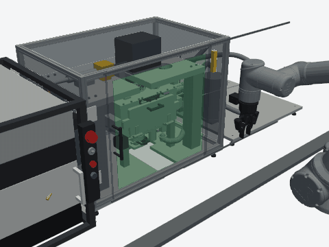
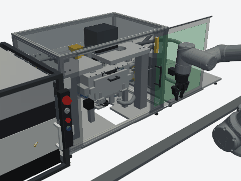
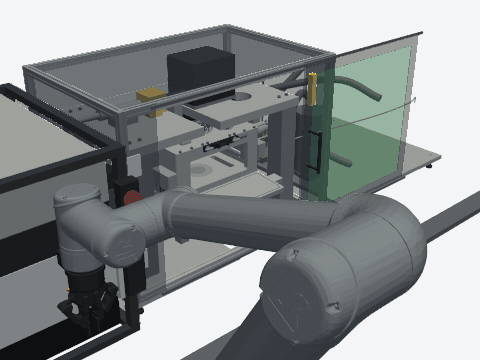
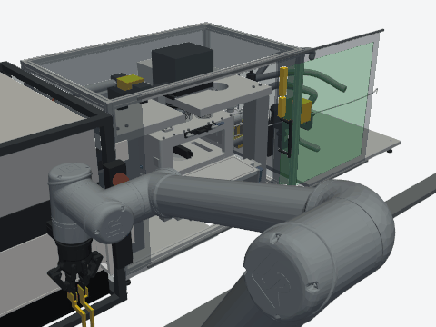
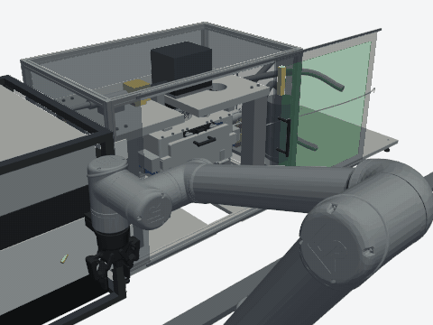

# Robot tending: every job planned and audited the byu-vcl PR 318 way

> **Update 2026-11-23 (round 5, A1): the overflow jar has a straight way out to the front** (section "Round 5" below). The jar stays
> under the funnel. Its KF-40 joint is 26 mm lower and it is a 45 mm 2 in. cup on an MKS 100318805 toggle clamp. The outlet plenum's
> KF-25 port and hose moved to the plenum's left end, and the front-right leg moved to the right side. The hand operations U4.5 and
> U4.7 now pass (operations.md). ROBOT_RESULT
> **The zero-point modules are still not drawn**: with the jar under the funnel, the right-hand NSE-HT has no place
> ([`hot-swap.md`](hot-swap.md) §3.2a lists what it would take), so the two captive M6 stay and the module job still assumes them released.
>
> **Update 2026-11-22 (round 4): the build module swap passes on M50, S25 and L75** ([`analysis/out/robot/ops_w3.md`](analysis/out/robot/ops_w3.md)).
> The module's handle now ends in an I-section grip block in front of the door's hinge knuckles, in the same place on every module
> (`cad/modules_low.py`, `MP.MODULE_GRIP`), so the gripper takes it level from the front instead of reaching under the chamber. The
> job follows the model's path to +4 mm, lifts the module 66 mm clear of the floor's front edge and carries it out over the guard
> sill, with the MiR at x = +300 mm. The clamp is still the two captive M6, which the job assumes released: two SCHUNK NSE-HT
> mini 88-20 don't fit under the floor until the overflow jar moves ([`hot-swap.md`](hot-swap.md) §3.2a). Section "Round 4" below
> has the numbers; the reservoir and blade jobs were re-run on this model too.
>
> **Update 2026-11-21 02:00 UTC (coordinator):** the bayonet plate exchange now passes on M50, S25 and L75 ([`analysis/out/robot/ops_bayonet_fix.md`](analysis/out/robot/ops_bayonet_fix.md)), after the thermal cutoff was lowered 1 mm out of the lugs' path (`cad/modules_low.py`, patch request 3 below). So 10 of the 12 jobs pass; the build-module swap and the overflow jar still need the changes listed.

Written 2026-11-20/21 (22:15–01:15 UTC) for [PR #266](https://github.com/vertical-cloud-lab/digital-alloy-lab/pull/266) (issue #260),
in answer to Sterling: "For mujoco, in relation to the UR12e ... make sure you're aligning with what's described in byu-vcl PR 318.
I'm also fine if we need a tool or attachment to make this work in terms of automation, but we need to make sure the workflow is
actually going to work, regardless of how we do it." This replaces the earlier note's straight-line MuJoCo study (its scripts and
outputs, `analysis/robot/robot_ops.py` and `analysis/out/robot/robot_ops_*.json`, are kept for the record).

| File | What it is |
|---|---|
| [`analysis/robot/ops.py`](analysis/robot/ops.py) | every job: IK branches with lookahead, RRT-Connect, Cartesian lines, the 1.5 mm audit, movers, clearances, torques, tip-over, cycle time, GIFs |
| [`analysis/robot/cell.py`](analysis/robot/cell.py) | the cell: UR12e + 2F-85 + D405 on a MiR250 at byu-vcl PR 318's layout, the Kardex opening, FCL scene, planner, statics |
| [`analysis/robot/eoat.py`](analysis/robot/eoat.py) | the robot's tools: plate fingers, straight caps, vacuum wand with grip fin |
| [`cad/automation.py`](cad/automation.py) | the machine's robot features, added to `lpbf_low.build()` by one hook line |
| [`analysis/robot/automation_check.py`](analysis/robot/automation_check.py) | interference sweep of those features ([`automation_interference.md`](analysis/out/robot/automation_interference.md)) |
| [`analysis/robot/door_mj.py`](analysis/robot/door_mj.py) | the chamber door's own motion in MuJoCo ([`door_mj.json`](analysis/out/robot/door_mj.json)) |
| [`analysis/out/robot/ops.md`](analysis/out/robot/ops.md), [`ops.json`](analysis/out/robot/ops.json) | results of the final run, every step of every job |
| [`robot-tooling.csv`](robot-tooling.csv) | robot-side tools and machine-side parts, with prices and sources |

## Short answer

**With what is now drawn, the UR12e on its MiR250 passes byu-vcl PR 318's audit end to end for 11 of its 12 jobs on the M50 machine:
the guard door both ways, opening the chamber door (and closing it with its new actuator), the build plate out by the drawbar path
and by the bayonet (both also on S25 and L75), the cover-slide drawer, the reservoir, the blade cartridge, cleaning the chamber
with a vacuum wand, and (since 2026-11-22) the build module swap, also on S25 and L75. Only the overflow jar fails.** Every frame was
checked: the arm, its tools and what it holds against the whole cell (machine, VLM, MiR, ballast, tool stand), handled parts only
up to 1.5 mm deep into their own fixtures, and every moving part against everything else. The arm is never the limit: peak static
torque is about a third of the UR12e's limits (the module's 158 N push takes the elbow to 64 %), and with PR 318's 131 kg ballast
the MiR250 would need at least 5× each job's force to tip or slide.

It took these machine features, drawn in [`cad/automation.py`](cad/automation.py) and interference-free:
- a handle on the guard door;
- a rotary actuator that opens and closes the chamber door;
- air cylinders that throw the door's draw latches;
- wing heads on the drawer's latch studs;
- a grip fin on the blade cartridge and pull tabs on the liners;
- AprilTag plates for re-registration.

The robot side needs three tools in PR 318's pattern, with no tool changer: cranked "plate fingers" and straight long caps that slip
over the 2F-85's fingertips from a stand on the MiR, and a vacuum wand with a clamp-on grip fin
([`eoat.py`](analysis/robot/eoat.py)).

**Still not robot-ready, each with its fix:**
- **Closing the chamber door by hand-like motion fails.** No arm path lifts it from 95° past the guard's frame and rails, in 16
  combinations of MiR position and grasp. So the door gets its own actuator, which closes it in 2 s with the arm parked (passes).
  The robot can still pull it open.
- **The bayonet plate fails, on a model clash.** Twisting the plate runs its lugs into the thermal cutoff, whose top sits in the
  lugs' channel. The drawbar path passes on S25, M50 and L75, so the drawbar is the way (hot-swap.md agrees).
- **The build module's motion now passes (2026-11-22); its clamp is still open.** The gripper couldn't reach the old handle under the
  chamber past the door's hinge knuckles, and the last 140 mm of the path brought the arm too close to its own base. The handle's new
  grip block sits in front of the knuckles, and the job lifts the module 66 mm before the last 140 mm. The two captive M6 still hold
  the module, and the robot can't turn them; the zero-point modules that would replace them need the overflow jar moved first
  (hot-swap.md §3.2a). Until then a person releases the two screws, or swaps the module.
- **The overflow jar has no way out as drawn**, and **the liners are captive** (patch requests).

## Results

Final run (`ops.py --render`, on the model as built at 23:56 UTC, with the chamber body as a through-frame plus a bolted floor plate). The drawer, blade cartridge and vacuum were re-run at 00:46–01:10 UTC after the last fixes, on the same model. **Rows re-run on 2026-11-22:** the build module on S25, M50 and L75 ([`ops_w3.md`](analysis/out/robot/ops_w3.md), 06:22–06:32 UTC), and the five jobs the MiR does from the rack's side (x −390 to −450: chamber door open, drawer, reservoir, blade, vacuum) on the final model with the 12U rack ([`ops_w3_rack.md`](analysis/out/robot/ops_w3_rack.md), 06:49 UTC). All pass; clearances moved by up to 3.6 mm because the planner found other branches. The bayonet rows are superseded by the 02:00 update above. Each job was tried at up to 12 MiR positions along the opening (and grasp variants); the table gives the first that passes, or the one that got furthest. **Clearance** is the smallest FCL distance from the robot, its tools and what it holds to anything it may not touch. **Torque** is the peak static joint torque against the UR12e's limits (330/330/150/56/56/56 N·m). **Force** is the largest the job applies, against the 100 N force mode. **CoG margin** is how far the MiR250's centre of gravity (base, cabinet, 131 kg ballast, arm, tool and payload) stays inside its wheels at the worst frame; the tip-over forces are in the forces section. **Time** is the arm's own time from the planned paths; add ~5 s for a tag read after docking and ~20 s for each cap change.

| Job | Module | MiR arm x (mm) | Result | Blocking step, or the first collision | Min clearance (mm), pair | Peak torque | Force (N) / limit | Payload (kg) | CoG margin (mm) | Time (s) |
|---|---|---|---|---|---|---|---|---|---|---|
| Guard door open (515 mm) | M50 | 450.0 | **pass** |  | 1.9, right_finger_tip / Guard-locking door switch (Omron D | 32.4 % elbow | 30 / 100 | 0.0 | 200.0 | 8.2 |
| Guard door close | M50 | 450.0 | **pass** |  | 26.1, left_finger_tip / Guard-door handle for the robot (Ø | 32.8 % elbow | 30 / 100 | 0.0 | 200.0 | 8.5 |
| Chamber door open (pull to 20 deg, then the drive) | M50 | -450.0 | **pass** |  | 0.9, ur/gr/left_finger_tip / Guard door rail (top + bottom) | 32.6 % elbow | 15 / 100 | 0.0 | 199.0 | 13.4 |
| Chamber door close (its actuator; robot parked) | M50 | 0.0 | **pass** |  | 21.5, wrist2 / Guard door rail (top + bottom) | 30.8 % elbow | 0 | 0.0 | 206.0 | 3.5 |
| Build plate out, drawbar | M50 | 450.0 | **pass** |  | 1.3, right_finger_tip / Chamber floor plate (6061-T6, 20 m | 33.7 % elbow | 5 / 100 | 0.053 | 191.0 | 24.7 |
| Build plate out, bayonet (2 x 30 deg twists) | M50 | 300.0 | **fail** | twist the plate 30 deg (lugs at their slots): held: build plate vs Thermal cutoff M50 (240 C, in series with the heat | 0.0, held: build plate / Thermal cutoff M50 (240 C, in seri | 31.6 % elbow | 5 / 100 | 0.053 | 191.0 | 28.7 |
| Cover-slide drawer: wings off, drawer out | M50 | -450.0 | **pass** |  | 1.8, ur/gr/left_finger_tip / Drawer-closed sensor (inductive M12, o | 31.7 % elbow | 20 / 100 | 0.0 | 199.0 | 27.5 |
| Reservoir off the dock and out | M50 | -390.0 | **pass** |  | 1.9, ur/cap/right_finger_tip / Enclosed beam tube | 33.4 % elbow | 40 / 100 | 0.37 | 199.0 | 24.2 |
| Blade cartridge out | M50 | -450.0 | **pass** |  | 2.0, held: blade cartridge / Recoater ball nut (flange on the +x fa | 33.7 % elbow | 40 / 100 | 0.197 | 199.0 | 22.3 |
| Build module out (grip block; lift 66 mm, then out) | M50 | 300.0 | **pass** |  | 0.5, held: build module / Overflow clamp (KF-40) | 55.7 % wrist 1 | 106 out, 158 in / 100 | 2.916 | 190.0 | 26.0 |
| Overflow jar out (as drawn) | M50 | -350.0 | **fail** | in to the jar: left_finger_tip vs Gas-loop + vacuum hoses (KF-25 SS bellows) | 0.0, base / Guard frame (20 mm T-slot) | 32.8 % elbow | 0 | 0.22 | 191.0 | 24.6 |
| Chamber vacuum, 3 lanes (wand from the MiR cradle) | M50 | -450.0 | **pass** |  | 3.0, wand (ATEX vacuum wand, collar, crevic / Chamber floor plate (6061-T6, 20 mm, b | 35.4 % elbow | 0 | 0.0 | 198.0 | 31.2 |
| Build plate out, drawbar | S25 | 450.0 | **pass** |  | 1.0, held: build plate / Thermal cutoff S25 (240 C, in seri | 33.7 % elbow | 5 / 100 | 0.014 | 191.0 | 24.6 |
| Build plate out, bayonet (2 x 30 deg twists) | S25 | -450.0 | **fail** | twist the plate 30 deg (half): held: build plate vs Thermal cutoff S25 (240 C, in series with the heat | 0.0, held: build plate / Thermal cutoff S25 (240 C, in seri | 33.4 % elbow | 5 / 100 | 0.014 | 195.0 | 29.2 |
| Build module out (grip block; lift 66 mm, then out) | S25 | 300.0 | **pass** |  | 0.5, held: build module / Overflow clamp (KF-40) | 57.0 % wrist 1 | 106 out, 158 in / 100 | 2.631 | 191.0 | 26.0 |
| Build plate out, drawbar | L75 | 450.0 | **pass** |  | 1.0, held: build plate / Thermal cutoff L75 (240 C, in seri | 33.7 % elbow | 5 / 100 | 0.12 | 191.0 | 24.9 |
| Build plate out, bayonet (2 x 30 deg twists) | L75 | -450.0 | **fail** | twist the plate 30 deg (half): held: build plate vs Thermal cutoff L75 (240 C, in series with the heat | 0.0, held: build plate / Thermal cutoff L75 (240 C, in seri | 32.9 % elbow | 5 / 100 | 0.12 | 194.0 | 29.7 |
| Build module out (grip block; lift 66 mm, then out) | L75 | 300.0 | **pass** |  | 0.5, held: build module / Overflow clamp (KF-40) | 54.5 % wrist 1 | 106 out, 158 in / 100 | 3.192 | 189.0 | 26.0 |

GIFs and stills (`analysis/out/robot/ops_<job>_<module>.gif`, `_tightest.png`: the first collision frame, or else the tightest):

| Guard door open (515 mm) (M50) | Guard door close (M50) | Chamber door open (pull to 20 deg, then the drive) (M50) |
|---|---|---|
|  |  |  |
| Chamber door close (its actuator; robot parked) (M50) | Build plate out, drawbar (M50) | Build plate out, bayonet (2 x 30 deg twists) (M50) |
|---|---|---|
|  |  |  |
| Cover-slide drawer: wings off, drawer out (M50) | Reservoir off the dock and out (M50) | Blade cartridge out (M50) |
|---|---|---|
|  |  |  |
| Build module out (M50) | Overflow jar out (as drawn) (M50) | Chamber vacuum, 3 lanes (wand from the MiR cradle) (M50) |
|---|---|---|
|  |  |  |

Not in the table:
- **The robot's own door close** (`ops.py --jobs chamber_door_close`; [`door_close_attempt.json`](analysis/out/robot/door_close_attempt.json)).
  A lift lug on the door's top corner, taken from the front at 95° and lifted along the door's arc, failed in all 16 combinations
  of MiR position (x −450 to +300) and grasp tilt (−60° to +20°). The wrist or forearm hit the guard's frame or rails, or no
  branch reached the lug past the VLM's front. The lug was dropped and the door got its actuator.
- **The liners** need the patch requests first (both side liners are threaded on the ball screw, and the LED bar stands in front
  of the right one), so `liner_right` is written but not run.
- **The build module's force column** gives the removal (106 N down: the spigot O-ring's 132 N less the module's 26 N) and the
  insertion (158 N up). Since round 4 the job passes, and both forces are over the 100 N force mode (round 4, still open).
- **Tight but passing:**
  - the guard-door approach passes 1.9 mm from the guard-lock switch;
  - the plate fingers' lower blades ride 1.0–1.3 mm over the floor and past the thermal cutoff;
  - the vacuum nozzle runs 3 mm over the floor (by design).

  A real program would keep 5–10 mm away from the switch, the floor and the thermal cutoff.
- **The vacuum misses one strip**: the strip under the dose chute (x < −60 mm, |y| ≤ 50 mm) is out of the level wand's reach. That
  is the recoater's park and dose zone, where powder collects, so it needs a narrower nozzle or a person with the same wand.

## Round 4 (2026-11-22): the build module swap

**Changed in the model** (commits e0e1a23 and 9297709, `cad/modules_low.py`, `cad/module_params.py`):
- **The module's handle.** The two side arms under the gland plate stay. A riser in front of the collar carries an arm forward,
  4 mm under the outlet plenum (z −52 to −40), to an I-section grip block:
  - at y −156 to −126 and z −69 to −25, in front of the door's hinge knuckles (their front is at y −138, their underside at z −20);
  - in the same place on S25, M50 and L75 (`MP.MODULE_GRIP`), so one grasp serves all three;
  - the 2F-85's stock pads close on its 40 mm web; the 5 mm flanges above and below take the 106 N pull and the 158 N push by form
    closure, with ±4 mm of vertical capture for the 22 mm pads;
  - 6061, about 0.25 kg, made in-house.
- **The job** (`ops.py`, `job_module`): the MiR stands at x = +300 mm. The gripper comes in level along +y and closes on the web. It
  follows the model's path to (0, −190, +4), lifts the module 66 mm (the spigot stays 19 mm under the door handle), then carries it
  140 mm forward over the guard sill and up to the MiR's rack. The first variant tried passes on all three modules.
- **Audit fixes on the way:**
  - the floor port is in the floor plate since the frame and floor plate were split, and the job's fixture list had missed it;
  - the floor plate is now tessellated at 0.05 mm: at 0.4 mm the Ø96 port's chords sat 0.3 mm inside the spigot's 0.1 mm fit;
  - during the straight 40 mm drop, the floor plate, the dowel and diamond pin, and the captive screws' floor inserts are soft
    (the screws are drawn screwed in; `interference.py` checks those fits exactly);
  - the riser moved 6 mm back, because the robot found its L75 pass at the guard's bottom front rail too tight (1.9 mm exact). It
    is 7.9 mm now.

| Job | Before (2026-11-21) | After (2026-11-22, [`ops_w3.md`](analysis/out/robot/ops_w3.md)) |
|---|---|---|
| Build module out, M50 | fail: the camera meets the door while reaching under the chamber | **pass**: 0.5 mm, 55.7 % wrist 1, 2.92 kg, centre of gravity 190 mm inside the wheels, 26.0 s |
| Build module out, S25 | fail | **pass**: 0.5 mm, 57.0 % wrist 1, 2.63 kg, 191 mm, 26.0 s |
| Build module out, L75 | fail | **pass**: 0.5 mm, 54.5 % wrist 1, 3.19 kg, 189 mm, 26.0 s |
| Reservoir, M50 | pass, on the 13:54 UTC model | **pass** on the final model: 1.9 mm (cap to the beam tube), 33.4 % elbow, 24.2 s |
| Blade cartridge, M50 | pass, on the 13:54 UTC model | **pass** on the final model: 2.0 mm (cartridge to the recoater's ball nut), 33.7 % elbow, 22.3 s |
| Chamber door open, drawer, vacuum (M50, MiR at x −450) | pass, on the 23:56 UTC model | **pass** on the final model, with the rack now 12U (560 mm) beside them: 0.9, 1.8 and 3.0 mm |

The 0.5 mm is the module flange's tab passing the overflow clamp's wing during the drop, as drawn before; `interference.py` finds
the same gap. **Jobs passing on M50: 11 of 12** (was 10): only the overflow jar fails. The module swap also passes on S25 and L75.

**Still open for the module:**
- **The clamp.** It is still the two captive M6, and the job assumes a person has released them. Two SCHUNK NSE-HT mini 88-20
  (ID 1460874, Ø88 × 20 mm) fit under the floor only once the overflow jar moves ([`hot-swap.md`](hot-swap.md) §3.2a).
- **The forces.** The 106 N pull and 158 N push are over the 100 N force mode. Run that part under position control with a
  200 N PFL limit; zero-point clamps would pull the last millimetre themselves.

## Round 5 (2026-11-23, A1): the overflow jar gets a way out; the zero-point modules still don't fit

**Changed in the model** (`cad/lpbf_low.py` sections 3, 4, 5 and 11, `cad/joints.py`; commits d8ec123, 9481fc5, 4344f5d):

| What | Before | Now | Why |
|---|---|---|---|
| KF-40 joint under the funnel | z −58, 16 mm weld stub | z −84, 42 mm weld stub | the toggle clamp's side links (z −89 to −79) pass 4.5 mm under the module flange's tabs when the module drops (tabs z −70 to −60) |
| Jar | 90 mm KF-40 half nipple, ~120 cm³, bottom z −150 | KF-40 flange on a 2 in. × 0.065 in. 316L cup, 45 mm, ~68 cm³, bottom z −129 (−137 dropped) | it passes 3 mm over the guard's bottom front rail (top z −140) on the way out; a wider cup meets the Z servo's corner (x 93.5, y 27.7) |
| Clamp | McMaster 4518K73 wing-nut clamp | **MKS 100318805** toggle clamp, NW40, aluminium, $23.34 (mks.com, 2026-11-23), lever to the front | one push on the lever opens it, for a hand or a fingertip; A 123.7, B 83.6, C 19.05 mm drawn, ring section assumed |
| Outlet plenum's boot, KF-25 port and hose | right end (x 72–100), port at x 86 pointing down, hose down and right | left end (x −100 to −72), port at x −86; the hose runs back along x −86 under the left side (z −145 to −109), behind the chamber at y 135 and up past the back-right leg | at the right end they stood in the jar's only lane; gas-flow.md has the update (the CFD's drain flips to the left end) |
| Front-right leg | x 120–150, y −105 to −75 | x 128–156, y 26–56 (28 × 30), on the right side behind the jar sensor | it overlapped the jar's lane by 7 mm; it stays 2 mm clear of the floor-plate screws' U-notches at (148, 20) and (148, 62), so those stay reachable. `analysis/fea/fea.py` still places the legs itself (line 441) and should read `lpbf_low.LEG_BOXES` |
| Jar sensor | M12 9 mm from the jar's side (beyond an inductive M12's range), no bracket | M12 2 mm from the cup at z −121 on a 6061 bracket, 2 × M4 into the leg's front face | the gripper's pads close on the cup at z −111 to −89, above it |

**The jar's lane** is x 72.6 to 127.4, from the jar to the guard door, and is now empty: under the plenum's flat part (z −36), under the
door's hinge knuckles, and over the guard's bottom front rail. The robot job (`ops.py`, `job_overflow`):
1. the toggle clamp comes off (a machine step, not simulated);
2. the gripper comes in level from the front and closes on the cup with its pads at z −111 to −89;
3. it lowers the jar 8 mm, slides it 160 mm straight out, lifts it 60 mm past the hinge knuckles, and carries it out over the guard
   sill.

## Alignment with byu-vcl PR 318

PR 318's latest round is round 14 (runs A–D, 2026-11-20). Its branch head (`e60fcb0`, 21:54 UTC) is three commits past `11d4410`:
chapter 3 re-rendered, the README's round-14 (C) section, and the start of a safety-assets note. None touches the arm, the collision
checks or the cell, so this study follows `11d4410` (`collide.py`, `animate.py`, `props.py`, `vlm.py`, `ur_arm.py`,
`alloy_atomize.py`, `notes/arm_collisions.md`, `notes/atom_vacuum.md`, `notes/ur12e.md`; read 22:20 UTC).

| | byu-vcl PR 318 (round 14) | This study |
|---|---|---|
| Robot | UR10e, shown as UR12e since round 14: "the robots themselves are mechanically unchanged" (UR FAQ, `notes/ur12e.md`); Robotiq 2F-85; RealSense D405 on the coupling | the same `ur_arm.py`, vendored unchanged: UR's and Robotiq's ROS 2 meshes, closed-form IK, the D405 drawn |
| Base | MiR250 800 × 580 × 300 mm, 480 mm cabinet, 20 mm plate: arm base 800 mm above the floor; 131 kg steel ballast plate (760 × 550 × 40) on the deck since round 9 | the same; the ballast is in the scene and in the tip-over check |
| Park pose | arm base 240 mm in front of the VLM's front face; the MiR drives along the opening to line up with each job, at 0.3 m/s² | the same y; each job's MiR x is chosen from 4–12 positions along the opening (−600 to +600 mm) |
| Opening | Kardex Shuttle XP 500, 2450 × 864 mm trays, access table at 833 mm, tray floor at 857 mm, 996 mm opening (header at 1829 mm) | the same; the machine stands on the presented tray (machine z = world z − 1069 mm) |
| Collisions | FCL on the meshes as drawn, arm against itself (MoveIt's always-touching pairs left out) and everything visible | the same, with the machine tessellated at 0.4 mm (0.05 mm for the plate, block, module, blade cartridge and reservoir fits) |
| Planner | every IK branch nearest first, straight joint line, else RRT-Connect (1.5° edges, shortcut), detours ≤ 150 mm above the move | the same, plus a lookahead: a branch is skipped if the work lines that follow it flip or collide |
| Audit | round 11: gripper, tool and held part may touch the handled part and its fixtures ≤ 1.5 mm deep (sampled translational depth, 0.3 mm shrink first); movers checked every frame | the same rules, every frame; seals a part slides over (drawer, reservoir dock, spigot O-rings) are soft parts, as `sc.soft` |
| Registration | AprilTag cubes (120 mm, tags on five faces) on target posts; the D405 sees each seat before the arm picks; the bay camera sees 94 % of a presented tray | two tag36h11 plates on the guard's front-left post (drawn), read by the D405 after each docking and VLM move; the MiR250 docks to a VL marker within ±3 mm, ±0.5° (MiR spec) |
| Tools | no changer: specimen fingers as caps over the 2F-85's fingertips, fitted from a stand on the MiR; a tong pinned to the fingertips; a vacuum wand with a clamp collar and grip fin in a holster | the same pattern: plate fingers and straight caps from a fork stand on the MiR's cabinet top, the wand in a cradle there (both in the collision scene) |
| Powder safety | bonded floor plates and sprung shoes on the MiR before the arm works near powder; Nilfisk ATEX vacuum; continuity checks | not modelled here; the same applies to AlSi10Mg (open item) |
| Machine motion | `interference.py` sweeps every model's own motion in MuJoCo | the coordinator's `analysis/interference.py` and `automation_check.py`; the door's dynamics in MuJoCo (`door_mj.py`) |

## What the machine needs, drawn in `cad/automation.py`

One hook line at the end of `lpbf_low.build()` adds these parts (every one tagged `automation`). Interference
(`automation_check.py`, interference.py's mesh and exact booleans, five states and the door, drawer, guard-door and recoater
sweeps): **0 interferences**. The tightest moving gaps are the wing heads to the drawer-closed sensor (2.0 mm) and the guard-door
handle to the guard's panels (6.0 mm at 494 mm of travel).

| Feature | Why | Product |
|---|---|---|
| Guard-door handle: Ø12 × 130 bar on two Ø10 standoffs at the door's left end | the door had nothing to hold | ours |
| Door drive: rotary actuator on the hinge axis, with its bracket and a drive disc keyed to the door | no arm path lifts the door shut from 95° (below); the actuator opens and closes it, its flow controls set the speed | SMC CRQ2 size 20 class (~1.8 N·m at 0.5 MPa), stroke set to 95°; envelope 47 × 47 × 42 mm. Passive alternative in the same place: McMaster 6597K124 one-way damper (2.0 N·m, $71.70) if a person closes the door |
| Draw-latch actuators: a Ø20 compact cylinder under each 1807A61 draw latch | throw the over-centre latches, so the 1.4 kN squeeze never goes through the arm; the latches still hold with the air off | SMC CQ2/CJ2 20 mm class, 157 N at 0.5 MPa; D-M9B switch ($37.10) for latch-closed. Catalogue alternative: DESTACO 8051 pull-action pneumatic latch (holds 2,669 N; $429.99, search snippet) |
| Wing heads on the drawer's two quarter-turn studs | the fingers drive the wing and the wrist turns it 90°: about 0.34 N·m for the 179 N each cam pulls, 26 N at the wing's end | ours; the quarter-turn latch itself is still an envelope (seals.md: no catalogue part fits) |
| Blade-cartridge grip fin, 4 mm, on the holder's front end | the lips of the plate fingers take it | ours |
| Liner pull tabs, 2 mm on 12 mm standoffs at each side liner's front top corner | something to hold, once the liners can come out at all (patch requests) | ours |
| Two AprilTag plates (tag36h11, 56 mm) on the guard's front-left post | re-registration after each docking and VLM move | ours |

The earlier note's other machine-side needs are resolved like this: the plate's grip groove level with the sill is handled by the
cranked fingers (no change to the plate height); the drawer's 350 N by the wing cams; the door's 1.4 kN by the latch cylinders.

## What the robot needs: `eoat.py`, `cell.py`

| Tool | Used for | Notes |
|---|---|---|
| Robotiq 2F-85 stock pads | guard-door handle, door handle, drawer tab and wings, module handle, wand fin | $5,990 (RoboticsCenter); 85 mm stroke, 20–235 N, 5 kg rated |
| **Plate fingers**: two cranked caps over the fingertips | build plate S25/M50/L75 by its 3 × 1.5 mm rim groove; blade-cartridge fin | ours: 120 mm reach past the pad centre, a 45 mm step down after 48 mm, a 2 × 2.4 mm lip on the lower blade's inner edge. The step keeps the 2F-85's housing above the open door (its top face at z −2 when it hangs at 95°) while the lips work 1–4 mm over the floor. 0.18 kg |
| **Straight caps**: the same without the step | reservoir handle fin | the knuckles pass over the optics bridge (its slot is 56 mm wide) and the D405 stays under the guard's top rail |
| Cap stand on the MiR's cabinet top | fitting and parking the caps | byu-vcl PR 318's specimen-finger pattern; in every job's collision scene |
| **Vacuum wand** with a clamp collar and 30 mm grip fin, crevice tool on a short wand | chamber cleaning | PR 318's `atom_vacuum` design; the full 508 mm wand put the TCP over the arm's own base, so a 200 mm section. Vacuum: Nilfisk VHS110EXP (Group E, for Al dust; price not found) |
| Wand cradle on the MiR's cabinet top | the wand's home; the job starts by taking it | in the collision scene |
| 131 kg ballast plate | tip-over margin | PR 318 round 9 |
| UR12e's own flange F/T sensor | force mode | ±100 N range, ±5.5 N accuracy (UR12e datasheet, Oct 2026) |

No tool changer is needed. ATI's QC-11 (1,068 N locking at 5.5 bar, 15.9 kg, quote only) is the choice if a powered tool is added.

## Forces against the arm's limits

Static joint torques use UR's UR10e/UR12e link masses at PR 318's centres of mass, the gripper, camera and caps (1.2–1.4 kg) at the
flange, the payload at the TCP and the reaction of the job's force. **Fixed this session:** `cell.static_torques()` attached every
link's centre of mass to the flange, which loaded the wrists with the whole arm (300 N·m at wrist 1 in a stretched pose). It now
loads each joint only with what hangs outboard of it, and matches `analysis/shop/shop_checks.joint_torques()` to 0.0 N·m over 200
random poses; `max_force()` uses it. Numbers from before the fix (the earlier note's) are superseded.

| Job | Force the job needs | Arm can push there (to its first joint limit) | Peak torque | MiR250 tips at (factor) | Notes |
|---|---|---|---|---|---|
| Guard door | 30 N along the rail (assumed: lock released, rollers) | 217 N | 27.8 % | 741 N about -x (24.72×) |  |
| Chamber door open | ~15 N on the handle to 20°, then the drive | 407 N | 27.8 % | 476 N about +y (31.7×) |  |
| Drawer | 20 N O-ring breakaway; 0.34 N·m per wing (26 N at its end) | 622 N | 21.3 % | 467 N about +y (23.33×) | wrist 3 limit 56 N·m |
| Reservoir | 40 N over three detents | 339 N | 32.7 % | 401 N about +y (10.04×) | grip ≥ 67 N on the 8 mm fin at μ 0.3 (2F-85: 20–235 N) |
| Blade cartridge | 40 N over two ball plungers | 354 N | 25.1 % | 495 N about +y (12.36×) | as the reservoir |
| Build module out | 106 N down: the 2-238 O-ring's 132 N less the module's 26 N | 167 N | 29.7 % | 730 N about -y (6.88×) | **over the 100 N force mode, and the arm's capacity at that pose is only 1.6×**: a form-closed handle and position control with a 200 N PFL limit, or the clamps push it out |
| Build module in | 158 N up | 537 N | 63.9 % | 819 N about +y (5.18×) | over the force mode; zero-point clamps should pull the last mm |

The plate needs ~5 N to lift once the drawbar's release cylinder holds the balls open; the bayonet needs 0.3–1.5 N·m of twist through the lips and a piston keyed against turning (hot-swap.md). The MiR250 never comes near tipping: with PR 318's 131 kg ballast every job's force is at least 5× below the force that would tip or slide the base ([`tipover.py`](analysis/robot/tipover.py), [`tipover.json`](analysis/out/robot/tipover.json)), and the carried module leaves the centre of gravity 191 mm inside the wheels.

## The chamber door in MuJoCo (`door_mj.py`)

The door group weighs 1.455 kg with its centre of mass 12 mm behind the hinge line, so it balances at **10.8°**: short of that it
falls shut, past it it falls open; gravity's torque peaks at 0.94 N·m. Released at 20°:
- **no damper:** it reaches its 95° stop in 0.27 s, the handle at 1.56 m/s (the earlier note's 1.7 m/s);
- **with the McMaster 6597K124 damper** (2.0 N·m, taken as linear at 20 rpm: 0.955 N·m·s/rad, an assumption): 2.49 s, 0.11 m/s;
- **closing**, released at 8°: it falls onto its cord in 0.19 s at 0.21 m/s at the handle.

## Registration and capture windows

The MiR250 docks to a VL marker within ±3 mm and ±0.5° (MiR spec; navigation alone ±60/±85 mm, ±4°). Edison's review (Edison
r3-robot-tending) found a MiR250-based lab manipulator reaching ±1.2 mm instrument-relative after marker and touch registration,
and suggests 1–3 mm as the development target, with sub-millimetre seating left to passive datums and lead-ins. So after each
docking and VLM move the D405 reads the two tag plates on the guard post, and every grasp has a capture window larger than that:

| Feature | Fingers open to | Capture |
|---|---|---|
| Guard-door bar Ø12 | 40 mm | ±14 mm |
| Door handle bar Ø12 | 40 mm | ±14 mm |
| Drawer wing (4 mm) / tab posts (40 mm) | 16 / 56 mm | ±6 / ±8 mm |
| Reservoir fin (8 mm) | 16 mm | ±4 mm |
| Blade fin (4 mm) | 12 mm | ±4 mm |
| Plate rim (lips beside it) | plate Ø + 6 mm | ±3 mm sideways; **±0.3 mm vertically** for the 2.4 mm lip in the 3 mm groove |
| Wand fin (30 mm) | 40 mm | ±5 mm |

The plate groove is the tight one. Touch the plate's top face with the lower blades in force mode (5 N) to set z before closing, or
make the groove and the lips 45° V-shapes (patch request), which centre over ±1.5 mm.

## Patch requests (parts other sections draw)

1. **Build module joint** (modules_low.py; **still not drawn, 2026-11-23 (round 5)**): the robot can't turn the two captive M6 thumb
   screws. The overflow jar now has its lane to the front (request 6), but it has to stay under the funnel at x = 100, and with it
   there the right-hand SCHUNK NSE-HT mini 88-20 has no place: in front of the jar it blocks the lane, behind it is the Z servo
   (x 34.5–93.5, y 27.7–109.5, z −187 to −84). [`hot-swap.md`](hot-swap.md) §3.2a lists the four moves it would take: fold the Z
   servo to the back, move the jar to the slot's front end, modules at (+100, +30) and (−100, −30), and re-route the outlet hose.
   The pins would be VERO-S SPC mini 20 (clamping only, with centring clearance), since the dowel and diamond pin keep locating the
   module. Two modules would pull 2 × 500 N (2 × 2,500 N with turbo), 4.6× (23×) the worst separating load. $2,680 each
   (MROSupply, re-checked 2026-11-23). Until then a person releases the two screws.
2. **Module handle** (**drawn 2026-11-22**: the I-section grip block, round 4): a hook the fingers close under (form closure), for
   the 106 N pull and 158 N push.
3. **Plate drawbar** (modules_low.py, hot-swap.md): pull stud in the plate, Jergens 16 mm ball lock (49607 + 49517, $178), disc
   springs at the rod end, SMC CDQ2B40-10DCMZ release cylinder ($55.27, 628 N at 0.5 MPa). The jobs here use the drawn plate turned
   60°, lugs in their slots, as a stand-in.
4. **Plate rim groove and lips as 45° V-shapes**, for ±1.5 mm vertical capture.
5. **Blade cartridge** (section 6): two Ø3 dowels and two ball plungers (85015A47, as the reservoir) instead of the 2 × M3 screws.
6. **Overflow jar** (sections 3, 4, 5 and 11; **drawn 2026-11-23, round 5**: see "Round 5" below). The jar stays under the funnel
   and gets a straight lane to the front:
   - its KF-40 joint is 26 mm lower (z −84), on a 42 mm weld stub;
   - it is a 45 mm long 2 in. 316L cup (~68 cm³, was ~120 cm³);
   - the outlet plenum's boot and KF-25 port moved to the plenum's left end, and their hose runs back under the left side;
   - the front-right leg moved to the right side (x 128–156, y 26–56);
   - the jar sensor sits 2 mm from the cup on a bracket on that leg.

   The clamp is an **MKS 100318805** toggle clamp, NW40, aluminium, lever to the front: $23.34 (mks.com, read 2026-11-23). Its A, B and
   C (123.7 × 83.6 × 19.05 mm) are drawn; its ring section is assumed.
7. **Liners** (section 5): both side liners are threaded on the recoater's ball screw (Ø22 holes at y 72, z 40), the LED bar
   (x 134–139) stands in front of the right liner, and the back liner is 2.4 mm behind the carriage block. Slot the screw holes to
   the back edge and shorten the liners 15 mm at the front, mount the LED bar on the lid or cut the liner round it, and split the
   back liner. The pull tabs are drawn already.
8. **Draw latches**: if the custom cylinder-on-latch is not wanted, replace each 1807A61 with a DESTACO 8051 pneumatic latch.
9. **Thermal cutoff vs the bayonet** (modules_low.py): twisting the plate runs its lugs into the thermal cutoff, whose top sits in
   the lugs' channel in the heater block (S25, M50 and L75; the drawbar plate clears it by 1.0 mm as it lifts). Drop the cutoff
   1 mm, or go to the drawbar. The model's own interference sweep never turns the plate, so it doesn't see this.

## What is still open

- **Not simulated:** fitting and stripping the caps at the stand (byu-vcl PR 318 doesn't animate it either), MiR docking, the
  install direction of each part (the same poses as removal, reversed), and anything after the part is out (the racks on the MiR).
- **The robot's own door close fails** (below the results table), so the door needs its actuator.
- **The overflow jar and the liners** need the patch requests before a robot can do them. The module's motion passes (round 4), but
  its clamp needs the jar moved first.
- **Dynamics:** only the door is simulated in MuJoCo. The arm moves slowly (60°/s joints, 30–150 mm/s lines), so the static
  torques stand in for the dynamic ones; the module's carry is the heaviest case.
- **Powder safety**: PR 318's bonded floor plates, sprung shoes and wand continuity checks apply here (AlSi10Mg is a combustible
  dust); not modelled.
- **Cycle times** are estimates from the planned paths (60°/s on the largest joint, 150 mm/s free, 30 mm/s fine, 0.8 s a grip),
  plus 20 s for a cap change and ~5 s for a tag read per docking (estimates).

## Re-running

```bash
cd desktop-lpbf
OMP_NUM_THREADS=1 MUJOCO_GL=egl /tmp/capmem 3 xvfb-run -a python analysis/robot/ops.py --render   # all jobs, M50 + S25/L75 plate and module, ~35 min
python analysis/robot/ops.py --jobs chamber_door_close --modules M50                             # the robot's own door-close attempt
python analysis/robot/automation_check.py M50                                                    # interference of the automation parts
python analysis/robot/door_mj.py                                                                 # the door in MuJoCo
# round 4 (2026-11-22): the module swap on all three modules, the reservoir and the blade, with GIFs (~10 min; needs imageio)
OMP_NUM_THREADS=1 MUJOCO_GL=egl /tmp/capmem 3.5 xvfb-run -a python analysis/robot/ops.py --jobs module_swap,reservoir,blade_cartridge --modules M50,S25,L75 --render --tag _w3
```

Each script rebuilds the model from `cad/lpbf_low.py`, so it runs on whatever the model is now. The UR and Robotiq meshes are
fetched to `/tmp/ur_arm_cache` (pinned commits; never committed) and need `pycollada`.
