# Two UR12e arms on MiR250s making the desktop LPBF's parts: a hypothetical robot shop

Written 2026-11-20 for [PR #266](https://github.com/vertical-cloud-lab/digital-alloy-lab/pull/266) (issue #260), in answer
to: "Can we have two UR12e units on MiR 250 units (similar to byu-vcl PR 318) carry out the steps of unpackaging the
boxes, machining the materials, assembling everything, etc.? (this is hypothetical, but it will get at the right kind of
interference and feasibility checks I think)."

This note covers receiving, stock prep, machining, deburring, washing, measuring and kitting. Assembly is a separate
study in this PR (`analysis/assembly/`). Nothing here was built or run on real machines. The shop is a layout made up for
the check, not a BYU room.

## Round 8 (2026-11-26): no lifter, the real programs

Sterling, 2026-11-26: "I don't think we have a vacuum chuck lift. Probably just a two person job for that part." In round 8 the shop chapters have no jib or vacuum tube lifter: two people lift by hand, each load against a two-person guideline of 2/3 x (23 + 23) = 30.7 kg (NIOSH's load constant, HSE L23's team rule) in [`analysis/out/shop/shop_person.json`](analysis/out/shop/shop_person.json). The plate as delivered (30.0 kg) is carried to a cart for the waterjet (chapter 29); the VF-4 loads are the cored stock (7.7 kg), the part after F-S1 (6.5 kg) and the frame with its plate (10.0 kg). There is no trepan: the programs start from the cored stock. Chapter 30 cuts the chamber with the posted programs ([`analysis/out/machining/gcode/`](analysis/out/machining/gcode/), [`cad/robotbuild/gcode_sim.py`](cad/robotbuild/gcode_sim.py)). The round-7 text below still describes the lifter and the trepan; read it with this note. See [`robot-build/video.md`](robot-build/video.md) round 8.

## Round 7 (2026-11-25): the shop modelled, every shown motion planned, and the video's shop chapters

Sterling asked for the two mobile manipulators to be shown carrying out the machining and assembly steps, with a person
"where a human is absolutely necessary (e.g., the loading of the initial massive block onto [the mill])", accurate models
of the equipment, custom tools where they help, and time estimates. This round does that for the shop. The video's
chapters are `20-receiving`, `30-machining-chamber`, `31-machining-parts` and `32-finishing`
([`cad/robotbuild/shop_chapters.py`](cad/robotbuild/shop_chapters.py)).

### What changed

- **The equipment is modelled from drawings and spec sheets**
  ([`cad/robotbuild/equipment.py`](cad/robotbuild/equipment.py)), replacing `shop_cell.py`'s boxes. Each piece is
  pyvista meshes for the renders and FCL arrays for the planner, with its moving parts separate. Sources are in the
  module's docstring and in [`robot-shop-equipment.csv`](robot-shop-equipment.csv).

  | Equipment | From | Estimated here |
  |---|---|---|
  | Haas VF-4 | Haas's page and layout drawing: travels 1270 / 508 / 635 mm; table 1321 x 495 mm, 5 T-slots, top at 940 mm; spindle 838 mm and table front 341 mm behind the front face; enclosure 3128 x 2314 mm, roof at 2004 mm; 1588 mm door aperture (2023 VF-3/SS drawing); 20-pocket carousel | sill 880 and header 1900 mm; door windows; column hood to 2740 mm; carousel size; pendant swung against the right side |
  | Haas HRT210 on a 63.5 mm riser | the HRT210 page and drawing; sized as `freecad_cam.FIXTURES`, which `holder_check.py` swept the tools against | |
  | Kurt XL6A air vise | 6 in. jaws, opens to 14.5 in. (Penn Tool) | body length and height |
  | Haas ST-10 lathe | vendored from byu-vcl PR 318 (`machining_cell.py`, 9740ba8): fitted to Haas's 12/2024 layout drawing and footage; door 794-1382 mm from a 680 mm sill; spindle axis 307 mm behind the front at 991 mm. Kept as fitted | the inside: 6.5 in. chuck (ST-10 page), 12-station turret, slant bed |
  | Hyd-Mech S-20A bandsaw | 13 x 18 in. capacity, table 31 in. (787 mm) (a reseller's listing) | the head, wheels and shuttle vise |
  | Jib and vacuum tube lifter | Schmalz JumboFlex 50 (50 kg), Gorbel WSJ360 class jib | the low machine-side jib (below) |
  | Pallet, pallet jack, Vestil SCTAB lift table | GMA 48 x 40 in. pallet; 27 x 48 in. forks, 2.9 in. lowered; 20 x 40 in. platform | the bodies |
  | Crest 7 gal ultrasonic tank, ATI compliant deburr spindle | tank 19.5 x 11.75 x 8 in. | the outside, the rinse tank |
  | Granite plate, height gauge, bore gauge | 36 x 24 x 4 in. grade A plate at 36 in.; Mitutoyo 570-412, 511-712-20 | the gauges' bodies |
  | Robot tools | Robotiq 2F-85 (ur_arm's meshes); OnRobot 3FG15 (4-152 mm, 10 kg); OnRobot VGP20 (264 x 184 x 92 mm); ATI QC-11 | 3FG15 body; a nut runner and a box cutter held by a 20 mm fin |

- **Every robot motion in the chapters is planned and recorded**
  ([`analysis/shop/shop_plan.py`](analysis/shop/shop_plan.py), [`shop_clips.py`](analysis/shop/shop_clips.py)). The
  checks are `shop_checks.py`'s:
  - FCL on meshes: the arm, its gripper or tool and the part it holds, against the equipment, the fixtures and the MiR;
  - every IK branch tried;
  - RRT-Connect with 0.5° edges;
  - every segment re-checked at 0.2°;
  - PR 318's rule that a handled part may touch its fixture, the deck or the jaws only up to 1.5 mm deep;
  - the static joint torques (`joint_torques`), and PR 318's tip-over check of the MiR at the worst-torque pose.

  The 3FG15 and the VGP20 are modelled as their own collision bodies, not as the 2F-85 (round 6 used the 2F-85 for all).
- **Loads over about 10 kg go to a person with the vacuum tube lifter, not to two arms.** Edison's review of the build
  ([r7](edison/r7-robot-build-review/answer.md), section 2.1) says two UR12e on separate MiR250 bases sharing a load
  "requires coordinated dual-mobile-base control, which has no published safety standard or industrial precedent". It
  recommends "a rated lifting device (vacuum lifter, hoist, or jib crane) for any part above approximately 10 kg".
  Round 6's two-arm moves (P3, P6) were feasibility checks only, and no shared lifts appear in the video.
- **The chamber frame's core is trepanned on the VF-4.** The robot shop has no waterjet. `setup_plan.json` lists
  trepanning from both sides with the 3/4 in. end mill as the alternative.
  - A 19.05 mm kerf inside the slug's 274 x 184 mm outline: its lower half in F-S1, its upper half in F-S2.
  - That frees a 235.9 x 145.9 mm core (13.0 kg from the 139.7 mm blank) on the dummy-floor plate.
  - The cut states reproduce the model's part to 0.000 % in volume
    ([`cad/robotbuild/shop_chamber_cache.py`](cad/robotbuild/shop_chamber_cache.py)).
  - The trepan's time is our estimate: about 7 min a side, from 0.5D passes at 60 % efficiency.
- **The blank is ordered at 13 in.**: 30.0 kg. `setup_plan.json` lists 15 in. and 34.7 kg; F-S1 holds the ends with edge
  clamps since 2026-11-23, so 13 in. will do. Either is beyond two arms' 22.4 kg.
- **A low jib at the VF-4** (our assumption): its boom runs at 1700-1850 mm and swings in through the doors under the
  1900 mm header. A tube lifter can't come down through the VF-4's roof, and a person can't guide a load lifted over a
  2 m enclosure.
  - Its boom is at head height when parked: pad it, or use a wall-mounted articulating arm.
  - It is drawn as a Gorbel WSJ360-class free-standing jib built to that height.

### The planned motions

From [`analysis/out/shop/shop_plan.json`](analysis/out/shop/shop_plan.json) and
[`shop_summary.json`](analysis/out/shop/shop_summary.json).
- **Torque:** the most loaded joint, as a fraction of its limit, at any recorded pose.
- **Tip-over:** the restoring moment of the MiR at that pose, with PR 318's 131 kg ballast plate. The weakest edge is
  always the one facing the station.
- **Closest pass:** the smallest distance, in the RRT-Connect moves, from the arm, its tool or the part to the machine.
  Fixtures and decks a part is set on are left out.

| Clip (chapter) | What | Gripper or tool | Arm time | Torque | Tip-over | Closest pass | Result |
|---|---|---|---|---|---|---|---|
| `recv_tape` (20) | cut a box's tape on the lift table (760 mm) | safety knife in the 2F-85 | 5.7 s | 33 % | 571 N·m | straight moves only | pass |
| `recv_unbox` (20) | a 4.0 kg tray out of the opened box onto the deck | 2F-85 on a 20 mm fin | 10.4 s | 50 % | 613 N·m | 24.3 mm | pass |
| `vf4_clamps` (30) | drive the four F-S1 edge clamps' screws | nut runner held by its fin | 24.7 s | 37 % | 550 N·m | 6.0 mm, wrist 2 to the roof over the table | pass |
| `vf4_floor_load` (30) | the floor plate's blank (5.0 kg, dry) onto the P-S1 parallels | VGP20 vacuum | 9.1 s | 51 % | 508 N·m | 26.4 mm | pass |
| `vf4_vise_part` (31) | a 1.9 kg bracket blank into the Kurt XL6A, on a 1 in. parallel | 2F-85 | 10.4 s | 41 % | 533 N·m | 26.2 mm | pass |
| `lathe_slug` (31) | a Ø54 x 100 slug into the ST-10's chuck, from above through the 588 mm door | 2F-85 | 13.0 s | 35 % | 632 N·m | 15.0 mm, upper arm to the door | pass |
| `lathe_big` (31) | a Ø108 x 50 316L blank (3.6 kg) | 3FG15 | – | – | – | – | **fail**: see below |
| `saw_bar` (31) | 600 mm of 2-1/8 in. bar (3.7 kg) onto the S-20A's infeed rollers | 2F-85 | 12.0 s | 47 % | 550 N·m | 81.5 mm | pass |
| `deburr` (32) | a bracket on the brush wheel, then the compliant spindle | 2F-85 | 21.9 s | 37 % | 607 N·m | 71.9 mm | pass |
| `wash` (32) | the parts basket (~4 kg) from the ultrasonic tank into the rinse | 2F-85 on the handle | 15.0 s | 33 % | 600 N·m | 48.0 mm | pass |
| `measure` (32) | a part onto the granite plate | 2F-85, VGP20 | – | – | – | – | **fail**: see below |
| `kit` (32) | the finished floor plate into its slot (C00a) on the long table, from lane A | VGP20 | 9.5 s | 41 % | 600 N·m | 27.4 mm | pass |

**What failed, and the fixes:**

- **The measuring station.** No collision-free carry onto the granite was found, from three docking positions, with
  either the 2F-85 or the VGP20 (RRT-Connect, 3000-9000 iterations).
  - The plate's top is at 914 mm, 114 mm above the arm's base.
  - While the base turns about 100° from the deck to the plate, the upper arm sweeps through the granite.
  - Round 6's P5 checked only reach, so it missed this.
  - Fix: a lower inspection table (about 760 mm), or dock at the plate's end. A robot-loadable gauge (Renishaw Equator)
    would also do.
  - In the video the person sets the part down, then gauges it.
- **The 3FG15 at the lathe: no plan, three fixes tried.** The Ø108 x 50 mm blank is for the four Ø3.375 and Ø4.25 in.
  parts.
  - From above, the 3FG15's 156 mm body met the chuck's top jaw.
  - Turning the spindle so no jaw is on top (M19 before the load) didn't free it.
  - With fingertips 40 mm longer (a custom tool), the body clears. But the 3FG15's three fingers sit 120° apart, so
    gripping a disc across its axis puts two of them 55 mm either side of its middle. A 50 mm disc can't go into the jaws
    without a finger reaching the chuck.
  - Gripping it along its axis means loading along the spindle axis, which fails as round 6's P2 found: the ST-10's
    588 mm door's jamb is in the way.
  - What would fix it:
    - a two-finger gripper with long parallel fingers (OnRobot 2FG14 class), which grips a disc across its faces;
    - a lathe with a wider door (an ST-20 class, about 730 mm);
    - or a person, for four parts.
  - The class table counts these four parts' robot time as if a fix were in place.
- **Fixed by a fixture or a tool, then passed:**
  - the floor plate's blank: 228.6 mm wide, past the 2F-85's 85 mm stroke, and too heavy to hold by an edge, so the
    VGP20 takes it (dry stock only);
  - the vise blank: on a 1 in. parallel, so the fingers stay above the jaws;
  - the saw bar: on two 40 mm V-blocks, so it clears the arm's mounting plate as it lifts;
  - the clamp screws: a 1/4 in. hex extension on the nut runner, so the bit reaches a screw 20 mm from the blank's end;
  - the shipping box is hollow;
  - the rinse tank was made big enough for the basket.

**Each motion class, rerun with each part's own stock attached.** Every vise-class and plate-class part's stock was
attached to its class's recorded path and checked with FCL against the VF-4, the fixtures and the MiR. All 35 parts are
clear (`class_recheck` in `shop_summary.json`).

### The person's lifts

The person is scripted, not planned. Two things were checked with FCL at every third frame
(`person_lifts` in [`shop_summary.json`](analysis/out/shop/shop_summary.json), from `shop_person.json`):
- the lifted load's path against the VF-4;
- the posed person (`people.Person.posed()`) against the machine, the lifter and the load. The hands on the handle bar
  touch it on purpose and are left out.

| Lift | kg | Why a person | Load's closest pass | The person |
|---|---|---|---|---|
| the 13 x 9.5 x 5.5 in. blank onto the F-S1 risers | 30.0 | over two arms' 22.4 kg | 40.1 mm, to the table | no contacts |
| turning it over onto the dummy-floor plate (F-S2) | 22.8 | over 10 kg; the core is still attached | 25.6 mm | at one sample in 22, a glove touches the jib's boom while the part is up high |
| the freed core out | 13.0 | over 10 kg | 25.4 mm (the first path, straight across to the pallet, put the core through the HRT210's platter; it now goes straight out through the doors first) | no contacts |
| the frame and its fixture plate onto the HRT210 (F-S3), turned 90° | 10.0 | at 10 kg, and it has to be turned | 25.4 mm (checked against the VF-4 with its table at the F-S1 position, not at F-S3's) | no contacts |

The person also fits F-S2's 18 M4 screws from below the dummy-floor plate, where no arm reaches. They bolt the plate to
the platter through the frame's opening, and set and bolt the fixtures.

### Time per part: machine, robot and person

From [`shop_summary.json`](analysis/out/shop/shop_summary.json). Every part of `setup_plan.json` / `hours.json` gets a
motion class, chosen by its stock:
- over 10 kg: the person's lift;
- bar up to 82 mm: `lathe_slug`; over 82 mm: `lathe_big`;
- plate up to 80 mm wide and 5 kg: the vise class;
- larger plate: the plate class;
- weldment: lathe and TIG.

How each part's hours are counted:
- **Machine:** `hours.json`'s run time (vendor feeds where it has them).
- **Robot:** each setup costs the class's planned arm motion twice (unload, load), plus 211 s of overhead:
  - docking and re-registration at the station, 120 s (Edison r7 reports 1-3 min a visit, and accuracies of 10 mm with
    fiducials, 0.19 mm with vision compensation and ±0.12 mm with touch calibration);
  - the door, 6 s;
  - the air blast, 20 s;
  - WIPS probing, 60 s;
  - a camera check that the part is seated, 5 s.

  Add 53 s per part for the deburr, wash and kitting moves.
- **Person:**
  - CAM, unchanged;
  - 8 min watching each setup's first run;
  - 4 min of gauging a part, or 10 min with a sealing face, plus 15 min of deburring that face;
  - for the heavy parts, 4 min per lift (two lifts a setup).

| Motion class | Parts | Setups | Machine h | Robot h | Person h (incl. CAM) |
|---|---|---|---|---|---|
| vise class (`vf4_vise_part`) | 25 | 27 | 4.0 | 2.1 | 52.5 |
| plate class (`vf4_floor_load` + `vf4_clamps`) | 10 | 11 | 7.1 | 1.0 | 25.6 |
| lathe class (`lathe_slug`) | 9 | 12 | 0.9 | 0.9 | 32.5 |
| lathe class, 3FG15 (`lathe_big`) | 4 | 4 | 1.9 | 0.3 | 14.3 |
| saw and vise class (tube stock) | 4 | 5 | 1.8 | 0.4 | 8.2 |
| person's lift (the frame blank, two base plates, the optics bridge) | 4 | 9 | 12.1 | 0 | 14.2 |
| lathe and TIG (the build module's body) | 1 | 1 | 0.6 | 0.1 | 6.2 |
| **all 57 parts** | **57** | **69** | **28.3** | **4.8** | **153.4** |

- **By hand** (`hours.json`, with the 4th axis): 287.3 h, of which 132.1 h is CAM.
- **In the robot shop:** 28.3 h of cutting, 4.8 h of arm time and 153.4 person-hours. Set CAM aside and the person's
  share falls from 155.2 h to 21.3 h.
- The robot figure is a floor. It counts no failures, no re-registration retries and no chips under parts. A real cobot
  cell reported a 12 min unload, clean and load cycle (round 6).

### Where a person is needed, and why

| Task | Why |
|---|---|
| CAM, and watching each new program's first run | Edison r7: first-article runs and judgement at the control |
| Tool setting (holders, lengths), cycle start, the E-stop, chips under a part, mis-seating | Edison r7: exception handling stays with a person |
| Lifts over about 10 kg: the 30 kg frame blank, its 22.8 kg flip, the 13 kg core, the 10 kg F-S3 unit, the MIC-6 base plates (18.1, 16.8 kg) and the optics bridge plate (19.7 kg) | over two arms' 22.4 kg, or no precedent for two separate bases sharing a load (Edison r7) |
| F-S2's 18 screws from below, bolting the fixtures | no access for an arm |
| Reading the bore and height gauges (Ø50.80 H7, seal faces ±0.05 mm) | the arms place parts but can't read gauges; at the granite even placing failed |
| Deburring the sealing faces and threads | Edison r7: robots are fine for outside edges, not these |
| TIG-welding the build module's body; sending the bore out to be honed | a welder; outsourced (about 10 working days, our estimate) |
| The three crates over 22.4 kg (pallet jack), box flaps and dunnage | weight; cardboard and loose fill deform |

### The video's shop chapters

Frames are written to `/tmp/robotbuild/frames/`, never committed. Metadata follows `common.py`'s contract: caption,
sub, who, step, status and proc_s per frame, with the robot, person and machine hours in `add`. Robot motions run in real
time. Cutting is time-lapsed at `setup_plan.json`'s minutes per setup, spread over the setup's cut states by volume.

| Chapter | Shows | Frames | Length |
|---|---|---|---|
| `20-receiving` | the shop from above; the person brings in the three heavy crates with a pallet jack; arm A cuts a box's tape; arm B lifts the tray of seals out onto its deck | 446 | 37 s |
| `30-machining-chamber` | the person loads the 30 kg blank; arm A clamps it; F-S1 cut (time-lapse); arm A unclamps; the person turns it over; F-S2 cut frees the core; the person lifts the core out and sets the frame on the 4th axis; F-S3 indexing 0/90/180/270; arm A loads the floor plate (VGP20); P-S1 cut | 2495 | 3 min 28 s |
| `31-machining-parts` | arm A, vise part; arm B, saw; arm A, lathe from above; the other parts by motion class | 641 | 53 s |
| `32-finishing` | TIG by a person; honing sent out; arm A deburrs; arm B washes; the failed granite carry and the person gauging; arm A kits the floor plate onto the long table | 925 | 77 s |
| **all four** | | **4507** | **6 min 16 s** |

The per-chapter totals and the hours each chapter's frames add are in `chapters` in
[`shop_summary.json`](analysis/out/shop/shop_summary.json) (also `/tmp/robotbuild/data/shop.json`, for the summary
chapter). `31`'s montage adds the other 55 parts' hours, as a time-lapse: 26.2 h of cutting, 4.6 h of arm time, 19.7
person-hours and 123.6 h of CAM.

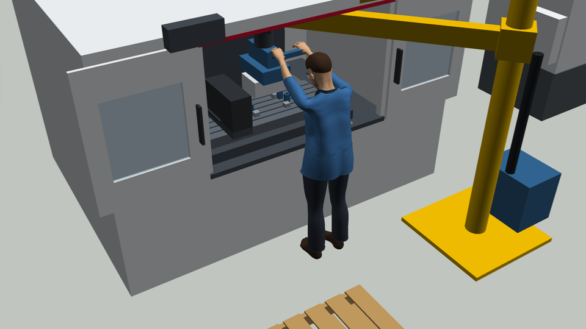
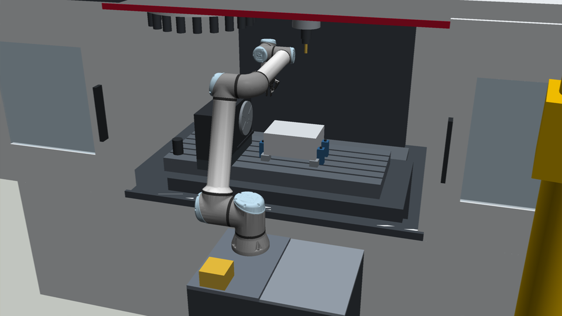
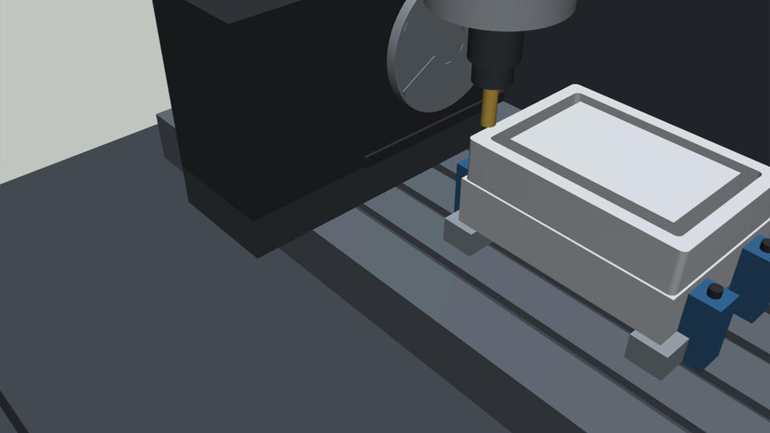
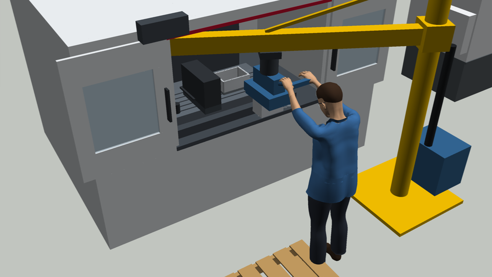
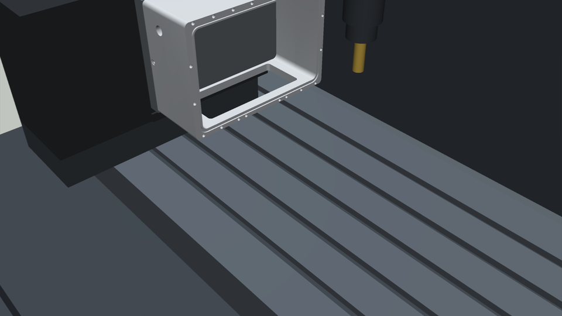
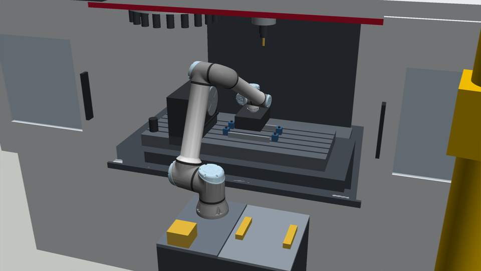
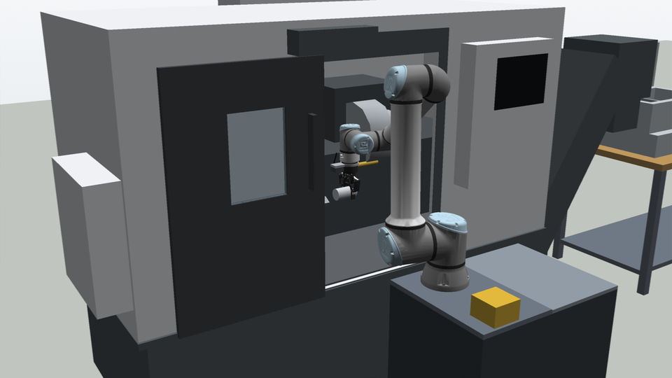
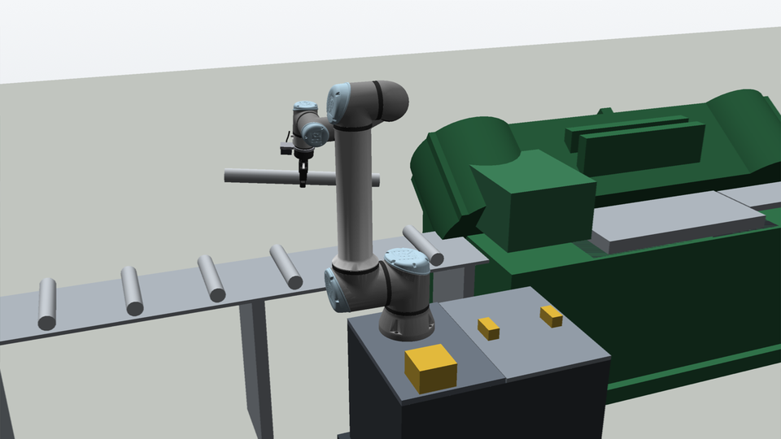
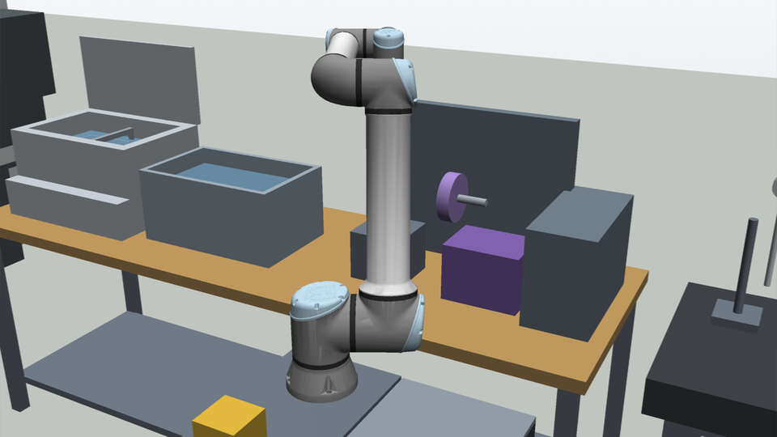
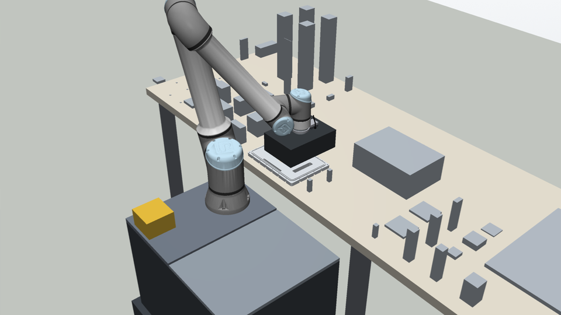
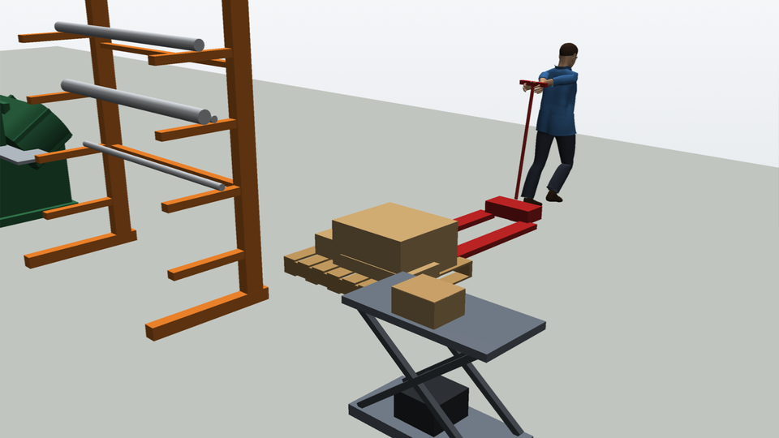

**How to rerun:**

1. `shop_chamber_cache.py` (the model's cut states, ~2 min).
2. `analysis/shop/shop_clips.py` (the plans, ~10 min).
3. `cad/robotbuild/shop_chapters.py 20 30 31 32` (the frames: ~25 min for chapter 30 alone).

   It needs a 6G cap for `/tmp/capmem`. With 3G and 4.5G, llvmpipe failed to create its first framebuffer, and it
   sometimes does at 6G too, so retry.
4. `analysis/shop/shop_summary.py` and `shop_stills.py`.

### Not done in round 7

- No MiR drives between stations are animated. The route table above (205 s per part's trip) stands.
- Not planned:
  - the floor plate's turnover between P-S1 and P-S2 (a regrip stand; counted as two plate-class moves);
  - unloading the lathe and parting off;
  - the arm's bolt-up of the F-S3 plate.
- Dynamics and grip slip are not checked: all torques are static.
- The jib's height and the VF-4's sill, header and roof are our estimates. So is the trepan.

## Result

- **Reach and collisions are not the problem. Payload and grippers are.** Every representative motion planned here
  passes: one arm at the Haas VF-4's vise, one at the lathe chuck, two arms together at the VF-4 twice, and a tape cut.
  They are collision-free on meshes (FCL), planned at 0.5° steps and re-checked at 0.2°. What stops a robot-only shop
  is the weight and size of a few stock pieces, and a gripper rated for 5 kg.
- **Payload, against the machining review's current stock list** (`dfm.json`, 48 parts, written 23:11 UTC with the
  through-frame chamber):
  - 44 of the 48 parts start from stock of 5 kg or less, which a Robotiq 2F-85 is rated to carry.
  - Four don't: the two MIC-6 base plates (18.1 and 16.8 kg), the optics bridge plate (19.7 kg) and the chamber
    frame's blank (11.0 kg).
  - One arm can carry 11.2 kg of part, not 12.5: the UR12e's 12.5 kg includes the gripper, coupling and wrist camera
    (1.3 kg). Two arms together can carry 22.4 kg, not 25.
  - So the three plates need both arms, with grippers rated for at least 10 kg each. The frame blank needs one arm
    with a gripper rated over 11 kg.
  - Three round blanks (Ø3.375 in. and two Ø4.25 in.) are wider than the 2F-85's 85 mm stroke, so the lathe can't be
    loaded by their outside diameter. An OnRobot 3FG15 (grips 4-152 mm, 10 kg) covers them.
- **The chamber, both versions:**
  - **Version B (the through-frame now in the model):** the 13 × 9.5 × 5.5 in. plate weighs 30.0 kg as delivered, so a
    person loads it with a lifter. Its 274 × 184 mm core is cut out as one slug; the slug weighs 19.0 kg (two arms, or
    the person). What is left is the 11.0 kg blank, which one arm loads into the vise
  - **Correction after the chamber study finished (23:55 UTC):** its final setup plan ([`setup_plan.json`](analysis/out/machining/setup_plan.json)) cuts the frame from a 15 × 9.5 × 5.5 in. blank, with 1 in. end tabs for setup F-S1's toe clamps: 34.7 kg as delivered and 15.7 kg once the core is out. That is more than one arm's 11.2 kg, so two arms (as in P6) or a person put it on the risers for F-S1. The tabs are sawn off before F-S2, which leaves the 11.0 kg-class part P1 was planned with (P1 used the 13 in. blank).
    ([P1](#p1-vf-4-one-arm-loads-the-frame-blank-version-b)).
    - An OnRobot 2FG14 is rated for 14 kg but weighs 1.5 kg itself. On a UR12e that leaves
      12.5 − 1.5 − ~0.4 kg (camera and coupling) = ~10.6 kg, so the blank is at the limit.
    - The finished frame is 4.3 kg and the floor plate's stock 5.0 kg: 2F-85 jobs.
  - **Version A (one 13 × 9.5 × 6 in. block):** 32.8 kg as delivered, beyond both arms: a person loads op 1. After the
    pocket is roughed it is 15.6 kg, which both arms can flip
    ([P3](#p3-vf-4-two-arms-hold-the-roughed-block-version-a)). Finished it is 7.4 kg.
- **The VF-4, one arm (P1):**
  - The arm carries the 11.0 kg frame blank from its MiR's deck through the open doors into an air vise, and back out.
  - **11.3 s** of arm motion, clear everywhere.
  - The closest pass depends on the door:
    - with the 1588 mm door of Haas's current enclosure drawing, the upper arm comes 27.9 mm from the panel under the
      door;
    - with the 1251 mm door of the 2014 drawing, the blank itself comes 6.3 mm from the right jamb.
  - At the vise pose, 11.2 kg loads the worst joint to 80 % of its torque limit and 12.5 kg to 86 %. 20 kg would need
    119 %.
- **The lathe, one arm (P2):**
  - The arm loads a 2-1/8 in. bar slug into the chuck in **23.5 s**, with the door 592 mm wide (the Haas ST-10 drawing).
  - The closest pass is 3.0 mm, the forearm to the panel above the door, while the arm picks the slug from its deck.
  - **The arm has to come in from above, not along the spindle axis.** Holding the slug on the spindle axis, every
    IK branch puts the wrist or upper arm through the door's right jamb.
- **The VF-4, two arms:**
  - **P3, the roughed block (15.6 kg):** both arms lift it 150 mm out of the vise and draw it 450 mm toward the door,
    all clear. The closest pass is 22.3 mm, forearm to forearm. Each arm's worst joint is at 68 %. With the 1251 mm
    door, arm B's upper arm reaches the right jamb after 430 mm.
  - **P6, the optics bridge's plate (19.7 kg):** both arms lift it off a fixture plate and draw it 400 mm toward the
    door, holding it from above by two bolted-on lifting tabs. Each arm's worst joint is at 77 %. Pinching the plate's
    edges with the gripper level fails: arm A's upper arm hits the panel under the door.
- **The MiRs stay down, but only with PR 318's ballast.** These use PR 318's method and masses, including the 131 kg
  steel plate:
  - With the plate, one arm holding 11.2 kg 1100 mm out toward the machine leaves 390 N·m of restoring moment: it would
    take 39.6 kg more at the gripper to tip it.
  - Without the plate, the same pose leaves 100 N·m, about 10 kg more at the gripper.
  - Driving at 0.3 m/s² with the blank on the deck leaves 591 N·m.
- **Routes:** one part's trip (receiving, rack, saw, VF-4, lathe, VF-4, wash, measuring, kitting, bench) is 9 MiR legs:
  56 m and 205 s of driving at 1 m/s with 0.3 m/s² ramps, plus a docking at each stop. The 3 m aisle is MiR's published
  width for two robots passing.
- **What still needs a person or a fixture:**
  - CAM, and watching each new program's first run;
  - a lifter (vacuum tube lifter on a jib) and a pallet jack for the heavy stock and three of the boxes;
  - soft jaws and fixtures;
  - gauging seal faces and bores. The arms can place parts on the granite plate but can't read a bore gauge;
  - the flaps and dunnage of boxes;
  - chips in deep pockets.

  The machines need robot-ready options: the Haas auto door, programmable air for a pneumatic vise and tailstock, WIPS
  probing, and the automatic air gun.
- **Time for one machine's 48 parts** (excluding assembly, welding, honing and setting the cell up):
  - **By hand:** about **137 person-hours**, 17.2 working days.
  - **In the robot shop:** about **60-78 person-hours** and about **7 days**. The cell runs 20 h a day once the CAM is
    done.
  - **Cutting time doesn't change** (27.7 h). The saving is the 41 h of setups by hand, replaced by 118 robot
    changeovers of about 3 minutes each. Deburring, washing and measuring save more.
  - **Commissioning dominates the first machine.** Fixtures, station registration, teaching and proving each task, and
    the risk assessment would take months. Edison's review estimates that only 10-30 % of a one-off prototype's distinct
    setups are readily robotizable ([Edison r3-robot-tending](edison/r3-robot-tending/answer.md), section 4).
- **The equipment the shop would buy, beyond BYU's VF-4 and lathe,** comes to about **$330k** on the priced lines
  ([`robot-shop-equipment.csv`](robot-shop-equipment.csv)). Most of it is two MiR250s (~$45k each, estimated: MiR
  publishes no price), two UR12e ($44,636 each from a reseller) and an automatic bandsaw (~$50k, estimated). For
  comparison, Haas's own fixed 25 kg robot package for one machine lists at $81,095.

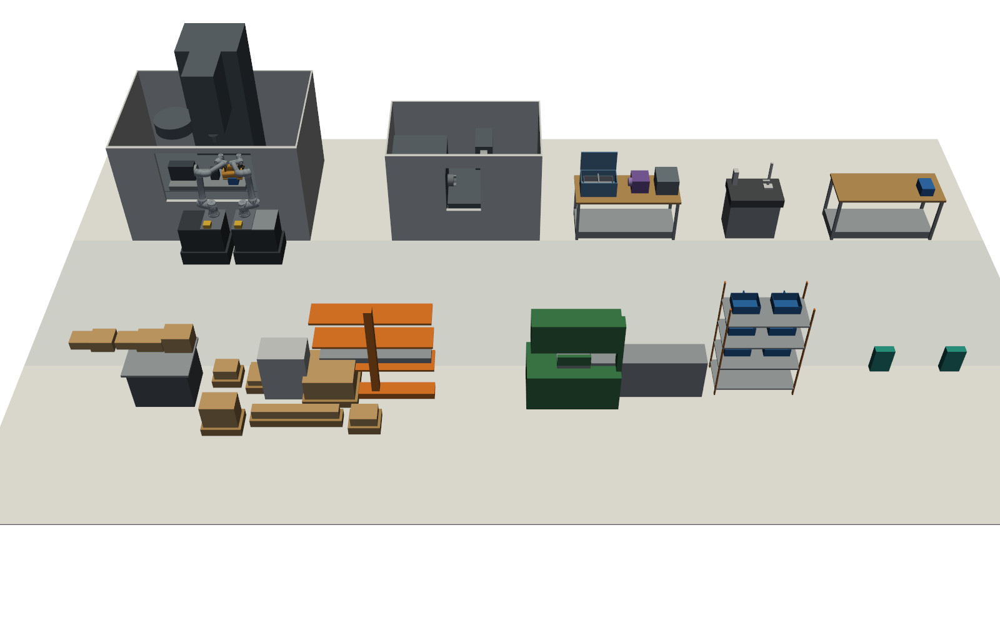

## What was modelled

Scripts are in [`analysis/shop/`](analysis/shop/), and results and images are in [`analysis/out/shop/`](analysis/out/shop/).
Run: `OMP_NUM_THREADS=1 xvfb-run -a -s "-screen 0 1920x1080x24" python desktop-lpbf/analysis/shop/shop_checks.py` (2-3 min),
then `python desktop-lpbf/analysis/shop/timeline.py`. Both read `analysis/out/machining/dfm.json`, so re-run them if the
machining review changes.

- [`shop_cell.py`](analysis/shop/shop_cell.py) is the shop: stations in their own frames, MiR docking poses and routes,
  and a scene class that feeds `cell.py`'s `Checker`.
- [`shop_checks.py`](analysis/shop/shop_checks.py) runs the payload table, plans P1-P4 and P6, the reach checks (P5), the
  routes and the tip-over margins.
- [`shop_figs.py`](analysis/shop/shop_figs.py) and [`shop_render.py`](analysis/shop/shop_render.py) make the pyvista
  renders.
- [`timeline.py`](analysis/shop/timeline.py) makes the hand-vs-robot timeline.
- Results are in [`shop_checks.json`](analysis/out/shop/shop_checks.json) and
  [`timeline.json`](analysis/out/shop/timeline.json).

**Robots.** Each is `analysis/robot/cell.py`'s arm, aligned with byu-vcl PR 318 (round 14, 11d4410):

- a UR12e (UR10e kinematics) with a Robotiq 2F-85 and a RealSense D405;
- on a MiR250 with a 480 mm cabinet, so the arm's base is 800 mm above the floor;
- the arm 130 mm toward the side it works on;
- docking 80 mm from a station's face.

What this study adds or changes:

- **The arm moves 190 mm along the cabinet.** That leaves a 380 × 520 mm deck for the part being carried. PR 318's arm
  is centred because it carries nothing.
- **A fingertip stand on the plate beside the arm.** PR 318 exchanges fingertips from a stand on the MiR deck.
- **The 131 kg ballast plate**, as PR 318 has it.
- **Docking:** a MiR250 docks to a VL marker within ±3 mm and ±0.5°
  ([MiR](https://mobile-industrial-robots.com/products/robots/mir250/specifications), fetched 2026-11-20 22:27 UTC).
  Then, as in PR 318, the D405 re-registers the station from an AprilTag cube. At the Haas, WIPS probing sets each work
  offset, so the arm only has to place a part within the vise's capture range. Edison's review suggests budgeting
  1-3 mm after re-registration.

**Collision checking** is `cell.py`'s:

- FCL on meshes: the arm against itself, and the arm, gripper and held part against everything else, the MiR and the
  other arm included;
- every IK branch tried;
- RRT-Connect with shortcutting.

Two things are tighter here than in `cell.py`:

- **Planning steps are 0.5°**, not 1.5°. At 1.5° a forearm grazed the lathe's door header between two samples
  (run of 22:42 UTC).
- **Every finished one-arm plan is re-checked at 0.2°.** All passed with no contacts.

The two-arm moves follow a straight line for the part, sampled every 10 mm. PR 318's round-11 rule holds throughout: a
handled part may touch its fixture, the deck or the vise only up to 1.5 mm deep.

**Joint torques** come from this folder's `joint_torques()`: UR's link masses, placed as PR 318's stability check places
them.

- **`cell.static_torques` has a bug, so it wasn't used.** It (and `max_force`) attaches every link's mass to the flange,
  which loads the wrist joints with the upper arm's weight: the worst joint reads 228 % of its limit with a 1 kg part at
  the saw.
- **The fix:** a mass on link i loads only joints 1 to i. `cell.py`'s owner (the tending study) is applying it.

**Equipment sizes are the makers' published figures.** Fetched 2026-11-20 22:18-22:45 UTC; every source is in the CSV.

| Equipment | Published numbers used | Estimated here |
|---|---|---|
| Haas VF-4 ([page](https://www.haascnc.com/machines/vertical-mills/vf-series/models/medium/vf-4.html), [layout drawing](https://www.haascnc.com/content/dam/haascnc/pdp_feed/mld/vf-4_4ss_mld_01_2022.pdf)) | travels 1270 / 508 / 635 mm; table 1321 × 495 mm, top 940 mm above the floor; spindle centre line 838 mm and table front 341 mm behind the front face; nose to table 107-742 mm; enclosure 3128 × 2314 mm, top 2004 mm; 20-tool carousel, 4.2 s tool to tool | door sill 880 mm and top 1900 mm; head, column and carousel as boxes |
| VF-4 door | 1588 mm (62.5 in.), from the [2023 VF-3/SS drawing](https://shop.phillipscorp.com/cdn/shop/files/vf-3_ss_mld__2_2023.pdf), which shares the VF-4's enclosure; the 2014 enclosure's drawing gives 1251 mm, so both were checked | |
| Haas HRT210 ([page](https://www.haascnc.com/machines/rotaries-indexers/rotary-tables/models/hrt210.html), [drawing](https://www.haas.co.uk/wp-content/uploads/2019/10/HRT210_Dimensions.pdf)) | platter Ø210 mm, centre height 152.40 mm, 470 × 178 × 315 mm, 77.1 kg with tailstock | tailstock as a box |
| Lathe ([ST-10 drawing](https://pub-aem.haascnc.com/content/dam/haascnc/pdp_feed/mld/st-10_st-15_mld_12_2024.pdf)): BYU's PF shop doesn't publish its model | spindle centre line 991 mm; door 592 mm wide from a 680 mm sill, 915 mm tall | where the door sits along the spindle axis; centre line 450 mm behind the front face; 8 in. chuck, turret at home |
| Vise | Kurt XL6A air vise: 6 in. jaws, opens to 14.5 in. ([Penn Tool](https://penntoolco.com/kurt-6-extra-capacity-air-vise-xl6a)) | body as boxes, opened to 261 mm for the 241 mm blank |
| Bandsaw | Hyd-Mech S-20A: 13 × 18 in. capacity, table 31 in. (reseller listings) | envelope (bed drawn at 760 mm) |
| MiR250, UR12e, 2F-85 | as PR 318, plus the MiR and UR datasheets; MiR250: two robots pass in a 3000 mm aisle | – |
| Granite plate, ultrasonic tank, bench, racks | 36 × 24 in. plate; 19.5 × 11.75 × 8 in. tank; McMaster 4849T1 cantilever rack | heights, totes, the tote's robot handle tab |

## Pass or fail by step class

"Clear" is the smallest distance from the arm, its gripper or the held part to anything it isn't meant to touch. "Torque"
is the most loaded joint as a fraction of its limit (static, at that pose).

| Step class | What was checked | Result | Numbers | Needs a person or fixture |
|---|---|---|---|---|
| Unboxing: cut tape | P4: a cutter held in the 2F-85 runs a 390 mm seam on a box on the receiving lift table (760 mm) | **pass** | clear all along; torque 32 %; it can push 110 N along the seam at half its joint torque | spring-retracting safety knife in a holder ($100, estimated); lift table at 760 mm, where the arm reaches |
| Unboxing: open flaps, remove dunnage | not modelled | **not checked** | – | two arms (one holds, one pulls) is plausible; loose fill and foam are deformable, so expect a person |
| Unboxing: lift contents | payload table (11 shipments, estimated from bom.csv and quotes/) | **partly** | 5 boxes ≤ 11.2 kg (one arm; 2 of them over 5 kg need a heavier gripper); 3 of 15-21 kg (two arms); 3 over 22.4 kg: the chamber block (34 kg), plate bundle (58 kg), IPG laser in its crate (52 kg) | pallet jack and a person for the three heavy ones |
| Stock prep (saw) | P5: reach to the saw bed at the blade line and on the infeed table | **pass** | clear 43 and 11 mm; torque 21-31 % | automatic saw with its own bar feed (S-20A class); buy the plates cut to size (machining.md) |
| Stock from the rack | P5: bar on cantilever arms at 450, 950 and 1450 mm | **2 of 3** | middle and top: clear 41 mm, torque 34-47 %; bottom level: the forearm hits the level above | keep bar off the bottom level, or use a drawer rack |
| Mill: load and unload the vise | P1, one arm, frame blank (version B, 11.0 kg) | **pass** | 11.3 s; clear 27.9 mm (1588 mm door) / 6.3 mm (1251 mm door); torque 80 % at 11.2 kg | Haas auto door ($2,595), programmable air ($2,395) and an air vise that opens past 241 mm (Kurt XL6A, $4,495); a gripper rated over 11 kg |
| Mill: flip for the next setup | P3, two arms, roughed block (version A, 15.6 kg), 150 mm lift + 450 mm draw | **pass** | clear 22.3 mm (forearm to forearm); torque 68 % each; with the 1251 mm door it stops at 430 mm | rigid two-arm grasp (see below); grippers rated ≥ 8 kg each |
| Mill: plates | P6, two arms, the optics bridge's 1.25 in. plate (19.7 kg) on a fixture plate, 150 mm lift + 400 mm draw | **pass with lifting tabs** | torque 77 % each; restoring moment 472 N·m per MiR; pinching the edges level fails (upper arm into the panel under the door) | two bolted lifting tabs (our addition) or vacuum cups on dry stock (OnRobot VGP20: not for wet CNC parts); grippers ≥ 10 kg |
| Mill: chips | not modelled | **needs equipment** | the old one-block chamber made 9.4 L of chips (78 % of the block) | Haas automatic air gun ($1,695), a chip auger or conveyor, flood coolant; a wrist-camera look at seating (Edison: chips caused mis-seating in a real cell) |
| Mill: work offsets | – | **by the machine** | ±3 mm docking, ~1-3 mm after re-registration | WIPS probing ($6,795) sets every offset, so placement only has to be within the vise's capture range |
| Tool changes | – | **by the machine** | VF-4 carousel: 20 tools, 4.2 s tool to tool | a person sets tools in holders and measures their lengths |
| 4th axis | – | **not checked here** | HRT210 centre height 152.4 mm, 77.1 kg with tailstock | the chamber study puts the frame's walls on the 4th axis on a riser (swing 191.5 mm > 152.4 mm); a pneumatic fixture on the platter would let the arm load it |
| Lathe: load and unload the chuck | P2, one arm, 2-1/8 in. 6061 slug | **pass, top-down only** | 23.5 s; clear 3.0 mm (forearm to the door header); coaxial loading fails (every IK branch hits the right jamb of the 592 mm door) | auto door (in Haas's VOP-A, $6,995); chuck closed by M-code; OnRobot 3FG15 ($6,091) for the three blanks over 82 mm |
| Deburring | P5: part held level against a brush wheel | **pass** | clear 23 mm; torque 26 % | compliant deburring spindle (ATI class, ~$12k estimated); edges inside deep pockets by a person |
| Washing | P5: basket handle in the ultrasonic tank | **pass** | clear 95 mm; torque 35 % | heated ultrasonic tank, 7-8 gal |
| Measuring | P5: parts on the granite plate; reaching the height gauge's scriber | **places parts: pass; gauging: person** | clear 21-41 mm; torque 25-30 % | a person reads the bore and height gauges (seal faces ±0.05 mm, Ø50.80 H7); or a robot-loadable gauge (Renishaw Equator, priced only on request) |
| Kitting | P5: tote handle on shelves at 600, 1050 and 1500 mm | **pass (handle tab needed)** | 1050 and 1500 mm: clear 21 mm, torque 23-52 %; 600 mm: only with the MiR parked 450 mm off the rack | a 20 mm handle tab standing 60 mm proud of each tote |
| Driving and docking | 9 route legs; tip-over by PR 318's method | **pass with ballast** | 56 m, 205 s per part's trip; 591 N·m restoring at 0.3 m/s² with the blank on the deck | VL markers and AprilTag cubes at each station; block driving while an arm is inside a machine |

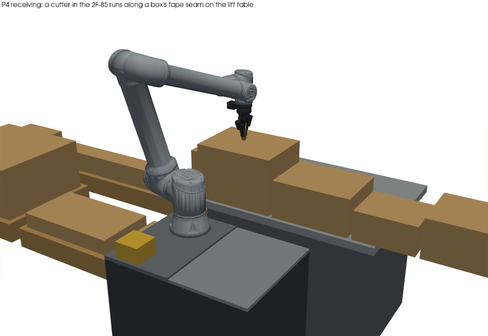

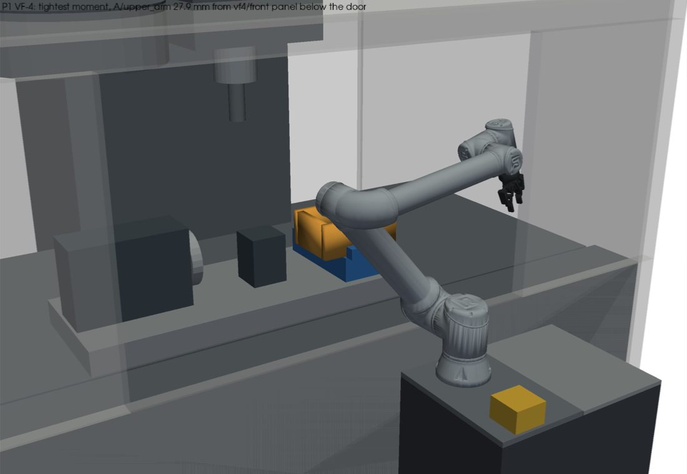

### P1: VF-4, one arm loads the frame blank (version B)

The blank is the chamber study's: 13 × 9.5 × 5.5 in. with its 274 × 184 mm core out, leaving 28 mm walls (11.0 kg).

**The setup.** The MiR docks with the arm in front of the vise. The vise is on the right half of the table, 450 mm right
of its centre; the HRT210 and tailstock are on the left half. At the load position the table is 150 mm left of the
spindle and nearest the door.

The arm then:
1. grasps the blank's end wall 30 mm below its top, on the deck;
2. lifts it 150 mm;
3. carries it through the door (planned by RRT-Connect, 3.0 s);
4. lowers it 120 mm into the open vise, 10 mm in front of the fixed jaw;
5. lets go when the vise closes, and backs out.

Unloading is the same moves in reverse. Every segment was re-checked at 0.2°, with no contacts.

| Segment | s |
|---|---|
| home (carry pose over the deck) → above the part | 0.4 |
| down 120 mm, close on the wall | 0.8 + 0.8 |
| lift 150 mm | 1.0 |
| through the door to 120 mm above the vise | 3.0 |
| lower 120 mm, vise closes, gripper opens | 0.8 + 1.5 |
| up 120 mm, out to home | 0.8 + 2.2 |

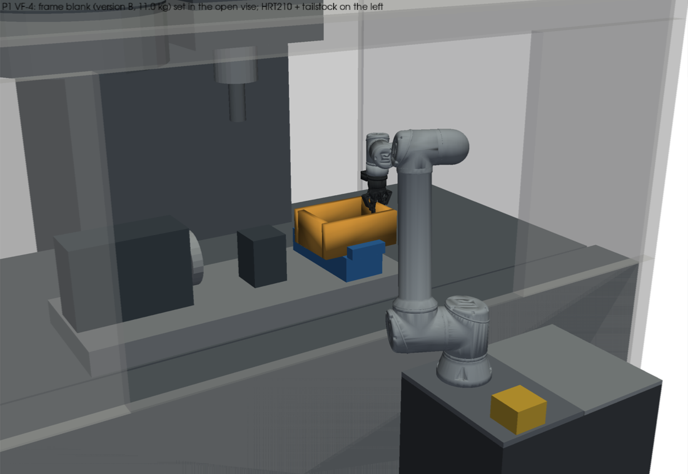
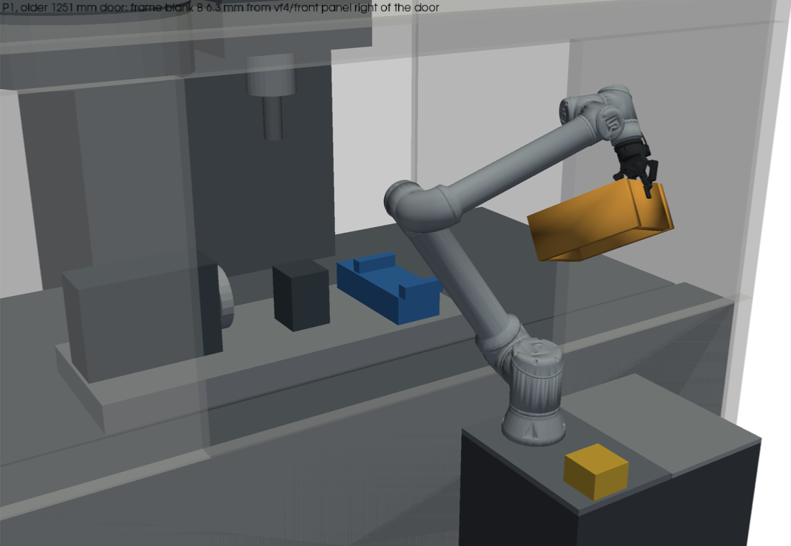

### P2: lathe, one arm loads a bar slug

The slug is Ø54 × 100 mm (0.6 kg). The heater block, build plate and piston head are turned from it and parted off. It
lies in a V-cradle on the deck.

The arm:
1. grasps it from above, 25 mm from its outer end;
2. carries it to the front of the door, level with the spindle axis;
3. moves straight in 450 mm and pushes it 70 mm along the axis into the open jaws;
4. lets go when the chuck closes, then rises and backs out the same way.

Coaxial loading (gripper pointing at the chuck along the spindle axis) is the usual way, but it fails: every IK branch
puts the wrist or upper arm through the right jamb of a 592 mm door. BYU's PF-shop lathe has live tooling but no
published model. If it is an ST-20 class machine, its door is probably wider (the research helper scaled about 730 mm
from the drawing).

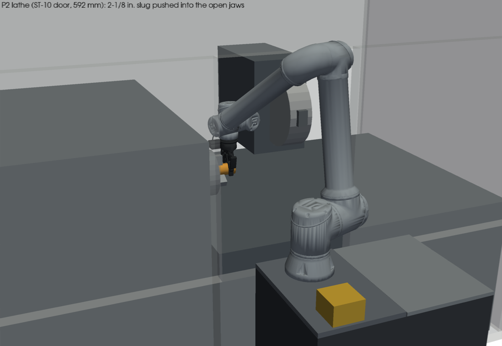
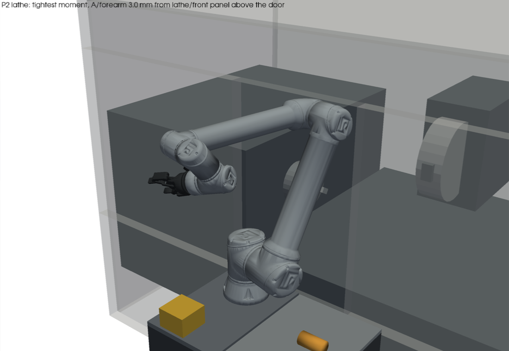

### P3: VF-4, two arms hold the roughed block (version A)

The two MiRs dock side by side at the VF-4, 100 mm apart. Arm A is at the right end of its cabinet and arm B at the left
end of its own, so the arms are 520 mm apart. Each grasps one end wall (25 mm) 30 mm below the top.

The block's path is a straight line, sampled every 10 mm. Both arms follow it on their nearest IK branch, with no joint
jump over 10°. At each step the check covers:
- each arm against the machine and both MiRs;
- the arms against each other;
- the block against everything but the two grippers holding it.

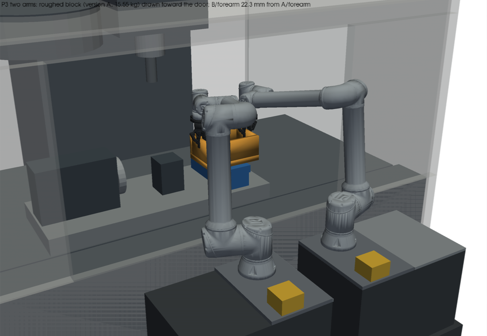

### P6: VF-4, two arms lift the optics bridge's plate

The table is centred in the door, with a 500 × 380 × 40 mm fixture plate (vacuum or zero-point) instead of the vise and
rotary table.

**The holds.** The first try pinched the 31.75 mm plate at its two short edges, with the grippers level, pointing in.
Every pair of IK branches put arm A's upper arm into the panel under the door and the chip trough. Two 20 mm lifting tabs
bolted near the plate's ends, gripped from above, work.

**The result.** The lift is clear with both door widths. The smallest distance is 70 mm, the plate to the table, as it
starts to rise. Each arm carries 9.85 kg at 77 % torque, and each MiR keeps 472 N·m of restoring moment.

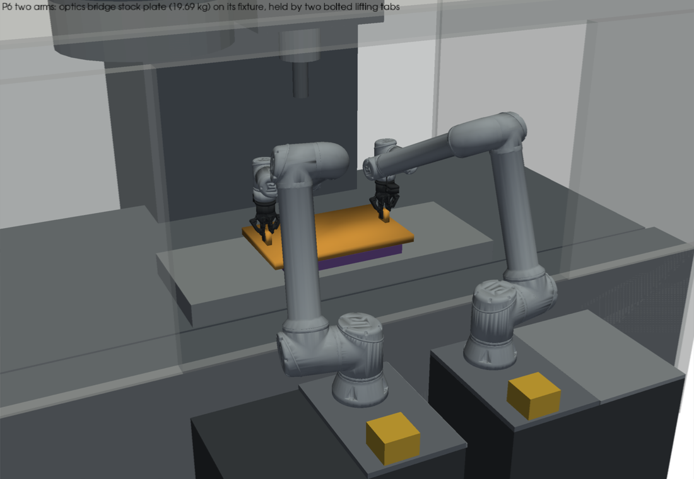

### What a rigid two-arm grasp implies

Holding one rigid part with both arms closes a kinematic loop: MiR A, arm A, the part, arm B, MiR B, and the floor.

**The position mismatch.** Each MiR docks within ±3 mm, and after re-registration the two arms may still disagree by
about 1-3 mm (Edison's estimate). Each arm repeats to ±0.05 mm (UR datasheet). Two stiff, position-controlled arms fight
over a 1-3 mm mismatch. The force goes into the grasp and the joints until a protective stop trips.

What makes it work:

- **One leader, one follower.** One arm leads in position control. The other follows in UR force mode, compliant along
  the directions the part constrains, using its ±100 N wrist F/T sensor. Or one wrist carries a passive compliance unit.
- **One shared reference.** Both arms register to the same datum (the vise's AprilTag cube or a probed face) before
  they grasp.
- **Form-fit grasps.** The grasp should be a feature, such as end walls, lifting tabs or lugs, not friction alone. Each
  gripper must be rated for at least half the load: 7.8 kg for the block and 9.9 kg for the plate, which rules out the
  2F-85.
- **Both bases still, one safety zone.** Neither MiR moves while the loop is closed. Both arms stop together if either
  one stops.

A dual-UR10e system that coordinates a shared workspace exists (battery disassembly; Edison section 4). It is evidence
that two arms can share a workspace, not that they can co-carry a 20 kg plate.

## Payload: every stock piece against the arms

From `dfm.json` (23:11 UTC), at 2.70 g/cm³ for 6061, 2.66 for MIC-6 and 8.0 for 316L. The tube stock is taken as the
part plus 30 %. Full table: `payload` in [`shop_checks.json`](analysis/out/shop/shop_checks.json).

**The limits:**
- one 2F-85: 5 kg;
- one arm: 11.2 kg of part (12.5 kg less 1.3 kg of tooling);
- two arms: 22.4 kg.

| Stock piece | kg as delivered | kg finished | Who can lift it |
|---|---|---|---|
| Chamber frame, version B (13 × 9.5 × 5.5 in. plate) | 30.0 | 4.3 | a person with a lifter as delivered |
| its 274 × 184 mm core, cut out as one slug | 19.0 | – | two arms, or the person |
| the frame blank with the core out | 11.0 | 4.3 | one arm with a gripper rated over 11 kg (P1) |
| Chamber floor plate, version B (1 in. plate, 228 × 318 mm) | 5.0 | 3.0 | one arm, 2F-85 (at its 5 kg limit) |
| Chamber body, version A (13 × 9.5 × 6 in. block) | 32.8 | 7.4 | a person with a lifter for op 1; two arms once the pocket is roughed (15.6 kg, P3) |
| Optics bridge (1.25 in. plate, 376 × 611 mm) | 19.7 | 13.3 | two arms with lifting tabs (P6) |
| Base plate, process module (MIC-6 3/4 in., 486 × 736 mm) | 18.1 | 12.0 | two arms |
| Base plate, gas module (MIC-6 3/4 in., 556 × 596 mm) | 16.8 | 12.9 | two arms |
| Recoater motor bracket (2.5 in. plate) | 2.9 | 2.5 | one arm, 2F-85 |
| The other 42 parts | ≤ 3.7 each (the lid's plate is the heaviest) | | one arm, 2F-85 (the three bars over 82 mm need the 3FG15 at the lathe) |

**Static torque at the P1 vise pose, by part mass:**

| Part mass, kg | 2 | 5 | 7.5 | 10 | 11.2 | 12.5 | 15 | 20 | 25 |
|---|---|---|---|---|---|---|---|---|---|
| Worst joint, % of its limit | 40 | 53 | 64 | 75 | 80 | 86 | 97 | 119 | 141 |

These are static. Accelerating a full payload adds to them, which is why UR rates 12.5 kg, not the ~15 kg where the
static sum reaches 100 %.

**Tip-over** uses PR 318's `stability()` with its masses: MiR 97 kg, control box 12 kg, cabinet 25 kg, arm 33.3 kg,
131 kg steel plate. Its support rectangle is ±325 × ±225 mm (estimated in PR 318). "Restoring" is the moment that keeps
the weakest edge down. The weakest edge is always the one facing the machine.

| Case | Total kg | CoG height, mm | Restoring, N·m | More kg at the gripper to tip it |
|---|---|---|---|---|
| P1: blank in the vise, with plate | 311 | 408 | 484 | 75 |
| P1, no plate | 180 | 473 | 195 | 30 |
| 11.2 kg, 1100 mm out, with plate | 311 | 391 | 390 | 40 |
| 11.2 kg, 1100 mm out, no plate | 180 | 443 | 100 | 10 |
| P3: each arm with 7.8 kg in the vise | 308 | 401 | 506 | 78 |
| P6: each arm with 9.9 kg | 310 | 398 | 472 | 66 |
| Driving at 0.3 m/s², blank on the deck | 311 | 394 | 591 | – |

## Routes and cycle times

**Routes.** The MiRs drive on two lanes, at y = 5.0 and 6.0 m in the 3 m aisle (red in
[`shop_layout.png`](analysis/out/shop/shop_layout.png)). Each leg is a trapezoidal profile at 1 m/s and 0.3 m/s², plus
4 s per turn.

| Leg | m | s |
|---|---|---|
| receiving → stock rack | 4.5 | 20 |
| rack → saw | 4.3 | 20 |
| saw → VF-4 | 8.3 | 25 |
| VF-4 → lathe | 7.6 | 25 |
| lathe → VF-4 | 7.6 | 25 |
| VF-4 → wash | 10.4 | 28 |
| wash → measuring | 5.5 | 23 |
| measuring → kitting | 2.8 | 18 |
| kitting → bench | 4.6 | 21 |
| **total** | **55.6** | **205** |

**The arm motion is from the plans.** P1 is 11.3 s per load (11.6 s with the narrower door). P2 is 23.5 s per lathe
load.

**A changeover** (unload, flip or re-fixture, load, at one setup) is modelled at **184 s**:

| Item | s | Source |
|---|---|---|
| two P1-length moves | 23 | the plans |
| MiR leg between stations | 25 | the route legs above |
| docking | 30 | estimate |
| D405 re-registration | 15 | estimate |
| auto door, open and close | 6 | estimate; Haas publishes no time |
| air blast | 20 | estimate |
| wrist-camera look at the seating | 5 | estimate |
| WIPS probing | 60 | estimate |

That is the floor set by motion. In a real cobot cell, Edison's review found a reported **12 minute** unload, clean and
load cycle, with chips, emulsion and vise height upsetting seating (bonifazio2024, section 4). Plan for something between
the two.

## Timeline: one machine's machined parts, by hand vs the robot shop

From [`timeline.json`](analysis/out/shop/timeline.json). Cutting and setup times are the machining review's (`dfm.json`
of 23:11 UTC: 27.7 h cutting, 118 setups at 20 min each, 40 min for the chamber; where `dfm.json` gives no setup list
the count is its setup time / 20 min). Everything else is an assumption listed in `timeline.py`.

| Step | By hand, person-h | Robot shop, machine or robot h | Robot shop, person-h | Note |
|---|---|---|---|---|
| CAM programming and simulation | 35.0 | – | 35.0 | unchanged |
| Unboxing and receiving | 1.8 | 1.1 | 1.0 | 3 heavy shipments by a person with a pallet jack |
| Stock prep (saw, ~20 blanks) | 1.7 | 1.0 | 0.5 | plates bought cut to size |
| Cutting (rough, finish, holes) | 27.7 | 27.7 | 0 to 18.0 | 0 if every first run goes unwatched; 18.0 if a person watches everything except the long roughing |
| Setups and flips (118) | 41.0 | 6.0 | 17.2 | 184 s robot changeover; a person watches each new setup's first minutes (8 min) and loads the heavy pieces |
| Deburr | 11.2 | 4.5 | 2.2 | a person checks each part (2 min) |
| Wash | 5.6 | 6.7 | 0 | |
| Measure | 11.2 | 4.5 | 4.5 | the arm places parts; a person gauges them (4 min a part) |
| Kitting | 2.2 | 1.1 | 0 | |
| **Total** | **137 person-h, 17.2 days at 8 h** | **34 h of machine time** | **60-78 person-h, ~7 days** | the cell runs 20 h a day after 4.4 days of CAM |

**Not included:**
- setting up the cell: fixtures and soft jaws, AprilTag cubes and registration at each station, teaching and proving
  each robot task, the risk assessment and the interlocks. For the first machine this is likely months;
- welding, honing (outsourced), heat treatment and bead blasting;
- assembly (the assembly study in this PR);
- queue time at BYU's shops.

## Equipment

[`robot-shop-equipment.csv`](robot-shop-equipment.csv) lists 38 lines. Each has a make and model, quantity, status (BYU
has it, buy, optional, benchmark), role, the specs the model used, the published specs, price and price basis, URL and
fetch time (2026-11-20, 22:18-22:45 UTC). Priced "buy" lines total **$329,339**; the ATI tool changers are priced only on
request. The biggest lines:

| Item | Qty | Price each | Basis |
|---|---|---|---|
| MiR250 | 2 | ~$45,000 | estimate: MiR publishes no price |
| UR12e | 2 | $44,636 | reseller (Vention) |
| Hyd-Mech S-20A automatic bandsaw | 1 | ~$50,000 | estimate: quote only (used $8-23k) |
| Schmalz JumboFlex 50 vacuum tube lifter | 1 | ~$15,000 | estimate: quote only |
| Robotiq 2F-85 / OnRobot 3FG15 | 2 + 2 | $5,990 / $6,091 | resellers |
| ATI compliant deburring tool | 1 | ~$12,000 | estimate: quote only |
| Haas options: auto door, programmable air, WIPS-R, air gun; ST-20 VOP-A (auto door) | 1 each | $2,595, $2,395, $6,795, $1,695; $6,995 | Haas US list |
| Haas pneumatic vise 05-0412; Kurt XL6A air vise | 1 + 1 | $5,299.95; $4,495 | Haas list; reseller |
| Gorbel jib, Vestil lift table, ultrasonic tank, granite plate and stand, gauges, cantilever rack | | $750-4,300 each | resellers and estimates |

## Not checked

- **Dynamics:** accelerations, the arms' own dynamic payload limits and grip slip. All torque checks are static.
- **Grippers:** the grippers, fingers and fixtures other than the 2F-85. The 2F-85's meshes stand in for the heavier
  grippers in the collision checks. The 3FG15 and 2FG14 are larger, so clearances would shrink.
- **Unmodelled hazards:** chips, coolant and burrs on the parts. Edison names these as what dominates reliability in
  real cells.
- **People:** human safety. Power-and-force limiting does not make spindles, chips or pinch points collaborative. The
  cell needs a risk assessment and interlocks.
- **Estimated geometry:** the VF-4's door sill and header heights, where the lathe door sits along the spindle axis,
  BYU's actual lathe model, and the MiR's wheel positions (PR 318 estimates them too).
- **Not planned at all:**
  - box flaps and dunnage;
  - the two-arm transfers from the door onto a MiR deck or cart;
  - the core slug's removal;
  - the HRT210 loading;
  - lathe parting-off and unloading.

## Sources

- Equipment: [`robot-shop-equipment.csv`](robot-shop-equipment.csv). Every row carries its URL and fetch time.
- byu-vcl PR 318, round 14 (11d4410): the arm, cabinet, docking, the 1.5 mm rule, the 131 kg ballast and `stability()`.
- Edison r3-robot-tending ([answer](edison/r3-robot-tending/answer.md)), sections 2-5: docking repeatability and
  re-registration, the 2F-85's 5 kg rating, the pneumatic robotic vise, the 12 minute cycle, and the estimate that
  10-30 % of a one-off prototype is readily robotizable.
- The machining review ([`machining.md`](machining.md) and `analysis/out/machining/dfm.json`): stock sizes, setups and
  times.
- The chamber study in this PR: the version B frame blank.
