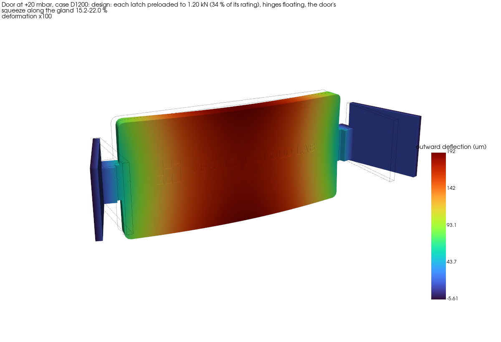
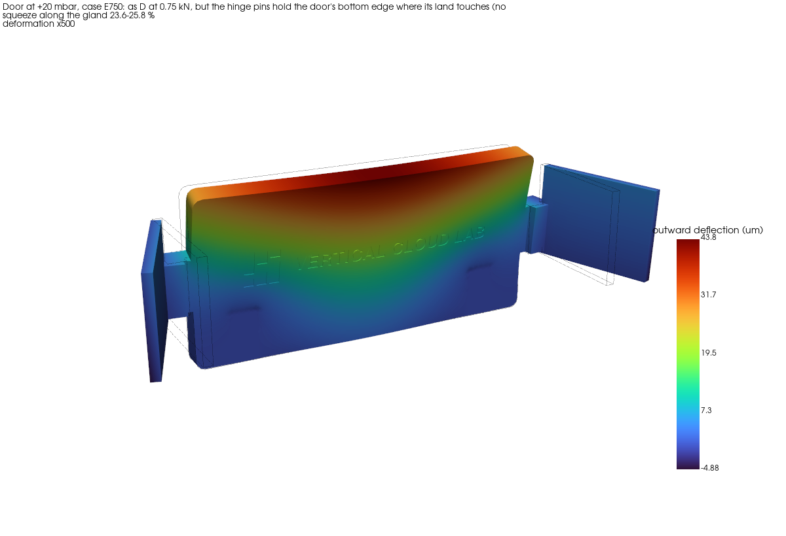

# Sealing the gas envelope: every seal checked, what had to change, and what the model now has

Written 2026-11-20 for [PR #266](https://github.com/vertical-cloud-lab/digital-alloy-lab/pull/266) (issue #260), in answer to
"make sure things that are meant to be sealed are sealed properly". Nothing here has been built or leak-tested.

| File | What it is |
|---|---|
| [`analysis/seals/seals.py`](analysis/seals/seals.py) | inventory of every seal and hole through the gas envelope; Parker gland checks with tolerances; closure forces; permeation and outgassing budget; pump-down; powder lift while pumping; rate-of-rise test → [`analysis/out/seals/seals.md`](analysis/out/seals/seals.md) |
| [`analysis/seals/door_seal_fea.py`](analysis/seals/door_seal_fea.py) | CalculiX: the door held at its latches and hinges against its own O-ring at +20 mbar → [`door_seal_fea.md`](analysis/out/seals/door_seal_fea.md) |
| [`analysis/mech/mech_checks.py`](analysis/mech/mech_checks.py) | the Z coupling's friction budget, screws and latches, chamber warm-up, cover-slide thermal lens → [`mech.md`](analysis/out/mech/mech.md) |

The machine has to hold two quite different states:
- **pumped to ~1 mbar** for the purge cycles, where the full atmosphere pushes in and leaks run inward;
- **+5 to +20 mbar of argon** for hours during a build. Here bulk leaks run outward, but O₂ and water still come in by
  permeation and back-diffusion. A closure that only the atmosphere was holding shut now has only its latches.

## Round 6 (2026-11-25): the door with its latches on the door, and the rod end's weld-ins

**The door** (§0 item 2; [`door_seal_fea.md`](analysis/out/seals/door_seal_fea.md)). Round 5 moved the draw latches onto
brackets on the door's ears, and the door-seal FEA hadn't been re-run since. It now reads the latches, brackets and hinges from
the model, and models three things the old run left out: the cord's stiffness, the floating hinges, and the door's land touching
the chamber where the latches pull it on.
- **As drawn in round 5, the latches pry the door off its seal.** Their pull line is at x ±158, 12 mm outboard of the ears' tips
  (x ±146), where the door bears on the chamber, and outside the chamber's front face (x ±156). With each latch preloaded to
  1.2 kN, the door touches the chamber at 34 of its 2,920 land nodes, all at the ears' outer edges, and 1.6 kN goes through them.
  The land opens by up to 192 µm at the top and bottom centres, and the squeeze there falls to **15.2 %**: 9.0 % at the gland's
  worst tolerance, against the 15 % the gland check asks for. Less preload doesn't cure it: at 0.75 kN, just enough to balance
  the cord, the door still pivots on the ear tips and the squeeze is 16.1-22.4 % (9.9 % at worst tolerance).
- **The old run's boundary conditions hid this.** They held the ears' front faces fixed and the hinges in y, which can't show a
  pull outboard of the bearing. On the new geometry they still give the round-4 answer: about 35 µm lost (case C).
- **Fix, drawn in `cad/lpbf_low.py`:**
  - **The hinge now holds the door's bottom edge.** The pin holes are round, where they were slotted ±0.6 mm. The chamber's knuckle
    blocks go on shims chosen at assembly, so the shut door's land just touches.
  - **Each latch is set to about 0.75 kN, and no more.** That is the cord's 1.48 kN plus the +20 mbar on the door, shared by two.
  - **Result:** squeeze **23.6-25.8 %** along the gland, 17.3 % at worst tolerance. The top centre is lowest, with the land open by
    44 µm there. Over-tightened to 1.2 kN, it is 23.5-25.8 %: the extra preload goes into the land at the ear tips and the hinge.
  - **What it asks of the hinge:** each hinge pulls the door's bottom edge in with 1.1 kN. Its Ø5 pin is then at 28 MPa in double
    shear. The pins need a close fit (reamed knuckles, H7/g6), because the FEA takes the hinge as rigid with no play.
- **Not drawn:** a 12 × 20 mm rib along the door's top edge (case F) lifts the top centre only from 23.6 to 23.9 %, so it isn't
  worth its swing clearance.
- **Mesh check:** cases A, B and C on the 76k-node mesh (hmin 1.5 mm) agree with a 78k-node run at hmin 1.0 mm to within 0.05 %
  of squeeze.

| | |
|---|---|
|  As drawn in round 5 (floating hinge, 1.2 kN latches): the door bows out up to 192 µm between its ear tips |  The fix (the hinge holds the bottom edge, 0.75 kN latches): up to 44 µm, at the top centre |

**The rod end** (§0 item 7). Round 5 replaced the rod end's hermetic connector, its 2-014 O-ring and the thermal cutoff with a
316L block carrying seven Solid Sealing weld-in feedthroughs ([`electrical.md`](electrical.md) §13.3-13.4). `seals.py` still
described the connector; it now lists the block, its welds and its weld-ins:
- **No elastomer at the rod end.** The 2-014 left the permeation budget with the connector (results below).
- **Leak rate.** Solid Sealing guarantees each part < 1e-10 atm·cc/s He, so the seven are < 7e-10 mbar·L/s. The welds decide
  the real number: helium-test the welded block and accept < 1e-9 mbar·L/s before the module is assembled. The potted leads
  this replaced were estimated at 1e-5 to 1e-2.
- **Weld side, an open question for Solid Sealing.** Its weld-ins are designed to be welded on the vacuum side. Here the welds
  are on the block's outer face, which is the air side, so each type K sleeve's annulus in its 26 mm blind bore is a crevice
  open to the chamber gas (~13 mm³ each at 0.05 mm diametral clearance). That is a slow virtual leak and a place moisture
  hides. Ask about it with the blind-bore weld and the weld access.

## 0. What the model now has (added 2026-11-20)

Every fix in §3 is now drawn in the low-profile model (`cad/lpbf_low.py`, `modules_low.py`, `module_params.py`, `joints.py`).
Each gland the model draws is registered in `lpbf_low.GLANDS`, and `analysis/seals/seals.py` checks every one of them (results:
[`seals.md` (results)](analysis/out/seals/seals.md), gland table). Part numbers, prices and sources are in
[`seal-parts.csv`](seal-parts.csv). O-rings are AS568 FKM (Viton) 75A, McMaster's 9464K family, read through the lab Pi on 2026-11-20.

| Item | Now in the model | Parts (McMaster unless noted) | Check | Still open |
|---|---|---|---|---|
| 1. Reservoir | 2-040 face O-ring in the dock face round a 12 × 100 mm opening. One 30 × 112.4 mm base plate for S, M and L. Rail lips over the plate's edges. Welded 304 top frame with an O-ring-sealed lid on 2 × M3 in blind holes. Shutter slot closed at both ends. NFC antenna moved to the dock's side face. | 2-040 9464K825; lid rings 2-022 9464K492 (S), 2-030 9464K774 (M), 2-042 9464K849 (L); detent 85015A47 | dock O-ring 508 N at 25 %. With 2° ramps under the lips and μ 0.15, the push home is 94 N, pull-out 58 N, self-locking | the ramps and the detent are not drawn (0.5 mm over 15 mm); the shutter's drive through its closed slot (e.g. magnetic) is not designed; μ is assumed |
| 2. Door | 1.78 mm cord in a half-dovetail groove: 1.32 deep, 2.3 wide at the bottom, outer wall undercut 24°. Round hinge pin holes since 2026-11-25 (they were slotted ±0.6 mm so the door floated): the hinge holds the bottom edge, its knuckle blocks shimmed at assembly. Two ears at mid-height (x ±124 to ±146) carry 6061 brackets, and the two draw latches sit on the brackets pointing forward, with their strikes on the chamber's side faces (since 2026-11-23: on the side faces the right latch was behind the front-right optics post, operations.md U2.2). They still pull straight back at the seal's centroid height, one each side of the centre line | cord 96515K123 ($1.40/ft); latches 1807A61 (800 lb, adjustable grip) | set each latch to **~0.75 kN** (a rigid door would need 725 N for 25 %, 328 N for 15 %), against a 3.56 kN rating. **CalculiX, round 6** ([`door_seal_fea.md`](analysis/out/seals/door_seal_fea.md), and the Round 6 note above): with the round-5 floating hinge the latches pry the door off its seal, because they pull 12 mm outboard of the ears' tips (1.2 kN latches: 15.2 % squeeze at the top and bottom centres). With the hinge holding the bottom edge: 23.6-25.8 % at 0.75 kN, 17.3 % at worst tolerance, and each hinge carries 1.1 kN. The round-4 "≤ 34 µm lost, hinges carry nothing" came from boundary conditions that held the ears fixed | **the half-dovetail is overfilled**: 94 % nominal, 111 % at worst tolerance when warm, and its 1.71 mm face opening doesn't hold the smallest in-tolerance cord. See note (a) below. Splice: vulcanized, not McMaster's glue kit (9262N11). Robot clamps: see (b) |
| 3. Window | 2-031 under the window in a seat groove, a 1 mm FKM flat ring on top, and a retaining ring whose spigot bottoms metal-to-metal on the flange. 2-036 face O-ring from the flange to the lid. Flange bore Ø42 (the Ø36 field stop still limits the beam) | 2-031 9464K775; 2-036 9464K793 | both glands 25 % (19–31 %) | FKM sheet for the flat ring not sourced |
| 4. Drawer | 2-033 in a half-dovetail on the front plate. The plate is widened to ±64 mm. Two quarter-turn latch studs in the plate, receptacles in the lid between the lid screws. Drawer sensor moved | 2-033 9464K788 | 358 N to squeeze: 180 N per latch | the same overfill as the door. **No catalogue quarter-turn latch fits**: 5210N21 holds 0.53 kN but needs a Ø22 hole; Southco's E3 compact holds 450 N but has a Ø29 head; the 5009N12 holds only 0.36 kN. The latches are drawn as an envelope |
| 5. Spigot, gland plate | spigot groove root Ø90.5 × 4.8. Gland-plate groove 2.6 wide, sized per module so a standard ring sits on the inner wall at 1.5–3.3 % stretch | 2-238 9464K365; 2-024 9464K753 (S25), 2-034 9464K791 (M50), 2-041 9464K836 (L75) | spigot 21 % (17–25 %), ≤ 81 % fill. Gland plate up to 32.2 % squeeze at worst tolerance | gland plate: make it 1.35 deep (now 1.30) to stay under 32 % |
| 6. Rod gland | two Parker rod grooves Ø20.0, throat Ø15.93, 3.6 wide (S25: 2-110, Ø13.64). The gland plate is now **14 mm thick (was 10)** to hold them with 2.3 mm lands. Rod labelled seamless, polished Ra ≤ 0.2 µm | 2-114 9464K982; 2-110 9464K977; 6 × M4 × 20 (was × 16) | 21 % (16–25 %), ≤ 82 % fill at 110 °C | friction against the Z coupling (§4) |
| 7. Rod end | **since 2026-11-23 (electrical.md §13.3): a 316L block,** the rod TIG-welded into its top, and seven weld-in feedthroughs TIG-welded at its 72 × 16 mm front face. The six type K sleeves sit 26 mm deep in blind bores joined to the rod bore by one Ø4 cross-drilling (both ends welded shut); the power sleeve stands over a pocket. No O-ring and no connector: the gas boundary is metal, glass-ceramic and welds (it was a LEMO 1B receptacle on a 2-014, which missed the spec) | Solid Sealing 3 × FA11631 + 3 × FA11632 single-lead type K ($44 each), 1 × FA10443 4-pin 16 A Cu ($92): $356 per module (electrical-bom.csv E6-01..03) | Solid Sealing guarantees < 1e-10 atm·cc/s He per part ([General Product Specifications](https://www.solidsealing.com/img/documents/SST_General_Product_Specifications-406829.pdf), read 2026-11-25), so the seven are < 7e-10, far under the 1e-4 mbar·L/s budget. The welds set the real leak rate | **Weld side.** Solid Sealing designs its weld-ins to be welded on the vacuum side ("weldable feedthroughs are designed to have the adapter welded on the vacuum side"; its [26482 welding sheet NS13003](https://www.solidsealing.com/img/resources/NS13003_887844.pdf): "preferred orientation is with the weld on the vacuum side"). Here the welds are on the block's outer, air-side face, so each type K sleeve's annulus in its 26 mm bore is a crevice open to the chamber gas: ~13 mm³ at 0.05 mm diametral clearance, a slow virtual leak and a place moisture hides. Ask Solid Sealing about the blind-bore weld, the weld side and weld access (electrical.md asks the first two). Helium-test the welded block, accepting < 1e-9 mbar·L/s, before the module is assembled. Weld it as NS13003 says: pulsed TIG at 20-25 A, heat sinks both sides, segments of ≤ 4 s. How the leads in the rod join the weld-ins' vacuum-side ends inside the welded block is not drawn |
| 8. Shafts | recoater: Ferrotec SFL-006-NN magnetic-fluid feedthrough (Ø52 flange, Ø28 housing, 82 mm, 15 mm vacuum shaft) on a 9 mm spacer ring (2 × 2-024), with a clamp coupling to the screw inside the wall bore; the servo moved 41 mm outboard on a 25 mm standoff. Roller: Ferrotec SSL-005-NN (Ø16, M8 × 1 nose, 65.5 mm) with a 2-012 shoulder ring; stepper moved back | Ferrotec prices not published; Rigaku FD-F1-KF25-0250-LC $921.57 is a priced alternative | – | how the overall lengths split between flange, housing and air shaft is assumed. Check the axial load rating of the SFL-006 against the ball screw. 2-012 not confirmed |
| 9. Ports | argon in, O₂ sample, transducer and relief valve are SAE J1926 -4 (7/16-20) O-ring-boss ports (thread, 12° O-ring chamfer, Ø4 drilling). The vacuum port's KF-25 stub is welded into a 304 adapter plate, bolted with 4 × M5 over a 2-024 | fittings 5182K862 ($21.77); port O-rings AS568-904 5267T786 | – | the transducer and relief valve must come with SAE-4 male ends (not confirmed) |
| 10. Other holes | inlet plenum: a bolting flange, 9 × M4, 2-044. Outlet plenum: 10 mm flanges each side of the opening, 6 counterbored M4, 2-044. Overflow funnel: 4 counterbored M4, 2-042 (316L is never welded to 6061). Metering base on the lid: 2-040. Camera adapter: 2-022. Camera window: 2-017 plus an FKM flat ring under a screwed retaining ring. Fibre heads: M6 threaded heads with 2-010. Right recoater bearing: blind cap with 2-019. The side reservoir port is a KF-16 machined in the 6061 base | as listed | all 1.78 mm face glands: 25 % (19–31 %) | see (c). The camera boss now sits on the line of sight; the old Ø22 bore broke through its wall. Fibre head part not chosen |

Notes:
- **(a) Half-dovetails.** With a 1.78 mm cord at 26 % squeeze, a half-dovetail can't both hold the cord and stay under 90 % fill.
  - Holding the cord needs a face opening below 1.70 mm (the smallest cord in tolerance). With a 24° wall, the groove's area then gives 94 % fill nominal.
  - Options:
    - use a 2.62 mm cord in Parker's half-dovetail table. The door then needs about 2.1 kN, still under the 2.4 kN the atmosphere gives at vacuum, and about 1.05 kN per latch;
    - use a plain 1.32 × 2.6 groove and let gravity hold the cord. The door's face points up when it is open, but the drawer's doesn't.
- **(b) Robot clamps.** McMaster's 5174A35 pneumatic hold-down is 143 × 40 × 41 mm. It is rated 100 lb (0.445 kN), but only at its 40 psi maximum, so it is marginal against the 0.73 kN needed. DE-STA-CO's 802-U (890 N, $225, with the 8EA-109-1 reed sensor) is 191 mm long.
  - The left side face has 156 mm free in front of the feedthrough. The right side has only 80 mm (y −110 to −30) before the vacuum port's KF clamp.
  - So the room for pneumatic clamps is not there on the right side as drawn. Move the vacuum port back, or mount the clamp on a bracket at the front corner.
  - Since 2026-11-23 the latches ride on brackets on the door's ears, and the side faces carry only the strikes (y −100 to −72). A pneumatic clamp would go on the same bracket, in front of the door, where the right side has the room the side face lacked (inboard of the front-right optics post, x ≤ 178).
- **(c) Gland fill.** Every new face gland uses Parker's gas and vacuum width for 1.78 mm (2.3 mm). With the AS568 cross-section tolerance (±0.076 mm) and ±0.05 mm machining, it fills to 93–95 % at worst tolerance when warm.
  - That is not an overfill, but it is above the 90 % this note uses as a margin.
  - Widening to 2.6 mm (Parker's liquid column) brings it to about 86 %, as done for the gland plate. This is not yet applied to the other grooves.
- **Interference:** 0 interferences in all 5 static states and all 8 motion sweeps, for M50/M, L75/L and S25/S
  ([`interference.md`](analysis/out/interference.md), [`variants/`](analysis/out/variants/); about 3 min each).
  - The 0.00 mm "gaps" are designed contacts: the reservoir plate on the dock O-ring, the drawer studs in their receptacles, the striker on the magnet.
  - In reality the reservoir plate rides 0.5 mm higher until it reaches the ramps. The sweep moves it at the docked height, touching the ring.
- **Mass:** the tray load is 266.4 kg (was 264.5 kg). The process module is 84.2 kg (was 82.3 kg).
- **Changed by the seals:**
  - the gland plate (14 mm) and the rod end (24 mm) make the rod 14 mm longer, so the Z stage hangs 14 mm lower. Its lowest point is 10 mm above the tray;
  - the module now rises at y −158 (was −170), so the L75 handle clears the guard's bottom front rail;
  - the module's last move out of the guard is now at z +4 (was −10), so the rod end clears the guard's sill rail.

## 1. Short answer (the review that led to §0, before the fixes were drawn)

**Three things would stop the machine purging or holding its atmosphere as drawn:**

1. **The reservoir is open to the room.** Its lid is a loose plate, nothing seals it to the metering base, and its shutter is a powder gate, not a gas seal. The powder column and the roller clearance are an open path into the chamber.
   - At +20 mbar, Darcy flow through 40 mm of powder over the 8 × 70 mm slot carries **~300 sccm of argon out**. That is a superficial velocity of 8.9 mm/s, three times the 2.8 mm/s that fluidizes 38 µm Al powder, so the reservoir would bubble and vent.
   - Pumping down, **~9 L/min of room air** is pulled through the powder: the purge can't get below a few hundred mbar, and the powder is dragged into the roller.
   - Fix: an FKM face seal on the dock face around the slot, an O-ring-sealed reservoir lid, and a clamp that pulls the reservoir down onto the dock seal (§3).
2. **The window isn't held down.** It sits loose on its O-ring with a 2 mm gap under the retaining ring. At +20 mbar the window carries 3.3 N upward against its 0.35 N weight, so it lifts and the seal opens. The window flange also has no seal to the lid.
   - Fix: clamp the window between two O-rings, with the retaining ring bottoming metal-to-metal so the squeeze is set by the geometry, and add a face O-ring under the flange.
3. **The rod-end "potted cable exit" leaks along the strands.** Stranded heater and thermocouple leads wick gas along the strands through any potting compound.
   - Fix: a glass-to-metal hermetic connector in the rod end cap, or solid pins potted with their insulation stripped. (Done since 2026-11-23 with seven weld-in feedthroughs: §0 item 7.)

**Closures whose holding force was never sized:**

4. **The door.**
   - Squeezing its 3.53 mm FKM 75A cord 25 % along the 669 mm seal takes ~2.8 kN (Lindley's relation with Gent's modulus, within Parker's chart range of 1.5–6.4 kN). That is more than the 2.4 kN the atmosphere puts on the door at full vacuum, which seats it at ~23 %.
   - During a build only the latches hold it. At +20 mbar they must each carry **~800 N to keep 25 %**, or ~350 N to keep 15 %. The FEA had sized them for 60 N.
   - CalculiX shows the 15 mm door itself is stiff enough: **≤ 26 µm of squeeze lost** at the top centre, against 350 µm of margin. (Superseded on 2026-11-25: those boundary conditions held the ears fixed; see the Round 6 note at the top.)
   - The groove as drawn (2.8 deep × 4.0 wide) is not the specified 2.65 × 4.6. It fills to 97 % at worst-case tolerance when warm.
5. **The cover-slide drawer.** Its O-ring needs ~350 N to squeeze, but nothing clamps the drawer, and +20 mbar pushes it out.

**Grooves to correct:**

6. **The spigot's 2-238 radial groove** (root Ø90.2, 3.6 mm wide) is **overfilled at worst tolerance (101 %)**, and its squeeze is light (13–21 %).
   - Make it root Ø90.5 × 4.8 wide: 17–25 % squeeze, ≤ 81 % fill.
7. **The gland plate's 1.78 mm face groove** (2.4 wide) reaches 94 % fill. Widen it to 2.6 mm.
8. **The rod gland has no grooves drawn.** Specify two 2-114 grooves (Ø20.0, throat Ø15.93) and a seamless, polished rod. Their friction is the problem in §4.

**Penetrations with no seal drawn:**
- the metering base on the lid;
- the camera adapter and its window;
- the inlet and outlet plenums (316L on 6061: bolt and O-ring, never weld);
- the right-hand recoater bearing housing, whose bore is open to the room;
- the through-beam fibre heads in both side walls;
- the KF stubs where they meet the body.

**Seals that work, but are the wrong kind for vacuum:**
- **The two rotary shafts** (recoater screw, metering roller) run in PTFE V-rings. A V-ring is a dirt excluder, not a vacuum seal. Use magnetic-fluid feedthroughs, or a magnetic coupling through a sealed can.
- **NPT threads into 6061** (argon inlet, O₂ sample, transducer, relief valve) leak at vacuum and gall. Use O-ring-boss (SAE J1926 / ISO 1179) ports, VCR or KF.

**What is fine:** the lid (20 × M5 give ≥ 48 kN against the 4.1 kN the O-ring needs), the KF joints, the FKM choice, the body with no welds to leak (a frame cut from solid plate with a bolted floor plate on a second face O-ring since 2026-11-20: [`chamber-construction.md`](chamber-construction.md)), and the permeation budget (§5).

## 2. Every seal and penetration

The full table, with status and the reason for each, is the first table of [`seals.md` (results)](analysis/out/seals/seals.md).
Before the fixes it had 21 rows: 2 OK, 7 CHECK (works, but a number needs fixing), 5 FIX (won't seal or won't hold as drawn) and
7 MISSING (a hole through the envelope with no seal drawn). With the fixes drawn (§0) it has 22 rows:
- **OK:** 14;
- **CHECK:** 8. Drawn, with an open item: the door and drawer half-dovetails, the drawer latches, the reservoir's ramps and shutter drive,
  the rod glands' friction, the rod end's weld-ins (the weld side and the blind-bore weld, since 2026-11-23; it was the connector), the fibre
  heads, and the gas loop and O₂ analyser (unchanged);
- **FIX** and **MISSING:** none.

## 3. The fixes, closure by closure

| Closure | Change | Why |
|---|---|---|
| Reservoir | 1.78 mm FKM face O-ring in the dock face round the slot; O-ring-sealed lid; a cam or toggle clamp (or the robot's push plus a detent cam) that pulls the reservoir down onto the seal; dock shutter stays a powder gate | removes the open path; the reservoir becomes part of the envelope and is purged with it |
| Door | 1.78 mm FKM cord in a half-dovetail groove (Parker: depth 1.32, width 2.3), so the cord stays put when the door opens; floating hinges (slotted holes); latches set to ≥ 0.4 kN each; for the robot, two pneumatic over-centre clamps with a clamp-closed sensor | halves the squeeze force (1.4 kN at 25 %), so vacuum seats it fully and two latches hold it at +20 mbar |
| Window | O-ring sandwich (1.78 mm under, a thin FKM or PTFE ring over), retaining ring screwed to a metal stop; a face O-ring between flange and lid | +20 mbar lifts a floating window |
| Drawer | 1.78 mm cord in a half-dovetail on the drawer face; two quarter-turn cam latches (or a robot-pushed toggle) giving ≥ 0.4 kN | nothing holds the drawer against its own seal |
| Spigot | groove root Ø90.5, width 4.8 | overfill at tolerance; light squeeze |
| Gland plate | groove width 2.6 | 94 % fill |
| Rod | two 2-114 grooves, seamless polished 316 rod (or an edge-welded bellows) | grooves not drawn; friction (§4) |
| Rod end | weld-in feedthroughs in a welded 316L block (since 2026-11-23; a hermetic connector on an O-ring before that) | stranded leads leak; the LEMO connector missed the leak and current spec |
| Shafts | magnetic-fluid feedthroughs (or magnetic couplings) | V-rings don't seal vacuum |
| Ports | O-ring-boss or VCR/KF instead of NPT | thread leaks and galling |
| Plenums, metering base, camera, right bearing, fibre heads | face O-rings and a blind bearing cap | holes with no seal |

## 4. The Z coupling and the rod seals

The rod gland and the bore seal have friction, and the pot magnet has to pull the piston down against it every layer
([`mech.md`](analysis/out/mech/mech.md) §A):
- **two 2-114 rod O-rings:** 28–43 N running (Parker Fig. 5-9, 75A, oil basis), and up to ~190 N to break away after a dwell. That allows for running dry in argon and Parker's 3× break-out after a rest;
- **the bore seal and the rim wiper:** another 13–80 N (assumed; to be measured);
- **the magnet:** rated 196 N on thick mild steel, but on a 430 SS striker at 68 °C with a little debris it gives ~74–138 N.

So the margin is 0.5–3.8 running and **0.2–0.5 after a dwell**. If the plate sticks while the arm drops, the magnet lets
go, the plate isn't lowered, and the blade drags the next layer over the part.

The coupling has to be rigid in both directions; [`hot-swap.md`](hot-swap.md) already recommends a switched, fail-safe
coupling. On the seal side, a single rod O-ring with an edge-welded bellows outside it, or PTFE-capped rod seals, cuts the
friction by 2–5×. Measure the break-out force on the first module before trusting any number here.

## 5. Leak, permeation and outgassing budget

From [`seals.md` (results)](analysis/out/seals/seals.md):
- **The envelope is 11.3 L:**
  - chamber 6.4 L;
  - HEPA housing 2.3 L;
  - hoses 1.5 L;
  - plenums and blower 1.1 L.
- **Permeation through every FKM seal adds 2.18 ppm O₂/h and 19.6 ppm H₂O/h**, using Parker's leak-rate approximation, Arrhenius-scaled to
  each seal's temperature, with Sturm's measured Viton permeabilities. 46.5 sccm of Ar 5.0 make-up flow holds 10 ppm O₂ against it, about
  2.8 L/h. (Re-run 2026-11-25. The rod end's 2-014 left with the connector: 2.20 → 2.18 ppm O₂/h on the merged round-6 model, 27 glands, was 28. The 1.7 ppm and 35 sccm
  this line gave until now were from 2026-11-20; the results file has said 2.20 ppm and 46.8 sccm since the 2026-11-21 re-run.)
- **Wall outgassing is as large as the water's permeation** (unbaked 6061 and FKM after ~1 h, O'Hanlon): ~19 ppm H₂O/h, falling roughly
  as 1/t. ~58 sccm of make-up holds a −40 °C dew point against outgassing and permeation together.
- **The powder can swamp all of that.** 150 g holding 50–300 ppm water by mass carries 8–45 mg, which is 830–5,000 ppmv in the loop if a 200 °C plate drives it off.
  - So dry the powder (vacuum oven) and load it dry.
  - Fit the dew-point sensor (BOM line G9).
  - Budget either a purifier (molecular sieve plus a getter) on the loop, or a larger make-up bleed while heating.
- **Real leaks, not permeation, decide the O₂.** A single elastomer rotary seal at 1e-4 mbar·L/s, held at vacuum, lets in ~6 ppm O₂/h; at 1e-3, 60 ppm/h. Hence the feedthroughs in §3.

## 6. Purge and the powder

- **Pump-down.** The McMaster 4396K21 (3 cfm, 1.42 L/s) through two KF-25 bellows reaches 1 mbar in **~1 min**. BOM line G2 is now the Edwards nXDS6i dry scroll; [`vacuum-and-purge.md`](vacuum-and-purge.md) re-runs the purge with it (`vacuum_purge.py`: 1.1 min to 1 mbar with the soft-pump start, ~3.6 min per cycle since 2026-11-25; 1.5 min and ~4 min with the old jar's 25 s soft pump) and compares the frame + floor plate with the old block.
- **Two cycles reach ~1 ppm O₂ in theory**, at the limit of Ar 5.0 purity. Plan three, with a hold at ≤ 1 mbar, to drain the powder's pores and the walls.
- **Pumping that fast lifts powder.** At atmospheric pressure the pump-down time constant is 8 s. The gas leaving a powder bed then pushes on it with 0.42 × the bed's weight for a 40 mm bed, **0.59 for the L reservoir** (56 mm) and 0.50 for the overflow jar full to its joint (47 mm since round 6; it was 0.95 for the old 90 mm jar) (Kozeny–Carman, Klinkenberg slip).
  - **Throttle the first stage:** a needle-valve bypass ("soft pump") that keeps τ = V/S ≥ 16 s until ~100 mbar (≤ 0.72 L/s, Cv ≥ 0.22; the L reservoir sets it since the jar got shorter, 2026-11-25; it was 25 s for the 90 mm jar). With the nXDS6i, `vacuum_purge.py` then gives 1.1 min to 1 mbar.
  - **Throttle the back-fill too**, with a diffuser, so the argon inrush doesn't blow the bed.

## 7. Acceptance test: rate of rise

- **Method.** After ≥ 1 h at ≤ 1 mbar, close the pump valve and log the pressure for 10 min with a Pirani or capacitance gauge. The 0–15 psia transmitter in the BOM can't resolve this.
- **Expected rise:**
  - the leak budget of 1e-4 mbar·L/s gives 5e-4 mbar/min;
  - outgassing at that time adds about 3e-4 mbar/min.
- **Pass:** the rise is under ~1e-3 mbar/min. A larger rise is a leak; find it with an argon or helium spray and a leak detector.

## Sources

Listed at the end of [`analysis/out/seals/seals.md`](analysis/out/seals/seals.md) and [`analysis/out/mech/mech.md`](analysis/out/mech/mech.md):
- Parker ORD 5700: design charts, leak-rate approximation, friction;
- Lindley and Gent: O-ring load;
- O'Hanlon: outgassing and conductance;
- Kozeny–Carman, Klinkenberg and Ergun: powder beds.
