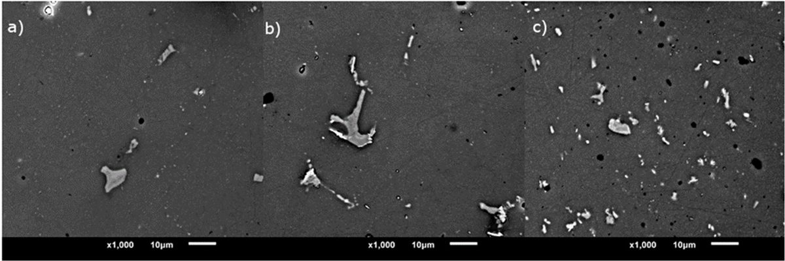
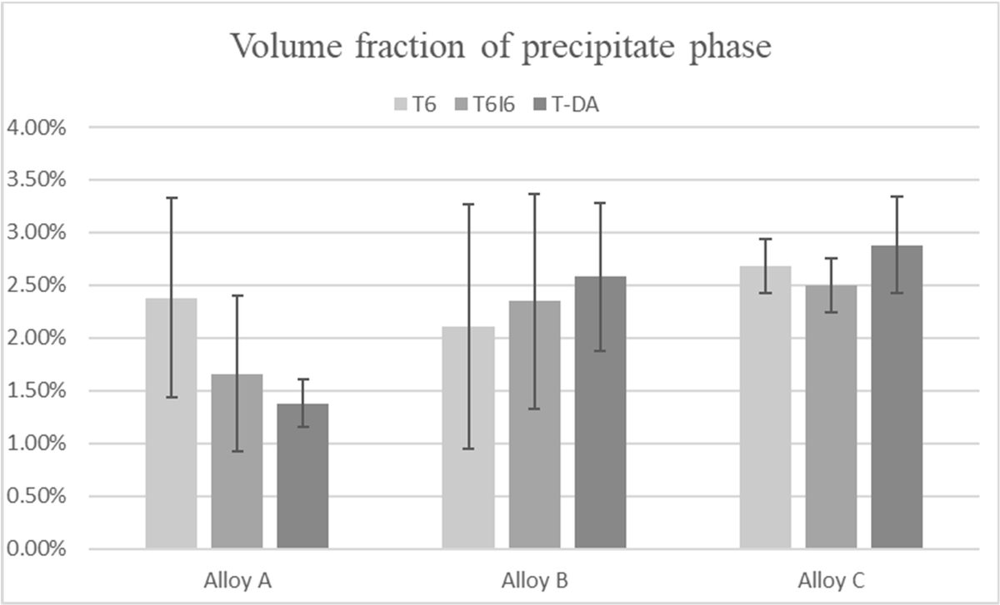
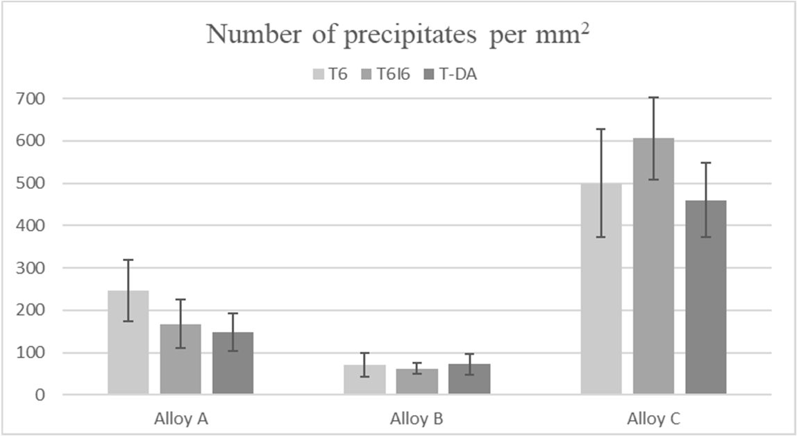
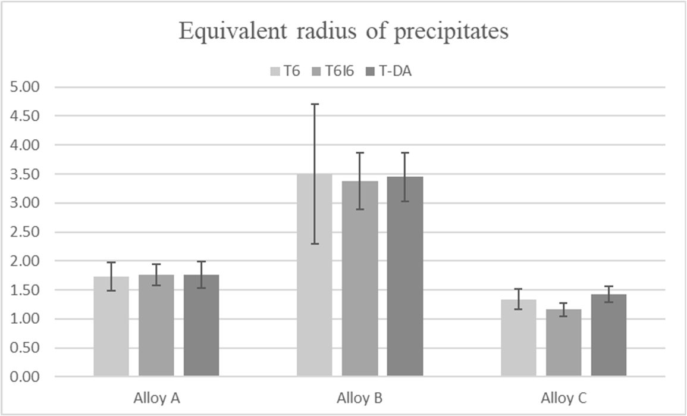
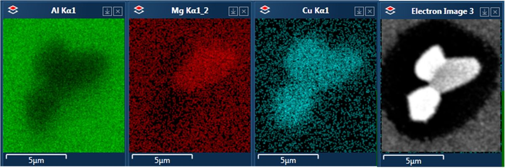
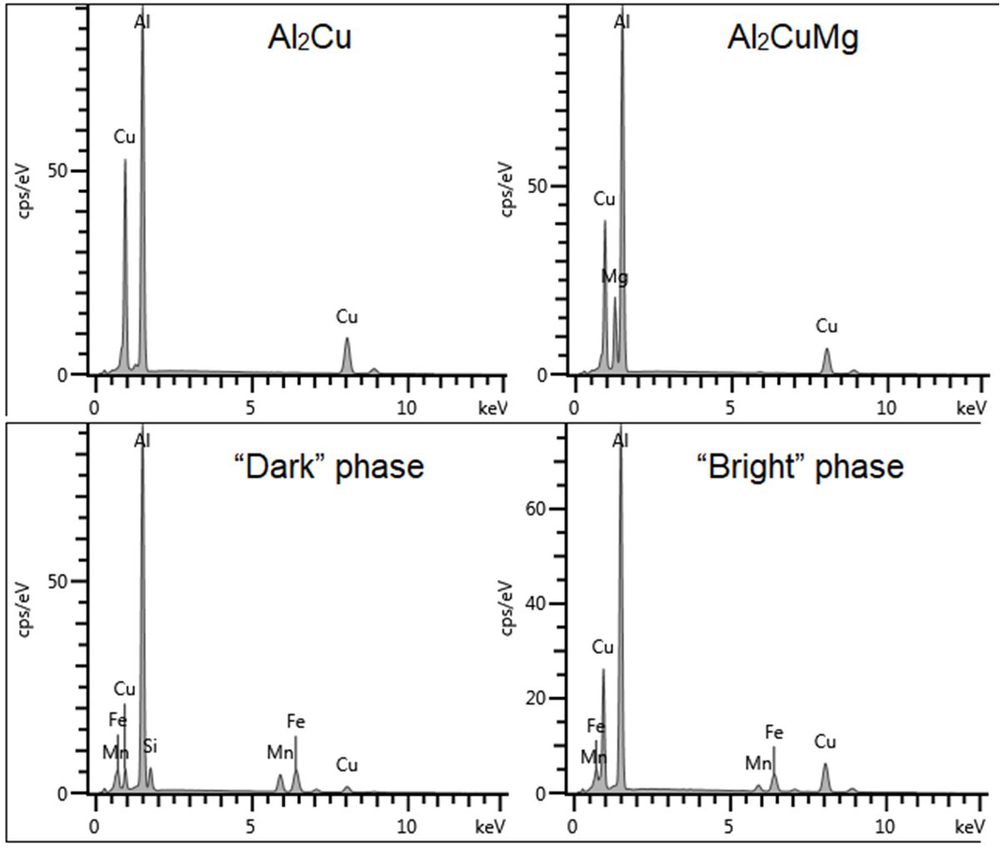
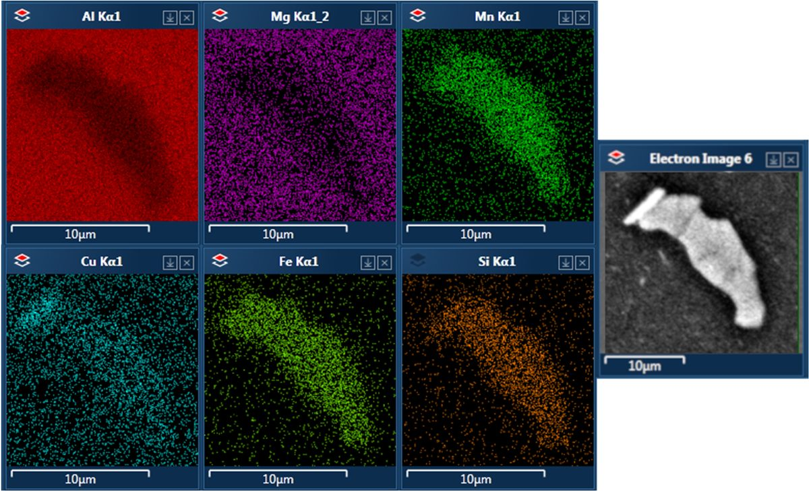
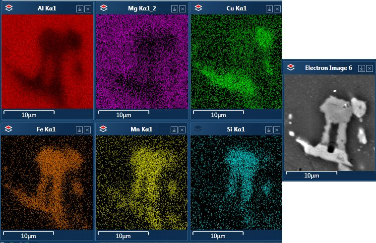
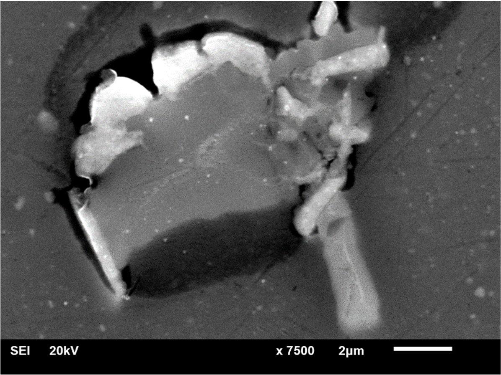

<!-- Extracted from Edison tokenization of materials-12-04168.pdf -->

## FIGURES
Figure 1: Schematic representation of three different aging treatments applied to the examined alloys.
Figure 2: Comparison of microstructures of (a) alloy A, (b) alloy B, and (c) alloy C after T6 aging.
Figure 3: Total volume fractions of precipitate phases for all the alloy treatment variants.
Figure 4: Number of precipitates on the examined surface of the specimen per mm2.
Figure 5: The equivalent radius of precipitates on the examined surface of the specimen.
Figure 6: Spectra from EDS analysis of the most common phases found in the alloys A, B and C.
Figure 7: A precipitate found in the alloy A after T-DA aging.
Figure 8: Precipitates of Al2Cu and Al2CuMg phases found in alloy A.
Figure 9: A precipitate found in alloy B after T-DA aging.
Figure 10: A closer view at the multiphase precipitate found in alloy B after T6I6 aging showing the distinction between “bright” and “dark” phases.
Figure 11: A precipitate of core–shell morphology found in alloy C after T6 aging. The results of EDS analysis show differentiation of chemical composition between the two phases.

- Used the PDF text extraction as primary source and the user-provided page images to resolve figure captions and reading-order artifacts.
- Normalized section headers into Markdown headings matching the user’s requested structure.
- Transcribed chemical formulas inline in plain Markdown text (e.g., Al2Cu, Al2CuMg) rather than subscripts because standard Markdown has no native subscript.
- Included a short Discussion section synthesized from the article’s results/discussion flow because the source article combines these under “Results and Discussion” while the user requested separate headings.
- Reconstructed tables as GitHub-flavored Markdown tables, leaving cells blank where the printed table had no reported value.

## Extracted figure images (raster objects from PDF)

_27 image object(s) extracted directly from the PDF via `pdfimages`; ordering is by PDF stream order and may not map 1:1 to figure numbers above._

