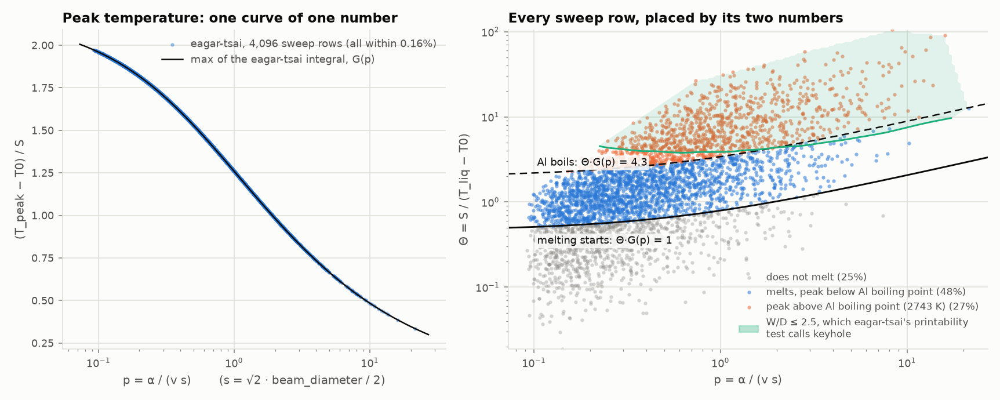
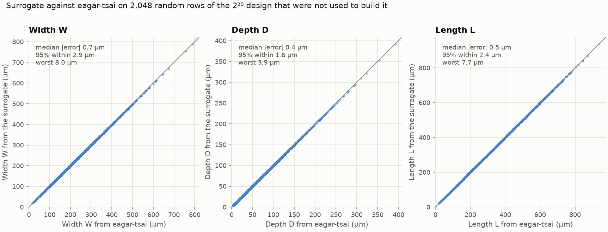
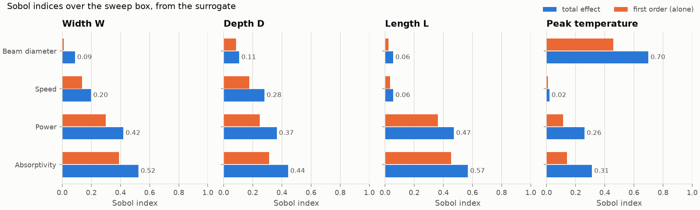

# eagar-tsai Sobol sweep for AlSi10Mg (issue #235)

Xavier's 2^20-row Sobol sweep of [eagar-tsai](https://github.com/ArroyaveLab/eagar-tsai) 0.6.0 varies the beam
diameter, power, speed and absorptivity over the ranges in [`../README.md`](../README.md), with the AlSi10Mg
properties held at 867 K, 110 W/(m·K), 2650 kg/m³ and 1040 J/(kg·K).

- **[Part 1](#part-1-the-unable-to-allocate-762-gib-errors)** explains its `Unable to allocate 762 GiB` errors
  (the beam diameter was in µm, and eagar-tsai reads metres) and adds a corrected script.
- **[Part 2](#part-2-the-first-4096-rows-and-why-220-rows-are-not-needed)** runs the first 4,096 rows with that script. For fixed
  material properties, eagar-tsai's answer depends on just **two numbers**. A surrogate built from those 4,096 rows
  reproduces eagar-tsai to within 8 µm on 2,048 rows it has not seen, and it gives all 2^20 rows in about a minute.
  The same surrogate holds when the material properties vary, and for pure Cu. Part 2 also has Sobol indices and
  the defect classes, and explains why eagar-tsai's keyhole test is really a pool-much-wider-than-the-beam test.
- [`upstream-issue-exp-finite.md`](upstream-issue-exp-finite.md) is a draft bug report for ArroyaveLab/eagar-tsai
  about its Linux wheels. It hasn't been filed.

## Part 1: the `Unable to allocate 762 GiB` errors

The sweep logged one error per row:

```
Error in chunk 5, row 0: Unable to allocate 762. GiB for an array with shape (301,339693421) and data type float64
Error in chunk 6, row 0: Unable to allocate 650. GiB for an array with shape (301,289990823) and data type float64
```

### Cause: the beam diameter was in µm, and eagar-tsai reads metres

The sweep scaled `beam_diameter` to 25–250 (µm) and passed it as `beam_diameter_m`. eagar-tsai's grid
(`_core._build_grids`) starts 1.5 beam diameters ahead of the beam and ends 600 µm behind it, at the
default 1 µm spacing. It is 301 points across (300 µm half-width). Row 5 has `beam_diameter = 226.46`,
read as 226 m, so

nx = (1.5 × 226.46 m + 600 µm) / 1 µm + 1 = 339,693,421, and T_xy = 301 × 339,693,421 × 8 bytes = 762 GiB.

Row 6 (193.33) gives the 650 GiB array. Running the original script on the first 8 rows reproduces both
messages exactly. Every one of the 2^20 rows fails the same way; the smallest array is 84 GiB.
**Fix:** multiply by 1e-6, i.e. sample `beam_diameter_m` from 25e-6 to 250e-6.

### Problems that remain after the unit fix

These measurements come from a 4-vCPU GitHub runner, on the first 64 or 1,024 rows of the same Sobol design.

1. **`return_field=True` (the default) runs out of memory.** It keeps both temperature planes for every row,
   3.3 MB per row at 1 µm (4.6 MB max), so 2^20 rows hold about 3.5 TB. Pass `return_field=False`. That also
   skips the T_xz plane outside the melt pool, which cuts the time by 24% with identical W, D and L.
2. **On Linux, the PyPI wheels use the slow integrand.** All 0.6.0 manylinux wheels (cp312–cp314) link
   `__exp_finite`, which glibc ≥ 2.31 no longer exports, so `import eagar_tsai._integrand_ext` fails and
   eagar-tsai quietly falls back to its pure-Python integrand. One `quad` call takes 137 µs instead of 6 µs,
   so whole rows run 25× slower. The Windows, macOS and musllinux wheels do not have the bad reference.
   Check which integrand you have with
   `python -c "from eagar_tsai._core import _INTEGRAND; print(type(_INTEGRAND))"`. It should print
   `LowLevelCallable`. If it prints `function`, fix it with
   `pip install --force-reinstall --no-deps --no-binary eagar-tsai eagar-tsai` (needs a C compiler).
3. **2^20 rows take days even when everything is right:**

   | Grid | `return_field` | Integrand | Mean s per row per worker | 2^20 rows on 4 workers |
   |---|---|---|---|---|
   | 1 µm (default) | True (default) | compiled | 3.96 | 12 days |
   | 1 µm | False | compiled | 3.00 | 9 days |
   | **2 µm** | **False** | **compiled** | **0.73** (1,024 rows) | **2.2 days** |
   | 5 µm | False | compiled | 0.12 | 9 hours |
   | 5 µm | False | PyPI Linux wheel | 3.28 | 10 days |
   | 1 µm | True | PyPI Linux wheel | 25× the compiled time on the same 8 rows | about a year |

   Against the 1 µm grid (46 melting rows), a 2 µm grid changes W, D and L by at most 2.0, 1.0 and 2.6 µm. A 5 µm grid
   changes them by up to 8.0, 4.0 and 8.1 µm (29% on the shallowest pool). Rows vary a lot: at 2 µm the
   median is 0.66 s, but 1% of rows take over 2.7 s and the slowest takes 9 s. The slow rows are in the slow,
   hot corner, where the domain has to grow.
4. **Some corner rows fail.** For a 25 µm beam at 400 W, 0.1 m/s and A = 0.7, the pool (900 × 450 × 1032 µm) outgrows the
   600 × 300 × 200 µm start domain faster than eagar-tsai's 20 expansion steps can follow (each step is
   0.71 × beam diameter, 18 µm here), giving
   `RuntimeError: Domain expansion did not converge after 20 iterations` and a NaN row. None of the first 1,024
   rows fail, but the corner is in the box. A 1500 × 600 × 500 µm start domain solves it in 8 s.
5. **`chunk_size=1` with 2^20 rows** gives 1,048,576 chunk CSVs and 1,048,576 queued tasks. Building the one-row
   DataFrames alone costs 1.3 GB. Also, `output_dir` names chunk files `ET_0000.csv` onward on every call, so
   calling `compute_melt_pool` batch by batch into one folder overwrites the earlier batches.

### What the corrected sweep returns (first 1,024 rows, 2 µm)

- 269 rows (26%) do not melt (`melt_width_um == 0`). Low absorptivity with a wide beam puts the peak below the
  liquidus.
- 281 of the 755 melting rows (37%) peak above aluminium's boiling point (2743 K), up to 28,800 K in these rows and 40,400 K at the box corner.
  The conduction-only model does not apply there, because it has no vaporisation, recoil or keyhole physics. Filter or
  flag those rows before fitting a surrogate.

## Part 2: the first 4,096 rows, and why 2^20 rows are not needed

`python scripts/eagar_tsai_sobol_alsi10mg.py --m 12` ran eagar-tsai 0.6.0, built from source (compiled integrand),
with a 2 µm grid and `return_field=False`. It took 14.5 minutes on a 4-vCPU GitHub runner (0.21 s per row) and no
row failed. The results are in `sobol-m12-4096-rows-2um.csv`, and its first 1,024 rows are identical to
`first-1024-rows-2um.csv`.

| First 4,096 rows | Rows | Share |
|---|---|---|
| Do not melt (peak below 867 K) | 1,036 | 25.3% |
| Melt, peak below Al's boiling point (2743 K) | 1,963 | 47.9% |
| Melt, peak above Al's boiling point: conduction-only physics no longer holds | 1,097 | 26.8% |

### eagar-tsai's answer depends on two numbers

eagar-tsai (`_core.py`) computes T = T0 + S · J(x/s, y/s, z/ζ; p), where J is the Eagar–Tsai integral and

- s = √2 · `beam_diameter` / 2 is the package's beam width, and T0 = 298 K;
- p = α / (v s), with α = k / (ρ c);
- ζ = √(α s / v) scales depth;
- S = A P / (π ρ c √(π α v s³)) scales temperature.

The pool is wherever J > 1/Θ, with **Θ = S / (T_liq − T0)**. So W/s, L/s and D/ζ are functions of **(Θ, p)** alone, and
(T_peak − T0)/S is a function G(p) of p alone. Absorptivity and power only ever appear as the product A·P, and the
material properties only enter through α, ρc and T_liq − T0. The eight inputs reduce to two numbers plus two
length scales. Checked against eagar-tsai itself (numbers in `summary.json`):

- For all 4,096 rows, (T_peak − T0)/S lies within 0.16% of G(p), which I computed from eagar-tsai's own integrand
  (left panel below).
- **A row melts exactly when Θ·G(p) > 1.** That rule classifies all 4,096 rows correctly. Similarly, the peak
  passes Al's boiling point when Θ·G(p) > (2743 − 298)/(867 − 298) = 4.3.
- **Similarity.** Multiplying the beam diameter and the power by f and dividing the speed by f leaves Θ and p
  unchanged. Every length should then scale by f, and the peak temperature should not change. On 16 rows, rerun at a
  1 µm grid with f = 0.5 and f = 2, W, D and L scaled by f to within one grid step, and the peak changed by less
  than 0.1% (`similarity-64-rows-1um.csv`). For example, 104 µm, 324 W and 0.59 m/s (A = 0.106) give W/D/L of
  138/29/146 µm and a peak of 1242 K. 52 µm, 162 W and 1.18 m/s give 68/14/73 µm and 1242 K. 208 µm, 648 W and
  0.30 m/s give 278/58/293 µm and 1242 K.
- Trading absorptivity against power (A × 0.8, P ÷ 0.8) gives identical output.



### A surrogate replaces the 2^20 run

`scripts/eagar_tsai_sobol_analysis.py` interpolates the 4,096 finished rows in log(Θ·G(p)) and log p, using a local
thin-plate spline with light smoothing chosen by cross-validation, and then rescales by s and ζ. To test it, I picked
2,048 random rows of Xavier's 2^20 design that are not among the 4,096 and ran each directly with eagar-tsai
(`holdout-2048-rows-2um.csv`, which has both sets of columns):

| Error on 2,048 unseen rows | Median | 95% of rows within | 99% within | Worst |
|---|---|---|---|---|
| Width W | 0.7 µm | 2.9 µm | 4.1 µm | 8.0 µm |
| Depth D | 0.4 µm | 1.6 µm | 2.4 µm | 3.9 µm |
| Length L | 0.5 µm | 2.4 µm | 3.9 µm | 7.7 µm |

These errors are about the size of eagar-tsai's own grid steps. At 2 µm, W moves in 4 µm steps, and D and L in 2 µm
steps. The regime (no melt, below boiling, above boiling) matches on all 2,048 rows, and eagar-tsai's defect class
matches on 99.1%; the rest sit on a class boundary. The peak temperature is within 31 K, with a median of 0.01 K.

Predicting all **2^20 rows** of Xavier's design from the surrogate takes about a minute. Running eagar-tsai on them at
2 µm would take about 2.5 days on 4 vCPUs at this run's 0.21 s per row. The shares are 25.0% no melt, 48.2% melt below boiling and 26.8% above boiling, matching
the 4,096 direct rows. 1.2% of the 2^20 rows fall outside the region the 4,096 rows cover in (Θ·G, p), and their output
column `extrapolated` is set. To get predictions for any parameter file:

```bash
python scripts/eagar_tsai_sobol_analysis.py predict \
    --train edison-trajectories/eagar-tsai-alsi10mg-inputs/sobol-check/sobol-m12-4096-rows-2um.csv \
    --rows sobol_params_si.csv --pred melt_pool_predicted.csv
```

`--rows` takes eagar-tsai's eight input columns, or the short names used in the original `sobol_params.csv`, in SI units.
It refuses a beam diameter given in µm.



### Which inputs matter: Sobol indices

These come from the surrogate, with a Saltelli design of 2^14 base rows (98,304 evaluations). Each cell gives the
first-order index, then the total index after the slash. The 95% bootstrap intervals are in `summary.json`, and all are
within ±0.035. As a check, I estimated first-order indices directly from the 4,096 eagar-tsai rows by binning, and they
agree with the table to within 0.004.

| Output | Absorptivity | Power | Speed | Beam diameter |
|---|---|---|---|---|
| W | 0.39 / 0.52 | 0.30 / 0.42 | 0.14 / 0.20 | 0.01 / 0.09 |
| D | 0.31 / 0.44 | 0.25 / 0.37 | 0.18 / 0.28 | 0.09 / 0.11 |
| L | 0.45 / 0.57 | 0.36 / 0.47 | 0.04 / 0.06 | 0.02 / 0.06 |
| Peak temperature | 0.14 / 0.31 | 0.11 / 0.26 | 0.01 / 0.02 | 0.46 / 0.70 |

- Absorptivity ranks above power only because its range is wider: 0.05–0.7 is a factor of 14, and 50–400 W is a
  factor of 8. eagar-tsai only sees A·P. Most of the gap between the first-order and total indices is that product.
- Over this box, the beam diameter barely moves W, D or L, but it dominates the peak temperature.
- Speed matters for W and D but hardly at all for L.



### Defect classes, and what eagar-tsai's keyhole test measures

These use eagar-tsai's own classification (`_classify_defect`, the Sheikh et al. 2024 criteria), with the 30 µm
layer and 190 µm hatch assumed in [`../README.md`](../README.md):

| First 4,096 rows | Lack of fusion | Keyhole | Balling | Defect-free |
|---|---|---|---|---|
| Do not melt | 1,036 | 0 | 0 | 0 |
| Melt, peak below boiling | 1,253 | 13 | 0 | 697 |
| Melt, peak above boiling | 102 | 842 | 5 | 148 |

- Only 697 rows (17.0%) are both defect-free and below boiling. Another 148 rows come out "defect-free" with the
  surface boiling, so the model does not apply to them. The surrogate gives the same 17.0% over all 2^20 rows.
- **eagar-tsai's W/D never drops below 2.0** in any row. A moving surface heat source in a conduction model gives
  a cross-section no deeper than a semicircle, which is the point-source limit. So the KH1 test (W/D ≤ 2.5)
  fires when the pool is much wider than the beam, not when a keyhole forms. In this box that region almost coincides
  with boiling (842 of the 855 "keyhole" rows boil; aqua region in the first figure). To call keyholes, calibrate the
  threshold or the boiling line against our single-track cross-sections.
- With a 190 µm hatch, the LOF2 criterion needs W of roughly 190 µm or more. That is why the defect-free rows mostly
  have wide beams (mean `beam_diameter` 180 µm) and high absorptivity (mean 0.49). Set the layer and hatch to our
  machine's values before reading anything into these shares.

### Other material properties, and copper

The two numbers absorb the material properties as well. So a surrogate built from fixed-property AlSi10Mg rows should
also work for other properties, wherever their (Θ·G, p) falls inside the region the training rows cover. I checked
this with two sets of rows over the same beam box, all run directly with eagar-tsai
(`materials-1024-rows-2um.csv`, `materials_summary.json`):

- 512 rows of an 8-D Sobol design: the beam box plus the Edison AlSi10Mg property ranges (T_liq 860–870 K,
  k 63–155 W/(m·K), ρ 2500–2700 kg/m³, c 920–1200 J/(kg·K));
- 512 rows of pure Cu (1358 K, 390 W/(m·K), 8960 kg/m³, 385 J/(kg·K)). These are room-temperature handbook values,
  used here only to test the scaling, not to find a Cu process window.

| Rows | Melting | Outside the training region | Worst error inside it (W / D / L) | Worst error outside it (W / D / L) |
|---|---|---|---|---|
| AlSi10Mg, properties varied | 386 of 512 | 23 | 6.0 / 2.6 / 4.5 µm | 5.5 / 3.9 / 21.0 µm |
| Pure Cu | 103 of 512 | 21 | 3.0 / 1.6 / 3.1 µm | 4.4 / 4.1 / 3.9 µm |

- The melting rule Θ·G(p) > 1 holds for 1,023 of the 1,024 rows. The exception is a Cu row right on the threshold
  (Θ·G = 1.0004): eagar-tsai's peak is 0.3 K above the liquidus, but the pool covers a single grid point, so it
  reports W = 0.
- So one eagar-tsai sweep serves any material whose (Θ, p) falls inside the region it covers. Rows outside that region
  are flagged `extrapolated` and are less reliable; L was off by up to 21 µm here. To cover more, run eagar-tsai on
  rows in the missing region, append them to the `--train` CSV and rerun `predict`. Any material works for this,
  because only (Θ, p) matter.
- **Sobol indices with the property ranges included** (8-D, from the surrogate, 2^13 Saltelli base rows): over this beam
  box, the Edison property ranges barely matter. Thermal conductivity's total index is 0.04 for W, 0.03 for D, 0.10 for
  L and 0.07 for the peak temperature. Specific heat, density and liquidus all stay below 0.01, and the beam inputs
  keep their 4-D ranking. Sobol indices are shares of variance, so this mostly reflects how wide the beam ranges are.
  At one fixed machine setting, the properties are what's left: in the one-at-a-time table in
  [`../README.md`](../README.md), k moves W from 200 to 160 µm at the nominal point.

## Files

| File | What it is |
|---|---|
| [`../../../scripts/eagar_tsai_sobol_alsi10mg.py`](../../../scripts/eagar_tsai_sobol_alsi10mg.py) | Corrected sweep: SI units with a unit check, `return_field=False`, 2 µm grid, resumable batches, larger-domain retry for failed rows, slow-integrand warning |
| `first-1024-rows-2um.csv` | `python scripts/eagar_tsai_sobol_alsi10mg.py --m 10` (the first 1,024 rows of the 2^20 design, since Sobol prefixes match), compiled integrand |
| [`../../../scripts/eagar_tsai_sobol_analysis.py`](../../../scripts/eagar_tsai_sobol_analysis.py) | Part 2: `holdout` and `similarity` (direct eagar-tsai runs), `analyse` (regimes, defect classes, the two-number checks, surrogate test, Sobol indices, `summary.json`), `predict` (surrogate for any parameter CSV) |
| [`../../../scripts/eagar_tsai_sobol_figures.py`](../../../scripts/eagar_tsai_sobol_figures.py) | The three figures, made by `analyse --figures` |
| `sobol-m12-4096-rows-2um.csv` | `--m 12`: the first 4,096 rows of the 2^20 design |
| `holdout-2048-rows-2um.csv` | 2,048 random rows of the 2^20 design beyond row 4,096 (`numpy` seed 235), run directly, with the surrogate's predictions (`*_surrogate`), `regime` and eagar-tsai's `defect` class |
| `similarity-64-rows-1um.csv` | 16 sweep rows × 4 variants (`scale_1`, `scale_0.5`, `scale_2`, `A*0.8,P/0.8`) at a 1 µm grid |
| `summary.json` | All Part 2 numbers, including the Sobol bootstrap intervals and the 2^20 shares |
| `materials-1024-rows-2um.csv`, `materials_summary.json` | `materials`: 512 AlSi10Mg rows with varied properties and 512 pure-Cu rows, run directly and with the surrogate, plus the 8-D Sobol indices |
| `sobol-reduction.png`, `sobol-surrogate-holdout.png`, `sobol-indices.png` | Part 2 figures |
| [`upstream-issue-exp-finite.md`](upstream-issue-exp-finite.md) | Draft upstream report on the Linux wheels (not filed) |

To redo Part 2 (about 30 minutes on 4 vCPUs):

```bash
pip install --no-binary eagar-tsai eagar-tsai pandas scipy matplotlib   # Linux; see Part 1
python scripts/eagar_tsai_sobol_alsi10mg.py --m 12 --out sobol-m12
python scripts/eagar_tsai_sobol_analysis.py holdout --out sobol-m12
python scripts/eagar_tsai_sobol_analysis.py similarity --out sobol-m12
python scripts/eagar_tsai_sobol_analysis.py analyse --out sobol-m12 --figures figs
python scripts/eagar_tsai_sobol_analysis.py materials --out sobol-m12
```
