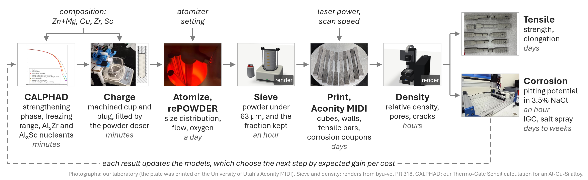

# The aluminum LPBF workflow as a network, with real images

Issue #284. This is the aluminum counterpart of the copper/DED Fig. 1 of the
ONR YIP proposal (#211, PR #215). It keeps the same network: each step is a
tile with its name, what it passes on, and its time per result in italics.
The inputs enter where they are set, the tests branch off at the end, and a
dashed return runs along the bottom. The steps are the route of the BOFN
benchmark (`benchmarks/bofn-prelim/` on `claude/onr-yip-fy27`) as the lab
runs it.



| File | What |
|---|---|
| [`al-lpbf-network.png`](al-lpbf-network.png) | 2933 × 902 px (13.33 × 4.1 in at 220 dpi), white background |
| [`al-lpbf-network.pdf`](al-lpbf-network.pdf) | The same at 13.33 × 4.1 in: text as text (Aptos, embedded), one image per tile |
| [`make_al_lpbf_network.py`](make_al_lpbf_network.py) | Builds `tiles/` from `img/`, then draws the figure |
| [`img/`](img/) | The source images; [`img/SOURCES.md`](img/SOURCES.md) says where each came from |
| [`tiles/`](tiles/) | The cropped 4:3 tiles (960 × 720 px) |

**On a slide.** The figure is 13.33 in wide, the width of a 16:9 slide, so
placed edge to edge its text is at its nominal size: step names 16 pt, all
other text 13 to 13.5 pt. That leaves about 3.4 in of the slide's height for the
headline. There is no title or message in the image; the headline carries it.
A 9.5 pt credit line sits at the bottom right.

## What the figure shows

| Step | Tile | Passes on | Time |
|---|---|---|---|
| CALPHAD | the lab's Scheil plot (computed) | strengthening phase, freezing range, Al₃Zr and Al₃Sc nucleants | minutes |
| Charge | photo: the powder doser dosing AlSi10Mg, with the cup and plug in section | machined cup and plug, filled by the powder doser | minutes |
| Atomize, rePOWDER | photo: aluminum rods melting in the lab's rePOWDER | size distribution, flow, oxygen | a day |
| Sieve | render (byu-vcl PR 318) | powder under 63 µm, and the fraction kept | an hour |
| Print, Aconity MIDI | photo: the lab's tensile bars as built on the plate of Utah's Aconity MIDI | cubes, walls, tensile bars, corrosion coupons | days |
| Density | render (byu-vcl PR 318): the Keyence VHX | relative density, pores, cracks | hours |
| Tensile | photo: the lab's pulled LPBF AlSi10Mg bars | strength, elongation | days |
| Corrosion | photo: the CubXL | pitting potential in 3.5% NaCl; then IGC, salt spray | an hour; days to weeks |

- **Inputs:** the composition (Zn+Mg, Cu, Zr, Sc) enters at CALPHAD and the
  charge. The atomizer setting enters at the atomizer, and laser power and scan
  speed enter at the printer. These are the benchmark's seven design
  variables.
- **The return:** "each result updates the models, which choose the next step
  by expected gain per cost", as in the copper figure.
- **Mapping to the benchmark's nodes** (`benchmarks/bofn-prelim/dag/README.md`
  on `claude/onr-yip-fy27`):
  - CALPHAD returns `s`, `f` and `g`.
  - Charge, atomize and sieve together make the powder, whose quality is `q`.
  - Print and density give `rho`, the dense, crack-free fraction.
  - Tensile gives `U`.
  - Corrosion is not in the benchmark. It is the corrosion branch of the
    aluminum proposal on the same branch (`onr-yip-technical-proposal.tex`,
    Fig. network): a polarization screen, then IGC and salt spray.
- **Times** follow that proposal's figure where it gives one: CALPHAD, atomize,
  print, tensile and both corrosion stages.
- **Photo or render:** each tile is a lab photograph where one exists. The
  sieve and the density step have none yet, so their tiles are renders from
  the vertical-lab animations (byu-vcl PR 318), each tagged "render" on the
  figure. No person appears in any tile.

## Choices to check

1. **Times I chose,** since neither source gives one:
   - charge: *minutes* (as in PR #215);
   - sieve: *an hour*;
   - density: *hours*.
2. **The sieve cut, under 63 µm,** is the one the vertical-lab animation
   sieves to before the print. The proposal gives no size range.
3. **The CALPHAD tile is an Al-Cu-Si Scheil calculation,** the lab's only Scheil
   plot for aluminum. It is not one of the route's Zn-Mg-Cu-Zr-Sc alloys, and
   the credit line says so.
4. **The print tile shows the bars on the plate,** not the machine. The lab
   has no photo of the Aconity MIDI itself; byu-vcl PR 318's
   `out/alloy_print_still.png` is a render of it if the machine is wanted
   instead.
5. **Density is imaged on polished sections (the VHX render).** If density
   means Archimedes weighing of the cubes, the tile should change, but there
   is no photo or render of that yet.
6. **No costs on the figure.** The copper figure gives times only, so this one
   does too. The benchmark's costs per stage are in `bofn-prelim/dag/`.

## Regenerate

```bash
pip install matplotlib pillow
# Aptos, the lab's slide font (Microsoft's free download):
mkdir -p ~/.local/share/fonts/aptos && cd ~/.local/share/fonts/aptos
curl -fsSLO "https://download.microsoft.com/download/8/6/0/860a94fa-7feb-44ef-ac79-c072d9113d69/Microsoft%20Aptos%20Fonts.zip"
unzip -o "Microsoft%20Aptos%20Fonts.zip" "*.ttf" && cd -
python figures/al-lpbf-network/make_al_lpbf_network.py
```

Without Aptos the script falls back to Lato or DejaVu Sans, which may run
wider, so check that the labels still fit.
