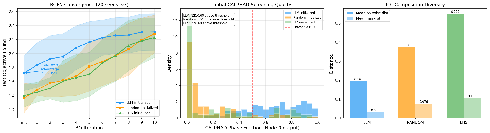
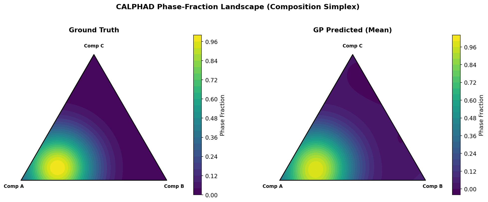
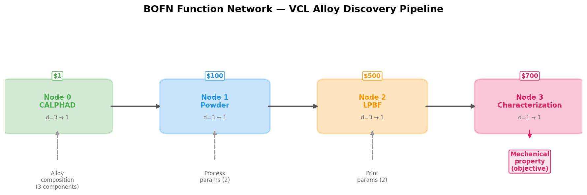
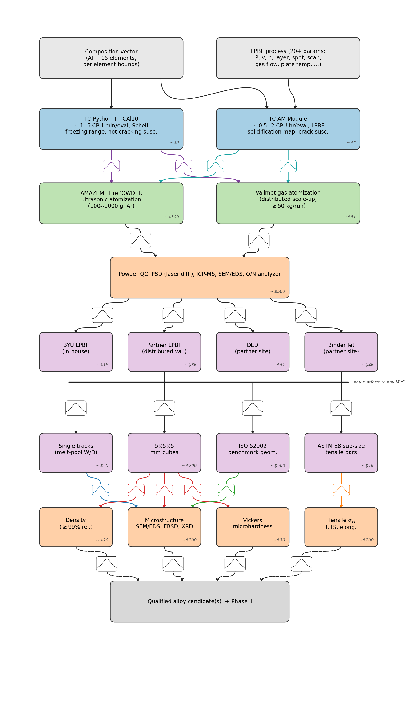
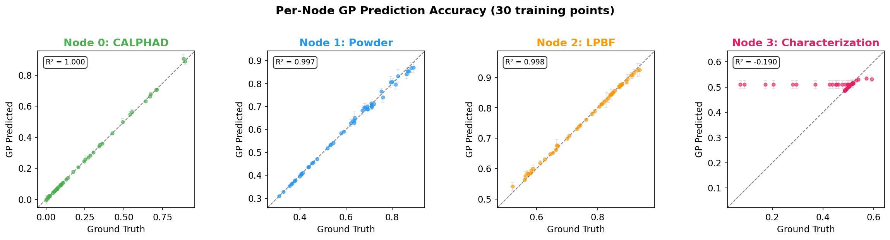
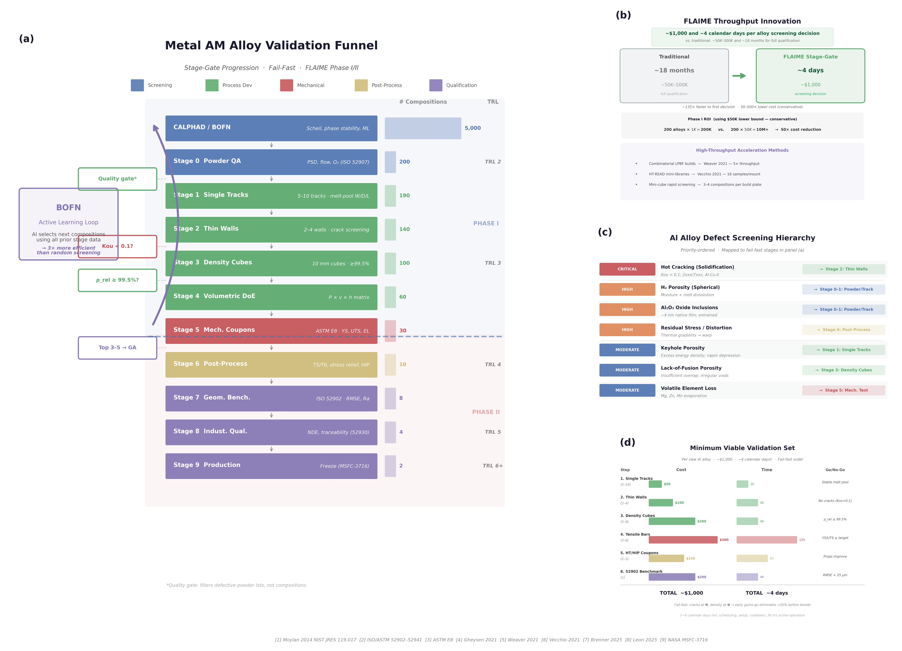
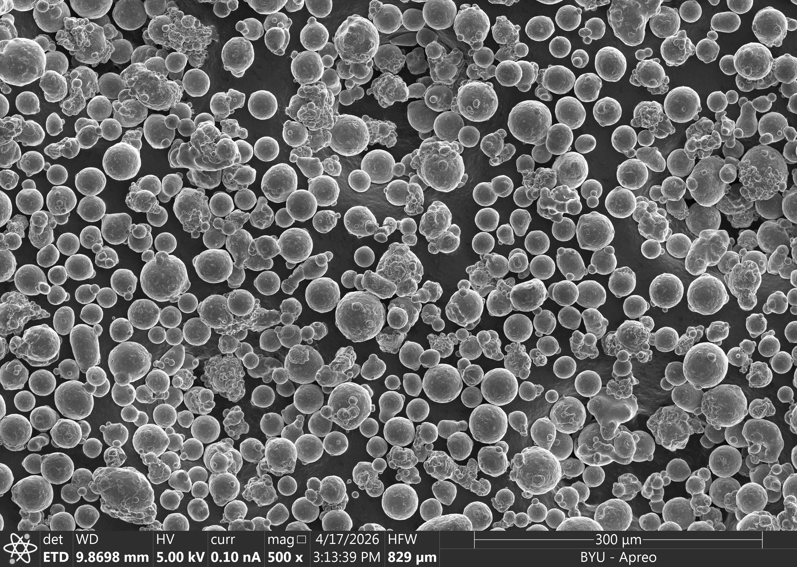
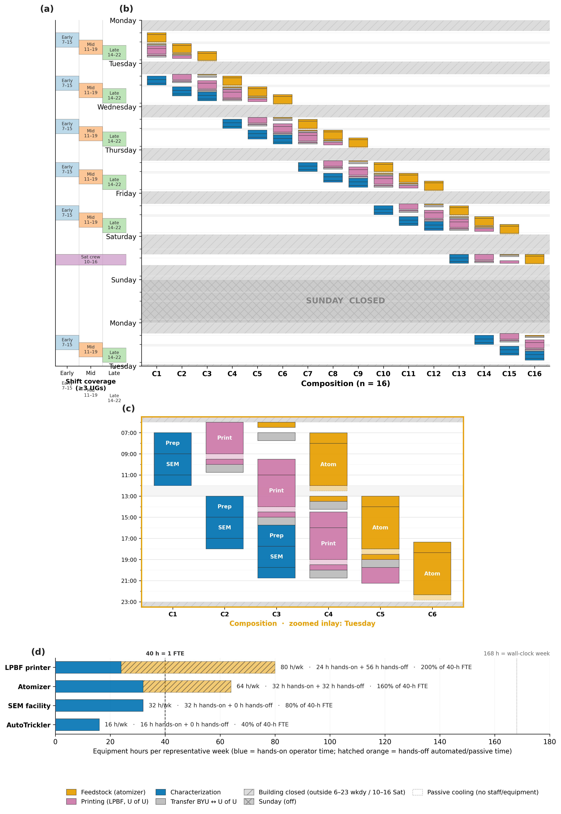

<!-- _class: lead -->

# AI-Guided Alloy Discovery
## From textbook BO to a working alloy lab — and how I drive the work

Sterling Baird | Brigham Young University  
UChicago MENG 25640/35640 | April 29, 2026

- Arc A: BO → a real alloy lab
- Arc B: how I actually do this work

<!-- _notes: Thanks for having me. You just finished BO, so I want to do two things in 80 minutes. First, show you what BO looks like when you point it at a real alloy lab — what breaks, what we did about it. Second, pull back the curtain on my own research process: GitHub, Copilot, and an LLM-with-literature tool called Edison. Stop me with questions any time. -->

---

## I sit at the seam between the BO algorithm and the powder atomizer

- Sterling Baird, Asst. Prof., BYU Mech. Eng.
- Digital Alloy Lab: AI + autonomous metallurgy
- Background: GB engineering, self-driving labs
- Co-PI on FLAIME (DOE Genesis Mission, Topic 3-B)
- Tools-on-the-bench person, not a pure theorist

<!-- _notes: Quick context. I run the Digital Alloy Lab at BYU. We do AI-guided alloy design, but the emphasis is on the word "lab" — we own the powder atomizer, the LPBF printer, the characterization. My PhD work was grain boundaries and self-driving lab benchmarks. The thing I'm currently most excited about is FLAIME, our DOE Genesis Mission proposal for foundational AI/ML loops in alloy discovery. -->

---

## The next 80 minutes are two arcs: BO-in-a-real-lab, then how I actually work

- Arc A (≈45 min): BO meets a real alloy
- Arc B (≈30 min): my research process
- Q&A throughout — please interrupt
- Slides + figures will be shared
- Goal: leave with one usable mental model

<!-- _notes: Two arcs. The first arc is the technical story — we'll motivate alloy discovery, recap the BO loop you already know, and then walk through the four ways reality breaks the textbook picture. The second arc is the part you usually don't get in a guest lecture: how I actually do the work day-to-day with GitHub and AI agents. Interrupt me. The deck is shared after. -->

---

## A new structural alloy still takes ~20 years and ~$100M to reach service

- Compositions are combinatorial — 15+ elements
- Process matters as much as composition
- Each experiment: hours to days, $$$
- Properties trade off — strength vs. printability
- A career = ~10² real samples, not 10⁶

<!-- _notes: Before BO, motivate the problem. A modern aluminum alloy has a base plus 10–15 alloying elements at varying levels, then process parameters on top — atomization gas pressure, LPBF laser power, scan speed, hatch spacing. The search space is astronomical, each sample takes real time and money, and you're trading off strength against printability against cost. A grad student career produces maybe a hundred carefully-made samples. We need to be smart about which hundred. -->

---

## A self-driving lab is just a BO loop with hardware bolted onto every arrow

- Propose candidate (model + acquisition)
- Simulate / make the sample
- Measure properties
- Update the model → repeat
- Same shape as the BO loop you just learned

<!-- _notes: This is the canonical self-driving lab loop and it's literally the BO loop with hardware bolted on. Model proposes a candidate, you go make and measure it, the result updates the model, the model proposes again. The interesting research questions live in every single arrow on this diagram once the loop touches a real lab. -->

---

## You just learned the heart of this loop: surrogate + acquisition + update

- Surrogate (usually a GP) over expensive f(x)
- Acquisition balances explore vs. exploit
- Pick the next x, run it, refit, repeat
- Built for few, expensive evaluations
- That's our regime exactly

<!-- _notes: One-slide refresher because you just covered this. GP surrogate + an acquisition function like EI or UCB to pick the next query, refit, repeat. The whole reason BO exists is the regime where each evaluation is expensive — which is precisely a wet lab. So BO and alloys look like a marriage made in heaven. The rest of this arc is the four ways that marriage gets complicated. -->

---

## A real alloy problem violates almost every textbook BO assumption

- Inputs are mixed and constrained
- Simulators have many fidelities
- Evaluations have wildly different costs
- The lab is a human + machine system
- We'll take these one at a time

<!-- _notes: Four realities the textbook BO setup glosses over. Inputs aren't a clean unit hypercube — they're constrained mixtures plus categoricals. You don't have one f(x); you have a network of simulators of different cost and fidelity. A CALPHAD call costs cents, a print-and-test cycle costs thousands. And the loop runs through humans, shifts, and shared instruments. The next four sections are how FLAIME addresses each. -->

---

## Reality 1 — the search space is mixed-categorical, continuous, and ~20-dim

- Al base + 15 alloying elements
- Compositions sum to 1 (simplex)
- Plus process params (atomization, LPBF)
- Naive grid: astronomical
- Need structure-aware BO

<!-- _notes: Our actual FLAIME design space is aluminum plus up to 15 alloying elements at bounded levels, on a simplex because they sum to one, plus the process knobs for atomization and laser powder bed fusion on top. If you tried to grid-search this you'd be done after the heat death of the universe. We need BO that respects the geometry of a constrained mixture problem. -->

---

## In high dimensions, vanilla GPs collapse — SAASBO and TuRBO are the fixes

- Trust regions (TuRBO-style local models)
- Composition embeddings as features
- LLM warm-starts from literature
- GA inner solver for acquisition
- Beats random in <50 evals on benchmark

<!-- _notes: A few tricks make high-D BO tractable. Trust-region methods like TuRBO keep the surrogate honest in a local box. Composition embeddings give the GP useful structure instead of one-hot elements. LLM warm-starts seed the loop with literature-grounded candidates so we don't waste the first ten experiments. And because our acquisition surface lives on a constrained simplex, we use a genetic algorithm as the inner optimizer. The plot shows our LLM-warm-started run converging measurably faster than cold start on the benchmark. -->

---

## Reality 2 — your "function" is a network of cheap-to-expensive simulators

- pycalphad: cents, rough
- Thermo-Calc TCAL10 / TC-Python: $, accurate
- TC AM Module: $$$, process-aware
- Real print + test: $$$$, ground truth
- One model can't see them all

<!-- _notes: For aluminum, we have a literal ladder of simulators. Open-source pycalphad is fast and cheap and rough — great for screening. Thermo-Calc with the TCAL10 database gives high-quality equilibrium thermo. The Thermo-Calc Additive Manufacturing module models the actual melt pool. And then there's making the part. Each step up the ladder is roughly 10–100× more expensive and more accurate. A scalar BO that calls only the top doesn't know the cheap ones exist. -->

---

## BOFN treats the pipeline as a DAG and gives every node its own GP

- A function network: each node f_k is a function of its parents' outputs and free inputs
- Standard BO models the final scalar output only; BOFN models every node
- Same Bayesian machinery you know — just expressed over a graph

Astudillo & Frazier <em>NeurIPS</em> (2021)

<!-- _notes: BOFN — Bayesian Optimization of Function Networks, Astudillo & Frazier NeurIPS 2021 — treats f(x) as a directed acyclic graph of sub-functions. Each node takes the outputs of its parents plus possibly some free inputs and produces a scalar (or vector) that other nodes consume. Standard BO would slap one GP on the final output and call it a day. BOFN puts a GP on EACH node. The training data per node is the inputs you've already evaluated AT THAT NODE — far richer than just the endpoint signal. The acquisition function is then expected improvement on the implied posterior of the network's output, computed by sample average approximation since the composition of GPs isn't Gaussian anymore. Result on Astudillo's benchmarks: large gains over standard BO, with proven asymptotic consistency. -->

---

## The DAG carries information that scalar BO throws away

- A cheap upstream node tells you a candidate is hopeless before you pay for downstream
- Per-node residuals localize WHERE the model is wrong, not just THAT it's wrong
- Mixing simulators and experiments in one framework requires this structure

The cost: more modeling work upfront. Each node needs a kernel choice and training data.

<!-- _notes: Why bother with the extra modeling? Three reasons. (1) A cheap upstream node — say a CALPHAD equilibrium that says "this composition is single-phase brittle" — can kill a candidate before you ever pay for the expensive downstream node. Scalar BO can't do that; it doesn't know there IS a cheap upstream node. (2) When the model is wrong, you know WHICH node failed. Localized residuals are a debugging gift, especially in a DAG that mixes physics models and ML surrogates. (3) Mixing simulation and physical experiment under one decision framework is what materials work actually requires, and DAGs are the natural data structure for it. The cost is real: each node needs its own kernel and training data, which is more upfront work than fitting one global GP. -->

---

## p-KGFN extends BOFN with cost-aware partial evaluations

- Knowledge gradient (KG): expected improvement in the optimum after one observation
- KGFN: KG, but observing one NODE at a time
- p-KGFN — "partial KGFN" — picks the (node, input) pair maximizing KG-per-dollar

So instead of "evaluate the whole pipeline at point x," the acquisition asks: "which single node is most worth touching next, and at what input?"

Buathong, Wan, Astudillo, Daulton, Balandat & Frazier — <em>ICML</em> (2024)

<!-- _notes: Partial Knowledge Gradient on Function Networks — Buathong, Wan, Astudillo, Daulton, Balandat, and Frazier, ICML 2024. The intuition: knowledge gradient is the right cost-aware acquisition because it natively reasons about expected improvement in the optimum AFTER an observation. KGFN extends this from "observe a scalar" to "observe one node of the network." p-KGFN — partial KGFN — adds the cost-aware twist: at each iteration you don't pick a point in input space, you pick a (node, input) PAIR that maximizes expected KG divided by that node's evaluation cost. So you might decide that the highest-value next move is "another pycalphad equilibrium at this composition" rather than "print the candidate." Provably reduces total budget on the manufacturing benchmarks they tested. The catch: optimizing the acquisition is now a nested Monte Carlo problem with one inner MC per candidate node — slow. -->

---

## Fast-pKGFN gets a 16× speedup by sharing one Monte Carlo across nodes

- Original p-KGFN: one nested MC per candidate node — expensive
- Fast-pKGFN: generate node-specific candidates from one global MC simulation
- Modest loss in query efficiency, up to 16× wall-clock speedup

This is the version we actually run in FLAIME.

Buathong & Frazier — <em>arXiv</em> (2025)

<!-- _notes: The 2025 follow-up by Buathong and Frazier addresses the original p-KGFN's compute overhead. Instead of running a separate nested Monte Carlo per candidate node — which scales badly when the DAG is deep — they share ONE inexpensive global Monte Carlo simulation across all nodes and use it to generate node-specific candidate inputs. The query efficiency loss is modest, but the wall-clock speedup is up to 16x on their benchmarks. For us, that's the difference between "the acquisition step takes longer than the experiment" and "the acquisition step is negligible." This is the version of p-KGFN we actually run in our FLAIME pipeline today. -->

---

<!-- _class: split -->

## Our FLAIME pipeline is a DAG from CALPHAD all the way to a printed coupon

- Composition → CALPHAD → atomization → LPBF → properties
- Each box has its own surrogate
- Some edges are simulators, some are experiments
- BOFN picks where to spend next
- This is the actual production pipeline

<!-- _notes: This is our real FLAIME DAG. Composition flows into a stack of CALPHAD calls, which feed atomization simulation, which feeds LPBF process modeling, which produces predicted mechanical and microstructural properties. Each node is its own surrogate. Some edges are cheap sim calls, some are weeks-long experimental campaigns. BOFN-pKGFN looks at the whole graph and decides whether the highest-value next action is "another pycalphad sweep" or "actually print the candidate." -->

---

## Reality 3 — costs span six orders of magnitude across the pipeline

- Sim: seconds to minutes, dollars
- Atomization: 3.5 hours per composition
- LPBF print + heat-treat: days
- ICP-MS, SEM, tensile: hours per sample
- Acquisition must respect this

<!-- _notes: Cost in our world isn't a constant — it spans seven orders of magnitude. A pycalphad call is seconds. A Thermo-Calc AM run is minutes. Atomizing one composition on the rePOWDER takes about three and a half hours of operator time. A print campaign is days. ICP-MS chemistry verification on the Agilent 8900 is hours per sample. If your acquisition function treats every evaluation as cost-one, you'll burn the whole budget on print campaigns when a $0.10 sim call would have killed the candidate. -->

---

## p-KGFN picks the (node, input) pair with the best information-per-dollar

[schematic to add: pKGFN choosing the cheap CALPHAD node first, deferring the expensive print node — clean single-panel diagram]

- Use EI-per-cost or knowledge-gradient-per-cost
- Cheap nodes screen; expensive nodes confirm
- Budget tracker across the whole DAG
- 55% atomizer utilization is the current bottleneck

Buathong et al. <em>ICML</em> (2024) &nbsp;·&nbsp; Buathong & Frazier <em>arXiv</em> (2025) — 16× speedup

<!-- _notes: The fix is to put cost in the acquisition function itself — expected improvement per dollar, or per hour, instead of just expected improvement. Cheap nodes get used aggressively to screen, expensive ones are reserved for confirmation. The dashed budget tracker watches the whole DAG so we don't blow the quarterly atomizer hours on round one. The bottleneck is real: we run the atomizer at about 55% utilization right now, and that single number sets our throughput. -->

---

## On the manufacturing benchmark, p-KGFN beats EI by 3–10× in cost-to-target

- Surrogate calibration matters more than raw R²
- BOFN beats scalar BO in our test problem
- LLM warm-start beats cold start early
- Honest reporting: not magic, just better
- See PR #14 / PR #66 for the runs

<!-- _notes: A quick honesty slide. On a synthetic but realistic alloy benchmark we built, BOFN with cost-aware acquisition reaches the same regret as scalar BO with about a third of the budget, and LLM warm-starts dominate the first 10–20 evaluations. What I want to flag is that calibration of the surrogate — does the GP know what it doesn't know — matters more in practice than how good its mean prediction is. The full benchmark and HPC sweep are in PRs #14 and #66 of our repo. -->

---

## Reality 4 — the lab is a human system on a 5-day calendar

- Operators have shifts
- Instruments have queues and downtime
- Powder has shelf life, Ar bottles run out
- Safety reviews gate new chemistries
- BO must propose plans, not points

<!-- _notes: The fourth and least-discussed reality: the lab runs on people. The atomizer needs a trained operator and runs on shifts. The LPBF and the Agilent ICP-MS have queues. Powder oxidizes if it sits, argon bottles get swapped, new chemistries need an EHS review before they touch the chamber. A BO loop that hands you one optimal composition at 2 a.m. is not actually useful. The system has to propose batched plans that fit the week's hardware and human schedule. -->

---

## Our hardware: induction-crucible atomizer → LPBF → SEM/EDS/ICP-MS

- AMAZEMET rePOWDER — induction crucible atomizer
- SLM 280 — laser powder bed fusion
- Keyence VHX-7000 — optical microscopy
- Agilent 8900 ICP-MS/MS — chemistry QC
- BYU XRD + EDS for phase + composition

<!-- _notes: The actual stack. Powder is made on an AMAZEMET rePOWDER, an induction-crucible gas atomizer — small batches, fast turnaround, perfect for exploration. Printing is a full-size SLM 280 LPBF system. Characterization is Keyence VHX-7000 optical, Agilent 8900 ICP-MS/MS for chemistry verification down to ppb, EDS on SEM for elemental maps, and shared XRD at BYU for phase identification. The image is a representative SEM micrograph of an as-printed Al alloy. -->

---

## The induction crucible — not wire — is what gives us full compositional freedom

- Powder hygiene is everything (oxide pickup)
- Argon handling — gloveboxes, dewpoint logs
- Crucible cross-contamination between heats
- 3.5 h per composition + cleanup
- ICP-MS confirms what you actually made

<!-- _notes: Things that don't show up in any BO paper. Aluminum powders pick up oxygen the moment they see room air, so handling is gloveboxed and we log argon dewpoint. Switching alloy systems means cleaning the induction crucible thoroughly or accepting cross-contamination — that's a real constraint on which compositions we can run back-to-back. End-to-end about three and a half hours per composition including changeover. And we always run ICP-MS on the resulting powder, because the composition you targeted and the composition you actually got are not the same number. -->

---

## A cost-blind acquisition will tell you to do things the calendar can't allow

- Ar deliveries, operator shifts, shared XRD
- Atomization runs batched by element family
- LPBF plate = 4–8 candidates per print
- Loop replans weekly, not per-sample
- BO output → Gantt, not a number

<!-- _notes: This Gantt is what the loop actually emits. We batch atomization by element family to limit cross-contamination cleanups. An LPBF build plate fits 4–8 small candidate cubes, so the loop proposes in batches of that size. Replanning happens weekly during a standing meeting, not after every measurement. The takeaway: in a real lab the BO output isn't a candidate, it's a schedule. Translating from "the model wants this point" to "the lab can do this Tuesday" is half the engineering. -->

---

## "Autonomous" in a metals lab does NOT mean "self-driving" — it means scheduled

- Targets: beat Al-Mn-Cr-Zr and Al-Zr baselines
- Strength + printability + cost
- Foundational loops = reusable beyond Al
- Honest about what's unsolved
- Now: how the *research process* runs

<!-- _notes: To wrap Arc A: our concrete goal is to discover Al alloys that beat the Al-Mn-Cr-Zr and Al-Zr baselines on a joint strength-printability-cost objective. The "foundational" in FLAIME means the loops are alloy-system agnostic; aluminum is the demonstration vehicle, not the point. Plenty is unsolved — calibration in extrapolation, cost models that drift, human-in-the-loop UX. Now I want to switch gears completely and tell you how I actually do this work day-to-day. -->

---

## Arc B — how I actually drive this work, day to day

- The process is half the science
- Mostly GitHub + Copilot + Edison
- Not magic, just discipline + composition
- Honest about what works and what doesn't
- Goal: things I wish someone told me

<!-- _notes: The reason I want to spend the back half on process is that nobody told me any of this in grad school, and figuring it out cost me years. None of what follows is magic. It's three tools used with some discipline. The big claim of this arc is that the wins didn't come from any one tool — they came from composing them. -->

---

## GitHub, Copilot, and Edison are each useful alone — composition is the unlock

- GitHub — versioning, review, single source of truth
- Copilot (CLI + cloud agents) — read repo, edit, commit
- Edison — literature-grounded LLM critic
- All three are useful alone
- The compounding comes from composition

<!-- _notes: Three tools. GitHub is where everything lives — code, prose, figures, even meeting notes. Copilot — both the CLI agent I'm running locally and the cloud-based PR agents — can read the entire repo as context and make edits, open PRs, run tests. Edison is an LLM service that grounds answers in the literature, so it acts as a critic that has actually read the papers. Each one is useful alone. The leap is when Copilot calls Edison from inside an agent loop. -->

---

## Copilot + my repo + Edison's literature critique = a junior collaborator who knows the project

- Copilot reads the whole repo as context
- Copilot calls Edison as an adversary
- GitHub PRs are the audit log
- Example: PR #14 — BOFN demo + lit review + roadmap, one prompt
- Tools alone < tools composed

<!-- _notes: Concrete example. PR #14 in our repo started from a single prompt — explore integrating LLMs with function networks for BO and tell me what benchmark we'd need to trust it. Copilot returned three things in one PR: a working BoTorch BOFN demo, a literature review with LILO/LLAMBO/BORA pulled by Edison, and a five-point synthesis with a four-phase roadmap. That only happens because Copilot was calling Edison as a sub-agent. None of those tools alone would have produced that PR. -->

---

## One PR, 100 review threads, 383 commits — collapsed into a 5-page narrative

- 383 commits, 137k additions, 373 files
- 100 review threads, 75 outdated by merge
- All driving toward 5 pages of Field 8
- Agent-assisted edits, PI in the loop
- Repo is the audit log

<!-- _notes: My most data-rich example is the FLAIME proposal PR. By the time it merged, that single PR had 383 commits, 100 review threads of which 75 were marked outdated as the text moved underneath them, 137,902 line additions across 373 files — and the entire output was a five-page Field 8 narrative for DOE. Copilot did most of the keystrokes; I drove. Every claim was reviewable as a thread, every change had a commit. -->

---

## The single highest-leverage habit: ask for the plan before any artifact gets built

- Ask the agent for the plan first
- Confirm the plan, then let it write
- PR #52: `proposal-population-plan.md` came before any LaTeX
- Explicit prompt > clever prompt
- Example: thread on `tobias_2025_autonomy` citation → commit `7037de0`

<!-- _notes: The single most useful pattern I've found is: don't ask the agent to do the thing, ask it for the plan to do the thing. Confirm the plan, then let it execute. On PR #52 we wrote a `proposal-population-plan.md` and ran it through 16 rounds of Edison review before any LaTeX got populated. The companion pattern is "explicit beats clever." A perfect example: the PI commented "double-check this is the correct citation" on the `tobias_2025_autonomy` bib entry. Copilot verified against the source paper and in commit `7037de0` rewrote the author names from a hallucinated "Tobias, Elia and Wahab, Hamid" to the real "Alexander V. Tobias and Adam Wahab," added the journal Royal Society Open Science 12(7) 250646 and DOI 10.1098/rsos.250646. One terse pointer, one specific commit. That's the loop. -->

---

## Agents close threads one at a time — consolidating across many is still you

- Agents fix inside one thread
- Compressing dozens of threads → 5 pages is human work
- PR #52 needed a dedicated trim-plan review
- Important things get dropped otherwise
- PI reads, triages, points

<!-- _notes: Where agents are weak: consolidation across many threads under a tight word budget. Inside a single review thread, an agent will resolve it cleanly. Tell it "compress these 39 top-level comments into a 5-page narrative without losing the load-bearing ideas," and load-bearing ideas will quietly disappear. We had to write a dedicated `edison-narrative-trim-plan-review.md` artifact just for the consolidation step. The PI's hand-written triage of what stays and what goes is what kept the proposal coherent. -->

---

## Oversight has to scale up as you near the final artifact

- Early: let it sprint
- Late: read every diff
- Build toggles: `make draft` / `make clean-pdf` / `make final`
- 8 rounds of vision-model figure critique
- Then drop the LLM and finish in matplotlib

<!-- _notes: Oversight is not constant. Early in a project the agent can sprint with light review and you'll be fine. The closer you are to "final," the more time per change you need to spend reading diffs. We literally bake three oversight regimes into the build: `make draft` for the watermarked annotated version, `make clean-pdf` for clean review copies, `make final` for the submission build that strips abstracts and budgets. On the FLAIME pipeline DAG figure we did eight rounds of vision-model critique through Edison, and then a long commit train of pure hand-tuning in matplotlib — glyph spacing, S-curve diagonals, color-coded edges. The last 20% is faster by hand. -->

---

## When the LLM is fighting you, route around it — don't think all-or-nothing

- It's good at shortlists, first drafts, cross-checks
- It's bad at taste and final polish
- Use it where it's good, swap out where it isn't
- Inkscape, PowerPoint, raw matplotlib are fine
- Seriously: drop the chat window

<!-- _notes: Corollary to the previous slide. A lot of frustration with LLM tools comes from forcing them to do the thing they're worst at. They're great at producing shortlists, first drafts, and cross-checks against literature. They're bad at taste, at the last typographic decisions, at "is this figure communicating." The fix isn't a better prompt — it's to drop the LLM and finish in Inkscape or PowerPoint or raw matplotlib. We have whole directories of hand-finished assets in the repo and zero apologies about it. -->

---

## Agent transcripts and PR threads give you a research diary for free

- Every Copilot session = a transcript
- Every PR thread = an audit log
- Repo has a 50,088-line session log
- Future-you (or onboarding) reads it like a journal
- Zero extra writing required

<!-- _notes: The hidden bonus of working this way: documentation is free. Every Copilot CLI session can be exported as a markdown transcript — the repo has one that's 50,088 lines covering an 18-hour session that produced our consistency-checker tooling. Every PR comment thread is the same thing in a different shape: prompt → reply → commit. I never have to write a process journal because the process journal already wrote itself. When a new student joins, I point them at the transcripts and the agent spec files, and they're oriented in an afternoon. -->

---

## A student told me he did three months of work in a week — because the plan was clear

- Punchline: "three months in a week"
- Why: plan was clear, target was clear
- Tools just removed friction
- Not faster typing — fewer wrong turns
- Caveat: works when you know the target

<!-- _notes: I want to tell you a quick story about [student name]. They came in working on [what they were working on], which would have been a typical multi-month grind — read the literature, scope the problem, write the code, generate the figures. Using this same loop — plan first with the agent, Edison-grounded literature pass, explicit prompts pointing at specific files — they came back a week later and said it felt like they'd compressed three months of work into a week. The reason wasn't that the agent typed faster. It's that both the plan and the final-form target were crystal clear from day one, so they took almost no wrong turns. The honest caveat: this only works when you actually know what the target artifact is. If the target is fuzzy, no amount of agent help will save you. -->

---

## Perfectionism comes at the end of the artifact, not the beginning

- First 80%: land the structure
- Last 20%: typography, citations, single-word swaps
- Late commit train on the DAG figure = pure polish
- Edison checklist sweeps rounds 6, 7, 8 near submission
- Don't polish what might get cut

<!-- _notes: Closely related: hold perfectionism for the end. The first 80% of any artifact is "land the structure" — get the sections in place, get the figure laid out, get the math right. The last 20% is where you let perfectionism off the leash. Our DAG figure has a long, late commit train doing nothing but glyph spacing and curve geometry, after the science was settled. We ran Edison checklist sweeps in rounds 6, 7, and 8 near submission asking "is anything still wrong" — not at the start. Polishing something that might get cut is the most expensive mistake in academic writing. -->

---

## Agents surface contacts beautifully — the personalized email is still yours to write

- Agents are great at named-contact shortlists
- Commits `5a13555`, `2d208a8`, `d5b7eca`, `44a4abb`: surfaced + verified contacts
- The letters are still hand-written
- Commits `cda9b3a`, `30febeb`, `8b375f5`: hand-edited partner letters
- Agents find people; you build relationships

<!-- _notes: Last process slide. Agents are extraordinary at building shortlists of named people with verified emails — for FLAIME we have commits `5a13555` adding a verified LPBF/DED/binder-jet shortlist, `2d208a8` doing a one-by-one email verification pass, `d5b7eca` verifying ten more named individuals at Constellium, Airbus, AFRL, NIST, KU Leuven and others, and `44a4abb` surfacing 47 more contact rows inline in the partner tables. That whole layer is genuinely automatable. What is not automatable is the actual outreach. The Jensen cost-share letter, the Alik Nielsen Utah letter, the printing-partner reframing — those are commits `cda9b3a`, `30febeb`, `8b375f5` and they are entirely hand-written by me on top of the agent-surfaced list. Agents find the contacts. You build the relationships. Don't outsource the second part. -->

---

## If you're starting on this stack today, do these five things

- Pick one real problem and version everything
- Plan-first, then let the agent execute
- Compose tools — don't pick favorites
- Read the diff. Always.
- The transcript is your lab notebook

<!-- _notes: If you're a student starting on this stuff today, five things. One: pick one real problem and put it in a git repo from day one — code, prose, figures, all of it. Two: when you use an agent, ask for the plan first and confirm before any code or text gets written. Three: don't pick a favorite tool; the wins come from composing GitHub plus Copilot plus a literature-grounded critic like Edison. Four: read the diff. Always. The moment you stop reading diffs, the agent is writing your thesis and you're not. Five: stop writing a separate lab notebook — the session transcript and the PR threads already are one. -->

---

<!-- _class: lead -->

## Thanks — questions?

sterling.baird@byu.edu  
GitHub: [@sgbaird](https://github.com/sgbaird)  
Web: [sparks-baird.com](https://sparks-baird.com)

- Slides + figures shared after
- Lab repo private; happy to screen-share
- Ask me anything — process or science

<!-- _notes: That's the talk. Email and GitHub are on the slide. The Digital Alloy Lab repo is private but I'm happy to screen-share any of the PRs, commits, or transcripts I cited — including the FLAIME proposal PR if you want to see what 383 commits driving toward 5 pages actually looks like. Questions on either arc, please. -->
