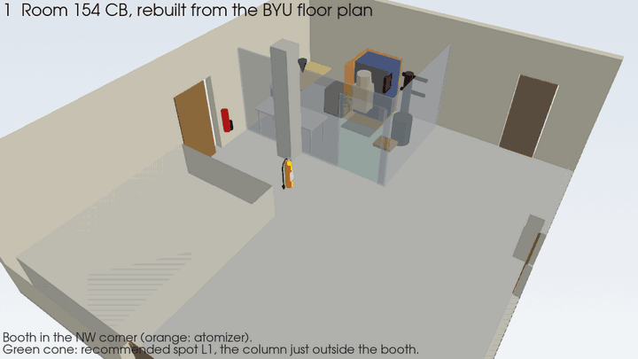
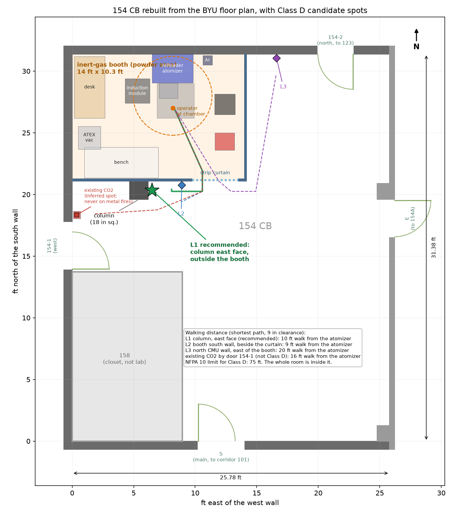
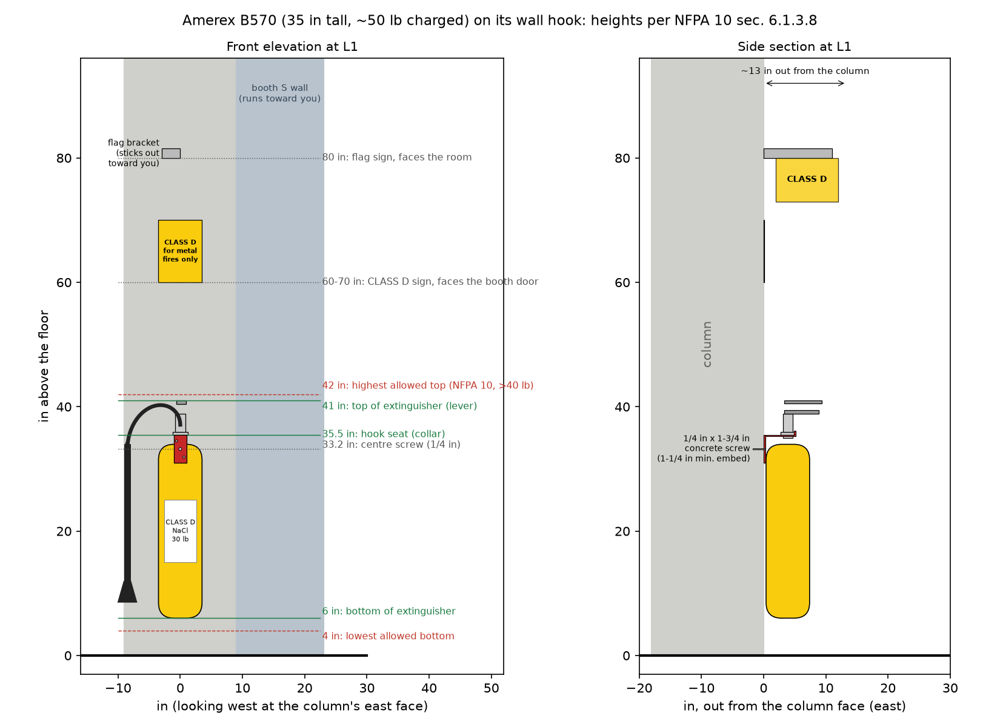
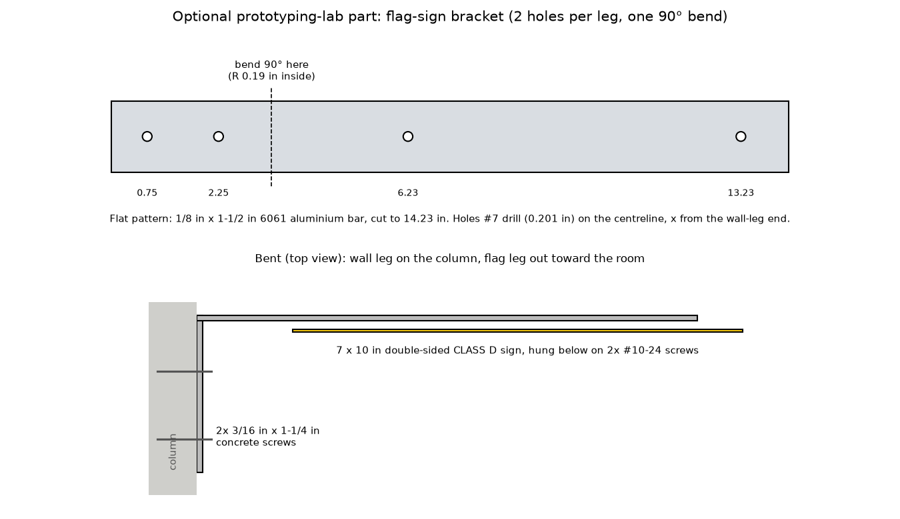

# Where to mount the Class D extinguisher in 154 CB (issue #126)

The lab's Amerex **B570** is a 30 lb sodium-chloride Class D extinguisher (Grainger 8C249). The
Amerex wall hook that shipped with it is in the box. This folder has a parametric CAD
reconstruction of 154 CB, a recommended mounting spot with two alternates, an animated
installation sequence, and the parts list.



## Recommendation

**L1: the east face of the structural column just outside the booth's south wall, hung from the
supplied Amerex hook. The hook seat goes at 35½ in, which puts the top of the extinguisher at
41 in and the bottom at 6 in.**



| | L1 column, east face (**recommended**) | L2 booth south wall, beside the curtain | L3 north CMU wall, east of the booth | Existing CO2 by door 154-1 |
| --- | --- | --- | --- | --- |
| Walk from the atomizer | 10.0 ft | 9.2 ft | 20.0 ft | 16.5 ft |
| Extra distance on the way out, door 154-1 / main door | 0.8 ft / 3.2 ft | 0.0 ft / 1.3 ft | 26 ft / 22 ft | (it is at the door) |
| What it's fixed to | the building's column (concrete, to be confirmed) | the booth's sheet-metal wall, which needs a backer across its frame | CMU | drywall |
| Outside the powder area | yes | yes | yes | yes |
| Visible from the strip curtain | yes, about 4 ft to the west | yes, right beside it | no, it's behind the booth | no |

The walking distances are shortest paths on the reconstructed plan, keeping 9 in from walls and
equipment (`render.py`, `out/distances.json`). The operator is taken to stand at the atomizer's
chamber. NFPA 10 (sec. 6.5) and OSHA 29 CFR 1910.157(d)(5) both allow at most 75 ft of travel to
Class D agent. Every point in the room is within that, so the choice comes down to the reasons
below.

Why L1:

- **It's on the way out.** Anyone leaving the booth through the strip curtain sees it about 4 ft
  away and passes it on the way to door 154-1. Someone fighting a fire with it has the curtain,
  and then the room's doors, behind them.
- **It stays clean and anyone can reach it.** It hangs outside the powder area, so dust won't
  settle on the gauge and label. A responder coming from the main room doesn't have to go into
  the booth to get it.
- **It's fixed to the building.** A column holds a 50 lb hanger without question. The booth's
  sheet-metal walls and the drywall partitions do not, without extra work. The B570 manual also
  asks for a hanger rated to five times the charged weight, about 250 lb.
- **It's out of traffic.** It sits in the corner between the column and the booth wall, out of the
  aisle, so carts and chairs won't knock it. NFPA 10 asks for protection wherever an
  extinguisher could be damaged.
- **It's apart from the CO2.** The building's CO2 extinguisher must never go on a metal-powder
  fire. Keeping the Class D at its own spot, with its own CLASS D sign, makes grabbing the wrong
  one less likely. That's why the spot next to the CO2 (the "next to the door" default) isn't
  recommended.

**Use L2 instead** if the column turns out to be a wrapped steel column or its east face is
taken (conduit, cabling). L2 is the booth's south wall, right beside the curtain on its west
side. Mount the supplied hook to a backer that spans two of the booth's frame members, not to
the sheet metal alone. **L3** only makes sense if the booth's door is ever moved to its east side.

## Mounting heights



The charged B570 weighs about 50 lb (53 lb shipping weight including the box), which is over
40 lb. So:

- NFPA 10 sec. 6.1.3.8.2 and the B570 manual: the top may be at most **42 in** (3½ ft) above
  the floor.
- NFPA 10 sec. 6.1.3.8.3: the bottom must be at least **4 in** above the floor.

The B570 is 35 in tall, which leaves a 3 in window. Aim for the middle of it:

| | Height above the floor |
| --- | --- |
| Top of the extinguisher (squeeze lever) | 41 in |
| Hook seat (under the valve's collar flange) | 35½ in |
| Centre screw of the hook (¼ in) | ~33 in, wherever the hook's centre hole lands with its seat at 35½ in |
| Bottom of the extinguisher | 6 in |
| Flat CLASS D sign, facing the curtain | 60 to 70 in |
| Flag sign, projecting toward the room | 73 to 80 in |

Hang the extinguisher on its hook first, then measure top and bottom before tightening the
screws. If the hook's proportions differ from the model's (they were read from the issue photos,
not a drawing), place the hook by the 41 in and 6 in targets, not by the 35½ in figure.

## Parts list

**In hand:** the B570 and the Amerex wall hook that shipped with it ("BR VLV W/ WALL BKT" on the
box). Use that hook. The manual says to use the furnished bracket, and the hook is part of what
UL and FM listed. **Don't swap it for a shop-made hanger.**

**To buy** (generic descriptions; any brand works):

| Qty | Item | Used for |
| --- | --- | --- |
| 1 | ¼ in masonry anchor for the hook's centre hole. The manual names a ¼ in lead (lag-shield) expansion anchor with a ¼ in lag screw. A ¼ in × 1¾ in hex-washer-head concrete screw (Tapcon-type) is the common alternative; the animation shows that one | the manual's "one ¼ in masonry anchor through the centre hole" for concrete or CMU |
| 4 | 3/16 in × 1¼ in hex-washer-head concrete screws, with a 5/32 in carbide bit | the hook's two diagonal holes (extra hold) and the flag bracket's wall leg |
| 1 | 7 × 10 in rigid-plastic "FIRE EXTINGUISHER: CLASS D, combustible metals only" sign | flat on the column at 60 to 70 in |
| 1 | 7 × 10 in double-sided CLASS D sign (projecting or flag type) | on the flag bracket, faces the room |
| 2 | #10-24 × ½ in screws, washers, nylon lock nuts | sign to flag bracket |
| 1 | roll of 2 in yellow/black floor-marking tape (optional) | marks a 36 × 36 in keep-clear zone in front |

**Only if L2 or a drywall wall is chosen instead of the column:** a ¾ in plywood backer, at least
2 in bigger than the extinguisher on every side, held to the wall with 3/16 in toggle bolts, with
the hook screwed to it using #10 × 1 in wood screws (the manual's "Sheetrock" method). At L2 the
toggles go through the booth's sheet metal into its frame, or the backer is bolted through with
a matching plate on the inside.

**Tools:** hammer drill, level, tape measure, pencil, 5/16 in and ¼ in hex drivers, and a stud or
rebar scanner to check the column for embedded conduit before drilling.

### Made in the prototyping lab: the flag-sign bracket



This is the one part worth making: an L bracket that holds a double-sided CLASS D sign out from
the column, so people walking up from the main door can see it.

- Stock: ⅛ in × 1½ in 6061 aluminium flat bar, cut to **14.23 in**.
- Holes: four #7 (0.201 in) holes on the centreline, at 0.75, 2.25, 6.23 and 13.23 in from the
  wall-leg end.
- Bend: one 90° bend, centred **3.37 in** from the wall-leg end, inside radius about 3/16 in
  (bend allowance 0.36 in, K = 0.33).
- Result: a 3½ in wall leg, screwed to the column at 80 in with two 3/16 in concrete screws, and
  an 11 in flag leg holding the sign on #10-24 screws.

STEP: [`out/flag_sign_bracket.step`](out/flag_sign_bracket.step).

## Installation, step by step (as in the animation)

1. **Check the column.** Confirm it's concrete: the hammer drill should throw grey dust, not hit
   steel. Scan the area from 30 to 45 in and around 80 in for conduit. If it's steel, stop: the
   B570 manual says steel posts and beams need a fire-extinguisher service company. Use L2 instead.
2. **Mark.** On the east face, centred, level the hook seat at 35½ in and mark the hook's three
   holes.
3. **Drill.** 3/16 in bit for the ¼ in screw, 5/32 in bits for the 3/16 in screws, each ¼ in
   deeper than the screw will go. Blow the dust out.
4. **Fasten the hook.** ¼ in × 1¾ in screw in the centre hole, 3/16 in × 1¼ in screws in the
   two diagonal holes. Snug them, but don't strip them.
5. **Hang the B570.** It weighs about 50 lb, so lift with your legs or use two people. Seat the
   collar flange in the hook, label facing out, hose and soft-flow applicator on the south side.
   Check that the pin and tamper seal are intact and the gauge reads green. Write "Date
   installed new" on the inspection tag.
6. **Signs.** Flat CLASS D sign at 60 to 70 in, facing the curtain. Flag bracket at 80 in, sign
   facing the room.
7. **Keep it clear.** Leave 36 × 36 in in front of it free of carts and boxes (optionally taped
   on the floor). Then:
   - monthly visual check, logged on the tag (NFPA 10 sec. 7.2, OSHA 1910.157(e));
   - annual service by a contractor, because Risk Management doesn't service Class D. The
     College's industrial hygienist suggested Associated Fire Protection (Salt Lake City);
   - for dry powder, 6-year maintenance and a 12-year hydrostatic test (B570 manual);
   - recharge after any use.

Also add the location to the atomizer SOP's emergency section, and train people on PASS with
the soft-flow applicator: lay the agent on gently, never blast powder into the air, and never
use the CO2 or water on a metal fire.

## How the room was reconstructed

| Source | Used for |
| --- | --- |
| BYU Facilities Planning floor plan, CB 1st floor, room 154 ([`cb154.pdf`](https://github.com/vertical-cloud-lab/byu-vcl/blob/main/cb154.pdf), [`cb154-annotated.pdf`](https://github.com/vertical-cloud-lab/byu-vcl/blob/main/cb154-annotated.pdf) in byu-vcl) | Interior 25.78 × 31.38 ft, the column (4.67 ft from the west wall, 10.29 ft from the north wall), closet 158 (8.53 ft wide), and the four doors and their swings. The plan is a raster, so positions were measured at 0.5 in/px, calibrated to the two room dimensions. The result, 809 ft² less 158's 113 ft², gives the "almost exactly 700 ft²" posted in [byu-vcl#31](https://github.com/vertical-cloud-lab/byu-vcl/issues/31) |
| [byu-vcl#31](https://github.com/vertical-cloud-lab/byu-vcl/issues/31): "the area to the pillar … is about 14′ W × 10′ D" | The booth's footprint: the NW corner, out to the column |
| Room-camera frame, 2026-10-01 17:01 ([byu-vcl `docs/stream-cams.md`](https://github.com/vertical-cloud-lab/byu-vcl/blob/main/docs/stream-cams.md)) and the 2026-09-03 and 2026-09-28 photos (PR #216) | CMU block on the booth's north and west walls, sheet metal on the south and east, the strip curtain at the south-east, and what's inside (atomizer, argon rack, induction module, bench, desk, ATEX vacuum). Inside the booth, positions are good to about ±1 ft |
| The issue's photos (Jan to Feb 2026) | The B570, its hook and manual, and the CO2 extinguisher by a door. That door's latch side reads as door 154-1, and its wall as textured drywall (no block joints after high-pass filtering). Both are inferences |
| [Amerex Class D spec sheet](https://amerex-fire.com/upl/downloads/library/class-d-extinguishers.pdf) | B570: 35 in H × 13 in W × 8 in D, 30 lb agent, 53 lb shipping weight, 195 psig, 3 to 6 ft range, 24 s discharge, wall bracket included |
| The lab's YouTube channels (BYU Vertical Cloud Lab, BYU VCL Hardware Streams) | Checked. The recent atomizer videos are close-ups of the machine. yt-dlp is bot-blocked on CI runners, so only thumbnails and the training-video frames already pulled in PR #216 were used |

**What couldn't be checked remotely.** All three lab Pis (panel, HMI, room camera) were offline
on the tailnet on 2026-11-19, so there's no fresh frame of the room. These are parameters in
`model.py`; a phone photo of each would settle them:

1. What the column is made of, and whether its east face is clear.
2. Whether the strip curtain is in the booth's south wall at its east end (as modelled) or in
   its east wall.
3. Where the CO2 extinguisher hangs now (door 154-1 is inferred).
4. Ceiling and booth heights. These don't affect the mount.

## Files

| File | What |
| --- | --- |
| [`model.py`](model.py) | CadQuery model: room, booth, equipment, B570, the Amerex hook, screws, signs and flag bracket. Every number is a named parameter with its source |
| [`render.py`](render.py) | Walking-distance search, plan, elevation, bracket drawing, 3-D still and the animation |
| [`out/cb154_class_d_install.step`](out/cb154_class_d_install.step) | The whole scene, one named solid per part |
| [`out/b570_on_wall_bracket.step`](out/b570_on_wall_bracket.step), [`out/flag_sign_bracket.step`](out/flag_sign_bracket.step) | The extinguisher on its hook, and the shop part |
| `out/install.gif`, `out/install.mp4`, `out/install_steps.png` | The animation, and one frame per step |
| `out/plan.png`, `out/elevation.png`, `out/flag_bracket.png`, `out/overview.png`, `out/distances.json` | Drawings and the computed distances |

Rebuild (CadQuery 2.8, PyVista 0.49, Python 3.12):

```bash
pip install cadquery pyvista imageio imageio-ffmpeg pillow matplotlib
cd lab-safety/class-d-extinguisher
xvfb-run -a python render.py out/          # add --fast to skip the animation
```
