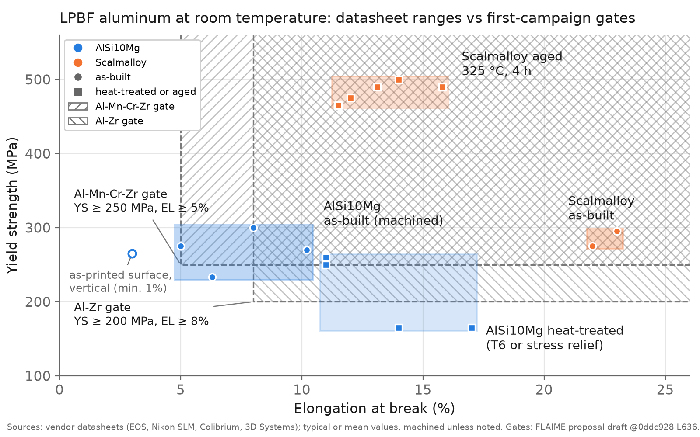

# LPBF aluminum benchmark alloys: AlSi10Mg and Scalmalloy against one part's requirements
*Draft, Nov 25, 2026. Compiled from manufacturer datasheets, USGS and NASA-STD-6030; sources at the end.*

**What this shows.** One example part, a printed aluminum bracket for a satellite or launch vehicle, sets the requirements. Below are those requirements, the measurement the lab would run for each, and how the two standard alloys for laser powder bed fusion (LPBF) of aluminum perform on manufacturer datasheets. The default alloy (AlSi10Mg) trades strength for ductility, and the strong alloy (Scalmalloy) depends on scandium, a U.S. critical mineral with about 80 t of world production in 2025 [1, 2].

## The part and its requirements

The part is a topology-optimized bracket that ties an instrument, tank, thruster or avionics box to primary structure. It is printed in one piece, with thin walls and as-printed surfaces that are often never machined, then heat-treated and inspected. It must be light, and it is structural: under NASA-STD-6030, a part whose failure would cause a catastrophic, critical or safety hazard, or that is mission critical, is Class A, the most tightly controlled class [3].

| Requirement | Why it matters for the part | How the lab measures it |
|---|---|---|
| Strength and ductility | Carry launch loads and vibration without permanent set; ductility tolerates notches at fillets and thin walls. | Tensile test (ASTM E8 sub-size, at least 3 replicates): yield strength, UTS, elongation [4, 10] |
| Service temperature | Near propellant tanks it runs cold (liquid oxygen 90 K, about −183 °C; liquid hydrogen 20 K, about −253 °C) [5]; elsewhere it runs warm. | Tensile at elevated temperature (ASTM E21 [7]); tensile in liquid nitrogen (77 K, −196 °C) as a possible low-cost cryogenic screen [5] |
| Fatigue | Vibration means many load cycles; pores and rough surfaces start cracks. AlSi10Mg's datasheet fatigue strength is 110 MPa at 20 million cycles, machined [6]. | Density and defect checks first; fatigue tests (e.g. ASTM E466) are not in the first screening loop and would follow for finalists |
| Corrosion | Hardware waits on the pad and in storage, so it must resist pre-launch coastal exposure (salt air). | Corrosion screen: salt fog (e.g. ASTM B117) or electrochemical polarization in salt water [11] |
| Printability | Crack-free and over 99% dense; cracks and pores cut strength, ductility and fatigue life. High-strength wrought alloys such as 7075 crack as they solidify in LPBF unless grain refiners are added [13]. | Density by Archimedes' method (proposal gate: ≥ 99.0% relative density [10]); cracks and pores by sectioning, optical microscopy and SEM |
| Chemistry | Qualification needs a known, repeatable composition; a printed part can drift from its powder. | ICP-OES or XRF on powder and printed parts |
| Qualification | NASA-STD-6030 requires a qualified material process, a material property suite (database, process-control reference, design values) and witness specimens in each build [3]. | Screening only: the lab does not qualify flight parts, but its provenance-tracked records are the kind of data a property database starts from |

## Where today's alloys fall short

Room temperature, manufacturer datasheets, typical or mean values, machined bars unless noted, vertical / horizontal build direction.

| Alloy (datasheet) | Condition | Yield strength (MPa) | UTS (MPa) | Elongation (%) |
|---|---|---|---|---|
| AlSi10Mg (EOS M 290, 30 µm) [6] | As-built | 233 / 270 | 466 / 461 | 6.3 / 10.2 |
| AlSi10Mg (Nikon SLM 500, 30 µm) [8] | As-built | 275 / 300 | 470 / 450 | 5 / 8 |
| AlSi10Mg (Nikon SLM 500, 30 µm) [8] | As-built, as-printed surface (vertical) | 265 | 425 | 3 (min. 1) |
| AlSi10Mg (EOS) [6] | T6 (530 °C solution, 165 °C 6 h age) | 250 / 260 | 310 / 320 | 11 / 11 |
| AlSi10Mg (Nikon SLM) [8] | Stress-relieved (285 °C, 2 h) | 165 / 165 | 285 / 280 | 14 / 17 |
| Scalmalloy (Colibrium M2, 50 µm) [7] | As-built | 275 / 295 | 350 / 355 | 22.0 / 23.0 |
| Scalmalloy (Colibrium M2) [7] | Aged 325 °C, 4 h | 465 / 475 | 505 / 515 | 11.5 / 12.0 |
| Scalmalloy (3D Systems, 30 and 60 µm) [9] | Aged 325 °C, 4 h (plastic elongation) | 490 / 490 to 500 | 520 / 520 to 530 | 13.1 to 15.8 / 14.0 to 15.8 |

*Data: [`property-window.csv`](property-window.csv). Chart: `python property-window.py` (matplotlib).*

- **AlSi10Mg is printable but modest.** As-built bars reach 233 to 300 MPa yield with 5 to 10% elongation. Heat treatment lifts elongation to 11 to 17%, but UTS falls from 450 to 475 MPa to 280 to 320 MPa [6, 8]. Unmachined vertical bars, closer to a bracket's as-printed surfaces, average 3% elongation (minimum 1%) [8].
- **Scalmalloy is strong because of scandium.** Aged at 325 °C for 4 h, it reaches 465 to 500 MPa yield with 11.5 to 15.8% elongation [7, 9].
- **Neither is characterized cold to hot.** Aged Scalmalloy keeps 319 MPa yield at 150 °C but only 60 MPa at 300 °C (vertical) [7]. The AlSi10Mg sheets give no elevated-temperature tensile data, and none of the four sheets gives cryogenic data. A literature survey for the lab found cryogenic tensile data for a few AM aluminum alloys, but no cryogenic toughness or fatigue data for any, Scalmalloy included [5].
- **Scandium is scarce and concentrated.** World production was about 80 t (scandium oxide equivalent) in 2025, all as a byproduct, led by China; the U.S. mined or recovered none and was 100% import-reliant. Scandium oxide (99.99%) averaged an estimated $640/kg in 2025, ex-works China (down from $890 to 1,000/kg in 2021), and China added export controls on scandium metal, alloys, oxides and compounds in April 2025 [1]. Scandium is on the final 2025 U.S. List of Critical Minerals [2].

**The target window.** The campaign goal is an alloy that "performs better than AlSi10Mg and uses less critical minerals than Scalmalloy" (the kickoff loosened "and" to "and/or") [11]. The proposal's month-7 go/no-go gate asks for at least one alloy meeting family-specific thresholds (Al-Mn-Cr-Zr: yield ≥ 250 MPa with elongation ≥ 5%; Al-Zr: yield ≥ 200 MPa with elongation ≥ 8%), a mean supply-risk index at least 25% below Scalmalloy's, and ASTM E8 sub-size data on at least 3 replicates. The Phase I objective adds elevated-temperature retention for Al-Zr and a ≥ 40% mineral-burden reduction versus Scalmalloy [10]. These are pass/fail gates for scandium-free families, not a claim to beat AlSi10Mg at room temperature: EOS's T6 and horizontal as-built AlSi10Mg already sit inside both windows. The case for the new families rests on meeting them while holding strength when hot and avoiding scandium.

**Limits.** Every property number here is from literature (manufacturer datasheets), not measured by the lab. Datasheet values are each vendor's typical or mean results on its own tuned parameters and are not design allowables; peer-reviewed studies report wider spreads, and an AI literature synthesis in this repository gives as-built AlSi10Mg elongations as low as 0.7% for vertical or unoptimized builds [12]. Not shown: fatigue beyond one AlSi10Mg number, fracture toughness, corrosion and cryogenic data, part-level load cases, and a third comparator (A20X, or Al-Mn-Zr types such as Addalloy or Aheadd CP1), which have not yet been sourced to the same standard. The NASA-STD-6030 summary is high level.

**Sources**

1. U.S. Geological Survey, *Mineral Commodity Summaries 2026*, Scandium (February 2026). https://pubs.usgs.gov/periodicals/mcs2026/mcs2026-scandium.pdf
2. U.S. Department of the Interior, "Final 2025 List of Critical Minerals," *Federal Register* 90(214): 50494 to 50497 (Nov 7, 2025), FR Doc. 2025-19813. https://www.govinfo.gov/content/pkg/FR-2025-11-07/html/2025-19813.htm
3. NASA-STD-6030, *Additive Manufacturing Requirements for Spaceflight Systems* (approved 2021-04-21), Sections 4.3 (part classification), 4.11 (witness testing), 5 (qualified material process). https://standards.nasa.gov/standard/nasa/nasa-std-6030
4. ASTM E8/E8M, *Standard Test Methods for Tension Testing of Metallic Materials*. https://www.astm.org/Standards/E8
5. Digital Alloy Lab, issue 254, "Importance of cryo testing for aerospace alloys," literature survey comment (Nov 12, 2026). https://github.com/vertical-cloud-lab/digital-alloy-lab/issues/254
6. EOS GmbH, Process Data Sheet, EOS Aluminium AlSi10Mg, EOS M 290, 30 µm (ISO 6892-1; last changed Nov 11, 2026; accessed Nov 25, 2026). https://www.eos.info/metal-solutions/data-sheets/aluminium/pds-eos-aluminium-alsi10mg-eos-m-290-30um
7. Colibrium Additive, "L-PBF Aluminum Al-Mg-Sc: Parameters for M2 Series 5 use of Scalmalloy," 400 W, 50 µm, Rev B (Aug 21, 2025); ASTM E8/E21. https://www.colibriumadditive.com/sites/default/files/M2SERIES5_Al-Mg-Sc_400W_CMDS_20250821_RevB%20%281%29.pdf
8. Nikon SLM Solutions, Material Data Sheet AlSi10Mg (EN AC-43000), SLM 500, 30 µm; stress relief 285 °C, 2 h. https://nikon-slm-solutions.com/wp-content/uploads/2025/11/mds5123.pdf
9. 3D Systems, Certified Scalmalloy (A) datasheet (Feb 23, 2022); 325 °C, 4 h, air cool (labeled "SR", as advised by APWORKS); ASTM E8. https://3dsystems.com/sites/default/files/2022-02/3d-systems-certified-scalmalloy(a)-datasheet-usen-2022-02-23-a-print.pdf
10. Digital Alloy Lab, FLAIME proposal draft, objective O4 (line 636) and gates G2 and G3 (lines 958 to 959). https://github.com/vertical-cloud-lab/digital-alloy-lab/blob/0ddc928/genesis-mission-proposal/flaime-genesis-proposal.tex#L636
11. Digital Alloy Lab, issue 277, "New Alloy Discovery Campaign," and its kickoff cross-check comment (Nov 24, 2026). https://github.com/vertical-cloud-lab/digital-alloy-lab/issues/277
12. Edison Scientific literature synthesis (AI-generated, not a primary source), LPBF AlSi10Mg properties. https://github.com/vertical-cloud-lab/digital-alloy-lab/blob/0ddc928/edison-trajectories/pareto-am-al-alloys/batch1_core_mechanical.md#L66
13. Martin, J. H. et al., "3D printing of high-strength aluminium alloys," *Nature* 549, 365 to 369 (2017). https://doi.org/10.1038/nature23894
