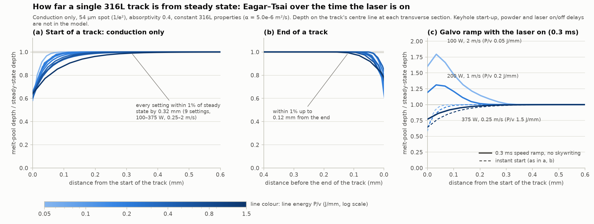
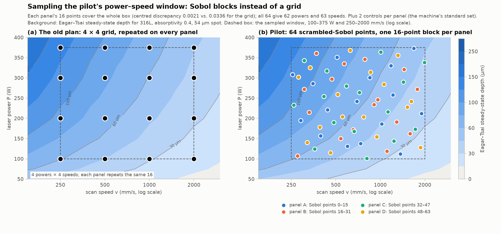

# Track length, spacing and sampling for the M2 single-track runs

Issue [#100](https://github.com/vertical-cloud-lab/digital-alloy-lab/issues/100), PR
[#243](https://github.com/vertical-cloud-lab/digital-alloy-lab/pull/243). This folder backs the track design in
[§4 of the plan](../m2-single-track-schedule.md#4-pilot-run-carl-and-josh): how long each track is, how far apart,
in what order, where it is sectioned, and how the power–speed settings are chosen (Sobol blocks and batch BO, not a
grid). It has two sources:

- **Eagar–Tsai runs for 316L** ([`eagar_tsai_316l.py`](eagar_tsai_316l.py)), which test the physical assumptions
  behind the design. These use [ArroyaveLab `eagar-tsai`](https://github.com/ArroyaveLab/eagar-tsai) 0.6.0, the
  package PR #238 checked, plus the same integral evaluated over the finite time the laser is on.
- **Six Edison literature reports** (four queries, two of them run twice; [`edison-trajectories/m2-single-track-design/`](../../edison-trajectories/m2-single-track-design/),
  prompts in [`scripts/edison_m2_track_design.py`](../../scripts/edison_m2_track_design.py)) on start and end
  transients, interactions between neighbouring tracks, sampling, and 316L inputs. Edison's literature search was
  down for both rounds, so all six are the model's own answers, without retrieved papers (see below).

## Recommendations

| Choice | Recommendation | Main reason |
| --- | --- | --- |
| Track length | **12 mm** (10 mm at the least) | Modelled start and end zones are short (below), but keyhole start-up, the galvo, the laser's on/off timing and the end crater are not modelled, and they scale with speed. 12 mm leaves 3 mm to discard at each end and 6 mm of steady track around the target plane: ±1 mm of slack in finding the plane and room for a second plane 1.5 mm further on. It still fits four rows on one panel at 15 mm row pitch (option B) |
| Discard at each end | **3 mm** | 8× the longest conduction start zone Eagar–Tsai gives (0.37 mm) and 18× its end zone (0.17 mm). At 2 m/s, 3 mm is 1.5 ms: enough for a 1 ms keyhole start-up or galvo ramp. Common practice is 10–15 mm tracks sectioned in their middle third |
| Section plane | **Mid-length** (6 mm), found from the track ends visible on the top view; on panel A in the pilot, a **second plane 1.5 mm further on** | One plane per track is enough if the along-track scatter is small; the second plane on panel A measures it. The top views (C1) give width along the whole steady zone of every track for free |
| Spacing | **2 mm centre to centre** in the pilot. Measure the denuded bands in its top views: go to 2.5 mm if the widest come within about 0.3 mm of each other, or 1.5 mm if they are narrow | Heat from a neighbour is negligible at 1 mm or more; denuded powder and spatter set the spacing. 2 mm is nearly 8× the widest pool Eagar–Tsai gives in the window (0.26 mm). 2.5 mm still fits 9 tracks in a 1.25" mount; 1.5 mm fits 12 |
| Scan direction | **The same on every track**, into or across the gas flow, never with it | With the flow, the plume and spatter are blown ahead of the beam onto the track still to be drawn |
| Exposure order | **Strictly from the gas outlet side toward the inlet**, with parameter sets in randomized positions; no interleaving | Spatter blown downstream lands on finished tracks. Interleaving (odd positions, then even) is sometimes suggested for heat, but heat doesn't matter here and interleaving would put upstream spatter on positions not yet drawn |
| Galvo | **Ask whether skywriting is on**; check the first 3 mm of a few tracks in the pilot (top view, or a longitudinal section of a spare track) | Without it, Eagar–Tsai puts the first 0.3 mm up to 1.9× deeper at 2 m/s for a 0.3 ms ramp |
| Settings | **64 scrambled-Sobol points in four 16-point blocks, one block per panel**, plus 2 controls per panel; **batch BO** in the campaign, one M2 run per batch, with one more Sobol block per run held out for validation | See [Sampling](#sampling-sobol-blocks-then-batch-bo) |

## What Eagar–Tsai says (and doesn't)

All runs use 316L with constant properties (nominal k 26 W/m/K, ρ 7300 kg/m³, c 710 J/kg/K, so
α = 5.0 × 10⁻⁶ m²/s; liquidus 1723 K), absorptivity 0.4 and a 54 µm 1/e² spot (LLNL's 400 W M2), unless noted.
The Edison 316L report suggests k 21.5, ρ 7500, c 640 (α 4.5 × 10⁻⁶) and a liquidus of 1697 K, but its literature
search returned nothing, so those are unsourced. The two alternative property sets below bracket α from 3.5 to
7.0 × 10⁻⁶ m²/s instead. Eagar–Tsai is conduction only: no Marangoni flow, keyhole, evaporation or powder. Its
peak temperatures are 10,000–70,000 K over this window, far above boiling, so it cannot say where keyholing starts,
as PR #238 also found for AlSi10Mg. What it can test is how long the heat flow takes to settle and how far heat
spreads, and that is what it is used for here.

**Steady state over the window** ([`out/steady_state_grid.csv`](out/steady_state_grid.csv), 1 µm grid): inside the
plan's window (100–375 W, 250–2000 mm/s) the pool is 60–256 µm wide, 21–127 µm deep and 0.18–0.65 mm long. The
length depends almost only on power.

**Start and end of a track** ([`out/finite_track_summary.csv`](out/finite_track_summary.csv)). The same Eagar–Tsai
integral, but with the laser on only from t = 0 to the end of the track, gives the fused depth and width at every
transverse section, from each point's maximum temperature over all time. At mid-length it reproduces the package's
steady state (200 W, 1 m/s: W 102.8 vs. 102.0 µm, D 47.5 vs. 47.0 µm; the package is on a 1 µm grid).

| | 9 settings, 100–375 W, 0.25–2 m/s | Same, α from 3.5 to 7.0 × 10⁻⁶ m²/s or a 90 µm spot |
| --- | --- | --- |
| Depth at the very start | 58–66% of steady state | 46–66% |
| Distance to within 5% / 1% of steady-state depth | ≤ 0.20 / ≤ 0.32 mm | ≤ 0.22 / ≤ 0.37 mm |
| Same, as a multiple of the steady-state depth | 2.3–3.7 D | |
| Distance from the end where depth is still within 1% | ≤ 0.12 mm | ≤ 0.17 mm |
| With a 0.3 ms galvo speed ramp at each end, laser on | first 0.2–0.3 mm up to 1.4× (1 m/s) and 1.9× (2 m/s) deeper than steady state; settled within 1% by 0.34 mm | |

So conduction alone settles within about a third of a millimetre, roughly three pool depths. Anything longer seen
in a real track comes from physics Eagar–Tsai leaves out (next section), which is why the 3 mm discard is set
well beyond this model's numbers.

**Heat reaching a neighbour** ([`out/neighbour_heating.csv`](out/neighbour_heating.csv)): the surface temperature
rise beside the middle of a finished 10 mm track.

| Setting | at 0.5 mm | at 1 mm | at 2 mm | at 3 mm |
| --- | --- | --- | --- | --- |
| 375 W, 0.25 m/s (1.5 J/mm, the hottest corner) | 108 K | 27 K | 6.8 K (peaks 0.2 s after the beam passes) | 3.0 K |
| 200 W, 1 m/s | 14 K | 3.6 K | 0.9 K | 0.4 K |
| 100 W, 2 m/s | 3.6 K | 0.9 K | 0.2 K | 0.1 K |

In Eagar–Tsai a preheat of ΔT is the same as lowering the liquidus by ΔT, which deepens the pool by 0.3–0.4% per
10 K ([`out/preheat_sensitivity.csv`](out/preheat_sensitivity.csv)). So a neighbour 2 mm away changes the depth by
under 0.3% even at the hottest setting, and 1 mm would still be under about 1%. Heat does not set the spacing.

## What the literature adds (Edison), and how far to trust it

**All six reports are ungrounded.** The four first-round reports ran during an outage of Edison's literature
search, and each says it retrieved no papers ("no contexts were retrieved, so this answer is not grounded in
evidence") and that its DOIs and numbers come from the model's own knowledge. I resubmitted the transients and
spacing queries at 05:31 UTC (`_task_ids_retry.json`, reports with a `-retry` suffix). The outage was still on, so
those two are ungrounded as well. The reports don't even agree with each other: the first four give four different
DOIs for Yadroitsev et al. 2010, and the two spacing runs differ about fivefold on how wide the denuded band is. So
the numbers below are a second opinion to test against, not sources. Where they matter, the pilot measures them.

| Report | What it says | How it changes the design |
| --- | --- | --- |
| [Transients and length](../../edison-trajectories/m2-single-track-design/track-transients-and-length.md) | Conduction pools settle within 1–3 pool lengths. A keyhole forms in 50–200 µs, but its depth takes 0.3–1 ms to settle. Galvo acceleration takes 0.1–1 ms, and uncompensated mark/laser delays are 50–500 µs, so at 1–3 m/s the ends can carry the wrong energy per length over 0.1–3 mm unless skywriting is on. Keyholes collapse within 50–200 µs of laser-off and leave end-of-vector pores (Martin et al. 2019); the end crater spans 0.5–1 pool length. Practice: 5–20 mm tracks, 10 mm most common, sectioned "in the middle"; discard distances are rarely stated. Width and depth vary 5–15% along stable tracks and 20–30% near instability. It recommends 10–15 mm, ≥3 mm discard (5 mm for keyholes at high speed) and 3 sections per calibration track | Its conduction figure agrees with Eagar–Tsai (about 2–4 pool depths, 0.1–0.4 mm). Its keyhole and galvo times are why the discard went from 2 to 3 mm and the length from 10 to 12 mm. Three sections per track would triple polishing and SEM, so the pilot measures the section-to-section scatter on panel A first |
| [Spacing and order](../../edison-trajectories/m2-single-track-design/track-spacing-and-order.md) | At 1 atm the vapour jet entrains gas and pulls powder into the track (Matthews et al. 2016). The denuded band is 2–5× the track width in total, 0.1–0.4 mm beyond each edge for 0.1–0.2 mm tracks, and 0.5–1 mm in total for keyholes. Spatter lands mostly 2–5 mm away, and some goes more than 10 mm downstream. Expose from outlet to inlet and scan into or across the flow. Spacing ≥1.5 mm, 2–2.5 mm for keyhole settings, and ≥3× the pool width. Heat is negligible beyond 1.5–2 mm. A spread layer is 50–65% dense | Supports 2 mm. Its heat estimate matches Eagar–Tsai's (≤7 K at 2 mm). It also suggests interleaving the exposure for heat, which this design doesn't do: Eagar–Tsai shows heat doesn't matter, and interleaving would break the outlet-to-inlet order |
| [Sampling](../../edison-trajectories/m2-single-track-design/sampling-sobol-vs-batch-bo.md) | Start with 64 Owen-scrambled Sobol points in (P, log v), a power of two for balance. Then run batch active learning with one build per batch, using a heteroscedastic multi-output GP plus a regime classifier. The acquisition mixes integrated-variance reduction (about 50%), boundary entropy (30%) and model-discrepancy checks (20%). Hold out 20–25% of settings for validation, split by setting, not by section. Repeat a few settings across builds and panels. It rates the evidence for 64-point Sobol over a maximin LHS as weak, and for space-filling plus batch BO as moderate to strong | Matches the design below. Its point about cross-build repeats is why the controls stay the same set in every run |
| [316L inputs](../../edison-trajectories/m2-single-track-design/ss316l-eagar-tsai-inputs-and-single-track-data.md) | Liquidus 1697 K, k 21.5 W/m/K, ρ 7500 kg/m³, c 640 J/kg/K (α 4.5 × 10⁻⁶ m²/s), boiling 3090–3134 K. Absorptivity 0.35 in conduction and 0.6–0.8 in keyhole mode. Its single-track data points are marked as approximate digitizations | α lies inside the 3.5–7.0 × 10⁻⁶ bracket used above, so the transient and heat conclusions stand. Its data points are too uncertain to calibrate Eagar–Tsai against; use the original papers or MeltpoolNet for that |
| [Transients, retry](../../edison-trajectories/m2-single-track-design/track-transients-and-length-retry.md) | Conduction settles in 2–5 pool lengths (0.3–1 mm). A keyhole takes 100–500 µs to reach its depth, so 0.5–2 mm. Without skywriting, galvo acceleration affects 50–500 µm at 1 m/s at 2–5× the energy per length. The end crater is 0.2–0.5 mm in conduction and 1–2 mm in keyhole mode. For the whole 50–400 W, 0.1–3 m/s window it recommends **12 mm tracks with 3 mm discarded at each end** (15 mm if there is room), the main plane at mid-length, and checking one track at 25/50/75% of its length | The same 12 mm / 3 mm this design landed on. Its conduction distances are longer than Eagar–Tsai's (≤ 0.37 mm); the discard covers both |
| [Spacing, retry](../../edison-trajectories/m2-single-track-design/track-spacing-and-order-retry.md) | Denuded band **0.5–2 mm per side** at 1 atm, against 0.1–0.4 mm in the first round. Pitch 3 mm by default and 4–5 mm for slow, high-power settings; 2 mm only after imaging shows undisturbed powder at the next track. Scan against the flow (outlet to inlet). Interlace the order, or wait 5–10 s between neighbours | The two ungrounded runs disagree about 5× on the band width, so the pilot measures it: if the widest bands in its top views come within about 0.3 mm of the neighbouring band at 2 mm pitch, go to **2.5 mm**, which still fits 9 tracks in a 1.25" mount. Its interlacing and waiting are for heat, and Eagar–Tsai says heat at 2 mm is ≤ 7 K and arrives about 0.2 s later, so neither is needed |

## From the Thermo-Calc AM Module's side

- **Its steady-state calculation is the pool in the beam's frame on an endless track**, which is what a transverse
  section through the middle of a long track shows. The plane sits 6 mm from either end, 16× the longest
  conduction start zone above and 2× the 3 mm discard. My estimate is that Marangoni flow doesn't lengthen the
  start much: the flow turns over in about pool size / flow speed (about 0.1 mm / 1 m/s = 0.1 ms). Keyhole start-up
  is the slow part (up to about 1 ms), and the discard covers it.
- **Check the discard with the model being validated.** The AM Module's transient mode can run one track from its
  start. Two transient runs in A2, one conduction setting and one keyhole setting at 2 m/s, would show directly
  whether 3 mm is enough for the AM Module's own physics. That costs two runs against a whole campaign that
  assumes it.
- **Compare width and depth first.** Both are set by the fusion boundary the AM Module computes. The height above
  the substrate depends on how much powder the track pulls in, which depends on denudation and the layer's packing,
  so compare it only if the AM Module run includes the powder layer. Use each panel's measured offset as its
  layer thickness, as the plan already says.
- **Calibrate on conduction tracks, test on keyhole tracks.** Absorptivity is cleanest to calibrate where the heat
  source is simplest. Then check whether the AM Module's keyhole model, with that absorptivity, gets the deep
  tracks right. The Sobol box spans both regimes, so both come out of every run.
- **BO needs a cheap stand-in for the AM Module.** The acquisition evaluates the AM Module's error over thousands of
  candidate settings, and the proposal budgets 0.5–2 CPU-hours per AM Module evaluation (as PR #238 notes). So run it once
  in batch mode on a dense Sobol set over the window (128–256 points; Thermo-Calc's batch and grid calculations
  are made for this). Fit a GP emulator to that set, and do BO on measured minus emulated. Re-run the AM Module
  itself only on the settings a batch actually prints.
- **Noise level.** The two-plane comparison on panel A and the 8 controls per run give the measurement and
  along-track scatter. The GP's noise term should come from those, not be fitted freely; otherwise it can absorb
  real model error.

## Sampling: Sobol blocks, then batch BO

**Pilot.** [`design.py`](design.py) draws 64 points of a scrambled 2-D Sobol sequence over P 100–375 W and
log v 250–2000 mm/s (the old grid's box, so P/v still spans 0.05–1.5 J/mm), seed 100, rounded to 1 W and 5 mm/s
([`out/pilot_sobol_sets.csv`](out/pilot_sobol_sets.csv)).

- **Each panel gets one block of 16 consecutive points** (0–15 on A, 16–31 on B, ...). Every such block of a base-2
  Sobol sequence is itself a balanced, space-filling set over the whole box. So **panel A, which is sectioned
  first, covers the whole window on its own**, and A–D together are a 64-point design. The centred discrepancy of
  each 16-point block is 0.0021, against 0.034 for the 4 × 4 grid (lower is more even).
- **64 distinct powers and speeds instead of 4 of each** (62 and 63 after rounding). A Gaussian process learns
  far more from 64 distinct points than from 4 replicates of 16, and the grid's repeated levels leave the space
  between them empty.
- **Replicates move into the controls.** The 2 controls per panel (8 per run) at the machine's standard 316L set
  estimate track-to-track noise and any panel or position effect. Keyhole depth is noisier than conduction depth,
  so consider making one of each panel's two controls a fixed keyhole setting instead.
- **The box is still a guess.** Xavier should check it against the AM Module's printability map before the pilot
  and change `P_RANGE` / `V_RANGE` in `design.py` if most of it is deep keyhole. On a 200 W M2, lower `P_RANGE`.

**Campaign: batch BO, one M2 run per batch.** With about one run a week and 3–6 campaign runs, there are only 3–6
rounds, each of up to 64 new tracks: a large-batch, few-round setting.

- **Each run:** 48 tracks chosen by batch BO, **16 from the next Sobol block** (points 64–79 for run 1, 80–95 for
  run 2, and so on), and the 8 controls. The Sobol block in each run is an unbiased, space-filling hold-out set
  for validating the AM Module, which BO-chosen points are not, since BO crowds them where the model is unsure.
- **What BO optimizes:** the goal is to calibrate and validate the AM Module, not to find one best track. So the
  surrogate is a GP on the AM Module's error (measured minus predicted depth and width, in log), and the
  acquisition reduces its integrated posterior variance (`qNegIntegratedPosteriorVariance` in BoTorch), weighted
  toward the regime boundaries (keyhole onset, depth equal to the layer, balling) where the printability map is
  decided. If the TMS story needs a process optimum too, add a constrained objective (for example a target depth
  per layer with depth/width < 0.5 and a continuous track) as a second batch criterion.
- **When Sobol alone is enough:** if the campaign shrinks to 1–2 runs, BO has too few rounds to pay off. Just
  continue the Sobol sequence; the next 64 points fill in the gaps of the first 64.
- **In Ax (as in the lab's Honegumi templates):** attach the pilot's 64 points as trials (`client.attach_trial`),
  then generate each batch of 48 from a BoTorch generation step whose acquisition is set to qNIPV
  (`botorch_acqf_class`). Ax's default acquisition optimizes an objective, which isn't the goal here. Or call
  BoTorch's `optimize_acqf` with `q=48` directly. Keep the AM Module emulator's prediction as an input to the GP's
  mean or as a fixed offset.

## Files

| File | What it is |
| --- | --- |
| [`eagar_tsai_316l.py`](eagar_tsai_316l.py) | All the Eagar–Tsai runs (about 10 min on 4 cores): `python eagar_tsai_316l.py [grid] [finite] [neighbour]` |
| [`design.py`](design.py) | The pilot's Sobol blocks; `python design.py` |
| [`figures.py`](figures.py) | The two figures above; `python figures.py` |
| `out/` | CSVs, the along-track profiles (`finite_track_profiles.json`) and the figures |

Environment: Python 3.12 with numpy 2.5, scipy 1.18, matplotlib 3.11 and `eagar-tsai` 0.6.0 installed from its
repository (`pip install -e .`).
