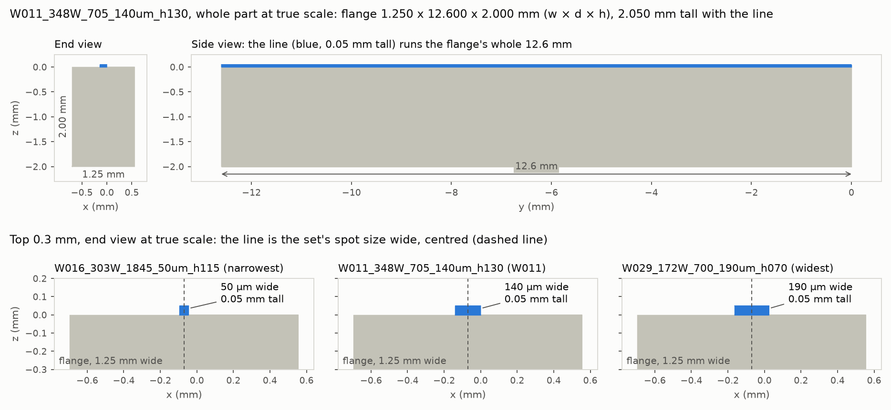

# Flange STLs with a single-track rectangle on top, one per set

Gage's request on [PR 243](https://github.com/vertical-cloud-lab/digital-alloy-lab/pull/243) (2026-11-19):
copy the W011 flange file once for each set in
[the final table](https://github.com/vertical-cloud-lab/digital-alloy-lab/pull/243#issuecomment-7021458367),
make the rectangle on top as wide as that set's spot, merge the bodies, and name the file after the set. The aim
is for the printer to lay a single track on top of each flange.

**2026-11-20: the flanges are now 2 mm tall.** Carl's correction on the same PR: the flange had been made too tall,
and should be "2mm tall, 1.25 mm wide, and 12.6 mm deep with the line on top". Every file was rebuilt to that
(822baf8). The first version, 1.27 × 12.7 × 5.08 mm flanges, is in e50d71d; don't print from it.

| File | What it is |
| --- | --- |
| `stl/<set name>.stl` | 33 binary STLs, one for each set in [`../out/wall_sets.csv`](../out/wall_sets.csv) (32 settings and the control). Walls that share a set use the same file |
| [`flange-fins-2mm-stl.zip`](flange-fins-2mm-stl.zip) | All 33 in one zip, in a folder `flange-fins-2mm` |
| [`fins.csv`](fins.csv) | For each file: spot, the line's width and x range, height and length, the flange's size, the overall height, volume, the walls that use it, and the sha256 |
| `template/` | The file as Gage sent it (`W011_348W_705_140um_h130.stl`, the 5.08 mm flange). It sets the frame and the line's height |
| [`make_fins.py`](make_fins.py) | Writes the STLs, `fins.csv` and the zip; standard library only: `python make_fins.py` |
| [`check_fins.py`](check_fins.py) | Rebuilds each part as a boolean union of two boxes (manifold3d) from Carl's sizes and checks the STL matches it |
| [`preview.py`](preview.py) | Draws `fins-preview.png` from the files' own triangles |

## Geometry

Each file is a single closed body of 28 triangles, in mm. Since the line runs the flange's whole length, the part
is a prism: its end view (the flange with the line standing on it, an 8-sided outline) extruded 12.6 mm.

| | Same in every file | Changes |
| --- | --- | --- |
| Flange | 1.25 mm wide, 12.6 mm deep, 2.00 mm tall (x −0.695 to 0.555, y −12.6 to 0, z −2.0 to 0) | |
| Line on top | 0.05 mm tall (z 0 to 0.05), 12.6 mm long, end to end (y −12.6 to 0), centred on the flange at x = −0.07 mm | width = the set's spot size, 0.050 to 0.190 mm |
| Whole part | 1.25 × 12.6 × 2.05 mm | |

The flange's three sizes are Carl's. The rest comes from Gage's template:

- **The frame.** The flange's top face is at z = 0, one end at y = 0, and the line is centred on x = −0.07 mm, as in
  the template. Each part sits where the template did, but its bottom is now at z = −2.0 instead of −5.08.
- **The line is 0.05 mm tall,** as in the template: one layer at 50 µm. The 2.00 mm flange is then 40 layers and
  the line the 41st. At 30 µm layers the flange is 66.7 layers, and the 0.05 mm line could land on one layer or two.
- **End to end.** Gage asked for the rectangle "running end to end on the top of the flange". In the template it was
  12.6 mm on a 12.7 mm flange, flush with one end. On the 12.6 mm flange it is flush with both.
- **33 files, not 28.** The table has 33 set names.

## Check in WRX before relying on it

Neither hatch tab can draw a strip this narrow. In the 316L set, Adv. surface area starts 0.11 mm inside the
outline and Upside surface area 0.14 mm inside, so a hatch needs a strip at least 0.22 to 0.28 mm wide. A contour
tab will draw the rectangle instead. In Carl's photos of the 316L set (2026-11-10) those are:

| Tab | Power (W) | Speed (mm/s) | Spot (µm) | Offset to original contour (mm) |
| --- | --- | --- | --- | --- |
| Upside contour | 120 | 220 | 70 | −0.035 |
| Adv. surface area contour | 120 | 220 | 50 | −0.015 |
| Downside contour | 100 | 130 | 50 | −0.01 |

So in WRX's layer view, on one flange:

1. Check that the rectangle appears on exactly one layer, the one just above the flange's 2.00 mm top.
2. Count its vectors. A contour follows the outline, so on a strip it is usually a loop: two passes along the
   rectangle, one down each side, rather than one. Check the narrowest file too (W016, 50 µm), in case WRX
   drops it.
3. See which tab draws them. It is probably the Upside contour, since nothing is above the rectangle. If so, the
   rectangle prints at that tab's 120 W, 220 mm/s and 70 µm on every flange, unless each set's Upside contour
   tab also gets that set's power, speed and spot. That tab also draws the outline of the flange's top layers,
   so those would change too.

If WRX draws a loop or nothing, the plan's fallback for one vector per track is a Magics line support, which is
exposed as a single line, probably by the Adv. lattice support tab
([plan §2](../../m2-single-track-schedule.md#2-can-the-m2-run-many-parameter-sets-in-one-build)).
