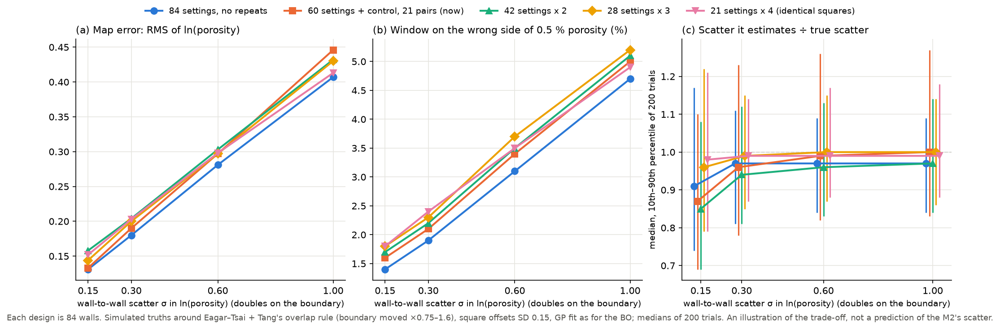

# Repeats or more settings? (M2 walls, PR #243, 2026-11-18)

Sterling asked whether the 84-wall build should print each condition three times, randomized over the plate, or
make the four squares identical, because nobody knows yet how far apart two walls at the same setting come out.

**Recommendation: keep the 61-set design (`wall_sheet.py`).** It already repeats: 18 settings and the 316L hatch
are printed on two squares (21 pairs), and the hatch six times. Going to 3 or 4 repeats cuts the map from 60
settings to 28 or 21, and in the simulation below that never paid off unless walls at one setting differ by about
3 times. Two additions cost no new parameter sets:

1. **Leave one of square 4's three copied parts unturned** (for example square 3's part 3). Its 7 walls become pure
   repeats on another square, so the scatter gets an estimate that orientation can't contaminate (10 degrees of
   freedom instead of 4), and 14 pairs still test orientation.
2. **Re-grind 2-3 mounts about 0.3 mm deeper and image them again.** That separates the scatter of a single section
   (few pores in about 5 mm2 of wall core) from the scatter between walls, which is the number Sterling is after.

## Simulation (`replicates.py`)

Each design is 84 walls. In each of 200 trials the true porosity map is drawn at random around Eagar-Tsai plus
Tang's overlap rule (the lack-of-fusion boundary moved by a factor of 0.75-1.6, its sharpness, the dense level and a
small keyhole term all random). Each square gets its own offset (SD 0.15 in ln porosity), and each wall gets noise
with SD sigma, doubled on the boundary. Each design is then fitted the same way, with a Gaussian process as for the
BO. The docstring has the details.

| sigma (ln porosity) | 84 settings | 60 + control, 21 pairs (now) | 42 x 2 | 28 x 3 | 21 x 4 (identical squares) |
| --- | --- | --- | --- | --- | --- |
| Map error, RMS of ln porosity: 0.15 | **0.131** | 0.133 | 0.158 | 0.144 | 0.152 |
| 0.3 | **0.180** | 0.190 | 0.204 | 0.200 | 0.203 |
| 0.6 | **0.281** | 0.297 | 0.303 | 0.297 | 0.298 |
| 1.0 | **0.407** | 0.446 | 0.432 | 0.430 | 0.413 |
| Window on the wrong side of 0.5 % porosity: 0.15 | **1.4 %** | 1.6 % | 1.7 % | 1.8 % | 1.8 % |
| 0.3 | **1.9 %** | 2.1 % | 2.2 % | 2.3 % | 2.4 % |
| 0.6 | **3.1 %** | 3.4 % | 3.5 % | 3.7 % | 3.5 % |
| 1.0 | **4.7 %** | 5.0 % | 5.1 % | 5.2 % | 4.9 % |
| Scatter estimate / true, 10th-90th percentile, sigma 0.3 | 0.81-1.11 (GP noise) | 0.78-1.23 | 0.81-1.12 | 0.85-1.15 | 0.87-1.14 |

- **Mapping:** more settings win at every scatter level. The current design is within 1-10 % of 84 settings; 28 x 3
  and 21 x 4 are 5-15 % worse at sigma 0.15-0.3 and only draw level near sigma 1 (walls at one setting differing by
  about 2.7 times).
- **Knowing the scatter:** every design estimates it to within about +-20 %, the replicated ones a little more
  tightly. The current design's model-free estimate rests on 22 degrees of freedom. Its pure repeats, at the same
  orientation, are only the hatch's 4 (0.54-1.57 of the truth); with one copy left unturned they become 10
  (0.71-1.36), and the map doesn't change (`replicates_summary.csv`, rows "turned +0.3" and "turned hurts cold
  walls").
- **What it leaves out:** heavy tails (an occasional wall with one big spatter pore) favour repeats; sharper
  features than this smooth truth favour more settings. The noise levels are the question being asked, so the
  figure spans them rather than assuming one.

## What the literature says about the scatter

Read in the open full text at the links, except where marked.

| Finding | Source |
| --- | --- |
| 316L, 9 positions on one plate: porosity "remains low (<0.07%) at all locations when the gas flow speed is above 2.5 m/s"; for melt pools "intra-specimen variations are much higher than any differences between the locations" | Reijonen et al. 2020, [10.1016/j.addma.2019.101030](https://doi.org/10.1016/j.addma.2019.101030), read in Reijonen's [thesis](https://utupub.fi/bitstream/handle/10024/179475/Annales%20F%2050%20Reijonen%20DISS.pdf?sequence=1) |
| 316L thin walls: 1.0 mm and thicker at most 0.027 % (CT) at 0, 45 and 90 degrees to the recoater over two builds; 0.7 mm walls 0.004 % at 0 vs 0.164 % at 90 | the same thesis, Table 8 |
| 316L single tracks, one specimen: "intra-specimen variations of 10–23% for penetration"; in walls, porosity from a polished section has "much more scatter" than CT | Reijonen et al. 2024, [10.1016/j.addma.2024.104180](https://doi.org/10.1016/j.addma.2024.104180) |
| Concept Laser M2, 316L, 130 um beam: keyhole depth along one track "about ±27%"; three repeat tracks at one setting: one large void, small voids, none | King et al. 2014, [10.1016/j.jmatprotec.2014.06.005](https://doi.org/10.1016/j.jmatprotec.2014.06.005) ([OSTI](https://www.osti.gov/servlets/purl/1502044)) |
| Concept Laser M2, 316L density map: no repeats; "multiple pillars built using a fixed set of process parameters will likely have slightly different densities" | Kamath et al. 2014, [10.1007/s00170-014-5954-9](https://doi.org/10.1007/s00170-014-5954-9) |
| Track-to-track melt-pool depth CV about 1-5 % on bare IN625, 13.5 % for the deepest, humping case (AM Bench 2018, computed from Table 3) | Lane et al. 2020, [10.1007/s40192-020-00169-1](https://doi.org/10.1007/s40192-020-00169-1) |
| Hastelloy X, optimised settings: porosity "fluctuated from 0.1% to 0.5%" across the platform | Shen et al. 2020, [10.1007/s11837-020-04020-y](https://doi.org/10.1007/s11837-020-04020-y) |

So for these walls: dense walls (well under 0.1 %) can differ by 50-100 % or more relative, because one section
holds a few pores, but they stay on the dense side of any boundary. Lack-of-fusion walls differ by about 10-30 %
(sigma 0.1-0.3). Melt-pool depth, the AM Module's calibration target, repeats to a few per cent against Eagar-Tsai's
23-75 um range over these walls. All three point to settings over repeats, with the 21 pairs to measure the scatter.
