# Visuals for the M2 single-track pilot (#100)

Figures and a 3-D animation of the plan in [`../m2-single-track-schedule.md`](../m2-single-track-schedule.md): single
tracks in stainless steel on BYU's Concept Laser M2, sectioned for SEM and compared with the Thermo-Calc AM Module.
Every number comes from the plan, except the build plate, which follows
[Nathan C.'s photo of it](https://github.com/vertical-cloud-lab/digital-alloy-lab/pull/243#issuecomment-6759290262)
(see below). Anything neither fixes, such as the machine's layout, the gas-flow direction and the melt-pool shapes,
is drawn as an assumption and labelled as one.

## The wall build in 3-D (what Carl is printing, 2026-11-20)

[`walls.py`](walls.py) animates the build in plan §4, ["Walls on stepped parts"](../m2-single-track-schedule.md#walls-on-stepped-parts-what-carl-is-printing-now-2026-11-17),
from the job file to the comparison with the AM Module. It uses the same machine, bench and `Scene` framework as the
single-track chapters below. The setup is 12 parts on the four panels, 7 walls 1.27 mm thick on each part, and 61
parameter sets, with square 4 turned 90°. Every wall's colour and setting comes from
[`wall_sheet.csv`](../m2-track-design/out/wall_sheet.csv). The animation follows part 1.1, one of the three parts
printed both ways.

**Likely problems are marked on screen.** Each one appears in an orange "Watch out" box under the step label, and
`out/m2w_*.json` lists them under `watch_out`.

**1/7 set up (B2, A1, B3).** Panels into the plate. The job file holds 84 walls and 61 sets. Part 1.1 and its notch
are shown, then the powder goes in.

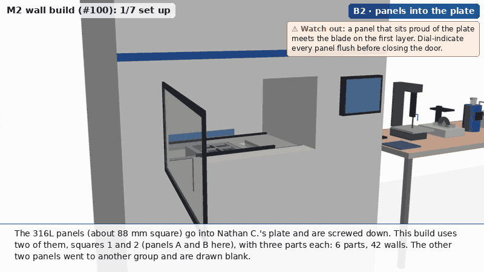

**2/7 print (B4, B5).** Inert the chamber, then print the bases with the 316L set and the walls layer by layer. One
wall layer is shown slowed down (contour, then this wall's hatch), followed by what to watch.

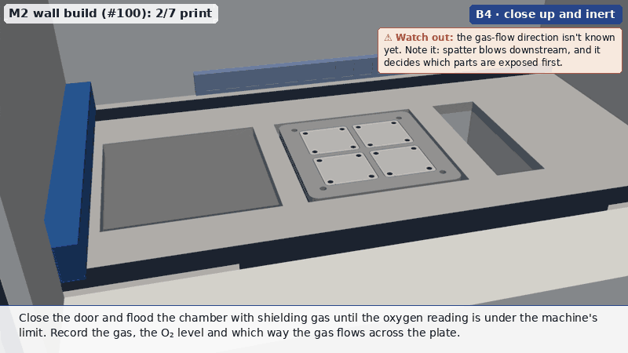

**3/7 unload (B6, B7, C1).** Depowder, then lift the panels out and photograph them. Number every part, then
bandsaw the parts off panel A.

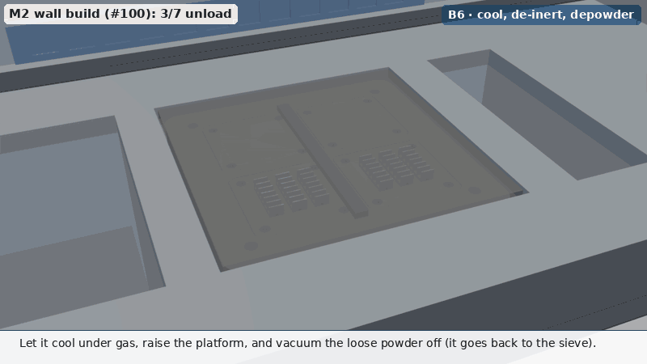

**4/7 section (C2).** Part 1.1 goes in the precision saw. Cut it lengthwise 1.5 mm off the centreline, then between
walls 4 and 5. The plane to grind to runs through every wall's mid-length.

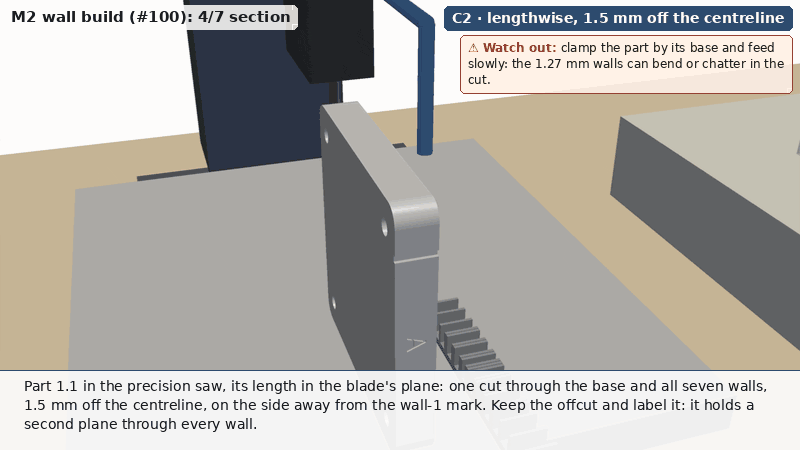

**5/7 mount and polish (C3, C4).** Hot-mount each piece with its cut face down, 24 mounts in all. Grind 1.5 mm to
the centreline, then polish.

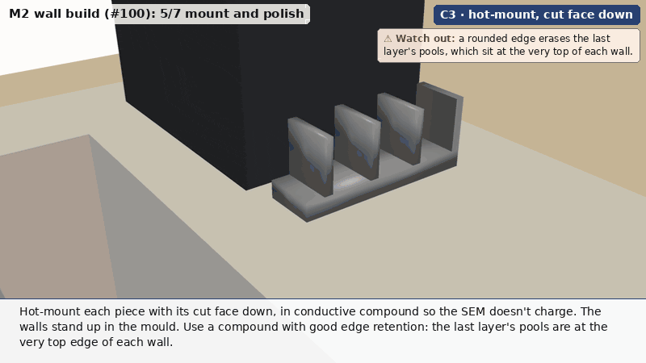

**6/7 SEM (C5, C4, C6).** Image porosity unetched in each wall's core band. Then etch and image the last layer's
melt pools at the top of each wall.

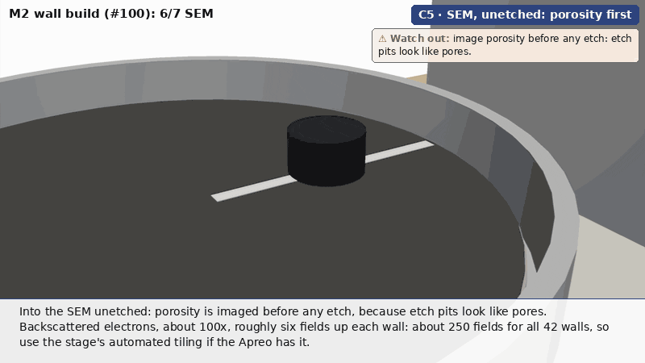

**7/7 analyse and compare (C6, C7).** Segment and classify the pores, then put each wall on the power–speed map.
The map shows the published 316L data and the CALPHAD-based keyhole threshold, where they exist (see below). The
last screen lists what each wall hands the AM Module and batch BO.

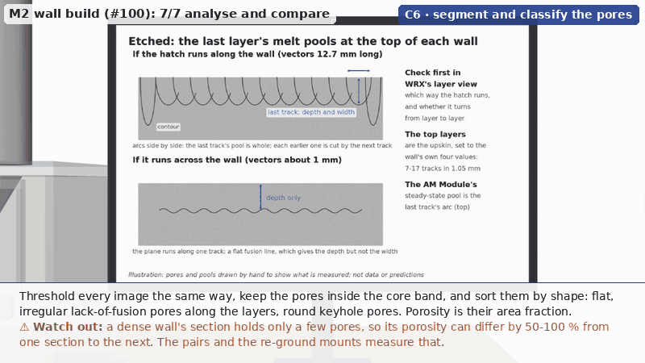

[`out/mp4/m2w_full.mp4`](out/mp4/m2w_full.mp4) joins all seven into one video with chapter marks (1280 x 720,
15 fps). [`out/mp4/m2w_full_chapters.txt`](out/mp4/m2w_full_chapters.txt) is the chapter list for a YouTube
description.

| Shown | Source |
| --- | --- |
| Part: 1.75 x 0.5 in base, 7 walls 0.05 in thick and 0.3 in tall, across the base's width | Carl (PR #243, 2026-11-17). The base is drawn 0.1 in thick, reading his 0.4 in as the overall height |
| 3 parts a square, 4 squares, square 4 turned 90° with copies of parts 1.1, 2.2 and 3.3; 61 sets | [`wall_sheet.py`](../m2-track-design/wall_sheet.py) |
| Each wall's P/v colour; the map's 61 settings and their Eagar–Tsai + overlap first guess | [`wall_sheet.csv`](../m2-track-design/out/wall_sheet.csv) |
| Contour with the standard set, then the wall's hatch at 0.09 mm; upskin at the wall's P and v | Plan §4, from Carl's WRX Control photos |
| Cuts: lengthwise 1.5 mm off the centreline, then between walls 4 and 5; grind to the centreline; 1.25 in conductive mounts | Plan §4 |
| **Assumed:** where the parts sit on each panel, the hatch running along the wall in the slowed-down layer, the bench tools | Not known yet; the hatch direction is one of the open questions |
| **Illustration only:** every pore, melt pool and porosity value on the monitor, and the BO panel | [`walls_screens.py`](walls_screens.py); each screen says so |

## Static figures

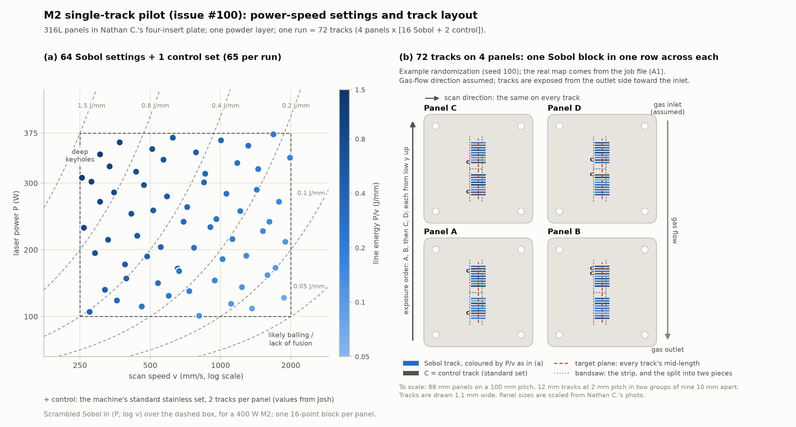

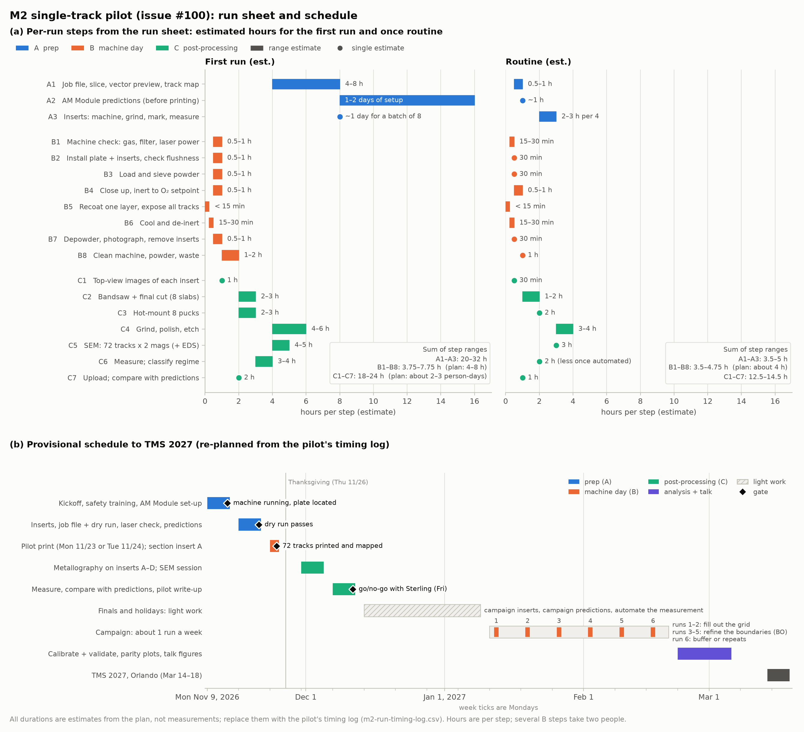

[`figures.py`](figures.py) draws both from the plan's tables. The track map is an example randomization (seed 100,
[`layout.py`](layout.py)); the real map comes from the job file (step A1). The durations are the plan's estimates,
to be replaced by the pilot's [timing log](../m2-run-timing-log.csv).

## The whole process in 3-D

Six short animations follow the run sheet, with step labels using its IDs. Six short GIFs instead of one long one
keep each under GitHub's ~5 MB. They follow panel A (insert A in the plan), as the plan does ("section insert A
first, all the way through SEM").

**The plate.** Nathan C.'s photo shows a plate about 10 in (254 mm) square, with rounded corners, a hole near each
corner, and four removable square panels in a 2 x 2 grid, each with four holes near its corners. Rectifying the
photo's top face to his 10 in gives pockets about 90 mm square on a 100 mm pitch (a 10 mm web between them),
panels about 88 mm (3.5 in) square (the dark outline round each, about 2.5 mm wide in the photo, includes the
edge breaks, so the clearance is drawn as 1 mm), panel holes about 34.5 mm from each panel's centre,
and corner holes about 26 mm in from the edges; the plate looks about 1 in thick. So all of these are +-5 %.

The tracks come from [`layout.py`](layout.py): one row of 18 across each panel's middle (plan §4), 12 mm long at
2 mm pitch in two groups of nine with a 10 mm gap, so every track's mid-length lies on one line, the target plane
that the cutting is built around (plan §3). Their power-speed settings are the track-design run's 64 Sobol points
([`../m2-track-design/`](../m2-track-design/)), one 16-point block per panel. `model.py` derives the strip, the cuts
and the pieces from the layout, so the cut chapter follows the tracks as long as their mid-lengths stay on one line.

**1/6 set up (B2, A1, B3).** The four panels go into the plate and are dial-indicated against it across the pocket
gap. The job file gives one vector per track, coloured by P/v as in the figure above. Powder goes into the dose
chamber.

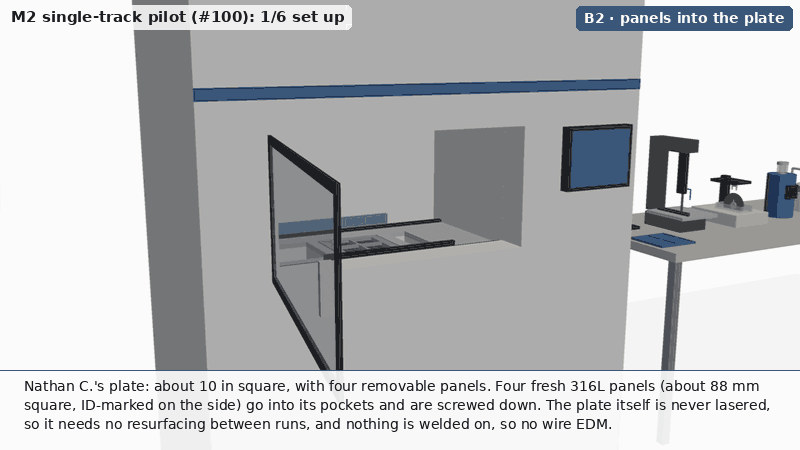

**2/6 print (B4, B5).** The door closes and the chamber is inerted. One recoated layer, then the laser draws the
tracks, from the gas-outlet side toward the inlet.

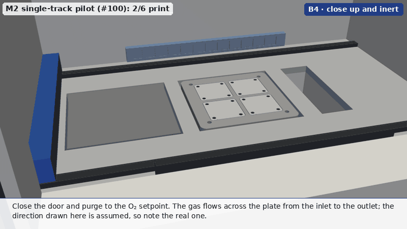

**3/6 unload (B6-C1).** De-inert, depowder, photograph, take out each panel's four screws and lift the panels out;
the plate only needs the powder blown out of the pocket gaps and screw holes. Top-view images of each panel; B to D
wait in a tray.

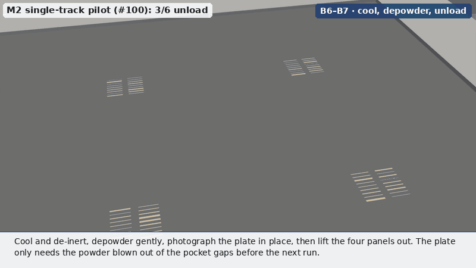

**4/6 cut (C2).** On the bandsaw, panel A lies flat against the fence. Two cuts across it, 3 mm to one side of the
target plane (red) and 7 mm to the other, free a strip about 10 mm wide that holds every track's mid-length; the rest
of the panel is scrap (a panel with tracks is used up). The strip is turned and cut into two pieces of nine tracks,
one per mount, and its blank ends come off. On the fine wet saw, piece 1 is lowered through the disc, which cuts all
the way through it 0.5 mm from the target plane, and a 1.5-2 mm sliver drops into the trough. The fine saw is
optional in the plan (grinding from a bandsaw cut 1.5-2 mm away also works); the pilot times both.

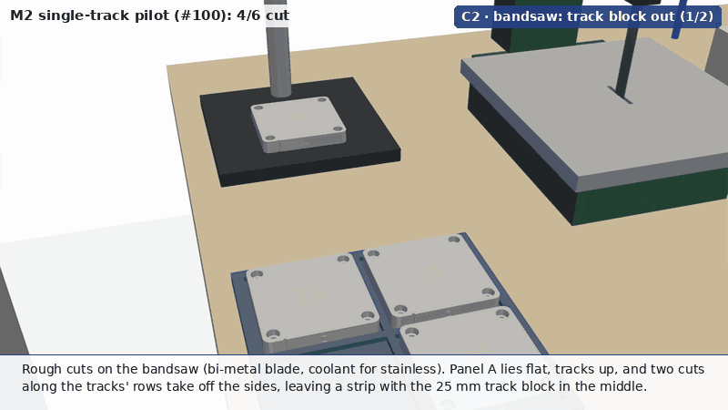

**5/6 mount, polish, SEM (C2-C5).** Grind the last 0.5 mm to the target plane, hot-mount (eight pucks per run),
grind, polish and etch, then SEM.

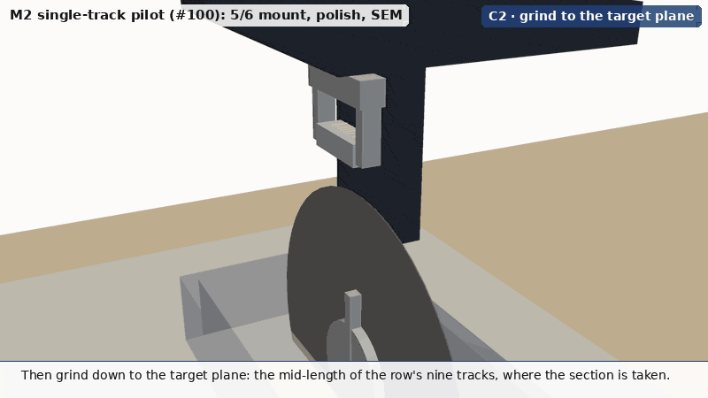

**6/6 measure and compare (C5-C7).** The SEM images, the measurements, and the parity plot against the AM Module.
All three are illustrations, and each says so on screen.

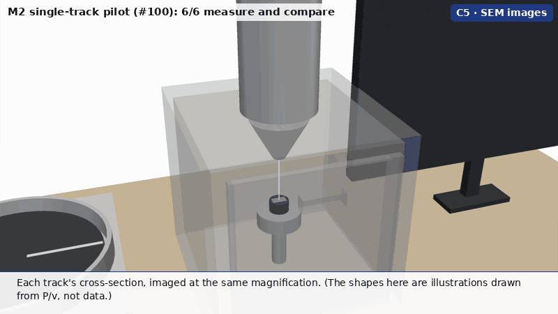

[`out/mp4/m2_full.mp4`](out/mp4/m2_full.mp4) joins all six (1280 x 720, 15 fps, 2 min 41 s) into one video with
chapter marks, for a talk or YouTube; [`out/mp4/m2_full_chapters.txt`](out/mp4/m2_full_chapters.txt) is the
chapter list for a YouTube description. The per-chapter MP4s are regenerated by `steps.py` and not committed.

### What is from the plan and what is assumed

| Shown | Source |
| --- | --- |
| The plate: about 10 in square, rounded corners, four corner holes; four removable panels about 88 mm square in 90 mm pockets on a 100 mm pitch, four holes each; the plate is never lasered | Nathan C.'s photo (PR #243), scaled from his "about 10 in", so +-5 %; plan §3 |
| **Assumed:** the plate about 1 in thick (read off the photo); panels 1/2 in thick in blind pockets; the panels' holes counterbored for cap screws (drawn) | Check against the drawings at the kickoff |
| One row of 18 tracks across each panel's middle, 12 mm long at 2 mm pitch in two groups of nine 10 mm apart, every mid-length on one line; one 16-point Sobol block (from `../m2-track-design/design.py`) + 2 controls per panel, randomized | Plan §4 ([`layout.py`](layout.py)) |
| One scan direction for every track; exposure from the outlet side toward the inlet | Plan §4 |
| Dial-indicating each panel; one recoated layer; inerting to the O₂ setpoint | Plan §3, §5 |
| Bandsaw: a 10 mm strip across the panel, 3 mm and 7 mm either side of the target plane, then two pieces of nine tracks; fine wet saw through each piece 0.5 mm from the plane (a 1.5-2 mm sliver drops off); grind the last 0.5 mm | Plan §3 |
| **Assumed:** a rip fence on the bandsaw; a gravity-fed low-speed saw (sample on an arm above the disc) standing in for "abrasive cut-off or precision saw" | Generic shapes; use whatever saws BYU has |
| 1.25 in conductive hot-mount pucks, eight per run; 320 and 800 grit, 3 µm diamond, 0.05 µm alumina; etch | Plan §3 |
| SEM, then measure width, depth, height and area, classify the regime, compare with the AM Module | Plan §1, §3 |
| **Assumed:** the M2's cabinet, chamber, dose / build / overflow layout, recoater and scanner position | Generic Concept Laser layout; not modelled from drawings |
| **Assumed:** gas flowing from the back of the chamber to the front | Note the real direction at the kickoff |
| **Assumed:** the bench tools (bandsaw, precision saw, press, polisher, SEM) | Generic shapes |
| **Illustration only:** track widths (2.5 times a rule-of-thumb width so they show), balling below 0.1 J/mm, the melt-pool shapes on the SEM screen, the made-up parity points | [`screens.py`](screens.py); the AM Module and the pilot's cross-sections replace them |

## Files

| File | What it is |
| --- | --- |
| [`layout.py`](layout.py) | The plate's sizes from Nathan C.'s photo, the 17 parameter sets and the example 72-track map, shared by the figures and the animation |
| [`figures.py`](figures.py) | The two static figures |
| [`model.py`](model.py) | CadQuery parts (M2 schematic, plate and panels, bench tools) and panel A's cut pieces, tessellated into PyVista and cached in `.cache/` |
| [`scene.py`](scene.py) | The `Scene` framework from [`atomizer-training/viz3d`](https://github.com/vertical-cloud-lab/digital-alloy-lab/blob/e64b3c5/atomizer-training/viz3d/scene.py) (imported from byu-vcl), with the inset hook of `sieving/viz3d`. It provides eased moves, groups with parents, captions, leader labels, gauges, and the GIF and MP4 writers. |
| [`screens.py`](screens.py) | The monitor's SEM, measurement and parity images (illustrations) |
| [`steps.py`](steps.py) | The six animations, and `full`, which joins them with chapter marks |
| [`walls.py`](walls.py) | The seven wall-build animations, and `full`, which joins them into `out/mp4/m2w_full.mp4` with chapter marks |
| [`walls_screens.py`](walls_screens.py) | The wall build's monitor screens: BSE sections, segmentation, etched pools (illustrations), the power–speed map (real settings) and the per-wall record |
| `out/<name>.gif` | 800 x 450, 10 fps, for GitHub |
| `out/<name>_still.png`, `out/<name>.json` | One 1280 x 720 frame; each sub-step's label, caption and frame range in the MP4 |
| `out/mp4/m2_full.mp4`, `out/mp4/m2_full_chapters.txt` | The six joined, 1280 x 720, 15 fps, h264, with chapter marks; the chapter list (the per-chapter MP4s are not committed) |

To render:

```bash
pip install cadquery pyvista pillow numpy matplotlib     # plus: apt-get install xvfb libgl1-mesa-dri gifsicle ffmpeg
python figures.py
xvfb-run -a -s "-screen 0 1920x1080x24" python steps.py setup print unload cut sem results
python steps.py full                                       # joins the six MP4s, with chapter marks
PREVIEW=1 xvfb-run -a -s "-screen 0 1920x1080x24" python steps.py cut   # last frame of each sub-step -> /tmp
xvfb-run -a -s "-screen 0 1920x1080x24" python walls.py setup print unload section mount sem results
python walls.py full                                       # joins the seven wall MP4s, with chapter marks
```
