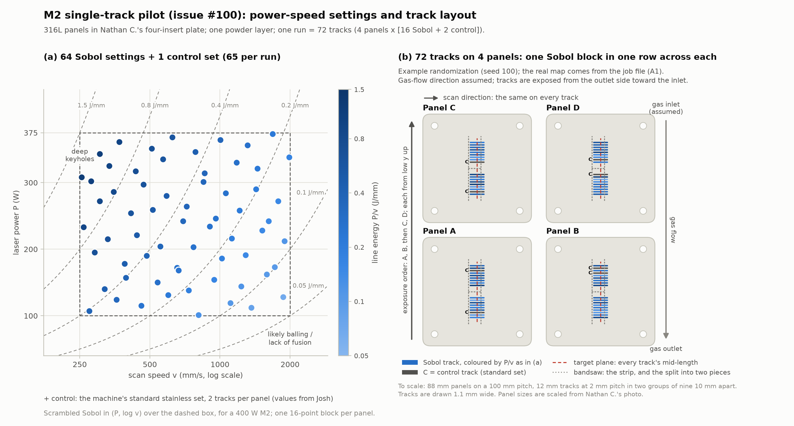
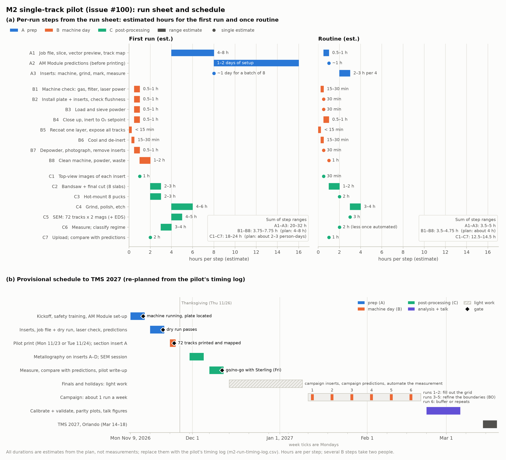

# Visuals for the M2 single-track pilot (#100)

Figures and a 3-D animation of the plan in [`../m2-single-track-schedule.md`](../m2-single-track-schedule.md): single
tracks in stainless steel on BYU's Concept Laser M2, sectioned for SEM and compared with the Thermo-Calc AM Module.
Every number comes from the plan. Anything the plan doesn't fix, such as the machine's layout, the gas-flow
direction and the melt-pool shapes, is drawn as an assumption and labelled as one.

## Static figures





[`figures.py`](figures.py) draws both from the plan's tables. The track map is an example randomization (seed 100,
[`layout.py`](layout.py)); the real map comes from the job file (step A1). The durations are the plan's estimates,
to be replaced by the pilot's [timing log](../m2-run-timing-log.csv).

## The whole process in 3-D

Three animations, one per stage of the run sheet, with step labels using the run-sheet IDs. They follow insert A, as
the plan does ("section insert A first, all the way through SEM").

**1/3 print (B2-B5).** Inserts go into the plate and are dial-indicated for flushness. The job file gives one vector
per track, coloured by P/v. Powder goes into the dose chamber, the door closes and the chamber is inerted. One
recoated layer, then the laser draws the tracks, from the gas-outlet side toward the inlet.


**2/3 unload and cut (B6-C2).** De-inert, depowder, photograph, and lift the inserts out. Top-view images. On the
bandsaw: the slab comes off, then it is split per row. Final face on the precision saw, 1.5 mm past mid-length.


**3/3 mount, SEM, compare (C2-C7).** Grind to the section plane, hot-mount (eight pucks per run), grind, polish and
etch, SEM, measure, and compare with the AM Module.


The three MP4s (1280 x 720, 15 fps) are in [`out/mp4/`](out/mp4/). [`out/mp4/m2_full.mp4`](out/mp4/m2_full.mp4)
joins them for a talk.

### What is from the plan and what is assumed

| Shown | Source |
| --- | --- |
| Four 25 mm 316L inserts in pockets of a 250 mm plate; the plate is never lasered | Plan §3 (the plan's example size; rescale to Nathan C.'s real inserts) |
| Two rows of nine 8 mm tracks per insert at 2 mm pitch, rows 3 mm apart, 3 mm margins; 16 grid sets + 2 controls per insert, randomized | Plan §4 ([`layout.py`](layout.py)) |
| One scan direction for every track; exposure from the outlet side toward the inlet | Plan §4 |
| Dial-indicating each insert; one recoated layer; inerting to the O₂ setpoint | Plan §3, §5 |
| Bandsaw: slab off, split per row, 1-2 mm from the target plane; final face on an abrasive or precision saw; grind to mid-length | Plan §3 |
| 1.25 in conductive hot-mount pucks, eight per run; 320 and 800 grit, 3 µm diamond, 0.05 µm alumina; etch | Plan §3 |
| SEM, then measure width, depth, height and area, classify the regime, compare with the AM Module | Plan §1, §3 |
| **Assumed:** the M2's cabinet, chamber, dose / build / overflow layout, recoater and scanner position | Generic Concept Laser layout; not modelled from drawings |
| **Assumed:** gas flowing from the back of the chamber to the front | Note the real direction at the kickoff |
| **Assumed:** where the inserts sit on the plate | Placeholder until the plate is located |
| **Assumed:** the bench tools (bandsaw, precision saw, press, polisher, SEM) | Generic shapes |
| **Illustration only:** track widths (2.5 times a rule-of-thumb width so they show), balling below 0.1 J/mm, the melt-pool shapes on the SEM screen, the made-up parity points | [`screens.py`](screens.py); the AM Module and the pilot's cross-sections replace them |

## Files

| File | What it is |
| --- | --- |
| [`layout.py`](layout.py) | The 17 parameter sets and the example 72-track map, shared by the figures and the animation |
| [`figures.py`](figures.py) | The two static figures |
| [`model.py`](model.py) | CadQuery parts (M2 schematic, plate and inserts, bench tools) and insert A's cut pieces, tessellated into PyVista and cached in `.cache/` |
| [`scene.py`](scene.py) | The `Scene` framework from [`atomizer-training/viz3d`](https://github.com/vertical-cloud-lab/digital-alloy-lab/blob/e64b3c5/atomizer-training/viz3d/scene.py) (imported from byu-vcl), with the inset hook of `sieving/viz3d`. It provides eased moves, groups with parents, captions, leader labels, gauges, and the GIF and MP4 writers. |
| [`screens.py`](screens.py) | The monitor's SEM, measurement and parity images (illustrations) |
| [`steps.py`](steps.py) | The three animations |
| `out/<name>.gif` | 800 x 450, 10 fps, for GitHub |
| `out/<name>_still.png`, `out/<name>.json` | One 1280 x 720 frame; each sub-step's label, caption and frame range in the MP4 |
| `out/mp4/<name>.mp4` | 1280 x 720, 15 fps, h264 |

To render:

```bash
pip install cadquery pyvista pillow numpy matplotlib     # plus: apt-get install xvfb libgl1-mesa-dri gifsicle ffmpeg
python figures.py
xvfb-run -a -s "-screen 0 1920x1080x24" python steps.py print cut sem
python steps.py full                                       # joins the three MP4s
PREVIEW=1 xvfb-run -a -s "-screen 0 1920x1080x24" python steps.py cut   # last frame of each sub-step -> /tmp
```
