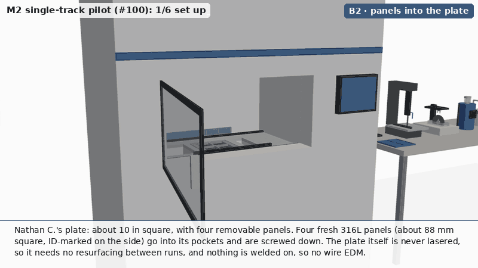
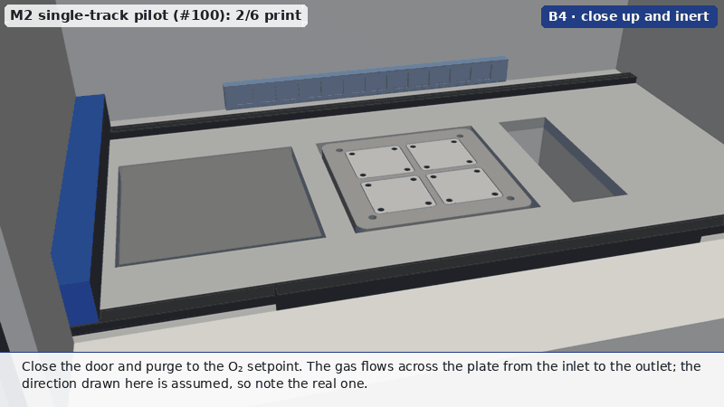
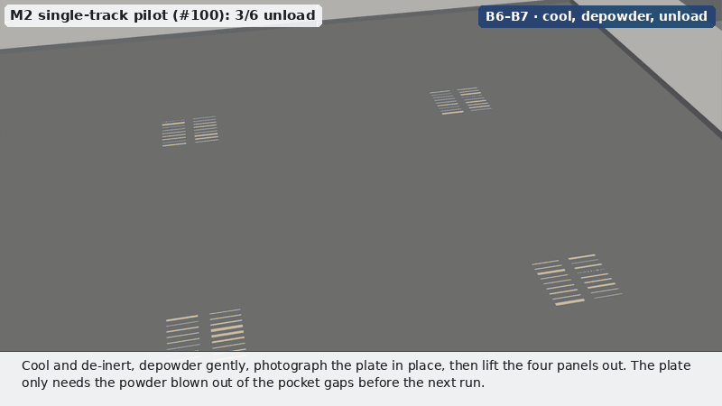
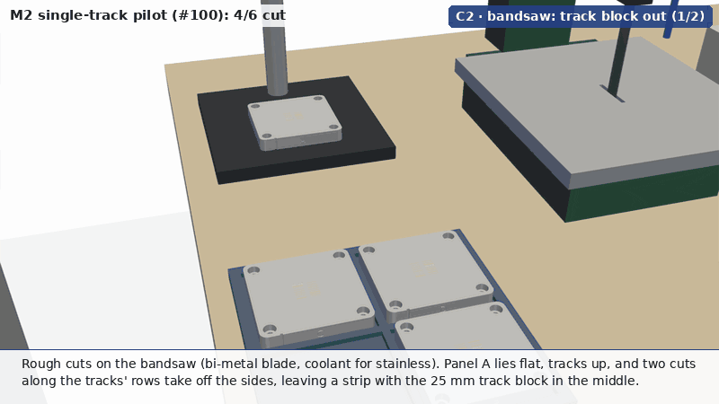
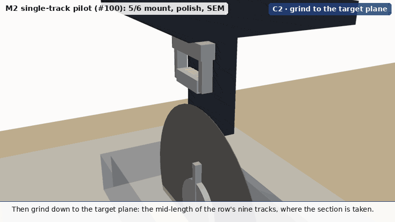
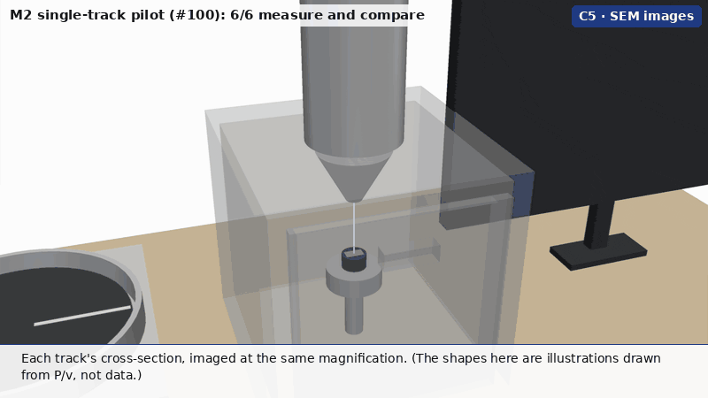

# Visuals for the M2 single-track pilot (#100)

Figures and a 3-D animation of the plan in [`../m2-single-track-schedule.md`](../m2-single-track-schedule.md): single
tracks in stainless steel on BYU's Concept Laser M2, sectioned for SEM and compared with the Thermo-Calc AM Module.
Every number comes from the plan, except the build plate, which follows
[Nathan C.'s photo of it](https://github.com/vertical-cloud-lab/digital-alloy-lab/pull/243#issuecomment-6759290262)
(see below). Anything neither fixes, such as the machine's layout, the gas-flow direction and the melt-pool shapes,
is drawn as an assumption and labelled as one.

## Static figures


[`figures.py`](figures.py) draws both from the plan's tables. The track map is an example randomization (seed 100,
[`layout.py`](layout.py)); the real map comes from the job file (step A1). The durations are the plan's estimates,
to be replaced by the pilot's [timing log](../m2-run-timing-log.csv).

## The whole process in 3-D

Six short animations follow the run sheet, with step labels using its IDs. Six short GIFs instead of one long one
keep each under GitHub's ~5 MB. They follow panel A (insert A in the plan), as the plan does ("section insert A
first, all the way through SEM").

**The plate.** Nathan C.'s photo shows a plate about 10 in (254 mm) square, with rounded corners, a hole near each
corner, and four removable square panels in a 2 x 2 grid, each with four holes near its corners. Rectifying the
photo's top face to his 10 in gives pockets about 90 mm square on a 100 mm pitch (a 10 mm web between them),
panels about 88 mm (3.5 in) square (the dark outline round each, about 2.5 mm wide in the photo, includes the
edge breaks, so the clearance is drawn as 1 mm), panel holes about 34.5 mm from each panel's centre,
and corner holes about 26 mm in from the edges; the plate looks about 1 in thick. So all of these are +-5 %.

The tracks come from [`layout.py`](layout.py), which still has the earlier layout: two rows of nine in a 25 mm block,
drawn at each panel's centre. Plan §4 now puts one row of 18 tracks across each panel's middle, and the track-design
run on this PR is revising `layout.py` (track length, spacing, Sobol sampling); re-rendering picks that up.

**1/6 set up (B2, A1, B3).** The four panels go into the plate and are dial-indicated against it across the pocket
gap. The job file gives one vector per track, coloured by P/v as in the figure above. Powder goes into the dose
chamber.



**2/6 print (B4, B5).** The door closes and the chamber is inerted. One recoated layer, then the laser draws the
tracks, from the gas-outlet side toward the inlet.



**3/6 unload (B6-C1).** De-inert, depowder, photograph, and lift the panels out; the plate only needs the powder
blown out of the pocket gaps. Top-view images of each panel; B to D wait in a tray.



**4/6 cut (C2).** On the bandsaw: two cuts along the rows and two across free the 25 mm track block from panel A
(a panel with tracks is used up). Then the block's slab comes off and is split per row. Final face on the precision
saw, 1.5 mm past mid-length. Plan §3 now takes a 10 mm strip holding every track's section plane across the panel
instead, and this chapter is being reworked to match.



**5/6 mount, polish, SEM (C2-C5).** Grind to the section plane, hot-mount (eight pucks per run), grind, polish and
etch, then SEM.



**6/6 measure and compare (C5-C7).** The SEM images, the measurements, and the parity plot against the AM Module.
All three are illustrations, and each says so on screen.



[`out/mp4/m2_full.mp4`](out/mp4/m2_full.mp4) joins all six (1280 x 720, 15 fps, 2 min 41 s) into one video with
chapter marks, for a talk or YouTube; [`out/mp4/m2_full_chapters.txt`](out/mp4/m2_full_chapters.txt) is the
chapter list for a YouTube description. The per-chapter MP4s are regenerated by `steps.py` and not committed.

### What is from the plan and what is assumed

| Shown | Source |
| --- | --- |
| The plate: about 10 in square, rounded corners, four corner holes; four removable panels about 88 mm square in 90 mm pockets on a 100 mm pitch, four holes each; the plate is never lasered | Nathan C.'s photo (PR #243), scaled from his "about 10 in", so +-5 %; plan §3 |
| **Assumed:** the plate about 1 in thick (read off the photo); panels 1/2 in thick in blind pockets; the panels' holes counterbored for screws | Check against the drawings at the kickoff |
| Two rows of nine 8 mm tracks at 2 mm pitch, rows 3 mm apart, in a 25 mm block at each panel's centre; one 16-point Sobol block (from `../m2-track-design/design.py`) + 2 controls per panel, randomized. The plan now has one row of 18 tracks, 10 mm long | Plan §4 ([`layout.py`](layout.py)) |
| One scan direction for every track; exposure from the outlet side toward the inlet | Plan §4 |
| Dial-indicating each insert; one recoated layer; inerting to the O₂ setpoint | Plan §3, §5 |
| Bandsaw: the track block out of the panel (four cuts), slab off, split per row, 1-2 mm from the target plane; final face on an abrasive or precision saw; grind to mid-length | This run's stand-in for the panels: plan §3 now takes a 10 mm strip across each panel instead, and the cut chapter is being reworked to match |
| 1.25 in conductive hot-mount pucks, eight per run; 320 and 800 grit, 3 µm diamond, 0.05 µm alumina; etch | Plan §3 |
| SEM, then measure width, depth, height and area, classify the regime, compare with the AM Module | Plan §1, §3 |
| **Assumed:** the M2's cabinet, chamber, dose / build / overflow layout, recoater and scanner position | Generic Concept Laser layout; not modelled from drawings |
| **Assumed:** gas flowing from the back of the chamber to the front | Note the real direction at the kickoff |
| **Assumed:** the bench tools (bandsaw, precision saw, press, polisher, SEM) | Generic shapes |
| **Illustration only:** track widths (2.5 times a rule-of-thumb width so they show), balling below 0.1 J/mm, the melt-pool shapes on the SEM screen, the made-up parity points | [`screens.py`](screens.py); the AM Module and the pilot's cross-sections replace them |

## Files

| File | What it is |
| --- | --- |
| [`layout.py`](layout.py) | The plate's sizes from Nathan C.'s photo, the 17 parameter sets and the example 72-track map, shared by the figures and the animation |
| [`figures.py`](figures.py) | The two static figures |
| [`model.py`](model.py) | CadQuery parts (M2 schematic, plate and panels, bench tools) and panel A's cut pieces, tessellated into PyVista and cached in `.cache/` |
| [`scene.py`](scene.py) | The `Scene` framework from [`atomizer-training/viz3d`](https://github.com/vertical-cloud-lab/digital-alloy-lab/blob/e64b3c5/atomizer-training/viz3d/scene.py) (imported from byu-vcl), with the inset hook of `sieving/viz3d`. It provides eased moves, groups with parents, captions, leader labels, gauges, and the GIF and MP4 writers. |
| [`screens.py`](screens.py) | The monitor's SEM, measurement and parity images (illustrations) |
| [`steps.py`](steps.py) | The six animations, and `full`, which joins them with chapter marks |
| `out/<name>.gif` | 800 x 450, 10 fps, for GitHub |
| `out/<name>_still.png`, `out/<name>.json` | One 1280 x 720 frame; each sub-step's label, caption and frame range in the MP4 |
| `out/mp4/m2_full.mp4`, `out/mp4/m2_full_chapters.txt` | The six joined, 1280 x 720, 15 fps, h264, with chapter marks; the chapter list (the per-chapter MP4s are not committed) |

To render:

```bash
pip install cadquery pyvista pillow numpy matplotlib     # plus: apt-get install xvfb libgl1-mesa-dri gifsicle ffmpeg
python figures.py
xvfb-run -a -s "-screen 0 1920x1080x24" python steps.py setup print unload cut sem results
python steps.py full                                       # joins the six MP4s, with chapter marks
PREVIEW=1 xvfb-run -a -s "-screen 0 1920x1080x24" python steps.py cut   # last frame of each sub-step -> /tmp
```
