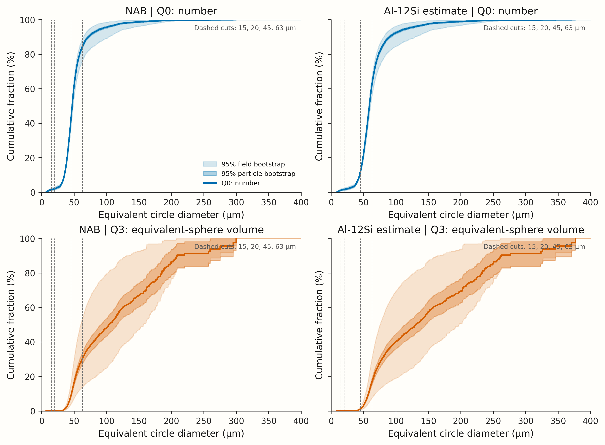
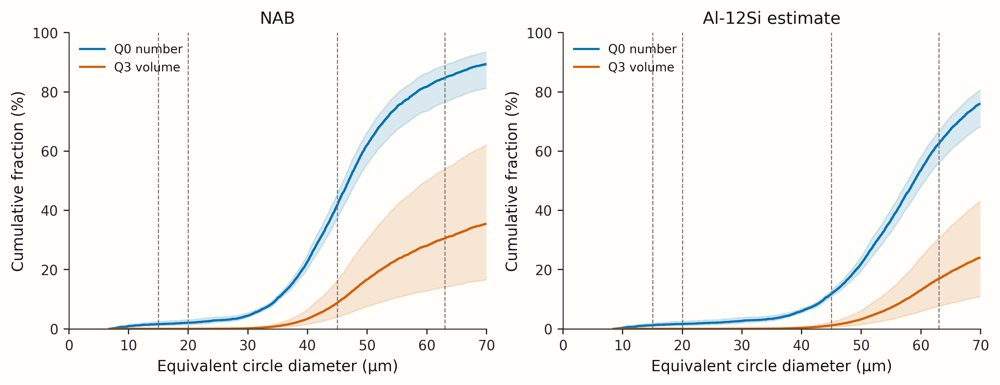
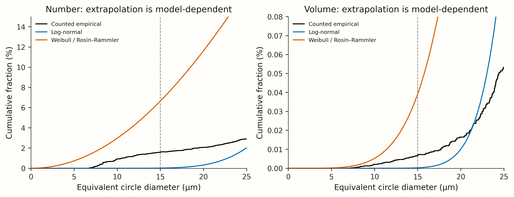
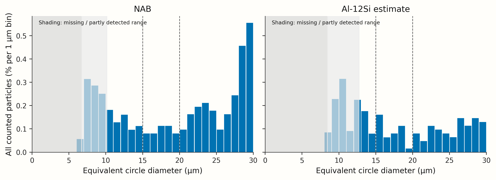

# Fine-end particle-size analysis: nickel–aluminium bronze and an aluminium scaling estimate

## Executive answer

I find a small **counted fine mass**, but not necessarily a negligible fine **particle count**. For the measured nickel–aluminium bronze (NAB), removing <20 µm costs **0.0540 g per 100 g of <63 µm powder**, or **0.1874 g per 100 g of <45 µm powder**. The corresponding <15 µm cuts cost **0.0223** and **0.0773 g**, respectively. The upper cut dominates the calculated yield: only **30.48%** of the measured volume is <63 µm and **8.79%** is <45 µm.

The Lang scaling estimate makes Al-12Si diameters **1.256 times larger**, not smaller. It predicts **16.81% mass in 20–63 µm** and **1.180% in 15–45 µm**, conditional on transferring the measured NAB distribution shape. This is not an aluminium measurement or a validated process model.

**Important limitation:** the SEM count is incomplete below about 6.7–10.1 µm. The bootstrap intervals describe the counted distribution, not unseen fines, stub representativeness, or the uncertainty in transferring from NAB to aluminium. The data do not support a finite upper bound below 100% for the true fine fractions without additional assumptions.

## 1. Data, definitions and uncertainty

I use exactly the **5,937 `included == True` particles**, including flagged particles, from **nine fields** and 27.756 mm² union area. I use corrected `ecd_um`, not raw ECD, fitted-circle diameter or `d_sphere_um`. I keep the supplied Miles–Lantuejoul `weight` attached to each particle.

For cut \(t\),

\[
Q_0(t)=\frac{\sum_i w_i\mathbf1(d_i<t)}{\sum_iw_i},\qquad
Q_3(t)=\frac{\sum_iw_id_i^3\mathbf1(d_i<t)}{\sum_iw_id_i^3}.
\]

The sphere factor \(\pi/6\) cancels. Q3 is a mass fraction **only if density does not depend on size within that alloy** and the equivalent-sphere approximation is adequate. Window fractions are \(Q_3(u)-Q_3(l)\), meaning \(l\le d<u\).

I run **20,000 bootstrap replicates** for each design, seed 20261027:

- **Particle bootstrap:** resample 5,937 particle records uniformly with replacement, keeping their weights. Multinomial multiplicities implement exactly this ordinary bootstrap; I do not sample in proportion to the correction weights and then weight again.
- **Field bootstrap:** resample nine complete field clusters uniformly with replacement and pool their particles and weights, including repeated fields. I do not renormalize fields to equal particle number or area: the target remains the supplied weighted pooled particle population, not an equal-field average.
- I report separate 2.5th–97.5th percentile intervals. Conditional fractions are recalculated in each replicate, not formed by dividing interval endpoints. Figure bands are **pointwise**, not simultaneous confidence bands.

Spatial segregation matters: field `3.2nA_004` contributes **39.62%** of the volume proxy, has a median counted diameter of 88.15 µm, and only **1.53%** of its volume <63 µm. Other fields have **35.29–62.36%** <63 µm. With only nine fields, even cluster-bootstrap intervals are approximate; neighbouring or overlapping source images may remain dependent. These intervals cannot establish that the stub or lot was sampled randomly.

My inverse empirical-CDF D10/D50/D90 values are **34.82/46.90/71.46 µm by number** and **45.78/103.68/208.60 µm by volume**. These reproduce the uploaded summary to its practical precision; minor last-digit differences depend on quantile interpolation. The weighted <20 µm number share is 2.064%, matching its rounded 2.1%.

## 2. Counted NAB cumulative fractions

All table entries below are **percent**, not fractions. Small volume shares are deliberately not rounded to zero.

### Q0: number

| Range / measure   | Weighting   |   Estimate | 95% particle interval   | 95% field interval   |
|:------------------|:------------|-----------:|:------------------------|:---------------------|
| <10 µm            | number      |      0.911 | 0.625–1.23              | 0.450–1.46           |
| <15 µm            | number      |      1.59  | 1.24–1.96               | 1.05–2.40            |
| <20 µm            | number      |      2.06  | 1.67–2.48               | 1.43–2.98            |
| <25 µm            | number      |      2.91  | 2.45–3.39               | 2.20–3.92            |
| <32 µm            | number      |      6.19  | 5.56–6.83               | 5.53–6.97            |
| <45 µm            | number      |     41.84  | 40.58–43.09             | 37.25–45.61          |
| <63 µm            | number      |     84.65  | 83.71–85.57             | 76.40–88.93          |

### Q3: equivalent-sphere volume / mass

| Range / measure   | Weighting   |   Estimate | 95% particle interval   | 95% field interval   |
|:------------------|:------------|-----------:|:------------------------|:---------------------|
| <10 µm            | volume      |    0.00203 | 0.00137–0.00281         | 0.000689–0.00470     |
| <15 µm            | volume      |    0.00679 | 0.00508–0.00872         | 0.00431–0.0123       |
| <20 µm            | volume      |    0.0165  | 0.0124–0.0212           | 0.0109–0.0268        |
| <25 µm            | volume      |    0.0532  | 0.0418–0.0665           | 0.0339–0.0843        |
| <32 µm            | volume      |    0.371   | 0.314–0.436             | 0.180–0.682          |
| <45 µm            | volume      |    8.79    | 7.86–9.84               | 3.92–16.31           |
| <63 µm            | volume      |   30.48    | 27.36–33.94             | 13.99–53.73          |



**Figure 1.** NAB and scaled Al-12Si estimates. Blue is Q0 and orange is Q3. Dark bands are particle-bootstrap intervals; light bands are field-bootstrap intervals. Vertical lines mark 15, 20, 45 and 63 µm. All bands are conditional on the observed particles and, for Al, on a fixed scale ratio. `cdf_pointwise_intervals.csv` and `empirical_distributions.csv` provide the numerical curves.



**Figure 2.** Detail of the sieve-relevant size range. Shading shows the 95% field-bootstrap intervals; Figure 1 includes both bootstrap designs.

## 3. Detection limit: what is and is not bounded

### Model-free limitation

The nominal 10-pixel exclusion corresponds to approximately **6.74, 8.99 and 10.13 µm** across fields. Corrected ECD and segmentation shape mean that this is not a perfectly calibrated sharp completeness function. I do not add the excluded `below_cut` records: they are outside the specified counted population and cannot be assumed to be a complete, duplicate-free measurement of the missing fines.

An arbitrary unseen population below these cutoffs can make the true sub-10 and sub-15 µm number and volume fractions approach 100%. Thus **there is no useful nonparametric upper bound** from these files alone. Under the simplified assumption that all missing particles are below 10 µm, the counted fractions are lower bounds for both thresholds. With the coarsest field's cutoff slightly above 10 µm, the sub-10 denominator can also grow from missed particles just above 10 µm, so even that monotone lower-bound interpretation needs care. Missing fines below 15 µm necessarily increase its fraction under this cutoff model.

### Two explicit extrapolation scenarios

I fit **number-distribution** log-normal and Weibull/Rosin–Rammler models to the weighted particles at **d ≥15 µm**, using left-truncated maximum likelihood:

\[
\ell(\theta)=\sum_{d_i\ge15}w_i\{\log f_\theta(d_i)-\log[1-F_\theta(15)]\}.
\]

The fitted log-normal parameters are \(\mu=3.89662\), \(s=0.33093\), with \(\log(d/\mathrm{µm})\sim N(\mu,s^2)\). Weibull parameters are shape \(k=2.03499\), scale \(\lambda=55.86073\) µm, with \(F(d)=1-\exp[-(d/\lambda)^k]\). Volume predictions integrate \(d^3f(d)\): I do not confuse a Rosin–Rammler mass fit with a number fit.

The table distinguishes two uses of these models:

1. **Whole-model extrapolation:** treat the fitted family as the entire true population. This can predict fewer fines than are already counted and is therefore not automatically a correction.
2. **Detection-aware completion:** retain every counted particle and add the model-predicted missing particles below each field's nominal limit \(L_f=10\,\mathrm{px\_um}_f\). I anchor each field's number intensity to its observed weighted number at ≥15 µm: \(A_f=W_{f,\ge15}/[1-F(15)]\). Missing number below threshold \(t\) is \(\sum_f A_fF(\min(t,L_f))\); missing volume is \(\sum_f A_f\int_0^{\min(t,L_f)}d^3f(d)\,\mathrm{d}d\). I add these terms to the empirical numerator and denominator.

| Population / scenario         | Cut    |   Number (%) |   Volume (%) |
|:------------------------------|:-------|-------------:|-------------:|
| Counted                       | <10 µm |      0.911   |     0.00203  |
| Log-normal: whole model       | <10 µm |      7.3e-05 |     3.13e-07 |
| Log-normal: counted + missing | <10 µm |      0.911   |     0.00203  |
| Weibull: whole model          | <10 µm |      2.97    |     0.00524  |
| Weibull: counted + missing    | <10 µm |      2.63    |     0.00335  |
| Counted                       | <15 µm |      1.59    |     0.00679  |
| Log-normal: whole model       | <15 µm |      0.0164  |     0.000228 |
| Log-normal: counted + missing | <15 µm |      1.59    |     0.00679  |
| Weibull: whole model          | <15 µm |      6.65    |     0.0393   |
| Weibull: counted + missing    | <15 µm |      3.3     |     0.00812  |

All entries are %. In the completion scenario, the log-normal changes the counted values negligibly. The Weibull completion moves sub-10 number from **0.911% to 2.626%**, and sub-15 number from **1.593% to 3.301%**: increases of **1.715 and 1.708 percentage points**. Its volume estimates move from **0.002033% to 0.003349%** (<10) and **0.006791% to 0.008123%** (<15). These are **model-conditional scenarios, not upper confidence limits**.

Neither global family describes the fine tail well. In the approximately observable 10–15 µm interval, the observed weighted count is **43.29**; the truncated fits predict **1.02** (log-normal) and **246.18** (Weibull). The log-normal's whole-population <15 prediction is only **0.0164% by number**, far below the **1.593% already counted**. The Weibull overpredicts 10–15 µm. Their conditional empirical-CDF discrepancies above 15 µm are 0.117 and 0.186, respectively (descriptive, not independent-particle hypothesis-test p-values). I therefore do not report these models as calibrated detection corrections or combine their results into a supposed 95% bound.

A nonparametric stress test makes the limitation concrete: if completely unseen **5 µm** spheres comprised only **0.1% of true mass**, the true <10 µm number fraction would be **69.0%**, while its mass fraction would be **0.102%**. This is an assumption-based counterexample, not evidence that such a population exists. A dedicated higher-magnification, representative sample is needed to constrain it.



**Figure 3.** Whole-model extrapolations, not the detection-aware completion curves. Both fits use only counted sizes ≥15 µm (dashed line). Their disagreement with the counted fine tail is why I do not treat either fit as a bound.

## 4. Sieve windows and lower-cut mass loss

### Mass fraction of the original measured powder in each ideal window

| Range / measure   | Weighting   |   Estimate | 95% particle interval   | 95% field interval   |
|:------------------|:------------|-----------:|:------------------------|:---------------------|
| 20–63 µm          | volume      |      30.46 | 27.34–33.93             | 13.98–53.70          |
| 15–45 µm          | volume      |       8.78 | 7.86–9.83               | 3.92–16.30           |
| 20–45 µm          | volume      |       8.77 | 7.85–9.82               | 3.91–16.29           |
| 0–63 µm           | volume      |      30.48 | 27.36–33.94             | 13.99–53.73          |

### Grams removed per 100 g already passing the upper sieve

For lower cut \(l\) and upper cut \(u\),

\[
\mathrm{removed\ g/100g}=100\frac{Q_3(l)}{Q_3(u)}.
\]

| Range / measure        | Weighting   |   Estimate | 95% particle interval   | 95% field interval   |
|:-----------------------|:------------|-----------:|:------------------------|:---------------------|
| Remove <20 from <63 µm | volume      |     0.054  | 0.0414–0.0680           | 0.0354–0.0866        |
| Remove <15 from <63 µm | volume      |     0.0223 | 0.0169–0.0280           | 0.0125–0.0385        |
| Remove <20 from <45 µm | volume      |     0.187  | 0.143–0.236             | 0.122–0.307          |
| Remove <15 from <45 µm | volume      |     0.0773 | 0.0586–0.0970           | 0.0425–0.138         |

These are conditional losses from the **sieved powder**, not percentages of the starting lot. For example, a <20 µm lower cut removes 0.0540 g out of 100 g of <63 µm NAB powder; 99.9460 g remains. At the <45 µm upper cut, 99.8126 g remains.

The **250 µm** sieve is a coarse protection step; it does not remove fine particles. Under ideal nested cuts it does not alter the final <63 or <45 µm population. The counted distribution predicts 91.20% NAB mass passing 250 µm, but only 30.48% passing 63 µm and 8.79% passing 45 µm. **8-inch diameter affects handling and throughput, not the ideal aperture-based fraction.** Actual recovery may differ because of sieve blinding, agglomeration, particle shape, loading, handling losses and non-sharp passage. ECD is a projected-area size, not a direct sieve-aperture measurement.

With 250/63/45 µm sieves alone you obtain **0–63 or 0–45 µm**, not certified **20–63 or 15–45 µm**. A lower cut requires an additional separation step. These PSD-derived yield numbers are not a demonstration that any unsieved fine content is acceptable for LPBF quality or powder handling.

## 5. Scaling NAB to Al-12Si

Lang (1962) reports number-median droplets at 0.34 times the capillary wavelength [1]. At the same frequency,

\[
r=\frac{d_{\mathrm{Al}}}{d_{\mathrm{NAB}}}
=\left[\frac{\sigma_{\mathrm{Al}}/\rho_{\mathrm{Al}}}{\sigma_{\mathrm{NAB}}/\rho_{\mathrm{NAB}}}\right]^{1/3}
=\left[\frac{0.85/2400}{1.25/7000}\right]^{1/3}
=1.2564.
\]

I use **liquid**, not solid, densities in SI units. The property endpoints in `context.md` give **1.2153–1.2981**. This is a property-range sensitivity interval, **not a 95% probability interval**. At 39.7 kHz the central absolute Lang diameters are 48.19 µm NAB and 60.55 µm Al-12Si. The empirical NAB number median is 46.90 µm; its rescaled value is 58.92 µm. I use the empirical distribution times the ratio, not the absolute Lang prediction, for all Al tables.

I multiply every counted diameter by 1.2564 and retain its number weight. All particle volumes acquire the same factor \(r^3\), which cancels on normalization. Thus \(Q_{p,\mathrm{Al}}(t)=Q_{p,\mathrm{NAB}}(t/r)\). Applying one median ratio to the entire distribution is an **additional shape-preserving assumption**, not a result established by Lang's theory.

### Requested Al-12Si fractions, percent

| Range / measure   | Weighting   |   Estimate | 95% particle interval   | 95% field interval   |
|:------------------|:------------|-----------:|:------------------------|:---------------------|
| <15 µm            | number      |    1.21    | 0.887–1.55              | 0.808–1.76           |
| <15 µm            | volume      |    0.00344 | 0.00249–0.00453         | 0.00174–0.00663      |
| <20 µm            | number      |    1.64    | 1.28–2.02               | 1.08–2.45            |
| <20 µm            | volume      |    0.00743 | 0.00557–0.00953         | 0.00480–0.0130       |
| <25 µm            | number      |    2.06    | 1.67–2.48               | 1.43–2.98            |
| <25 µm            | volume      |    0.0165  | 0.0124–0.0212           | 0.0109–0.0268        |
| 20–63 µm          | number      |   60.8     | 59.54–62.04             | 53.87–65.19          |
| 20–63 µm          | volume      |   16.81    | 15.06–18.78             | 7.56–30.37           |
| 15–45 µm          | number      |   10.56    | 9.78–11.34              | 9.50–11.62           |
| 15–45 µm          | volume      |    1.18    | 1.03–1.35               | 0.529–2.23           |

### Lower-cut removal in the Al scaling scenario, g per 100 g passing upper sieve

| Range / measure        | Weighting   |   Estimate | 95% particle interval   | 95% field interval   |
|:-----------------------|:------------|-----------:|:------------------------|:---------------------|
| Remove <20 from <63 µm | volume      |     0.0442 | 0.0337–0.0554           | 0.0246–0.0776        |
| Remove <15 from <63 µm | volume      |     0.0205 | 0.0150–0.0263           | 0.0144–0.0301        |
| Remove <20 from <45 µm | volume      |     0.628  | 0.474–0.797             | 0.345–1.14           |
| Remove <15 from <45 µm | volume      |     0.291  | 0.212–0.378             | 0.198–0.455          |

With only the liquid-property scale range varied, the predicted **20–63 µm mass yield is 14.38–19.38%**, and **15–45 µm mass yield is 0.835–1.623%**. These sensitivity ranges do not include field or transfer uncertainty. At fixed central scaling, the field-bootstrap ranges are **7.56–30.37%** and **0.529–2.227%**, respectively.

**I would not use these as reliable aluminium lot predictions.** NAB and Al-12Si differ in alloy composition, viscosity and oxide behaviour, temperature/superheat and solidification. Melt flow rate, film formation and wetting, plate condition or geometry, amplitude and actual vibration coupling can change the distribution and its tails even at nominally identical settings. The model omits droplet-to-solid dimensional changes. The Mo plate, booster and nominal amplitude being similar does not establish identical atomization dynamics. The NAB stub may be size-segregated and nonrepresentative. The initial qualitative Al observation of relatively large particles does not validate this transfer. The supplied Al-12Si properties also do not quantify **6063**: I make no separate 6063 prediction.

## 6. Fine-end histogram and LPBF particle counts



**Figure 4.** Weighted number percentages in 1 µm bins below 30 µm, normalized to **all counted particles**, not only those <30 µm. Gray shading marks the nominal absent and partially detected ranges; in the Al panel it is the **inherited NAB measurement limit after scaling**, not a measured Al detection limit. The histogram cannot demonstrate absence of particles in that range.

A powder layer's absolute particle count cannot be inferred from the PSD alone. It also requires layer area, thickness, solid packing fraction and a valid model of how recoating selects particles. If the layer mirrors the corresponding sieved feed, the counted estimates are:

| Feed                   |   <20 µm particles / 1,000 | 95% field interval / 1,000   |
|:-----------------------|---------------------------:|:-----------------------------|
| NAB, <63 µm            |                       24.4 | 16.3–37.6                    |
| NAB, <45 µm            |                       49.3 | 33.1–76.6                    |
| Scaled Al-12Si, <63 µm |                       26.3 | 16.9–41.4                    |
| Scaled Al-12Si, <45 µm |                      139.6 | 92.3–210.9                   |

The intervals are **95% field-bootstrap intervals**, expressed per 1,000 particles. Unsieved NAB and scaled Al have about **20.6** and **16.4** particles <20 µm per 1,000, respectively. Upper sieving enriches the fine number share, particularly the scaled <45 µm Al estimate, because its main population is shifted above the upper cut.

For a layer area \(A\), thickness \(h\) and solid packing fraction \(\phi\),

\[
N_{<20}=\frac{\phi Ah}{\langle V\rangle_{\mathrm{number},\,d<u}}
\frac{Q_0(20)}{Q_0(u)},\qquad
\langle V\rangle=\frac{\pi}{6}\frac{\sum_{d_i<u}w_id_i^3}{\sum_{d_i<u}w_i}.
\]

**Illustration only, not a known “typical” Aconity layer:** for 1 cm² of a 30 µm-thick layer at \(\phi=0.5\), the scaled Al model gives about **514 sub-20 µm particles** with <63 µm feed, or **7,306** with <45 µm feed. Multiply by area in cm² and by \((h/30\,\mathrm{µm})(\phi/0.5)\). This assumes a uniform layer with the feed's number distribution and no missing fines; it is not a validated recoating calculation.

## Reproducibility and files

- `analysis.py`: complete Python analysis, including the truncated likelihood, both bootstrap designs, all tables and figures.
- `analysis.ipynb`: executed Python notebook, with the complete script shown and outputs displayed.
- `inputs/`: the supplied particle CSV, fields CSV, context and published summary.
- `fractions_and_intervals.csv`: estimates and both interval types for NAB, central Al and both property-endpoint Al scenarios; values are percent or g/100 g as labelled.
- `empirical_distributions.csv`: exact normalized weighted empirical steps; `cdf_pointwise_intervals.csv`: pointwise bands on a numerical threshold grid.
- `detection_limit_scenarios.csv`, `tail_model_curves.csv`, `unseen_fines_stress_test.csv`: explicit model and stress-test outputs.
- `field_diagnostics.csv`, `layer_particle_factors.csv`, `quantiles.csv`, `fine_number_histogram.csv`: supporting numerical results.
- PNGs at 350 dpi and vector PDFs for all four figure sets.
- `analysis_metadata.json`: input SHA-256 hashes, seed, replicate counts, scale and fit diagnostics.
- `references.bib`: full primary-source bibliography; `requirements.txt`: package versions.

To rerun from the unpacked analysis folder:

```bash
python analysis.py --input-dir inputs --output-dir rerun --bootstrap 20000
```

### Sources

Input data and liquid properties: user-supplied `nab_k7m2q9_particles.csv`, `fields.csv`, `context.md`, and `nab_k7m2q9_summary.md`, identified in `analysis_metadata.json`. All numerical results are calculations from those inputs.

[1] Robert J. Lang. *Ultrasonic Atomization of Liquids*. Journal of the Acoustical Society of America **34**(1), 6–8 (1962). https://doi.org/10.1121/1.1909020. I verified the primary abstract and saved the full BibTeX entry.

## Discretionary analytical decisions

- I retain all included particles, including flagged regions, because that is the requested counted population; I assume equivalent spheres and do not substitute a shape-fit diameter.
- I estimate a weighted pooled distribution, not an equal-field average, and resample whole fields to expose spatial heterogeneity.
- I use percentile intervals from 20,000 ordinary resamples, conditional on fixed image sizes, correction weights and Al scale. I do not interpret them as coverage for detection or transfer bias.
- I use left-truncated number-model likelihoods above 15 µm, then integrate third moments for volume; I retain two contrasting families to expose model dependence, not to create a false bound.
- I use field-specific nominal cutoffs only in illustrative missing-population completion; I do not treat a 10-pixel threshold as a calibrated completeness curve.
- I treat sieve cuts as ideal sharp ECD thresholds for the yield calculation, while distinguishing those predictions from measured sieve recoveries.
- I use midpoint liquid properties for the central Al-12Si scale and endpoint combinations for a nonprobabilistic sensitivity range. I do not transfer Al-12Si liquid properties to 6063.
- I give particle counts per 1,000 first, because no layer geometry or packing was specified; any absolute layer example is explicitly hypothetical.

## Short conclusion

**For the counted population, a 15–20 µm lower cut hardly changes mass yield:** NAB losses are 0.022–0.054 g per 100 g of <63 µm powder, or 0.077–0.187 g per 100 g of <45 µm powder. The Al scaling scenario remains below 1 g per 100 g at either upper cut, but is not a lot specification. **Upper sizing dominates yield.** The fine number population is not zero: approximately **24–49 sub-20 µm particles per 1,000** in the sieved NAB feed, and **26–140 per 1,000** in the scaled Al feed. A layer can therefore contain many such particles despite their small mass. These figures do not bound a completely unseen ultrafine population; verify representative Al lots at higher magnification before relying on them for LPBF decisions.
