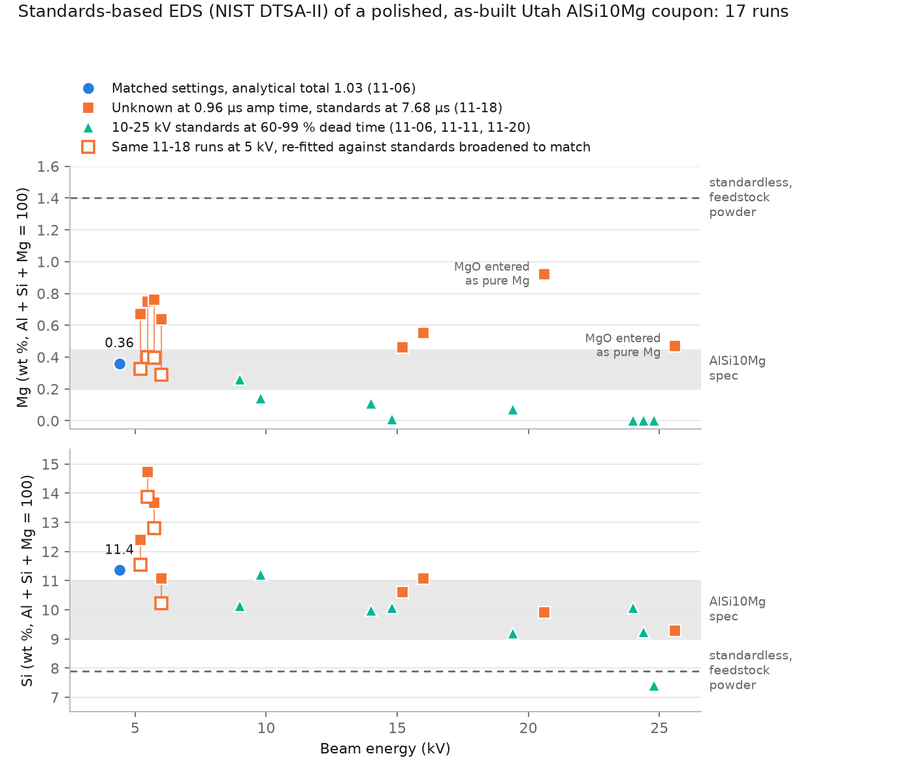

# Standards-based EDS of AlSi10Mg: a polished Utah coupon

Source threads: [caliber#35](https://github.com/vertical-cloud-lab/caliber/issues/35) (the
spectra and the DTSA-II results) and
[caliber#12](https://github.com/vertical-cloud-lab/caliber/issues/12#issuecomment-6803490926)
(the standards). Gathered on 2026-11-26.

This is the lab's first EDS quantified against measured standards rather than with the EDAX
software's standardless routine. **It is on a printed part, not on powder.**

The DTSA-II quantification was re-run from the raw spectra on 2026-11-26 and reproduces every
number the student reported ([DTSA-II re-run](#dtsa-ii-re-run)).

*Mg and Si from all 17 runs, renormalized without O, against the AlSi10Mg specification (grey)
and the standardless result for the feedstock powder (dashed). Only the blue run has nothing
wrong with it. Hollow squares are the four 5 kV runs from 11-18 re-fitted in DTSA-II against
standards broadened to their resolution ([below](#fixes-software-can-make)). The table view is
[`results.csv`](results.csv) and [`dtsa2-rerun/broadened.csv`](dtsa2-rerun/broadened.csv).*

## What was measured

- **Sample.** A polished section of one of the as-built AlSi10Mg tensile coupons printed at the
  University of Utah from the lab's commercial AlSi10Mg powder
  ([`../tensile-alsi10mg-utah/`](../tensile-alsi10mg-utah/), #138).
  - caliber calls it "our tensile sample"
    ([caliber#1](https://github.com/vertical-cloud-lab/caliber/issues/1#issuecomment-5574532841)),
    and the piece was cut on 2026-09-10
    ([photo](https://github.com/vertical-cloud-lab/caliber/issues/1#issuecomment-5622890558)).
    Which coupon it came from isn't recorded.
  - It was polished with the lab's SOP
    ([byu-vcl PR 258](https://github.com/vertical-cloud-lab/byu-vcl/pull/258), last step 0.1 µm
    diamond on the vibratory polisher) and left uncoated.
  - SE images of this surface from 2026-11-06 are in
    [byu-vcl PR 258](https://github.com/vertical-cloud-lab/byu-vcl/pull/258#issuecomment-6750386449).
- **Instrument.** BYU Apreo SEM with an EDAX Octane Plus detector, 34.8-35.4° take-off angle,
  4096 channels of 5 eV, exported from EDAX TEAM as `.msa`.
- **Standards.** Pure Al, pure Si and a cleaved MgO single crystal
  ([caliber PR 20](https://github.com/vertical-cloud-lab/caliber/pull/20)).
  - Each was measured at 5, 10, 15, 20 and 25 kV, about 1 million counts each, 3.2-4.1 nA.
  - Dates: MgO and Si on 2026-11-11, Al on 2026-11-13.
  - The student read each standard's dead time off the EDAX display: 25-32 % at 5 kV, 60-67 %
    at 10 kV and 79-99 % at 15-25 kV
    ([caliber#12](https://github.com/vertical-cloud-lab/caliber/issues/12#issuecomment-6865364302)).
- **Quantification.** The student used NIST DTSA-II ("Polaris 2026-10-07") with the XPP matrix
  correction.
  - Each unknown was fitted against standards taken at its own kV, for O, Mg, Al and Si (C was
    not included).
  - The results are in the DTSA-II reports
    [Sobol 1_6 with MgO.pdf](https://github.com/user-attachments/files/35006676/Sobol.1_6.with.MgO.pdf)
    (2026-11-17) and [Nov 20 2026.pdf](https://github.com/user-attachments/files/35182778/Nov.20.2026.pdf),
    and in [`dtsa2-results.csv`](dtsa2-results.csv).
  - [`dtsa2-rerun/`](dtsa2-rerun/) re-runs the same quantification from the raw spectra and
    gets the same numbers ([DTSA-II re-run](#dtsa-ii-re-run)).
- **Runs.** There are 17 spectra.
  - **Seed runs.** Six Sobol-design runs (`sobol_exp_1`-`6`, 2026-11-06 and 11-11) seed the
    CALIBER model.
  - **Model-chosen runs.** Trials 6 and 8-17 (11-18 and 11-20) were chosen by the model.
  - **Trial 7.** It has a current logged but no spectrum posted.

## Result

Only one run has nothing wrong with it: `sobol_exp_1_1`, at 5 kV, 6.04 nA and 332 s live time.
The standards and the unknown share the detector setting, the standards ran at low dead time,
and the analytical total is 1.033.

| | O | Mg | Al | Si | Analytical total |
|---|---|---|---|---|---|
| **`sobol_exp_1_1`, DTSA-II normalized** | 2.08 ± 0.11 | **0.35 ± 0.01** | 86.45 ± 0.16 | **11.12 ± 0.13** | 1.033 ± 0.002 |
| Same, renormalized without O | | 0.36 | 88.29 | 11.36 | |
| AlSi10Mg specification (EN AC-43000 / ASTM F3318) | | 0.20-0.45 | balance | 9.0-11.0 | |
| Standardless (TEAM eZAF), feedstock powder, normalized to metals ([`../sem-eds-feedstock/`](../sem-eds-feedstock/)) | | 1.4 | 90.8 | 7.9 | |
| Standardless (TEAM), the first polished section of a Utah coupon, 15 kV ([caliber PR 11](https://github.com/vertical-cloud-lab/caliber/pull/11#issuecomment-5374055623)) | | 1.64 | | | |

Values are wt %. The ± values are DTSA-II's 1σ, from counting statistics and the matrix
correction. They are not run-to-run scatter. They also leave out the detector resolution entered
in DTSA-II, which moves Mg by more: 0.32-0.35 wt % for the widths tried at or above the
detector's (128-145 eV at Mn Kα), and 0.44 at 120 eV ([check (c)](#checks-on-sobol_exp_1_1)).

- **Mg is inside the specification.** 0.35 wt % sits in the 0.20-0.45 % range, while the
  standardless numbers read about four times higher.
- **Si is at the top of the range.** 11.1 wt % (11.4 without O) is at or just above the 11.0 %
  limit. Standards-based EDS is usually good to a few percent relative, so this reading can't
  tell 10.8 from 11.4.
- **O is a surface film.** The 2.1 wt % O comes from the native oxide and the polishing film. At
  5 kV most X-rays come from the top few hundred nanometres.
- **The MgO standard was uncoated but did not charge.** Its Duane-Hunt limit at 5 kV is
  5.107 keV, not below the beam energy.
- **One run on one area.**
  - No other run repeats these settings.
  - The coupon has had no independent analysis yet (ICP or spark OES).
  - The unknown ran at about 40,000 counts per second, roughly twice the standards' rate. Its
    analytical total of 1.03 says that did no harm here.

## Why the other 16 runs don't count yet

| Problem | Runs | Effect |
|---|---|---|
| Standards for 10-25 kV taken at 60-99 % dead time | `sobol_exp_2`-`6`, trials 15-17; also trials 6, 9, 11, 14 | Analytical totals 0.91-1.41, and Mg falls with kV, to 0 at 25 kV. Diagnosed in [caliber#35](https://github.com/vertical-cloud-lab/caliber/issues/35#issuecomment-6930731960). Fix: re-collect those standards at about 20,000 counts per second |
| Unknown acquired at a 0.96 µs amp time, while every standard used 7.68 µs | trials 6 and 8-14 (all of 2026-11-18) | Al Kα is 90-92 eV wide, against 75.7 eV in the 5 kV Al standard and 76.5 eV in `sobol_exp_1_1`. At 5 kV, Mg reads 0.63-0.73 wt % (normalized) and the totals 0.88-0.91. Fix: take standards at 0.96 µs too, or acquire at 7.68 µs. Re-fitting against broadened standards gives Mg 0.28-0.38 and totals 1.03-1.07 at 5 kV ([below](#fixes-software-can-make)) |
| MgO standard entered as "Pure magnesium", DTSA-II's default | trials 11 and 14 | Mg about 2.5-2.8 times too high, the error found in [caliber#35](https://github.com/vertical-cloud-lab/caliber/issues/35#issuecomment-6930731960). Re-run with MgO: 0.91 → 0.37 (trial 11) and 0.47 → 0.17 wt % (trial 14). Both runs still have the other two problems |

**Checking the amp-time effect.** [`analyze_eds.py`](analyze_eds.py) fits the 5 kV spectra
against the 5 kV standards with a top-hat filter fit. That is the method DTSA-II uses, written
in about 20 lines here; it is not DTSA-II itself.

| 5 kV spectrum | Al Kα FWHM (eV) | Fitted Mg/Al, relative to `sobol_exp_1_1` |
|---|---|---|
| `sobol_exp_1_1`, as measured (7.68 µs) | 76.5 | 1.00 |
| `sobol_exp_1_1`, broadened as a 0.96 µs amp time would | 91.3 | 1.64 |
| trials 8, 10, 12, 13 (0.96 µs) | 90.3-90.9 | 1.55-1.79 |

Broadening the 11-06 spectrum, with nothing else changed, puts its Mg where the 11-18 runs are.
So the resolution mismatch alone is enough to explain their higher Mg. There is no sign that the
Mg content itself differs. DTSA-II's own fit says the same ([check (a)](#checks-on-sobol_exp_1_1)).

## DTSA-II re-run

The quantification was re-run on 2026-11-26 from the raw spectra, with no GUI, by
[`dtsa2-rerun/run.sh`](dtsa2-rerun/run.sh).

- **How.** DTSA-II is a GUI around NIST's [EPQ](https://github.com/usnistgov/EPQ) library.
  [`RerunDTSA2.java`](dtsa2-rerun/RerunDTSA2.java) calls EPQ's `QuantifyUsingStandards`, the
  class DTSA-II's quantification wizard uses. The settings are DTSA-II's defaults, the ones the
  student's reports list:
  - each standard serves as its own reference, with the variable-width filter fit;
  - matrix correction "XPP - Pouchou & Pichoir Simplified (Non-normal)";
  - MACs "SuperSet[NIST-Chantler 2005, Sabbatucci & Salvat MACs]";
  - an SDD with 128 eV FWHM at Mn Kα. That gives the same regions of interest as the student's
    reports: O 0.424-0.626, Mg 1.128-1.380, Al 1.354-1.658 and Si 1.600-1.945 keV.
- **Version.** EPQ's public source at `249dd3f` ("Polaris", 2026-09-10), built with JDK 26. The
  student ran the 2026-10-07 build of Polaris, whose source isn't on GitHub.
- **Running it.** `run.sh` takes about 30 s. It downloads JDK 26 and builds EPQ in a temporary
  directory, and needs git, curl, Maven and Python 3.
- **Outputs.** Each configuration writes a CSV (k-ratios, Z·A·F, raw and normalized wt %,
  regions of interest) and an HTML page with DTSA-II's own results table, the one in its
  reports:
  - `as-entered`, the student's entries;
  - `mgo`, the same with MgO entered as MgO everywhere;
  - `broadened`, the same, with the 0.96 µs runs fitted against broadened standards;
  - `checks/`, the checks below.

### It reproduces the student's numbers

With the student's entries, including MgO entered as pure Mg in trials 11 and 14, all 17 runs
come out within 0.005 wt % of the transcribed values, which is the rounding of the reports. The
analytical totals agree to the fourth decimal, except trial 8, whose transcribed total was summed
from rounded mass fractions and is 0.0001 higher
([`dtsa2-rerun/comparison.csv`](dtsa2-rerun/comparison.csv)). For `sobol_exp_1_1`, the k-ratios
(O 0.0504, Mg 0.0069, Al 0.8881, Si 0.1027) and the Z·A·F factors also match the report.

So [`dtsa2-results.csv`](dtsa2-results.csv) is transcribed right. Nothing outside the spectra and
the settings listed above went into the student's numbers.

One difference: this build leaves the standard's own counting statistics (`I[std]`) out of the
uncertainty of the un-normalized mass fractions. Only Al in `sobol_exp_1_1` shows it (±0.06
here, ±0.13 wt % in the report), along with the analytical total (±0.0020 against ±0.0023). The
uncertainties of the normalized values are the same.

### Fixes software can make

**MgO entered as MgO** in trials 11 and 14 (`mgo.csv`):

| Run | Mg, MgO entered as pure Mg (student) | Mg, MgO entered as MgO | Analytical total | Still wrong |
|---|---|---|---|---|
| trial 11, 20 kV | 0.91 | **0.37** | 1.117 | amp-time mismatch; 20 kV standards at 81-96 % dead time |
| trial 14, 25 kV | 0.47 | **0.17** | 1.197 | amp-time mismatch; 25 kV standards at 86-99 % dead time |

**Standards broadened to the 0.96 µs resolution** (`broadened.csv`). Under EPQ's line-width
model, FWHM(E)² = FWHM(Mn Kα)² + 2.45 eV × (E − 5899 eV). Going from 128 to 135.5 eV at Mn Kα
therefore adds the same Gaussian (44.5 eV FWHM) at every energy.
- **The 135.5 eV.** It is the resolution the EDAX header gives for a 0.96 µs amp time. Gaussian
  fits to the Al and Si Kα peaks give 133-138 eV in the 0.96 µs runs, and 126-130 eV in the
  7.68 µs spectra.
- **What the re-run changes.** It convolves the three standards with that Gaussian and enters
  the detector as 135.5 eV. Nothing else changes.

| 5 kV run, 0.96 µs | Native standards: total, Mg, Si | Broadened standards: total | O | Mg | Al | Si |
|---|---|---|---|---|---|---|
| trial 8 | 0.915, 0.65, 12.08 | 1.067 | 3.04 | **0.32** | 85.45 | 11.20 |
| trial 10 | 0.881, 0.72, 14.13 | 1.032 | 4.83 | **0.38** | 81.58 | 13.21 |
| trial 12 | 0.894, 0.73, 13.19 | 1.044 | 4.28 | **0.38** | 83.08 | 12.26 |
| trial 13 | 0.909, 0.63, 10.90 | 1.058 | 1.89 | **0.28** | 87.78 | 10.04 |
| `sobol_exp_1_1` (7.68 µs, native) | 1.033, 0.35, 11.12 | | | | | |

- **At 5 kV,** Mg falls to 0.28-0.38 wt % and the totals rise to 1.03-1.07. That puts these runs
  in line with `sobol_exp_1_1` and inside the specification.
- **Si varies from area to area.** Trials 10 and 12 also read the most O (4.3-4.8 wt %) and the
  most Si (12.3-13.2 wt %), so those areas differ from the others, whatever the reason.
- **At 15-25 kV broadening doesn't help.** Totals stay at 1.05-1.31, because those standards'
  dead time is still wrong.

### Checks on `sobol_exp_1_1`

| `sobol_exp_1_1`, 5 kV | Total | O | Mg | Al | Si |
|---|---|---|---|---|---|
| As measured, detector 128 eV | 1.033 | 2.08 | 0.35 | 86.45 | 11.12 |
| (a) Unknown broadened as a 0.96 µs amp time would, standards not | 0.893 | 1.74 | 0.64 | 85.61 | 12.01 |
| (b) Unknown and standards both broadened, detector 135.5 eV | 1.036 | 2.11 | 0.27 | 86.54 | 11.08 |
| (c) As measured, detector entered as 120 eV | 1.029 | 1.94 | 0.44 | 86.38 | 11.25 |
| (c) As measured, detector 135.5 eV | 1.037 | 2.10 | 0.32 | 86.47 | 11.11 |
| (c) As measured, detector 145 eV | 1.040 | 2.13 | 0.34 | 86.41 | 11.12 |

- **(a) DTSA-II confirms the amp-time diagnosis.** Broadening the clean run alone reproduces the
  11-18 pattern: Mg 0.64 against their 0.63-0.73, and a total of 0.89 against 0.88-0.91. The
  top-hat check above uses code written for this folder; this one uses DTSA-II's own fit.
- **(b) The broadened-standards fix reads Mg low.** It recovers the total, O and Si, but gives Mg
  0.27 instead of 0.35. If the 0.96 µs runs above are low by the same 0.08 wt %, their Mg is
  0.36-0.46. Either way they agree with `sobol_exp_1_1` and sit in or near the 0.20-0.45 %
  specification. This is still no substitute for standards collected at 0.96 µs.
- **(c) The detector resolution entered in DTSA-II moves Mg by up to 0.09 wt %.** Si and the
  total barely move.
  - **Too narrow.** 120 eV, narrower than the detector, gives 0.44, because the regions of
    interest then cut into the peaks.
  - **At or above the detector's.** Widths of 128 eV and up give 0.32-0.35.
  - **The right value is 128 eV.** The EDAX header gives 127.9, and peak fits give 126-130.
  - **Uncertainty.** DTSA-II's ±0.01 on Mg is counting statistics only, so the real uncertainty
    on Mg is several times larger.

## What this means for the feedstock numbers

**It supports the artifact reading, but doesn't test the powder.**
- **The earlier claim.** The standardless EDS of the feedstock powder gave Mg 1.4 and Si
  7.9 wt % (normalized to metals), outside the specification.
  [`../sem-eds-feedstock/`](../sem-eds-feedstock/) attributes that to the standardless method.
- **What standards add.** With standards, a part printed from the lab's commercial AlSi10Mg
  powder comes out at Mg 0.35 and Si 11.1-11.4 wt %.
- **Why it isn't a powder measurement.** Laser melting can evaporate some Mg, and no
  standards-based EDS of any powder (feedstock or atomized) exists yet.
- **What would settle it.** The supplier's certificate, or ICP of the powder.

## On GitHub but not used here

- **The 2026-04-30 fracture-surface spectrum.** This was a spectrum of a broken coupon's
  fracture surface (#138). It was re-quantified in DTSA-II on 2026-11-16
  ([caliber#35](https://github.com/vertical-cloud-lab/caliber/issues/35#issuecomment-6929087563))
  and gave Mg 0.91 wt %, but it can't be used:
  - MgO was entered as pure Mg.
  - The current was a guess (3.2 nA), and the analytical total is 0.336.
  - The surface is a rough fracture face at 24 mm working distance and a 48.8° take-off angle,
    unlike the standards.
- **The DTSA-II reports.** They are linked above, not copied. They are prints of DTSA-II's
  HTML report and carry the student's local file paths. The 2026-11-18 report
  ([Trials from Nov 18 2026.pdf](https://github.com/user-attachments/files/35052215/Trials.from.Nov.18.2026.pdf))
  is cut off at exactly 4 MiB on GitHub and doesn't open. Trials 9-14 therefore come from the
  screenshots in caliber#35 and from pages 10-16 of the 11-20 report, which repeats them.

## Files

| File | What it is |
|---|---|
| `raw/unknowns/*.msa` | The 17 spectra of the coupon, unmodified. The `sobol_exp_*` files are the "with current" versions from caliber#35, which add a `#PROBECUR` line to the originals |
| `raw/standards/*.msa` | The 15 standard spectra, unmodified but renamed; [`raw/FILES.md`](raw/FILES.md) gives the original names |
| `raw/SHA256SUMS` | Checksums of all 32 spectra |
| [`dtsa2-results.csv`](dtsa2-results.csv) | DTSA-II's results, transcribed from the reports and screenshots, with the source of each row. The re-run reproduces every row |
| [`results.csv`](results.csv) | Written by `analyze_eds.py`: settings read from each spectrum (kV, current, live time, counts, amp time, Al Kα width), DTSA-II's numbers, the composition without O, and each run's problems |
| [`analyze_eds.py`](analyze_eds.py) | Builds `results.csv` and the figure and runs the amp-time check (numpy, matplotlib). The figure's hollow squares come from `dtsa2-rerun/broadened.csv` |
| `composition-by-run.png` | The figure above |
| [`dtsa2-rerun/run.sh`](dtsa2-rerun/run.sh) | Builds NIST EPQ at `249dd3f` with JDK 26 and runs every configuration below, then `compare.py` |
| [`dtsa2-rerun/RerunDTSA2.java`](dtsa2-rerun/RerunDTSA2.java) | Drives EPQ's `QuantifyUsingStandards` the way DTSA-II's quantification wizard does |
| [`dtsa2-rerun/compare.py`](dtsa2-rerun/compare.py) | Compares the re-run with `dtsa2-results.csv` (writes `comparison.csv`) and prints the tables in this README |
| `dtsa2-rerun/as-entered.*`, `mgo.*`, `broadened.*` | The re-run with the student's entries, with MgO entered as MgO, and with broadened standards for the 0.96 µs runs. `.csv` has one row per run (k-ratios, Z·A·F, raw and normalized wt %, regions of interest); `.html` is DTSA-II's results table |
| `dtsa2-rerun/checks/` | Checks (a)-(c) on `sobol_exp_1_1` |
