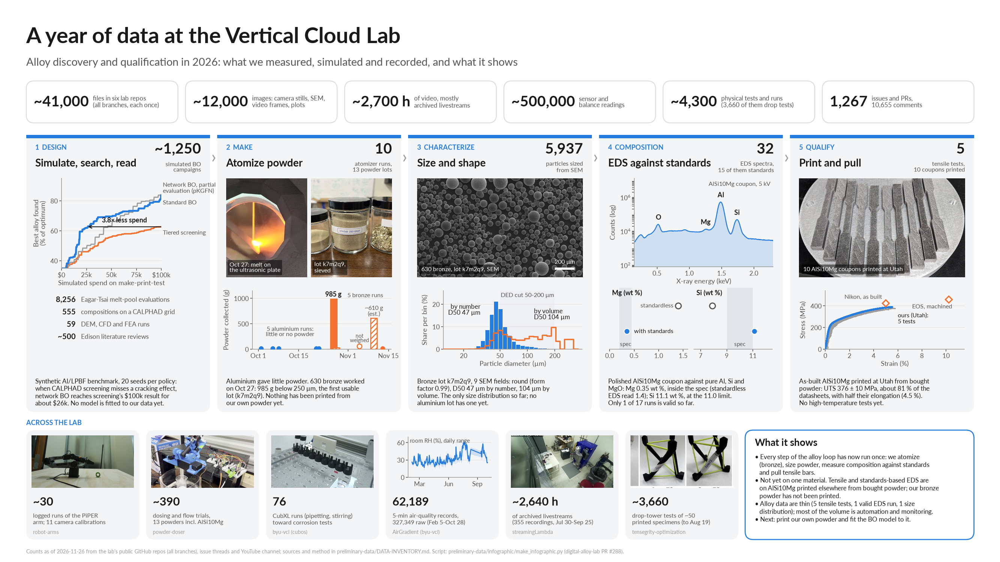

# Infographic: the lab's first year of data

One 16:9 slide (13.33 × 7.5 in) on what the Vertical Cloud Lab has measured, simulated and
recorded in 2026, built around alloy discovery and qualification. Asked for on
[PR #288](https://github.com/vertical-cloud-lab/digital-alloy-lab/pull/288) on 2026-11-26.



[`infographic.pdf`](infographic.pdf) is the same slide as vector PDF, for dropping into a deck.

## What is on it

- **Top row:** lab-wide totals. Each is sourced in [`../DATA-INVENTORY.md`](../DATA-INVENTORY.md).
- **Five columns,** one per step of the alloy loop, each with representative data and a caption
  on what it shows:
  1. **Design:** best alloy found against spend in the synthetic Al/LPBF benchmark at κ = 1,
     mean of 20 seeds per policy ([#122](https://github.com/vertical-cloud-lab/digital-alloy-lab/pull/122)).
     The arrow marks where pKGFN first reaches tiered screening's \$100k level (\$26.5k, 3.8×).
  2. **Make:** the Oct 27 viewport frame and the sieved jars of lot k7m2q9, and the powder
     collected in each of the 10 atomizer runs. Hatched bars are operator estimates, and the
     solid bar was weighed ([#286](https://github.com/vertical-cloud-lab/digital-alloy-lab/pull/286)).
  3. **Characterize:** SEM of k7m2q9 at 200× and its size distribution by number (bars) and by
     volume (line), from 5,937 particles ([#226](https://github.com/vertical-cloud-lab/digital-alloy-lab/pull/226)).
  4. **Composition:** the raw 5 kV spectrum of `sobol_exp_1_1` (log counts) and its Mg and Si
     against the AlSi10Mg specification. The filled dot is the standards-based result with
     ±2σ counting error, the hollow dot the standardless feedstock reading
     ([`../eds-standards-alsi10mg-utah/`](../eds-standards-alsi10mg-utah/)).
  5. **Qualify:** the Utah coupons and their stress-strain curves (test 5 in blue, test 4 dashed
     for its grip break), against EOS's machined and Nikon's as-built datasheet points
     ([`../tensile-alsi10mg-utah/`](../tensile-alsi10mg-utah/)).
- **Bottom band:** the rest of the lab (robot arms, powder doser, CubXL, air quality,
  livestreams, tensegrity) and a short "what it shows".

## Rebuild

```bash
pip install matplotlib numpy pandas pillow   # the Lato font is used if installed
python prepare_data.py     # optional: rebuilds data/ from the pinned commits (needs git fetch)
python make_infographic.py # writes infographic.png and infographic.pdf
```

The tensile curves and the EDS spectrum are read from the raw files in the sibling folders.
`make_infographic.py` holds the counts and captions as plain text near the bottom, so a number
can be updated there and the slide rebuilt.

## Sources of `data/` and `img/`

| File | From |
|---|---|
| `data/atomizer_runs.csv` | Hand-copied from `atomizer-runs/runs.csv` on #286's branch (`e7fb052`). `powder_g` is the weighed mass on Oct 27 (984.6 g below 250 µm), and estimates of 3 % of 858 g on Oct 28 and 75 % of 816 g on Nov 10. It is blank where the powder wasn't weighed |
| `data/k7m2q9_particles.csv` | The 5,937 counted particles of `particles.csv`, #226 (`8dbae74`) |
| `data/bofn_k1_best_vs_spend.csv` | `prepare_data.py`: best validated alloy against spend, mean and standard error over 20 seeds, normalised by the κ = 1 optimum of 0.694, from `benchmarks/bofn-paper/results/k1/` on #122 (`8401bbe`) |
| `data/airgradient_cb154_daily.csv` | `prepare_data.py`: daily mean, minimum and maximum of CB 154's corrected readings, Feb 5 - Oct 3, from #192 (`253763d`) and #188 (`c25f602`) |
| `img/atomizer-2026-10-27-viewport-spray.jpg` | `atomizer-runs/2026-10-28/frames/oct27-viewport-spray-at-plate-tip.jpg`, #230 (`8732329`) |
| `img/k7m2q9-sieved-jars.jpg` | byu-vcl `vertical-lab/out/footage/nab_k7m2q9_sieved_three_jars.jpg` (`cc31ddc`) |
| `img/cubxl-deck-2026-09-17.jpg` | byu-vcl `cubos/results/pipette_test_20260917/frames/02_z_down__cam1.jpg` (`b69612f`) |
| `img/room-stream-2026-10-01.jpg` | byu-vcl `docs/images/stream-cam-picam-ot2-720p-2026-10-01.jpg` (`b69612f`) |
| `img/powder-doser-mid-dose.jpg` | powder-doser `docs/figures/real-doser/alt-test-rig-mid-dose.jpg` (`b2d72ce`) |
| `img/robot-arms-piper-2026-10-15.jpg` | robot-arms `docs/issue-19/stage3/camera_2026-10-15.jpg` (`e258e11`) |
| `img/tensegrity-specimens.jpg` | tensegrity-optimization `docs/static/images/fig5_replicate_specimens.jpg` (`0e95d42`) |

Images were downscaled to at most 1,000 px and their metadata removed. None shows a person.

## Caveats

- **The benchmark is synthetic.** Its truth model is literature-based, and no model has been
  fitted to the lab's own measurements yet.
- **The bottom-band counts are partial.** They stop where the data stops being visible on
  GitHub: AirGradient after Oct 28, livestreams after Sep 25 and drop tests after Aug 19.
  Photos on the camera Pis weren't counted, because the Pis were offline. MongoDB counts are
  estimates, since this repo has no credentials for it.
- **The tensile and EDS-standards data are on AlSi10Mg printed at Utah from bought powder.**
  The lab's own powder (bronze) has been sized and imaged but not printed.
